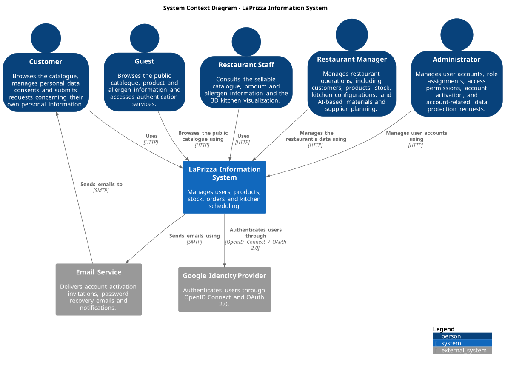
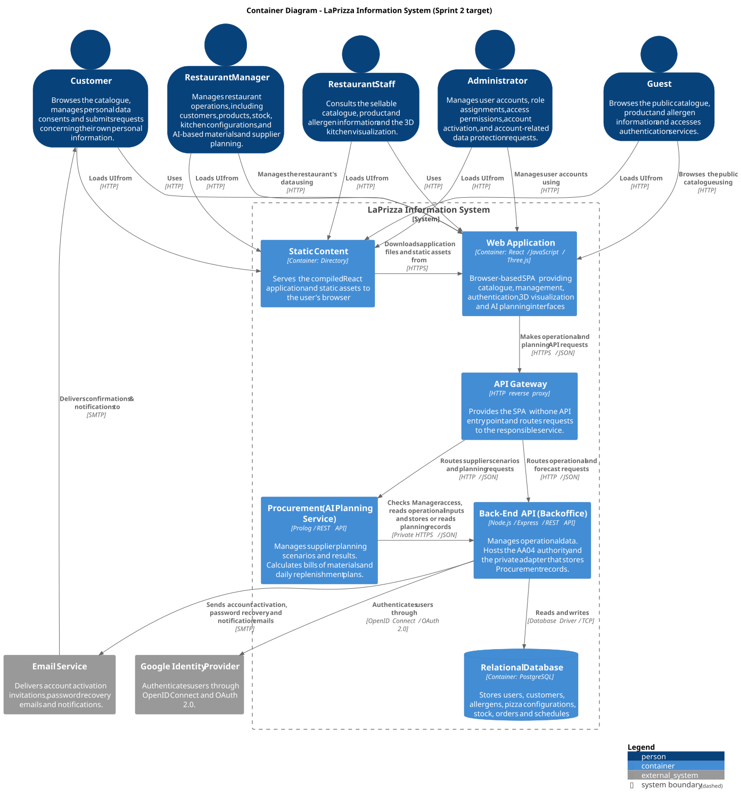
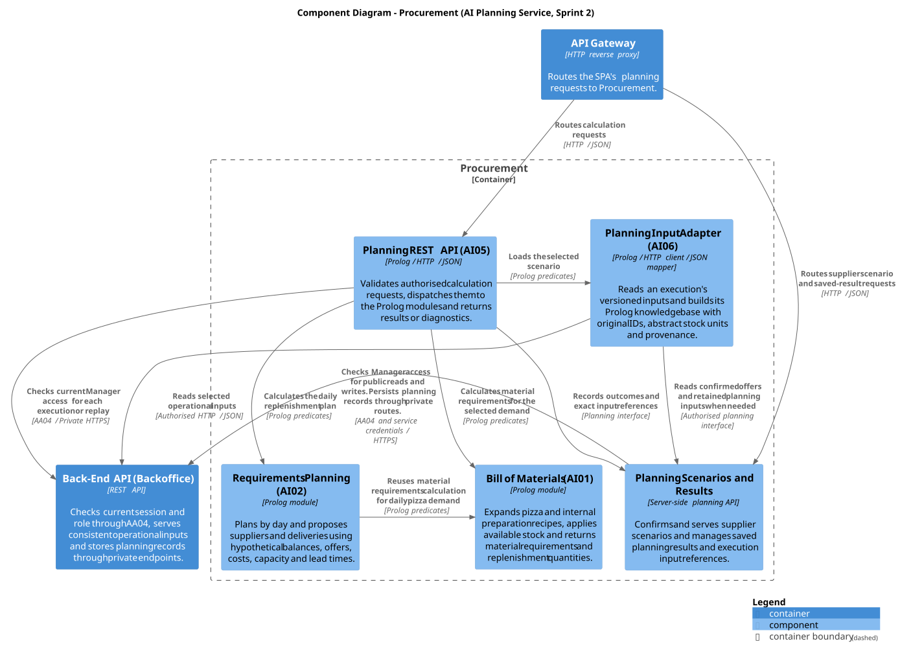
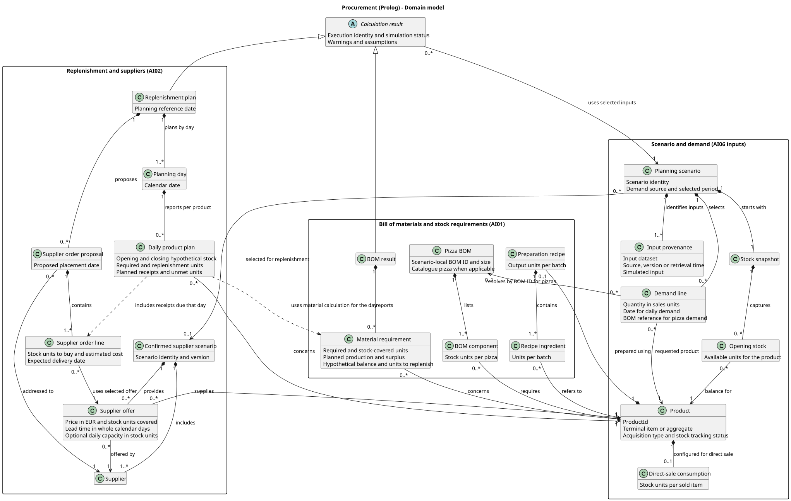
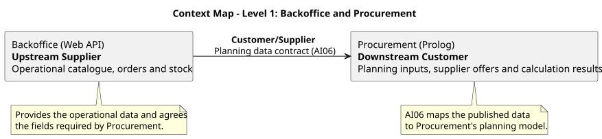
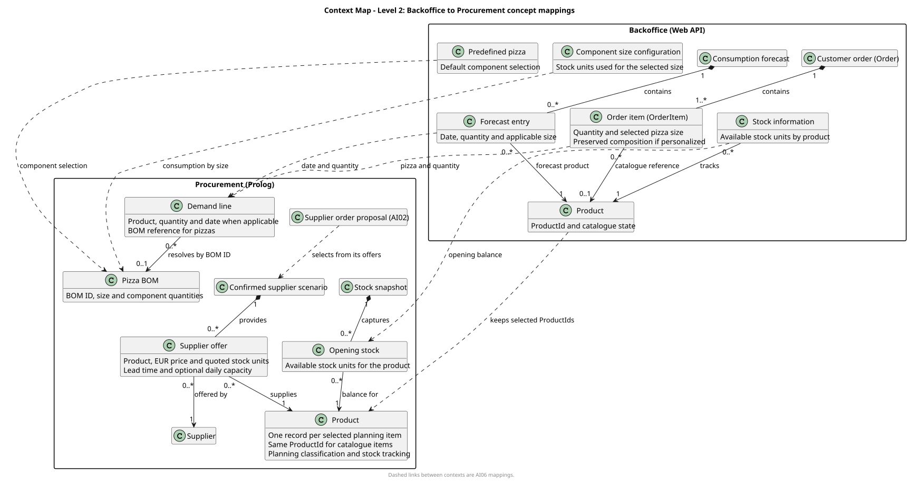

# LaPrizza - Information System

Repository for **LaPrizza**, a modern pizza restaurant information system developed as an Integrative Project for the 5th semester of the Bachelor’s Degree in Informatics Engineering (LEI) at ISEP (2026/2027).

 *

# Software Architecture Document (SAD)

## 1. Problem Statement

**LaPrizza** is a modern pizza restaurant seeking to modernize and optimize its operational and business management processes. Modern restaurant operations face complex challenges, including:

*   **Product & Customization Complexity:** Managing dynamic menus, predefined pizzas, and highly customizable pizzas (sizes, doughs, sauces, toppings) with specific pricing rules and stock dependencies.
*   **Health & Safety Constraints:** Strictly tracking allergens and customer dietary restrictions (intolerances) to ensure customer safety.
*   **Operational Efficiency & Kitchen Bottlenecks:** Coordinating order fulfillment, managing limited kitchen resources (e.g., ovens, assembly stations), and optimizing preparation schedules.
*   **Seamless User Experience:** Providing real-time menu management, multi-role access control, and intuitive interactions (including future 3D visualization for pizza customization and AI-driven kitchen scheduling).

 *

## 2. System Context & Overview

This project serves as a proof-of-concept prototype submitted in response to a Request for Proposal (RFP) by LaPrizza. The overall solution is structured around four major technological pillars across three development sprints:

1. Web Application: Main interface for identity/access management, customer profiles, product catalog, stock control, and order fulfillment.
2. 3D Visualization & Interaction: WebGL/Three.js module allowing interactive 3D pizza customization (“Build Your Pizza”) and dynamic 3D kitchen preparation monitoring.
3. Artificial Intelligence (AI): Prolog-based intelligent scheduling for kitchen operations, optimizing resource allocation and minimizing customer wait times.
4. Systems Administration & Infrastructure: Automated deployment, containerization, security, logging, and disaster recovery.

### 2.1 Sprint 1 Scope

Sprint 1 establishes the foundational architecture and back-end domain core:

*   **Domain Modeling:** Core domain entities (Customers, Products, Categories, Allergens, Pizza Sizes, Component Types, Component Configurations, Stock, Predefined Pizzas, …).
*   **Architecture Foundations:** Layered/Clean Architecture, REST API definition, persistence integrity, and automated unit/integration testing.
*   **Security & RBAC:** User authentication and Role-Based Access Control (RBAC).

 *

### 2.2 System Context Diagram (C4 Level 1)

The System Context Diagram shows LaPrizza as a single system and the external actors and systems interacting with it.



#### Stakeholders and Actors

| Actor | Responsibilities |
| :--- | :--- |
| **Guest** | Unauthenticated visitor (not a stored role). Browses the public catalogue, product/allergen information and the privacy notice, and reaches the local and external authentication entry points. |
| **Customer** (`CUSTOMER`) | Registers an account, manages their profile and dietary restrictions, browses the catalogue, customizes pizzas and places orders. Every new account receives this role automatically (AA03). |
| **Restaurant Manager** (`MANAGER`) | Manages customers, product categories, allergens, products, pizza sizes, component types, stock information, predefined pizzas, kitchen configurations and planning. |
| **Restaurant Staff** (`EMPLOYEE`) | Handles incoming customer orders, tracks order preparation states, consults the sellable catalogue and the kitchen viewer. |
| **Administrator** (`ADMINISTRATOR`) | Manages website user accounts, activation invitations, roles and access permissions (Sprint 2, AA06); access to restaurant management requires an additional role. |

A user account holds `0..*` of these website roles (Guest excluded) and receives the union of their permissions. Roles are always resolved internally by the back end from the stored account, never from the authentication method or from data supplied by the client (AA03).

#### External Systems

| External System | Purpose |  
| :— | :— | :— |  
| **Email Service** | Sends transactional emails (account registration, order confirmations) and marketing communications. |

 *

### 2.3 Container Diagram (C4 Level 2)

In the Sprint 2 design, the SPA sends API requests through the Gateway. Backoffice handles operational and forecast requests. Procurement handles supplier scenarios, calculations, replays and results. Procurement asks Backoffice to verify current Manager access for each protected planning request. [Planning access and records](#27-planning-access-and-records)



[PlantUML source](./containerDiagram/containerDiagram.puml)

#### System Containers

| Container | Technology | Responsibilities |
| :--- | :--- | :--- |
| **Static Content** | Directory | Serves the compiled React application and static assets to the user’s browser. |
| **Front-End** | React, JavaScript, Three.js | Single-page application for customers (registration, profile and dietary restrictions, ordering, 3D ‘Build Your Pizza’ customization) and for staff and managers (catalogue, stock, order handling, 3D kitchen preparation monitoring). |
| **API Gateway** | HTTP reverse proxy | Routes SPA requests to Backoffice or Procurement. |
| **Back-End API (Backoffice)** | Node.js / Express / JavaScript, REST API | Enforces operational rules and RBAC and manages the catalogue, forecasts, customer orders and stock. |
| **Relational Database** | PostgreSQL | Single database of the system ([ADR-010](ADR.md#adr-010-use-postgresql-as-the-single-database)). Stores users, customers, product catalogue, allergens, pizza configurations, stock, orders and schedules, and the 3D data: kitchen configurations (layout as validated `JSONB`, one active at a time) and the kitchen asset catalogue (model and texture metadata). Model and texture files are not stored in the database; they are deployed with the Back-End API and served read-only. |
| **Procurement (AI Planning Service)** | Prolog / REST API | Owns supplier planning scenarios and planning results. Uses AI06 to obtain the selected operational inputs and exposes BOM and replenishment calculations through AI05. |

#### Communication

| Source | Target | Protocol | Purpose |
| :--- | :--- | :--- | :--- |
| Customer, Restaurant Manager, Restaurant Staff | Static Content | HTTPS | Load the UI. |
| Customer, Restaurant Manager, Restaurant Staff | Front-End | HTTPS | Use the application. |
| Static Content | Front-End | — | Delivers the compiled application. |
| Front-End | API Gateway | HTTPS / JSON | Sends operational and planning API requests through one entry point. |
| API Gateway | Back-End API (Backoffice) | HTTP / JSON | Routes catalogue, forecast and other Backoffice requests. |
| API Gateway | Procurement | HTTP / JSON | Routes supplier-scenario requests, executions and result queries. |
| Back-End API | Relational Database | Database Driver / TCP | Reads and writes operational records and stores Procurement records through its private persistence adapter. |
| Procurement | Back-End API (Backoffice) | HTTPS / JSON | Checks current Manager access, reads selected operational inputs through AI06 and uses the private planning records API. |
| Back-End API | Email Service | SMTP | Sends email requests. |
| Email Service | Customer | SMTP | Delivers confirmations and notifications. |

#### Architectural Boundaries

*   **Domain ownership.** Backoffice owns real stock and operational purchase orders. Procurement owns supplier scenarios and planning results.
*   **Single relational persistence ([ADR-010](ADR.md#adr-010-use-postgresql-as-the-single-database), supersedes ADR-005):** all persistent data – business data (product catalogue, allergens, sizes, stock, users, orders and schedules) and 3D data (kitchen configurations and the kitchen asset catalogue) – lives in one PostgreSQL database, accessed exclusively through the Back-End API, so ACID transactions, constraints and foreign keys (ARC04) also cover the 3D data. Values that are queried or constrained are normal columns; document-like 3D content that is always read and replaced as a whole and has a versioned format (e.g. the WEB06 kitchen layout) is a `JSONB` column validated by the back end before it is written. Cross-row invariants use transactions and constraints (e.g. a partial unique index for the single active kitchen configuration). Model and texture files live outside the database; only their metadata is stored, and their presence is checked by the back end. One database also means one migration, backup and restore procedure (SYS01, SYS07, SYS08).
*   **Planning data.** Procurement owns supplier scenarios, executions, input snapshots and results. The Backoffice persistence adapter stores them in the shared PostgreSQL database through private endpoints. Prolog uses a fresh working set for each calculation.
*   **Client-side 3D rendering:** Three.js is integrated directly into the Front-End as a presentation-layer library. The SPA reaches the Backoffice REST API through the Gateway for 3D data.

### 2.4 Procurement Component Diagram (C4 Level 3)

The Gateway sends calculation requests to AI05 and requests for supplier scenarios or saved results to the planning API. AI01 calculates material needs from pizza BOMs. AI02 uses that calculation to plan daily replenishment and select suppliers.

AI06 reads catalogue, order or forecast and stock data from Backoffice. It reads confirmed offers from Procurement when needed and maps the inputs to Prolog. Procurement saves results with the input versions used.

The Procurement APIs check the current Manager session through Backoffice before accessing planning data. Procurement's planning records component uses the private persistence adapter for the reads and writes below. [Planning access and records](#27-planning-access-and-records)



[PlantUML source](./componentDiagram/aiPlanningComponentDiagram.puml) · [Procurement domain model](#25-procurement-domain-model) · [WEB07 forecast workflow](../user_stories/web/web07/usWEB07.md)

### 2.5 Procurement Domain Model

AI01 and AI02 use the same Procurement domain model. AI06 supplies each calculation with the inputs for the selected scenario. The [Context Map](#26-procurement-context-map-ddd) shows how Backoffice data maps to that model.



[Domain model source](./domainModel/procurement/procurement_domain_model.puml) · [Backoffice boundary source](./domainModel/procurement/backoffice_procurement_domain.puml) · [AI01 design and worked scenarios](../user_stories/ai/ai01/usAI01.md) · [WEB07 forecast and supplier scenarios](../user_stories/web/web07/usWEB07.md)

| Scope | Domain rules |
| --- | --- |
| Scenario and stock | A scenario identifies the selected demand, stock snapshot, BOM definitions and applicable supplier data by source and version or retrieval time. A fresh run uses current stock unless a simulated stock source is selected. A historical replay uses the inputs of the original execution. Any simulated input labels the result as a simulation. |
| Demand | Forecast lines identify the product, daily quantity and size when applicable. A selected order can also supply pizza demand to an AI01 scenario. The customer order records what the customer requested, such as five medium pizzas. Directly sold stock-controlled items enter AI02 with an explicitly configured consumption factor. |
| AI01 material requirements | A pizza BOM expresses consumption for one size. Existing aggregate stock covers demand first. A remaining requirement for an internally produced aggregate uses the preparation recipe and its yield. Remaining requirements for raw materials and purchased aggregates go to replenishment. |
| AI02 daily plan | A replenishment plan has a reference date and one or more planning days. It reports one line per relevant product and day with requirements, expected receipts, hypothetical opening and closing stock and unmet units. The calculation carries feasible balances and deliveries forward between days and reports late deliveries or shortages. |
| AI02 offers and supplier proposals | A replenishment plan uses a confirmed supplier scenario. Each offer links a supplier to a product and defines the EUR price for a stock-unit quantity, lead time in whole calendar days and optional daily capacity for that offer. A proposed order is addressed to one supplier. Every line uses an offer from that supplier and records the quantity, estimated cost and expected delivery date. Order dates start at the reference date or later, and requirements are due at the start of their day. When a missing capacity limit affects a proposed order, the plan records the assumption that the offer is unconstrained for calculation. |
| Operational orders | Supplier order proposals are planning results for consultation in Sprint 2. Backoffice owns operational stock and purchase-order records. Registering a real purchase order requires a separate, explicitly confirmed operation validated by Backoffice. |

AI05 provides service access to the calculations and returns diagnostics when required inputs are invalid or missing. AI06 maps the selected data to the scenario, and the two calculation results keep the scenario reference for traceability. AI03 provides the neural-network study and AI04 documents the work and evidence.

### 2.6 Procurement Context Map (DDD)

#### Level 1 – Relationship between the bounded contexts



[PlantUML source](./domainModel/procurement/procurement_context_map.puml)

**Customer/Supplier** describes how the teams agree on the data AI06 needs. Backoffice is the **upstream Supplier** because it owns the operational data. Procurement is the **downstream Customer** because its needs shape the API, for example by requiring the selected pizza size and the consumption per component. **Conformist** would mean adopting the Backoffice model as-is. AI06 maps the data to Procurement's own model. [Eric Evans, DDD Reference, pp. 29 and 32–34](https://www.domainlanguage.com/wp-content/uploads/2016/05/DDD_Reference_2015-03.pdf)

On this map, *Supplier* is the context that provides data. In Procurement, a `Supplier` is a business that sells products to the restaurant. The [C4 container view](#23-container-diagram-c4-level-2) shows the Gateway routing.

#### Level 2 – Mapping between the domain models



[PlantUML source](./domainModel/procurement/backoffice_procurement_domain.puml) · [Glossary for the Level 2 concepts](./glossary/glossary.md#context-map-level-2)

| Backoffice source | Procurement concept | Mapping and rationale |
| --- | --- | --- |
| `Product` | `Product` | For the selected items, Backoffice's `id` becomes Procurement's `productId` with the same value. Demand, stock and offers can then refer to the same product. Backoffice keeps its catalogue record. Procurement keeps the information it needs for this calculation. |
| `OrderItem` | `Demand line` | Take the pizza quantity from the selected order line. Use its recorded size and composition to choose the `bomId`. Customer details stay in Backoffice. An order-based run uses only the selected order. |
| `ForecastEntry` | `Demand line` | Take each entry from the selected forecast version. Keep the product, quantity, applicable size and date. AI01 uses the pizza entries for a BOM run. AI02 needs the dates and the stock consumption per sale for any directly sold, stock-controlled products. |
| `PredefinedPizza` | `Pizza BOM` | Use the catalogue pizza's default components for the selected size. For a personalised order, use the components recorded on its order line. Different sizes or compositions get distinct `bomId` values in that scenario, even when the catalogue pizza ID is the same. |
| `ComponentSizeConfiguration` | `Pizza BOM` | Look up each component by `productId` and `sizeId`. Use `stockUnitsConsumed` and apply any explicit component multiplicity once. An explicit zero is valid. An explicitly untracked component has null consumption. A missing size configuration or missing consumption for a tracked component is an input error. |
| `StockInformation` | `Opening stock` in a `Stock snapshot` | Match the stock record by `ProductId` and use `availableUnits` in that product's stock units. Read one opening balance for each selected tracked stock item from the chosen snapshot. Keep a balance of zero as zero. An explicitly untracked product has no opening balance, and a missing balance for a tracked product is an error. |

##### Which products are loaded?

Procurement loads only the products referenced by the selected scenario. A product in the catalogue, in current stock or in a supplier offer does not enter a run on that basis alone.

1. Start with the pizza lines in the selected order or forecast. Check the catalogue product and size when applicable. Keep the catalogue pizza's ID on its BOM when it has one. The AI01 calculation uses the opening stock of the components and preparations. Stock of finished pizzas is outside the current calculation.
2. Add the components of the selected BOMs. For an internally produced aggregate, also add the ingredients of its recipe and follow any further internal recipes. Load those definitions even if there is enough aggregate stock. AI01 validates the reachable recipes first, then uses the aggregate stock and calculates ingredient demand only for any uncovered quantity. A purchased aggregate is the item to replenish, so its descriptive composition adds no products.
3. For AI02, include directly sold products from the selected daily forecast. A tracked drink, for example, needs its explicit stock units per sale and its opening balance. A product referenced by a zero-quantity entry still needs a valid reference. That entry adds zero demand.
4. Keep one planning record per stock or consumption item in the scenario, identified by `ProductId`. The same cheese can appear in several pizzas and still has one plan item and one opening balance. Keep the item type, the production or purchase classification where applicable, and whether stock is tracked. A simulated item uses its fixture ID consistently across its recipes and stock.

An unknown product, size or recipe ingredient makes the relevant input invalid. A first forecast run also checks that its products and sizes are still active. A replay uses the original product selection, definitions, stock and offers recorded for the run. Each selected input keeps its source and version or retrieval time.

For example, an order for five medium pizzas with a dough base, cheese and ham needs those three products. If the base is made in-house, its recipe can also bring in flour and water. The calculation needs those recipe references for validation even if the base is fully covered by stock. A stock-controlled drink from the catalogue enters an AI02 run when it is part of the selected forecast.

##### Which supplier offers are loaded?

The WEB07 product export lists items that can be used to build a supplier scenario. Each calculation still uses the products selected by its own inputs. When WEB07 confirms a supplier scenario, Procurement checks the product IDs against Backoffice.

AI02 uses offers from the selected confirmed version for products it may need to buy. An offer for an unrelated product adds no demand. If a relevant product has no offer, keep it in the plan so AI02 can report any shortage. AI06 records the source and version of the offers. AI01 uses the selected demand, recipes and stock for its BOM calculation.

### 2.7 Planning access and records

#### Manager access

The Gateway forwards the Manager's access bearer to Procurement for execution, replay, result reads and supplier scenario operations. On each request, Procurement passes that bearer to `GET /api/v1/internal/planning-access` on the Backoffice service network. This endpoint reuses AA04's `AuthMiddleware` and `resolveActor` to check the token, the server-side session and the current account and roles. It then applies `requireRole('MANAGER')`. A successful check returns only the actor ID. Procurement applies the requested record's access rules before it reads or writes planning data.

A revoked or expired session returns `401`. A valid session whose user no longer has `MANAGER` returns `403`. If the authority cannot be reached, the request fails before protected data is released or work starts. The check runs again for a retry or result read. Access checks and protected planning responses use `Cache-Control: no-store`. The Manager bearer is not stored with the execution or passed to AI06. [AA04 protected operations](../user_stories/aa/aa04/AA04.md#protected-operations)

AI06 uses a server-configured Bearer credential over HTTPS. Its scopes are `planning:operational:read`, `planning:inputs:read` and `planning:supplier-offers:read` for the relevant APIs. Procurement's records component has a separate credential with `planning:records:read` and `planning:records:write`. It seals snapshots on AI06's behalf through the local planning records interface. These permissions cover planning records only. The service and records endpoints stay private.

#### Read and write paths

The Gateway routes forecast reads and edits to Backoffice. Procurement validates and confirms supplier scenarios, authorises executions and replays, and publishes results. It uses the following private Backoffice operations under `/api/v1/internal/planning-records`. Backoffice checks service permissions and enforces storage constraints. Procurement applies the planning rules.

| Record | Write by Procurement records component | Read by Procurement records component |
| --- | --- | --- |
| Confirmed supplier scenario version | `PUT /supplier-scenarios/{scenarioId}/versions/{version}` after Procurement validates the import. Store the version once. | `GET /supplier-scenarios/{scenarioId}/versions/{version}` for scenario consultation or to supply AI06 with the selected offers. |
| Execution and selection | `PUT /executions/{executionId}` to reserve the ID supplied by WEB07, fix the requesting actor and selection, and claim an attempt if eligible. | `GET /executions/{executionId}` to find the selection, snapshot reference and execution state. |
| Input snapshot | `PUT /executions/{executionId}/inputs` with `attemptNo` to bind the first complete snapshot or bind a replay to its original snapshot. The adapter stores and links the snapshot in one transaction and returns the already bound snapshot on a repeated write. Only the current unexpired attempt can make the first binding. | `GET /executions/{executionId}/inputs` to recover the stored set for an internal input read or replay. |
| Outcome | `PUT /executions/{executionId}/result` with `attemptNo` to record the result with its snapshot reference or record a failure. Return the stored state after applying the completion rule. | `GET /executions/{executionId}/result` to serve the saved result or status after a fresh Manager check in Procurement. |

Procurement checks access before attempting to reserve or read an execution. The Backoffice adapter serializes attempt claims, snapshot bindings and completions by locking the execution row in a PostgreSQL transaction. The execution ID has a uniqueness constraint. Submitting the same ID again for the same actor and selection returns the current state while an attempt is active or the execution is completed. A changed selection for the same authorised ID returns `409`.

- **Claim.** The first claim assigns `attemptNo = 1`, sets `RUNNING` and records an expiry using the Backoffice clock. A retry after a retryable `FAILED` state or an expired `RUNNING` attempt increments `attemptNo` and sets a new expiry. A retry keeps the same execution ID, selection and any sealed snapshot. The attempt window covers the configured time limits for loading inputs, calculating and saving the outcome.
- **Complete.** Only a write for the current unexpired `attemptNo` in `RUNNING` can change the outcome. A success must reference the snapshot already bound to the execution. The adapter saves the outcome and moves to `COMPLETED` or `FAILED` in one transaction. Once `COMPLETED`, the saved result is final. A late or repeated outcome write returns the stored state without modifying the execution.
- **Recover.** The result read reports the stored status and whether another attempt is eligible. An expired `RUNNING` attempt is reported as retryable. If Procurement loses the reply to an outcome write, it checks the stored state before reporting an outcome. A calculation result is returned as completed after the save is confirmed.

The storage adapter writes only Procurement records. Operational stock and purchase orders remain under Backoffice operations. AI06 reads operational data through the Backoffice input API in a single read-only transaction. [AI06 snapshot design](https://github.com/Departamento-de-Engenharia-Informatica/LEI-SEM5-PI-2026-27-3DE-01/blob/7231b23c53152e9914bbd6e55e6105f7338f6bf0/docs/user_stories/ai/ai06/usAI06.md#45-snapshot-and-replay)

## 3. Key Scenarios

The following scenarios were selected as *key scenarios* because they satisfy at least one of the following criteria: they represent significant risk or uncertainty, they are architecturally significant (they cut across multiple areas of the system), or they represent an intersection/trade-off between quality attributes and functionality.

### Scenario 1 - 3D pizza personalization integrated with catalogue and pricing

**Description:** The customer uses an interactive 3D interface to configure a personalized pizza (size, components), with price and allergen information recalculated in real time from the configuration data maintained by the system.

**Why it is a key scenario:**

*   **Architectural significance:** cuts across three technological areas at once — 3D visualization, the web application/API (configuration and pricing rules), and the domain data model (Pizza Configuration, Component Size Configuration).
*   **Quality trade-off:** tension between performance (immediate visual feedback) and consistency (correct price and allergens, calculated from authoritative data rather than replicated or assumed on the 3D client).
*   **Risk:** requires business configuration data to be interpreted by a graphics engine.

### Scenario 2 - End-to-end flow: order, scheduling, and kitchen visualization

**Description:** A confirmed order generates preparation activities, which are organized by an artificial intelligence module, whose result (schedule) is then consumed both by the web application and by the 3D kitchen visualization.

**Why it is a key scenario:**

*   **Architectural significance:** it is the scenario that most strongly forces the definition of boundaries, responsibilities, and APIs between all areas of the system: web application, artificial intelligence, visualization and infrastructure.
*   **Quality trade-off:** the schedule needs to reflect changes (new orders, resource changes) without constant recalculation compromising system performance.
*   **Risk:** involves integrating a distinct technology (Prolog) with the rest of the stack.

### Scenario 3 - Authentication, authorization, and access control by user role

**Description:** Different types of users (customers and staff) authenticate with the system and are granted access to different functionality according to their role and permissions.

**Role model (Sprint 2):** website roles are `ADMINISTRATOR`, `MANAGER`, `EMPLOYEE` and `CUSTOMER` (Table 1); a user holds `0..*` of them and Guest is the absence of a session. New accounts receive `CUSTOMER` automatically from the back end; on every protected request the Back-End API reloads the account from the database and grants access only if it is active and holds at least one role, then applies the role required by the operation. The JWT only identifies the user; its `roles` claim is not used for authorization. Local (AA01) and external (AA02) authentication follow exactly the same rules (see [AA03](../user_stories/aa03/usAA03.md)).

**Why it is a key scenario:**

*   **Architectural significance:** it is cross-cutting to the entire system, there is no module or feature that does not depend on this decision.
*   **Quality trade-off:** security and legal compliance (GDPR) vs. development speed
*   **Risk:** customers’ personal data (addresses, dietary restrictions) is sensitive by nature, making access-design errors especially costly to fix.

### Scenario 4. Product availability dependent on component stock

**Description:** A product may be marked as sellable but become unavailable due to a lack of stock of one of its components, requiring that availability information be propagated through the product–component–configuration chain.

**Why it is a key scenario:**

*   **Functionality/quality intersection:** appears to be a simple use case, but requires propagating availability through several dependencies in real time, without compromising catalogue listing performance.
*   **Quality trade-off:** consistency (always up-to-date availability information) vs. performance (avoiding recalculating availability on every request); concurrent orders consuming the same stock further require consistency mechanisms to avoid overselling.

 *

## 4. Architecture Decision Records (ADRs)

Major decisions, expanded with context, alternatives, trade-offs, and consequences, are documented in [Architecture Decision Records](ADR.md).

 *

## 5. Project Structure & Setup

The repository places the Backoffice API in `backend/`, the SPA and its 3D views in `frontend/`, and the Prolog service in `ai/`. The Gateway configuration belongs with cross-cutting deployment in `infra/`.

```
.
├── backend/                    # Back-End REST API (Sprint 1 increment)
│   ├── index.js                # Process entry point
│   ├── src/
│   │   ├── app.js              # Express application composition
│   │   ├── modules/            # Domain modules (each with domain/application/infrastructure/api)
│   │   └── shared/             # Config, errors, logging, health, OpenAPI
│   └── tests/
│       ├── unit/               # Domain and application unit tests
│       └── integration/        # REST API and persistence integration tests
├── frontend/                   # Web application (React + Vite)
│   └── src/
│       └── visualization/      # Three.js views (later sprints; part of Front-End, not a separate deployable)
├── ai/                         # Prolog service, including Procurement planning
├── infra/                      # Containerization and deployment for the whole system (later sprints)
├── docs/                       # Architectural documentation, diagrams, and sprint planning
│   ├── architecture/           # SAD.md, C4 diagrams (Context, Container), domain model
│   │   ├── SAD.md              # Software Architecture Document (this document)
│   │   ├── domainModel/        # Core domain model (PlantUML) and aggregate justifications
│   │   ├── contextDiagram/     # C4 Level 1
│   │   ├── containerDiagram/   # C4 Level 2
│   │   ├── clientClarifications/
│   │   └── glossary/
│   ├── Planning/
│   └── guidelines/
└── README.md
```

**Folder placement notes**

*   **`frontend/src/visualization`:** Matches the container boundary — client-side WebGL/Three.js rendering inside the Front-End; business data always comes from the Back-End REST API.
*   **`infra/` at repository root:** Cross-cutting ASIST concerns (Compose, CI, reverse proxy, deployment) that span backend, frontend, AI, and databases. Do not nest under `backend/` or `frontend/`.
*   **`ai/` at repository root:** Separate Prolog HTTP service. Procurement receives SPA planning requests through the Gateway and reads operational inputs through the Backoffice API.

 *

## 6. Git Tagging Strategy for Submissions

Submissions follow the required naming convention tag:  
`sprint-1-submission`

 *

*Developed by 1240914, 1240898, 1240905, 1241341 — ISEP 2026/2027.*
