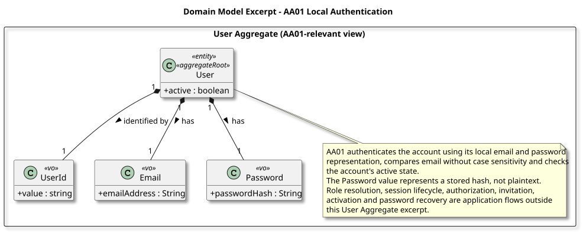
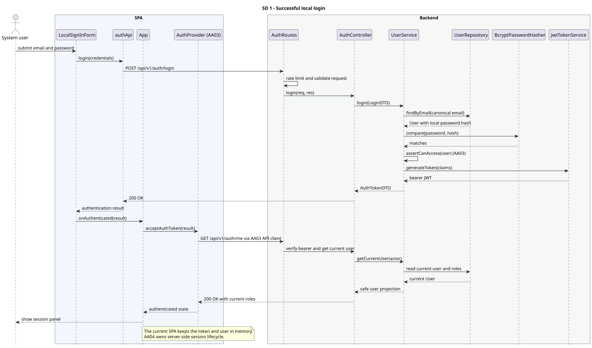
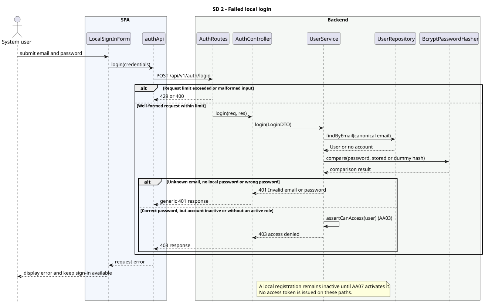
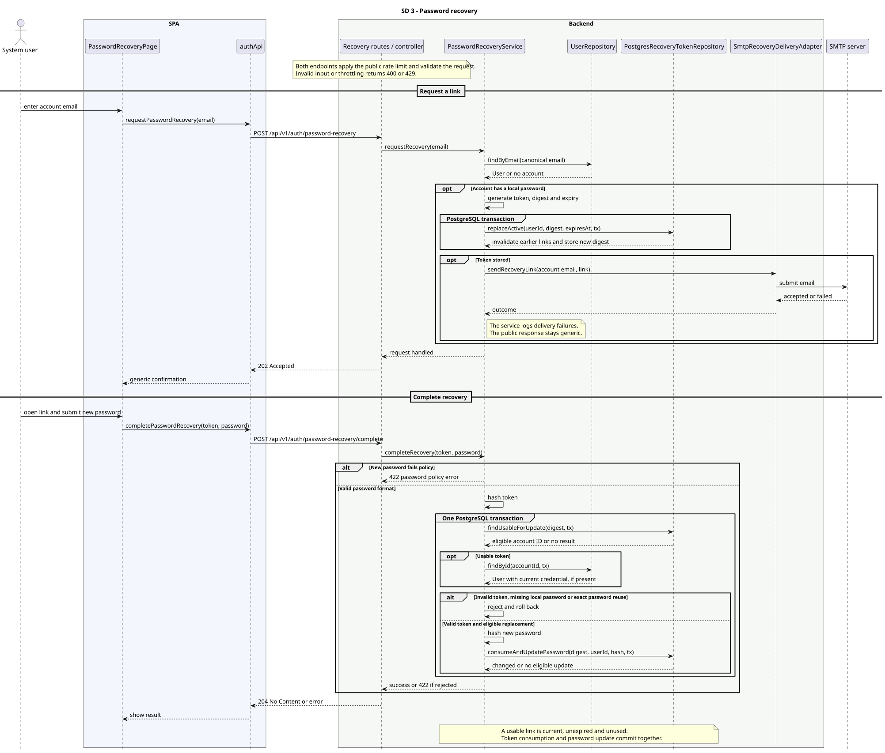
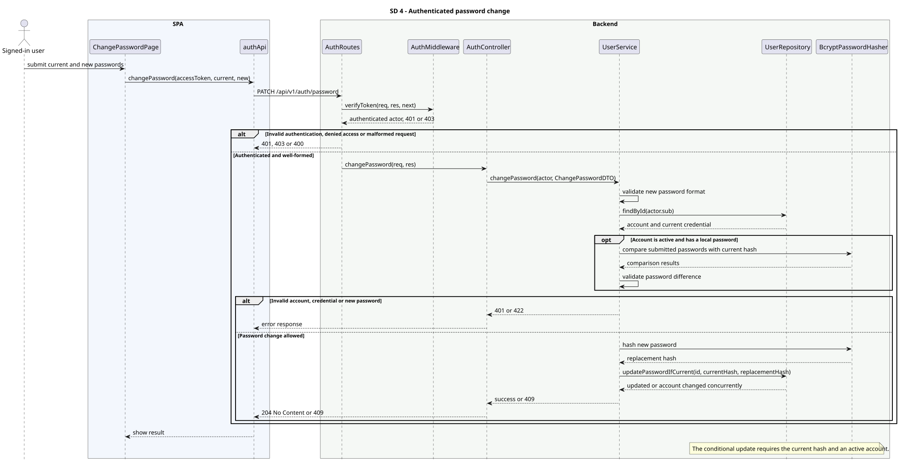
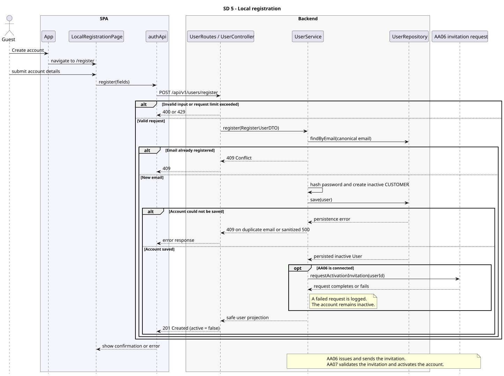

# US AA01 – Local Authentication

## 1\. Context & Scope

- **User Story ID:** AA01
- **Sprint:** Sprint 2
- **Area:** Authentication and Authorization (AA)
- **Responsible:** Francisco Sá (1241341)
- **Related Requirements / Stories:**
  - Sprint 2 User Stories, _PART IV – Sprint 2 – User Stories_, AA01.
  - Architecture: [System Architecture Description](../../architecture/SAD.md), [C4 context](../../architecture/contextDiagram/LaPrizza-C4-Context.svg), [C4 containers](../../architecture/containerDiagram/LaPrizza-C4-Container.svg), and [C4 components](../../architecture/componentDiagram/LaPrizza-C4-Component-Backend.svg).
  - Related stories:
    - **BCK01 – User and Authentication Management:** existing user credentials, registration and login functionality.
    - **AA03 – Internal Role Resolution:** resolution of current internal roles after authentication.
    - **AA04 – Secure Session Handling:** secure session lifecycle, expiry, renewal and logout.
    - **AA05 – Authorization Enforcement:** enforcement of access restrictions on protected operations.
    - **AA06 – Role Assignment and Activation Invitation** and **AA07 – Secure Account Activation:** role assignment, invitation and account activation.
  - **Dependencies:** AA01 relies on the local credentials and authentication services established by BCK01. It must coordinate with related AA stories where their requirements intersect.

### Scope boundary

AA01 concerns local authentication using an account identifier and password. The Sprint 2 specification also includes password protection, password rules, generic failed-login messages, failed-attempt controls and password recovery in its acceptance criteria.

BCK01 already implements an email-and-password login endpoint. The repository does not explicitly state which parts of BCK01 are considered complete for AA01, so the overlap must be validated with the team. This analysis distinguishes existing behavior from the additional Sprint 2 requirements.

AA01 extends the BCK01 public registration entry point with a local sign-up view and creates an inactive Customer with a local credential. AA06 owns invitation issuance, delivery and replacement. AA07 validates the invitation and activates the account. AA03, AA04 and AA05 own role resolution, session lifecycle and authorization respectively.

The Sprint 2 plan assigns the following AA01 tasks to Francisco Sá:

1. Integrate local login with existing credentials and authentication services.
2. Handle authentication failures without disclosing sensitive information.
3. Test successful and unsuccessful authentication.
4. Implement or collect applicable tests and acceptance evidence.
5. Update technical documentation and submit it for peer review.

These tasks are recorded in `docs/Planning/Sprint2/sprintPlanning.md`.

## 2\. Requirements & Analysis

### 2.1. User Story Description

> **As a** System User,  
> **I want** to authenticate using a local account,  
> **so that** I can access the application without using an external identity provider.

The actor is **System User**, as named in the Sprint 2 specification. The repository’s Sprint 1 client clarification distinguishes a system User from a business Customer; there is no evidence to narrow the AA01 actor to Customer, Manager or Employee.

### 2.2. Acceptance Criteria

The following criteria are from the formal AA01 entry in the Sprint 2 specification. They are paraphrased here for traceability:

- [ ] **AC 1:** The login interface supports local authentication using an account identifier and password.
- [ ] **AC 2:** The system validates local credentials, and only active accounts may establish a normal authenticated session. The intended recipient of an inactive account may access the limited invitation-based activation process.
- [ ] **AC 3:** Passwords are stored using a suitable one-way protection mechanism and are never recoverable or displayed in their original form.
- [ ] **AC 4:** Password rules are documented, and password entry, change and recovery preserve confidentiality.
- [ ] **AC 5:** Failed-login messages do not disclose whether an account exists, and repeated failures are controlled to discourage automated password guessing.
- [ ] **AC 6:** Password recovery is time-limited, single-use and verifies control of the intended account.
- [ ] **AC 7:** Local accounts follow the same activation, role, logout and access-control rules as externally authenticated accounts.

Several criteria cross into related stories. The account activation process belongs to AA06/AA07, current role resolution to AA03, session lifecycle and logout to AA04, and access checks to AA05. AA01’s responsibility is local credential authentication and integration with those flows.

The Sprint 1 clarification in `docs/architecture/clientClarifications/clarifications.md` scoped that sprint to back-end/API work and did not require a login screen then. AA01 belongs to Sprint 2 and AC1 explicitly requires a login interface, so the earlier clarification does not waive this acceptance criterion. AA01 includes a Web Application login screen connected to the local-login API. Session state, renewal, logout and protected-route behavior remain AA04 responsibilities.

#### Existing implementation evidence relevant to the criteria

- At the analysis baseline, the back end exposed `POST /api/v1/auth/login`, accepting `email` and `password`, while `frontend/src` contained only the health-check skeleton. The AA01 implementation adds the login interface and API client.
- `UserService.login` looks up the account and compares the submitted password with the stored hash (or a dummy hash). Unknown accounts, missing local credentials and incorrect passwords return `401 Invalid email or password`. After a password match, AA03 checks that the account is active and has a role.
- Integration tests assert identical failure response bodies for an unknown email, incorrect password and deactivated account (`backend/tests/integration/user-authentication-management/api.test.js`). This confirms equal response content, not equal response timing.
- Password hashing uses bcryptjs with cost factor 10 (`backend/src/modules/user-authentication-management/infrastructure/security/BcryptPasswordHasher.js`). Response mapping does not include the password hash.
- A public rate limiter is applied to login and registration. Its default is 30 requests per 15 minutes and it responds with `429` (`backend/src/modules/user-authentication-management/api/routes/publicRateLimiter.js`). It is request-based and shared with registration; no account-specific failed-login counter or lockout was identified.
- No password-recovery endpoint, recovery token persistence, or recovery tests were identified in the inspected authentication module.
- Public local registration creates an inactive Customer. When AA06 is wired, registration passes it the new account ID to request an invitation. The login route rejects the account until AA07 activates it.

### 2.3. Client Clarifications & Questions

`docs/architecture/clientClarifications/clarifications.md` confirms that Customers and Users are distinct concepts and that Sprint 1 focused on back-end/API authentication rather than a login screen. The client has now clarified the four AA01 questions:

1. **Sign-in identifier:** local sign-in uses the User account's email address; email comparison is case-insensitive.
2. **Password recovery:** recovery uses the email address associated with the account and a single-use link. Its validity period must be configurable; the client did not prescribe a fixed duration.
3. **Password requirements:** security requirements must follow the policies and good practices studied in ASIST. The same policy applies to password creation, change and recovery. The client did not prescribe numeric thresholds; this design adopts the supplied ASIST example as the common password-quality policy.
4. **Accounts awaiting email confirmation:** sign-in is denied until account activation. The User may request that the confirmation email be resent.

**Clarification provenance:** These four answers were provided by the client to the team and consolidated here. The repository does not preserve the original message dates or source document for those answers, so no date or verbatim quotation is inferred. The numeric password policy below is an AA01 design choice based on ASIST material supplied to the team, not numeric thresholds stated by the client. The exact ASIST document title and section remain to be added when the source can be identified.

The resend-confirmation operation belongs to the account activation/invitation flow (AA06/AA07); its route and response contract are not specified by this clarification and are not added to AA01's API design. The shared password-quality policy selected for this design is specified below and is applied by the AA01 implementation.

### 2.4. Business Rules & Invariants

#### Confirmed by the Sprint 2 specification

- Only active accounts may establish a normal authenticated session.
- Failed-login messages must not reveal whether an account exists.
- Passwords must be protected with a one-way mechanism and must not be recoverable or displayed in plaintext.
- Password recovery must be time-limited, single-use and verify control of the intended account.
- Local accounts must follow the same activation, role, logout and access-control rules as external accounts.

#### Confirmed by the client clarification

- Local sign-in identifies a User by the associated email address, case-insensitively.
- Password recovery uses the account-associated email and a single-use link with configurable validity.
- One security policy applies when creating, changing or recovering a password; the client directs the team to apply the policies and good practices studied in ASIST.
- A User cannot sign in before account activation and may request the confirmation email to be resent. The resend flow is coordinated with AA06/AA07.

#### AA01 design decisions

- Adopt the supplied ASIST example's password-quality rules across creation, change and recovery: minimum 12 characters and at least one digit, uppercase letter, lowercase letter and special character. Keep bcrypt's 72 UTF-8 byte maximum to avoid bcrypt truncation. These numeric rules are a team design choice, not client-confirmed thresholds; the exact ASIST source citation remains to be recorded.
- Apply `difok=4` only to an authenticated password change where the previous password is available. Recovery cannot check a four-character difference against the old plaintext; it must reject exact reuse by comparing the proposed password against the stored hash.
- Treat `retry=3` and `enforce_for_root` as PAM/system-administration settings, not API authentication rules. Login abuse control remains the responsibility of the existing API rate limiter.
- Use a configurable 30-minute default validity for recovery links. A new recovery request invalidates any previously issued unused link for that account.
- The account's email address is the recovery link recipient. The application requires an outbound email delivery integration configured for the project; the provider is not selected by this design.
- AA01 does not change existing AA04 sessions during password recovery. The team and AA04 owner must decide whether recovered accounts should lose existing sessions before adding such an integration.

#### Observed in the existing BCK01 implementation

- Email is trimmed and lowercased before lookup, matching the client's case-insensitive sign-in rule (`Email.create` in `backend/src/modules/user-authentication-management/domain/model/values.js`; Joi login schema in `api/schemas.js`).
- Login requires a non-empty password of at most 72 UTF-8 bytes with no null character. Password input is not trimmed (`api/schemas.js`).
- At the analysis baseline, password creation required at least 8 characters, at most 72 UTF-8 bytes and no null character (`application/services/passwordPolicy.js`). The AA01 implementation updates it to the selected policy below.
- Passwords are hashed and verified with bcrypt; plaintext passwords are not included in user response DTOs (`BcryptPasswordHasher.js`, `UserResponseMapper.js`).
- Unknown accounts and mismatched passwords produce the same `401` error message. The service compares against a dummy hash for unknown accounts. An inactive account with a matching password receives AA03's `403 Account is not active`.
- The public limiter applies to login and registration requests. It is not evidence of a per-account failed-password policy.

#### Not identified in the repository

- A password-recovery flow or storage for recovery tokens.
- Per-account login-failure tracking, lockout, or progressive delay.
- A local login interface in the original inspected `frontend/src` source; the AA01 implementation adds it.
- An authenticated password-change endpoint was not present at the analysis baseline. AA01 now specifies it as a distinct flow from password recovery to cover password entry/change under AC4.
- The route and response contract for requesting a confirmation-email resend; this is part of the AA06/AA07 activation flow, not established by the AA01 clarification.

### 2.5. Domain Model Excerpt



PlantUML source: [`excerptDomainModel/AA01-domain-model-excerpt.puml`](./excerptDomainModel/AA01-domain-model-excerpt.puml).

This focused excerpt is based on the **User Aggregate** in the current integrated `docs/architecture/domainModel/domainmodel.puml`. The AA01-relevant elements are `User`, `UserId`, `Email`, `Password` (represented by `passwordHash`) and the active state. The excerpt deliberately excludes recovery-token persistence because it is an application security mechanism, not part of the User Aggregate.

The excerpt intentionally omits `UserRole`, because resolving the current internal roles belongs to AA03. It also omits session/token lifecycle (AA04), authorization rules (AA05), and invitation and activation concepts (AA06/AA07). The clarified recovery link is a recovery-process concern and does not add an entity or value object to the existing User Aggregate, so the excerpt's model elements remain unchanged. The broader model remains at `docs/architecture/domainModel/domainmodel.puml`.

The diagram is a domain-model excerpt, not a claim that all depicted properties are implemented identically. In the current code, `User` contains a role set in addition to the fields shown, and `Password` wraps a hash (`backend/src/modules/user-authentication-management/domain/model/User.js` and `domain/model/values.js`).

---

## 3. Design

### 3.1. Architecture & C4 Alignment

AA01 reuses the existing Back-End API and PostgreSQL-backed local account data and adds the Web Application login screen required by Sprint 2 AC1. The screen submits credentials through an API client and passes the successful response to AA03's `AuthProvider`. The Google Identity Provider belongs to AA02. Server-side session renewal, idle-time tracking and logout belong to AA04.

The AA03 provider resolves the current user and roles via `GET /api/v1/auth/me` and keeps the resulting authentication state in memory. The signed-in panel renders after the API confirms access.

The existing BCK01 endpoint currently returns a bearer JWT. The approved AA04 design defines a common `AuthTokenDTO` for local login, external login and renewal, including `accessToken`, `tokenType`, `expiresIn`, `sessionCredential`, `idleTimeoutSeconds`, `activityReportIntervalSeconds`, `idleExpiresAt` and the safe user projection. After AA04 integration, AA01 login must return this shared contract. Until AA04 implementation is available, AA01 must not fabricate session values or duplicate AA04 session lifecycle behavior.

AA01 validates local credentials and calls AA03's shared `UserService.assertCanAccess(user)` after a password match. Local and external sign-in use the same JWT issuance path until AA04 session establishment is integrated. AA05 owns authorization, and AA06/AA07 own invitation, activation and confirmation-email resend. AA01 changes the password and consumes the recovery token. The effect on existing sessions remains an AA04 decision.

The reviewed integration design is recorded in `origin/aa/AA03-analysis-and-design` at `ab2a801` (the `UserService.assertCanAccess(user)` rule) and `origin/aa/AA04-design` at `60573c5` (`UserService.establishSession(user)` and the shared `AuthTokenDTO`). The reviewed AA04 design does not define what should happen to existing sessions after a password recovery. AA01 therefore does not invent or implement a session-revocation contract.

### 3.2. Class Diagram (CD)

The design follows the ARQSI SPA lecture's route map, component tree, state model and API contract (slides 9, 10, 12, 14, 15 and 19). The [AA07 design](https://github.com/Departamento-de-Engenharia-Informatica/LEI-SEM5-PI-2026-27-3DE-01/blob/d76b22d/docs/user_stories/aa/aa07/AA07.md) uses the same separation for the activation route.

#### SPA route map

| Screen | Current entry and navigation | Proposed route design |
| --- | --- | --- |
| Local sign-in | Public entry at `/`. The form reports a successful login to `App`. | Keep `/` as the public entry. |
| Local registration | Public route at `/register`. `App.navigate()` uses `pushState`, and `popstate` restores the previous or next pathname. | Keep `/register` and return to sign-in through client-side navigation. |
| Signed-in panel | `App` renders `SessionPanel` when the session is present in memory. | Use `/account` for the signed-in panel. The route requires a client session. |
| Request recovery | **Forgot password** selects the recovery screen through local shell state. | Use public route `/password-recovery`. |
| Complete recovery | The email link opens the configured SPA URL with `?recoveryToken=…`. `App` reads the query on load and passes the token to the recovery page. | Use `/password-recovery?recoveryToken=…` for the email link. The query selects the completion form. |
| Change password | `SessionPanel` triggers an `App` callback. The shell renders the form when a session is present. | Use `/account/password`. Redirect to sign-in if there is no client session. |

The static host must serve `index.html` for direct visits to SPA routes, including `/register`. In the proposed route design, the additional paths need the same fallback, and the recovery email URL must point to the dedicated recovery route. The API verifies authentication independently of the SPA for protected requests. The CD shows the components and connections in the current implementation.

#### Components, state and API access

| State | Owner and behaviour |
| --- | --- |
| URL state | `App` reads the pathname and the recovery query parameter. History navigation updates the pathname. |
| Shared client state | AA03's `AuthProvider` holds the resolved user and bearer token in memory. `App` reads that state and passes the session data, access token or recovery token to the relevant child through props. Children report actions through callbacks. AA04 owns the server-side session lifecycle and logout. |
| Local UI state | The form components own their inputs and submission feedback. They render idle, submitting and error states. On success, login reports the result to `App`, registration confirms that activation is required, and recovery and password change show the result in the form. |
| Server state | The API owns account status, credentials and recovery tokens. Registration assigns Customer and persists an inactive account. AA06 issues the invitation and AA07 handles activation. |

The form components call the feature API client `authApi`. Its shared `send` helper handles `fetch`, JSON, the bearer header for authenticated requests and error translation. The REST endpoints and request/response contract are listed in [§3.4](#34-rest-api-specification-arc03).

The CD includes the AA01 login screen, authenticated password-change flow, existing local-login components and password-recovery flow. Recovery uses the account-associated email, a single-use link and configurable validity (1800-second default). Both change and recovery apply the shared password quality policy; authenticated change additionally checks the submitted current password and the `difok=4` design rule, while recovery rejects exact reuse. Recovery records persist token hashes only. `RecoveryTokenCandidate` is an Application read model, so the application port does not return an Infrastructure persistence model. Session lifecycle remains AA04-owned. SMTP settings are environment configuration. `IUserRepository`, `IPasswordHasher` and `ITokenService` are JSDoc structural contracts, not runtime interface hierarchies.

The class diagram groups the SPA components and their shared HTTP client separately from the Onion backend. The API routes and controllers invoke application services. The services use the `User` aggregate and the repository contract in the Domain. The Infrastructure adapters implement the repository, hashing, token and email contracts. The recovery service also receives the shared transaction runner through dependency injection.

Both services share the domain model. When requesting recovery, `PasswordRecoveryService` finds the account by `Email` and sends the link to the address stored on the account. When completing recovery, it finds the account by `UserId` and reads its `Password` hash to check for reuse. The recovery repository consumes the token and updates the stored password hash in the same transaction.


[Open the full class diagram](./classDiagram/class_diagram.svg) · [PlantUML source](./classDiagram/class_diagram.puml)

### 3.3. Sequence Diagram (SD)

SD 1 and SD 2 show successful and rejected login through the local form. On success, AA03 resolves the current user and roles and keeps the authentication state in memory. AA04 owns the server-side session lifecycle. SD 3 shows recovery request and completion, SD 4 shows authenticated password change, and SD 5 shows registration and the optional request to AA06.

#### SD 1 — Successful Local Login



PlantUML source: [`sequence_diagram_login_success.puml`](./sequenceDiagram/sequence_diagram_login_success.puml).

The diagram shows the mounted API endpoint, request checks, credential lookup and comparison, JWT creation and the transition to the signed-in panel.

#### SD 2 — Failed Local Login



PlantUML source: [`sequence_diagram_login_failure.puml`](./sequenceDiagram/sequence_diagram_login_failure.puml).

Unknown email, missing local credentials and incorrect password return the same `401` response body. After a password match, AA03 returns `403` for an inactive account or an account without an active role.

#### SD 3 — Password Recovery



PlantUML source: [`sequence_diagram_password_recovery.puml`](./sequenceDiagram/sequence_diagram_password_recovery.puml).

This flow covers requesting a recovery link by account email and completing a password change using the single-use link. Validity is configured by `PASSWORD_RECOVERY_TOKEN_TTL_SECONDS` (1800-second default). A new request invalidates previous unconsumed links for the account. The request endpoint returns identical `202` status and content for known and unknown emails; because delivery is synchronous, equal response timing is not guaranteed. Completion validates and consumes the token and updates the password in one transaction. Token lookup and final consumption both reject invalidated, consumed and expired records. AA01 does not revoke active sessions; that post-recovery behavior remains an AA04/team decision.

#### SD 4 — Authenticated Password Change



PlantUML source: [`sequence_diagram_change_password.puml`](./sequenceDiagram/sequence_diagram_change_password.puml).

The signed-in User supplies the current password and a new password through the Web Application. The route verifies the bearer token, validates the request, and passes the authenticated actor and `ChangePasswordDTO` to `UserService`. The service verifies the current password, applies the shared password policy and the `difok=4` change rule, hashes the replacement, and uses a conditional repository update so a concurrent password change or account deactivation cannot be overwritten. Success returns `204`; invalid authentication/current password returns `401`, a race returns `409`, and password policy failures return `422`. This operation does not revoke existing sessions; AA04 owns that policy and no revocation contract is assumed here.

No separate malformed-request or rate-limit diagram is included. SD 3 shows the shared public rate limiter on both recovery operations; its configured window and limit are the same as the existing module limiter.

#### SD 5 — Local Registration and AA06 Handoff



PlantUML source: [sequence_diagram_registration.puml](./sequenceDiagram/sequence_diagram_registration.puml).

Registration retains the BCK01 request and endpoint. The API rejects malformed input and duplicate emails. After saving the inactive account, `UserService` can call the AA06 invitation request with the persisted user ID. This integration is optional until AA06 is available. The SPA confirms account creation and explains that activation is required before sign-in.

### 3.4. REST API Specification (ARC03)

The OpenAPI server prefix is `/api/v1` (`backend/src/shared/openapi/spec.js`). The user-authentication module registers `AuthRoutes` under that API router (`backend/src/app.js`, `backend/src/modules/user-authentication-management/index.js`), and `AuthRoutes` declares `/auth/login`. The mounted path is therefore **`POST /api/v1/auth/login`**.

| Method  | Endpoint                | Description                                                                                               | Auth / Role                               |
| :------ | :---------------------- | :-------------------------------------------------------------------------------------------------------- | :---------------------------------------- |
| `POST`  | `/api/v1/auth/login`    | Authenticate an active local account using email and password; return a bearer JWT and safe user profile. | Public; no bearer token or role required  |
| `PATCH` | `/api/v1/auth/password` | Change the authenticated account password after verifying the current password.                           | Bearer token required; account owner only |

Password recovery is also part of AA01's API contract:

| Method | Endpoint                                  | Purpose                                                                                                                  | Auth / Role          |
| :----- | :---------------------------------------- | :----------------------------------------------------------------------------------------------------------------------- | :------------------- |
| `POST` | `/api/v1/auth/password-recovery`          | Request a single-use link sent to the account-associated email; returns generic content for known and unknown addresses. | Public; rate-limited |
| `POST` | `/api/v1/auth/password-recovery/complete` | Submit the link token and a new password; atomically consume the token and update the password.                          | Public; rate-limited |

**Response status codes:**

- `200 OK` — successful login (`AuthenticationResponse`).
- `202 Accepted` — recovery request accepted; same response for known and unknown email addresses.
- `204 No Content` — password recovery completed.
- `204 No Content` — authenticated password change completed.
- `400 Bad Request` — invalid request.
- `401 Unauthorized` — invalid credentials.
- `401 Unauthorized` — missing/invalid bearer token or incorrect current password.
- `403 Forbidden` — AA03 rejects an inactive account or an account without an active role after identity verification.
- `409 Conflict` — account/password changed concurrently before the conditional update.
- `422 Unprocessable Entity` — invalid/expired/used recovery token or password policy/reuse rejection.
- `413 Payload Too Large` — request body exceeds the configured parser limit.
- `429 Too Many Requests` — public request limit exceeded.
- `500 Internal Server Error` — generic error response.

The API integration tests cover `400` for malformed JSON, `401` for invalid credentials, `403` after a password match for an inactive or roleless account, and `429` after the public request limit. Recovery and password-change status codes and schemas are defined above and in OpenAPI. Login returns a bearer JWT until AA04 integration.

**Registration** uses public `POST /api/v1/users/register` with `name`, `email`, `password` and optional `marketingConsent`. A successful creation returns `201` with the safe user projection and `active: false`. The response confirms account creation. If the optional request to AA06 fails after persistence, the backend logs a generic message and the account stays inactive. Invalid input returns `400`, an existing canonical email returns `409`, and rate limiting returns `429`.

### 3.5. Request & Response Schemas

#### Request: `POST /api/v1/auth/login`

The confirmed request fields are `email` and `password`; unknown fields are rejected by Joi.

```json
{
  "email": "ana@example.com",
  "password": "long-password"
}
```

- **`email`:** required string; trimmed and lowercased by Joi; valid email format; maximum 254 characters.
- **`password`:** required string; runtime Joi minimum 1 character, maximum 72 characters, maximum 72 UTF-8 bytes, and no null character. It is not trimmed.

The OpenAPI `LoginRequest` and Joi login schema both describe a non-empty password, with a maximum of 72 characters/UTF-8 bytes and no null characters. Login verifies the submitted password against the stored hash and does not impose the creation policy's minimum or character classes.

The selected policy in Section 2.4 applies to password creation, change and recovery. The BCK01 registration validator enforces it; login continues to accept any non-empty password within bcrypt's input limit so existing accounts can authenticate.

#### Success response: `200 OK`

The shared AA04 `AuthTokenDTO` contains `accessToken`, `tokenType`, `expiresIn`, `sessionCredential`, `idleTimeoutSeconds`, `activityReportIntervalSeconds`, `idleExpiresAt` and `user`. The safe user projection contains `id`, `name`, `email`, `roles`, `active`, `marketingConsent` and `createdAt`; it excludes the password hash. Session fields come from AA04 and must not be fabricated by AA01.

```json
{
  "accessToken": "<signed-jwt>",
  "tokenType": "Bearer",
  "expiresIn": "5m",
  "sessionCredential": "<opaque-session-credential>",
  "idleTimeoutSeconds": 1800,
  "activityReportIntervalSeconds": 30,
  "idleExpiresAt": "2026-10-14T15:30:00.000Z",
  "user": {
    "id": "USR-00001",
    "name": "Ana Silva",
    "email": "ana@example.com",
    "roles": ["CUSTOMER"],
    "active": true,
    "marketingConsent": false,
    "createdAt": "2026-10-14T15:00:00.000Z"
  }
}
```

`expiresIn`, session credential and inactivity fields are supplied by the AA04 session flow after integration. The existing BCK01 implementation currently returns a JWT without those session fields. The login controller calls `res.json(...)`, which produces the documented default `200` status.

#### Error response format

The global error handler and rate-limit handler use the following shape:

```json
{
  "error": {
    "message": "Invalid email or password",
    "status": 401
  }
}
```

Unknown emails and incorrect passwords use the same `401` body. Inactive and roleless accounts with the correct password receive `403`. Schema validation failures return `400`, with `Invalid request body` for Joi failures or `Invalid JSON body` for malformed JSON. The rate-limit handler returns `429` with `Too many attempts; try again later`.

Recovery request schema: `{ "email": "ana@example.com" }`. Completion schema: `{ "linkToken": "<single-use-token>", "newPassword": "<new-password>" }`. Both reject unknown properties. Request recovery returns `202` with `{ "message": "If the account is eligible, recovery instructions will be sent." }` regardless of account existence. Completion returns `204` with no body. Invalid request bodies return the shared `400` response. Invalid/expired/consumed tokens use the generic `422` message `Invalid or expired recovery link`; policy failures and exact password reuse use descriptive `422` messages. Rate limiting returns the shared `429` response and unexpected failures use the generic `500` response. Recovery responses include `Cache-Control: no-store`.

Password change request schema: `{ "currentPassword": "<current-password>", "newPassword": "<new-password>" }`. Both fields are write-only, are not trimmed, and reject values over 72 UTF-8 bytes or containing NUL; unknown fields are rejected. The endpoint requires a valid bearer token and uses its subject as the account identity; clients cannot provide a target user ID. The current password must verify against the stored hash. The new password must satisfy the shared quality rules and differ from the current password by at least four Levenshtein edits (the team's explicit implementation of the `difok=4` design rule). Success returns `204` with no body. Incorrect/missing authentication or incorrect current password returns `401`; invalid input returns `400`; concurrent password/account change returns `409`; password policy and difference failures return `422`. Responses use the shared error body and `Cache-Control: no-store`.

### 3.6. Persistence & Data Integrity (ARC04)

Local login reads the `users` row by email through `UserRepository.findByEmail`, selecting the password hash for verification. Relevant persisted fields and constraints are:

- `email`: `VARCHAR(254) NOT NULL UNIQUE`; `users_email_canonical` in `backend/migrations/0001_users.sql` enforces lowercase, trimmed canonical form and email format.
- `password_hash`: `NOT NULL`, constrained to a bcrypt-formatted hash by the same migration.
- `active`: `NOT NULL`. Public local registration persists `false` explicitly. Login rejects inactive accounts.

Registration uses the existing `users` table. AA06 owns invitation persistence and delivery. AA07 owns the transaction that redeems the invitation and activates the account.
- `id`: primary key used as the account identity; `backend/migrations/0014_user_business_ids.sql` migrates it to the `USR-...` business identifier format.

Migration `0019_password_recovery_tokens.sql` adds the AA01 token store: generated record ID, `user_id` referencing `users(id)` with `ON DELETE CASCADE`, unique SHA-256 token hash, expiry, consumed/invalidation timestamps and creation time. Checks require finite timestamps and prevent a record from being both consumed and invalidated. A partial unique index permits at most one unconsumed, non-invalidated token per user. Issuance locks the user row, invalidates earlier unconsumed links and inserts the new hash. Completion first reads the token owner without a lock, then locks the user row and rechecks/locks the token row; both issuance and completion therefore use the same user-before-token lock order. Lookup and final atomic consumption require `consumed_at IS NULL`, `invalidated_at IS NULL` and `expires_at > now()`. Password replacement and token consumption share one transaction. AA04 session revocation is not included because no operation or post-recovery session policy is defined in the reviewed AA04 design. Plaintext tokens are delivered once and never persisted.

Authenticated password change does not add a table or migration. `UserRepository.updatePasswordIfCurrent` performs a single conditional update on user ID, previously verified password hash and active status, changing only `password_hash` and `updated_at`. If another password update or deactivation wins first, zero rows are updated and the service returns `409` rather than overwriting newer state. The repository's compare-and-update operation is implemented for PostgreSQL and the in-memory test repository.

The migration does not add a failed-login counter; request-level abuse control remains with the shared public rate limiter. Roles remain stored on the user row; effective role resolution is outside AA01.

### 3.7. Applied Patterns & Architecture Principles

- **Modular layered architecture:** `user-authentication-management` separates API, application, domain and infrastructure concerns.
- **Dependency injection:** `createUserModule` wires the existing local-login service and, when PostgreSQL is available, the recovery service, token repository, SMTP adapter and transaction coordinator.
- **Repository abstraction:** the structural `IUserRepository` contract separates account lookup from SQL persistence.
- **Security ports/adapters:** `IPasswordHasher` and `ITokenService` are structural contracts implemented by bcrypt and JWT adapters.
- **Value objects:** `Email`, `Password` and `UserId` encapsulate credential-related values.
- **DTO/mapper boundaries:** `LoginDTO`, `ChangePasswordDTO`, shared AA04 `AuthTokenDTO` and `UserResponseMapper` separate input, authentication output and safe user projection. `RecoveryTokenCandidate` is an Application read model returned by the recovery persistence port; infrastructure persistence rows remain internal.

The current `UserService` invokes AA03's `assertCanAccess(user)` and issues a stateless JWT. AA04 session establishment and the policy for existing sessions after recovery remain integration dependencies.

`UserService` currently raises the shared `AppError`, which carries an HTTP status, so the application service is coupled to HTTP error semantics. This is existing architectural debt to consider separately; it does not require redesigning the local-login flow for AA01.

### 3.8. Password Recovery Design

AC6 assigns password recovery to AA01. The client confirmed a single-use link sent to the account email and configurable validity. A cryptographically random token is generated; only its SHA-256 hash is stored. Validity uses `PASSWORD_RECOVERY_TOKEN_TTL_SECONDS` with a default of 1800 seconds. New issuance locks the user row, invalidates prior unconsumed tokens, inserts the new hash and commits before delivery. The request endpoint returns identical `202` content for known and unknown emails.

Completion verifies the hash, expiry and unused state, enforces the shared password policy, rejects exact reuse of the current password, and then atomically updates `password_hash` and consumes the token. The final conditional update checks `consumed_at IS NULL`, `invalidated_at IS NULL` and `expires_at > now()` to prevent invalidated or concurrently consumed tokens from succeeding. `difok=4` does not apply to recovery because the previous plaintext password is unavailable; it remains a change-only rule when the previous password is provided.

Outbound delivery uses project-configured SMTP as described in [ADR-009 — Transactional Email](https://github.com/Departamento-de-Engenharia-Informatica/LEI-SEM5-PI-2026-27-3DE-01/blob/2b0b181bc9b17e5aee743951e2b1d614bc914eab/docs/architecture/ADR.md#adr-009-use-smtp-with-mailpit-and-brevo-for-transactional-email). SMTP credentials and sender configuration are supplied through the environment. Links point to the configured Web Application URL. If delivery fails after token persistence, the request still returns the generic `202` response to avoid account enumeration. The backend logs a generic failure and a new request invalidates the undelivered token.

After password replacement, AA01 consumes the recovery token and commits the password change. It does not revoke existing AA04 sessions because no such contract or requirement has been agreed. The AA04 owner/team must decide whether recovery invalidates current sessions and, if so, provide the contract and transaction behavior; AA01 should then integrate with that contract without owning AA04 persistence.

### 3.9. Rate-Limit Deployment Assumptions

`createPublicRateLimiter` configures a 15-minute window and a default limit of 30 requests, and accepts overrides from `createUserModule`. No shared store is supplied by this module, and no Express `trust proxy` setting was identified in `createApp`; deployments must verify shared counter storage and proxy configuration. The limiter is request-based and shared by login, registration and both recovery operations; it does not implement per-account lockout. Confirmation-email resend remains AA06/AA07-owned.

### 3.10. Acceptance Verification Design (Proposed)

The following acceptance scenarios are used to assess AA01. Unit and API tests cover password policy, generic login failures, throttling, recovery-token orchestration, authenticated password change, and the documented API contracts. The AA01 PostgreSQL integration suite has also been run against a dedicated local test database. The Mailpit procedure below covers local SMTP delivery.

- Recovery request for an existing and a nonexistent account returns the same `202` status and response body.
- A valid email link allows one password change; an expired link and a previously consumed link are rejected.
- Requesting a new recovery link invalidates a previously issued unused link for that account.
- Two concurrent completion attempts using the same link result in at most one successful password change.
- The link is delivered to the account-associated email and expires according to `PASSWORD_RECOVERY_TOKEN_TTL_SECONDS` (1800-second default).
- Password creation, change and recovery enforce the same policy: at least 12 characters, at least one digit, uppercase letter, lowercase letter and special character, and at most 72 UTF-8 bytes. Change applies `difok=4` only when the previous password is available; recovery rejects exact reuse of the existing password.
- Authenticated password change requires a valid bearer token and the correct current password; a successful change returns `204`, the old password no longer authenticates, and the new password does. Invalid current credentials, password reuse/insufficient difference and concurrent updates are covered by `backend/tests/integration/user-authentication-management/api.test.js` and `backend/tests/unit/user-authentication-management/services.test.js`.
- An account awaiting activation cannot sign in; the User can request a confirmation-email resend through the AA06/AA07 flow without exposing account existence in the login failure response.
- AC1 is verified through the Web Application login screen and its request to `POST /api/v1/auth/login`; the Sprint 1 API-only clarification does not waive Sprint 2 AC1.
- Integration checks must confirm local login follows the agreed activation, role and session contracts from AA06/AA07, AA03 and AA04, and that authorization remains enforced by AA05. These checks depend on those stories' contracts being available and are not complete on this branch.
- Existing login tests cover successful credentials, unknown account, incorrect password, inactive account and request-rate limiting (`backend/tests/integration/user-authentication-management/api.test.js`). Recovery orchestration tests use test doubles for user/recovery repositories, hashing, token generation, delivery and transaction handling (`backend/tests/unit/user-authentication-management/passwordRecovery.test.js`).
- Password change is covered at domain, service, controller, API, OpenAPI-contract, PostgreSQL repository unit-test and Web Application API-client levels. Database integration tests against a live PostgreSQL instance remain dependent on the configured database test environment.

## 4. Tests (ARC05)

### 4.1. Test Plan & Scenarios

The [local sign-in UI tests](../../../frontend/test/auth/localSignIn.test.js) render the shared screen, submit email and password to the login API, and verify the signed-in panel, browser logout and generic invalid-credentials feedback with simulated HTTP responses.

| Criteria | Scenario and expected result | Evidence |
| --- | --- | --- |
| AC1, AC2, AC5 | Valid credentials for an eligible account return `200` and a safe user projection. Unknown emails and wrong passwords return the same `401` body. A matching password for an inactive or roleless account returns `403`. Repeated requests eventually return `429`. | [HTTP integration tests](../../../backend/tests/integration/user-authentication-management/api.test.js) |
| AC3, AC4 | Password hashing verifies the original credential and uses independent salts. Password creation, change and recovery enforce the shared policy. OpenAPI marks password inputs as write-only. | [Security tests](../../../backend/tests/unit/user-authentication-management/security.test.js), [service tests](../../../backend/tests/unit/user-authentication-management/services.test.js), [recovery tests](../../../backend/tests/unit/user-authentication-management/passwordRecovery.test.js), [OpenAPI tests](../../../backend/tests/unit/user-authentication-management/openapi.test.js) |
| AC4 | Password change requires authentication and the correct current password. After success, only the new password authenticates. | [HTTP integration tests](../../../backend/tests/integration/user-authentication-management/api.test.js), [frontend API client test](../../../frontend/src/authApi.test.js) |
| AC6 | Recovery issues a hashed, expiring token, sends the link to the account email and rejects expired, used or invalidated tokens. | [Recovery service tests](../../../backend/tests/unit/user-authentication-management/passwordRecovery.test.js), [controller tests](../../../backend/tests/unit/user-authentication-management/passwordRecoveryController.test.js), local Mailpit procedure in §6.2 |
| AC4, AC6 | PostgreSQL prevents stale password changes and permits at most one successful completion when two attempts use the same recovery link. | [PostgreSQL integration tests](../../../backend/tests/integration/user-authentication-management/postgres.test.js) |
| AC2, AC7 | Invitation-based activation and parity with external accounts across activation, roles, logout and access control. | Pending integration with the related AA stories |

### 4.2. Sample Test Specifications

- **Login failures.** Submit a request for an unknown email and another with a wrong password. Expect the same `401` body. Submit the correct password for an inactive account and expect AA03's `403 Account is not active`.
- **Authenticated password replacement.** Authenticate, call `PATCH /api/v1/auth/password` with the current credential and a valid new one, and expect `204`. Try both credentials against the login endpoint and expect `401` for the old one and `200` for the new one.
- **Recovery replacement and concurrent use.** Issue two tokens for the same user and check that the first is invalidated. Submit two concurrent completion attempts with the second token. Assert that at most one attempt succeeds and that the successful attempt consumes the token and replaces the password.

## 5. Implementation

### 5.1. Implemented File Structure

| Layer | Main implementation files |
| --- | --- |
| Web application | `frontend/src/App.jsx`, `LoginPage.jsx`, `ChangePasswordPage.jsx`, `PasswordRecoveryPage.jsx` and `authApi.js` |
| API | `backend/src/modules/user-authentication-management/api/` contains the authentication and recovery routes, controllers, Joi schemas and OpenAPI contract. |
| Application and domain | `UserService.js`, `PasswordRecoveryService.js`, `passwordPolicy.js`, `ChangePasswordDTO.js`, `AuthTokenDTO.js`, recovery ports and read model, `User.js` and `IUserRepository.js` |
| Infrastructure | `UserRepository.js`, `PostgresRecoveryTokenRepository.js`, `BcryptPasswordHasher.js`, `RecoveryTokenService.js`, `SmtpRecoveryDeliveryAdapter.js` and `passwordRecoveryConfig.js` |
| Composition and persistence | `backend/src/modules/user-authentication-management/index.js` and `backend/migrations/0019_password_recovery_tokens.sql` |
| Local registration | `frontend/src/auth/LocalRegistrationPage.jsx`, `UserService.register` and the optional `requestActivationInvitation` integration in the module composition |

### 5.2. Core Implementation Highlights

- Local login reuses the BCK01 endpoint and credentials. The service looks up the canonical email, verifies the bcrypt hash, and checks that the account is active. Successful login returns a bearer JWT and a safe user projection.
- The Web Application holds the login result in memory and uses its bearer token for password change. The backend identifies the target account from the token subject and conditionally updates the password only while the verified hash and active state are current.
- Registration, bootstrap, password change and recovery enforce the shared password policy. Login checks the submitted credential against the stored hash so existing users can still authenticate with passwords set under the earlier policy.
- When a PostgreSQL connection is supplied, the module wires the recovery routes, token repository, transaction coordinator and SMTP adapter. A request replaces earlier unused links, stores only the new token hash and sends the link after commit. Completion consumes the token and updates the credential in one transaction.

## 6. Integration, Verification & Demonstration

### 6.1. Running the Automated Tests

From `backend`, run the targeted unit and HTTP tests. These use test doubles for persistence and email delivery where applicable.

```powershell
npm.cmd test -- --runInBand tests/unit/user-authentication-management tests/integration/user-authentication-management/api.test.js
```

For the database-backed tests, create a dedicated `laprizza_test` database owned by the configured PostgreSQL user. Keep the connection settings in `backend/.env` and run the suite from `backend`. The suite applies the migrations in an isolated schema.

```powershell
$env:PGDATABASE = 'laprizza_test'
$env:RUN_DATABASE_TESTS = '1'
npm.cmd test -- --runInBand tests/integration/user-authentication-management/postgres.test.js
Remove-Item Env:PGDATABASE, Env:RUN_DATABASE_TESTS
```

From `frontend`, run `npm.cmd test -- --runInBand` and `npm.cmd run build`.

### 6.2. Manual Verification & OpenAPI Contract

With the backend running, open [Swagger UI](http://localhost:8080/api-docs) for the login, password change and recovery request schemas. In the Web Application, verify login with an active local account and compare the failed responses for a wrong password and an unknown email. After signing in, open **Change password**, submit the current password and a valid new one, and verify that only the new password works on the next login.

#### 6.2.1. Test Password Recovery Locally with Mailpit on Windows

Mailpit receives test emails from the backend on SMTP port `1025` and displays them in a browser inbox on port `8025`. Use the email of an account already in the local database. A fictional address such as `aa01.customer@example.com` works because Mailpit captures the message locally.

1. Start PostgreSQL and apply the migrations with `npm.cmd run db:migrate` from `backend`. Use an existing active test account. Follow the [backend setup guide](../../../backend/README.md) for the database connection and JWT configuration. This procedure works with PostgreSQL installed directly on Windows.
2. Download the Windows ZIP matching your PC architecture and extract it. In File Explorer, open the folder containing `mailpit.exe`, type `powershell` in the address bar, and press Enter. Run the command from that folder. [Mailpit downloads](https://github.com/axllent/mailpit/releases/latest)

   ```powershell
   .\mailpit.exe --listen 127.0.0.1:8025 --smtp 127.0.0.1:1025
   ```

   Leave this PowerShell window open and check that the [Mailpit inbox](http://127.0.0.1:8025/) opens. An empty inbox is expected before requesting a link.

3. From the `backend` folder, copy `.env.example` to `.env` if `.env` does not already exist. Edit the existing recovery entries and keep the PostgreSQL and JWT values already configured.

   ```powershell
   if (-not (Test-Path .env)) {
       Copy-Item .env.example .env
   }
   notepad .env
   ```

   ```dotenv
   PASSWORD_RECOVERY_TOKEN_TTL_SECONDS=1800
   PASSWORD_RECOVERY_WEB_URL=http://localhost:5173/
   SMTP_HOST=127.0.0.1
   SMTP_PORT=1025
   SMTP_SECURE=false
   SMTP_USER=
   SMTP_PASSWORD=
   SMTP_FROM=laprizza@example.com
   ```

   The local Mailpit instance accepts SMTP without credentials. `SMTP_FROM` is the sender. The recipient is the email stored on the account. Keep the local `.env` out of Git.

4. Start or restart the backend after saving the file. Run `npm.cmd run dev` from `backend` and from `frontend` in separate terminals. Open the [LaPrizza login page](http://localhost:5173/).
5. Open the password recovery form and submit the exact email of the test account. `POST /api/v1/auth/password-recovery` returns a generic `202`, including for an unknown email. Confirm delivery by opening the latest **LaPrizza password recovery** message in Mailpit and checking its **To** field.
6. Click **Reset password** in the email. Submit a new password that meets the policy and differs from the existing password. Expect `204` from `POST /api/v1/auth/password-recovery/complete`. Return to login and sign in with the email from the **To** field and the new password.
7. Reopen the same link and submit another valid password. Expect `422` with `Invalid or expired recovery link`. Confirm that the password set in step 6 still works.

If the inbox stays empty after a `202`, check that the submitted email exists in the database used by the running backend. If the backend logs `Password recovery email delivery failed`, verify the SMTP settings above and run `Test-NetConnection 127.0.0.1 -Port 1025` in another PowerShell window. After fixing the configuration and restarting the backend, request a fresh link.

#### 6.2.2. Verify Real Delivery with Brevo SMTP

The AA01 SMTP adapter uses Mailpit for local capture and Brevo for deployed environments that send to real inboxes. Both environments use the same password recovery flow.

1. In the project's Brevo account, verify the sender address or authenticate its domain. Confirm that transactional sending is enabled. Obtain the SMTP login and generate a dedicated SMTP key under **SMTP & API → SMTP**. [Brevo SMTP setup](https://help.brevo.com/hc/en-us/articles/7924908994450-Send-transactional-emails-using-Brevo-SMTP)
2. Set these values in the backend deployment environment and restart the API. Replace the placeholders with the project values and store the SMTP key as a deployment secret.

   ```dotenv
   SMTP_HOST=smtp-relay.brevo.com
   SMTP_PORT=465
   SMTP_SECURE=true
   SMTP_USER=BREVO_SMTP_LOGIN
   SMTP_PASSWORD=BREVO_SMTP_KEY
   SMTP_FROM=VERIFIED_SENDER_EMAIL
   PASSWORD_RECOVERY_WEB_URL=https://PUBLIC_FRONTEND_HOST/
   PASSWORD_RECOVERY_TOKEN_TTL_SECONDS=1800
   ```

   Port `465` uses TLS from the start of the connection. For a local test of real delivery, temporarily use the same SMTP settings in `backend/.env` with `PASSWORD_RECOVERY_WEB_URL=http://localhost:5173/` and open the link on the same computer.

3. Request recovery for a test account with a local password and a real inbox you control. Verify that the message reaches the account's email address and that the link opens the expected frontend. Complete recovery, sign in with the new password and confirm that a second use of the link is rejected. Record the environment, receipt time and result without exposing the token or credentials.
4. If no email arrives, check the backend for `Password recovery email delivery failed`, then check the transactional logs in Brevo for delivery, deferral or rejection. The generic `202` is the application's acknowledgement of the request.

Brevo's Free plan includes up to 300 sends per day and adds its branding. The quota covers both invitations and recovery when they share the account. Delivery delayed by the provider may outlast the recovery link's validity. [Brevo Free plan limits](https://help.brevo.com/hc/en-us/articles/208580669)

#### 6.2.3. Verify Local Registration

1. Start the API and the SPA. Open the sign-in screen, choose **Create account** and register with a fresh test address. Expect `201` and an inactive Customer.
2. Try signing in with the registered password and expect `403 Account is not active`. Repeat registration with the same email and expect `409`.
3. When AA06 and AA07 are integrated, verify that AA06 sends the invitation and that the recipient can redeem it through AA07 and sign in afterwards.

### 6.3. Executed Verification

- Recorded on 2026-11-07: backend default suite reported 541 passed and 83 database tests skipped. The targeted PostgreSQL suite on `laprizza_test` reported 19 passed. The frontend suite reported 2 passed, and the frontend production build and backend and frontend lint checks passed.
- Manual verification on Windows confirmed email delivery to Mailpit, recovery completion with `204` and login with the new password. Link reuse is included in the manual procedure and covered by automated tests.
- A separate local run with Brevo confirmed delivery to the real inbox associated with a local account and successful password recovery on the PC hosting the frontend. Verification against the published frontend URL is pending deployment.
- Registration tests cover the SPA form, creation of an inactive Customer, the handoff to AA06 using a test double and denial of login before activation.

## 7. Observations, Dependencies & Limitations

### 7.1. Current Implementation Status

The branch implements local login, authenticated password change and recovery by single-use email link. Recovery requires the PostgreSQL migration and a configured SMTP server. The current login response uses the BCK01 bearer JWT. The additional shared session fields in §3.5 describe the AA04 integration contract.

### 7.2. Confirmed Scope Boundaries

- AA01 extends the BCK01 registration endpoint with inactive local accounts. The initial Manager bootstrap still prepares an active account for local testing.
- Internal role resolution belongs to AA03. Session renewal, logout and any session revocation after recovery require coordination with AA04.
- Access enforcement belongs to AA05. Role assignment, invitations, activation and confirmation resend are coordinated with AA06/AA07.
- Local Mailpit verification exercises SMTP delivery to a test inbox. Project deployment requires its own SMTP configuration and rate-limiter verification.

### 7.3. AA02 Integration

- The AA02 sign-in screen renders AA01's `LocalSignInForm` alongside `GoogleSignInButton`. Both methods use the same sign-in callback and session panel. The application handles Google callbacks at `/auth/callback/google` and AA01 recovery links with the `recoveryToken` query parameter.
- Both methods require an active account with at least one role before calling `UserService.issueAuthToken`. The response's `hasLocalCredential` flag controls whether the session panel offers **Change password**. Server-side session termination remains an AA04 dependency.
- An account without a local password receives the generic `401` on local login and `422` on authenticated password change. Recovery returns the generic `202` without issuing a link for that account. If a recovery token resolves to an account without a local credential, completion returns the generic `422`.
- The main branch provides external identities in migration `0018_user_external_identities.sql`. AA01 adds password recovery in `0019_password_recovery_tokens.sql`. Use a fresh local database if it previously applied the standalone AA01 recovery migration under version `0016`.

### 7.4. Pending Integrated Acceptance Checks

- **AA06/AA07:** Confirm that the intended invite recipient can use the limited activation flow while the inactive account is denied a normal login. Confirm that successful activation enables sign-in with the chosen credential.
- **AA03–AA05:** For both local and Google sign-in, verify that the same internal roles grant access to the same protected operations and that a session credential from either method is rejected by the server after logout. The current UI logout clears the in-memory authentication state.

---
