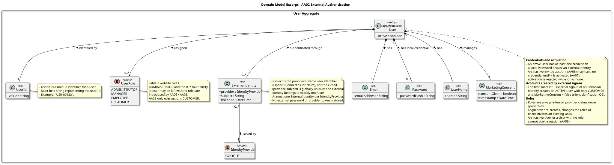
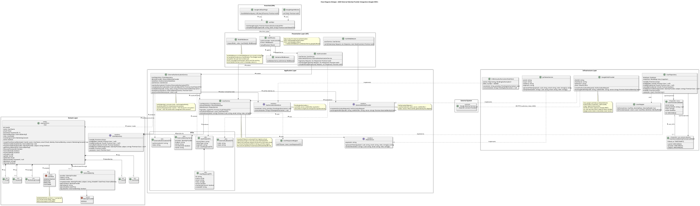
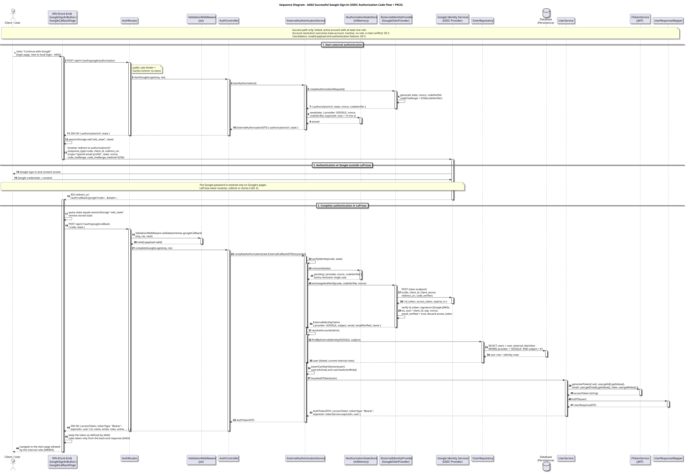
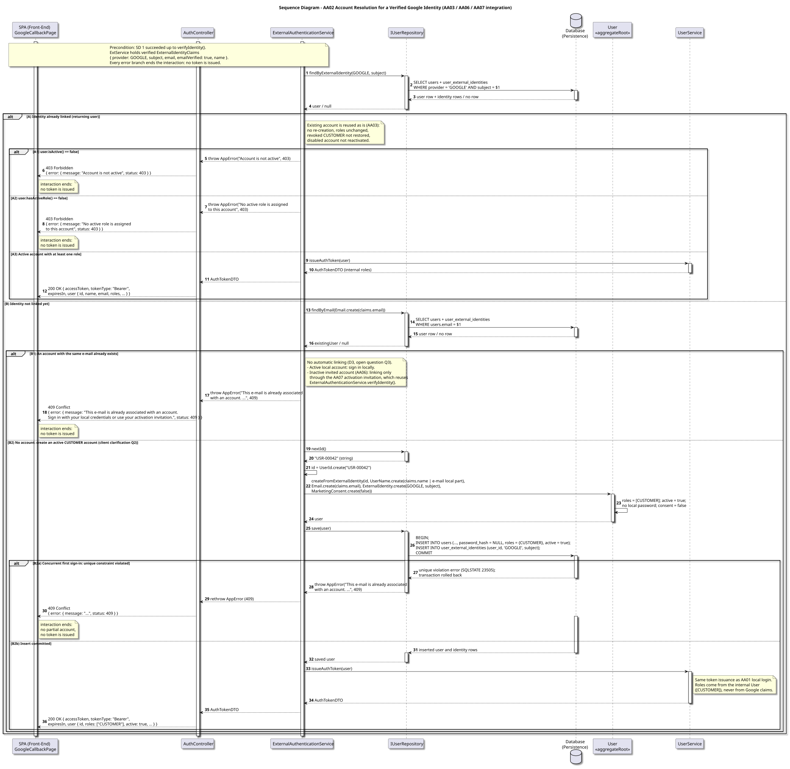
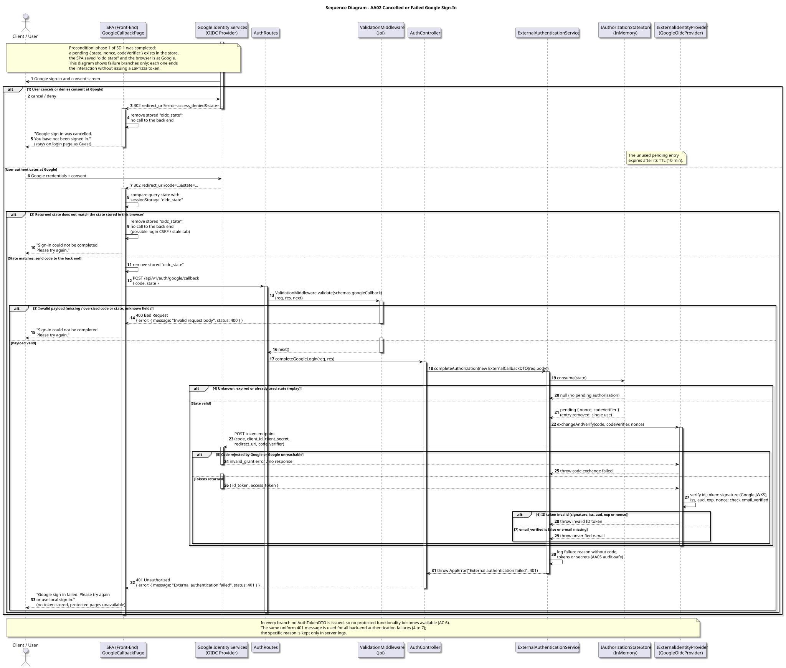
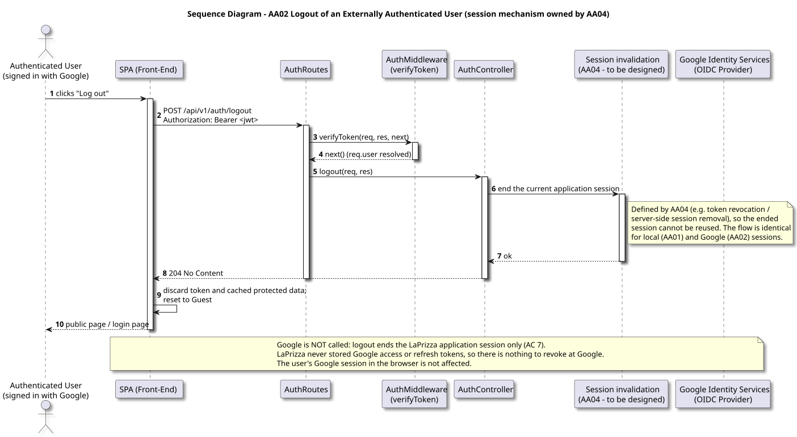

# US AA02 – External Identity Provider Integration

## 1. Context & Scope

*   **User Story ID:** AA02
*   **Sprint:** Sprint 2
*   **Area:** Authentication and Authorization (AA)
*   **Responsible:** Leonor de Moura (1240914)
*   **Related Requirements / Stories:**
    *   Sprint 2 User Stories, *PART IV – Sprint 2 – User Stories*, AA02.
    *   System Specification: *PART II – System Specification*, Identity and Access Management (identification and authentication of users and control of access according to assigned roles and permissions) and Security and Data Protection.
    *   Architecture: [System Architecture Description](../../architecture/SAD.md) (*Scenario 3 – Authentication, authorization, and access control by user role*) and [ADR-008 – Use Google Identity Services for External Authentication](../../architecture/ADR.md).
    *   Related stories:
        *   **BCK01 – User and Authentication Management:** existing `User` aggregate, `UserService`, JWT issuance (`ITokenService`) and `AuthMiddleware` / `RoleMiddleware`.
        *   **AA01 – Local Authentication:** local login offered alongside external login; both must follow the same activation, role, logout and access-control rules.
        *   **AA03 – Internal Role Resolution:** automatic `CUSTOMER` assignment for new accounts; roles always resolved internally; access denied for inactive accounts or accounts without an active role.
        *   **AA04 – Secure Session Handling:** session lifecycle, expiry and logout mechanism used after external login.
        *   **AA05 – Authorization Enforcement:** permission checks on protected operations; audit-safe recording of failed attempts.
        *   **AA06 – Role Assignment and Activation Invitation:** Table 1 roles (including `Administrator`), role removal and creation of inactive invited accounts.
        *   **AA07 – Secure Account Activation:** activation of invited accounts, which for external accounts reuses the identity verification designed here.
        *   **WEB01 / WEB02 / WEB03:** SPA shell, layout and role-based navigation that host the login entry point and the callback page.
    *   **Dependencies:** AA02 extends the `user-authentication-management` module created in BCK01. It depends on AA03/AA06 for the role model, on AA04 for the logout/session-invalidation mechanism, and provides `ExternalAuthenticationService.verifyIdentity()` to AA07.

### Scope boundary

AA02 concerns authentication through an external identity provider. The client left the choice of provider to the team (Client Clarification Q1); the team selected **Google Identity Services** ([ADR-008](../../architecture/ADR.md)), used with **OpenID Connect (OIDC) on top of OAuth 2.0**, in the **Authorization Code flow with PKCE**, with the authorization code exchanged by the Back-End API (decision D1).

AA02 owns:

1. The external sign-in entry point offered alongside local sign-in.
2. The redirect to Google and the return to the application (callback).
3. Validation of the identity assertion (ID token) before any protected functionality becomes available.
4. Safe association of the verified external identity with an internal `User` account, including automatic creation of an active `CUSTOMER` account on first sign-in (Client Clarification Q2).
5. Feedback and fail-closed behaviour for cancelled or failed external sign-in.
6. Guaranteeing that logout of an externally authenticated user ends the application session.

---

## 2. Requirements & Analysis

### 2.1. User Story Description

> **As a** System User,  
> **I want** to authenticate through an external identity provider,  
> **so that** I can securely access the integrated application.

The actor is **System User**, as named in the Sprint 2 specification. Any account (Customer, Restaurant Staff, LaPrizza Manager or Administrator) may sign in with Google once its Google identity is linked; the roles it then receives are always the internal ones (BR 4).

### 2.2. Acceptance Criteria

- [ ] **AC 1:** Users can choose authentication through an external identity provider in addition to local authentication.
- [ ] **AC 2:** External authentication uses OpenID Connect with OAuth 2.0 (or an equivalent supported combination) suitable for identifying the user and authorizing service access.
- [ ] **AC 3:** Choosing external authentication directs the user to the selected provider and returns them to the application after successful authentication.
- [ ] **AC 4:** External authentication establishes a verified identity before protected application functionality becomes available.
- [ ] **AC 5:** The application does not collect or store the password used at the external provider.
- [ ] **AC 6:** Cancelled or failed authentication shows appropriate feedback and does not grant access.
- [ ] **AC 7:** Users can log out of the application and end their application session.

Criteria from related stories that constrain AA02 (not owned, but must hold for externally authenticated users):

*   **AA01 AC 7 / AA04 AC 5:** local and external authentication provide equivalent session protection, activation, role, logout and access-control behaviour.
*   **AA03:** every newly created account automatically receives `CUSTOMER`, assigned by the back end; returning users keep their current roles; login never recreates an account, restores a revoked `CUSTOMER` role or reactivates a disabled account; roles supplied by the user are never proof of authorization; users with no active role or with an inactive account receive an access-denied message; if roles cannot be confirmed, protected functionality remains unavailable.
*   **AA06:** a user must not acquire an administrative role by selecting an authentication method; role removal must prevent subsequent use of withdrawn permissions.
*   **AA07:** for an invited external account, the invitation guides the user through the identity provider and verifies that the authenticated identity matches the intended recipient before activation; authentication must not automatically grant marketing consent.

#### Existing implementation evidence relevant to the criteria

*   Only local authentication exists: `POST /api/v1/auth/login` (`AuthRoutes`, `AuthController.login`, `UserService.login`). No OIDC/OAuth library, configuration or route exists (`backend/package.json`, `backend/.env.example`).
*   `UserService.login` builds the `AuthTokenDTO` inline (JWT payload `{ sub, email, roles }` with primitive values from `getId().getValue()`, `getEmail().getValue()` and `getRoles()`; `tokenType: "Bearer"`; `expiresIn` from `ITokenService`). External login must issue the **same** token.
*   `AuthMiddleware.verifyToken` → `UserService.resolveActor(token)` reloads the `User` on every protected request and returns `{ sub, email, roles }` with the current roles; inactive users are rejected with `401`.
*   The `User` aggregate requires a `Password` (bcrypt hash validated by regex) and `users.password_hash` is `NOT NULL` (`migrations/0001_users.sql`). An account created from a Google identity has no local password.
*   The current role model has `MANAGER`, `EMPLOYEE` and `CUSTOMER` with at least one role per user (`normalizeRoles`, `users_roles_valid` constraint). The Sprint 2 `Administrator` role and the "no active role" state are not yet represented; they are owned by AA03/AA06.
*   `IUserRepository` supports `nextId(): Promise<string>`, `findById`, `findByEmail`, `existsByEmail`, `findAll` and `save`; there is no lookup by external identity.
*   `ValidationMiddleware.validate(schema)` returns an Express middleware that rejects invalid bodies with `AppError('Invalid request body', 400)`. `errorHandler` returns `{ "error": { "message", "status" } }` and sanitizes every non-4xx error to `500`.
*   `AuthRoutes` already applies `Cache-Control: no-store` and the public rate limiter (30 requests / 15 min per IP).

### 2.3. Client Clarifications & Questions

**Question 1:** External identity provider (AA02). Is there a specific identity provider that LaPrizza prefers for external authentication (e.g., Google or Microsoft), or is the choice left to the team?

**Answer 1:** External identity provider (AA02): There is no preference for a specific identity provider. The choice is left to the team, provided the defined authentication and security requirements are met.

**Question 2:** First login via an external provider (AA02/AA03): When a user authenticates for the first time through an external provider without having received an invitation, should an account with the "Customer" role be created automatically? In this scenario, is the account considered active—given that the identity has already been verified by the external provider—or can it only be activated via an invitation?

**Answer 2:** First login with an external identity provider: Yes. On the first successful authentication through an external identity provider, an account with the Customer role must be created automatically and activated. No invitation is required.


### 2.4. Business Rules & Invariants

Each rule states its source: **S** = Sprint 2 specification, **C** = client clarification, **D** = team design decision (section 3.8).

| ID | Rule | Source |
| --- | --- | --- |
| **BR 1** | External authentication uses OpenID Connect with OAuth 2.0. | S – AA02 AC 2 |
| **BR 2** | The password used at the provider is never collected or stored by LaPrizza. | S – AA02 AC 5 |
| **BR 3** | Cancelled or failed external authentication shows feedback and never grants access (no LaPrizza token is issued). | S – AA02 AC 6 |
| **BR 4** | Roles come exclusively from the internal `User`. Roles or claims supplied by the user or the provider are never proof of authorization; selecting Google cannot grant `MANAGER`, `EMPLOYEE` or `ADMINISTRATOR`. | S – AA03, AA06 |
| **BR 5** | A returning user's account is reused as is: no re-creation, no role change, no restoration of a revoked `CUSTOMER` role, no reactivation. | S – AA03 |
| **BR 6** | A user with an inactive account, or with no active role, receives an access-denied message and no session. | S – AA03 |
| **BR 7** | A new account receives `CUSTOMER` automatically from the back end, and `MarketingConsent = false`. | S – AA03, AA07 |
| **BR 8** | Local and external authentication provide equivalent session protection and authorization behaviour; both issue the same `AuthTokenDTO`. | S – AA01 AC 7, AA04 AC 5 |
| **BR 9** | On the first successful external authentication of an unknown identity, an account with `CUSTOMER` is created automatically and **activated**; no invitation is required. | C – Q2 |
| **BR 10** | An external identity is identified by `(provider, subject)`, where `subject` is the OIDC `sub` claim; `(provider, subject)` is globally unique and maps to exactly one `User`. The e-mail is not the identity key. | D7 |
| **BR 11** | External sign-in is accepted only when the provider asserts `email_verified = true` and supplies an e-mail. | D (required for BR 9 and the BCK01 e-mail uniqueness rule) |
| **BR 12** | An **active** `User` has at least one credential: a local `Password` and/or an `ExternalIdentity`. An inactive invited account (AA06) may have no credential until activation (AA07); `activate()` is rejected while the account has no credential. | D2 |
| **BR 13** | A `User` has at most one `ExternalIdentity` per `IdentityProvider`. | D |
| **BR 14** | A new external identity whose e-mail already belongs to an existing account is not linked automatically. | D3 (open question Q3) |
| **BR 15** | Each authorization attempt has a random `state`, `nonce` and PKCE `code_verifier`, valid for 10 minutes and usable once. | D1, D4 |
| **BR 16** | The LaPrizza token is returned only in a JSON body, never in a URL; Google tokens are discarded and never persisted; codes, tokens and secrets are never logged. | S – AA04 AC 6, AA05; D |
| **BR 17** | The new account's `UserName` is the Google `name` claim (trimmed, at most 100 characters) or, if absent, the local part of the e-mail. | D |
| **BR 18** | Local login rejects any account without a local password, independently of the dummy-hash comparison result. | D8 |

### 2.5. Domain Model Excerpt



PlantUML source: [`excerptDomainModel/domain_model_excerpt.puml`](./excerptDomainModel/domain_model_excerpt.puml).

| Concept | Kind | Role in AA02 |
| --- | --- | --- |
| **User** | Entity / Aggregate Root (existing, extended) | Internal account authenticated through Google; owns roles and `active` state |
| **ExternalIdentity** | Value Object (**new**) | `(provider, subject, linkedAt)` – links the User to one identity at an external provider |
| **IdentityProvider** | Enumeration (**new**) | Supported providers; `GOOGLE` in Sprint 2 |
| **Password** | Value Object | Becomes optional (0..1): external-only accounts may have no local password |
| **Email**, **UserName**, **UserId**, **MarketingConsent** | Value Objects | Filled from verified claims for a new account (consent always `false`) |
| **UserRole** | Enumeration |AA02 only ever assigns `CUSTOMER` |

`ExternalIdentity` is modelled inside the User aggregate because its invariants (BR 10, BR 12, BR 13) are User invariants and must change atomically with the User. 

---

## 3. Design

### 3.1. Architecture & C4 Alignment

This User Story operates within the established **C4 Model** of the system ([SAD](../../architecture/SAD.md)), which already includes Google Identity Services as an external system ([ADR-008](../../architecture/ADR.md)):

*   **C4 Level 1 (System Context):** The System User signs in with a Google account at **Google Identity Services**; the LaPrizza Information System authenticates users through OpenID Connect / OAuth 2.0.
*   **C4 Level 2 (Containers):** The *Web Application* (SPA) starts the flow and receives the redirect back from Google; the *Back-End API* is the OIDC confidential client (holds the client secret, exchanges the code, validates the ID token, resolves the internal account and issues the LaPrizza JWT); the *Relational Database* (PostgreSQL) stores the internal account and the `(provider, subject)` link. The SPA never validates identities or decides roles.
*   **C4 Level 3 (Components):** AA02 is realised by the **Security Component**, which runs the Google OpenID Connect sign-in (authorization code exchange and ID token validation) and issues the application JWT. It relies on the **User Component** to resolve or create the internal account and on the **Repositories Component** for persistence. In code, both components correspond to the existing `user-authentication-management` module, keeping its Clean / Layered structure (`api` → `application` → `domain` ← `infrastructure`). No new module is created.

---

### 3.2. Class Diagram (CD)

Structural design of the classes participating in this User Story, organised by Clean / Layered Architecture (Presentation → Application → Domain ← Infrastructure). 



> PlantUML source: [`classDiagram/class_diagram.puml`](./classDiagram/class_diagram.puml).

Key design points:

*   **Reused unchanged:** `ValidationMiddleware`, `AuthMiddleware`, `RoleMiddleware`, `ITokenService` / `JwtTokenService`, `AuthTokenDTO`, `UserResponseDTO`, `UserResponseMapper`, the public rate limiter and `AppError` / `errorHandler`. Protected requests from Google-authenticated users go through exactly the same `AuthMiddleware → UserService.resolveActor → RoleMiddleware` pipeline.
*   **Extended:**
    *   `AuthRoutes` (two public routes) and `AuthController` (two handlers, new dependency).
    *   `UserService`: `issueAuthToken(user)` extracted from `login()`; `login()` explicitly rejects accounts without a local password (BR 18).
    *   `User`: optional `Password`, external identities, `hasActiveRole()`, `hasCredential()`, and `activate()` guarded by BR 12.
    *   `IUserRepository` / `UserRepository` / `UserMapper`: `findByExternalIdentity`, identity hydration in **every** finder (including `findAll`), and persistence of newly linked identities in `save()`.
    *   `UserPersistenceModel`: `password_hash` becomes nullable.
*   **New:** `ExternalAuthenticationService`, the ports `IExternalIdentityProvider` and `IAuthorizationStateStore`, their adapters `GoogleOidcProvider` and `InMemoryAuthorizationStateStore`, the domain elements `ExternalIdentity` and `IdentityProvider`, three DTOs (`ExternalAuthorizationDTO`, `ExternalCallbackDTO`, `ExternalIdentityClaims`), the persistence model `UserExternalIdentityPersistenceModel` (`user_external_identities` table) and the SPA elements `GoogleSignInButton`, `GoogleCallbackPage` and `authApi`. Section 3.7 justifies each one.
*   **Dependency direction:** the application reaches external concerns (identity provider, authorization state, persistence, token signing) only through ports; Google-specific code (`google-auth-library`, endpoints, JWKS) is confined to `GoogleOidcProvider` in Infrastructure, as bcrypt and JWT already are. `ExternalAuthenticationService` reuses `UserService.issueAuthToken()` so that token issuance is not duplicated.

#### Role handling (AA03 / AA06 integration)

*   AA02 does not define the role set. It uses the `UserRole` values (`ADMINISTRATOR`, `MANAGER`, `EMPLOYEE`, `CUSTOMER` for Table 1) and only ever assigns `CUSTOMER`, when it creates an account (BR 7, BR 9).
*   Before issuing a token, `ExternalAuthenticationService` checks the internal account (decision D9):
    *   `user.isActive() == false` → `403 Account is not active`;
    *   `user.hasActiveRole() == false` (no role left after AA06 removals) → `403 No active role is assigned to this account`;
    *   otherwise the token is issued with the internal roles.
*   After sign-in, each protected request is re-checked by `UserService.resolveActor` (current roles and `active` state). Denying requests from users whose roles were all removed after sign-in is part of AA03's per-request resolution.

---

### 3.3. Sequence Diagrams (SD)

Four scenarios are documented separately because they cover distinct acceptance criteria and interaction paths. Error branches always end the interaction explicitly; only success branches issue a token.

#### SD 1 — Successful Google Sign-In (AC 1, AC 2, AC 3, AC 4, AC 5)

Start of the flow, authentication at Google, callback, ID token validation, internal account lookup and issuance of the LaPrizza token.



> Source: [`sequence_diagram_google_login.puml`](./sequenceDiagram/sequence_diagram_google_login.puml)

#### SD 2 — Account Resolution for a Verified Google Identity (AC 4; AA03, AA06, AA07 integration)

Returning linked user (inactive, no active role, or allowed), e-mail already used by another account, automatic creation of an active `CUSTOMER` account (BR 9) and the concurrent-creation conflict.



> Source: [`sequence_diagram_google_account_resolution.puml`](./sequenceDiagram/sequence_diagram_google_account_resolution.puml)

#### SD 3 — Cancelled or Failed Google Sign-In (AC 6)

Cancellation at Google, state mismatch in the browser, invalid callback payload, and back-end rejection (unknown/expired/replayed state, code rejected by Google or Google unreachable, invalid ID token, unverified e-mail).



> Source: [`sequence_diagram_google_login_failure.puml`](./sequenceDiagram/sequence_diagram_google_login_failure.puml)

#### SD 4 — Logout of an Externally Authenticated User (AC 7; AA04 integration)



> Source: [`sequence_diagram_logout.puml`](./sequenceDiagram/sequence_diagram_logout.puml)

---

### 3.4. REST API Specification (ARC03)

All endpoints are versioned under `/api/v1`, documented via OpenAPI/Swagger (`api/openapi.js` of the module), respond with `Cache-Control: no-store` and use the public rate limiter (same as `POST /auth/login`).

| Method | Endpoint | Description | Auth / Role |
| :--- | :--- | :--- | :--- |
| `POST` | `/api/v1/auth/google/authorization` | Starts a Google OIDC authorization; returns the Google authorization URL and the `state` | Public (Guest) |
| `POST` | `/api/v1/auth/google/callback` | Completes the authorization with `code` + `state`; validates the identity; returns the LaPrizza token | Public (Guest) |
| `POST` | `/api/v1/auth/login` | Existing local login (AA01) – unchanged contract | Public (Guest) |
| `POST` | `/api/v1/auth/logout` | Ends the application session – **defined by AA04**, used by AA02 | Authenticated |

`POST` is used for the authorization endpoint because each call creates a new one-time server-side authorization state.

#### Request & Response Schemas

- **Start — Request (`POST /api/v1/auth/google/authorization`):** no body.

- **Start — Success (`200 OK`):**

  ```json
  {
    "authorizationUrl": "https://accounts.google.com/o/oauth2/v2/auth?response_type=code&client_id=...&redirect_uri=http%3A%2F%2Flocalhost%3A5173%2Fauth%2Fcallback%2Fgoogle&scope=openid%20email%20profile&state=...&nonce=...&code_challenge=...&code_challenge_method=S256",
    "state": "q3Jk0p...Yw"
  }
  ```

- **Callback — Request (`POST /api/v1/auth/google/callback`):**

  ```json
  {
    "code": "4/0AeanS0...",
    "state": "q3Jk0p...Yw"
  }
  ```

  Applied as `ValidationMiddleware.validate(schemas.googleCallback)`. Joi schema `googleCallback`: `code` – required string, 1–2048 characters; `state` – required string, 16–256 characters, URL-safe base64 alphabet; unknown fields rejected.

- **Callback — Success (`200 OK`):** identical to the local login response (`AuthTokenDTO`):

  ```json
  {
    "accessToken": "eyJhbGciOiJIUzI1NiIsInR5cCI6IkpXVCJ9...",
    "tokenType": "Bearer",
    "expiresIn": "1d",
    "user": {
      "id": "USR-00042",
      "name": "Ana Silva",
      "email": "ana.silva@gmail.com",
      "roles": ["CUSTOMER"],
      "active": true,
      "marketingConsent": false,
      "createdAt": "2026-11-02T10:00:00.000Z"
    }
  }
  ```

- **Error Responses** (all in the existing `errorHandler` format):
  - `400 Bad Request`: `Invalid request body` – callback payload invalid (existing `ValidationMiddleware` message).
  - `401 Unauthorized`: `External authentication failed` – unknown, expired or reused `state`; code rejected by Google; Google unreachable; invalid ID token (signature, `iss`, `aud`, `exp`, `nonce`); `email_verified` false. One uniform message; the reason is only logged server-side without secrets (decision D6).
  - `403 Forbidden`: `Account is not active` – the Google identity is linked to an inactive account (BR 6).
  - `403 Forbidden`: `No active role is assigned to this account` – the linked account has no role (BR 6). The identity is verified by Google, so disclosing the account state to its owner does not weaken AA01's generic-failure rule.
  - `409 Conflict`: `This e-mail is already associated with an account. Sign in with your local credentials or use your activation invitation.` – first Google sign-in with an e-mail already used by another account (BR 14), including the concurrent-creation race.
  - `429 Too Many Requests`: `Too many attempts; try again later` – public rate limiter.
  - Format:
    ```json
    {
      "error": {
        "message": "External authentication failed",
        "status": 401
      }
    }
    ```

JWT payload: unchanged from BCK01 – `{ "sub": "<userId string>", "email": "<email string>", "roles": ["<role>", ...] }`, built from `user.getId().getValue()`, `user.getEmail().getValue()` and `user.getRoles()`, with issuer `laprizza` and audience `laprizza-api`. The token does not carry the authentication method.

#### Configuration (no secrets in the repository)

| Variable (back end) | Example | Notes |
| --- | --- | --- |
| `GOOGLE_CLIENT_ID` | `1234-abc.apps.googleusercontent.com` | OAuth client of type *Web application* in Google Cloud Console |
| `GOOGLE_CLIENT_SECRET` | *(local `.env` only)* | Never committed; documented empty in `.env.example` |
| `GOOGLE_REDIRECT_URI` | `http://localhost:5173/auth/callback/google` | Must be registered exactly in Google Cloud Console; HTTPS required outside `localhost` |

Configuration is loaded and validated by a new `loadExternalIdentityConfig()` next to `loadSecurityConfig()` in `src/shared/security/config.js`. If the variables are absent, the Google routes are not registered (local login and automated tests keep working without Google credentials). The SPA needs no Google configuration: it receives the authorization URL from the back end.

### 3.5. Persistence & Data Integrity (ARC04)

A new migration `0016_user_external_identities.sql` (next number after `0015`) is required:

- **`users` (existing, altered):**
  - `password_hash` becomes **nullable** (`ALTER TABLE users ALTER COLUMN password_hash DROP NOT NULL`). The existing bcrypt-format `CHECK` still applies to non-null values.
- **`user_external_identities` (new):**

| Column | Type | Constraints / Notes |
| :--- | :--- | :--- |
| `user_id` | VARCHAR(32) | NOT NULL; FK → `users(id)` ON DELETE RESTRICT (users are never hard-deleted, BCK01 BR 5) |
| `provider` | VARCHAR(16) | NOT NULL; `CHECK (provider IN ('GOOGLE'))` |
| `subject` | VARCHAR(255) | NOT NULL; `CHECK (length(subject) BETWEEN 1 AND 255)`; OIDC `sub` claim |
| `linked_at` | TIMESTAMPTZ | NOT NULL, DEFAULT now(); `CHECK (isfinite(linked_at))` |

- **Integrity Rules:**
  - `PRIMARY KEY (provider, subject)` enforces BR 10 under concurrent first sign-ins.
  - `UNIQUE (user_id, provider)` enforces BR 13.
  - BR 12 ("an active user has at least one credential") spans two tables and is enforced by the `User` aggregate. The repository writes the user row and its identity rows in one transaction.
  - The existing `users_email_key` unique constraint still enforces e-mail uniqueness; a violation during Google account creation is reported as `409`.
  - No Google password, access token, refresh token or ID token is persisted. Pending authorization state is kept in memory only (decision D4).

### 3.6. Applied Patterns & Architecture Principles

- **Clean / Layered Architecture:** unchanged module structure; Google specifics only in Infrastructure; the domain has no dependency on OIDC or HTTP.
- **Aggregate Root (DDD):** external identities are created and linked only through `User` (`createFromExternalIdentity`, `linkExternalIdentity`), which enforces BR 7, BR 10, BR 12 and BR 13.
- **Value Objects:** `ExternalIdentity` is immutable and validated (`provider` in `IdentityProvider`, non-empty `subject` ≤ 255).
- **Repository Pattern:** `IUserRepository.findByExternalIdentity` keeps SQL in `UserRepository`.
- **Ports & Adapters:** `IExternalIdentityProvider` and `IAuthorizationStateStore` follow the structural JSDoc port style of `IPasswordHasher` / `ITokenService` in `application/ports/security.js`.
- **DTO Pattern:** `ExternalCallbackDTO`, `ExternalAuthorizationDTO`, `ExternalIdentityClaims`; the response reuses `AuthTokenDTO`.
- **Middleware pipeline:** `limiter` → `ValidationMiddleware.validate(schema)` → controller for the public routes; protected routes unchanged.
- **Security practices:** OIDC Authorization Code + PKCE (S256); `state` (CSRF), `nonce` (replay), single-use and time-limited state; ID token validation; least-privilege scopes `openid email profile`; secrets only in environment variables.
- **Architecture decision:** [ADR-008](../../architecture/ADR.md) records the selection of Google Identity Services. The flow and integration decisions specific to AA02 are listed in section 3.8.

### 3.7. New Components and Justification

| Component | Layer | Why it is needed / why an existing one is not enough |
| --- | --- | --- |
| `ExternalAuthenticationService` | Application | Orchestrates start/callback, state consumption, identity verification, account resolution and the session-start checks (D9). Kept separate from `UserService` because it has different collaborators (provider, state store) and because AA07 must reuse `verifyIdentity()` without the login logic. Token issuance is **not** duplicated: it calls `UserService.issueAuthToken()`. |
| `IExternalIdentityProvider` + `GoogleOidcProvider` | Application port + Infrastructure adapter | No existing component talks to an identity provider. Isolates `google-auth-library`, Google endpoints, JWKS verification and secret handling, as `BcryptPasswordHasher` / `JwtTokenService` do for their libraries. Enables tests with a fake provider (no Google calls in CI). |
| `IAuthorizationStateStore` + `InMemoryAuthorizationStateStore` | Application port + Infrastructure adapter | OIDC requires remembering `state`, `nonce` and `code_verifier` between the two requests. In-memory with TTL follows the precedent of the in-memory rate limiter; the port allows a PostgreSQL implementation later without changing the service (D4). |
| `ExternalIdentity`, `IdentityProvider` | Domain | Represent "this User is the Google subject X" with its invariants (BR 10, BR 13). |
| `ExternalAuthorizationDTO`, `ExternalCallbackDTO`, `ExternalIdentityClaims` | Application DTOs | Same DTO pattern as `LoginDTO` / `AuthTokenDTO`; the claims DTO keeps provider data out of the domain. |
| Table `user_external_identities`, nullable `password_hash` | Persistence | Required by D2, BR 10 and BR 13. |
| `google-auth-library` (npm) | Dependency | Official Google library: authorization URL with PKCE, code exchange and ID-token verification with cached Google certificates. Avoids hand-written JWT/JWKS verification. Alternative: `openid-client` (generic, certified) – acceptable but more configuration for a single provider. |
| SPA: `GoogleSignInButton`, `GoogleCallbackPage`, `authApi` | Front-End | Minimal touch points inside the SPA shell owned by WEB01/WEB02; naming follows the existing `healthApi.js`. |

### 3.8. Design Decisions

| ID | Decision | 
| --- | --- | 
| **D1** | Authorization Code flow + PKCE; code exchanged by the back end; SPA callback route; state single-use, valid 10 minutes. |
| **D2** | `Password` becomes optional. Only an **active** User must have at least one credential (BR 12); invited inactive accounts may have none until AA07 activation, and `activate()` is rejected while the account has no credential. |
| **D3** | No automatic linking by e-mail: `409` with guidance; linking to an existing account only through AA07 (invited accounts). | 
| **D4** | In-memory authorization-state store with TTL and single use. |
| **D5** | Logout ends only the LaPrizza session (AA04 mechanism); no Google sign-out. |
| **D6** | All back-end authentication failures, including Google being unreachable, return the uniform `401 External authentication failed`. |
| **D7** | Identity key is `(provider, sub)`; the e-mail of an existing linked account is not updated from later Google sign-ins. | 
| **D8** | `UserService.login()` explicitly rejects accounts without a local password with the uniform `401`, while still performing the dummy-hash comparison so response timing does not reveal the account type. |
| **D9** | Before issuing a token after external sign-in, require `active == true` and at least one role; otherwise `403` with an access-denied message (BR 6). | 

---

## 4. Tests (ARC05)

### 4.1. Test Plan & Scenarios

Automated tests never call Google: `IExternalIdentityProvider` is replaced by a fake in service and HTTP tests, and `GoogleOidcProvider` is tested with a mocked `OAuth2Client` / locally signed tokens. Real Google sign-in is covered by the manual demonstration (MT01–MT03).

| Test ID | Level / Source | Scenario / Description | Expected Result |
| ------- | -------------- | ---------------------- | --------------- |
| UT01 | Domain — `domain.test.js` | Create `ExternalIdentity` with valid/invalid provider and subject (empty, > 255) | Valid VO or domain validation error |
| UT02 | Domain — `domain.test.js` | `User.createFromExternalIdentity` | Roles `[CUSTOMER]`, active, no password, consent `false`, identity present |
| UT03 | Domain — `domain.test.js` | Second identity for the same provider; `linkExternalIdentity` on an existing account | Rejected; linked without changing roles or `active` |
| UT04 | Domain — `domain.test.js` | `activate()` on an invited account without credential; after `linkExternalIdentity` | Rejected (BR 12); then accepted |
| UT05 | Application — `externalAuth.test.js` | `startAuthorization` | Pending state saved with TTL; DTO contains only `authorizationUrl` and `state` |
| UT06 | Application — `externalAuth.test.js` | Callback for linked active user with roles (Google claims include fake "roles") | Token roles equal internal roles; claims ignored |
| UT07 | Application — `externalAuth.test.js` | Callback for unknown identity with free e-mail | Active account with `CUSTOMER` only created and saved once; token issued (BR 9) |
| UT08 | Application — `externalAuth.test.js` | Linked inactive account; linked account with no role; account whose `CUSTOMER` was removed but has other roles | `403 Account is not active`; `403 No active role…`; token with the remaining roles – account never modified |
| UT09 | Application — `externalAuth.test.js` | Unknown identity, e-mail already used (active local account and inactive invited account) | `409`, no linking, no new account |
| UT10 | Application — `externalAuth.test.js` | Unknown, expired and reused `state` | `401`; provider never called |
| UT11 | Application — `externalAuth.test.js` | Provider error, invalid token, `email_verified = false` | Uniform `401`; logged reason contains no code/token |
| UT12 | Application — `services.test.js` | Local login for an external-only account, including a forced `compare() → true` | Uniform `401 Invalid email or password` (BR 18) |
| UT13 | Application — `services.test.js` | `issueAuthToken` used by `login` | Existing local login tests pass with an identical `AuthTokenDTO` |
| UT14 | Infrastructure — `googleProvider.test.js` | Authorization URL; ID-token verification (wrong `aud`, `iss`, `nonce`, expired, bad signature) | URL has `response_type=code`, `scope=openid email profile`, `state`, `nonce`, `S256` challenge; invalid tokens rejected |
| UT15 | Infrastructure — `stateStore.test.js` | Save/consume, consume twice, consume after TTL | Entry returned once; `null` afterwards or after expiry |
| UT16 | OpenAPI — `openapi.test.js` | New operations documented | Two operations, public, no secret fields in schemas |
| IT01 | HTTP — `api.test.js` | `POST /auth/google/authorization` | `200`, `Cache-Control: no-store`, URL + state |
| IT02 | HTTP — `api.test.js` | Full callback with fake provider; then `GET /api/v1/stock` with the new Customer token; promote the account to Manager (test fixture, independent of AA06); repeat `GET /api/v1/stock` with the **same** token | `200` token with `["CUSTOMER"]`; first request `403` (Customer has no access to internal stock, Table 1); second request `200` without a new sign-in (roles resolved internally per request) |
| IT03 | HTTP — `api.test.js` | Invalid payload; unknown state; replayed callback | `400 Invalid request body`; `401`; `401` |
| IT04 | HTTP — `api.test.js` | Deactivate external user after sign-in; sign in again | Existing token denied (`401`); new sign-in `403` |
| IT05 | HTTP — `api.test.js` | Repeated public attempts; routes without Google configuration | `429` at limit; Google routes not registered, local login works |
| IT06 | PostgreSQL — `postgres.test.js` | Migration replay; null `password_hash`; `(provider, subject)` uniqueness; concurrent first sign-ins | Migration applies once; exactly one account created; other attempt `409` |
| IT07 | PostgreSQL — `postgres.test.js` | Round-trip with identities through `findById`, `findByEmail`, `findByExternalIdentity` and `findAll` | Complete aggregates with identities in every finder; local accounts unaffected |
| IT08 | PostgreSQL — `postgres.test.js` | Load an existing user, `linkExternalIdentity`, `save`; then a stale save of the same aggregate | Identity row inserted in the same transaction; no duplicate row |
| MT01 | Manual (real Google) | Sign in with a new Google test account | Redirected to Google and back; active account with `CUSTOMER` |
| MT02 | Manual (real Google) | Cancel at the Google consent screen | Cancellation message; still Guest |
| MT03 | Manual (real Google) | Log out, then press browser Back | Session ended; no protected data shown (AA04) |

Acceptance-criteria traceability:

| AC | Main scenarios |
| --- | --- |
| AC1 | IT01, IT05, MT01 |
| AC2 | UT05, UT14, IT01, IT02 |
| AC3 | UT05, IT01, MT01 |
| AC4 | UT06–UT11, UT14, IT02, IT03, IT06 |
| AC5 | UT02, UT12, UT14, IT07, MT01 |
| AC6 | UT10, UT11, IT03, MT02 |
| AC7 | IT04, MT03 (with AA04 tests) |

### 4.2. Sample Test Implementations

To be added after implementation.

---

## 5. Implementation

### 5.1. File Structure

```text
backend/
├── migrations/
│   └── 0016_user_external_identities.sql                      (new)
├── src/
│   ├── shared/security/config.js                              (extended: loadExternalIdentityConfig)
│   └── modules/user-authentication-management/
│       ├── index.js                                           (extended: wiring)
│       ├── api/
│       │   ├── routes/authRoutes.js                           (extended)
│       │   ├── controllers/authController.js                  (extended)
│       │   ├── schemas.js                                     (extended: googleCallback)
│       │   └── openapi.js                                     (extended)
│       ├── application/
│       │   ├── dtos/ExternalAuthorizationDTO.js               (new)
│       │   ├── dtos/ExternalCallbackDTO.js                    (new)
│       │   ├── dtos/ExternalIdentityClaims.js                 (new)
│       │   ├── ports/externalIdentity.js                      (new: IExternalIdentityProvider, IAuthorizationStateStore)
│       │   └── services/
│       │       ├── ExternalAuthenticationService.js           (new)
│       │       └── UserService.js                             (extended: issueAuthToken, BR 18)
│       ├── domain/
│       │   ├── model/User.js                                  (extended)
│       │   ├── model/values.js                                (extended: ExternalIdentity, IdentityProvider)
│       │   └── repositories/IUserRepository.js                (extended)
│       └── infrastructure/
│           ├── persistence/UserRepository.js                  (extended)
│           ├── persistence/UserMapper.js                      (extended)
│           └── security/
│               ├── GoogleOidcProvider.js                      (new)
│               └── InMemoryAuthorizationStateStore.js         (new)
├── .env.example                                               (extended: GOOGLE_* without values)
└── tests/                                                     (see section 4)
frontend/src/
├── auth/authApi.js                                            (new)
├── auth/GoogleSignInButton.jsx                                (new)
└── auth/GoogleCallbackPage.jsx                                (new)
```

### 5.2. Core Implementation Highlights

- **Start of sign-in:** `GoogleOidcProvider.createAuthorizationRequest()` generates random `state` and `nonce` and a PKCE verifier/challenge (S256); `ExternalAuthenticationService` stores them in `InMemoryAuthorizationStateStore` (single use, 10 minutes) and returns only `{ authorizationUrl, state }`.
- **Callback:** `verifyIdentity()` consumes the state, exchanges the code with the verifier (`OAuth2Client.getToken`) and validates the ID token (`verifyIdToken`: signature, `aud`, `exp`; plus `iss`, `nonce`, `sub` and `email_verified`). The Google access token is discarded.
- **Account resolution:** linked identity → existing account reused unchanged; e-mail already used → `409` (D3); otherwise `User.createFromExternalIdentity()` creates an active `CUSTOMER` account without password or marketing consent (BR 9).
- **Session start:** inactive account or no role → `403` (D9); otherwise `UserService.issueAuthToken()` issues the same `AuthTokenDTO` as local login (BR 8).
- **Persistence:** `UserRepository` loads identities in every finder (one extra query, also in `findAll`), inserts a new user and its identities in one transaction, and inserts identities linked after loading; unique violations map to `409`.
- **Local login safeguard:** `UserService.login()` rejects accounts without a local password, after the dummy-hash comparison (BR 18 / D8).
- **SPA:** `googleSignIn.js` stores the `state` in `sessionStorage`, compares it on return, never calls the back end when the user cancelled or the state does not match, and removes `code`/`state` from the address bar.

---

## 6. Integration, Verification & Demonstration

### 6.1. Running the Automated Tests

```bash
cd backend
npm test -- tests/unit/user-authentication-management tests/integration/user-authentication-management
```

### 6.2. Manual Verification & OpenAPI Contract

1. Create an OAuth client (*Web application*) in Google Cloud Console and register `GOOGLE_REDIRECT_URI`.
2. Set `GOOGLE_CLIENT_ID`, `GOOGLE_CLIENT_SECRET` and `GOOGLE_REDIRECT_URI` in the local `backend/.env` (never committed).
3. Start the backend (`npm run dev`) and the frontend.
4. Open Swagger UI at `http://localhost:8080/api-docs` and check the two `/auth/google/*` operations.
5. Execute MT01–MT03 from the login page.

### 6.3. Google Cloud Configuration (OAuth client)

The Google OAuth client was created once for the whole team in the Google Cloud Console. All team members use the same client, because every local environment runs the SPA on `http://localhost:5173`.

1. **Project:** created the project `LaPrizza` in [Google Cloud Console – New project](https://console.cloud.google.com/projectcreate) (no organization, no billing required). A personal Google account was used, because institutional accounts may not be allowed to create projects.
2. **OAuth consent screen (Google Auth Platform):** configured in [Google Auth Platform – Overview](https://console.cloud.google.com/auth/overview):
   - App name `LaPrizza`, support and developer contact e-mail;
   - **Audience: External**, publishing status **Testing**;
   - **Test users:** the Google accounts of the team members who test the sign-in. While the app is in Testing, only these accounts can sign in (other accounts get "access blocked").
   - Scopes: `openid`, `email`, `profile` (non-sensitive scopes, no Google verification required).
3. **OAuth client:** created in [Google Auth Platform – Clients](https://console.cloud.google.com/auth/clients):
   - Application type: **Web application**;
   - Authorized JavaScript origins: `http://localhost:5173`;
   - Authorized redirect URIs: `http://localhost:5173/auth/callback/google` – must be exactly equal to `GOOGLE_REDIRECT_URI`, otherwise Google returns `redirect_uri_mismatch`.
4. **Local configuration:** the generated Client ID and Client secret were placed in each member's `backend/.env` (ignored by Git):

   | Variable | Value |
   | --- | --- |
   | `GOOGLE_CLIENT_ID` | Client ID of the OAuth client (`…apps.googleusercontent.com`) |
   | `GOOGLE_CLIENT_SECRET` | Client secret (shared privately, never committed) |
   | `GOOGLE_REDIRECT_URI` | `http://localhost:5173/auth/callback/google` |

   Google sign-in is enabled only when both `GOOGLE_CLIENT_ID` and `GOOGLE_CLIENT_SECRET` are set; with both empty it is disabled and local login keeps working. Setting only one of them makes the back end refuse to start. The front end needs no Google configuration.

**Security notes:**
- The client secret is shared only through private channels and never in the repository, issues, screenshots or group chats. If it is exposed, it is reset in the console and every member's `.env` is updated.
- For deployment (SYS01/SYS02), a production redirect URI using **HTTPS** must be added to the client and set in `GOOGLE_REDIRECT_URI` of that environment.

---

## 7. Observations, Dependencies & Limitations

- **Dependencies:** BCK01 (User aggregate, token, middleware); AA03/AA06 (`ADMINISTRATOR` role, zero-role state and their migrations); AA04 (logout/session invalidation and SPA token storage); WEB01/WEB02 (SPA shell, router, login page, i18n). AA07 depends on `verifyIdentity()` and `linkExternalIdentity()`.
- **Known Limitations:** the in-memory authorization-state store is per process: a restart cancels sign-ins in progress, and several back-end instances would need a shared store (D4). Google requires HTTPS redirect URIs outside `localhost`, which must be considered in SYS01/SYS02 deployment.
- **Documentation updates:** the global domain model must include `ExternalIdentity`, `IdentityProvider` and `Password 0..1`.
- **Future Considerations:** additional providers only require a new `IdentityProvider` value and a new adapter; linking an external identity to an existing active account depends on the answer to Q3.

---

## 8. References

**Google Cloud Console (configuration):**
- [Google Cloud Console – Create project](https://console.cloud.google.com/projectcreate)
- [Google Auth Platform – Overview / consent screen](https://console.cloud.google.com/auth/overview)
- [Google Auth Platform – Clients](https://console.cloud.google.com/auth/clients)

**Google documentation:**
- [OpenID Connect – Google Identity](https://developers.google.com/identity/openid-connect/openid-connect)
- [Using OAuth 2.0 for Web Server Applications](https://developers.google.com/identity/protocols/oauth2/web-server)

**Library:**
- [google-auth-library (npm)](https://www.npmjs.com/package/google-auth-library) – `OAuth2Client`: authorization URL with PKCE, code exchange and ID-token verification.

**Standards:**
- [RFC 6749 – The OAuth 2.0 Authorization Framework](https://datatracker.ietf.org/doc/html/rfc6749)
- [RFC 7636 – Proof Key for Code Exchange (PKCE)](https://datatracker.ietf.org/doc/html/rfc7636)
- [OpenID Connect Core 1.0](https://openid.net/specs/openid-connect-core-1_0.html)