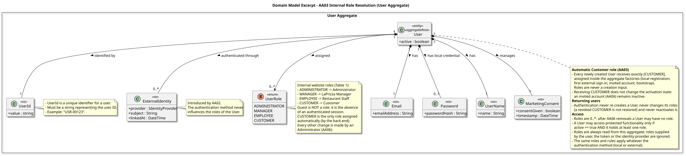
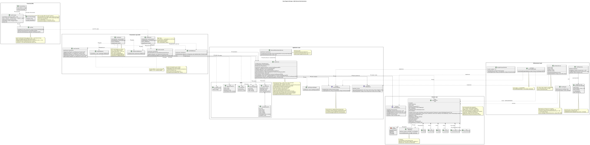
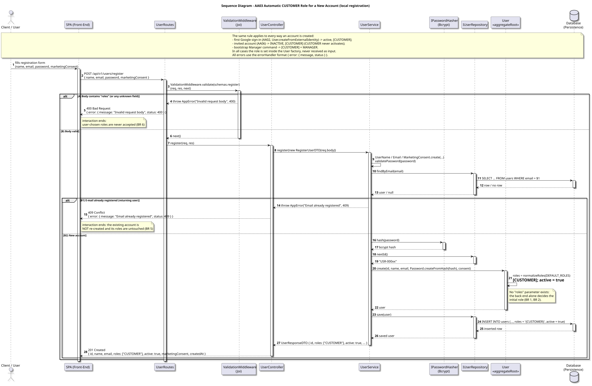
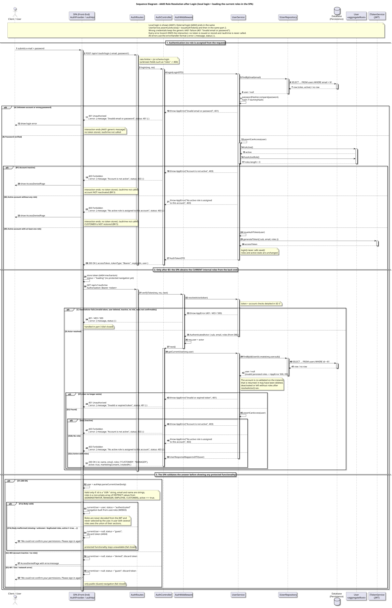

# US AA03 – Internal Role Resolution

## 1. Context & Scope

*   **User Story ID:** AA03
*   **Sprint:** Sprint 2
*   **Area:** Authentication and Authorization (AA)
*   **Responsible:** Leonor de Moura (1240914)
*   **Related Requirements / Stories:**
    *   Sprint 2 User Stories, *PART IV – Sprint 2 – User Stories*, AA03, and *Table 1 – Website roles and accessible functionality*.
    *   System Specification: *PART II – System Specification*, Identity and Access Management (identification and authentication of users and control of access according to assigned roles and permissions) and Security and Data Protection.
    *   Architecture: [System Architecture Description](../../architecture/SAD.md) (*Scenario 3 – Authentication, authorization, and access control by user role*) and [ADR-006 – Secure authentication with bcrypt and JWTs](../../architecture/ADR.md).
    *   Related stories:
        *   **BCK01 – User and Authentication Management:** existing `User` aggregate, `UserRole`, `normalizeRoles`, `UserService.register` / `login` / `resolveActor`, `AuthMiddleware` and `RoleMiddleware`.
        *   **AA01 – Local Authentication:** local login after which the internal roles must be resolved; generic failure message for wrong credentials.
        *   **AA02 – External Identity Provider Integration:** automatic creation of an active `CUSTOMER` account on the first Google sign-in; reuses the access-state check designed here.
        *   **AA04 – Secure Session Handling:** token storage, expiry and logout; protected operations must belong to an active, authorized user.
        *   **AA05 – Authorization Enforcement:** permission checks per operation, distinction between authentication failure (`401`) and lack of permission (`403`).
        *   **AA06 – Role Assignment and Activation Invitation:** Administrator assignment / removal of roles, invited (inactive) accounts and audit of role changes.
        *   **AA07 – Secure Account Activation:** activation enables only the roles already assigned.
        *   **WEB03:** role-based navigation in the SPA, which consumes the roles resolved here.
    *   **Dependencies:** AA03 extends the `user-authentication-management` module created in BCK01. It provides `UserService.assertCanAccess()` (used by AA01 and AA02), the `0..*` role model and the `ADMINISTRATOR` value (whose assignment is owned by AA06), and the `GET /api/v1/auth/me` endpoint consumed by WEB03.

### Scope boundary

AA03 concerns **where roles come from and when they are trusted**. It does not define *what* each role can do (Table 1 / AA05) nor *who* changes roles (AA06).

AA03 owns:

1. The automatic, back-end-only assignment of `CUSTOMER` to every newly created account, independently of the authentication method and without activating the account.
2. The guarantee that authentication (local or external) never re-creates an account, never changes its roles and never reactivates it.
3. The resolution of the **current** internal roles from the database after login and on every protected request.
4. The rejection of roles supplied by the user (request body, JWT claim, identity-provider claim) as proof of authorization.
5. The access-denied behaviour for inactive accounts and for accounts with no active role.
6. Fail-closed behaviour when role information cannot be confirmed (back end and SPA).

---

## 2. Requirements & Analysis

### 2.1. User Story Description

> **As an** authenticated System User,  
> **I want** new accounts to receive the Customer role automatically and my assigned roles to be loaded after login,  
> **so that** my access reflects my restaurant responsibilities.

The actor is **authenticated System User**, as named in the Sprint 2 specification. It covers every account type in Table 1 (Customer, Restaurant Staff, LaPrizza Manager, Administrator) and both authentication methods (AA01 local, AA02 Google).

### 2.2. Acceptance Criteria

- [ ] **AC 1:** Every newly created internal account automatically receives the Customer role, whether created for local authentication or for a verified external identity. The assignment is performed by the back end without requiring an Administrator.
- [ ] **AC 2:** Automatic assignment of Customer does not activate an account nor grant staff, Manager or Administrator permissions. Activation and identity-verification requirements continue to apply.
- [ ] **AC 3:** Returning users retain their current assigned roles. Login does not recreate an existing account, restore a revoked Customer role or reactivate a disabled account.
- [ ] **AC 4:** After either external or local authentication, the application obtains the user's active internal roles from the back end.
- [ ] **AC 5:** Authentication alone does not grant access to protected business functionality without the corresponding internal authorization.
- [ ] **AC 6:** Users with no active role, or with an inactive account, receive an appropriate access-denied message.
- [ ] **AC 7:** The same internal role model and permissions apply to both authentication methods.
- [ ] **AC 8:** Roles supplied or selected by the user are not accepted as proof of authorization.
- [ ] **AC 9:** If role information cannot be confirmed, protected functionality remains unavailable.

Criteria from related stories that constrain AA03 (not owned, but must hold):

*   **AA01 AC 5:** failed-login messages must not disclose whether an account exists → the access-denied messages of AC 6 are only returned **after** the password has been verified.
*   **AA02 BR 9 (Client Clarification Q2):** the first Google sign-in creates an **active** `CUSTOMER` account.
*   **AA04 AC 2:** protected operations must verify that the session belongs to an active, authorized user.
*   **AA05 AC 3:** authentication failure (`401`) is distinguished from lack of permission (`403`).
*   **AA06:** a user must not acquire an administrative role by registering or by selecting an authentication method; role removal and deactivation must prevent subsequent use of the withdrawn permissions; automatic `CUSTOMER` assignment does not replace activation.
*   **AA07 AC 5:** activation enables only the roles already assigned to the account.

#### Existing implementation evidence relevant to the criteria

*   `UserService.register` creates the account with `['CUSTOMER']` and `active = true`, but the role is passed as an **argument** to `User.create(id, name, email, password, roles, consent)`; nothing in the domain prevents another caller from creating an account with other roles. `bootstrapManager` uses that argument to create an account with only `['MANAGER']`.
*   The `register` Joi schema has no `roles` field and uses `.unknown(false)`, so a `roles` property in the request body is already rejected with `400 Invalid request body`. The same holds for the `login` schema.
*   `UserService.login` never calls `save()`; it does not change roles or the `active` state. Inactive accounts are rejected with the generic `401 Invalid email or password`, indistinguishable from wrong credentials (AC 6 is not met).
*   `AuthMiddleware.verifyToken` → `UserService.resolveActor(token)` verifies the JWT, reloads the `User` by `sub` on **every** protected request and returns `{ sub, email, roles }` with the roles **from the database**; the `roles` claim of the JWT is not used. Inactive users are rejected with `401 Invalid or expired token` (AC 6 is not met: no access-denied message).
*   `RoleMiddleware.requireRole(...roles)` grants access when `req.user.roles` contains **any** of the required roles and returns `403 Forbidden: insufficient permissions` otherwise. It is used by every business module (e.g. `StockRoutes`, `ProductRoutes`).
*   There is no endpoint that returns the current user and its roles; the SPA (`frontend/src`) has no authentication code yet. The roles in the login response are a snapshot taken at login time.
*   `errorHandler` returns `{ "error": { "message", "status" } }` and sanitizes every non-4xx error to `500 Internal Server Error`.
*   `AppError` defaults to status `400`. `User.restore` (called by `UserMapper.toDomain`) validates persisted data with the same value objects and `normalizeRoles`, so an invalid role stored in the database currently surfaces as `400` with a domain message instead of a server error (AC 9 / BR 9 require a sanitized `500`).

### 2.3. Client Clarifications & Questions

**Question 1 (Sprint 1):** Which roles should exist in the first phase? Can a user have more than one role?

**Answer 1:** In this first phase, you should consider at least the roles Manager, Customer, and Employee. A User may have more than one role, if necessary to represent different responsibilities in the system. *(Extended in Sprint 2 by Table 1, which adds the Administrator role.)*

**Question 2 (AA02/AA03):** When a user authenticates for the first time through an external provider without having received an invitation, should an account with the "Customer" role be created automatically? In this scenario, is the account considered active, given that the identity has already been verified by the external provider, or can it only be activated via an invitation?

**Answer 2:** Yes. On the first successful authentication through an external identity provider, an account with the Customer role must be created automatically and activated. No invitation is required.


### 2.4. Business Rules & Invariants

Each rule states its source: **S** = Sprint 2 specification, **C** = client clarification, **D** = team design decision (section 3.8).

| ID | Rule | Source |
| --- | --- | --- |
| **BR 1** | Every newly created `User` receives exactly `[CUSTOMER]`, whatever the creation path (local registration, first external sign-in, invited account, bootstrap command). | S – AA03 AC 1 |
| **BR 2** | The initial role is assigned by the back end inside the `User` aggregate factories; roles are never an input of account creation. | S – AA03 AC 1, AC 8; D1 |
| **BR 3** | Receiving `CUSTOMER` does not change the activation state: an invited account (AA06) stays inactive until AA07 activation. Only `CUSTOMER` is assigned automatically; `EMPLOYEE`, `MANAGER` and `ADMINISTRATOR` are assigned only by an Administrator (AA06) or by the bootstrap command. | S – AA03 AC 2, AA06 |
| **BR 4** | A local self-registered account is created active (BCK01); an account created by the first Google sign-in is created active. | BCK01; C – Q2 |
| **BR 5** | Authentication never creates an account that already exists, never changes its roles (a revoked `CUSTOMER` is not restored) and never reactivates it: login paths do not persist the `User`. | S – AA03 AC 3 |
| **BR 6** | Roles supplied by the client (request body, query, headers, JWT claim) or by the identity provider are never proof of authorization. The only source of roles is the persisted `User`. | S – AA03 AC 8; D3 |
| **BR 7** | Roles and the `active` state are read from the database after login (`GET /auth/me`) and on every protected request, so role removals and deactivations take effect without a new login. | S – AA03 AC 4, AA06; D3 |
| **BR 8** | A `User` may access protected functionality only if `active == true` **and** it holds at least one role. Otherwise the request is denied with `403 Account is not active` or `403 No active role is assigned to this account`. | S – AA03 AC 5, AC 6; D4, D5 |
| **BR 9** | If the roles cannot be confirmed (database error, invalid persisted role, error or malformed `/auth/me` answer), the request is denied and the SPA shows no protected functionality. An invalid persisted role is a server fault and is answered with the sanitized `500 Internal Server Error`, never with `400`. | S – AA03 AC 9; D7, D9, D10 |
| **BR 10** | The same role model, access-state check and `RoleMiddleware` rules apply to local and external authentication. | S – AA03 AC 7 |
| **BR 11** | A `User` has `0..*` distinct roles from `{ADMINISTRATOR, MANAGER, EMPLOYEE, CUSTOMER}`; a user with several roles receives the union of their permissions. | S – Table 1; C – Q1; D2 |
| **BR 12** | On local login the access-denied messages of BR 8 are returned only after the password matched; unknown accounts and wrong passwords keep the generic `401`. | S – AA01 AC 5; D5 |
| **BR 13** | A failed authentication (any `4xx`/`5xx` from login) ends the flow: no token is stored and `/auth/me` is not called. `/auth/me` re-validates the account it returns (deleted → `401`; inactive / no role → `403`). | S – AA03 AC 5, AC 6; D6 |

### 2.5. Domain Model Excerpt



PlantUML source: [`excerptDomainModel/domain_model_excerpt.puml`](./excerptDomainModel/domain_model_excerpt.puml).

| Concept | Kind | Role in AA03 |
| --- | --- | --- |
| **User** | Entity / Aggregate Root (existing, extended) | Single source of the internal roles and of the `active` state; its factories assign `CUSTOMER` |
| **UserRole** | Enumeration (existing, **extended**) | Adds `ADMINISTRATOR`; multiplicity becomes `0..*` |
| **ExternalIdentity** | Value Object (AA02) | Shown to make explicit that the authentication method does not influence roles |
| **Password**, **Email**, **UserName**, **UserId**, **MarketingConsent** | Value Objects | Unchanged by AA03 |

Mapping to Table 1: `ADMINISTRATOR` → Administrator, `MANAGER` → LaPrizza Manager, `EMPLOYEE` → Restaurant Staff, `CUSTOMER` → Customer. **Guest** is not a role: it is the absence of an authenticated session and is never stored.

The roles are kept inside the User aggregate because BR 1, BR 5 and BR 8 are User invariants that must be checked atomically with the `active` state. The audit history of role changes (who/when) required by AA06 is out of AA03's scope.

---

## 3. Design

### 3.1. Architecture & C4 Alignment

This User Story operates within the established **C4 Model** of the system ([SAD](../../architecture/SAD.md)):

*   **C4 Level 1 (System Context):** Google Identity Services (AA02) only proves the identity; it never supplies roles.
*   **C4 Level 2 (Containers):** the *Back-End API* is the only authority on roles; the *Relational Database* (PostgreSQL) stores them in `users.roles`; the *Web Application* (SPA) only displays what `GET /auth/me` returns and never decides access.
*   **C4 Level 3 (Components):** AA03 is realised by the **User Component** (role model, automatic `CUSTOMER`, access-state check) and the **Security Component** (`AuthMiddleware` / `RoleMiddleware`), relying on the **Repositories Component**. In code, all of them belong to the existing `user-authentication-management` module, keeping its Clean / Layered structure (`api` → `application` → `domain` ← `infrastructure`). No new module is created; the business modules keep using `RoleMiddleware` unchanged.

---

### 3.2. Class Diagram (CD)

Structural design of the classes participating in this User Story, organised by Clean / Layered Architecture (Presentation → Application → Domain ← Infrastructure).



> PlantUML source: [`classDiagram/class_diagram.puml`](./classDiagram/class_diagram.puml).

Key design points:

*   **Reused unchanged:** `AuthMiddleware`, `RoleMiddleware`, `ValidationMiddleware`, `UserRoutes`, `UserController`, `ITokenService` / `JwtTokenService`, `IPasswordHasher` / `BcryptPasswordHasher`, `LoginDTO`, `RegisterUserDTO`, `UpdateRolesDTO`, `AuthTokenDTO`, `UserResponseDTO`, `UserResponseMapper`, `UserRepository`, the public rate limiter and `AppError` / `errorHandler`. Every business module keeps calling `RoleMiddleware.requireRole(...)`.
*   **Extended:**
    *   `User`: factories without a `roles` argument (`create`, and AA02's `createFromExternalIdentity`), `hasActiveRole()` and `canAccess()`.
    *   `UserMapper.toDomain`: rethrows any domain error from `User.restore` as `AppError('Invalid persisted account', 500)` (D9).
    *   `values.js`: `UserRole.ADMINISTRATOR`, `DEFAULT_ROLES = [CUSTOMER]`, `normalizeRoles` accepting an empty array.
    *   `UserService`: new `assertCanAccess(user)` and `getCurrentUser(actor)`; `login()` and `resolveActor()` call `assertCanAccess()`.
    *   `AuthRoutes` / `AuthController`: new authenticated route `GET /auth/me`.
    *   `bootstrapManager`: `User.create(...)` followed by `addRole(MANAGER)`.
    *   `users_roles_valid` constraint (migration `0017`).
*   **New:** the `AuthenticatedActor` DTO (formalises the existing `{ sub, email, roles }` object placed in `req.user`) and the SPA elements `AuthProvider`, `ProtectedRoute`, `AccessDeniedPage`, `authApi.getCurrentUser()` and `authApi.parseCurrentUser()`.
*   **Single access-state check:** `UserService.assertCanAccess()` is the only place that decides "inactive" / "no role". It is used by local login (after `IPasswordHasher.compare()` succeeded), by AA02's `ExternalAuthenticationService.assertCanStartSession()`, by `resolveActor()` on every protected request and by `getCurrentUser()` on the user it reloads (BR 10, BR 13).

#### Role handling (AA02 / AA05 / AA06 integration)

*   **Creation:** only the domain factories assign roles at creation (`DEFAULT_ROLES`). AA06's invited-account factory must follow the same rule (inactive, `[CUSTOMER]`), then add the roles chosen by the Administrator through `addRole()`.
*   **Login:** `assertCanAccess()` → token issued with the internal roles; nothing is persisted.
*   **Per request:** `resolveActor()` ignores the JWT `roles` claim, reloads the `User`, runs `assertCanAccess()` and places the current roles in `req.user`; `RoleMiddleware` then applies the permission of the route (AA05).
*   **SPA:** only after a successful login (`200`), and on reload, `AuthProvider` calls `GET /auth/me`, validates the body with `authApi.parseCurrentUser()` and builds the navigation only from its `roles`. Any error or malformed body discards the token and keeps only Guest navigation.

---

### 3.3. Sequence Diagrams (SD)

Three scenarios are documented separately because they cover distinct acceptance criteria and interaction paths. Error branches always end the interaction explicitly.

#### SD 1 — Automatic CUSTOMER Role for a New Account (AC 1, AC 2, AC 3, AC 8)

Local registration; rejection of user-supplied roles; existing e-mail not re-created; `CUSTOMER` assigned inside the aggregate. The note lists the other creation paths (AA02, AA06, bootstrap).



> Source: [`sequence_diagram_new_account_customer_role.puml`](./sequenceDiagram/sequence_diagram_new_account_customer_role.puml)

#### SD 2 — Role Resolution after Login (AC 3, AC 4, AC 6, AC 7, AC 9)

Local login (wrong credentials, inactive account, no role, success). Only the success branch continues: the token is stored and `GET /auth/me` is called; the back end re-validates the reloaded account (deleted, inactive, role-less) and the SPA validates the response body before showing protected functionality (fail closed on errors and malformed data).



> Source: [`sequence_diagram_login_role_resolution.puml`](./sequenceDiagram/sequence_diagram_login_role_resolution.puml)

#### SD 3 — Role Resolution on Every Protected Request (AC 5, AC 6, AC 8, AC 9)

Invalid token, database failure, invalid persisted role (mapped to the sanitized `500`), deleted user, account deactivated or left without roles after login, insufficient role, and access with multiple roles. Every error is returned through `errorHandler` as `{ error: { message, status } }`.


> Source: [`sequence_diagram_protected_request_role_resolution.puml`](./sequenceDiagram/sequence_diagram_protected_request_role_resolution.puml)

---

### 3.4. REST API Specification (ARC03)

All endpoints are versioned under `/api/v1`, documented via OpenAPI/Swagger (`api/openapi.js` of the module) and respond with `Cache-Control: no-store`.

| Method | Endpoint | Description | Auth / Role |
| :--- | :--- | :--- | :--- |
| `GET` | `/api/v1/auth/me` | **New.** Returns the authenticated user with its **current** internal roles, read from the database and re-validated (`assertCanAccess`) | Authenticated (any active user with ≥ 1 role) |
| `POST` | `/api/v1/auth/login` | Existing local login (AA01) – contract unchanged; adds the `403` responses of BR 8 after a correct password | Public (Guest) |
| `POST` | `/api/v1/users/register` | Existing registration (BCK01) – contract unchanged; the new account always has `["CUSTOMER"]` | Public (Guest) |
| `POST` | `/api/v1/auth/google/callback` | Defined by AA02 – uses the same `assertCanAccess()` | Public (Guest) |
| *any protected route* | e.g. `GET /api/v1/stock` | Adds the `403` responses of BR 8 when the account became inactive or lost all roles after login | Authenticated + role (AA05) |

#### Request & Response Schemas

- **Current user — Request (`GET /api/v1/auth/me`):** no body; header `Authorization: Bearer <token>`.

- **Current user — Success (`200 OK`):** `UserResponseDTO` with the roles from the database:

  ```json
  {
    "id": "USR-00007",
    "name": "Rui Costa",
    "email": "rui.costa@laprizza.pt",
    "roles": ["CUSTOMER", "MANAGER"],
    "active": true,
    "marketingConsent": false,
    "createdAt": "2026-10-12T09:30:00.000Z"
  }
  ```

- **Registration — Success (`201 Created`):** unchanged; `roles` is always `["CUSTOMER"]`. A request body containing `roles` is rejected:

  ```json
  { "name": "Ana", "email": "ana@example.com", "password": "S3cure!pass", "roles": ["MANAGER"] }
  ```
  → `400 Invalid request body`.

- **Error Responses** (all in the existing `errorHandler` format):
  - `400 Bad Request`: `Invalid request body` – a `roles` (or any unknown) field sent on `register` / `login`.
  - `401 Unauthorized`: `No token provided` / `Invalid or expired token` – missing or invalid token, or the user no longer exists, including when it is deleted between `resolveActor()` and `getCurrentUser()` (authentication failure, AA05).
  - `401 Unauthorized`: `Invalid email or password` – local login with unknown account or wrong password (AA01, unchanged).
  - `403 Forbidden`: `Account is not active` – inactive account, at login (after a correct password) or on any protected request (BR 8).
  - `403 Forbidden`: `No active role is assigned to this account` – active account without roles, at login or on any protected request (BR 8).
  - `403 Forbidden`: `Forbidden: insufficient permissions` – active user with roles, but none required by the route (`RoleMiddleware`, unchanged).
  - `500 Internal Server Error` – roles could not be confirmed (database error, invalid persisted role); the request is denied (BR 9). Body: `{ "error": { "message": "Internal Server Error", "status": 500 } }` – the internal reason (`Invalid persisted account`) is never exposed.
  - Format:
    ```json
    {
      "error": {
        "message": "No active role is assigned to this account",
        "status": 403
      }
    }
    ```

JWT payload: unchanged – `{ "sub", "email", "roles" }`. The `roles` claim is kept for backward compatibility and debugging, but it is **never** used for authorization (BR 6, D3); the SPA does not decode it.

### 3.5. Persistence & Data Integrity (ARC04)

A new migration `0019_user_roles_administrator_and_empty.sql` 

- **`users` (existing, altered):** the `users_roles_valid` constraint is replaced:

```sql
ALTER TABLE users DROP CONSTRAINT users_roles_valid;
ALTER TABLE users ADD CONSTRAINT users_roles_valid CHECK (
  cardinality(roles) BETWEEN 0 AND 4
  AND (cardinality(roles) = 0 OR (array_ndims(roles) = 1 AND array_lower(roles, 1) = 1))
  AND array_position(roles, NULL) IS NULL
  AND roles <@ ARRAY['ADMINISTRATOR', 'MANAGER', 'EMPLOYEE', 'CUSTOMER']::text[]
  AND cardinality(roles) =
    ('ADMINISTRATOR' = ANY(roles))::int + ('MANAGER' = ANY(roles))::int
    + ('EMPLOYEE' = ANY(roles))::int + ('CUSTOMER' = ANY(roles))::int
);
```

| Column | Type | Constraints / Notes |
| :--- | :--- | :--- |
| `roles` | TEXT[] | NOT NULL; `0..4` distinct values from `{ADMINISTRATOR, MANAGER, EMPLOYEE, CUSTOMER}` (BR 11) |
| `active` | BOOLEAN | NOT NULL; unchanged; never modified by login paths (BR 5) |

- **Integrity Rules:**
  - Existing rows remain valid (they have `1..3` roles from the old set); no data migration is needed.
  - The default `[CUSTOMER]` (BR 1) is enforced by the aggregate, not by a column `DEFAULT`, so that an `INSERT` without roles fails instead of silently assigning a role.
  - Role removal by AA06 and the per-request reload (BR 7) need no new table; the role-change audit (who/when) belongs to AA06.
  - `UserMapper.toDomain` → `User.restore` → `normalizeRoles` rejects unknown persisted values, so a corrupted row is never interpreted as a valid set of permissions. `UserMapper.toDomain` converts that domain error into `AppError('Invalid persisted account', 500)`, which `errorHandler` returns as the sanitized `500` (BR 9, D9).

### 3.6. Applied Patterns & Architecture Principles

- **Clean / Layered Architecture:** unchanged module structure; the role rules live in the domain (`User`, `normalizeRoles`) and the access-state check in the application layer.
- **Aggregate Root (DDD):** roles are created and changed only through `User` (factories, `addRole`, `removeRole`, `setRoles`), which enforces BR 1, BR 2 and BR 11.
- **Factory Method:** the `User` factories are the only place where the initial role is decided (`DEFAULT_ROLES`).
- **Single Source of Truth:** the database-backed `User` is the only source of roles; the JWT carries only the identity (`sub`) used to find it.
- **Repository Pattern:** `IUserRepository.findById` used by `resolveActor` and `getCurrentUser`.
- **DTO Pattern:** `UserResponseDTO` for `/auth/me`; `AuthenticatedActor` for `req.user`.
- **Middleware pipeline (Chain of Responsibility):** `AuthMiddleware` (who are you, are you allowed in at all) → `RoleMiddleware` (may you use this route) → controller.
- **Security principles:** never trust client input for authorization, least privilege (only `CUSTOMER` by default), fail closed, re-validation on every request.

### 3.7. New Components and Justification

| Component | Layer | Why it is needed / why an existing one is not enough |
| --- | --- | --- |
| `UserService.assertCanAccess(user)` | Application | The inactive / no-role decision is today scattered (`login` mixes it with the credential check; `resolveActor` returns `401`). A single method gives the access-denied messages of AC 6 and guarantees the same behaviour for local, external and per-request checks (AC 7). |
| `UserService.getCurrentUser(actor)` + `GET /auth/me` | Application + API | AC 4 requires the application to obtain the **current** roles from the back end; the login response is only a snapshot and the JWT claim must not be trusted. It re-validates the user it reloads, because the account may change between `resolveActor()` and the reload. |
| `authApi.parseCurrentUser(body)` | Front-End | AC 9: the SPA must not build navigation from an answer it cannot trust; a malformed body (missing/unknown/duplicated roles, `active !== true`) is handled like an error. |
| Error mapping in `UserMapper.toDomain` | Infrastructure | `AppError` defaults to `400`; without the mapping, corrupted stored roles would be reported as a client error instead of the documented sanitized `500`. |
| `User.hasActiveRole()`, `User.canAccess()`, `DEFAULT_ROLES` | Domain | Express BR 1 and BR 8 in the aggregate instead of in the services. |
| `UserRole.ADMINISTRATOR`, `0..*` roles, migration `0017` | Domain + Persistence | Table 1 role set and the "no active role" state required by AC 6 are not representable today. |
| `AuthenticatedActor` | Application DTO | Names the object that `resolveActor` already returns and that every `RoleMiddleware` reads; no behaviour change. |
| SPA: `AuthProvider`, `ProtectedRoute`, `AccessDeniedPage`, `authApi.getCurrentUser()` | Front-End | Minimal touch points for AC 4, AC 6 and AC 9 in the SPA; the menus themselves belong to WEB03. Naming follows `healthApi.js`. |

### 3.8. Design Decisions

| ID | Decision |
| --- | --- |
| **D1** | The initial role is decided inside the `User` factories (`DEFAULT_ROLES = [CUSTOMER]`); `roles` is removed from `User.create(...)`. The bootstrap Manager is therefore `[CUSTOMER, MANAGER]`. |
| **D2** | Roles become `0..*` and `ADMINISTRATOR` is added to `UserRole`. AA03 only introduces the value; assigning it is AA06's responsibility. |
| **D3** | Roles are always reloaded from the database (`resolveActor`, `/auth/me`). The JWT `roles` claim is kept but never used for authorization; the SPA never decodes the token. |
| **D4** | One access-state check, `UserService.assertCanAccess()`, used by local login, external login (AA02) and every protected request. |
| **D5** | Inactive account → `403 Account is not active`; no role → `403 No active role is assigned to this account`. On local login they are returned only after the password matched (BR 12); before that the AA01 generic `401` is kept. On protected requests this replaces the current `401` for inactive users. |
| **D6** | New endpoint `GET /api/v1/auth/me` returning `UserResponseDTO`, called by the SPA only after a successful login and on reload. `getCurrentUser()` re-validates the reloaded user: deleted → `401 Invalid or expired token`; inactive / no role → `403` (same messages as D5). |
| **D7** | Fail closed: any failure while loading the user or its roles denies the request (`500`, sanitized) and the SPA treats any non-`200` from `/auth/me` as "no roles". |
| **D8** | Login paths never call `save()`: authentication cannot change roles nor the `active` state (BR 5). |
| **D9** | `UserMapper.toDomain` maps any error from `User.restore` to `AppError('Invalid persisted account', 500)`; `errorHandler` answers `{ error: { message: "Internal Server Error", status: 500 } }`. |
| **D10** | The SPA validates the `/auth/me` body (`authApi.parseCurrentUser`) before using it: `id` matches `USR-…`, `name`/`email` are strings, `roles` is a non-empty array of distinct known roles, `active === true`. Otherwise the token is discarded and only Guest navigation is shown. |

---

## 4. Tests (ARC05)

### 4.1. Test Plan & Scenarios

| Test ID | Level / Source | Scenario / Description | Expected Result |
| ------- | -------------- | ---------------------- | --------------- |
| UT01 | Domain — `domain.test.js` | `User.create(...)` (no roles argument) | Roles `[CUSTOMER]`, active |
| UT02 | Domain — `domain.test.js` | `User.createFromExternalIdentity(...)` (AA02) | Roles `[CUSTOMER]`, active |
| UT03 | Domain — `domain.test.js` | `normalizeRoles([])`, `normalizeRoles(['ADMINISTRATOR','MANAGER','MANAGER'])`, `normalizeRoles(['ROOT'])` | `[]`; `['ADMINISTRATOR','MANAGER']`; domain error |
| UT04 | Domain — `domain.test.js` | `hasActiveRole()` / `canAccess()` for active+roles, active+no roles, inactive+roles | `true/true`; `false/false`; `true/false` |
| UT05 | Domain / Infrastructure — `domain.test.js`, `userMapper.test.js` | `User.restore` with an unknown persisted role; `UserMapper.toDomain` with the same row | Domain error; mapper throws `AppError` with status `500` (D9) |
| UT06 | Application — `services.test.js` | `register` | Saved user has only `CUSTOMER`; repository called once |
| UT07 | Application — `services.test.js` | `register` with an existing e-mail whose account had `CUSTOMER` removed | `409`; existing user not saved, roles unchanged |
| UT08 | Application — `services.test.js` | `login` correct password: inactive; no roles; `[EMPLOYEE]` (CUSTOMER revoked) | `403 Account is not active`; `403 No active role…`; token with `[EMPLOYEE]` – `save()` never called |
| UT09 | Application — `services.test.js` | `login` wrong password on inactive account; unknown account | Generic `401 Invalid email or password` (BR 12) |
| UT10 | Application — `services.test.js` | `resolveActor` with a token whose `roles` claim is `["ADMINISTRATOR"]` for a `[CUSTOMER]` user | Actor roles `["CUSTOMER"]` |
| UT11 | Application — `services.test.js` | `resolveActor` after deactivation / after removal of all roles / user deleted / repository throws | `403`; `403`; `401`; error propagated (no actor) |
| UT11b | Application — `services.test.js` | `getCurrentUser` when, after `resolveActor`, the user is deleted / deactivated / left without roles | `401 Invalid or expired token`; `403 Account is not active`; `403 No active role…` – no DTO returned |
| UT12 | Application — `externalAuth.test.js` | AA02 callback for an inactive or role-less linked account | Same `403` messages as UT08 (shared `assertCanAccess`) |
| UT13 | Infrastructure — `bootstrapManager.test.js` | Bootstrap command | Account `[CUSTOMER, MANAGER]` |
| UT14 | OpenAPI — `openapi.test.js` | `GET /auth/me` documented | Bearer security, `200`/`401`/`403` responses |
| IT01 | HTTP — `api.test.js` | `POST /users/register` with `"roles": ["MANAGER"]`; without roles | `400 Invalid request body`; `201` with `["CUSTOMER"]` |
| IT02 | HTTP — `api.test.js` | Login, then `GET /auth/me` | `200` with roles equal to the database roles |
| IT03 | HTTP — `api.test.js` | Customer token on `GET /api/v1/stock`; Manager promoted in DB; same token again | `403 Forbidden: insufficient permissions`; `200` without new login |
| IT04 | HTTP — `api.test.js` | `[CUSTOMER, MANAGER]` user: `GET /api/v1/stock` and a customer-only operation | Both allowed (union of permissions) |
| IT05 | HTTP — `api.test.js` | After login: remove all roles in DB, then `GET /auth/me`; deactivate, then `GET /api/v1/stock` | `403 No active role…`; `403 Account is not active` |
| IT06 | HTTP — `api.test.js` | Token forged with another secret claiming `["MANAGER"]`; header `X-Roles: MANAGER` | `401`; header ignored (`403` for a Customer) |
| IT07 | HTTP — `api.test.js` | Repository stub throws during `resolveActor`; user row with role `ROOT` (constraint disabled in the fixture) on `GET /auth/me` and `GET /api/v1/stock` | `500` `{ error: { message: "Internal Server Error", status: 500 } }` (never `400`); business controller not called |
| IT08 | HTTP — `api.test.js` | Same user with local login and Google login (fake provider) | Identical `/auth/me` roles and identical permitted/denied routes |
| IT09 | PostgreSQL — `postgres.test.js` | Migration `0017` replay; save user with `[]`, with `ADMINISTRATOR`, with duplicates, with `ROOT` | Applies once; `[]` and `ADMINISTRATOR` accepted; duplicates / unknown rejected by constraint |
| IT10 | PostgreSQL — `postgres.test.js` | Login twice for a user with `CUSTOMER` revoked and `active = false` | Row unchanged (`roles`, `active`, `updated_at`) |
| FT01 | Front-End — `AuthProvider.test.jsx` | `/auth/me` answers `200` / `403` / `500` / network error | Navigation from roles; access-denied message; Guest-only navigation in the last two |
| FT01b | Front-End — `authApi.test.js` | `parseCurrentUser` with valid body; `roles` missing, not an array, empty, `["ROOT"]`, `["MANAGER","MANAGER"]`; `active: false`; body `null` | Valid DTO; every malformed case throws → `AuthProvider` keeps Guest navigation and discards the token |
| FT01c | Front-End — `AuthProvider.test.jsx` | Login answers `401` / `403` | Token not stored; `/auth/me` never requested (BR 13) |
| FT02 | Front-End — `ProtectedRoute.test.jsx` | Route requiring `MANAGER` with `[CUSTOMER]` and with `[CUSTOMER, MANAGER]` | `AccessDeniedPage`; page rendered |
| MT01 | Manual | Register, log in, check menu; Administrator/DB removes `CUSTOMER`; reload | Customer menu, then access-denied message without new login |

Acceptance-criteria traceability:

| AC | Main scenarios |
| --- | --- |
| AC1 | UT01, UT02, UT06, UT13, IT01 |
| AC2 | UT01, UT04, UT13 (no other role / no activation; invited accounts with AA06 tests) |
| AC3 | UT07, UT08, IT10 |
| AC4 | IT02, IT03, FT01 |
| AC5 | UT04, IT03, IT05, FT01c |
| AC6 | UT08, UT11, UT11b, UT12, IT05, FT01, MT01 |
| AC7 | UT12, IT08 |
| AC8 | UT10, IT01, IT06 |
| AC9 | UT05, UT11, UT11b, IT07, FT01, FT01b |

### 4.2. Sample Test Implementations

To be added after implementation.

---

## 5. Implementation

### 5.1. File Structure

Planned files:

```text
backend/
├── migrations/
│   └── 0017_user_roles_administrator_and_empty.sql             (new)
├── src/modules/user-authentication-management/
│   ├── api/
│   │   ├── routes/authRoutes.js                                (extended: GET /auth/me)
│   │   ├── controllers/authController.js                       (extended: getCurrentUser)
│   │   └── openapi.js                                          (extended)
│   ├── application/
│   │   ├── dtos/AuthenticatedActor.js                          (new)
│   │   ├── services/UserService.js                             (extended: assertCanAccess, getCurrentUser, login, resolveActor)
│   │   └── services/ExternalAuthenticationService.js           (extended: delegates to UserService.assertCanAccess)
│   ├── domain/
│   │   └── model/
│   │       ├── User.js                                         (extended: factories, hasActiveRole, canAccess)
│   │       └── values.js                                       (extended: ADMINISTRATOR, DEFAULT_ROLES, normalizeRoles 0..*)
│   ├── infrastructure/bootstrapManager.js                      (extended)
│   ├── infrastructure/persistence/UserMapper.js                (extended: integrity errors -> 500)
│   └── index.js                                                (extended: wiring of authMiddleware into AuthRoutes)
└── tests/                                                      (see section 4)
frontend/src/
├── App.jsx                                                     (extended: session from AuthProvider, AccessDeniedPage)
├── main.jsx                                                    (extended: AuthProvider)
└── auth/
    ├── authApi.js                                              (extended: getCurrentUser, parseCurrentUser, network errors)
    ├── authSession.js                                          (new: startSession, loadCurrentSession, hasAnyRole)
    ├── authContext.js                                          (new: AuthContext, useAuth)
    ├── AuthProvider.jsx                                        (new)
    ├── ProtectedRoute.jsx                                      (new)
    └── AccessDeniedPage.jsx                                    (new)
```

### 5.2. Core Implementation Highlights

To be completed after implementation.

---

## 6. Integration, Verification & Demonstration

### 6.1. Running the Automated Tests

```bash
cd backend
npm test -- tests/unit/user-authentication-management tests/integration/user-authentication-management
cd ../frontend
npm test -- src/auth
```

### 6.2. Manual Verification & OpenAPI Contract

1. Start the backend (`npm run dev`) and the frontend.
2. Open Swagger UI at `http://localhost:8080/api-docs` and check `GET /auth/me`.
3. Register a user and confirm `roles: ["CUSTOMER"]`; try registering with a `roles` field and confirm `400`.
4. Log in, call `GET /auth/me` with the token; change the roles of that user in the database (or via AA06) and call it again with the **same** token to see the new roles.
5. Deactivate the user and repeat the call: `403 Account is not active`.
6. Execute MT01 from the SPA.

---

## 7. Observations, Dependencies & Limitations

- **Dependencies:** BCK01 (User aggregate, middleware); AA01 (local login, generic-failure rule); AA02 (`createFromExternalIdentity`, `ExternalAuthenticationService`, which must delegate to `assertCanAccess()`); AA04 (token storage and logout in the SPA); AA05 (route permissions per Table 1); AA06 (assignment of `ADMINISTRATOR`, role removal, invited accounts with `[CUSTOMER]`, audit); WEB03 (menus built from `/auth/me`).
- **Alignment needed with other stories:**
  - **AA01:** the existing test that expects the generic `401` for a *deactivated account with the correct password* must change to `403 Account is not active` (D5).
  - **AA02:** IT04 ("existing token denied (`401`)" after deactivation) must expect `403 Account is not active`; `assertCanStartSession()` delegates to `UserService.assertCanAccess()`.
  - **AA06:** the `roles` Joi schema of `PATCH /users/:id/roles` must accept `ADMINISTRATOR`; its invited-account factory must assign `[CUSTOMER]` internally (BR 1).
- **Known Limitations:** reloading the user on every protected request costs one primary-key query per request (already the case in BCK01). Roles changed while the SPA is open are reflected in the menus only on the next `/auth/me` call (reload or new login), although the back end already enforces them on every request.

