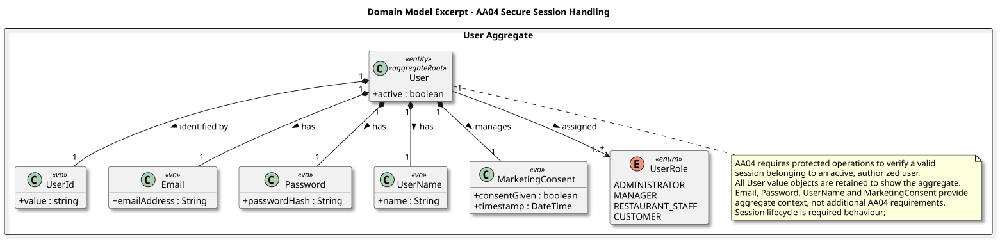
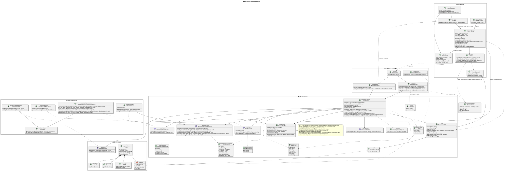

# US AA04 – Secure Session Handling

## 1. Context & Scope

- **User Story ID:** AA04
- **Sprint:** Sprint 2
- **Area:** Authentication and Authorization (AA)
- **Responsible:** Sofia Carvalho (1240898)
- **Related Requirements / Stories:**
  - **Architectural Stories:** ARC01 (Domain Modelling), ARC02 (System Architecture), ARC03 (REST API), ARC04 (Persistence), and ARC05 (Automated Testing) are existing architectural references, not additional AA04 acceptance criteria. [Domain Model](../../../architecture/domainModel/domainmodel.puml) and [System Architecture Description](../../../architecture/SAD.md). 
  - **Dependencies:** **AA01 – Local Authentication** and **AA02 – External Identity Provider Integration** establish the authentication methods to which AA04 requires equivalent session protection and authorization behaviour. AA01 explicitly requires common logout and access-control rules; AA02 explicitly requires ending the application session on logout.
  - **Related authorization requirements:** **AA03 – Internal Role Resolution** requires current internal roles after either authentication method and denies protected functionality when roles cannot be confirmed; **AA05 – Authorization Enforcement** requires permission checks whenever protected information or functionality is requested. These support AA04's active, authorized-user check without transferring their full scope into AA04. **AA06 – Role Assignment and Activation Invitation** requires role removal/account deactivation to prevent further use of withdrawn permissions, and **WEB03 – Role-Based Navigation** requires role/account changes to be reflected before further protected operations. AA04's per-request reload of the current account and roles supports both without transferring their scope into AA04.

---

## 2. Requirements & Analysis

### 2.1. User Story Description
> **As a** System User,  
> **I want** my authenticated session to be handled securely,  
> **so that** I can use protected functionality consistently.

### 2.2. Acceptance Criteria

- [x] **AC 1:** The authenticated session must be maintained securely while the user works in the application.
- [x] **AC 2:** Protected operations must verify that the session is valid and belongs to an active, authorized user.
- [x] **AC 3:** Expired or invalid sessions must require an appropriate renewal or a new login before protected work continues.
- [x] **AC 4:** Logout must prevent the ended session from being reused to perform protected operations.
- [x] **AC 5:** Local and external authentication must provide equivalent session-protection and authorization behaviour.
- [x] **AC 6:** Session information must not be exposed in application addresses, user messages, or diagnostic records.
- [x] **AC 7:** Returning to a previously visited page after logout must not reveal protected information.

### 2.3. Client Clarifications & Questions

> **Question:** Is there an intended inactivity timeout or maximum session duration? While the user remains active, may the session be renewed automatically, or must a new login be required after a defined period?  
> **Answer :** The session must expire after a configurable period of inactivity. This value must be easy to change without modifying application code, for example through an environment variable or configuration file. While the user is active, the session may be renewed automatically; a new login need not be required after a fixed period.

> **Question:** When the user logs out on one device, must only that session be invalidated, or must all other sessions for the same account also be invalidated?  
> **Answer:** Logout must invalidate only the session on the device currently in use. Other sessions belonging to the same account may remain active.

### 2.4. Business Rules & Invariants
- **Secure Session Continuity:**  an authenticated session must be maintained securely while the user works in the application. 
- **Protected Operation Eligibility:** every protected operation must verify a valid session belonging to an active, authorized user. Session validity alone is insufficient.
- **Expired or Invalid Session:** protected work must not continue with an expired or invalid session until appropriate renewal or a new login has occurred. The session must expire after the configured inactivity period. Renewal while the session remains valid and the user is active is permitted; a fixed token lifetime must not be treated as a client requirement to terminate an otherwise active session. 
- **Logout Invalidates the Ended Session:** logout must invalidate only the current device's application session and prevent its subsequent reuse. Other sessions of the same account may remain active; do not implement account-wide logout for this operation. 
- **Authentication Method Equivalence:** equivalent session-protection and authorization behaviour must apply to local and external authentication. 
- **Session Information Confidentiality:** application addresses, user messages and diagnostic records must not expose session information. 
- **Protected Information After Logout:** returning to a previously visited page after logout must not reveal protected information. 
- **Session-to-User Association:** session validity checks must establish the user to whom the session belongs so that the active-account and authorization checks can be applied to that user. This does not prescribe a session identifier format, persistence model, or number of concurrent sessions. 
- **Account and Authorization Remain Necessary:**  a session must not permit a protected operation when its user is inactive or lacks authorization for that operation, even if the session has not expired. 
- **Configurable Inactivity Timeout:** **Explicit client clarification** — the inactivity period must be configurable without changing application code, using environment or file-based configuration. The client has not specified a numeric default or allowed range. 
- **Active Session Renewal:** **Explicit client clarification** — automatic renewal is permitted while the user remains active; a new login is not required solely because a fixed interval has elapsed. 
- **Session-Level Expiry and Logout Across Renewal:** **Logically derived** — inactivity expiry or logout must prevent continued use of credentials associated with the ended session, including credentials issued through renewal. Ending one session must not end another session of the same User. This does not prescribe a session table, token format or domain aggregate. 

### 2.5. Domain Model Excerpt
Relevant domain concepts and aggregates directly involved in this User Story:

The excerpt shows the complete `User` aggregate from the existing global model: `User` with its `active` status, the `UserId`, `Email`, `Password`, `UserName` and `MarketingConsent` value objects, and the assigned `UserRole` enumeration. Their attributes, relationships and multiplicities are preserved from the global model.

For AA04, `UserId`, the user's `active` status and assigned roles support identifying the user associated with a session and checking that the user is active and authorized. The remaining value objects are included to preserve the aggregate's structural context; their inclusion does not introduce additional AA04 requirements. Session validity, expiry, renewal and logout are required behaviours; no `Session` aggregate, session attributes or session cardinalities are introduced by this excerpt.



---

## 3. Design

### 3.1. Architecture & C4 Alignment

This User Story operates within the established **C4 Model** of the system:
- **C4 Level 1 (System Context):** The actor (System User) interacts with the *LaPrizza Information System* via HTTPS ([System Architecture and Design](../../../architecture/SAD.md)).
- **C4 Level 2 (Containers):** The request originates from the *UI* and targets the *Back-End API*, which persists state in the *Database*([System Architecture and Design](../../../architecture/SAD.md)).
- **C4 Level 3 (Component Diagram):** As defined in the global Back-End architecture ([System Architecture and Design](../../../architecture/SAD.md)).
---

### 3.2. Class Diagram (CD)



`AuthProvider` owns the session; `AuthContext` exposes it to the UI. Both use a `status` property with `anonymous`, `authenticated` or `logoutPending`. Permission and connection errors are view/API outcomes, not separate authentication states.

### 3.3. Sequence Diagram (SD)

#### Protected operations

Every protected request checks the access token, the session expiry and the user’s current account status and roles. Invalid or expired access returns `401`; missing permission returns `403`; a database failure returns `500`. The server enforces expiry even when the browser is paused. Normal API requests do not extend the session.


#### Activity and renewal

The opaque renewal credential is stored only in the browser's `HttpOnly`, `SameSite=Lax` session cookie. Frontend JavaScript cannot read it; the browser attaches it to API calls made with credentials enabled. While the user is active, `AuthProvider` requests renewal through `authApi`, which sends the cookie automatically and adds the session-bound `X-CSRF-Token` header. The server checks the session, current account and active role before extending the same session and issuing a new access token. The response refreshes the cookie and returns the CSRF value and timing metadata, but never returns the renewal credential in JSON.

The access token contains only `sub`, `sid`, `jti`, `iat`, `exp`, `iss` and `aud`. The token adapter adds these claims from `TokenPayload {sub,sid}`. Email and roles come from the current User record when building `Actor {sub,email,roles}`.

A `401` clears the session and protected data. A `403` hides denied content without forcing logout. A connection or server error hides protected content and allows retry while the session remains valid.


#### Session restoration after a page reload

The access JWT and CSRF value are held in frontend memory, so a full page reload clears them. The browser retains the HttpOnly session cookie. On provider startup, `authApi.resumeSession()` sends `POST /api/v1/auth/resume`; the browser attaches the cookie. The API checks the configured frontend `Origin`, validates that the backing session is unrevoked and unexpired, reloads the current User and verifies that the account is active with an active role. It returns a fresh access JWT and the session's CSRF value without extending the inactivity deadline. The provider then requests `/auth/me` and restores authenticated UI only after that request succeeds. Missing, expired or revoked sessions fail closed and leave the user anonymous.


Activity reports follow `activityReportIntervalSeconds`. Only one renewal runs at a time. Responses from a previous login or logout are ignored using a generation counter; renewal keeps the same generation.

`status` is `authenticated` after login or renewal, `anonymous` when the session ends, and `logoutPending` while logout is unconfirmed. Permission and connection errors are shown separately.

`apiClient` may renew after a `401` and retry the rejected request once, but only when there has been recent user activity. It does not repeat a write whose outcome is unknown. Without activity, protected content stays hidden until the user interacts or logs in again.

#### Logout

Logout immediately clears the displayed protected data and blocks renewal. `authApi` sends the browser-held HttpOnly session cookie and the in-memory `X-CSRF-Token`; JavaScript never reads the session credential. The server ends only the session identified by the cookie. All access tokens for that session then stop working; other sessions and the Google session remain active. A successful response clears the cookie.

Renewal and logout lock the same database row, so renewal cannot restore an ended session. A business operation authorized before logout may still finish.


If logout fails because of a connection or server error, the provider keeps the CSRF value privately in memory for retry and shows that logout is not yet confirmed; the browser continues to hold the HttpOnly cookie. It cannot use this session to renew or access protected requests while logout is pending. Repeating a confirmed logout returns `204`; an invalid credential returns `401`. Logout does not require an active account, a role or an unexpired access token.

A new login replaces the local session and stops retries for the old logout. A late response from the old logout cannot change the new session. If the old logout was never confirmed, that server session remains subject to its existing inactivity deadline.

#### History restoration and local timeout

`ProtectedRoute` hides protected content when leaving a page and checks the session before showing it again, including when using the browser’s Back button. Returning to a page does not count as activity or automatically renew the session.

The browser uses a monotonic timer, which is unaffected by changes to the device clock. After login or renewal, its remaining time is `max(0, idleTimeoutSeconds * 1000 - requestDurationMs)`. `authApi` supplies the request duration through the client-only `AuthHttpResult`; it is not part of the JSON response. `idleExpiresAt` is for display only. The server remains responsible for the final expiry check.

The logout diagram includes the protected-page restoration flow.

#### Confidentiality

Authentication and protected responses use `Cache-Control: no-store`. Tokens, session IDs and credentials must not appear in URLs, messages or logs. Credentials and protected data are not saved in browser storage, history or service-worker caches. Logs use route templates and a separate random request ID, excluding sensitive headers, bodies and URL values.

### 3.4. REST API Specification 

| Method | Endpoint | Description | Auth / Role |
| :--- | :--- | :--- | :--- |
| `POST` | `/api/v1/auth/resume` | Restore an unexpired session after page reload; returns a fresh access JWT without extending inactivity expiry. | HttpOnly session cookie and exact configured frontend `Origin`; current active User and active role required. |
| `POST` | `/api/v1/auth/renew` | Report qualifying user activity and automatically renew access to the same session before inactivity expiry. | HttpOnly session cookie, matching `X-CSRF-Token`; current active User and active role required; access JWT may be expired. |
| `POST` | `/api/v1/auth/logout` | End only the application session identified by the HttpOnly cookie, including all of its access JWTs. | HttpOnly session cookie and matching `X-CSRF-Token`; no active-account/role requirement and no external identity-provider sign-out. |

**Resume:** No body. The request must include the browser's session cookie and the exact configured `Origin`. Success returns `200 AuthTokenDTO` with a fresh access token and the current inactivity deadline; it does not extend that deadline. The session credential is omitted from JSON. Return `401` for a missing, malformed, revoked or expired session, `403` for an untrusted origin or no active role, and `500` for database or signing failure. Missing accounts are rejected as invalid sessions.

**Renew:** No body. The browser sends the session cookie automatically; the caller supplies the matching CSRF value in `X-CSRF-Token`. Success returns `200 AuthTokenDTO` with a fresh access token and updated inactivity deadline; the cookie is refreshed and the credential is omitted from JSON. Return generic `401` for an invalid credential, missing, ended or expired session or missing account; `403` for no active role; and `500` for database or signing failure. An expired access token alone does not prevent renewal. An expired session cannot be renewed.

**Logout:** No body. The browser sends the session cookie automatically and the caller supplies the matching CSRF value in `X-CSRF-Token`. Return `204` after the matching session is ended and clear the cookie. Return `401` for an unknown or invalid credential and `500` if termination cannot be confirmed. After cleanup, an old credential may return `401`. No account-wide or Google logout is performed. Renew/logout reject unexpected input with `400`; parser limits may return `413`.

#### Request & Response Schemas

- **Existing local login body:**
  ```json
  {
    "email": "ana@example.com",
    "password": "<user-entered-password>"
  }
  ```
- **`200` login, resume or renewal response:** The session credential is set in the HttpOnly cookie and is omitted from JSON. The numeric values below illustrate one possible deployment configuration only; they are not client defaults or validation limits.
  ```json
  {
    "accessToken": "<signed-access-jwt>",
    "tokenType": "Bearer",
    "expiresIn": "5m",
    "csrfToken": "<session-bound-csrf-token>",
    "idleTimeoutSeconds": 1800,
    "activityReportIntervalSeconds": 30,
    "idleExpiresAt": "2026-11-05T15:30:00.000Z",
    "user": {
      "id": "USR-00001",
      "name": "Ana Silva",
      "email": "ana@example.com",
      "roles": ["CUSTOMER"],
      "active": true,
      "marketingConsent": false,
      "createdAt": "2026-10-14T15:00:00.000Z"
    }
  }
  ```
- **Resume:** `POST /api/v1/auth/resume` with `Origin` and the browser-managed session cookie. No CSRF header is required because this endpoint validates the exact configured origin. Resume does not extend the idle deadline.
- **Renew/logout:** Empty request body; the browser-managed session cookie plus `X-CSRF-Token` header. Logout success is `204` with no JSON payload. The cookie uses `HttpOnly`, `SameSite=Lax`, `Path=/`, and `Secure` in production; frontend code does not read it.
- **Representative errors:**
  ```json
  { "error": { "message": "Invalid or expired session", "status": 401 } }
  ```
  ```json
  { "error": { "message": "Forbidden: insufficient permissions", "status": 403 } }
  ```
  ```json
  { "error": { "message": "Internal Server Error", "status": 500 } }
  ```
  Access-JWT validation may retain the current generic `Invalid or expired token` message. Neither message discloses session existence, inactivity/revocation reason, secrets, SQL or internal state.

### 3.5. Persistence & Data Integrity (ARC04)

Reuse PostgreSQL, the User repository and `database.query`/`withTransaction`. Add the following session table during implementation. The User aggregate and global domain model remain unchanged.

| `application_sessions` field | PostgreSQL type / integrity | Meaning |
| :--- | :--- | :--- |
| `id` | `UUID PRIMARY KEY` | Stable `sid` from credential generation. |
| `user_id` | `VARCHAR(32) NOT NULL REFERENCES users(id) ON DELETE CASCADE` | Exactly one internal account; a User may have zero or many independent sessions. Account erasure also deletes its session rows, including ended records, instead of being blocked. |
| `credential_hash` | `BYTEA NOT NULL UNIQUE`, 32-byte SHA-256 digest | Hash of the random secret; never store the raw secret or JWT. |
| `csrf_token` | `BYTEA NOT NULL`, 32 bytes | Random session-bound CSRF token returned in JSON for the frontend's memory-only header; not an authentication credential. |
| `created_at` | `TIMESTAMPTZ NOT NULL`, finite | Database-time initial creation; not a maximum-session-age cutoff. |
| `last_activity_at` | `TIMESTAMPTZ NOT NULL`, finite and not before creation | Updated only on establishment and successful activity-driven renewal. |
| `idle_expires_at` | `TIMESTAMPTZ NOT NULL`, finite and after `last_activity_at` | Authoritative deadline set to database activity time plus the configured interval at creation/valid renewal. |
| `revoked_at` | Nullable finite `TIMESTAMPTZ`, not before creation | Non-null ends the session permanently; never reset on renewal. |

The stored `idle_expires_at` is the session’s expiry deadline. Creation and renewal calculate it using database time and the configured timeout. Client clocks and token claims cannot override it. Every protected operation checks the stored session; a cache must not bypass logout or expiry.

#### 3.5.1. Session configuration

`SessionConfig` reads environment variables or a configuration file. Invalid or missing required settings prevent startup.

| External name | SessionConfig property | Technical validation |
| :--- | :--- | :--- |
| `AUTH_IDLE_TIMEOUT_SECONDS` | `idleTimeoutSeconds` | Required positive integer; missing, non-integer or `<= 0` is a startup error. No client-approved default or numeric range exists; example values are illustrative only. |
| `ACCESS_TOKEN_TTL` | `accessTokenTtl` | Required positive duration parsed to seconds, strictly shorter than `idleTimeoutSeconds`; retain the existing architectural one-day ceiling for an access token. Map it to the adapter's existing `expiresIn`; it is not a maximum session age. |
| `ACTIVITY_REPORT_INTERVAL_SECONDS` | `activityReportIntervalSeconds` | Required positive integer, strictly below `AUTH_IDLE_TIMEOUT_SECONDS` and at most half of it: `0 < interval <= idleTimeoutSeconds / 2`. This technical safety margin prevents the chosen minimum report spacing from consuming the entire idle budget. |

The report interval limits how often activity is sent; it is not a background heartbeat. Send reports only for new activity while the page is visible and focused and the local session timer is valid. Network delays may still cause expiry. The backend validates configuration and sends the public timing values to `AuthProvider` through `AuthTokenDTO`.

#### 3.5.2. Session personal data, retention and recovery

Session records are personal data because they identify a user and contain activity times. Include them in GDP01 data handling and SYS08 backup procedures. Account erasure deletes the related sessions through `ON DELETE CASCADE`.

**Backup recovery:** Before accepting requests after restoring a backup, revoke or delete all restored sessions. Otherwise, the restore could reactivate a session that had already ended. Changing the JWT signing key alone is insufficient because a restored credential could still renew.

### 3.6. Applied Patterns & Architecture Principles

- **Clean Architecture and dependency injection:** Controllers call `UserService`, which uses repository and security interfaces. Database, cryptography and JWT details stay in infrastructure.
- **DDD:** Reuse the User aggregate and its value objects. `SessionRecord` stores security state without changing the global domain model.
- **Repository:** `IApplicationSessionRepository` handles session storage, expiry and locking. `IUserRepository` provides the current account and roles.
- **Shared frontend:** `AuthProvider` manages the in-memory access token and CSRF value; the browser manages the HttpOnly session cookie. `authApi` handles resume, renewal and logout requests with credentials included, `apiClient` handles protected requests, and `ProtectedRoute` controls protected content. One renewal runs at a time, and old responses cannot overwrite a newer session.
- **DTO:** Local login, external login and renewal share `AuthTokenDTO`. Database records and credential hashes remain internal.
- **Transactions and idempotency:** Renewal and logout lock the same session row. Repeating logout is safe. Reuse `database.withTransaction` rather than adding another transaction framework.

| Acceptance criterion | Design coverage |
| :--- | :--- |
| AC 1 | Shared provider, HTTPS, opaque renewal credential, persistent session registry and foreground activity reports. |
| AC 2 | JWT verification, registered `sid`/User binding, server inactivity/revocation check and existing current-account/permission checks. |
| AC 3 | Configurable inactivity timeout and activity-driven automatic renewal; no fixed maximum session age; expired/ended sessions cannot be revived. |
| AC 4 | Stable session identity and committed session-level logout invalidate all renewed JWTs for that session, while preserving other sessions (Section 2.3, logout clarification). |
| AC 5 | Shared `establishSession`/renew/resolve/logout after either local or verified external authentication. |
| AC 6 | Separate credential header, safe DTO/error boundaries, no-store and diagnostic redaction; no secrets in URLs/storage/logs. |
| AC 7 | Immediate local cleanup, blocked pending logout, generation guards, idle timer and hidden-before-validation history restoration. |


## 4. Tests 

AA04 is implemented as a server-tracked application session associated with the existing `User` aggregate. The back end stores a SHA-256 digest of the opaque renewal credential and a random 32-byte CSRF token in `application_sessions`. The renewal credential is returned as an `HttpOnly` cookie; the access JWT remains in frontend memory and contains the user ID and session ID. Local login and verified Google sign-in both use `UserService.establishSession`.

`AuthMiddleware.verifyToken` validates the JWT and calls `UserService.resolveActor`, which checks the session record and reloads the current user before the existing role middleware evaluates the requested operation. The database session deadline is based on inactivity and database time. `POST /api/v1/auth/renew` extends a still-valid session after current account and role checks; `POST /api/v1/auth/logout` revokes only the session in the cookie. Renewal and logout serialize on the same PostgreSQL row. A browser logout hides the protected UI immediately. On a stale-CSRF `401`, it resumes the current cookie-backed session and retries once; other unconfirmed failures leave the protected content hidden and offer a retry. The access JWT is not preserved in browser storage.

On initial page load, `AuthProvider` calls `POST /api/v1/auth/resume` with the browser's HttpOnly session cookie. The API accepts the configured frontend `Origin`, verifies that the server-side session is active and unexpired, reloads the current user and roles, and returns a fresh short-lived access JWT plus the CSRF token. The endpoint does not extend the inactivity deadline; normal activity-based renewal remains `POST /api/v1/auth/renew`. The frontend then calls `GET /api/v1/auth/me` and only restores the authenticated UI when that check succeeds. A reload therefore preserves a valid session, while logout, expiration, deactivation, or loss of an active role prevents restoration. If a different tab renewed first, logout recovers the current CSRF value through resume and retries once while the protected UI remains hidden. A successful logout broadcasts an event (no credentials) to other tabs; those tabs hide protected content and revalidate against the server. Separate devices retain their independent server-side sessions.

### 4.1. Test Plan & Scenarios

The following scenarios correspond to the main tests that need to be made. 

**Scenario: Successful access with a valid session**

**Objective:** Confirm that a valid session belonging to an active user permits a protected operation.

**Preconditions:** The integration fixture has an active Manager account; local login has created a session.

**Steps:**
1. Sign in through `POST /api/v1/auth/login`.
2. Send the returned access JWT as a Bearer token to the protected fixture route.
3. The middleware verifies the JWT, session record, account, and current role.

**Expected Result:** The protected request is accepted.

**Acceptance Criteria:** AC 1, AC 2.

**Scenario: Access with an expired session**

**Objective:** Confirm that inactivity expiry cannot be bypassed through an otherwise valid access token.

**Preconditions:** A valid session is established, then its stored inactivity deadline is moved to the past in the unit fixture.

**Steps:**
1. Establish a session and obtain its access JWT.
2. Expire the fixture session record.
3. Resolve the actor and attempt renewal using the old session credential.

**Expected Result:** Protected access and renewal are rejected with HTTP-equivalent status `401` at the application boundary.

**Acceptance Criteria:** AC 2, AC 3.

**Scenario: Access after account deactivation**

**Objective:** Ensure an active session cannot preserve access after its account becomes inactive.

**Preconditions:** A valid session is established for an active user.

**Steps:**
1. Deactivate the user after session creation.
2. Attempt renewal and protected actor resolution with the existing session.

**Expected Result:** The session cannot authorize further protected operations.

**Acceptance Criteria:** AC 2, AC 3.

**Scenario: Insufficient permission**

**Objective:** Confirm authentication does not grant a role the user does not hold.

**Preconditions:** An active Manager has signed in and has a valid session.

**Steps:**
1. Request the integration fixture route restricted to `ADMINISTRATOR`.
2. The authentication middleware accepts the session and the role middleware checks current roles.

**Expected Result:** The request is denied without disclosing protected data.

**Acceptance Criteria:** AC 2.

**Scenario: Logout and session reuse**

**Objective:** Verify that logout invalidates every access token associated with the ended session.

**Preconditions:** Login has returned an access JWT, an HttpOnly session cookie, and a CSRF value.

**Steps:**
1. Renew the session with its cookie and `X-CSRF-Token` header.
2. Log out with the same cookie and CSRF header.
3. Retry a protected request with the renewed JWT and retry renewal with the ended cookie.

**Expected Result:** Logout succeeds; both access and renewal credentials for that session stop working.

**Acceptance Criteria:** AC 4.

**Scenario: Local and external authentication use the same session checks**

**Objective:** Confirm both authentication methods establish a session through the shared application service.

**Preconditions:** The local test fixture and a verified external-identity service fixture resolve an active internal user.

**Steps:**
1. Establish a session through local login.
2. Complete verified external authentication through `ExternalAuthenticationService`.
3. Resolve the resulting access token through the same `UserService.resolveActor` path.

**Expected Result:** Both credentials are bound to server-tracked sessions and use the same current-user authorization path.

**Acceptance Criteria:** AC 5.

**Scenario: Session credential confidentiality and protected responses**

**Objective:** Verify the renewal secret is not returned as JSON and session-related responses are not cached.

**Preconditions:** A local login request has completed through the AA04 integration fixture.

**Steps:**
1. Inspect the response body and `Set-Cookie` header.
2. Inspect the protected response cache header.

**Expected Result:** The renewal credential is delivered as an HttpOnly cookie, the response omits it from JSON, and the response uses `no-store`.

**Acceptance Criteria:** AC 1, AC 6.

**Protected page restoration:** `AuthProvider` marks the document hidden on `pagehide` while authenticated. If the browser restores the document from its back/forward cache (`pageshow.persisted`), the provider shows no protected content until resume and `/auth/me` validation finish. A logout broadcast from another tab also triggers this fail-closed validation. The automated frontend test dispatches a persisted `pageshow` event and verifies that the protected content stays hidden until the server rejects the session. A real-browser back/forward-cache run has not yet been performed.

**Scenario: Logout after another tab rotates the CSRF token**

**Objective:** Demonstrate that a stale in-memory CSRF value does not prevent logout of the browser's current shared session.

**Preconditions:** A first login has created a session; another tab has renewed that session, rotating its cookie credential and CSRF token. A separate device has its own independently created session.

**Steps:**
1. Submit logout from the tab that still holds the old CSRF token, using the browser's current HttpOnly cookie.
2. The server rejects the stale CSRF value; the SPA remains in `logoutPending` and renders no protected content.
3. The SPA resumes with the shared cookie, obtains the current CSRF value, and retries logout once.
4. On success, the SPA broadcasts a credential-free logout event; other tabs resume and hide protected content when the server rejects the ended session.
5. Check the independent device's access token against a protected test route.

**Expected Result:** The shared browser session is invalidated, other tabs do not keep displaying its protected content, and the other device's separate session remains valid.

**Actual Result:** The frontend test verifies stale-CSRF recovery, retry, immediate protected-content hiding, and other-tab revalidation. The HTTP integration test verifies the stale-CSRF rejection/resume/retry sequence and that an independent device token remains accepted. A browser-based two-tab run has not been performed.

**Evidence:** `frontend/test/auth/AuthProvider.test.js`; `backend/tests/integration/user-authentication-management/session.api.test.js`.

**Acceptance Criteria:** AC 4, AC 7.

**Scenario: Returning to a protected page from browser history after logout**

**Objective:** Prevent browser history restoration from revealing a previously rendered protected page after the server session ended in another tab.

**Preconditions:** A page is rendered with an authenticated session and then placed in the browser's back/forward cache; the same session is logged out in another tab.

**Steps:**
1. On `pagehide`, the provider marks the root hidden before the authenticated document is cached.
2. On a persisted `pageshow`, the provider keeps it hidden and resumes the session with the server.
3. The server rejects the ended session and the SPA removes protected content before clearing the restore-pending marker.

**Expected Result:** The restored page does not display protected information; the user sees the unauthenticated state after validation.

**Actual Result:** The jsdom test dispatches a persisted `pageshow`, holds the resume request pending, verifies that protected content remains absent, and then verifies the unauthenticated state after a 401 response. Real-browser BFCache behavior remains unverified.

**Evidence:** `frontend/test/auth/AuthProvider.test.js` (`keeps restored history content hidden until the server rejects the session`).

**Acceptance Criteria:** AC 7.

**Scenario: Full page reload during a valid session**

**Objective:** Confirm a reload reconstructs authenticated frontend state from the server session cookie without extending the session deadline.

**Preconditions:** The browser has an active, unexpired `lap_session` cookie from local or external sign-in.

**Steps:**
1. Reload the application page, clearing JavaScript memory as a browser reload does.
2. `AuthProvider` sends `POST /api/v1/auth/resume` with credentials included; the browser attaches the HttpOnly cookie.
3. The API validates the cookie-backed session, exact configured `Origin`, current account status and active role, and returns a fresh access JWT, CSRF token, and existing idle deadline.
4. The provider calls `GET /api/v1/auth/me` with the new JWT and restores the authenticated UI only after success.

**Expected Result:** A still-valid session remains signed in after reload. An ended, expired, inactive, or role-less session is not restored. Resume itself does not prolong inactivity expiry.

**Acceptance Criteria:** AC 1, AC 2, AC 3, AC 5, AC 7.

### 4.2. Sample Test Implementations

#### Unit Test Evidence

These are concise excerpts for the test necessary to validate the state of the feature:

**Unit — resume preserves the existing session and does not extend its idle deadline**:

```javascript
test('resume restores an active session without extending its inactivity deadline', async () => {
  const { service, user, sessions } = setup();
  const auth = await service.establishSession(user);
  const parsed = credentials.parse(auth.sessionCredential);
  const record = await sessions.findByCredential(parsed.id, parsed.hash);
  const originalDeadline = record.idle_expires_at;

  const resumed = await service.resume(auth.sessionCredential);

  expect(JSON.parse(resumed.accessToken).sid).toBe(
    JSON.parse(auth.accessToken).sid,
  );
  expect(resumed.csrfToken).toBe(auth.csrfToken);
  expect(resumed.idleExpiresAt).toBe(originalDeadline);
  await expect(service.resolveActor(resumed.accessToken)).resolves.toMatchObject({
    sub: user.getId().getValue(),
  });
});
```

**API integration — resume works with the cookie and a logged-out session cannot resume**:

```javascript
const login = await request(app)
  .post('/api/v1/auth/login')
  .send({ email: 'ana@example.com', password: 'password' });
const cookie = login.headers['set-cookie'][0].split(';')[0];

const resumed = await request(app)
  .post('/api/v1/auth/resume')
  .set('Origin', config.allowedOrigin)
  .set('Cookie', cookie);

expect(resumed.status).toBe(200);
expect(resumed.body.idleExpiresAt).toBe(login.body.idleExpiresAt);

await request(app)
  .post('/api/v1/auth/logout')
  .set('Cookie', cookie)
  .set('X-CSRF-Token', login.body.csrfToken)
  .expect(204);

await request(app)
  .post('/api/v1/auth/resume')
  .set('Origin', config.allowedOrigin)
  .set('Cookie', cookie)
  .expect(401);
```

**Unit — renewal rotates the session credential and permits an active session beyond eight hours**:

```javascript
const first = await service.establishSession(user);
const renewed = await service.renew(
  first.sessionCredential,
  first.csrfToken,
);

expect(renewed.sessionCredential).not.toBe(first.sessionCredential);
expect(renewed.csrfToken).not.toBe(first.csrfToken);
expect(JSON.parse(renewed.accessToken).sid).not.toBe(
  JSON.parse(first.accessToken).sid,
);
await expect(service.resolveActor(first.accessToken)).rejects.toMatchObject({
  status: 401,
});
```

The session lifecycle unit test advances the record's creation time by nine hours while leaving its inactivity deadline valid. Renewal and protected access remain valid, demonstrating that session expiry follows inactivity rather than a fixed eight-hour cap. Configuration tests reject a 30-second JWT with a 60-second activity report interval and accept a 30-second JWT with a 10-second interval.

**Security — resume rejects an untrusted origin**:

```javascript
await request(app)
  .post('/api/v1/auth/resume')
  .set('Origin', 'https://attacker.example')
  .set('Cookie', cookie)
  .expect(403);
```

**Frontend API client — resume includes browser-managed credentials**:

```javascript
await resumeSession();

expect(global.fetch).toHaveBeenCalledWith(
  'http://localhost:8080/api/v1/auth/resume',
  expect.objectContaining({
    method: 'POST',
    credentials: 'include',
  }),
);
```


#### Representative HTTP Exchange

The test uses a placeholder account and secret values. The session credential is deliberately omitted from the JSON response and redacted from the example.

```http
POST /api/v1/auth/login HTTP/1.1
Content-Type: application/json

{"email":"<test-account>","password":"<test-password>"}
```

```http
HTTP/1.1 200 OK
Cache-Control: no-store
Set-Cookie: lap_session=<redacted>; Path=/; HttpOnly; SameSite=Lax
Content-Type: application/json

{"accessToken":"<redacted>","tokenType":"Bearer","expiresIn":"5m","csrfToken":"<redacted>","idleTimeoutSeconds":600,"activityReportIntervalSeconds":30,"idleExpiresAt":"<database-generated-time>","hasLocalCredential":true,"user":{"id":"<test-user>","name":"<test-name>","email":"<test-email>","roles":["MANAGER"],"active":true,"marketingConsent":false,"createdAt":"<test-time>"}}
```

The values in this example reflect the in-memory integration fixture’s configuration, not production defaults. In production, the five session settings are supplied by environment configuration.

Renewal uses the HttpOnly cookie plus the CSRF header:

```http
POST /api/v1/auth/renew HTTP/1.1
Cookie: lap_session=<redacted>
X-CSRF-Token: <redacted>
```

On a page reload, the browser sends its cookie to the resume endpoint; JavaScript does not read or persist the cookie:

```http
POST /api/v1/auth/resume HTTP/1.1
Origin: http://localhost:5173
Cookie: lap_session=<redacted>
```

After successful renewal, the response sets a replacement HttpOnly cookie and returns a new `csrfToken` and access token. Postman clients must use the refreshed values for later renewal/logout requests; the old cookie, CSRF token and session-bound access token are invalid.

## 5. Implementation

### 5.1. File Structure
| Component | Implemented files | Responsibility |
| --- | --- | --- |
| Session persistence | `backend/migrations/0022_application_sessions.sql`; `backend/src/modules/user-authentication-management/infrastructure/persistence/PostgresApplicationSessionRepository.js`; `backend/src/modules/user-authentication-management/infrastructure/security/InMemoryApplicationSessionRepository.js` | Store the session ID, user binding, credential digest, CSRF token, inactivity deadline and revocation time; enforce configurable idle expiry using database time, rotate IDs atomically during renewal, and serialize renewal/logout with row locks. The in-memory adapter supports unit and HTTP integration tests. |
| Session application/security | `backend/src/modules/user-authentication-management/application/ports/session.js`; `backend/src/modules/user-authentication-management/application/services/UserService.js`; `backend/src/modules/user-authentication-management/application/services/PasswordRecoveryService.js`; `backend/src/modules/user-authentication-management/application/dtos/AuthTokenDTO.js`; `backend/src/modules/user-authentication-management/infrastructure/security/SessionCredentialService.js`; `backend/src/modules/user-authentication-management/infrastructure/security/JwtTokenService.js`; `backend/src/modules/user-authentication-management/infrastructure/security/sessionConfig.js`; `backend/src/modules/user-authentication-management/infrastructure/persistence/UserRepository.js` | Create and validate opaque session credentials, issue session-bound JWTs, resume/rotate/revoke sessions, enforce current account status, revoke sessions after password changes/recovery or deactivation, and configure expiry. Current roles are reloaded for authorization, so role changes apply to an existing session without retaining removed permissions. The existing `User` domain aggregate is reused; no session domain entity was added. |
| HTTP and composition | `backend/src/modules/user-authentication-management/api/controllers/authController.js`; `backend/src/modules/user-authentication-management/api/routes/authRoutes.js`; `backend/src/modules/user-authentication-management/api/openapi.js`; `backend/src/modules/user-authentication-management/index.js`; `backend/src/app.js`; `backend/index.js`; `backend/src/shared/openapi/spec.js` | Set and clear the HttpOnly cookie, expose resume/renew/logout routes, enforce allowed origin and CSRF checks, disable API caching, and wire the session repository and configuration. |
| Configuration | `backend/.env.example`; `backend/src/modules/user-authentication-management/infrastructure/security/sessionConfig.js` | Document and validate inactivity timeout, activity report interval, access-token TTL, retention, cookie security and CORS origin settings. There is no fixed maximum duration while the user remains active. Startup rejects a report interval that could reach or exceed half the JWT lifetime. |
| SPA | `frontend/src/auth/AuthProvider.jsx`; `frontend/src/auth/authApi.js`; `frontend/src/auth/authSession.js`; `frontend/src/authApi.js`; `frontend/src/App.jsx`; `frontend/src/ChangePasswordPage.jsx`; `frontend/src/index.css` | Restore the session on startup, keep access/CSRF values in memory, recover and retry logout after a stale CSRF rejection, notify same-browser tabs after logout, and hide the SPA root until a BFCache-restored session is revalidated. |
| Tests | `backend/tests/unit/user-authentication-management/session.test.js`; `backend/tests/unit/user-authentication-management/sessionRepository.test.js`; `backend/tests/integration/user-authentication-management/session.api.test.js`; `backend/tests/integration/user-authentication-management/session.postgres.test.js`; `frontend/test/auth/authApi.test.js`; `frontend/test/auth/authSession.test.js`; `frontend/test/auth/AuthProvider.test.js` | Verify idle session lifecycle, incompatible JWT/report interval rejection, cookie/CSRF/origin behavior, stale-CSRF logout recovery, cross-tab operation serialization, independent device sessions, and hidden content during simulated BFCache restoration. The PostgreSQL suite is added but could not run because no local PostgreSQL server was listening; real-browser BFCache validation remains outstanding. |
| Documentation and diagrams | `docs/user_stories/aa/aa04/AA04.md`; `docs/user_stories/aa/aa04/classDiagram/class_diagram.puml` and `.svg`; `docs/user_stories/aa/aa04/sequenceDiagram/sequence_diagram_{logout,protected,renew,resume}.puml` and `.svg` | Describe implementation and design; the resume sequence is new, and the class/renew/logout diagrams show cookie-based transport. |

### 5.2. Core Implementation Highlights

- Local login and verified external login converge on `UserService.establishSession()`. `SessionCredentialService` generates an opaque UUID-plus-random-secret credential. The raw credential is set as an HttpOnly cookie; only its SHA-256 digest is stored in PostgreSQL. The access JWT stays in frontend memory.
- `AuthController` owns HTTP details. Login and external callback set the session cookie and omit the internal `sessionCredential` field from JSON. Resume requires the configured `Origin`. Renewal and logout read the cookie and require the matching `X-CSRF-Token`; logout clears the cookie after server revocation succeeds.
- `UserService.resume()` verifies the cookie credential against a live server-side session, reloads the current User and checks active status and role. It returns a fresh session-bound access JWT and CSRF value without changing `idle_expires_at`, allowing an SPA reload to recover an unexpired session. Session validity is governed by the configured inactivity deadline and revocation state, not a fixed maximum age.
- `AuthMiddleware.verifyToken()` verifies the JWT and resolves its `sid` against the current session; `UserService.resolveActor()` reloads the User so current active status and roles, rather than token role claims, govern later authorization.
- `PostgresApplicationSessionRepository` uses PostgreSQL time for inactivity expiry. Renewal locks and atomically replaces the session UUID, credential digest and CSRF token while issuing a JWT bound to the new UUID; the old cookie, CSRF token and JWT are rejected. Logout locks and revokes that row, and user security changes revoke all of the user's sessions.
- `AuthProvider` stores JWT/CSRF/timing values in memory, calls resume at mount, calls `/auth/me` before restoring authenticated state, and sends activity-driven renewals only while visible and focused. If another tab rotates the shared cookie, both renewal and logout recover from the shared cookie; logout retries once with the current CSRF value. A successful logout sends a credential-free `BroadcastChannel` event so other tabs revalidate and clear ended sessions, while separate device sessions remain independent. Before a page enters BFCache, the root is hidden; persisted `pageshow` events resume and validate before the UI is revealed. After password change, the server revokes all sessions and the SPA clears its local session and returns to sign-in.
- `/api/v1` responses use `Cache-Control: no-store`; the session cookie is `HttpOnly`, `SameSite=Lax`, and `Secure` in production. The server does not log request headers or bodies through the configured Morgan `dev` format; credentials are not placed in URLs or returned in error messages.

---

## 6. Integration, Verification & Demonstration

### 6.1. Running the Automated Tests

Run the focused tests from the relevant package directory. The PostgreSQL test requires a disposable configured database whose name ends with `_test`; it uses a temporary schema and runs the migrations before exercising the production repository:

```bash
cd backend
npm test -- --runInBand tests/unit/user-authentication-management
npm test -- --runInBand tests/integration/user-authentication-management/session.api.test.js
RUN_DATABASE_TESTS=1 npm test -- --runInBand tests/integration/user-authentication-management/session.postgres.test.js

cd ../frontend
npm test -- --runInBand test/auth/AuthProvider.test.js test/auth/localSignIn.test.js
npm test -- --runInBand
npm run lint
npm run build
```

The API integration test uses the in-memory session repository. The PostgreSQL repository test is present, but its execution was attempted and failed because PostgreSQL was not listening at `127.0.0.1:5432`; therefore migration and production-repository lifecycle are not yet validated against PostgreSQL. In the current validation run, all user-authentication-management unit tests passed (15 suites, 151 tests), the frontend full suite passed (9 suites, 53 tests), the session API integration passed (1 suite, 4 tests), backend and frontend lint passed, the frontend production build passed, and the Postman collection/environment lint passed with no issues. Frontend tests simulate BFCache's persisted `pageshow` event in jsdom; a real-browser Back/forward-cache test was not run. Configure a disposable project PostgreSQL database ending in `_test` and run the command above to verify migration and adapter behavior.

### 6.2. Manual Verification & OpenAPI Contract


With PostgreSQL configured and migration `0022_application_sessions.sql` applied to a development database:

1. Set `CORS_ORIGIN` to the frontend origin. Configure `AUTH_IDLE_TIMEOUT_SECONDS`, `ACTIVITY_REPORT_INTERVAL_SECONDS`, `ACCESS_TOKEN_TTL`, `SESSION_RETENTION_SECONDS` and `SESSION_COOKIE_SECURE`. The report interval must be less than half the access-token lifetime; incompatible settings fail at startup. There is no fixed eight-hour session cap, so active users can continue through rotation while inactivity remains below the configured timeout.
2. Start the backend and frontend with the commands:
  ```bash
  cd backend
  npm run dev

  cd frontend
  npm run dev
  ```
3. Open Swagger UI at `http://localhost:8080/api-docs`. Review `POST /api/v1/auth/resume`, `/renew`, and `/logout`, along with the existing login and `/auth/me` operations. For browser-session checks, use the frontend or Postman so the HttpOnly cookie is retained.
4. Sign in and inspect the login response: expect `200`, a `Set-Cookie` header marked HttpOnly and no `sessionCredential` in JSON. In the SPA, reload the page. Expect `/auth/resume` followed by `/auth/me` and the authenticated UI to return while the server-side idle deadline remains unchanged by resume.
5. Keep the page visible and focused, and generate activity. Check that renewal refreshes the access token, idle deadline, session cookie and CSRF token before the access JWT expires. The values from before renewal must no longer work. An active session can continue beyond eight hours; once the configured inactivity timeout is reached, resume and protected requests are rejected. The included Postman renewal request updates the environment variables after a successful rotation.
6. Log out, then retry resume and `/auth/me` with the prior access token. Expect the session to be rejected. If testing another device, use a separate browser profile/cookie jar; its independent session remains active unless a password change, recovery, or account deactivation revokes all of the user's sessions. In another tab sharing the same browser cookie, logout recovers from a stale CSRF value and retries once; successful logout broadcasts to tabs, which revalidate against the server.
7. For AC 5, repeat sign-in/session checks using Google only when valid Google OAuth configuration is available. Confirm server logs and user-facing errors contain no cookie, JWT, CSRF value or credential.

---

## 7. Observations, Dependencies & Limitations

- **Dependencies:** AA01 local authentication and AA02 external identity sign-in establish sessions through the shared `UserService` path. AA03 supplies current internal account/role information; AA05's route-level authorization checks build on the actor resolved for a valid session. AA06 role removal/account deactivation must take effect on subsequent protected requests. Runtime dependencies are PostgreSQL, migration `0022_application_sessions.sql`, valid session/CORS configuration, and the existing Node/Express/Jest toolchain. Google OAuth credentials are needed only to demonstrate the external callback.
- **Real-browser history validation:** The jsdom tests exercise persisted `pageshow` and hidden-content state, but BFCache restoration and cross-tab logout still need confirmation in a real browser. This remains a planned, unexecuted verification scenario rather than a passed test.
- **No fixed session cap:** Active sessions have no absolute age limit; they end on inactivity, logout, account/security revocation, or other invalidation. This follows the explicit client clarification and means deployments must choose an appropriate inactivity timeout.
- **JWT/report interval relationship:** Configuration fails at startup when the activity report interval is at least half the JWT TTL. The selected report interval and JWT TTL must leave time for scheduling and request latency.
- **Credential changes:** Renewal rotates the session UUID, opaque cookie credential, CSRF token and bound JWT. Password change, password recovery, and account deactivation revoke the user's active sessions; the user must sign in again. Role updates do not revoke the session: every protected request reloads the current roles, so removed permissions stop applying immediately. This intentionally logs out the user's other devices for password and deactivation security events.
