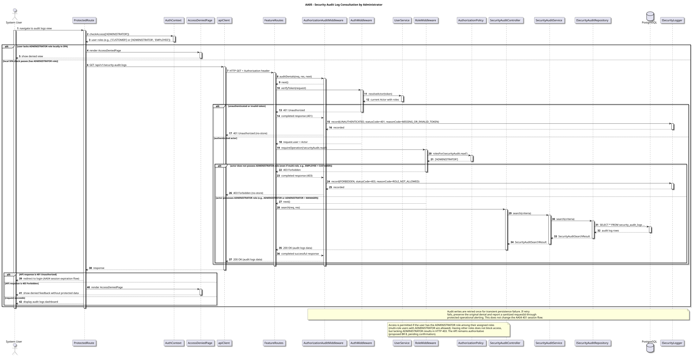

# US AA05 – Authorization Enforcement

## 1. Context & Scope

*   **User Story ID:** AA05
*   **Sprint:** Sprint 2
*   **Area:** Authentication and Authorization (AA)
*   **Responsible:** Mariana Moreira (1240905)
*   **Related Requirements / Stories:**
    *   Sprint 2 User Stories, *PART IV – Sprint 2 – User Stories*, AA05.
    *   System Specification: *PART II – System Specification*, Identity and Access Management (identification and authentication of users and control of access according to assigned roles and permissions) and Security and Data Protection.
    *   Architecture: [System Architecture Description](../../architecture/SAD.md) (*Scenario 3 – Authentication, authorization, and access control by user role*).
    *   Related stories:
        *   **AA01 – Local Authentication** and **AA02 – External Identity Provider Integration:** establish authenticated identities.
        *   **AA03 – Internal Role Resolution:** supplies the internal roles used in authorization decisions.
        *   **AA04 – Secure Session Handling:** establishes the protected session and invalidates it on logout.
        *   **AA06 – Role Assignment and Activation Invitation:** assigns and removes website roles.
        *   **WEB03 – Role-Based Navigation:** presents role-appropriate navigation and protects SPA routes; it complements, but does not replace, API checks.
        *   **WEB05–WEB07, AI, VIS, GDP and BCK stories:** expose operations and information that must follow the role policy and confidentiality restrictions.
    *   **Dependencies:** AA05 consumes the authenticated identity/session from AA01, AA02 and AA04 and the current internal roles from AA03. It applies authorization across the SPA and supporting services. Role assignment remains owned by AA06.
    *   **Analyzed Code Baseline:** Sprint 1 baseline (`main` branch). Observations reflect this baseline and define the scope of enforcement needed for Sprint 2.

### Scope boundary

AA05 owns:

1. Enforcing permissions for protected sections and actions in the SPA and supporting services.
2. Distinguishing authentication failure from insufficient permission.
3. Enforcing resource ownership and confidentiality restrictions, particularly for customer personal information.
4. Recording unauthorized attempts with sufficient, privacy-safe information for investigation.
5. Demonstrating allowed and denied operations through automated checks for the base roles.

AA05 does not authenticate credentials (AA01/AA02), define role resolution (AA03), own session creation or logout (AA04), assign roles (AA06), or replace business validation and invariants owned by each service. Hiding a link or button in the SPA is not sufficient: the back end must independently reject unauthorized requests. Infrastructure administration is not a website role and must not grant website permissions.

---

## 2. Requirements & Analysis

### 2.1. User Story Description

> **As a** LaPrizza Manager,  
> **I want** access restrictions enforced throughout the system,  
> **so that** users can perform only permitted operations.

The actor is **LaPrizza Manager** as named in the Sprint 2 specification. Enforcement covers Guest requests and users with the four assigned roles in Table 1 (Administrator, Manager, Restaurant Staff, Customer), including multi-role users. Guest represents an unauthenticated request, not an assigned `UserRole`.

### 2.2. Traceability Table & Acceptance Criteria Analysis

The table below maps each formal acceptance criterion to its current implementation status in the Sprint 1 baseline and identifies the specific gap or integration dependency addressed in Sprint 2 (AA05):

| Acceptance Criterion / Requirement | Current Implementation Status (Sprint 1 Baseline) | Gap / Dependency for AA05 |
| :--- | :--- | :--- |
| **AC 1 & AC 2:** Request-level permission checking across SPA and API. | `RoleMiddleware.requireRole` and `AuthMiddleware.verifyToken` exist in BCK01. Product/Customer routes apply basic checks. | Centralized route-to-role policy mapping covering all Sprint 2 endpoints and all  Table 1 roles is required. Front-end SPA guards (WEB03) need integration. |
| **AC 3:** Distinguish authentication failure from insufficient permission. | Middleware conventions return `401` for missing/invalid tokens and `403` for forbidden roles. | Formalize this convention as a project **Design Decision** across all modules. |
| **AC 4:** Prevent unauthorized access to customer personal information. | BCK02 customer routes are currently Manager-only; no self-service customer profile endpoint exists in the inspected baseline. | Apply resource-ownership validation wherever customer data is exposed; ownership enforcement is an integration dependency, not a requirement to rebuild BCK02. |
| **AC 5:** Record unauthorized attempts without secrets. | `requestLogger.js` uses Morgan dev format (disabled in tests); no dedicated security/audit trail exists. | Implement privacy-safe logging for rejected authorization attempts, excluding passwords, tokens, and PII. **Update global `requestLogger.js` to redact query strings, preventing search parameters (e.g., emails) from leaking into standard logs.** |
| **AC 6:** Base-role permissions & least privilege (Table 1). | Internal roles (`MANAGER`, `EMPLOYEE`, `CUSTOMER`) exist in BCK01. `ADMINISTRATOR` role mapping is missing. | Introduce Administrator mapping (AA06) and enforce Table 1 boundaries across all new Sprint 2 features. |
| **AC 7:** Automated checks for base roles. | Individual API unit/integration tests check specific 401/403 responses, but no comprehensive role-matrix test suite exists. | Develop automated authorization tests covering allowed/denied scenarios, parameter tampering resistance, and **log-scrubbing verification for sensitive query values**. |
 
### 2.3. Client Clarifications & Questions

The specification defines the role descriptions and authorization criteria. This section contains client clarifications and open questions; AA05 design decisions are documented in Section 3.

No client clarification or unanswered question for this story has been verified in the checked-in sources.

### 2.4. Business Rules & Invariants

Each rule states its source: **S** = Sprint 2 specification, **D** = team design decision.

| ID | Rule | Source |
| --- | --- | --- |
| **BR 1** | Every request for protected functionality or information must be checked against the current actor’s permissions. | S – AA05 AC 1 |
| **BR 2** | Both the SPA and supporting services prevent unauthorized access; service-side checks are authoritative. | S – AA05 AC 2 |
| **BR 3** | Authentication failure (`401`) and insufficient permission (`403`) are strictly distinct. | S – AA05 AC 3; D1 |
| **BR 4** | Changing a customer ID, query parameter or payload reference must not expose or alter another customer's personal data. | S – AA05 AC 4; D2 |
| **BR 5** | Permissions strictly follow Table 1 and the least privilege principle. Multiple roles combine permissions without bypassing ownership rules. | S – AA05 AC 6 |
| **BR 6** | Unauthorized attempts are logged for investigation without recording passwords, tokens, or session secrets. | S – AA05 AC 5; D3 |
| **BR 7** | Infrastructure administration tasks do not grant website permissions or bypass authorization enforcement. | S – Table 1 |
| **BR 8** | Application denial logs are consultable only by users with the `ADMINISTRATOR` role. System and infrastructure logs are outside the AA05 application interface. | D5 – proposed, pending confirmation |
| **BR 9** | Guests may read public catalogue, product, and allergen information without authentication; this excludes personal data and internal stock. | SAD; D4 |

### 2.5. Authorization Model

AA05 represents a cross-cutting authorization policy across the application and supporting services rather than a standalone business aggregate. It operates on the authenticated `User` identity (AA01/AA02) and its internally resolved roles (AA03) to decide whether an actor may execute a given operation or access a specific resource.

The authorization flow and its design components are described in Section 3. The class and sequence diagrams are linked there to their rendered SVGs and PlantUML sources. This cross-cutting model does not add a separate business aggregate to the domain model.

---

## 3. Design

### 3.1. Design Overview

AA05 applies authorization at two boundaries. The SPA uses `ProtectedRoute` and the current `AuthContext` to prevent navigation to sections that do not match the user's roles. The API independently applies authentication, operation-level role checks and, where required, ownership checks. The API is authoritative; a client-side check is only a navigation and presentation safeguard.

The design separates authorization decisions, request enforcement, ownership resolution and audit persistence. It does not introduce a separate business aggregate for authorization.

#### Design decisions

> **D1 — HTTP Status Codes (AC 3):** Use **HTTP 401 Unauthorized** when authentication fails or the session is invalid, and **HTTP 403 Forbidden** when an authenticated actor lacks the required role or permission. In the SPA, a 401 follows AA04's session-expiration flow; a 403 displays access-denied feedback without protected content.

> **D2 — Resource Ownership (AC 4):** Apply ownership enforcement at the service/endpoint boundary wherever customer data is accessed, preventing parameter tampering such as changing a customer ID in a request.

> **D3 — Audit Logging (AC 5):** Denials (401/403) and ownership-related 404 responses produce privacy-safe events with timestamp, method, normalized route template, outcome, bounded `reasonCode`, status, request ID, and actor ID/roles when available. Allowed codes: `MISSING_OR_INVALID_TOKEN`, `ROLE_NOT_ALLOWED`, and `RESOURCE_NOT_OWNED_OR_NOT_FOUND`. Concrete URLs, query strings, passwords, authorization headers, tokens, cookies, session credentials and request bodies are excluded.

> **D4 — Public Catalogue and Information:** In accordance with the SAD, Guests may read the public catalogue and public product/allergen information without authentication. Authentication currently required by the inspected BCK11 and product read routes is an implementation gap. Public responses must not include customer data or internal stock information.

> **D5 — Application Audit-Log Access (pending confirmation):** Only users with the **Administrator** role may consult application denial logs; Manager, Employee and Customer users may not. System and infrastructure logs are for technical operators and outside the website roles. Confirm this rule with the requirements owner before implementation.

### 3.2. Class Diagram (CD)

The class diagram presents the SPA, API, authorization policy, ownership checks and audit persistence components, organised by architectural layer.

> PlantUML source: [`classDiagram/class_diagram.puml`](./classDiagram/class_diagram.puml).

### 3.3. Sequence Diagrams (SD)

#### SD 1 — Role Authorization and Audit Logging

This flow shows the SPA guard, API authentication, operation-level role check and recording of authentication or authorization denials. A 401 follows AA04's session-expiration flow, as in SD 3; an audit-write failure preserves the original denial and is reported for recovery.

> PlantUML source: [`sequenceDiagram/sequence_diagram_role_authorization.puml`](./sequenceDiagram/sequence_diagram_role_authorization.puml).

#### SD 2 — Customer Ownership and Confidentiality

This flow shows the owner check for customer data, the concealed `404 Not Found` response for a non-owner or missing linked Customer, and the associated audit event.

> PlantUML source: [`sequenceDiagram/sequence_diagram_ownership.puml`](./sequenceDiagram/sequence_diagram_ownership.puml).

#### SD 3 — Security Audit Log Consultation

This flow shows the SPA guard, API authentication, proposed Administrator-only role check (`securityAudit.read`, D5 pending confirmation), retrieval of audit events, and auditing of unauthorized consultation attempts. A 401 follows the same AA04 session-expiration flow shown in SD 1.

> PlantUML source: [`sequenceDiagram/sequence_diagram_audit_log_consultation.puml`](./sequenceDiagram/sequence_diagram_audit_log_consultation.puml).

### 3.4. Authorization Policy and Roles

`AuthorizationPolicy` maps each protected `operationId` to an `OperationPolicyEntry`, containing its permitted roles and ownership rules. `RoleMiddleware` obtains the permitted roles for the operation and allows the request when at least one of the actor's roles is permitted. An operation without a policy entry is denied by default.

For users with multiple roles, permissions combine for the operation being requested. This does not remove operation-specific ownership or confidentiality checks: having an Employee role, for example, does not by itself grant access to another Customer's personal information. Guest is an unauthenticated request state, not an assigned `UserRole`.

### 3.5. Operation & Role Policy Matrix

The matrix below enumerates the business routes exposed by the inspected backend baseline. Operations sharing a row have the same permission rule. It describes the intended AA05 policy, with baseline discrepancies called out explicitly; unlisted operations are denied by default until assigned a policy. The role names map to Table 1: `EMPLOYEE` is Restaurant Staff and `MANAGER` is LaPrizza Manager. Guest means no authenticated session.

| Operation ID | HTTP route(s) | Permitted roles | Ownership rule / status |
| :--- | :--- | :--- | :--- |
| `health.read` | `GET /api/v1/health` | Guest and all authenticated roles | None; health response contains no protected business data. |
| `auth.login`, `auth.google` | `POST /api/v1/auth/login`; optional `POST /api/v1/auth/google/authorization` and `/api/v1/auth/google/callback` when configured | Guest | Public authentication entry points. |
| `users.register` | `POST /api/v1/users/register` | Guest | Public registration; role assignment follows AA03/AA06 rules. |
| `users.list`, `users.read`, `users.changeRoles`, `users.deactivate` | `GET /api/v1/users`, `GET /api/v1/users/:id`, `PATCH /api/v1/users/:id/roles`, `DELETE /api/v1/users/:id` | `ADMINISTRATOR` (AA06/Table 1) | No customer ownership rule. **Baseline discrepancy:** current BCK01 routes require `MANAGER`; align with AA06 before claiming this target policy is implemented. |
| `categories.read`, `allergens.read` | `GET /api/v1/categories`, `GET /api/v1/categories/:id`, `GET /api/v1/allergens`, `GET /api/v1/allergens/:id` | Guest and all authenticated roles | Public read operations. |
| `categories.manage`, `allergens.manage` | `POST`, `PUT /:id`, `DELETE /:id` under `/api/v1/categories` and `/api/v1/allergens` | `MANAGER` | No ownership rule. |
| `products.read` | `GET /api/v1/products`, `GET /api/v1/products/:id` | Guest and all authenticated roles | Public product information only; no personal data or internal stock. **Baseline discrepancy:** inspected product read routes require authentication; align with the SAD public-information policy. |
| `products.manage` | `POST /api/v1/products`, `PUT /api/v1/products/:id`, `DELETE /api/v1/products/:id`, `PATCH /api/v1/products/:id/activate` | `MANAGER` | No ownership rule. |
| `componentTypes.manage` | `POST`, `GET`, `GET /:id`, `PATCH /:id`, `DELETE /:id` under `/api/v1/pizza-component-types` | `MANAGER` | No ownership rule. |
| `pizzaSizes.read` | `GET /api/v1/pizza-sizes`, `GET /api/v1/pizza-sizes/:id` | Guest and all authenticated roles | Public read operations. |
| `pizzaSizes.manage` | `POST /api/v1/pizza-sizes`, `PUT /api/v1/pizza-sizes/:id`, `DELETE /api/v1/pizza-sizes/:id` | `MANAGER` | No ownership rule. |
| `componentConfigurations.manage` | `POST` and `PATCH /api/v1/products/:productId/component-configurations/:sizeId`; `GET /api/v1/products/:productId/component-configurations` | `MANAGER` | No customer ownership rule. |
| `predefinedPizzas.manage` | `POST /api/v1/predefined-pizzas`, `GET /api/v1/predefined-pizzas`, `GET /api/v1/predefined-pizzas/:productId`, `PUT /api/v1/predefined-pizzas/:productId/default-configuration` | `MANAGER` | No customer ownership rule. |
| `stock.manage` | `POST /api/v1/stock`, `DELETE /api/v1/stock/:productId`, `GET /api/v1/stock/:productId`, `GET /api/v1/stock`, `POST /api/v1/stock/:productId/adjustments` | `MANAGER` | No customer ownership rule. |
| `customers.manage` | `POST /api/v1/customers`, `GET /api/v1/customers`, `GET /api/v1/customers/:id`, `PUT /api/v1/customers/:id`, `PATCH /api/v1/customers/:id/activate`, `PATCH /api/v1/customers/:id/deactivate` | `MANAGER` | These are manager operations. No Customer self-service route is exposed in the inspected backend baseline; any future customer-scoped route must be owner-scoped. |
| `catalogue.read` | `GET /api/v1/catalogue`, `GET /api/v1/catalogue/:productId` | Guest and all authenticated roles | Public catalogue only; no personal data or internal stock. **Baseline discrepancy:** current BCK11 route requires authentication; this is an implementation gap against the SAD. |
| `securityAudit.read` | `GET /api/v1/security-audit-logs` | `ADMINISTRATOR` | Proposed design decision D5, pending confirmation by the requirements owner. |

This matrix is based on the routes present in the inspected backend and the role responsibilities documented in SAD/AA06; it does not invent order operations. Guest access to public product and catalogue information is the intended policy even where the inspected baseline still requires authentication. Add each new route and its ownership rule to the matrix before exposing it. `GET /api/v1/auth/me` and order endpoints are not listed because they are not exposed in the inspected route files.

### 3.6. Customer Ownership and Confidentiality

Ownership enforcement applies to each customer reference carried by a path, query or body field; the source of the reference must be explicit in the operation policy. Middleware must consume the **validated** request value, not raw input. Its design contract is `requireOwnership(operationId, source, field)`, where `source` is `params`, `query` or `body`.

For a direct Customer resource ID, `CustomerOwnershipResolver` compares the requested ID with the Customer linked to `actor.sub`. For a child resource ID (for example, a future order ID), the application use case must load the persisted resource and verify its stored owner; it must not trust a submitted `customerId` to establish ownership. Missing resources and ownership mismatches return the same `404 Not Found` and are marked `OWNERSHIP_DENIED`. Invalid request syntax is rejected by input validation before the ownership check. Exemptions must be explicit per operation and do not follow automatically from additional roles.

**Required automated tests (AC 7):** add integration cases for foreign Customer IDs in path, query and validated body references; child resources with a different persisted owner; and multi-role ownership enforcement. Assert the same `404` for missing and foreign-owned resources. These are required scenarios, not a claim that the tests already exist.

### 3.7. Security Audit Events

`AuthorizationAuditMiddleware` records completed `401` and `403` responses and ownership-related `404` responses through `ISecurityLogger`. `SecurityAuditLogger` delegates persistence to `ISecurityAuditRepository`, implemented by `PostgresSecurityAuditRepository`.

Each `SecurityEvent` contains timestamp, outcome, bounded `reasonCode`, HTTP method, normalized route template, status, request ID and actor ID/roles when available. `MISSING_OR_INVALID_TOKEN` maps to `UNAUTHENTICATED`/401, `ROLE_NOT_ALLOWED` to `FORBIDDEN`/403, and `RESOURCE_NOT_OWNED_OR_NOT_FOUND` to `OWNERSHIP_DENIED`/404. Exclude passwords, tokens, cookies, session credentials, authorization headers, request bodies, concrete URLs and query strings. Unrelated `404` responses are not ownership denials.

#### Audit-log API contract

Under proposed Design Decision D5 (pending confirmation), `GET /api/v1/security-audit-logs` is restricted to `ADMINISTRATOR`. Optional filters are `from`, `to` (UTC timestamps), `actorId`, `outcome`, `statusCode`, `method`, and `routeTemplate`; `limit` and `offset` provide bounded pagination. The default limit is 50 and the maximum is 100. The response contains `items`, `total`, `limit`, and `offset`. Filter values are validated and used as bound query parameters.

Each event contains `id`, `timestamp`, `requestId`, nullable `actorId`, `actorRoles`, `method`, `routeTemplate`, `outcome`, `statusCode`, and `reasonCode`. The reason code must be one of the three values defined above and match the outcome/status. The route is a normalized pattern, never a concrete URL or query string. Request bodies, credentials, tokens, cookies, and session secrets are not stored or returned.

#### PostgreSQL persistence and retention

The `security_audit_logs` table stores these fields. `id` is the primary key; `timestamp`, `request_id`, `method`, `route_template`, `outcome`, `reason_code`, and `status_code` are required; `actor_id` is nullable for unauthenticated requests; `actor_roles` is empty when no actor is authenticated. Check constraints limit outcome/reason values and enforce valid outcome/status/reason combinations (`401`, `403`, or ownership-related `404`). Indexes support time ordering and actor/outcome filters: `(timestamp)`, `(actor_id, timestamp)`, and `(outcome, timestamp)`.

Audit events can be linked to individuals, so access must be controlled and collection minimized. The Administrator-only access policy is proposed in D5 and pending confirmation. No retention duration is specified by the available requirements; it must be approved before production, configurable, and expired records must be purged. Indefinite retention is not permitted.

#### Global HTTP Request Logging & Privacy

*   **Safe Request Logging:** `requestLogger.js` is configured to log safe request metadata (HTTP method, normalized route template, status code, and response time) while omitting query strings, request bodies, and tokens to prevent leaking PII (such as customer emails).
*   **Audit Persistence:** `ISecurityLogger.record(event)` operates asynchronously (`Promise<void>`). `AuthorizationAuditMiddleware` awaits persistence and retries once for a transient failure. If the retry also fails, it preserves the original authorization result (`401`, `403`, or ownership `404`) and reports a sanitized failure with the `requestId` through protected operational logging/alerting for recovery. The failure must not be silently swallowed or grant access.
*   **Data Minimization:** Audit events capture only the minimum required for security investigation (timestamp, outcome, `reasonCode`, method, route template, status code, request ID, `actorId`, and `actorRoles`). Sensitive data like emails, IP addresses, tokens, request bodies, and query strings are strictly excluded.

#### AC 7 test plan

For each operation, test permitted and denied base roles (including multi-role users), expecting success, `401` for unauthenticated requests, and `403` for authenticated disallowed roles. Test audit-endpoint access (Administrator allowed; Guest gets `401`; other roles get `403`), ownership `404` behavior, and privacy scrubbing. Verify that audit-write failure is retried once, preserves the original denial, and reports a sanitized recovery signal if the retry fails. These tests are required scenarios, not a claim that they already exist.

### 3.8. Access to Application Denial Logs

Under proposed Design Decision D5, pending confirmation by the requirements owner, application logs recording denied authentication and authorization attempts may be consulted exclusively by users with the **`ADMINISTRATOR`** role via `GET /api/v1/security-audit-logs`.

If D5 is confirmed, Manager, Employee, and Customer roles cannot access these logs. An unauthorized attempt results in `403 Forbidden` and is recorded as a security audit event. System and infrastructure logs remain restricted to technical operators outside the application interface. A failed audit write does not change the denial response and is reported according to Section 3.7.

