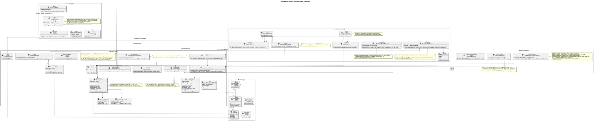
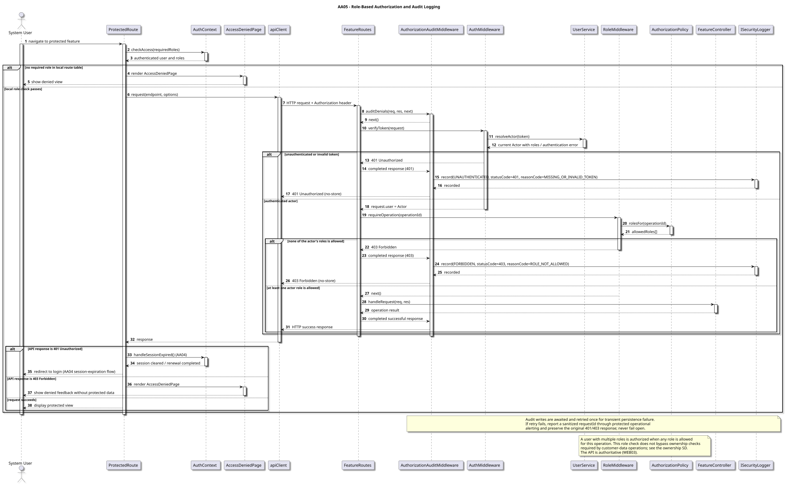
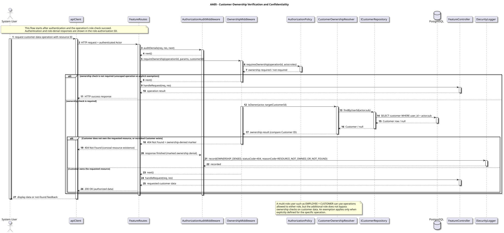

# US AA05 – Authorization Enforcement

## 1. Context & Scope

*   **User Story ID:** AA05
*   **Sprint:** Sprint 2
*   **Area:** Authentication and Authorization (AA)
*   **Responsible:** Mariana Moreira (1240905)
*   **Related Requirements / Stories:**
    *   Sprint 2 User Stories, *PART IV – Sprint 2 – User Stories*, AA05.
    *   System Specification: *PART II – System Specification*, Identity and Access Management (identification and authentication of users and control of access according to assigned roles and permissions) and Security and Data Protection.
    *   Architecture: [System Architecture Description](../../architecture/SAD.md) (*Scenario 3 – Authentication, authorization, and access control by user role*).
    *   Related stories:
        *   **AA01 – Local Authentication** and **AA02 – External Identity Provider Integration:** establish authenticated identities.
        *   **AA03 – Internal Role Resolution:** supplies the internal roles used in authorization decisions.
        *   **AA04 – Secure Session Handling:** establishes the protected session and invalidates it on logout.
        *   **AA06 – Role Assignment and Activation Invitation:** assigns and removes website roles.
        *   **WEB03 – Role-Based Navigation:** presents role-appropriate navigation and protects SPA routes; it complements, but does not replace, API checks.
        *   **WEB05–WEB07, AI, VIS, GDP and BCK stories:** expose operations and information that must follow the role policy and confidentiality restrictions.
    *   **Dependencies:** AA05 consumes the authenticated identity/session from AA01, AA02 and AA04 and the current internal roles from AA03. It applies authorization across the SPA and supporting services. Role assignment remains owned by AA06.
    *   **Analyzed Code Baseline:** Sprint 1 baseline (`main` branch). Observations reflect this baseline and define the scope of enforcement needed for Sprint 2.

### Scope boundary

AA05 owns:

1. Enforcing permissions for protected sections and actions in the SPA and supporting services.
2. Distinguishing authentication failure from insufficient permission.
3. Enforcing resource ownership and confidentiality restrictions, particularly for customer personal information.
4. Recording unauthorized attempts with sufficient, privacy-safe information for investigation.
5. Demonstrating allowed and denied operations through automated checks for the base roles.

AA05 does not authenticate credentials (AA01/AA02), define role resolution (AA03), own session creation or logout (AA04), assign roles (AA06), or replace business validation and invariants owned by each service. Hiding a link or button in the SPA is not sufficient: the back end must independently reject unauthorized requests. Infrastructure administration is not a website role and must not grant website permissions.

---

## 2. Requirements & Analysis

### 2.1. User Story Description

> **As a** LaPrizza Manager,  
> **I want** access restrictions enforced throughout the system,  
> **so that** users can perform only permitted operations.

The actor is **LaPrizza Manager** as named in the Sprint 2 specification. Enforcement covers Guest requests and users with the four assigned roles in Table 1 (Administrator, Manager, Restaurant Staff, Customer), including multi-role users. Guest represents an unauthenticated request, not an assigned `UserRole`.

### 2.2. Traceability Table & Acceptance Criteria Analysis

The table below maps each formal acceptance criterion to its current implementation status in the Sprint 1 baseline and identifies the specific gap or integration dependency addressed in Sprint 2 (AA05):

| Acceptance Criterion / Requirement | Current Implementation Status (Sprint 1 Baseline) | Gap / Dependency for AA05 |
| :--- | :--- | :--- |
| **AC 1 & AC 2:** Request-level permission checking across SPA and API. | `RoleMiddleware.requireRole` and `AuthMiddleware.verifyToken` exist in BCK01. Product/Customer routes apply basic checks. | Centralized route-to-role policy mapping covering all Sprint 2 endpoints and all  Table 1 roles is required. Front-end SPA guards (WEB03) need integration. |
| **AC 3:** Distinguish authentication failure from insufficient permission. | Middleware conventions return `401` for missing/invalid tokens and `403` for forbidden roles. | Formalize this convention as a project **Design Decision** across all modules. |
| **AC 4:** Prevent unauthorized access to customer personal information. | BCK02 customer routes are currently Manager-only; no self-service customer profile endpoint exists in the inspected baseline. | Apply resource-ownership validation wherever customer data is exposed; ownership enforcement is an integration dependency, not a requirement to rebuild BCK02. |
| **AC 5:** Record unauthorized attempts without secrets. | `requestLogger.js` uses Morgan dev format (disabled in tests); no dedicated security/audit trail exists. | Implement privacy-safe logging for rejected authorization attempts, excluding passwords, tokens, and PII. **Update global `requestLogger.js` to redact query strings, preventing search parameters (e.g., emails) from leaking into standard logs.** |
| **AC 6:** Base-role permissions & least privilege (Table 1). | Internal roles (`MANAGER`, `EMPLOYEE`, `CUSTOMER`) exist in BCK01. `ADMINISTRATOR` role mapping is missing. | Introduce Administrator mapping (AA06) and enforce Table 1 boundaries across all new Sprint 2 features. |
| **AC 7:** Automated checks for base roles. | Individual API unit/integration tests check specific 401/403 responses, but no comprehensive role-matrix test suite exists. | Develop automated authorization tests covering allowed/denied scenarios, parameter tampering resistance, and **log-scrubbing verification for sensitive query values**. |
 
### 2.3. Client Clarifications & Questions

The requirements owner confirmed in the Moodle response by Paulo Matos to “AA05 - Logs access” on 7 November 2026 that application denial logs are restricted to users with the Administrator role. Infrastructure logs are reserved for technical operators and remain outside the application interface. D5 below records this clarification; the remaining points are AA05 design decisions.

> **D5 — Application Logs Access (requirements-owner clarification):** Application logs recording denied authentication and authorization attempts may be consulted only by users with the **Administrator** role. Manager, Employee and Customer users must not access these logs. System and infrastructure logs (e.g. operating system, servers, containers and infrastructure services) are for technical operators and are outside the website roles and AA05 application-log interface. Source: Paulo Matos, Moodle response to “AA05 - Logs access”, 7 November 2026.

> **Design Decision 1 (HTTP Status Codes - AC 3):** The system adopts **HTTP 401 Unauthorized** when authentication fails or the session is invalid, and **HTTP 403 Forbidden** when an authenticated actor lacks the required role or permission. In the SPA, a 401 follows AA04's session-expiration flow; a 403 displays access-denied feedback without protected content.

> **Design Decision 2 (Resource Ownership - AC 4):** Ownership enforcement is treated as a cross-cutting authorization rule applied at the service/endpoint boundary wherever customer data is accessed, preventing parameter tampering (e.g., changing a customer ID in a request).

> **Design Decision 3 (Audit Logging - AC 5):** Denials (401/403) and ownership-related 404 responses will produce privacy-safe events with a timestamp, method, normalized route template, outcome, status code, request ID, and actor ID/roles when available. Concrete URLs, query strings, passwords, authorization headers, tokens, cookies, session credentials and request bodies are excluded.

> **Design Decision 4 (Public Catalogue and Information):** In accordance with the SAD, Guests may read the public catalogue and public product/allergen information without authentication. The authentication currently required by the inspected BCK11 and product read routes is an implementation gap, not the AA05 policy. Public responses must not include customer data or internal stock information.

### 2.4. Business Rules & Invariants

Each rule states its source: **S** = Sprint 2 specification, **D** = team design decision.

| ID | Rule | Source |
| --- | --- | --- |
| **BR 1** | Every request for protected functionality or information must be checked against the current actor’s permissions. | S – AA05 AC 1 |
| **BR 2** | Both the SPA and supporting services prevent unauthorized access; service-side checks are authoritative. | S – AA05 AC 2 |
| **BR 3** | Authentication failure (`401`) and insufficient permission (`403`) are strictly distinct. | S – AA05 AC 3; D1 |
| **BR 4** | Changing a customer ID, query parameter or payload reference must not expose or alter another customer's personal data. | S – AA05 AC 4; D2 |
| **BR 5** | Permissions strictly follow Table 1 and the least privilege principle. Multiple roles combine permissions without bypassing ownership rules. | S – AA05 AC 6 |
| **BR 6** | Unauthorized attempts are logged for investigation without recording passwords, tokens, or session secrets. | S – AA05 AC 5; D3 |
| **BR 7** | Infrastructure administration tasks do not grant website permissions or bypass authorization enforcement. | S – Table 1 |
| **BR 8** | Application denial logs are consultable only by users with the `ADMINISTRATOR` role. System and infrastructure logs are outside the AA05 application interface. | Client clarification |
| **BR 9** | Guests may read public catalogue, product, and allergen information without authentication; this excludes personal data and internal stock. | SAD; D4 |

### 2.5. Authorization Model

AA05 represents a cross-cutting authorization policy across the application and supporting services rather than a standalone business aggregate. It operates on the authenticated `User` identity (AA01/AA02) and its internally resolved roles (AA03) to decide whether an actor may execute a given operation or access a specific resource.

The authorization flow and its design components are described in Section 3. The class and sequence diagrams are linked there to their rendered SVGs and PlantUML sources. This cross-cutting model does not add a separate business aggregate to the domain model.

---

## 3. Design

### 3.1. Design Overview

AA05 applies authorization at two boundaries. The SPA uses `ProtectedRoute` and the current `AuthContext` to prevent navigation to sections that do not match the user's roles. The API independently applies authentication, operation-level role checks and, where required, ownership checks. The API is authoritative; a client-side check is only a navigation and presentation safeguard.

The design separates authorization decisions, request enforcement, ownership resolution and audit persistence. It does not introduce a separate business aggregate for authorization.

### 3.2. Class Diagram (CD)

The class diagram presents the SPA, API, authorization policy, ownership checks and audit persistence components, organised by architectural layer.



> PlantUML source: [`classDiagram/class_diagram.puml`](./classDiagram/class_diagram.puml).

### 3.3. Sequence Diagrams (SD)

#### SD 1 — Role Authorization and Audit Logging

This flow shows the SPA guard, API authentication, operation-level role check and recording of authentication or authorization denials. A 401 follows AA04's session-expiration flow, as in SD 3; an audit-write failure preserves the original denial and is reported for recovery.



> PlantUML source: [`sequenceDiagram/sequence_diagram_role_authorization.puml`](./sequenceDiagram/sequence_diagram_role_authorization.puml).

#### SD 2 — Customer Ownership and Confidentiality

This flow shows the owner check for customer data, the concealed `404 Not Found` response for a non-owner or missing linked Customer, and the associated audit event.



> PlantUML source: [`sequenceDiagram/sequence_diagram_ownership.puml`](./sequenceDiagram/sequence_diagram_ownership.puml).

#### SD 3 — Security Audit Log Consultation

This flow shows the SPA guard, API authentication, administrator-only role check (`securityAudit.read`) and retrieval of recorded security audit events, as well as the auditing of unauthorized consultation attempts. A 401 follows the same AA04 session-expiration flow shown in SD 1.


> PlantUML source: [`sequenceDiagram/sequence_diagram_audit_log_consultation.puml`](./sequenceDiagram/sequence_diagram_audit_log_consultation.puml).

### 3.4. Authorization Policy and Roles

`AuthorizationPolicy` maps each protected `operationId` to an `OperationPolicyEntry`, containing its permitted roles and ownership rules. `RoleMiddleware` obtains the permitted roles for the operation and allows the request when at least one of the actor's roles is permitted. An operation without a policy entry is denied by default.

For users with multiple roles, permissions combine for the operation being requested. This does not remove operation-specific ownership or confidentiality checks: having an Employee role, for example, does not by itself grant access to another Customer's personal information. Guest is an unauthenticated request state, not an assigned `UserRole`.

### 3.5. Operation & Role Policy Matrix

The matrix below enumerates the business routes exposed by the backend. Operations sharing a row have the same permission rule; unlisted operations are denied by default until assigned a policy. The role names map to Table 1: `EMPLOYEE` is Restaurant Staff and `MANAGER` is LaPrizza Manager. Guest means no authenticated session.

| Operation ID | HTTP route(s) | Permitted roles | Ownership rule / status |
| :--- | :--- | :--- | :--- |
| `health.read` | `GET /api/v1/health` | Guest and all authenticated roles | None; health response contains no protected business data. |
| `auth.login`, `auth.google` | `POST /api/v1/auth/login`; optional `POST /api/v1/auth/google/authorization` and `/api/v1/auth/google/callback` when configured | Guest | Public authentication entry points. |
| `users.register` | `POST /api/v1/users/register` | Guest | Public registration; role assignment follows AA03/AA06 rules. |
| `users.list`, `users.read`, `users.changeRoles`, `users.deactivate` | `GET /api/v1/users`, `GET /api/v1/users/:id`, `PATCH /api/v1/users/:id/roles`, `DELETE /api/v1/users/:id` | `ADMINISTRATOR` (AA06/Table 1) | No customer ownership rule. **Baseline discrepancy:** current BCK01 routes require `MANAGER`; align with AA06 before claiming this target policy is implemented. |
| `categories.read`, `allergens.read` | `GET /api/v1/categories`, `GET /api/v1/categories/:id`, `GET /api/v1/allergens`, `GET /api/v1/allergens/:id` | Guest and all authenticated roles | Public read operations. |
| `categories.manage`, `allergens.manage` | `POST`, `PUT /:id`, `DELETE /:id` under `/api/v1/categories` and `/api/v1/allergens` | `MANAGER` | No ownership rule. |
| `products.read` | `GET /api/v1/products`, `GET /api/v1/products/:id` | Guest and all authenticated roles | Public product information only; no personal data or internal stock. Routes use optional authentication and the central operation policy. |
| `products.manage` | `POST /api/v1/products`, `PUT /api/v1/products/:id`, `DELETE /api/v1/products/:id`, `PATCH /api/v1/products/:id/activate` | `MANAGER` | No ownership rule. |
| `componentTypes.manage` | `POST`, `GET`, `GET /:id`, `PATCH /:id`, `DELETE /:id` under `/api/v1/pizza-component-types` | `MANAGER` | No ownership rule. |
| `pizzaSizes.read` | `GET /api/v1/pizza-sizes`, `GET /api/v1/pizza-sizes/:id` | Guest and all authenticated roles | Public read operations. |
| `pizzaSizes.manage` | `POST /api/v1/pizza-sizes`, `PUT /api/v1/pizza-sizes/:id`, `DELETE /api/v1/pizza-sizes/:id` | `MANAGER` | No ownership rule. |
| `componentConfigurations.manage` | `POST` and `PATCH /api/v1/products/:productId/component-configurations/:sizeId`; `GET /api/v1/products/:productId/component-configurations` | `MANAGER` | No customer ownership rule. |
| `predefinedPizzas.manage` | `POST /api/v1/predefined-pizzas`, `GET /api/v1/predefined-pizzas`, `GET /api/v1/predefined-pizzas/:productId`, `PUT /api/v1/predefined-pizzas/:productId/default-configuration` | `MANAGER` | No customer ownership rule. |
| `stock.manage` | `POST /api/v1/stock`, `DELETE /api/v1/stock/:productId`, `GET /api/v1/stock/:productId`, `GET /api/v1/stock`, `POST /api/v1/stock/:productId/adjustments` | `MANAGER` | No customer ownership rule. |
| `customers.manage` | `POST /api/v1/customers`, `GET /api/v1/customers`, `PUT /api/v1/customers/:id`, `PATCH /api/v1/customers/:id/activate`, `PATCH /api/v1/customers/:id/deactivate` | `MANAGER` | Manager operations. |
| `customers.getById` | `GET /api/v1/customers/:id` | `MANAGER`, `CUSTOMER` | Managers can read any record. Customers use one owner-scoped repository read with the canonical customer ID and authenticated user ID; non-owner and missing records both return `404`. |
| `catalogue.read` | `GET /api/v1/catalogue`, `GET /api/v1/catalogue/:productId` | Guest and all authenticated roles | Public catalogue only; no personal data or internal stock. |
| `listKitchenConfigurations`, `validateKitchenConfiguration`, `createKitchenConfiguration`, `getKitchenConfiguration`, `updateKitchenConfiguration`, `deleteKitchenConfiguration`, `activateKitchenConfiguration` | `/api/v1/kitchen-configurations` operations | `MANAGER` | Each operation is mapped to a central AA05 policy. |
| `getActiveKitchenConfiguration` | `GET /api/v1/kitchen-configurations/active` | `MANAGER`, `EMPLOYEE` | Central AA05 operation policy. |
| `listKitchenAssets` | `GET /api/v1/kitchen-assets` | `MANAGER` | Central AA05 operation policy. Static read-only asset files remain public for browser model loading. |
| `securityAudit.read` | `GET /api/v1/security/audit-logs` | `ADMINISTRATOR` | Requirements-owner clarification D5: only Administrator may consult application denial logs. |

This matrix is based on the routes present in the backend and the role responsibilities documented in SAD/AA06; it does not invent order operations. Add each new route and its ownership rule to the matrix before exposing it. `GET /api/v1/auth/me` and order endpoints are not listed because they are not exposed in the inspected route files.

### 3.6. Customer Ownership and Confidentiality

Ownership enforcement applies to each customer reference carried by a path, query or body field; the source of the reference must be explicit in the operation policy. Middleware must consume the **validated** request value, not raw input. Its design contract is `requireOwnership(operationId, source, field)`, where `source` is `params`, `query` or `body`.

For `GET /api/v1/customers/:id`, the service canonicalizes the requested ID and reads the record with both that ID and `actor.sub` in one repository query. The Manager exception explicitly uses an ID-only read. Missing records and ownership mismatches return the same `404 Not Found`; customer ownership mismatches are marked `OWNERSHIP_DENIED`. Invalid request syntax is rejected by input validation before the read. For future child resources, the application use case must verify the persisted owner rather than trusting a submitted `customerId`.

The route integration test covers an owner, a non-owner, a lowercase canonicalizable ID, and reassignment between request handling and the owner-scoped read. Each non-owner result is the same `404` as a missing record; the test confirms that the unscoped `findById` path is not used for Customer access. Query/body ownership and child-resource ownership will need corresponding tests when such operations are introduced.

### 3.7. Security Audit Events

`AuthorizationAuditMiddleware` records completed `401` and `403` responses and ownership-related `404` responses through `ISecurityLogger`. `SecurityAuditLogger` first writes each event to a private filesystem outbox and synchronizes it to disk before attempting PostgreSQL persistence. Pending events are read in bounded batches and retried while the process runs or reloaded after restart. An event is removed only after PostgreSQL confirms it. Malformed records and permanently rejected writes (or records that exceed the retry limit) are retained in a dead-letter directory with metadata so they cannot block later events. PostgreSQL inserts are idempotent by `request_id`, covering a restart after database insertion but before outbox acknowledgement.

Each `SecurityEvent` contains the timestamp, outcome, HTTP method, normalized route template, status code, request ID and actor ID and roles when available. It excludes passwords, tokens, cookies, session credentials, authorization headers, request bodies, concrete URLs and query strings. An ownership-related `404` is recorded as `OWNERSHIP_DENIED`; unrelated `404` responses are not classified as ownership denials.


#### Audit-log API contract

`GET /api/v1/security/audit-logs` is restricted to `ADMINISTRATOR`, as confirmed by D5. Supported filters are `from` and `to` (ISO date-time values), `actorId`, and `outcome`, plus bounded pagination through `limit` (default 50, maximum 100) and `offset` (default 0).

The JSON response contains `items`, `total`, `limit`, and `offset`. Each item contains `requestId`, `timestamp`, `outcome`, `method`, `routeTemplate`, `statusCode`, nullable `actorId`, and `actorRoles`. The implementation does not return `id` or `reasonCode`. The route template uses the `/api/v1` prefix and matched Express route definition; if none is available, the event uses `/unmatched`. It never falls back to the concrete request URL or query string. Request bodies, credentials, tokens, cookies, and session secrets are not stored or returned.

#### PostgreSQL persistence and retention

The `security_audit_logs` table stores these fields. `id` is the primary key; `request_id` is unique; `occurred_at`, `request_id`, `method`, `route_template`, `outcome`, and `status_code` are required; `actor_id` is nullable for unauthenticated requests; `actor_roles` is empty when no actor is authenticated. A check constraint limits outcomes to `UNAUTHENTICATED`, `FORBIDDEN`, and `OWNERSHIP_DENIED`, with status codes `401`, `403`, or ownership-related `404`. Indexes support time ordering and actor/outcome filters: `(occurred_at, id)`, `(actor_id, occurred_at)`, and `(outcome, occurred_at)`.

The outbox directory defaults to `.runtime/security-audit-outbox` under the backend working directory and can be configured with `SECURITY_AUDIT_SPOOL_DIR`. It is created with owner-only permissions; event files use mode `0600` and are synchronized before delivery. Deployments that replace containers must mount this directory on persistent storage. Use one API process per outbox directory.

Audit events can be linked to individuals, so access is Administrator-only and collection is minimized. No retention duration is specified by the available requirements; it must be approved before production, configurable, and expired records must be purged. Indefinite retention is not permitted.

#### Global HTTP Request Logging & Privacy

*   **Safe Request Logging:** `requestLogger.js` is configured to log safe request metadata (HTTP method, normalized route template, status code, and response time) while omitting query strings, request bodies, and tokens to prevent leaking PII (such as customer emails).
*   **Audit Persistence:** `ISecurityLogger.record(event)` resolves after the event has been written and synchronized to the durable outbox. PostgreSQL delivery is retried while the process runs and resumes from the outbox after restart. The original authorization result (`401`, `403`, or ownership `404`) is preserved. If the outbox itself cannot be written, the middleware reports a sanitized operational error containing only the `requestId`; it does not change the already completed authorization response.
*   **Data Minimization:** Audit events capture only the minimum required for security investigation (timestamp, outcome, method, route template, status code, request ID, `actorId`, and `actorRoles`). Sensitive data like emails, IP addresses, tokens, request bodies, and query strings are strictly excluded.

### 3.8. Access to Application Denial Logs

Per the requirements-owner clarification D5, application logs recording denied authentication and authorization attempts may be consulted exclusively by users with the **`ADMINISTRATOR`** role via `GET /api/v1/security/audit-logs`.

Manager, Employee, and Customer roles cannot access these logs. Any unauthorized attempt to consult them results in a `403 Forbidden` response and is itself recorded as a security audit event. System and infrastructure logs remain restricted to technical operators outside the application interface. Failed PostgreSQL writes remain in the durable outbox and do not change the denial response.

---

## 4. Tests

### 4.1. Test Plan and Scenarios

The automated checks exercise the authorization policy, representative API operations, denial-event creation, privacy-safe persistence, and the administrator-only audit-log endpoint. The current suite is representative rather than a complete test of every row in Section 3.5.

| Scenario | Expected result | Test coverage |
| --- | --- | --- |
| Missing or invalid authentication on a protected route | `401`; event outcome `UNAUTHENTICATED` | API and PostgreSQL integration tests |
| Authenticated role not allowed for an operation | `403`; event outcome `FORBIDDEN` | Policy unit and API integration tests |
| Any allowed role in a multi-role actor grants the operation | Operation proceeds when at least one role is permitted | Policy unit and API integration tests |
| A role added for one operation does not bypass another operation's policy | Disallowed operation remains `403` | Policy unit and API integration tests |
| Customer reads own record, another Customer's record, and a record reassigned during request handling | Owner gets `200`; other owner and reassigned owner get the same concealed `404`; lowercase valid ID is canonicalized | Customer API integration test using owner-scoped read |
| Guest or any assigned role reads public product information | `200` with public fields and without internal stock fields | Product API integration test |
| Kitchen configuration and asset routes are invoked under allowed and disallowed roles | Access follows the central operation policy; active configuration allows Manager and Employee | Kitchen API integration and policy unit tests |
| Administrator consults audit events; other roles or Guest attempt the same | Administrator receives `200`; other authenticated roles receive `403`; Guest receives `401` | API and PostgreSQL integration tests |
| Query parameters include sensitive values | General request logging omits the query string | Request-logger unit test |
| Audit repository receives filters | Query values are bound parameters and results are paginated | Repository unit test |
| Audit persistence has a transient error, a permanent rejection, a corrupt event, or a large backlog | Transient event remains queued; permanent/corrupt event is retained in dead-letter; later events continue in bounded batches | SecurityAuditLogger unit tests |

The design scenarios for ownership references in query/body fields, child-resource persisted ownership, and the complete base-role/operation matrix remain required coverage; they are not covered by the current test files.

### 4.2. Implemented Test Files

* `backend/tests/unit/authorization-enforcement/authorizationPolicy.test.js` checks multi-role authorization and operation-specific ownership rules.
* `backend/tests/unit/authorization-enforcement/securityAuditRepository.test.js` checks the persisted event fields, bound search filters, and pagination.
* `backend/tests/unit/authorization-enforcement/securityAuditLogger.test.js` checks retry after a transient failure, bounded batches, dead-letter retention for corrupt/permanently rejected records, and continued delivery.
* `backend/tests/unit/authorization-enforcement/requestLogger.test.js` checks that standard request logs use the full route template rather than a concrete path or query string.
* `backend/tests/integration/authorization-enforcement/securityAudit.api.test.js` checks representative role allow/deny cases, audit endpoint access, invalid filters, ownership-denied `404`, and a nested route with sensitive query values.
* `backend/tests/integration/authorization-enforcement/securityAudit.postgres.test.js` checks persisted denials and Administrator log consultation against PostgreSQL. It is conditional on `RUN_DATABASE_TESTS=1`.
* `backend/tests/integration/customer-management/api.test.js` and `product-management/api.test.js` check owner-scoped customer reads and public product reads through real routes.
* `backend/tests/integration/kitchen-configuration-management/api.test.js` checks kitchen route access through the central policy.
* `frontend/test/navigation/roleBasedNavigation.test.js` checks Administrator menu visibility and direct access to the audit route for every base role.

The latest focused backend run passed 8 suites (51 tests) and skipped the PostgreSQL suite (4 tests) because database tests were not enabled. The frontend role-navigation suite passed 26 tests.

---

## 5. Implementation

### 5.1. File Structure

| Component | Implemented files | Responsibility |
| --- | --- | --- |
| Policy and event model | `backend/src/modules/authorization-enforcement/domain/model/AuthorizationPolicy.js`; `OperationPolicyEntry.js`; `SecurityEvent.js`; existing `backend/src/modules/user-authentication-management/domain/model/values.js` | Map operation IDs to allowed roles and ownership rules; default to deny for unlisted operations; define privacy-safe denial events. The existing `UserRole` values are reused. |
| API enforcement | `backend/src/modules/authorization-enforcement/api/middlewares/RoleMiddleware.js`; `OwnershipMiddleware.js`; `AuthorizationAuditMiddleware.js`; `api/routes/SecurityAuditRoutes.js`; `api/controllers/SecurityAuditController.js`; `api/schemas.js`; `api/openapi.js` | Enforce operation roles, capture completed denial responses, validate audit search input, and expose the audit endpoint. Customer detail authorization uses a single owner-scoped repository read. |
| Application and ports | `backend/src/modules/authorization-enforcement/application/ports/ISecurityLogger.js`; `IOwnershipResolver.js`; `application/services/SecurityAuditService.js` | Separate audit persistence and ownership lookup from API and database implementations, and delegate audit searches. |
| Infrastructure | `backend/src/modules/authorization-enforcement/infrastructure/SecurityAuditLogger.js`; `FileSecurityAuditOutbox.js`; `PostgresSecurityAuditRepository.js`; `CustomerOwnershipResolver.js`; `backend/migrations/0029_aa05_security_audit_logs.sql` | Persist denial events to a durable local outbox before PostgreSQL delivery, search stored events, resolve a Customer linked to the authenticated user, and create the audit table and indexes. |
| Composition and route integration | `backend/src/modules/authorization-enforcement/index.js`; `backend/index.js`; `backend/src/app.js`; `backend/src/modules/index.js`; affected feature route files under `backend/src/modules/` | Construct the module, mount audit middleware/routes, and apply operation policies and ownership checks to the integrated API routes. |
| Standard request logging | `backend/src/shared/logging/routeTemplate.js`; `backend/src/shared/logging/requestLogger.js` | Capture full matched route templates from Express route metadata and reuse them for audit and standard request logs, without concrete IDs or query strings. |
| SPA audit view | `frontend/src/features/security-audit/SecurityAuditPage.jsx`; `securityAuditApi.js`; `frontend/src/app/navigation/navigationPolicy.js`; `routeSections.js`; `routeComponents.jsx`; `App.jsx`; `frontend/src/shared/locale/messages.js`; `frontend/src/styles/index.css` | Add the Administrator-only audit page, its filters and pagination, API access, localized labels, and route/navigation integration using the existing SPA guard. |
| Automated checks | Files listed in Section 4.2; `frontend/test/navigation/roleBasedNavigation.test.js` | Verify authorization policy, audit persistence/API behavior, safe request logging, retry behavior, and Administrator-only SPA navigation. |

The audit migration was originally recorded by some development databases under `0025_aa05_security_audit_logs.sql`. It is now named `0029_aa05_security_audit_logs.sql` to avoid colliding with another `0025` migration. `backend/src/shared/persistence/postgres/migrate.js` recognizes the old AA05 migration name and matching checksum as an alias, preventing the audit table from being created twice on databases that already applied it.

### 5.2. Core Implementation Highlights

* `AuthorizationPolicy.rolesFor(operationId)` supplies the permitted roles. `RoleMiddleware.requireOperation()` allows public operations to Guests and authenticated roles, enforces the role list for protected operations, and denies unlisted operations by default.
* `products.read` exposes only public product information to Guests and all authenticated roles; product changes remain Manager-only. Customer `getById` uses a canonical ID and a single owner-scoped repository query for Customers, with the Manager exception explicit. Kitchen configuration and asset-list operations use central operation policies; active configuration remains available to Managers and Employees.
* `AuthorizationAuditMiddleware` observes response completion and creates events for `401`, `403`, and `404` responses explicitly marked as ownership denials. It records a request ID, method, full normalized route template from Express route metadata, status, outcome, and actor ID/roles when available. It does not record request bodies, credentials, query values, or concrete query strings.
* `SecurityAuditLogger` stores every event in a private, synchronized filesystem outbox before attempting PostgreSQL delivery. It reads bounded batches, retries transient failures, and moves malformed or permanently rejected records to a retained dead-letter directory so later events can proceed. Duplicate delivery is idempotent by request ID. The already-completed HTTP denial is not changed.
* `PostgresSecurityAuditRepository` stores and searches events in `security_audit_logs`. Search values are bound parameters, and results are ordered newest first with a limit and offset. The table has indexes for time, outcome, and actor lookups.
* The API audit route is `GET /api/v1/security/audit-logs`. The implemented filters are `outcome`, `actorId`, `from`, `to`, `limit`, and `offset`. `SecurityAuditPage` presents those filters, a paginated event table, and refresh control under the SPA route `/admin/security-audit`.
* Customer ownership for `GET /api/v1/customers/:id` is enforced in the same repository read that fetches the record, using the canonical customer ID and `actor.sub`. Managers have an explicit unscoped read exception.

---

## 6. Integration, Verification & Demonstration

### 6.1. Running the Automated Tests

Run the focused AA05 and affected route integration tests from `backend`:

```bash
cd backend
npm test -- --runInBand tests/unit/authorization-enforcement tests/integration/authorization-enforcement
npm test -- --runInBand tests/integration/customer-management/api.test.js tests/integration/product-management/api.test.js tests/integration/kitchen-configuration-management/api.test.js
```

To include the PostgreSQL integration test, start the project PostgreSQL service, select a disposable database ending in `_test`, and run:

```bash
export PGDATABASE=laprizza_aa05_test
RUN_DATABASE_TESTS=1 npm test -- --runInBand tests/integration/authorization-enforcement/securityAudit.postgres.test.js
```

Run the frontend role-navigation and direct audit-route tests from `frontend`:

```bash
cd ../frontend
npm test -- --runInBand test/navigation/roleBasedNavigation.test.js
```

The PostgreSQL integration test is skipped unless `RUN_DATABASE_TESTS=1` is enabled against a disposable test database. A skipped PostgreSQL test is not evidence that the production repository passed.

### 6.2. Manual Verification

With the backend, frontend, and a migrated development database running:

1. Sign in as an Administrator and open **Security audit logs**. Confirm that the page loads, displays events, supports the implemented filters and pagination, and does not display credentials or request contents.
2. Sign in as a Manager, Employee, or Customer and attempt to open `/admin/security-audit` directly. The SPA must deny access. Verify the API also returns `403` for an authenticated non-Administrator and `401` for a request without a valid session/token.
3. As an Employee, attempt a Manager-only product change. Confirm that the API returns `403` and that an Administrator can find the corresponding `FORBIDDEN` event.
4. As an unauthenticated browser/client, request a protected API operation. Confirm `401` and an `UNAUTHENTICATED` event.
5. With a Customer linked to the authenticated account, request a different Customer's ID at `/api/v1/customers/:id`. Confirm the same `404` response used for a missing or unlinked Customer and an `OWNERSHIP_DENIED` event.
6. Check the browser Network panel and backend logs to confirm that denied responses do not expose protected response data and that query-string values are absent from standard request logs.

### 6.3. Observed Test and Runtime Status

During local verification, the focused authorization and affected route integration suites passed, while the PostgreSQL suite was skipped because `RUN_DATABASE_TESTS=1` was not active. The frontend role-navigation suite also passed. Manual requests to `GET /api/v1/security/audit-logs` on the running backend returned the expected audit event responses.
---

## 7. Observations, Dependencies & Limitations

* **Ownership scope:** the implemented Customer ownership rule covers the direct `GET /api/v1/customers/:id` route. It uses one canonical-ID/user-ID scoped read; ownership through future query/body references or child resources must be added with those operations.
* **Outbox storage:** durability depends on the configured outbox directory surviving process/container replacement. Deployments that replace containers must mount the directory on persistent storage and must not share one outbox directory among multiple API processes.
* **Runtime dependencies:** PostgreSQL migrations must be applied before the audit repository can persist events. The Administrator audit view depends on the API route and the authenticated session/access token supplied by the existing AA04/WEB03 integration. Role assignment and current role resolution remain dependencies on AA03/AA06.


