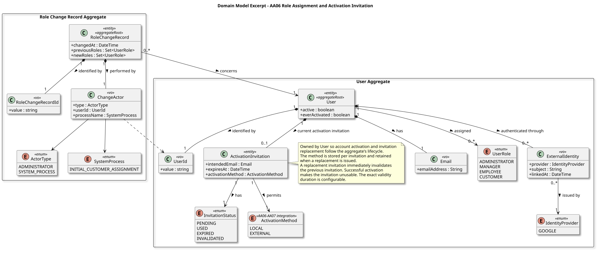
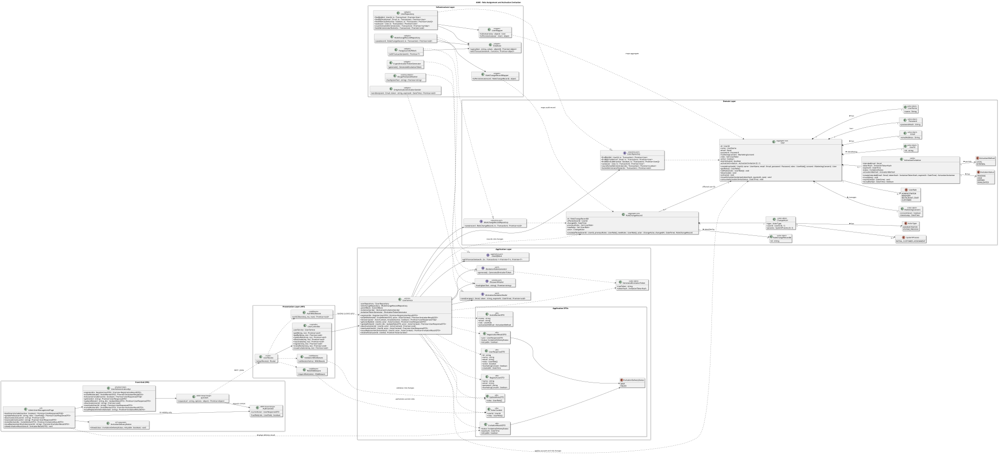
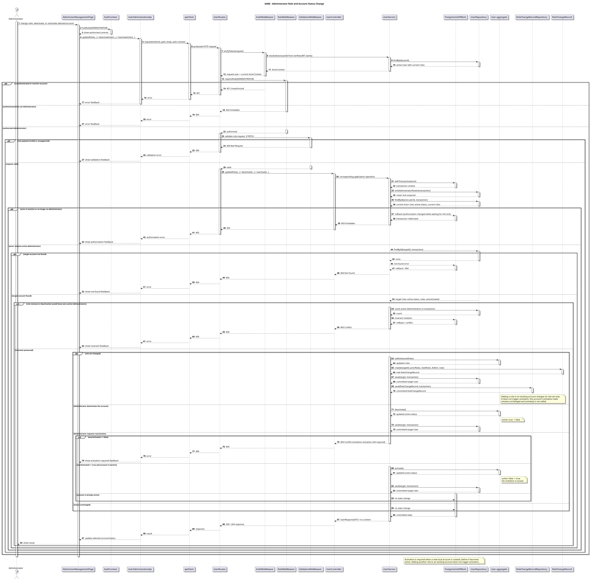
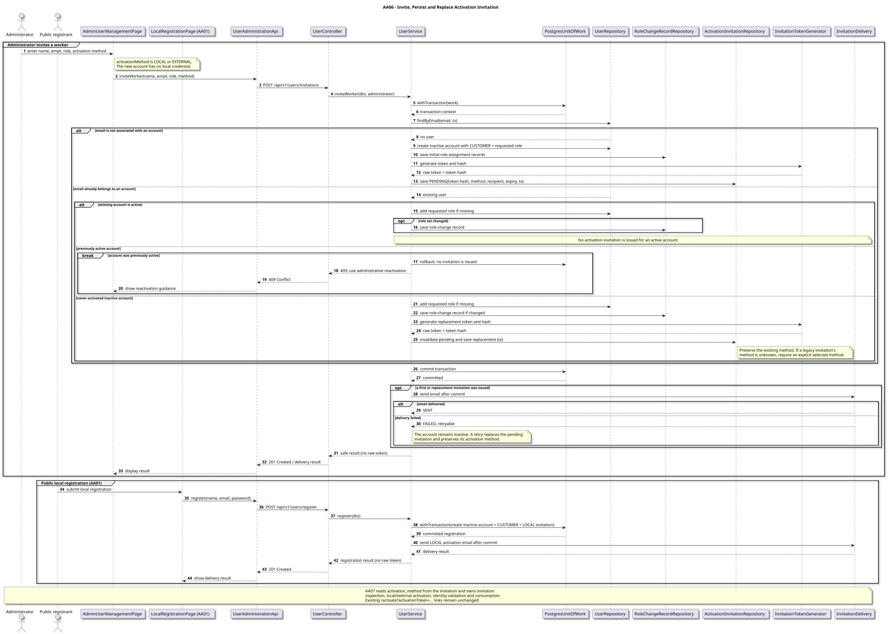

# US AA06 – Role Assignment and Activation Invitation

## 1. Context & Scope

- **User Story ID:** AA06
- **Sprint:** Sprint 2
- **Area:** Authentication and Authorization (AA)
- **Responsible:** Sofia Carvalho (1240898)
- **Related Requirements / Stories:**
  - **Architectural Stories:** ARC01 (Domain Modelling), ARC02 (System Architecture), ARC03 (REST API), ARC04 (Persistence), and ARC05 (Automated Testing) are architectural references, not additional AA06 acceptance criteria. [Domain Model](../../../architecture/domainModel/domainmodel.puml) and [System Architecture Description](../../../architecture/SAD.md).
  - **Related User Stories:** AA03 — Internal Role Resolution is explicitly referenced by AA06 for the automatic Customer role assignment; AA07 — Secure Account Activation specifies how the invitation is used to activate local or external accounts. The AA06–AA07 integration extension below records the invitation method and administrator provisioning contract. AA05 — Authorization Enforcement is related to the enforcement of role-based permissions.
---

## 2. Requirements & Analysis

### 2.1. User Story Description
> **As an** Administrator,  
> **I want** to assign or update users’ internal roles,  
> **so that** access matches their responsibilities.

### 2.2. Acceptance Criteria (from Sprint 2 Specification)

- [ ] **AC 1:** An Administrator must be able to assign, update, and remove the authenticated-user roles defined in Table 1; Guest access applies automatically to unauthenticated visitors.
- [ ] **AC 2:** Except for the initial automatic Customer assignment defined in AA03, role changes must be limited to authorized administrators. Assignments and changes must record the responsible user or system process and the time of the change.
- [ ] **AC 3:** A user must not acquire an administrative role by registering, changing profile information, or selecting an authentication method.
- [ ] **AC 4:** A newly created inactive account must receive a unique activation invitation at its intended email address. Automatic Customer assignment under AA03 does not replace activation. Adding a role to an already active account must not require reactivation.
- [ ] **AC 5:** Invitations must expire and become unusable after successful activation; an authorized administrator must be able to issue a replacement.
- [ ] **AC 6:** Removal of a role or account deactivation must prevent subsequent use of the withdrawn permissions.
- [ ] **AC 7:** Website permissions must be assigned independently of any responsibility for infrastructure administration.

### 2.3. Client Clarifications & Questions

> **Question (1.1):** How should the first Administrator account be provided: preconfigured during installation and activated by its owner through an invitation?  
> **Answer:** The first Administrator account must be created during system installation or initialisation through a secure credential setup process. An invitation is not mandatory.

> **Question (1.2):** May an Administrator remove their own Administrator role or deactivate their own account, and must operations that would leave no active Administrator be prevented?  
> **Answer:** Any operation that would leave the system without at least one active Administrator must be prevented, including removing the Administrator role or deactivating the account.

> **Question (1.3):** Are the roles and permissions in Table 1 fixed for this sprint, with the Administrator assigning/removing roles, or should individual permissions also be configurable?  
> **Answer:** The roles and permissions in Table 1 are fixed. The Administrator may assign and remove roles; configuring individual permissions is not required.

> **Question (1.4):** Besides recording the responsible party and change date, is a role-change history required, including the affected user and the previous and new roles?  
> **Answer:** Role changes must be recorded with the responsible party, date, affected user, and previous and new roles.

> **Question (2.1):** Must an activation invitation have a limited validity period, and should the installing entity be able to configure it?  
> **Answer:** Invitations must have a limited validity period. A default may be defined in code, but a configuration parameter must allow it to be overridden. 

> **Question (2.2):** When a replacement invitation is issued, must the previous invitation become invalid immediately, even if it has not expired?  
> **Answer:** Yes. Issuing a new invitation must immediately invalidate the previous invitation.

> **Question (2.3):** If an email already belongs to an account, should a duplicate be avoided, and how should an inactive account or one with a pending invitation be handled?  
> **Answer:** A duplicate account must not be created for the same email. An Administrator or another user with the required permissions must be able to manage the situation through the existing account.

> **Question (2.4):** If invitation email delivery fails, should the account remain inactive, with retry available and the failure clearly indicated?  
> **Answer:** Yes. The account must remain inactive, the email must be retryable, and information about the failure must be presented.

> **Question (3.1):** When a previously active account is deactivated and later restored, is Administrator reactivation sufficient, or is a new invitation and recipient confirmation required?  
> **Answer:** Administrator reactivation is sufficient; a new invitation is not required.

> **Question (3.2):** When a user loses a role during a session, may they remain authenticated with their other roles, and what happens to access associated with the removed role?  
> **Answer:** Role changes take effect immediately. The user may remain authenticated with the remaining roles but must lose access to functionality associated with the removed role.

**AA06–AA07 integration decisions**

- An Administrator can invite a worker by entering a name, email, role, and activation method (`LOCAL` or `EXTERNAL`, currently Google). AA06 creates or reuses the account, assigns the requested role, and stores the first invitation in the same database transaction. For a new account, the account remains inactive, has no local credential, and receives the automatic `CUSTOMER` role under AA03 in addition to the administrator-assigned role. The email is sent only after the transaction commits. AA07 owns credential setup and invitation redemption.
- An email already associated with an account must resolve to that account; AA06 must not create a duplicate. For an active account, AA06 applies the requested role through normal role management and does not issue an invitation. A never-activated inactive account can receive a replacement invitation. A previously activated, deactivated account follows administrative reactivation and receives no invitation.
- Every new invitation stores its `activation_method`. Public local registration creates `LOCAL` invitations. An administrator-created invitation stores the selected `LOCAL` or `EXTERNAL` method. AA07 uses the method on the invitation to choose password confirmation/setup or external identity verification.
- Replacing an invitation invalidates the previous pending invitation in the same transaction and carries forward its method. Legacy invitations may be backfilled as `LOCAL` only where their local-registration origin is known. If the method is unknown, AA07 must not guess; an Administrator issues a replacement with an explicit method.
- Invitation delivery happens after persistence commits. A delivery failure leaves the account inactive and the invitation retryable; retry replaces the pending invitation using the same method.

### 2.4. Business Rules & Invariants

- **Permitted Website Roles:** The assignable authenticated-user roles are the website roles defined in Sprint 2 Specification Table 1: `ADMINISTRATOR`, `MANAGER`, `RESTAURANT_STAFF`, and `CUSTOMER`. Guest represents an unauthenticated visitor and is applied automatically; it is not an assigned user role.
- **Role Change Authority:** Except for the initial automatic Customer role assignment specified by AA03, role assignment, update, and removal may be performed only by an authorized Administrator. A user must not gain an administrative role through registration, profile changes, or choice of authentication method.
- **Change Audit:** Every role assignment or change must record the responsible user or system process and the time. Per the client clarification, the record must also identify the affected user and the previous and new roles.
- **Initial Customer Role and Activation:** Every newly created internal account receives the initial Customer role automatically as described by AA03, but that assignment does not activate the account or replace the activation invitation. An added role on an already active account does not require reactivation.
- **Invitation Recipient and Account Uniqueness:** A newly created inactive account must receive a unique activation invitation at its intended email address. A second account must not be created for an email that already belongs to an account; an authorized person manages the existing account.
- **Administrative Worker Invitation:** The Administrator supplies the invitee name, email, role, and activation method. New account creation, automatic initial Customer assignment, requested role assignment and first invitation persistence are atomic. The new account has no local credential and remains inactive until AA07 redemption. If the email exists, reuse the account: active accounts receive role changes without an invitation; never-activated inactive accounts may receive a method-specific invitation; previously activated accounts use administrative reactivation without a new invitation.
- **Activation Method:** Every newly issued invitation has exactly one method, `LOCAL` or `EXTERNAL`. Public registration uses `LOCAL`; administrator provisioning uses the selected method. AA07 follows the method stored on the invitation. Unknown legacy methods require an explicit replacement invitation.
- **Invitation Validity:** An invitation must expire and must become unusable after successful activation. An authorized Administrator may issue a replacement, which immediately invalidates the previous invitation. The invitation validity period must be limited and configurable.
- **Replacement Method:** A replacement preserves the prior invitation method and immediately invalidates the prior pending token. If a legacy invitation has no known method, the replacement request must specify one.
- **Failed Invitation Delivery:** If sending an invitation email fails, the account remains inactive; the failure must be communicated and sending must be retryable.
- **Deactivation and Role Removal:** Deactivating an account or removing a role must prevent subsequent use of the withdrawn permissions. As clarified by the client, role changes take effect immediately; the user may retain an authenticated session only with the remaining roles and may not access functionality granted by the removed role.
- **At Least One Active Administrator:** The system must not allow an operation that would leave it without at least one active Administrator, including removal of the last Administrator role or deactivation of the last active Administrator account.
- **Role and Permission Catalogue:** The website roles and their permissions are fixed as described in Table 1; configuring individual permissions is not required. Website permissions are separate from infrastructure administration responsibilities, which do not constitute website roles or grant website access.
- **Restoring a Deactivated Account:** An Administrator may reactivate a previously active account without issuing a new invitation.
- **Authorization Follows Current Roles:** Because role removals must immediately withdraw associated functionality, authorization decisions must use the user's current assigned roles when protected functionality is requested. This is a direct consequence of AC 6 and clarification 3.2; it does not prescribe a technical session or token design.

### 2.5. Domain Model Excerpt

The `User` aggregate may have zero or more `UserRole` assignments, and the role values include Administrator, Manager, Employee, and Customer. Guest is applied automatically to unauthenticated visitors and is not assigned to a User. `ActivationInvitation` is owned by the `User` aggregate and records its `ActivationMethod` (`LOCAL` or `EXTERNAL`) alongside the recipient and expiry. `RoleChangeRecord` is a separate aggregate linked to the affected `User`; it records the time and previous and new role sets, while `ChangeActor` identifies either the Administrator responsible for a manual change or the system process responsible for the automatic initial Customer assignment. The exact invitation validity period is configurable.



---

## 3. Design

### 3.1. Architecture & C4 Alignment

This User Story operates within the established **C4 Model** of the system:
- **C4 Level 1 (System Context):** An Administrator interacts with the *LaPrizza Information System* over HTTPS ([System Architecture Description](../../../architecture/SAD.md)).
- **C4 Level 2 (Containers):** The request originates in the *Front-End UI* and targets the *Back-End API*. The API persists account and audit state in PostgreSQL and sends activation invitations through the configured email integration ([System Architecture Description](../../../architecture/SAD.md)).
- **C4 Level 3 (Components):** The existing user-authentication-management module supplies the Express routes/controllers, authentication and role middleware, `UserService`, and `UserRepository`; shared PostgreSQL transaction infrastructure supplies `PostgresUnitOfWork`. AA06 adds audit and invitation components at the corresponding layer boundaries.

### 3.2. Class Diagram (CD)
The diagram follows AA04's layer-oriented class diagram convention and includes the AA06 front-end entry points. The Administrator page and AA01 local-registration boundary call the REST API through `UserApi`; client-side role checks are presentation-only. The worker-invitation operation creates or reuses a User, assigns the requested role and persists the initial invitation atomically. At the backend, `RoleChangeRecord` remains a separate aggregate linked to the affected User by identifier; the application service writes both aggregates in the same transaction. `ActivationInvitation` remains owned by User and stores its activation method. The email sender is a port because the domain and application layers must not depend on SMTP.




The existing `UserService`, repository, controller, routes, and middleware are extended; the audit repository, audit record, invitation email and token ports/adapters, invitation response DTOs, and AA06 page/API-client/notice components are new. Domain objects and application services remain independent of Express, SQL, and SMTP; the API layer maps HTTP requests and DTOs to application calls.

---

### 3.3. Sequence Diagram (SD)
#### Role assignment and account status

The Administrator opens the user management page, selects a local or external account, and submits a role or status change. The page uses the shared authentication context and API client; every protected request is still authenticated and authorized by the Back-End API. The sequence shows role validation, the audit write, the last-active-Administrator guard, and the current-role lookup that makes removals effective on the next protected request.



#### Invitation issue and replacement

This sequence covers both public local registration and the **administrator worker invitation**. Public registration creates a `LOCAL` invitation. The Administrator provides name, email, role and `LOCAL` or `EXTERNAL` method; AA06 reuses a matching account or creates an inactive account with no local credential, assigns the requested role, and persists the invitation in the same transaction. For a new account, the automatic `CUSTOMER` role and its audit record are included. Email delivery starts after commit. A retry invalidates the pending token and retains the activation method. Previously active accounts use administrative reactivation and receive no invitation.




AA02's first verified Google sign-in is deliberately not shown here: it creates an active Customer account without an invitation and uses the external-authentication flow defined by AA02. AA07 owns invitation inspection and redemption, including expiry, method routing, identity matching and used-token rejection. AA06 owns invitation creation, method persistence, delivery, expiry metadata and replacement. A legacy invitation whose method is unknown must be replaced with an explicitly selected method before AA07 can route it.

### 3.4. REST API Specification (ARC03)

| Method | Endpoint | Description | Auth / Role |
| :--- | :--- | :--- | :--- |
| `GET` | `/api/v1/users` | Lists accounts for Administrator management. The optional `includeInactive` query parameter includes inactive accounts; the management page sets it to `true`. | Bearer authentication; Administrator |
| `GET` | `/api/v1/users/:id` | Gets the selected account details and current role/status for Administrator management. | Bearer authentication; Administrator |
| `PATCH` | `/api/v1/users/:id/roles` | Replaces the target user's website role set and writes a role-change record when the set changes. Guest is not assignable. | Bearer authentication; Administrator |
| `DELETE` | `/api/v1/users/:id` | Deactivates the target account; preserves the record and prevents later protected access. | Bearer authentication; Administrator |
| `PATCH` | `/api/v1/users/:id/activation` | Reactivates a previously active account without issuing an invitation. | Bearer authentication; Administrator |
| `POST` | `/api/v1/users/invitations` | Creates or reuses an account, assigns the requested role, and stores the first activation invitation atomically. A newly created account is inactive and has no local credential. Email delivery occurs after commit. Active existing accounts receive the role without a new invitation. | Bearer authentication; Administrator |
| `POST` | `/api/v1/users/:id/activation-invitations` | Issues or replaces an invitation for a never-activated account, invalidating its current invitation and preserving its method. It also provides the authorized retry path after delivery failure. A legacy invitation with unknown method requires an explicit `activationMethod`. A previously activated account receives `409 Conflict` and must be reactivated instead. | Bearer authentication; Administrator |

#### Request & Response Schemas

- **`PATCH /api/v1/users/:id/roles`:** Request body is `{ "roles": ["ADMINISTRATOR", "MANAGER", "RESTAURANT_STAFF", "CUSTOMER"] }` with any subset, including an empty set. It does not accept `GUEST`. Return `200 OK` with the existing safe `UserResponseDTO` (identifier, profile fields, roles, and active state; never password material or invitation token). Reject malformed or unsupported role values with `400`; return `401` for missing/invalid authentication, `403` for a non-Administrator, `404` for an unknown account, and `409` if the change would leave no active Administrator.
- **`GET /api/v1/users`:** Return `200 OK` with safe `UserResponseDTO` items, including `activationMethod` for the latest invitation or `null` when the method is unknown. The optional `includeInactive` boolean query parameter includes inactive accounts; only an Administrator may access this endpoint. The default list behavior may remain active-only.
- **`GET /api/v1/users/:id`:** Return `200 OK` with the safe `UserResponseDTO`, including `active`, current roles and latest `activationMethod` when known. Return `401`, `403`, or `404` for authentication, authorization, or unknown account errors.
- **`DELETE /api/v1/users/:id`:** Return `204 No Content` after deactivation. Use `401`, `403`, `404`, and `409` as above, with `409` when deactivation would remove the last active Administrator.
- **`PATCH /api/v1/users/:id/activation`:** Request body is `{ "active": true }`; return `200 OK` with the safe `UserResponseDTO`. This is for an Administrator restoring a previously active account and must not issue an invitation. Use `400`, `401`, `403`, and `404` for invalid input, authentication, authorization, and unknown account; return `409 Conflict` when `everActivated` is false and invitation activation is still required.
- **`POST /api/v1/users/invitations`:** Request body is `{ "name": "...", "email": "...", "role": "MANAGER", "activationMethod": "LOCAL" }`; `role` is one assignable website role and `activationMethod` is `LOCAL` or `EXTERNAL`. Return `201 Created` with a safe account summary and invitation delivery result, never a raw token or credential. For a new account, persist the inactive User, initial `CUSTOMER` assignment, requested role, applicable role-change audit records and initial invitation in one transaction. Send email after commit. A matching email reuses the existing account: add the requested role without creating a duplicate; issue an invitation only if the account has never been activated and is inactive. Active accounts need no invitation; previously activated inactive accounts follow the reactivation operation. Email delivery failure is reported as retryable while the account remains inactive.
- **`POST /api/v1/users/:id/activation-invitations`:** Request body is empty when the current invitation has a known method; `{ "activationMethod": "LOCAL" | "EXTERNAL" }` is required to replace a legacy invitation whose method is unknown. For a known method, any supplied method must match it. Return `200 OK` with an `InvitationResultDTO` containing `deliveryStatus`, expiry and `retryable`, never the invitation token. Only an account that has never been activated may receive an invitation. A previously activated account returns `409 Conflict` and must use reactivation instead. Delivery failure leaves the account inactive and allows retry.
- **`POST /api/v1/users/register`:** Public registration continues to create an inactive local account and stores its invitation with `activationMethod: LOCAL`. Its existing password-at-registration behavior is retained; AA07 uses the stored password to confirm activation.
- **Validation and error format:** Reuse the shared validation middleware and the API's existing `{ "error": { "message": "...", "status": n } }` error shape. The role schema must use the Sprint 2 catalogue `{ADMINISTRATOR, MANAGER, RESTAURANT_STAFF, CUSTOMER}` and permit the domain model's empty set. The current OpenAPI `403` description also says “Manager role required” and must be updated to Administrator for these protected operations. The existing user-list repository query filters inactive accounts; extend it so the Administrator page can request inactive accounts. No endpoint is added for Guest or individual permission configuration.

### 3.5. Persistence & Data Integrity (ARC04)

Reuse PostgreSQL, `UserRepository`, and the shared `database.query`/`withTransaction` infrastructure. The existing `users_email_key` unique constraint on canonical `users.email` prevents duplicate accounts under concurrent registration; map a violation of this constraint to `409 Conflict`. Extend the existing User persistence for the Sprint 2 role catalogue and account activation state; add the invitation and role-change records below.

| Table / field | PostgreSQL type and integrity | Purpose |
| :--- | :--- | :--- |
| `users.roles` | Existing `TEXT[] NOT NULL`; constrain values to the fixed Sprint 2 website roles and permit cardinality `0..4`. | Current User role set; Guest is not stored. |
| `users.active` | Existing `BOOLEAN NOT NULL`. | Current account status; deactivation remains a state change. |
| `users.ever_activated` | New `BOOLEAN NOT NULL`. | Distinguishes an account restored after activation from one still requiring invitation activation. Set for accounts provisioned active and after successful AA07 activation. |
| `activation_invitations.token_hash` | `BYTEA PRIMARY KEY`; unique by definition. | Identifies the invitation without storing its raw token. |
| `activation_invitations.user_id` | `VARCHAR(32) NOT NULL REFERENCES users(id) ON DELETE RESTRICT`; partial unique index for `status = 'PENDING'`. | Associates invitation history with its owning User and permits at most one current invitation. |
| `activation_invitations.intended_email` | `VARCHAR(254) NOT NULL`. | Invitation recipient captured when it is issued. |
| `activation_invitations.activation_method` | `TEXT`; new invitations require `LOCAL` or `EXTERNAL`. Legacy rows may remain null only when provenance is unknown and must be replaced before redemption. | Selects the AA07 local-password or external-identity activation flow. Public registration writes `LOCAL`; Administrator invitations write the selected method; replacement carries the method forward. |
| `activation_invitations.expires_at` | `TIMESTAMPTZ NOT NULL`, finite. | Invitation validity deadline; an invitation is unusable after this time even if `EXPIRED` has not yet been persisted. |
| `activation_invitations.status` | `TEXT NOT NULL CHECK` in `PENDING`, `USED`, `EXPIRED`, `INVALIDATED`. | Tracks invitation lifecycle; replacement marks the previous invitation `INVALIDATED`, and AA07 marks successful redemption `USED`. |
| `role_change_records.id` | `UUID PRIMARY KEY`. | Identifies an immutable role-change audit record. |
| `role_change_records.user_id` | `VARCHAR(32) NOT NULL REFERENCES users(id) ON DELETE RESTRICT`. | Identifies the affected User; records are retained with the account. |
| `role_change_records.changed_at` | `TIMESTAMPTZ NOT NULL`, finite. | Time of the role assignment/change. |
| `role_change_records.previous_roles`, `new_roles` | `TEXT[] NOT NULL`; values constrained to supported website roles. | Before/after snapshots, including an empty set where all roles are removed. |
| `role_change_records.actor_type`, `actor_user_id`, `system_process` | Actor type constrained to `ADMINISTRATOR` or `SYSTEM_PROCESS`; exactly one corresponding actor reference is populated. | Identifies the responsible Administrator or the automatic initial-Customer assignment process. |

#### 3.5.1. Transactions and data integrity

Persist the User role/status change and its `RoleChangeRecord` in one transaction. Serialize all operations that can change active-Administrator membership with the same PostgreSQL transaction lock, then count active Administrators before a reducing change and reject one that would leave zero. Because middleware authorization can become stale while a request waits for that lock, reload the actor inside the transaction after acquiring the lock and revalidate that the account is active and still has the `ADMINISTRATOR` role; roll back and return `403 Forbidden` otherwise. Reuse `PostgresUnitOfWork`; its implementation delegates to the shared PostgreSQL transaction wrapper. For administrator worker provisioning, persist a new or reused User, its role changes and audit records, and the first or replacement invitation in one transaction. Deliver email only after commit so SMTP latency/failure cannot hold the database transaction open. On delivery failure, retain the inactive account and invitation state, report `FAILED` and allow an Administrator to issue a replacement with the same activation method.

The Administrator UI lists inactive users so failed invitations and previously active accounts can be managed. Extend `IUserRepository.findAll`/`UserService.listUsers` to accept the `includeInactive` query while preserving the existing active-only default; the detail endpoint remains available for a selected account.

#### 3.5.2. Existing domain and persistence gaps

The initial `users` migration restricts roles to three values and requires one role; later migrations reconcile the persisted role catalogue. The domain accepts the `0..*` role cardinality. `User.createInactive()` supports inactive accounts without local credentials for administrator invitations. Migration `0014_user_business_ids.sql` aligns persisted IDs with the `USR-...` UserId format; use the final migrated schema rather than the initial UUID shape. Migration `0025_activation_invitation_method.sql` adds `activation_method` and classifies an existing invitation as `LOCAL` only when its account is still pending and has a local password credential, the available evidence of public local registration. Other legacy methods remain null and must be selected when replacing the invitation. Administrator user responses expose the latest invitation method so the interface can request a choice only when needed.

### 3.6. Applied Patterns & Architecture Principles
- **Layered/Clean Architecture (ADR-002):** `UserController` and middleware call the application service; the service depends on repository, unit-of-work, and email-sender ports; PostgreSQL and SMTP adapters implement those ports. Domain objects remain independent of Express, DTOs, SQL, and SMTP.
- **Aggregate Root:** Role membership, account active state, and the current activation invitation are changed through `User`. `RoleChangeRecord` is its own aggregate root, because the AA06 domain excerpt models it separately; the application service coordinates persistence of the two roots transactionally.
- **Repository Pattern:** Reuse `IUserRepository`/`UserRepository`; add a focused `IRoleChangeRecordRepository`/PostgreSQL adapter for required audit history. Repositories persist aggregates and receive the shared transaction context.
- **Unit of Work:** Reuse `PostgresUnitOfWork` to commit the User mutation and audit record atomically. The same transaction boundary protects the last-active-Administrator invariant.
- **DTO and Mapper patterns:** Reuse `RegisterUserDTO`, `UpdateRolesDTO`, `UserResponseDTO`, and `UserMapper`; add only an invitation result DTO and invitation persistence mapping as needed. Do not expose domain entities, raw invitation tokens, or credentials in API responses.
- **Dependency Injection and Adapter:** Reuse the module composition root to inject repository, unit of work, and token/email services. The SMTP invitation sender adapts the SAD's email integration to the application port. No Factory, Strategy, or new aggregate abstraction is required.
- **Front-end client and view:** Extend `AdminUserManagementPage` with an invite-worker form for name, email, role and activation method; `UserApi` maps the new operation, and `InvitationDeliveryNotice` presents delivery status and retryability. Public registration continues to call `UserApi.register`, following the API-client naming approach used by AA01. Reuse the AA04 `AuthContext`/`apiClient` design; the API remains the authority for authorization and business rules. `LocalRegistrationPage` is the AA01 entry point for public local registration.

| Acceptance criterion | Design coverage |
| :--- | :--- |
| AC 1 | Covered — fixed website roles and Guest handling in the role request schema and `PATCH /users/:id/roles`. |
| AC 2 | Covered — Administrator authorization and transactional `RoleChangeRecord`, including the automatic Customer assignment actor for both local creation and AA02 external first-sign-in creation. |
| AC 3 | Covered — public registration accepts no roles; initial Administrator comes from secure bootstrap. |
| AC 4 | Covered by the existing local registration design. The AA06–AA07 integration additionally defines administrator provisioning with an initial invitation, method-specific redemption and reuse of existing accounts. |
| AC 5 | Covered — invitation expiry/status rules, immediate invalidation on replacement, and AA07 consumption boundary. |
| AC 6 | Covered — current account status and roles are reloaded for protected requests; deactivation and role removal take effect on subsequent authorization. |
| AC 7 | Covered — fixed website role catalogue is distinct from infrastructure administration. |

---

## 4. Tests (ARC05)

### 4.1. Implementation Summary

AA06 provides Administrator-only role and account management, transactional role-change auditing, inactive local registration with `LOCAL` activation invitations, administrator worker provisioning with `LOCAL` or `EXTERNAL` invitations, method-preserving replacement, expiry, and a guard that preserves at least one active Administrator. Account, role audit and invitation persistence share a transaction; email is sent after commit.

### 4.2. Main Jest Scenarios

#### Scenario 1 — Assign roles and record the change

- **Objective:** Verify an Administrator can replace a user's role set and the change is audited.
- **Preconditions:** An active Administrator and a target account exist.
- **Test Steps:** Submit a supported role set, then inspect the persisted role-change record.
- **Expected Result:** Roles are replaced and an audit record stores the target, previous/new roles, actor, and time in the same transaction.
- **Acceptance Criteria:** AC 1, AC 2.

```js
test('assigns a supported role set and audits actor and before/after values', async () => {
  const admin = makeUser('USR-00001', ['ADMINISTRATOR']);
  const target = makeUser('USR-00002');
  const { service, roleChangeRepository, repository } = serviceFor({
    admin,
    target,
  });

  await service.updateRoles(
    target.getId().getValue(),
    { roles: ['CUSTOMER', 'EMPLOYEE'] },
    {
      sub: admin.getId().getValue(),
      roles: ['ADMINISTRATOR'],
    },
  );

  expect(target.getRoles()).toEqual(['CUSTOMER', 'EMPLOYEE']);
  expect(repository.save).toHaveBeenCalled();
  expect(roleChangeRepository.save).toHaveBeenCalledWith(
    expect.any(RoleChangeRecord),
    expect.any(Object),
  );
  const record = roleChangeRepository.save.mock.calls[0][0];
  expect(record).toMatchObject({
    userId: target.getId().getValue(),
    previousRoles: ['CUSTOMER'],
    newRoles: ['CUSTOMER', 'EMPLOYEE'],
    actor: { type: 'ADMINISTRATOR', userId: admin.getId().getValue() },
  });
});
```

#### Scenario 2 — Deny unauthorized changes and preserve an Administrator

- **Objective:** Verify non-Administrators cannot manage roles and the last active Administrator cannot be removed or deactivated.
- **Preconditions:** A Manager or customer account and at least one active Administrator exist.
- **Test Steps:** Attempt a role update without Administrator authority; concurrently remove the roles of the final two Administrators; attempt to remove the remaining role.
- **Expected Result:** Unauthorized changes return `403`; the concurrent operations leave one active Administrator; removing that last Administrator returns `409`.

```js
test('denies a Manager and blocks removal of the last active Administrator', async () => {
  const admin = makeUser('USR-00001', ['ADMINISTRATOR']);
  const target = makeUser('USR-00001', ['ADMINISTRATOR']);
  const { service, repository } = serviceFor({
    admin,
    target,
    databaseQuery: jest.fn().mockResolvedValue({ rows: [{ count: 0 }] }),
  });

  await expect(
    service.updateRoles(
      target.getId().getValue(),
      { roles: [] },
        {
          sub: admin.getId().getValue(),
          roles: ['MANAGER'],
        },
    ),
  ).rejects.toMatchObject({ status: 403 });
  await expect(
    service.updateRoles(
      target.getId().getValue(),
      { roles: [] },
        {
          sub: admin.getId().getValue(),
          roles: ['ADMINISTRATOR'],
        },
    ),
  ).rejects.toMatchObject({ status: 409 });
  expect(repository.save).not.toHaveBeenCalled();
});
```

The PostgreSQL concurrency test executes both removals together:

```js
const [firstRemoval, secondRemoval] = await Promise.all([
  removeAdmin(admin.getId().getValue(), token),
  removeAdmin(secondAdmin.getId().getValue(), secondToken),
]);
expect([firstRemoval.status, secondRemoval.status].sort()).toEqual([
  200,
  409,
]);
const remaining = await database.query(
  "SELECT id FROM users WHERE active AND 'ADMINISTRATOR' = ANY(roles)",
);
expect(remaining.rows).toHaveLength(1);
const remainingToken = module.tokens.generateToken({
  sub: remaining.rows[0].id,
});
const lastAdminRemoval = await removeAdmin(
  remaining.rows[0].id,
  remainingToken,
);
expect(lastAdminRemoval.status).toBe(409);
```

#### Scenario 3 — Issue, replace, and expire an invitation

- **Objective:** Verify inactive accounts keep the automatic Customer role and invitation delivery failures are visible and retryable.
- **Preconditions:** A local account has never been activated; email delivery is unavailable in the test environment.
- **Test Steps:** Register the account, issue replacement invitations, force the pending invitation's expiry in PostgreSQL, and check whether it remains usable.
- **Expected Result:** The account stays inactive; the response reports failed delivery without exposing a token; older invitations are invalidated, expired invitations cannot be used, and one pending replacement remains.
- **Acceptance Criteria:** AC 4, AC 5.

```js
const failed = await request(app)
  .post(`/api/v1/users/${customerId}/activation-invitations`)
  .set(auth(managerToken));
expect(failed.status).toBe(200);
expect(failed.body).toMatchObject({
  deliveryStatus: 'FAILED',
  retryable: true,
});
expect(JSON.stringify(failed.body)).not.toContain('secret-token');
expect(
  (
    await request(app)
      .patch(`/api/v1/users/${customerId}/activation`)
      .set(auth(managerToken))
      .send({ active: true })
  ).status,
).toBe(409);

const retried = await request(app)
  .post(`/api/v1/users/${customerId}/activation-invitations`)
  .set(auth(managerToken));
expect(retried.body.deliveryStatus).toBe('SENT');
expect(repositoryAdapter.replacePending).toHaveBeenCalledTimes(2);
```

The PostgreSQL test also verifies expiry rejection and the stored replacement states:

```js
const pending = await database.query(
  "SELECT encode(token_hash, 'hex') AS token_hash FROM activation_invitations WHERE user_id = $1 AND status = 'PENDING'",
  [created.id],
);
await database.query(
  "UPDATE activation_invitations SET expires_at = now() - interval '1 second' WHERE user_id = $1 AND status = 'PENDING'",
  [created.id],
);
const usableInvitation =
  await module.userService.unitOfWork.withTransaction((tx) =>
    module.userService.invitationRepository.findUsableForUpdate(
      pending.rows[0].token_hash,
      tx,
    ),
  );
expect(usableInvitation).toBeNull();
expect((await invite()).body.deliveryStatus).toBe('FAILED');
expect(invitations.rows.map((row) => row.status)).toEqual([
  'INVALIDATED',
  'INVALIDATED',
  'EXPIRED',
  'PENDING',
]);
```

#### Scenario 4 — Reactivate a previously activated account

- **Objective:** Distinguish account restoration from first-time invitation activation.
- **Preconditions:** One account was active before deactivation; another account is awaiting its first activation.
- **Test Steps:** Reactivate the previously active account and submit the same operation for the never-activated account.
- **Expected Result:** The previously active account is restored without an invitation; the never-activated account receives `409 Conflict`.
- **Acceptance Criteria:** AC 4, AC 6.

```js
test('restores a previously activated account but rejects an invited account', async () => {
  const admin = makeUser('USR-00001', ['ADMINISTRATOR']);
  const target = makeUser('USR-00002');
  target.deactivate();
  const { service } = serviceFor({ admin, target });
  await expect(
    service.reactivateUser(target.getId().getValue(), {
      sub: admin.getId().getValue(),
      roles: ['ADMINISTRATOR'],
    }),
  ).resolves.toMatchObject({ active: true });

  const invited = User.createInactive(
    UserId.create('USR-00003'),
    UserName.create('Invitee'),
    Email.create('invitee@example.test'),
    Password.createFromHash(hash),
    MarketingConsent.create(false),
  );
  const invitedService = serviceFor({ admin, target: invited }).service;
  await expect(
    invitedService.reactivateUser(invited.getId().getValue(), {
      sub: admin.getId().getValue(),
      roles: ['ADMINISTRATOR'],
    }),
  ).rejects.toMatchObject({ status: 409 });
});
```

### 4.3. AA06–AA07 Integration Verification Scenarios

These scenarios describe the expected verification for the integration behavior. They are not test execution results.

- **Administrator provisions a new worker:** Submit name, email, role and `LOCAL` or `EXTERNAL`. Verify the inactive account has no local credential, receives the automatic `CUSTOMER` role and requested role, and has a pending invitation with the selected method. Verify the account, role audit records and invitation commit atomically, then verify email delivery occurs after commit.
- **Existing email is reused:** Invite an email already associated with an active account and verify no duplicate or invitation is created; the requested role is added and audited only if it changes. For a never-activated inactive account, verify the role and replacement invitation are persisted together. For a previously active account, verify invitation is rejected and administrative reactivation remains the path.
- **Method drives activation:** Verify public registration stores `LOCAL`, administrator invitations store the selected method, and AA07 inspection returns the method persisted for that invitation. A local invitation to an account without a password permits first-password setup; an external invitation follows Google verification and recipient matching.
- **Replacement preserves method:** Replace a pending invitation and verify the prior token is immediately invalid, the replacement has the same method, and the activation URL still uses `/activate?activationToken=…`. For an unknown legacy method, verify replacement requires an explicit method and AA07 does not guess.
- **Delivery failure and retry:** Force mail delivery failure and verify the account remains inactive, the invitation remains retryable, and retry issues a new token while retaining the method.

### 4.4. Test Execution Results

| Test Suite / Command | 
| :--- | ---: | 
| Backend: `npm test -- --runInBand` | 
| Backend PostgreSQL: `npm run test:db` | 
| Frontend Jest: `npm test -- --runInBand` | 

### 4.5. Known Limitations

AA07 owns invitation redemption and marking an invitation used after successful activation. AA06 persists expiry and replacement state and rejects expired invitations, but successful redemption and used-token behavior remain dependent on AA07. The SMTP delivery success path requires deployment SMTP configuration.

---

## 5. Implementation

### 5.1. File Structure

```text
backend/
├── migrations/0023_roles_invitations.sql
├── migrations/0025_activation_invitation_method.sql
├── scripts/bootstrap-administrator.js
├── src/modules/user-authentication-management/
│   ├── api/
│   │   ├── controllers/userController.js
│   │   ├── routes/userRoutes.js
│   │   ├── schemas.js
│   │   └── openapi.js
│   ├── application/services/
│   │   ├── UserService.js
│   │   └── ExternalAuthenticationService.js
│   ├── application/dtos/InviteWorkerDTO.js
│   ├── domain/model/
│   │   ├── User.js
│   │   └── RoleChangeRecord.js
│   ├── infrastructure/
│   │   ├── bootstrapAdministrator.js
│   │   ├── persistence/
│   │   │   ├── UserRepository.js
│   │   │   ├── UserMapper.js
│   │   │   ├── RoleChangeRecordRepository.js
│   │   │   └── ActivationInvitationRepository.js
│   │   └── security/
│   │       ├── ActivationInvitationTokenService.js
│   │       ├── SmtpInvitationDeliveryAdapter.js
│   │       └── activationInvitationConfig.js
│   └── index.js
├── src/shared/validation/ValidationMiddleware.js
└── tests/
    ├── unit/user-authentication-management/aa06.test.js
    ├── integration/user-authentication-management/api.test.js
    └── integration/user-authentication-management/postgres.test.js
frontend/
└── src/
    ├── AdminUserManagementPage.jsx
    ├── adminUserApi.js
    ├── App.jsx
    ├── auth/LocalRegistrationPage.jsx
    └── index.css
```

### 5.2. Core Implementation Highlights

- **Authorization:** `UserRoutes` protects account listing, detail, role, deactivation, activation, and invitation operations with `ADMINISTRATOR`. `UserService` reloads the acting user after obtaining the PostgreSQL advisory lock and denies the operation if that account is no longer active with the Administrator role.
- **Role changes and last-Administrator rule:** `UserService.updateRoles` writes the changed `User` and its `RoleChangeRecord` through the shared unit of work. Role changes and deactivation serialize on the same advisory lock, then check the active Administrator count before a reducing change. Deactivation also revokes the target's sessions in the transaction.
- **Audit records:** `RoleChangeRecord` records the affected user, previous and new role sets, actor, and timestamp. Initial automatic Customer assignments are recorded as `INITIAL_CUSTOMER_ASSIGNMENT`; first-Administrator setup is recorded as a system process.
- **Activation invitations:** Local registration creates an inactive account with the automatic Customer role and stores a `LOCAL` invitation in the same transaction. Administrator provisioning creates or reuses the account, assigns and audits its role, and stores a `LOCAL` or `EXTERNAL` invitation atomically. `ActivationInvitationRepository` stores the activation method with the SHA-256 token hash, intended email, expiry, and status. Replacement invalidates an unexpired invitation or marks an expired one `EXPIRED`, and preserves the previous method. Email delivery happens after commit.
- **Delivery and configuration:** Invitation persistence commits before email delivery. Delivery failure leaves the account inactive and returns a retryable failure status; plaintext invitation tokens are sent only through the email adapter and are not returned by the API. The default validity is 86,400 seconds and can be overridden with `ACTIVATION_INVITATION_TTL_SECONDS`.
- **Dependency wiring and UI:** `createUserModule` composes the PostgreSQL repositories, unit of work, token service, and SMTP adapter. The Administrator page calls the same API for worker invitations, user listing, role changes, deactivation/reactivation, and invitation retries.

---

## 6. Integration, Verification & Demonstration

### 6.1. Running the Automated Tests

Run the backend unit and HTTP suites:

```bash
cd backend
npm test -- --runInBand
```

Run the PostgreSQL integration suites with a dedicated test database whose name ends in `_test`:

```bash
cd backend
npm run test:db
```

Run the frontend Jest tests and production build:

```bash
cd frontend
npm test -- --runInBand
npm run build
```

The verified results are recorded in Section 4. Backend and frontend lint also passed with `npm run lint` in each package.

### 6.2. Manual Verification & OpenAPI Contract

1. Apply migrations with `cd backend && npm run db:migrate`.
2. Create the initial Administrator through the secure bootstrap command. Supply `BOOTSTRAP_ADMINISTRATOR_NAME`, `BOOTSTRAP_ADMINISTRATOR_EMAIL`, and `BOOTSTRAP_ADMINISTRATOR_PASSWORD` through the environment, then run `npm run users:bootstrap-admin`. Remove those credentials from the environment after setup.
3. Configure `SMTP_HOST`, `SMTP_FROM`, and, when required, `SMTP_PORT`, `SMTP_SECURE`, `SMTP_USER`, and `SMTP_PASSWORD`. Invitation validity can be set with `ACTIVATION_INVITATION_TTL_SECONDS`; the invitation link base can be set with `ACTIVATION_INVITATION_WEB_URL`.
4. Start the backend with `cd backend && npm run dev` and open Swagger UI at `http://localhost:8080/api-docs`.
5. Authenticate as the Administrator and verify `GET /api/v1/users` with and without `includeInactive=true`, `GET /api/v1/users/{id}`, `POST /api/v1/users/invitations`, `PATCH /api/v1/users/{id}/roles`, `DELETE /api/v1/users/{id}`, `PATCH /api/v1/users/{id}/activation`, and `POST /api/v1/users/{id}/activation-invitations`.
6. In the frontend, sign in as the Administrator and use the User Management panel to invite a worker with each activation method, assign roles, deactivate/reactivate accounts, and retry invitations. Register a local account separately to verify its `LOCAL` invitation and delivery status.

The AA06 endpoints implement invitation issue/replacement and failure handling, including worker provisioning and method persistence. Completing the link and activating the account requires the AA07 redemption flow.

---

## 7. Observations, Dependencies & Limitations

- **Dependencies:** AA03 supplies the automatic Customer role and current-role resolution. AA04 supplies authenticated sessions. AA05 supplies the role-based protection model. AA07 consumes invitations and completes secure account activation. Apply migrations `0023_roles_invitations.sql` and `0025_activation_invitation_method.sql` before using the AA06 persistence paths.
- **Configuration:** Production invitation email requires SMTP configuration. `ACTIVATION_INVITATION_TTL_SECONDS` defaults to 86,400 seconds; `ACTIVATION_INVITATION_WEB_URL` defaults to `http://localhost:5173/activate` and should point to the AA07 activation page when that flow is available.
- **Known Limitations:** AA07 redemption and marking invitations `USED` remain outside AA06; AA06 persists the method and supports expiry and replacement, while AA07 owns successful activation. Live SMTP delivery was not exercised in the test environment because SMTP credentials were unavailable. The internal role code `EMPLOYEE` remains in use for compatibility and is presented as Restaurant Staff in the UI.
