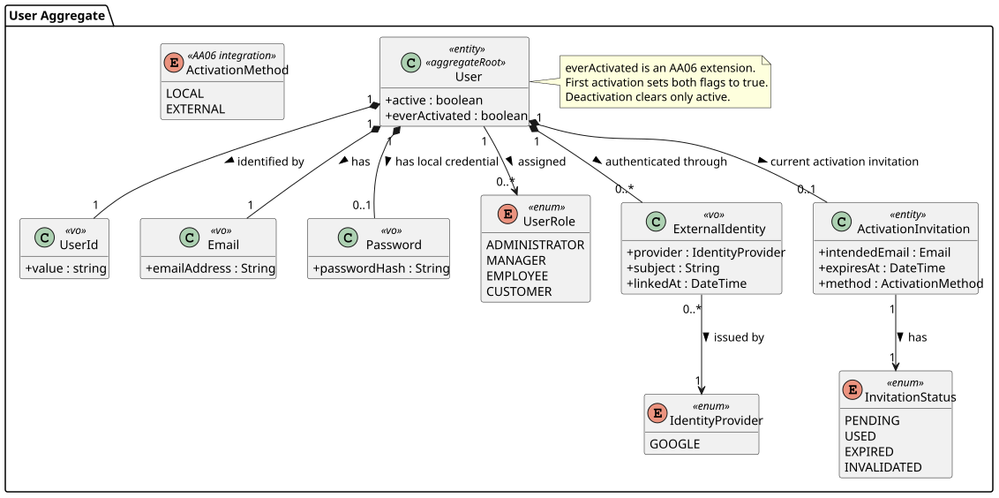
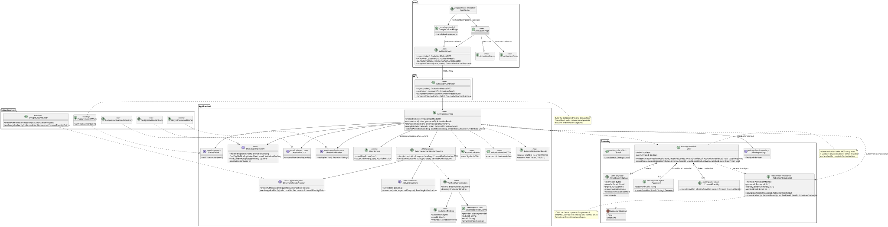
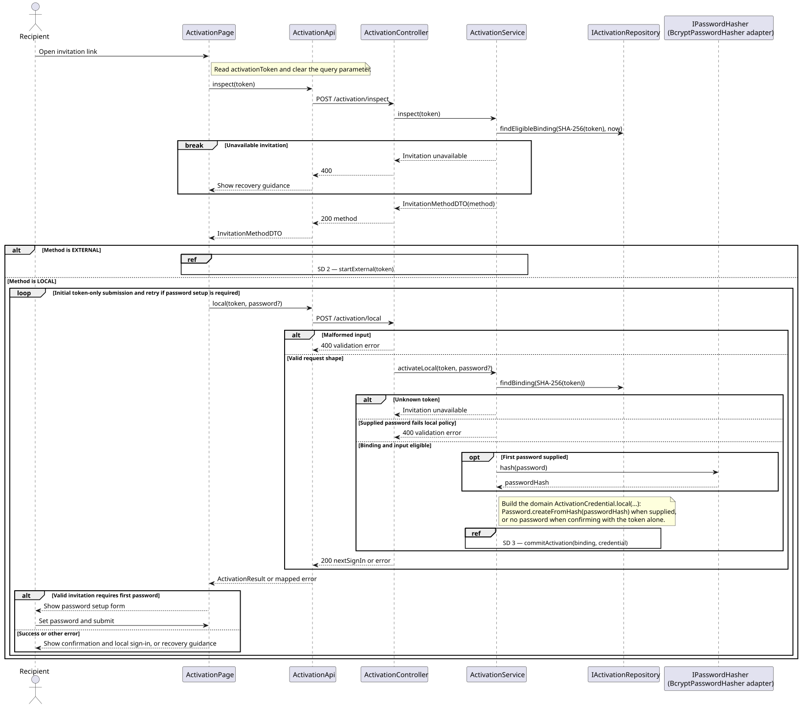
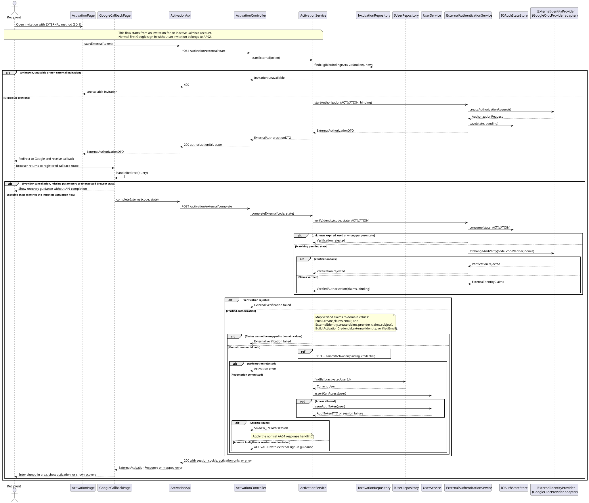
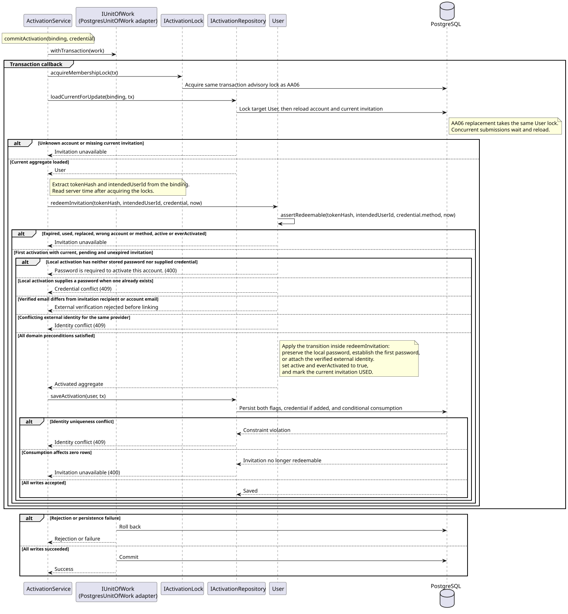

# US AA07 – Secure Account Activation

## 1. Context & Scope

- **User Story ID:** AA07
- **Sprint:** Sprint 2
- **Area:** Authentication and Authorization (AA)
- **Responsible:** Francisco Sá
- **Related Requirements / Stories:**
  - **System specification:** Part II, §II.3.2 (Identity and Access Management) and §II.3.6 (Security and Data Protection).
  - **Sprint planning:** [AA07 tasks](../../../Planning/Sprint2/sprintPlanning.md#aa07--secure-account-activation).
  - **Direct dependencies:** [BCK01](../../bck/bck01/usBCK01.md) provides the account model. [AA06](../aa06/AA06.md) issues, sends and replaces invitations. [AA02](../aa02/usAA02.md) verifies Google identities.
  - **Authentication and access:** [AA01](../aa01/AA01.md) handles local sign-in, [AA03](../aa03/usAA03.md) resolves roles, [AA04](../aa04/AA04.md) handles sessions and [AA05](../aa05/AA05.md) enforces permissions.

AA07 activates a new account through its invitation. Users who register themselves confirm activation by email and keep the password from sign-up. Invited local users without a password set their first one during activation. For a Google invitation, the user signs in with the invited Google address. Activation marks the invitation as used and preserves roles and marketing consent.

---

## 2. Requirements & Analysis

### 2.1. User Story Description

> **As an** invited System User, **I want** to complete account activation securely, **so that** only the intended identity can use my account.

### 2.2. Acceptance Criteria

AC 1–6 follow the order of the six criteria in the official Sprint 2 specification, Part IV, AA07 (p. 12). The business rules and test scenarios below add the implementation and verification details.

- [ ] **AC 1:** For a local account, a valid invitation allows the intended recipient to establish a password and activate the account before the first normal login. This limited process requires no active local session and grants no access to protected business functionality.
- [ ] **AC 2:** An external account invitation takes the user through the identity provider. The authenticated identity must match the intended recipient before activation.
- [ ] **AC 3:** Local users set their own password securely. Invitation emails must not contain passwords.
- [ ] **AC 4:** Invalid, expired, used or mismatched invitations must show an error and must not enable access.
- [ ] **AC 5:** Successful activation enables only the internal roles already assigned to the account.
- [ ] **AC 6:** Activation and authentication must not grant optional marketing consent automatically.

### 2.3. Client Clarifications & Questions

**Question 3 — Activation method for invited accounts.** Does the Administrator choose the method, or can the recipient choose it on the activation page?

**Client answer.** Local users set a password and activate through the email they receive. An account associated with an external identity provider is validated after successful authentication with that provider.

**AA06 integration.** The Administrator selects `LOCAL` or `EXTERNAL` when inviting a worker. AA06 stores the selected method and sends the email after saving the account and invitation. Public registration always issues a `LOCAL` invitation. Replacement keeps the original method when known and invalidates the previous link. Invitations are valid for 24 hours by default. [AA06 invitation flow](../aa06/AA06.md#invitation-issue-and-replacement)

### 2.4. Business Rules & Invariants

- **BR 1 (Target account)** The invitation belongs to one existing User and is addressed to its intended recipient. An invited account remains inactive until activation succeeds, even if Customer has already been assigned. (AA06 AC 4 and AA03)
- **BR 2 (Validity)** Only the current invitation in `PENDING` state and within its validity period can be accepted, using the method recorded at issuance. Replacement invalidates the previous invitation immediately and retains its method. (Sprint 2 plan, AA06 analysis, D7)
- **BR 3 (Credentials)** An active User must have a local `Password`, an `ExternalIdentity`, or both. Local redemption preserves the stored password or establishes the first password when the account lacks one. External redemption requires successful provider authentication and recipient matching before activation. A provider identity, identified by provider and subject, can belong to only one User. (Client clarification, AA02 and domain model)
- **BR 4 (First activation and single use)** Redemption requires `active = false` and `everActivated = false`. Success sets both flags to true and marks the invitation `USED` in the same transaction. Deactivation clears `active` while preserving `everActivated`. A previously active account follows administrative restoration through AA06. (Sprint 2 plan and AA06 activation design)
- **BR 5 (Roles and access)** Activation preserves the role set. AA03 resolves the current roles and denies session start for an inactive account or one with zero roles. AA05 applies permissions to protected operations. (AA03 and domain model)
- **BR 6 (Separate flows)** AA02/AA03 handle first-time external account creation without an invitation. AA06 handles administrative restoration and manages invitation delivery and replacement. (AA02/AA03 and AA06 analyses)

### 2.5. Domain Model Excerpt



[PlantUML source](./excerptDomainModel/domain-model-excerpt.puml) · [Sprint 2 domain model](https://github.com/Departamento-de-Engenharia-Informatica/LEI-SEM5-PI-2026-27-3DE-01/blob/a5a622a15cda51400a56d630533e5383cc05281a/docs/architecture/domainModel/domainmodel.puml)

The excerpt shows the Sprint 2 `User` aggregate during first activation. `Password` is optional, and `everActivated` distinguishes first activation from administrative restoration. The activation method comes from AA06. [AA06 domain model excerpt](../aa06/excerptDomainModel/domain-model-excerpt.puml)

| Concept | Kind | Role in AA07 |
| --- | --- | --- |
| **User** | Entity / Aggregate Root | Holds the current activation state and the AA06 `everActivated` flag and owns at most one current activation invitation. |
| **ActivationInvitation** | Entity | Records the intended recipient's email, expiry time and permitted activation method. The method is an extension to the Sprint 2 model for the AA06 integration. |
| **InvitationStatus** | Enumeration | Only a current, unexpired `PENDING` invitation can be accepted. Successful activation marks it as `USED`. The other states are `EXPIRED` and `INVALIDATED`. |
| **UserId**, **Email** | Value Objects | Identify the target account and represent the email addresses of the account and the intended recipient. |
| **Password** | Value Object | Represents the optional local credential. |
| **ExternalIdentity** | Value Object | Links the account to the external identity verified by AA02 during external activation. |
| **IdentityProvider** | Enumeration | Identifies the provider of the external identity. Sprint 2 supports `GOOGLE`. |
| **UserRole** | Enumeration | Represents role assignments, which activation preserves. |

The invitation belongs to the User aggregate because activating the account and consuming its invitation must succeed together (BR 4). The account must have a local password or a verified external identity at activation (BR 3).

---

## 3. Design

### 3.1. Architecture & C4 Alignment

- **C4 Level 1 — System context.** The recipient opens an email from LaPrizza to activate the account. Google verifies the recipient's identity when the invitation uses external activation. [System Architecture Description](../../../architecture/SAD.md)
- **C4 Level 2 — Containers.** The SPA displays the activation form and handles browser redirects. The Express API owns the authentication and authorization rules. PostgreSQL stores their data. Google verifies the identity before the API opens the redemption transaction.
- **C4 Level 3 — Components.** `ActivationController` passes requests to `ActivationService` in the user authentication module. The service uses the `User` aggregate and the AA02 verification service. The Google callback uses AA03 access checks and AA04 session handling after activation. AA01 handles local sign-in and AA05 enforces permissions.

The three activation paths cover a local account with a password, a local account that needs a first password, and an account invited to use Google. Normal first sign-in through Google is covered by AA02. Issuing, replacing and sending invitations, as well as restoring a previously active account, are AA06 operations.

#### SPA route map and state

| Browser route | View and navigation |
| --- | --- |
| `/activate?activationToken=…` | `ActivationPage` reads the token from the email link, replaces the current URL with `/activate` and asks the API for the invitation method. It holds the token in memory while the user completes the form. |
| `/auth/callback/google` | The AA02 callback checks the OAuth state kept in the initiating tab and selects the login or activation endpoint. The API checks the purpose again. |
| `/login` | The activation confirmation links here after local activation or external activation without a session. If another account is signed in, the confirmation shows that account's email and offers to sign out first. |

The activation form disables repeat submissions while a request is pending and displays errors on the same page. After a failed Google check, the recipient can reopen a valid invitation. The web host must serve `index.html` for `/activate` and `/auth/callback/google` so an email link or Google redirect opens the right SPA view.

### 3.2. Class Diagram (CD)



[PlantUML source](./classDiagram/class_diagram.puml)

The diagram shows the design of the redemption operation. In the implementation, `ActivationService` uses the digest and user ID to load the invitation and calls `User.redeemInvitation(invitation, credential, now)` with domain values. The invitation binding and AA02 claims stay in the application layer.

`ActivationCredential.local()` carries a `Password` only when the recipient sets one. `ActivationCredential.external()` carries an `ExternalIdentity` and the verified `Email`. The aggregate checks the invitation and credential before setting both activation flags and marking the invitation used. `PostgresUnitOfWork` supplies the transaction shared by the lock and repositories.

### 3.3. Sequence Diagrams (SDs)

#### SD 1 — Local activation

The page first submits the token on its own. If the account already has a password, activation keeps the existing hash. If the API asks for a first password, the page displays the password field and resubmits it with the same token. The service validates and hashes the new password before opening the transaction. The recipient then signs in through AA01.



[PlantUML source](./sequenceDiagram/sequence_diagram_local_activation.puml)

#### SD 2 — External activation

The browser checks the returned state and clears it from the tab. AA02 verifies the code and returns the identity claims with the original invitation binding. The `User` compares the verified email with the intended recipient and the current account email before linking the identity. A failed verification leaves the invitation available while it is valid, so the recipient can start again from the email.

After activation commits, `ActivationService` reloads the account and calls `UserService` to check access and start the AA04 session. If the account has no roles or session creation fails, the browser confirms activation and offers sign-in. A failed Google verification leaves any existing browser session in place.



[PlantUML source](./sequenceDiagram/sequence_diagram_external_activation.puml)

#### SD 3 — Shared transactional redemption

The service takes the AA06 membership lock, then locks the account and loads the invitation by digest and user ID. It checks the invitation again before saving the credential, activation flags and used status. If any write fails, PostgreSQL rolls back the whole operation. The next request sees the committed state, including any intervening replacement.



[PlantUML source](./sequenceDiagram/sequence_diagram_commit_activation.puml)

### 3.4. REST API Specification (ARC03)

The four endpoints are public. Inspection, local activation and external start take the invitation token. External completion takes Google's code and the state created for that invitation. The API obtains the account, roles and method from its own records.

| Method and route | Request body | Success |
| --- | --- | --- |
| `POST /api/v1/users/activation/inspect` | `{ token }` | `200` with `{ method }`, where `method` is `LOCAL` or `EXTERNAL`. Inspection leaves the invitation pending. |
| `POST /api/v1/users/activation/local` | `{ token, password? }` | `200` with `{"nextSignIn":"LOCAL"}` after commit. |
| `POST /api/v1/users/activation/external/start` | `{ token }` | `200` with `{ authorizationUrl, state }` for redirect to Google. |
| `POST /api/v1/users/activation/external/complete` | `{ code, state }` | `200` with `{ status: "SIGNED_IN", auth }` and the AA04 session cookie, or `{ status: "ACTIVATED", nextSignIn: "EXTERNAL" }` when activation succeeds without a session. |

The token is a 43-character Base64URL string generated by AA06. The local password follows the AA01 password policy, and the external callback reuses the AA02 code and state schema. The API rejects extra fields. All responses use `Cache-Control: no-store`.

Errors use the project format `{"error":{"message":"...","status":400}}`.

| Status | When it is returned |
| --- | --- |
| `400 Bad Request` | Invalid request or password, unavailable invitation, or an account that needs a first password. The latter returns `Password is required to activate this account.` so the page can show the password field. Expired, replaced, used and mismatched invitations share the same unavailable message. |
| `401 Unauthorized` | Google verification fails, the OAuth state is invalid or belongs to a different flow, or the verified email does not match the recipient. |
| `409 Conflict` | The request supplies a password for an account that already has one, or the external identity conflicts with an existing association. |
| `413 Payload Too Large` | The JSON body exceeds the API's request size limit. |
| `429 Too Many Requests` | The shared public rate limiter blocks the request. |
| `500 Internal Server Error` | The server could not complete the operation. The response omits storage error details. |

`SIGNED_IN` contains the normal AA02 response in `auth` and sets the AA04 HttpOnly cookie. Local activation and `ACTIVATED` confirm activation and offer sign-in. For an unavailable invitation, the page suggests signing in if the account was already activated or asking an Administrator for a new link.

### 3.5. Persistence & Data Integrity (ARC04)

The AA06 `activation_invitations` table stores the token digest, user ID, recipient, expiry, status and activation method. A partial unique index permits one pending invitation per user. A legacy invitation with an unknown method requires replacement before it can be used. AA02's `(provider, subject)` and `(user_id, provider)` constraints apply when the verified identity is saved. [Invitation table](../../../../backend/migrations/0023_roles_invitations.sql) · [Activation method](../../../../backend/migrations/0025_activation_invitation_method.sql)

AA07 redemption and AA06 administrative operations take the membership lock before locking the user row. Redemption then locks the invitation and checks the recipient, method, expiry and first activation flags. `saveActivation()` writes the credential and activation flags. The same transaction marks the invitation `USED` only if it is still pending and unexpired, and checks that exactly one row changed. If the check fails, the account changes roll back with it.

Two requests for the same invitation wait for the same lock. Once one commits, the other sees an active account or a used invitation and is rejected. A request that fails before commit leaves an otherwise valid invitation available.

PostgreSQL stores pending OAuth requests for ten minutes. The table records a digest of the state, its purpose, the PKCE verifier and nonce, and the invitation binding when applicable. The callback deletes and returns the state in one operation, so a different API instance can complete the flow and a replay fails. [OAuth state migration](../../../../backend/migrations/0028_oauth_authorization_states.sql)

### 3.6. Applied Patterns & Architecture Principles

- **Layering.** The controller handles HTTP input and output. The service translates requests and provider claims into domain values. The `User` applies the activation rules, and the adapters handle SQL and hashing. [ADR-002 through ADR-006](../../../architecture/ADR.md)
- **Invitation and password protection.** The browser clears the token from the URL and submits it in a JSON body. The SPA sets a `no-referrer` policy and the API logs paths without query strings. PostgreSQL stores the token digest and bcrypt password hash. Deployments use HTTPS for links and API calls.
- **External verification.** AA07 reuses AA02's OIDC code exchange with PKCE, nonce and verified email checks. The shared callback uses the state for the initiating flow and removes the code and state from the URL. [ADR-008](../../../architecture/ADR.md)

### 3.7. New Components and Justification

| Component | Layer | Responsibility |
| --- | --- | --- |
| `ActivationPage`, `ActivationSignInAction`, `activationApi` | SPA | Open the email link, collect a first password if needed and explain how to switch accounts after activation. |
| `ActivationController`, `createActivationRoutes` | API | Validate and rate-limit the public requests, then return activation results using AA04's cookie handling. |
| `ActivationService` | Application | Inspect the invitation, prepare the credential and run redemption in one transaction. |
| `ExternalAuthenticationService` | Application | Reuses AA02 verification and separates login state from activation state. |
| `User`, `ActivationInvitation`, `ActivationCredential` | Domain | Apply first activation rules and keep provider claims out of the aggregate. |
| `ActivationInvitationRepository`, `UserRepository`, `PostgresActivationLock` | Infrastructure | Load and update the user and invitation under the same lock used by AA06. |
| `PostgresAuthorizationStateStore` | Infrastructure | Share pending OAuth state across API instances and consume it once. |

### 3.8. Design Decisions

| ID | Decision | Rationale |
| --- | --- | --- |
| D1 | Use the AA06 default of 24 hours, configurable through `ACTIVATION_INVITATION_TTL_SECONDS`. | A configuration change applies to new invitations. Existing invitations keep their deadline. |
| D2 | Preserve the password set at public sign-up. Let recipients of invitations for local accounts without a password set their first password during activation. | Keeps the existing registration flow and lets invited users set their own credentials. |
| D3 | Use a single unavailable-invitation message and direct recipients to sign-in or Administrator replacement. | Avoids exposing invitation or account state and uses the AA06 recovery workflow. |
| D4 | Bind external OAuth state to the original invitation and match the verified recipient before linking. | Prevents crossing login and activation flows or redeeming a different invitation after provider verification. |
| D5 | Lock and reload the User, then commit redemption as one transaction. | Prevents concurrent redemption and coordinates with replacement. |
| D6 | Offer normal sign-in after local activation. Start the Google session only after redemption commits and access checks pass. | Local activation leaves any open session in place until the user signs out. Google has already authenticated the recipient, so a successful callback can start a session with AA04. |
| D7 | Let the Administrator choose the activation method when inviting an employee. Store the choice on the invitation and use it to route the recipient. | The server controls which credential may be established for the prepared account. Public registration issues a local invitation. |

| Requirement | Flow and diagram | Operation |
| --- | --- | --- |
| AC 1, BR 1, BR 3 | First activation with an existing or newly established local credential, SD 1 and SD 3. | `local`, `redeemInvitation` |
| AC 2, BR 1, BR 3 | Verified external recipient and identity linkage, SD 2 and SD 3 | `startExternal`, `completeExternal`, `redeemInvitation` |
| AC 3, BR 3 | Recipient sets the first password in SD 1. AA06 sends an activation link, without a password. | `activateLocal`, `sendInvitation` |
| AC 4, BR 2, BR 4 | SD 1–3 reject invalid invitations. SD 3 consumes a valid invitation once and rolls back on failure. | `assertRedeemable`, `verifyIdentity`, `consume` |
| AC 5, BR 5 | SD 3 preserves assignments. SD 2 checks the assigned roles before starting a session. | `saveActivation`, `assertCanAccess` |
| AC 6 | SD 1–3 leave existing marketing consent in place. | `saveActivation`, `issueAuthToken` |
| BR 6 | SD 1 hands off to AA01. SD 2 can start a Google session after commit. AA02 sign-in without an invitation and AA06 restoration use separate flows. | `local`, `completeExternal` |

---

## 4. Tests (ARC05)

### 4.1. Test Plan & Scenarios

| ID | Coverage | Level | Scenario | Expected result |
| --- | --- | --- | --- | --- |
| AA07-V01 | AC 1, BR 1, BR 3 | End-to-end | Try to sign in before and after opening a registration invitation. | Sign-in works only after activation, using the original password. The invitation is used and activation itself creates no session. |
| AA07-V02 | AC 2, AC 5, AC 6, BR 3 | API integration | Complete Google activation with the invited account and an assigned role. | The callback links the identity and activates the account before returning `SIGNED_IN` with the AA04 cookie. The assigned roles are preserved and optional consent remains off. |
| AA07-V03 | AC 2, AC 4, BR 3 | API integration | Complete with a different email, invalid Google proof or state from the normal login flow. | The callback rejects the attempt. The account and invitation remain unchanged. |
| AA07-V04 | AC 4, BR 2, BR 4 | API integration | Submit an unknown, expired, used or replaced invitation, including replacement after external authorization starts. Submit a stale invitation for a previously active, now inactive account. Try a valid invitation through the other method. | Each attempt is rejected. The account and any valid invitation remain unchanged. |
| AA07-V05 | AC 4, BR 4 | PostgreSQL integration | Submit two requests for the same valid invitation at the same time. | One request activates the account and consumes the invitation. The other is rejected. |
| AA07-V06 | BR 4 | PostgreSQL integration | Force a persistence failure after redemption starts, including an external identity uniqueness conflict. | The transaction rolls back. No flags, credentials or invitation status change. |
| AA07-V07 | AC 5, AC 6, BR 5 | API integration | Activate an account with existing roles and marketing consent. | Role assignments and marketing consent are preserved. |
| AA07-V08 | AC 5, BR 5, BR 6 | End-to-end | Remove all roles from an existing account while its invitation is pending, then redeem it. Repeat with an eligible account and simulate failure to start a Google session after commit. | Activation persists and the invitation is consumed in both cases. The Google callback returns `ACTIVATED` without a session. Normal sign-in remains subject to access checks. |
| AA07-V09 | AC 2, AC 4, BR 3 | PostgreSQL integration | Start Google activation on one API instance. Complete and repeat the callback on another. | The first valid callback succeeds. The second is rejected because the state was consumed. |
| AA07-V10 | AC 1, AC 3, BR 3 | API integration | Open the invitation for an inactive local account provisioned without a password. Submit the token alone or with an invalid password, then resubmit it with a valid password. | The API returns `400` for the initial attempts and preserves the invitation. With a valid password, the first hash, both flags and invitation consumption commit together. |
| AA07-V11 | AC 1, AC 3, BR 3 | API integration | Submit a password with a valid local invitation for an account that already has a password. | `409`. The stored hash, account state and invitation remain unchanged. |
| AA07-V12 | AC 2, AC 4, BR 2 | End-to-end | Invite employees with each method and replace one invitation before redemption. | The link opens the method selected by the Administrator. The replacement retains that method. The previous link is rejected. |
| AA07-V13 | AC 1, BR 6 | SPA integration | Activate a local account while signed in as another user. | The confirmation shows the current session. The user reaches the login form after choosing to sign out. |
| AA07-V14 | AC 3 | Manual | Check the email for a local worker invitation before opening it. | The email contains a link and its deadline, without a password. |

### 4.2. Automated Tests

- [PostgreSQL integration suite](../../../../backend/tests/integration/user-authentication-management/activation.postgres.test.js) covers both activation methods, concurrent redemption, replacement, OAuth replay across API instances and migration from the original `0025`.
- [Activation page tests](../../../../frontend/test/auth/local/activation.test.js) cover the password prompt, switching accounts after local activation and keeping the existing session when Google verification fails.
- [Administration page tests](../../../../frontend/test/user-management/AdminUserManagementPage.test.js) cover preserving the selected method when invitation delivery fails.

---

## 5. Implementation

### 5.1. File Structure

| Area | Main files |
| --- | --- |
| API and application | [ActivationController](../../../../backend/src/modules/user-authentication-management/api/controllers/activationController.js), [activation routes](../../../../backend/src/modules/user-authentication-management/api/routes/activationRoutes.js) and [ActivationService](../../../../backend/src/modules/user-authentication-management/application/services/ActivationService.js) |
| Domain and persistence | [ActivationInvitation and ActivationCredential](../../../../backend/src/modules/user-authentication-management/domain/model/ActivationInvitation.js), [User](../../../../backend/src/modules/user-authentication-management/domain/model/User.js), [ActivationInvitationRepository](../../../../backend/src/modules/user-authentication-management/infrastructure/persistence/ActivationInvitationRepository.js) and [PostgresAuthorizationStateStore](../../../../backend/src/modules/user-authentication-management/infrastructure/persistence/PostgresAuthorizationStateStore.js) |
| SPA | [ActivationPage](../../../../frontend/src/features/authentication/pages/ActivationPage.jsx), [ActivationSignInAction](../../../../frontend/src/features/authentication/components/ActivationSignInAction.jsx) and [GoogleCallbackPage](../../../../frontend/src/features/authentication/pages/GoogleCallbackPage.jsx) |

### 5.2. AA06 Integration

An invitation replacement is saved before the email is sent. The replacement response returns the stored method even if delivery fails. The administration page uses that value when the Administrator retries the send.

Migration `0027` repairs legacy invitations in databases that applied the first version of `0025`. It clears the inferred `LOCAL` method where there is no evidence of pending local registration and preserves invitations issued after that migration. Migration `0028` adds the shared OAuth state table. [Legacy invitation repair](../../../../backend/migrations/0027_repair_legacy_invitation_methods.sql) · [OAuth state storage](../../../../backend/migrations/0028_oauth_authorization_states.sql)

---

## 6. Integration, Verification & Demonstration

### 6.1. Running the Automated Tests

Run the backend suite against a PostgreSQL test database whose name ends in `_test`. Google and email delivery are simulated in this suite.

```powershell
cd backend
$env:PGDATABASE = 'laprizza_test'
$env:RUN_DATABASE_TESTS = '1'
npm.cmd test -- --runInBand tests/integration/user-authentication-management/activation.postgres.test.js
```

Run the browser tests from `frontend`:

```powershell
npm.cmd test -- --runInBand --runTestsByPath test/auth/local/activation.test.js test/auth/session/googleSignIn.test.js test/user-management/AdminUserManagementPage.test.js
```

### 6.2. Manual Verification

With the development database selected, apply the migrations from `backend` and start the API and SPA. Configure SMTP in `backend/.env` to test real email delivery.

1. Register a local account. Confirm sign-in is refused before activation, then open the email link and sign in with the original password.
2. Invite a worker with the password method. Confirm the activation page asks for the first password and sign in after activation.
3. Replace a pending invitation. Open the old link and confirm it fails, then activate using the replacement. Reopen the used link and confirm that it is rejected.
4. Invite a worker with Google. Try the wrong Google account, then reopen the invitation and use the invited address. Check that only the second attempt activates the account.
5. Repeat local activation with another LaPrizza session open. Check that the confirmation identifies the current session and only signs out when the user chooses to switch accounts.

### 6.3. Deployment Configuration

Set `ACTIVATION_INVITATION_WEB_URL` to the public HTTPS frontend address ending in `/activate`. LaPrizza appends `activationToken` to each new link. For Google, set `GOOGLE_REDIRECT_URI` to the matching public `/auth/callback/google` address and register the exact URL in Google Cloud. Brevo sends the invitation through AA06, using the SMTP settings in the backend environment. [Backend environment example](../../../../backend/.env.example)

---

## 7. Observations, Dependencies & Limitations

- An account without a role can complete activation, but it cannot start a session until a role is assigned.
- A local login after activation and administrative restoration of a previously active account follow the existing AA01 and AA06 flows, respectively.
- The shared PostgreSQL OAuth state store supports multiple API instances. The in-memory adapter supports a single process.

## 8. References

- [Sprint 2 planning](../../../Planning/Sprint2/sprintPlanning.md#aa07--secure-account-activation)
- [System Architecture Description](../../../architecture/SAD.md)
- [Architecture Decision Records](../../../architecture/ADR.md)
