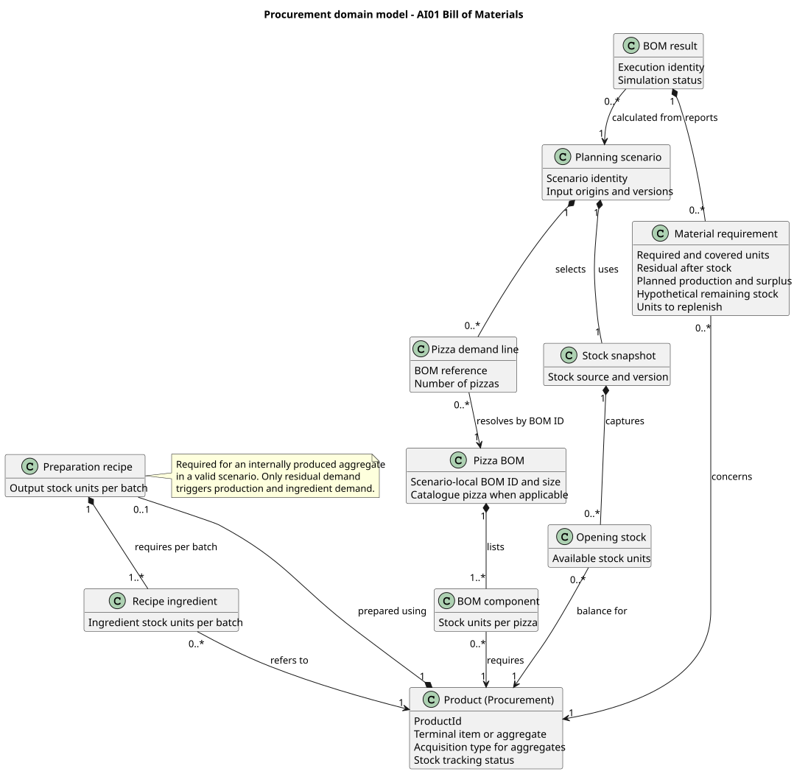
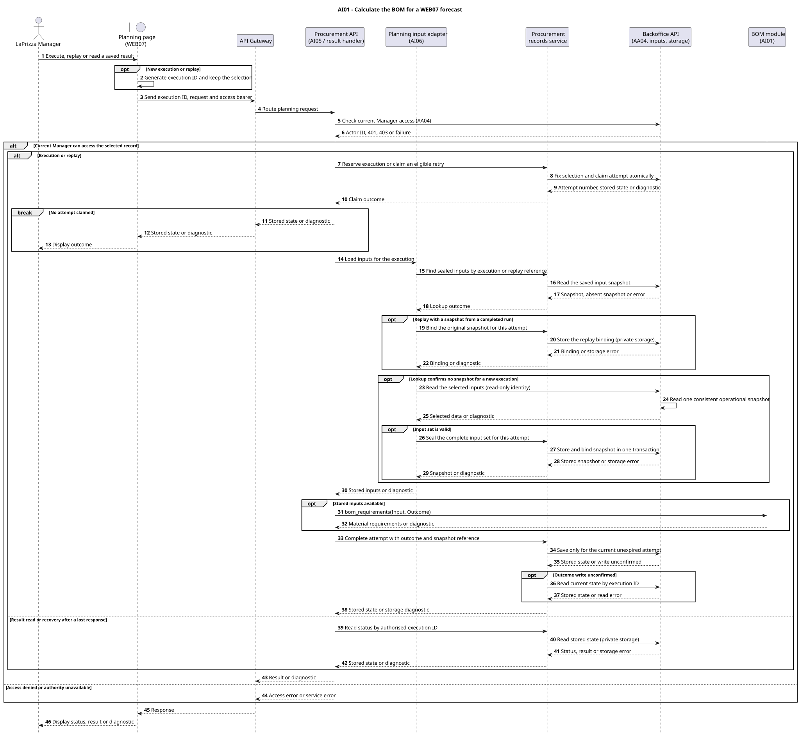
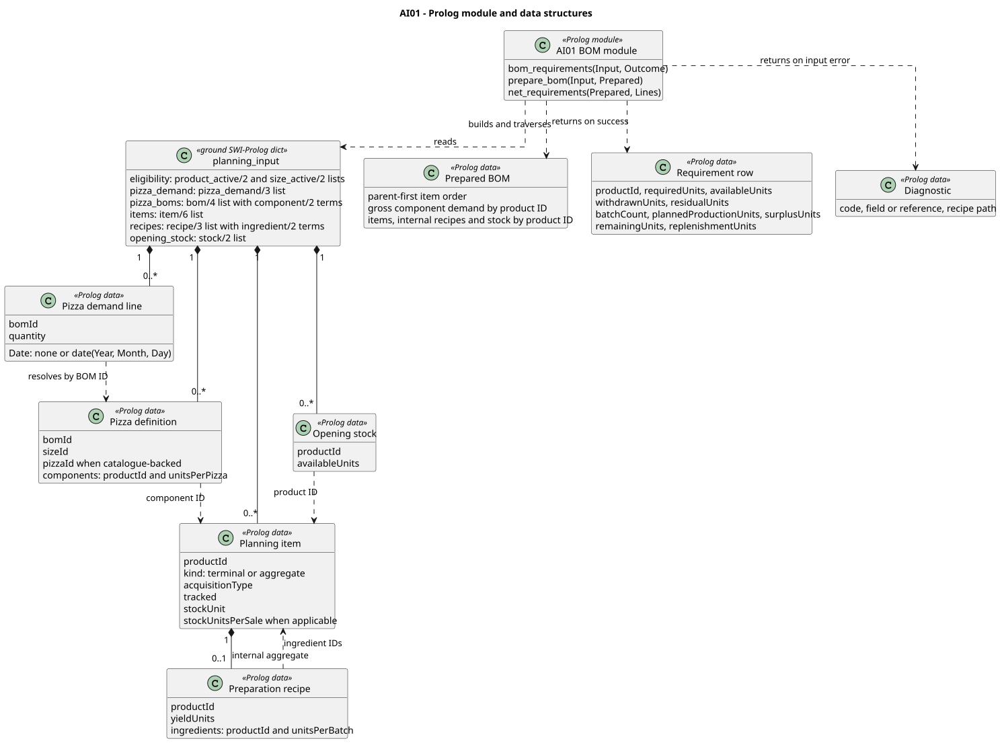

# US AI01 – Prolog Bill of Materials and Stock Requirements

## 1. Context and scope

- **Sprint:** 2 (IARTI Sprint B)
- **Actor:** LaPrizza Manager
- **Team responsibility:** All members, per the [Sprint 2 plan](../../../Planning/Sprint2/sprintPlanning.md#ai01--prolog-bill-of-materials-and-stock-requirements).
- **Status:** Core calculation implemented with versioned input mocks. AI05 and AI06 integration follows their implementation. [Run the calculation and tests](../../../../ai/README.md)
- [Technical design](#4-design) describes the Prolog model, calculation, integration and verification plan.

The Manager needs a Prolog Bill of Materials (BOM) calculation that takes a set of pizza quantities by size and reports how much the selected stock can cover and what must be replenished. For the integrated forecast flow, demand comes from the selected forecast, independently of the status or contents of operational orders. AI06 can also provide ordered pizza quantities for a selected order-based scenario, including predefined or generated orders for demonstration. Both sources provide the same planning information about the pizzas, sizes and quantities.

AI01 owns material expansion and stock coverage for a demand set. AI02 owns the daily planning horizon, hypothetical deliveries and supplier selection, and can reuse the AI01 calculation for daily pizza demand. AI05 owns the service interface. AI06 supplies a consistent dataset from the back end. WEB07 owns the Manager's forecast workflow and result consultation. AI04 records the Prolog examples, expected and observed results, and assumptions for assessment.

## 2. Requirements and analysis

### 2.1. Acceptance criteria

The following identifiers follow the order of the nine AI01 criteria in the Sprint 2 specification, printed pp. 15–16 (PDF pages 16–17).

| ID | Requirement | Evidence planned |
| --- | --- | --- |
| AI01-AC01 | Calculate the BOM in Prolog and expose the calculation through AI05. | S12, S15–S16, S20–S21 |
| AI01-AC02 | Obtain demand quantities, sizes, BOM definitions, products, aggregates and stock from the AI06 back-end interface. The back end may provide predefined or generated demand for demonstrations. | S01, S03, S10, S12–S14, S17–S19 |
| AI01-AC03 | Derive raw-material and aggregate quantities using pizza sizes, recipes, consumption values and each item's abstract stock units. | S01, S03, S05, S06 |
| AI01-AC04 | Use available aggregate stock first. Expand the residual for internally produced aggregates and report the residual of purchased aggregates for replenishment. Use the back-end classification and count each portion of demand once. | S01, S03–S06 |
| AI01-AC05 | Report requirements, available stock, hypothetical remaining stock and replenishment by item. Identify shortages and keep remaining stock non-negative. | S01–S06 |
| AI01-AC06 | Keep the calculation read-only for actual and scenario stock. Operational consumption belongs to the back end and must be explicitly confirmed and accounted for once. | S10, S12 |
| AI01-AC07 | Explain unknown items, invalid quantities, incomplete recipes and cycles. | S07–S09, S12, S14, S19 |
| AI01-AC08 | Identify the scenario and any simulated inputs. Apply the same rules and interfaces to actual and simulated data. | S03, S10, S12, S13 |
| AI01-AC09 | Demonstrate sufficient stock, shortages and a partially stocked aggregate. Document initial inputs and expected results and make simulated runs reproducible. | S01–S06, S10 |

### 2.2. Client clarifications and Sprint 2 interpretation

| Topic | Clarification supplied for this analysis | Consequence for AI01 |
| --- | --- | --- |
| Product composition | Only pizzas have a BOM in the LaPrizza website and management system in Sprint 2 and subsequent sprints. The pizza configurations and component quantities by size available through the API suffice on that side. The client referred the AI-specific scope and demonstration of chained recipes to IARTI. | Keep the pizza as the root of the planning BOM. The Sprint 2 AI01 criteria and IARTI material require a Prolog calculation that can traverse internal preparation recipes. Use a documented, repeatable simulation supplied by the back end to demonstrate that capability alongside the catalogue-backed case. This is the proposed demonstration approach based on the teacher's instruction to follow IARTI and the support material. A production source for preparation recipes is a separate integration decision. |
| Stock reference | Use the current system stock at execution time. The forecast is independent of pending and confirmed orders. Saved or simulated stock is allowed for controlled evaluation. | Use one stock snapshot per execution. If actual mozzarella stock is now 6 after an earlier sale of 4, use 6 for a forecast demand of 4. Coverage is 4, hypothetical remaining stock is 2 and the persistent balance is 6. |
| Directly sold items | Consumption per item sold must be explicitly configurable for stock-controlled products. Missing configuration must be identified. | The standalone demand path used by AI02 consumes `forecast quantity × configured stock units per sale` and treats the product as indivisible. A missing factor yields a product-specific error. The pizza case uses component consumption by size. |
| Inactive references | New forecasts require active products and sizes. First execution checks their status again, including forecasts saved while the references were active. Prior results remain available and a replay may use the original inputs when identified as historical. | For a fresh run, the back end resolves and checks current eligibility with AI06 and supplies the corresponding inputs. For a replay, use the saved dataset and original eligibility and label the result as historical. Simulated stock by itself grants no historical exception. |
| Supplier rules | Lead times are whole days. A configured limit applies per day to each supplier offer for a product. An omitted limit is treated as unlimited for calculation. | AI02 applies these rules and discloses the unlimited-capacity assumption where it affects the plan. AI01 supplies replenishment quantities in stock units. |

### 2.3. Domain model and available data

#### Procurement domain model

This excerpt shows the BOM, recipes, stock and material requirements used by AI01. AI06 maps Backoffice data to these concepts and keeps the original IDs and input sources. [Procurement domain model](../../../architecture/SAD.md#25-procurement-domain-model) · [Context Map](../../../architecture/SAD.md#26-procurement-context-map-ddd)



[AI01 domain model source](excerptDomainModel/procurement_domain_model.puml)

| Backoffice concept | Meaning in Procurement |
| --- | --- |
| Customer `Order` and `OrderItem` | In a selected order-based scenario, AI06 resolves the recorded pizza and size or preserved personalized configuration to a `bomId` and carries over the number of pizzas. Customer details stay in the Backoffice. |
| Consumption forecast and entry | AI06 maps the selected catalogue pizza and size to the default BOM in that scenario and provides its `bomId` and the number of pizzas to plan for. |
| Predefined pizza composition and component size configuration | A pizza BOM lists the components and their stock units per pizza. A predefined pizza keeps its catalogue `ProductId`, and the size selects its BOM. |
| Catalogue `Product` | The Procurement `Product` is a planning item with the classification and stock tracking status needed by the calculation. Catalogue-backed items keep the original `ProductId`. An ingredient is a product used as an input to a recipe, with a quantity for that recipe. |
| `StockInformation` | The stock snapshot contains opening balances by planning item for the selected run. Its source may be the current stock, a simulated dataset or the inputs retained for historical replay. |

Procurement saves the BOM result with its scenario, stock coverage and hypothetical balances for later consultation.

**Customer orders.** The shared `Order` contains one or more `OrderItem` records and may be placed by an identified Customer. An item references a catalogue product or preserves a personalized pizza configuration. For example, “5 medium ham and cheese pizzas” supplies a pizza or fixture reference, the medium size and a quantity of five. AI06 maps the selected size and composition to a `bomId` using the [demand contract](#431-demand-mapping-in-ai06). A missing size or required configuration is incomplete input. The Backoffice applies operational consumption on order confirmation. The forecast stays independent of pending and confirmed orders, and a separately selected order-based scenario runs the same calculation against its selected stock snapshot.

**Supplier orders.** The AI01 result reports quantities that need replenishment. AI02 can turn those quantities into a supplier order proposal with one supplier, proposed order and delivery dates and lines in product-specific stock units. Each line uses an offer for the product. A future operational supplier purchase order would require separate explicit confirmation in the Backoffice. The proposed quantities and associated stock balances are planning results for consultation in Sprint 2.

The scenario can also supply a preparation recipe for an internally produced aggregate. Its yield is the number of output units per batch, and each ingredient quantity is expressed in the corresponding item's abstract stock units. Sprint 2 uses versioned simulated fixtures to demonstrate these recipes; the live catalogue mapping uses the terminal-component rule in section 4.3.3. The [S03 example](#51-simulated-recipe-and-worked-result) shows how the stock of a preparation covers part of the demand before the residual triggers production. The hypothetical balance belongs to the result. The Backoffice retains ownership of operational stock.

Supplier scenarios, offers and daily plans are described in the [WEB07 domain model](../../web/web07/usWEB07.md#25-domain-model-excerpt). Direct-sale items, such as a drink ordered alongside a pizza, enter AI02's demand with an explicit consumption factor when stock is tracked.

#### Backoffice data sources

| Concept | Relation and current source | Implication for AI06 |
| --- | --- | --- |
| Pizza and size | A predefined pizza uses the representative Product ID and `componentIds` from `GET /predefined-pizzas/{productId}`. `GET /pizza-sizes/{id}` supplies size identity and active state. See [BCK10](../../bck/bck10/usBCK10.md) and [BCK06](../../bck/bck06/usBCK06.md). | Resolve a pizza and size to a structurally valid recipe. The public catalogue's availability also depends on stock. A stock shortage must remain calculable for a valid active recipe, even while the catalogue shows it as unavailable. |
| Pizza component consumption | `GET /products/{productId}/component-configurations` lists size-specific entries with `stockUnitsConsumed`. For stock-controlled components it can be zero. For components outside stock control it is `null`. See [BCK08](../../bck/bck08/usBCK08.md). | Join by component ID and size ID. For the current catalogue, a component known to be outside stock control can be recorded as such and omitted from quantified stock requirements. A missing entry, or missing consumption for a tracked component, is incomplete input. |
| Product and preparation recipe | BCK05 exposes `isActive`, `acquisitionType` and `compositionItems`. Composition entries provide child IDs and quantities. The Product response has no batch yield. [BCK05](../../bck/bck05/usBCK05.md) · [Product DTO](../../../../backend/src/modules/product-management/application/dtos/ProductResponseDTO.js) | AI06 classifies catalogue components and fixture items using their selected source. [Classification rules](#433-classification-of-catalogue-and-fixture-items) |
| Stock snapshot | BCK09 exposes `availableUnits` by product. A current open `StockInformation` period indicates stock control. Balances are non-negative integers in product-specific abstract stock units. See [BCK09](../../bck/bck09/usBCK09.md). | Capture tracking status and balances from a consistent view. Distinguish tracked stock of zero, an explicitly untracked item and a missing balance. Use the same distinction for simulated inputs. |
| Forecast and execution | Each demand line identifies the sellable product, applicable size and quantity. WEB07 adds daily dates. AI06 adds the selected versions or retrieval times and origins of the input datasets. | For a BOM calculation, supply the selected demand set with its scenario identity. For daily planning, AI02 invokes the same calculation for the applicable demand and stock on each day. A reproducible replay needs the actual original input data or references that resolve to those exact versions. |

The listed HTTP paths are relative to `/api/v1`. They identify available source data, while AI05 and AI06 define planning routes, service authorization and the integrated input contract. The [`ai/` directory](../../../../ai/README.md) contains the AI01 calculation, versioned input mocks and tests. The related [WEB07 analysis](https://github.com/Departamento-de-Engenharia-Informatica/LEI-SEM5-PI-2026-27-3DE-01/blob/d6bf71d8fcdc52e1c620ec803dc551f76a5464b1/docs/user_stories/web/web07/usWEB07.md) describes the forecast workflow and the need to check recipe completeness.

### 2.4. Calculation rules

| ID | Rule |
| --- | --- |
| BR01 | A demand quantity is a non-negative integer. A valid line with zero demand generates no material requirements. An empty valid scenario produces an empty requirement list. Quantities refer to pizza counts at demand level and to product-specific abstract stock units at material level. |
| BR02 | For each pizza line, multiply its quantity by the configured consumption of each component for the requested size. Sum contributions by product ID across all lines. When AI06 supplies an explicit multiplicity, apply it once according to the documented input semantics. BCK10's default recipe lists each selected component once. |
| BR03 | Start from the selected stock snapshot and allocate each stocked unit at most once in a calculation. For an item with total demand `D` and opening stock `S`, withdraw `min(D, S)`. Residual demand is `D − withdrawn`. |
| BR04 | A terminal item or purchased aggregate reports the residual as replenishment. A purchased aggregate stays indivisible for planning, even if a composition is supplied as descriptive data. |
| BR05 | An internally produced aggregate with sufficient stock adds no demand for its ingredients. When stock is insufficient, derive ingredient demand from the residual and its recipe. Include that aggregate in the output with its requirement, withdrawal and planned production. Replenishment for that row is zero. |
| BR06 | Validate the reachable planning recipes before allocating coverage. A shared child is valid. A cycle on a path of internal expansion, an unknown child, a missing internal recipe or an invalid quantity makes the scenario invalid, even if the opening stock would cover the affected item. Purchased aggregates are leaves in the expansion graph. |
| BR07 | Calculate using request-local input and working balances. Return hypothetical balances as results. Repeated or concurrent runs use their own snapshots and working balances. Any simulated input marks the calculation as a simulation. |
| BR08 | Missing or inconsistent required data invalidates the affected calculation. Identify the scenario and offending field, product, size or recipe path in the error. AI05 distinguishes invalid values, missing information and input-service unavailability. A valid shortage is a successful, reportable calculation. |

#### Calculation semantics

1. Validate the input set, including pizza and size eligibility, amounts, tracking status, classification and reachable recipes. Start the gross requirements with the component demands from all pizza lines. Only the scenario's declared recipes and classifications determine expansion.
2. Process every item after all its parent assemblies have contributed demand. This combines direct and nested demand for the same item before applying its stock and rounding its production. Stable ordering by product ID makes equivalent inputs easy to compare. A graph with shared descendants can be handled without expanding the same stock independently per branch.
3. For a terminal item or a purchased aggregate, report the residual in stock units. For an internally produced aggregate, multiply each ingredient quantity per batch by the required number of batches. For a recipe stated per output unit, the same calculation uses an explicit yield of one. Do not infer a yield from the product ID or acquisition type.
4. For a batch that yields `Y` units, the implemented convention is `batches = ceil(residual / Y)`, calculated with integer arithmetic. When the residual is positive, `produced = batches × Y` and `surplus = produced − residual`. The hypothetical closing balance is `opening − withdrawn + surplus`. AI02 owns the decision to carry a balance to the next day after checking whether the planned production can obtain its materials; AI01 returns the quantities for the demand set supplied.

#### Result and error semantics

- Identify the scenario, demand selection, mode (current or historical replay), and the source and version or retrieval time of each relevant input. Indicate any simulated inputs and link historical results to the original execution.
- For each demanded stock item, show the product ID, gross requirement at that level, opening stock, opening stock withdrawn, residual after stock, hypothetical closing stock and replenishment quantity. Include planned production and surplus for internal aggregates when applicable. A replenishment row represents a shortfall against the scenario's stock, without implying a supplier, delivery or fulfilled purchase.
- Keep quantities for different products in their own units. A material summary can show aggregate and ingredient rows for traceability. Only terminal or purchased-item shortfalls contribute to the replenishment list, with rows summed by product ID.
- Report unknown products or sizes, inactive references, incompatible sizes, missing consumption, missing stock data for tracked items, invalid or negative counts, invalid recipe quantities or yields, missing classification for an aggregate and cyclic paths. Provide no apparently complete result when required input is invalid or unavailable.

### 2.5. Implementation decisions and integration boundaries

| ID | Decision | Owner |
| --- | --- | --- |
| OP01 | Versioned input fixtures supply internal recipes and stock through `planning_input`. Live catalogue components use the terminal classification in section 4.3.3; descriptive compositions do not become production recipes. | AI01 fixtures; AI06 source adapter |
| OP02 | Recipes declare positive integer batch yields and ingredient quantities. Round production up to whole batches and report surplus in the hypothetical closing balance. AI02 handles daily feasibility and balance transfer. | AI01, AI02 and AI06 |
| OP03 | Tracking is explicit. Ordinary untracked components use `none` consumption. Quantified preparations and their ingredients require tracked stock. Direct-sale consumption and its source mapping belong to AI02 and AI06. | AI01 validation; AI06 and AI02 integration |
| OP04 | The core consumes `planning_input` and returns `ok(Lines)` or a diagnostic. Sections 4.1 and 4.3 define access, execution IDs and retained snapshots. This implementation uses local mocks; AI05, AI06 and WEB07 will connect those service paths. | AI01 core; AI05, AI06 and WEB07 integration |
| OP05 | Pizza demand expands directly into components; finished pizzas have no stock balance in this contract. The briefcase is a stocked aggregate inside a synthetic training BOM, preserving the teacher's stock-first calculation. Arbitrary assembly-root requests are outside this API. | AI01 and AI06 |
| OP06 | Every selected BOM requires an explicit size. The S13 fixture supplies the medium size. AI06 must resolve the recorded order size and personalised configuration before calling AI01 and reject incomplete source data. | AI01 validation; AI06 order mapping |

## 3. IARTI support material

| Source | What to carry into AI01 |
| --- | --- |
| *TP Support IARTI SprintB - Pizza Restaurant - 1.pdf*, pp. 4–13, and `pizza-BOM.pl` supplied as text | `part/1` represents a leaf and `setp/2` represents a composition. `manage_stock/4` allocates finished products and assemblies from stock first, recursively processes shortages, and consolidates withdrawals and order needs with `join_equals/2`. For 60 briefcases it withdraws 10 finished units, 20 bottoms and 30 lids, and the final order list is 15 locks and 5 handles. Transfer the stock-first rule, recursive residual expansion and grouping. Replace repeated facts such as two `lock` entries with explicit quantities. The demo uses `retract/1` and `asserta/1` on `stock/2`, so a repeated query depends on the previous one unless stock is reloaded. AI01 needs request-local stock, validation of the full reachable recipe and structured results. The pasted source also contains an encoding artifact before `setp/2`. |
| *TP Support IARTI SprintB - Pizza Restaurant - 1.pdf*, p. 13 | The professor's adaptation exercise calls for at least 3 sizes, 2 bases or doughs, 20 ingredients, assemblies such as dough, and 8 types of pizza. Use these targets for the IARTI demonstration dataset in addition to the small fixtures below. Use abstract stock units in the planning interface. |
| *TP Support IARTI SprintB - Pizza Restaurant - 2.pdf*, pp. 3–10, and `procurement_plan.pl` supplied as text | `buy/5` gathers offers using `findall/3` and `buy1/6` buys packages in the order of the facts, rounding up when one offer covers the remainder. It returns a purchase list, residual supplier stock and unfilled demand. For 5,010 g of ham the code picks two 5,000 g packages at €150, while 5,000 g plus 250 g costs €80 with the example prices. An exact exhaustion can yield a zero-package row. These examples inform AI02's supplier planning. AI01 reports the product and stock-unit deficit that this later step consumes. |
| *TP Support IARTI SprintB - Pizza Restaurant - 3.pdf*, pp. 3–10 | The research and citation guidance is for the AI03 study and AI04 report. The assessment slide assigns 40% each to AI01 and AI02 and 20% to AI03. It calls for the Prolog code and the report and assesses how well students can explain the work. AI05 remains required for the integrated Sprint 2 project, with its assessment in LAPR5. |

## 4. Design

This design implements the rules in the [approved analysis](#2-requirements-and-analysis). It uses the stock-first calculation illustrated by `pizza-BOM.pl` and the first IARTI support deck. `procurement_plan.pl` and the second deck inform AI02's use of the resulting deficits. The code and calculation evidence support IARTI assessment and the AI04 report described in the third deck. The integrated project exposes the calculation through AI05 and obtains the scenario through AI06.

### 4.1. Architecture and execution

| Boundary | Responsibility |
| --- | --- |
| WEB07 and API Gateway | WEB07 assigns an execution ID before submitting a forecast or replay and uses it to recover the state of that run. The Gateway forwards planning requests and responses. |
| Backoffice API | Provide the selected forecast or order, catalogue, eligibility and opening stock through authorised endpoints. |
| AI06 input adapter in Procurement | Read and map the selected inputs to Prolog. Use the original inputs when replaying a saved execution. |
| AI05 Prolog service | Ask Backoffice to verify current Manager access. Claim a calculation attempt, load inputs through AI06 and call AI01. Report the state stored by Procurement planning records. |
| Procurement planning records | Own the execution, sealed input snapshot and outcome. Read and write them through Backoffice's private adapter to the shared PostgreSQL database. |
| AI01 Prolog module | Validate the input model, calculate gross demand and stock coverage, expand internal preparations and return per-product requirements and deficits. The calculation is independent of HTTP, persistence and the clock. |
| AI02 Prolog module | Reuse the stock requirements calculation for daily pizza demand. Own delivery timing, direct-sale demand, supplier selection and transfer of feasible balances to the next day. |

The Gateway routes protected planning requests to Procurement. Backoffice remains the session authority and PostgreSQL access point. Procurement owns planning records, including results and inputs retained for replay. [C4 container view](../../../architecture/SAD.md#23-container-diagram-c4-level-2) · [Access checks and record paths](../../../architecture/SAD.md#27-planning-access-and-records)

The sequence diagram covers a WEB07 forecast execution and replay of that workflow. AI06 also supports a separately selected order-based scenario in the [input contract](#431-demand-mapping-in-ai06). That source uses the same AI01 calculation after normalization.



[PlantUML source](sequenceDiagram/sequence_diagram_bom_execution.puml)

#### Manager and service access

For each new BOM execution, replay or saved-result read, the Procurement handler forwards the Manager's access bearer to Backoffice `GET /api/v1/internal/planning-access`. Backoffice uses the AA04 session check and the user's current account and roles, then requires `MANAGER`. A revoked session returns `401`. A live session without the Manager role returns `403`. If Backoffice cannot verify access, Procurement stops before loading inputs or releasing a result. The handler also checks that the actor may access the referenced forecast or execution. [AA04 protected operations](../../aa/aa04/AA04.md#protected-operations)

AI06 uses a separate read-only service identity for the operational input endpoint and permitted Procurement input reads. It receives an execution selection, without the Manager's bearer. The Procurement records component seals the snapshot and saves the result using its own records permissions. [Service and records permissions](../../../architecture/SAD.md#27-planning-access-and-records)

#### Execution input and persistence

- **Current run.** Resolve the saved forecast and recheck its product and size eligibility against the current catalogue. Capture the selected stock at the start of execution. The proposed BOM-only action uses all pizza quantities in the selected forecast as one demand set against that stock snapshot. Here a date identifies a source forecast line. Daily stock and deliveries are evaluated by AI02. WEB07 should confirm the BOM-only selection and present any standalone forecast lines as outside the requested BOM calculation.
- **Demonstration run.** AI06 can supply a versioned order-based fixture with product and size references, explicit preparation recipes and simulated stock. The adapter maps the selected pizza order lines to the same demand input as the forecast flow. The operational catalogue uses pizza component configurations by size. An internal preparation recipe and its yield are explicit scenario data. If the scenario mixes simulated and current data, every foreign reference must resolve in the selected input and the result is labelled a simulation.
- **Historical replay.** Resolve the exact saved demand, eligibility, BOM, stock and provenance of a completed run. Link the replay to the source execution. A reference must resolve to an immutable version or a retained copy. A replay whose inputs can no longer be resolved returns a missing-data error. Historical status is distinct from the presence of simulated data.
- **Consistency.** After checking access, AI05 reserves the execution ID and fixes its selection. AI06 asks Backoffice for the operational input set in a single read. Backoffice reads the demand, catalogue, BOM components, eligibility and stock on the same connection in a read-only `REPEATABLE READ` transaction. The capture begins before the first planning data query. A failed read or a source that cannot honour a selected version stops the load.
- **Binding.** After validation, the current attempt seals the first complete input set and links its snapshot ID to the execution in one transaction through the Backoffice records adapter. AI01 receives the stored snapshot. Before sealing, a retry repeats the entire capture with the same selection. After sealing, a retry or replay uses the stored inputs. A failed lookup returns an error.
- **Completion.** Backoffice saves the outcome in one transaction, conditioned on the current `attemptNo` in `RUNNING` and its expiry. A success references the sealed snapshot and makes the execution `COMPLETED`. A delayed failure from another attempt returns the stored state and leaves the saved result intact. [Attempt and completion rules](../../../architecture/SAD.md#27-planning-access-and-records)

### 4.2. Prolog module design



[PlantUML source](classDiagram/class_diagram_bom.puml)

The diagram uses a class-style view for Prolog data and predicates. The public calculation predicate accepts the ground `planning_input{...}` dict built by AI06. An in-memory demonstration uses the same shape. A demand line is `pizza_demand(Date, BomId, Quantity)`, with `Date = none` for standalone AI01. A recipe is `recipe(ProductId, YieldUnits, Ingredients)` with `ingredient(ProductId, UnitsPerBatch)` entries. Look up pizza definitions by scenario-local BOM ID. Per-item lookups and accumulated quantities use the product ID as the key.

| Predicate | Role |
| --- | --- |
| `bom_requirements(+Input, -Outcome)` | Run the calculation for one ground input. Return exactly one `ok(Lines)` or `error(Diagnostic)`. |
| `prepare_bom(+Input, -Prepared)` | Read the `planning_input` keys defined below. Validate `pizza_demand/3`, `bom/4`, `item/6`, `recipe/3` and `stock/2`, build lookups and produce initial component demand and parent-first item order. |
| `net_requirements(+Prepared, -Lines)` | Traverse that order with an accumulated demand map. Calculate stock coverage and production, propagate ingredient requirements and produce one row per item with positive demand. |
| `stock_lists(+Lines, -Withdraw, -Order)` | Project successful rows to positive `(Quantity, ProductId)` pairs for the teacher's LWS and LOS. Exported alongside `bom_requirements/2`. |

The second and third predicates are internal responsibilities. They separate the validation of a complete input set from arithmetic on a prepared graph. `Lines` is sorted by product ID. `stock_lists/3` takes positive `withdrawnUnits` and `replenishmentUnits`, respectively, preserving row order and the string product IDs. This retains the intent of `manage_stock/4` and `join_equals/2` from the professor's example while tracking one balance and one requirement total per item. List order can differ from the teacher's traversal; quantities match. The calculation passes values through predicates for each request. The adapter handles expected validation errors separately from unexpected runtime failures.

#### 4.2.1. Input model

This is the normalised model at the AI01 boundary. AI06 owns its transport contract and provides the source records needed to construct it. IDs refer to the selected input set throughout. Quantities are integers, with one product-specific abstract stock unit per item. A pizza demand line uses counts of pizzas.

AI06's `load_inputs/2` returns `ok(Input)` where `Input` has tag `planning_input`. The calculation reads these exact keys and terms. Business identifiers are case-sensitive strings. Classification, tracking flags and `none` are atoms. [Complete producer mapping and example](../ai06/usAI06.md#44-data-mapping-to-prolog)

| Dict key | Value consumed by `prepare_bom/2` |
| --- | --- |
| `meta` | Execution metadata. Require string `scenarioId` and `mode`, where mode is `"current"` or `"historicalReplay"`. Mode validation does not retrieve or authenticate a historical snapshot. |
| `pizza_demand` | List of `pizza_demand(Date, BomId, Qty)`. Date is `none` or a validated `date(Year, Month, Day)`. AI01 totals the supplied rows. |
| `pizza_boms` | List of `bom(BomId, PizzaId, SizeId, Components)` with `component(ProdId, Units)` terms. An absent catalogue pizza ID is `none`. Untracked component consumption is `none`. |
| `items` | List of `item(ProdId, Kind, Tracked, AcqType, StockUnit, UnitsPerSale)`. Kinds are `terminal` or `aggregate`. Aggregate acquisition is `produced` or `purchased`. Optional fields that do not apply are `none`. |
| `recipes` | List of `recipe(ProdId, Yield, Ingredients)` with `ingredient(ProdId, UnitsPerBatch)` terms. |
| `opening_stock` | List of `stock(ProdId, Units)` in each tracked item's stock unit. |
| `eligibility` | Dict with `products` and `sizes` lists of `product_active(ProdId, Active)` and `size_active(SizeId, Active)`. |

The same input carries `meta`, `direct_sale_demand`, `offers`, `forecast` and `reference_date` as defined by AI06. AI01 validates and calculates the pizza graph from the fields above. AI05 uses `meta` to associate the result with the execution, while AI02 handles direct sales, supplier terms and calendar planning. The JSON fields below describe the transport representation. AI06 maps them to this dict before the call.

| Element | Fields and invariants |
| --- | --- |
| Execution metadata | `executionId`, `scenarioId`, `mode` (`current` or `historicalReplay`), and `replayedFrom` for replay. Provenance records `dataset`, `source`, `version` or `retrievedAt`, and `simulated` for every selected input set, including catalogue or eligibility data if supplied separately. The result's `simulation` flag is true if any selected dataset is simulated. |
| Pizza demand | `bomId` and `quantity ≥ 0`. Every line references exactly one definition from the selected scenario, including zero-quantity lines. Multiple lines can refer to the same BOM. WEB07 validates duplicates within a forecast date, and AI06 retains dates where AI02 needs them. |
| Pizza definition | One definition per `bomId`, with a required `sizeId`, a `pizzaId` when it refers to a catalogue pizza, and the component IDs and `unitsPerPizza`. The size and applicable products must be eligible in the selected input view. Quantities already include any configured multiplicity. Explicit zero is valid. An explicitly untracked catalogue component has `unitsPerPizza: null` and contributes no quantified stock demand. |
| Planning item | One record per `productId` referenced by the selected BOMs and reachable internal recipes. `kind` is `terminal` or `aggregate`. Aggregates have the AI06 `acquisitionType`, either `PRODUCED` or `PURCHASED`. `tracked` explicitly identifies stock control. A terminal can also have a catalogue acquisition type. Expansion is determined by the aggregate kind and classification together. |
| Preparation recipe | One recipe per internally produced aggregate, identified by the output `productId`. `yieldUnits > 0` is the number of output units per batch. Each ingredient specifies `productId` and `unitsPerBatch > 0` in its own units. A recipe per output unit uses `yieldUnits: 1`. Purchased aggregates are leaves in the planning graph. |
| Opening stock | One `availableUnits ≥ 0` per tracked item referenced by the selected planning recipes. A tracked item with zero stock has an explicit zero record. For the current catalogue the stock and tracking state derive from BCK09's current period. |

The adapter supplies original catalogue and size identifiers and eligibility from the selected snapshot together with the configuration, even when the catalogue shows a stock shortage. For a catalogue pizza, `pizzaId` stays on the BOM. Opening balances are for tracked components and ingredients used by the selected definitions. [Product selection per run](../../../architecture/SAD.md#which-products-are-loaded)

Reject an unresolved `bomId`, duplicate BOM IDs, duplicate stock records and repeated recipe ingredient IDs. Consolidate source composition quantities during normalisation when the source explicitly represents multiplicity. AI01 checks the normalised definitions before use. For the proposed demonstration contract, internally produced aggregates and their quantified recipe inputs have tracked balances. A quantified recipe input without stock control yields a missing-data diagnostic pending a business rule for that case. An ordinary untracked catalogue component can use explicit `null` consumption.

#### 4.2.2. Calculation

1. **Validate the selected demand and graph.** Resolve each `bomId` in the selected scenario and check input types, identifier references, pizza and size eligibility and compatible component configurations, including on zero-demand rows. Starting with the referenced pizza components, traverse all internal recipe edges before allocating stock. Track the active traversal path and completed items separately. A repeated item on the active path reports the cycle path. References to a completed item represent shared ingredients. Reject unknown children, missing classification, missing required stock or consumption, and missing, empty or invalid internal recipes. Purchased aggregates terminate expansion even if their source records carry descriptive composition.
2. **Compute gross component demand.** For every pizza line and quantified component, add `quantity × unitsPerPizza` to that product's demand. Keep one total per product ID. Zero contributions do not create result rows.
3. **Net stock in parent-first order.** Reverse the graph's depth-first finishing order so that every parent is processed before its children. Each product is visited once in this pass after all potential contributions to its demand. For a positive demand `D` and opening stock `S`, set `withdrawn = min(D, S)` and `residual = D − withdrawn`. If the product is a terminal or purchased aggregate, report `residual` for replenishment and set closing stock to `S − withdrawn`.
4. **Expand internally produced residuals.** For an internal item with yield `Y`, plan `ceil(residual / Y)` whole batches. Use integer ceiling division. A residual of zero yields zero batches and zero child demand. Add `batchCount × unitsPerBatch` for each ingredient to the same demand map. Set planned production to `batchCount × Y`, surplus to `plannedProduction − residual`, closing stock to `S − withdrawn + surplus`, and external replenishment to zero for that internal item. These balances are conditional on obtaining any missing inputs.
5. **Return deterministic rows.** Report one row per demanded item. Keep aggregate rows so the Manager can trace stock used and planned production. Only terminal and purchased shortages appear in the replenishment list. An empty valid demand set returns a successful empty list. Use exact integer arithmetic in Prolog and validate representability at the JSON boundary so rounding or overflow can be reported explicitly.

Example S05 demonstrates why the parent-first pass precedes rounding. Two preparations and a pizza component contribute one premix unit each. With one unit of stock and a yield of two, total demand is three, the withdrawal is one, and a single batch covers the residual. Processing each branch separately can schedule excess batches and produce different results when the input order changes.

#### 4.2.3. Result and AI02 handoff

Each row contains `productId`, `requiredUnits`, `availableUnits`, `withdrawnUnits`, `residualUnits`, `batchCount`, `plannedProductionUnits`, `surplusUnits`, `remainingUnits` and `replenishmentUnits`. Terminal or purchased rows use zero batches, production and surplus. These quantities obey three relationships.

```text
requiredUnits  = withdrawnUnits + residualUnits
availableUnits = withdrawnUnits + unspentOpeningUnits
remainingUnits = unspentOpeningUnits + surplusUnits
```

`unspentOpeningUnits` is derived as `availableUnits − withdrawnUnits`. A calculation with deficits has a successful result. The remaining stock is a hypothetical result, conditional on obtaining any missing inputs for planned production. Items without demand retain their opening balances.

AI02 selects one day's `pizza_demand/3` rows and supplies that day's hypothetical balances in `opening_stock` on a local copy of `planning_input`. It passes the dated terms unchanged to `bom_requirements/2`. AI01 totals the supplied rows and returns the day's pizza requirements. AI02 owns date selection, direct-sale demand, supplier selection and the progression of feasible balances. Positive `replenishmentUnits` identify pizza-driven shortages in each product's own stock units.

### 4.3. Integration contract proposal

AI01 uses `planningType: "BILL_OF_MATERIALS"` in the shared API. A completed BOM run returns its requirement rows under `result.data`. Start, status, history, retry and replay use the same envelope as AI02. [Shared planning execution API](../../../architecture/planning-execution-api.md) · [WEB07 recovery flow](../../web/web07/usWEB07.md#execution-recovery)

#### 4.3.1. Demand mapping in AI06

For a first run, AI06 opens a private Backoffice read view with the authorised selection. For a retry or replay with saved inputs, AI06 reads the retained snapshot through its internal input-run API. It maps the bound snapshot to the `planning_input` dict above. [AI06 REST and snapshot design](../ai06/usAI06.md#43-internal-rest-contracts)

An `OrderItem` links to `PizzaSize`. `PersonalizedPizzaConfiguration` holds the selected components. Simulated orders provide these values directly. AI06 must resolve the recorded size before constructing this input, as specified in OP06; connecting the order API belongs to that adapter. [Sprint 2 domain model](https://github.com/Departamento-de-Engenharia-Informatica/LEI-SEM5-PI-2026-27-3DE-01/blob/a5a622a15cda51400a56d630533e5383cc05281a/docs/architecture/domainModel/domainmodel.puml)

| Selected input | Mapping into AI01 |
| --- | --- |
| Forecast entry | Read the product, selected size and quantity from the forecast entry. Resolve the default composition from the selected catalogue version, join its components with the corresponding size configurations, and reference that BOM by `bomId`. |
| Catalogue pizza order line | Read the product, order quantity and recorded selected size. Use the same catalogue BOM mapping as for a forecast entry. An order fixture supplies the size directly. If the selected size is unavailable, report incomplete input. |
| Personalized pizza order line | Use the preserved selected size and components from the order line. Join those components with their consumption for that size. Keep the catalogue pizza ID when the order preserves a reference to it. Assign a different `bomId` to each distinct composition for the same catalogue pizza and size. |
| Incomplete order line | Return a diagnostic identifying the line and missing or invalid data, such as the selected size, preserved composition or component configuration. |

The `bomId` identifies a definition within the selected snapshot. Replaying the execution preserves its BOM IDs and definitions. Each definition preserves the selected catalogue reference and size. The demand lines contain only the planning data required by AI01. AI01 resolves each pizza's components through `bomId` and then groups material quantities by `productId`. Recipe expansion and stock coverage remain part of the Prolog calculation.

The following excerpt is for S14. Both order lines use the same catalogue pizza and medium size, but the first contains ham and the second omits it. Opening stock, item definitions and provenance are supplied in the full scenario.

```json
{
  "pizzaDemand": [
    { "bomId": "medium-ham-cheese", "quantity": 5 },
    { "bomId": "medium-cheese", "quantity": 2 }
  ],
  "pizzaBoms": [
    {
      "bomId": "medium-ham-cheese",
      "pizzaId": "PROD-90020",
      "sizeId": "PSIZE-0002",
      "components": [
        { "productId": "PROD-90001", "unitsPerPizza": 1 },
        { "productId": "PROD-90003", "unitsPerPizza": 2 },
        { "productId": "PROD-90008", "unitsPerPizza": 1 }
      ]
    },
    {
      "bomId": "medium-cheese",
      "pizzaId": "PROD-90020",
      "sizeId": "PSIZE-0002",
      "components": [
        { "productId": "PROD-90001", "unitsPerPizza": 1 },
        { "productId": "PROD-90003", "unitsPerPizza": 2 }
      ]
    }
  ]
}
```

#### 4.3.2. Recipe and result examples

For S03, an AI06 fixture could use `PROD-90001` for the base, `PROD-90002` for the premix, `PROD-90003` for cheese, `PROD-90004` for tomato, `PROD-90005` for water, `PROD-90006` for flour, and `PROD-90007` for yeast. Here is how the relevant premix data would map to the AI01 boundary. The values refer to the second preparation in the [worked example](#51-simulated-recipe-and-worked-result).

```json
{
  "items": [
    { "productId": "PROD-90002", "kind": "aggregate", "acquisitionType": "PRODUCED", "tracked": true }
  ],
  "recipes": [
    {
      "productId": "PROD-90002",
      "yieldUnits": 2,
      "ingredients": [
        { "productId": "PROD-90006", "unitsPerBatch": 3 },
        { "productId": "PROD-90007", "unitsPerBatch": 1 }
      ]
    }
  ],
  "openingStock": [
    { "productId": "PROD-90002", "availableUnits": 3 }
  ]
}
```

The matching row from the successful response is shown below. The executed scenario includes all referenced product, pizza, size, recipe and stock records.

```json
{
  "executionId": "a5242c8e-526a-4b5c-9539-a84887a492d1",
  "scenarioId": "iarti-bom-s03",
  "mode": "current",
  "simulation": true,
  "provenance": [
    { "dataset": "demand", "source": "iarti-bom-s03", "version": "1", "simulated": true },
    { "dataset": "bom", "source": "iarti-bom-s03", "version": "1", "simulated": true },
    { "dataset": "stock", "source": "iarti-bom-s03", "version": "1", "simulated": true }
  ],
  "lines": [
    {
      "productId": "PROD-90002",
      "requiredUnits": 8,
      "availableUnits": 3,
      "withdrawnUnits": 3,
      "residualUnits": 5,
      "batchCount": 3,
      "plannedProductionUnits": 6,
      "surplusUnits": 1,
      "remainingUnits": 1,
      "replenishmentUnits": 0
    }
  ]
}
```

| Outcome | Diagnostic or result |
| --- | --- |
| Valid calculation, including shortages | `ok(Lines)` from the core. Return the calculated result with provenance. |
| Invalid input | Identify the offending field, product, size or recipe path. Examples include a negative quantity, inactive reference, incompatible size or cyclic recipe. |
| Missing required data | Identify the unknown reference, absent balance, missing recipe or consumption value, or unavailable saved version. |
| Denied or unavailable | Keep access denial and service or data-source failure distinct. The service boundary reports these outcomes and keeps any result from a partial read out of the successful response. |

For example, a cycle diagnostic contains `code: "CYCLIC_RECIPE"` and `path: ["PROD-90001", "PROD-90002", "PROD-90001"]`. Missing tracked stock can report `code: "MISSING_STOCK"` and the affected product ID. AI05 owns final response schemas and HTTP codes. Business errors should remain recognisable when reported through the back end to WEB07.

#### 4.3.3. Classification of catalogue and fixture items

Use the selected source to decide `kind`. A catalogue pizza supplies the BOM for the ordered size. Its component configurations supply the per-pizza quantities. A live component is a `terminal` item under the client's rule that only pizzas have an operational BOM. Its catalogue `acquisitionType` remains metadata. A `PRODUCED` component with no planning recipe therefore remains terminal and any shortfall is reported for that stock item. Generic `compositionItems` do not enter the planning graph.

In an IARTI fixture, each item declares its `kind`. An aggregate must also declare `PRODUCED` or `PURCHASED`. A produced aggregate needs an explicit preparation recipe, yield and ingredient quantities. A purchased aggregate enters the calculation as one item and its descriptive composition adds no demand. A missing or unknown fixture kind, an unresolved aggregate acquisition type, or a missing recipe for a declared produced aggregate yields an input diagnostic. AI06 must identify the product and the invalid or missing field.

### 4.4. Verification and demonstration

| Verification level | Design evidence |
| --- | --- |
| Prolog calculation | Run S01–S09, S13–S14 and S18–S19 from the [scenario matrix](#52-scenario-matrix). Check the exact rows for S03, the shared ingredient in S05, and catalogue versus fixture classification. |
| Service integration | Run S10–S21 with AI05 and AI06. Verify execution, replay and result access after session revocation or Manager role removal. Change inputs during S17 capture and verify the stored set is coherent. Check historical replay, product eligibility, diagnostic responses and read-only use of stock. Recover a saved result after a lost response and verify that a stale failure leaves the saved success intact. |
| IARTI demonstration | Use the S03 fixture for a worked explanation and a larger fixture covering at least three pizza sizes, two doughs or bases, 20 ingredients and eight pizza types as described in the first deck. Show an API-backed catalogue run, internal and purchased aggregate shortages, and reproducible output. Record the Prolog invocation, input snapshot and actual results in AI04. |

The scenario matrix describes expected behavior across the core calculation and its future integration. Sections 6 and 7 record the implemented core, its mock boundary and the local verification evidence.

### 4.5. Implemented decisions and integration boundaries

| Analysis reference | Implemented decision and integration boundary |
| --- | --- |
| OP01 | `bom_fixtures.pl` supplies versioned internal recipes and stock through the AI06 input shape. The live classification rule remains the one in section 4.3.3. AI06 will connect the sources. |
| OP02 | Whole batches are rounded up using integer arithmetic. Recipe yields and ingredient quantities are explicit; surplus is returned as a hypothetical balance. AI02 checks daily feasibility before carrying it forward. |
| OP03 | Ordinary untracked components use `none` consumption. Quantified internal recipes require tracked preparations and ingredients with explicit balances. Direct-sale demand is outside the AI01 calculation. |
| OP04 | The CLI calls the same core contract intended for AI05/AI06. Authorisation, sealed snapshots, execution recovery and stored results follow sections 4.1 and 4.3 when those USs are implemented. |
| OP05 | Finished pizza stock is outside the input model. A training BOM wraps the teacher's briefcase aggregate to exercise stock of the finished assembly. Section 6.3 explains this adapter and its limits. |
| OP06 | The selected BOM must have an explicit known size. S13 tests the normalised order case and rejects a missing size. AI06 must resolve the original order size before this boundary. |

## 5. Acceptance scenarios and expected evidence

### 5.1. Simulated recipe and worked result

The `worked` fixture uses fixed product IDs. The names below make the arithmetic readable. Quantities are abstract stock units for the corresponding item.

| Input | Definition |
| --- | --- |
| Medium Margherita | 1 dough base, 2 cheese and 3 tomato per pizza |
| Large Margherita | 2 dough bases, 3 cheese and 4 tomato per pizza |
| Dough base | Internally produced. A batch yields 1 base and consumes 2 premix and 1 water. |
| Premix | Internally produced. A batch yields 2 premix and consumes 3 flour and 1 yeast. |
| Other ingredients | Cheese, tomato, water, flour and yeast are terminal stock items. |

**S03.** Demand is 3 medium and 2 large pizzas. The size-specific pizza requirements are 7 bases, 12 cheese and 17 tomato. Use 3 bases from stock and make 4. These 4 bases require 8 premix and 4 water. Use 3 premix from stock. Three premix batches yield 6 units, cover the residual of 5 and leave 1 in hypothetical stock. They require 9 flour and 3 yeast. The resulting replenishment list is 4 cheese, 1 water and 2 flour.

| Item | Opening stock | Required | Withdrawn | Residual after stock | Produced | Closing stock | Replenishment |
| --- | ---: | ---: | ---: | ---: | ---: | ---: | ---: |
| Dough base | 3 | 7 | 3 | 4 | 4 | 0 | 0 |
| Premix | 3 | 8 | 3 | 5 | 6 | 1 | 0 |
| Cheese | 8 | 12 | 8 | 4 | 0 | 0 | 4 |
| Tomato | 20 | 17 | 17 | 0 | 0 | 3 | 0 |
| Water | 3 | 4 | 3 | 1 | 0 | 0 | 1 |
| Flour | 7 | 9 | 7 | 2 | 0 | 0 | 2 |
| Yeast | 3 | 3 | 3 | 0 | 0 | 0 | 0 |

All opening stock values remain persisted as entered. In this result, production is conditional on sourcing the material deficits, and closing stock is hypothetical under the displayed production and demand assumptions.

### 5.2. Scenario matrix

| ID | Level | Input and expected behavior |
| --- | --- | --- |
| S01 | Prolog | Use S03 and replace only the opening stock of bases, cheese and tomato with 7, 12 and 17, respectively. Withdraw those quantities, with no replenishment and no demand for premix or its children. |
| S02 | Prolog | For 5 pizzas consuming 2 cheese and 3 tomato each, set cheese stock to 4 and tomato stock to 0. Report gross quantities of 10 and 15, replenishment of 6 and 15 and closing stock of zero for both. |
| S03 | Prolog and demo | Run the chained internal recipe above from its fixed stock snapshot. Confirm the full per-item table, including the amount covered by each aggregate's stock. |
| S04 | Prolog | Classify the base in S03 as purchased. Withdraw 3 bases and report 4 bases for replenishment, along with the 4 cheese shortage. The base's previous recipe contributes zero demand for premix or water. |
| S05 | Prolog | Forecast one pizza of each of two types. The first consumes 1 unit of preparation A and 1 premix. The second consumes 1 unit of preparation B. A and B each have zero stock and a recipe that yields 1 unit and consumes 1 premix. With 1 premix, 3 flour and 1 yeast in opening stock, withdraw the premix once. A single two-unit batch supplies the residual of 2 and uses all the flour and yeast. Reorder the demand lines and verify the same result. |
| S06 | Prolog | Set base stock to 0 in S03 and keep the other inputs. Produce 7 bases, require 14 premix and withdraw the available 3 premix. Produce 12 premix in 6 batches, leaving 1 premix in hypothetical stock. Report gross requirements of 18 flour, 6 yeast and 7 water. |
| S07 | Prolog | Provide an empty valid demand set and a valid zero-quantity line. Both give empty requirements. Reject negative or fractional demand, negative stock, non-positive batch yield and invalid ingredient quantities with the offending item or field identified. |
| S08 | Prolog and integration | Exercise unknown product and size IDs, a size without a compatible component configuration, a missing tracked stock balance, a missing consumption value and an internal preparation with a missing recipe or child. Each case yields a diagnostic. An explicitly untracked, ordinary catalogue component provides a separate valid case. |
| S09 | Prolog | Introduce a self-cycle and then a multi-level cycle such as base → premix → base. Return the cycle path, including when sufficient base stock would cover demand. A recipe with a shared child, as in S05, remains valid. |
| S10 | Integration | Run S03 twice from identical saved inputs and compare the quantities and input references. Verify stored scenario and backend stock before and after success and failure. Run two cases concurrently to check snapshot isolation. In a current-stock case, change live stock through its normal back-end operation, then run a new forecast and verify that it reads the new balance. |
| S11 | Integration | Save a forecast while the product and size are active, then deactivate either before its first execution. Verify rejection. For a separate completed run, verify that its result is preserved and a replay with its saved inputs works and is labelled historical. |
| S12 | Integration | Pass the exact `planning_input` dict from AI06 AS12 through `prepare_bom/2` and `bom_requirements/2`. Verify 600 g of cheese demand and 200 g to replenish. Repeat with one day's dated `pizza_demand/3` rows and the AI02 daily stock. Check catalogue and simulated scenarios, provenance, structured diagnostics and absence of operational stock writes or purchase orders. |
| S13 | Prolog and integration | Supply a selected simulated customer order of 5 medium ham and cheese pizzas with the medium size explicitly recorded. The BOM consumes 2 mozzarella units and 1 ham unit per pizza. With 6 mozzarella and 5 ham units in stock, these two lines require 10 and 5 units respectively. AI01 reports 4 mozzarella units to replenish and no ham shortage. Supply the same demand through a forecast and verify identical quantities with the same BOM and stock. Remove the size from the order line and verify an incomplete-input diagnostic. |
| S14 | Prolog and integration | Use the example in [section 4.3.1](#431-demand-mapping-in-ai06) with 5 medium ham and cheese pizzas and 2 medium cheese pizzas from the same catalogue pizza and size. Verify two BOM IDs and requirements of 7 bases, 14 cheese units and 5 ham units. With opening stock of 7 bases, 10 cheese units and 4 ham units, replenish 4 cheese units and 1 ham unit. Remove one referenced BOM and verify a missing-data diagnostic. |
| S15 | Integration | Revoke a Manager's session after a successful planning request. Reuse its still unexpired bearer for execution, replay and saved-result reads. Each request returns `401` before any input load, execution write or result disclosure. |
| S16 | Integration | Remove `MANAGER` from a user with a live session and another active role. Execution, replay and saved-result reads return `403` on the next request. No calculation starts and no saved result is disclosed. |
| S17 | Integration | Start a capture for 5 pizzas with 2 cheese units per pizza and 6 units in stock. After the first query in the capture, commit a change to 3 units per pizza and 8 in stock in another transaction. The first run uses 2 and 6 throughout, so it reports 4 units missing. A new execution uses 3 and 8 and reports 7 missing. A retry after sealing and a replay use the first snapshot. |
| S18 | Prolog and integration | Use a live component marked `PRODUCED` with descriptive children and no approved planning recipe. Demand 10 units with 6 in stock. AI06 maps it as `terminal`. AI01 reports 4 units to replenish for that component and adds no demand for its descriptive children. |
| S19 | Prolog and integration | Run separate fixtures with an unknown or missing item kind, an aggregate with no valid acquisition type, and a declared produced aggregate without a recipe. Each returns a diagnostic identifying the affected product and missing or invalid field. |
| S20 | Integration | Generate the execution ID in WEB07, start the run and drop the response after the success is committed. Use the original ID to retrieve `COMPLETED` with the saved result and snapshot reference. Repeat the start with the original request and verify the same result and a single attempt. A repeat with a different forecast version returns `409` and leaves the record intact. |
| S21 | Integration | Pause attempt 1 after sealing its snapshot. Let it expire, then retry the same execution and let attempt 2 succeed with the sealed snapshot. Deliver the failure from attempt 1 after the success is committed. The completion write returns `COMPLETED` with the result of attempt 2, which remains available under the original execution ID. Repeat with the stale failure arriving while attempt 2 is still running and verify it can still complete. |

For the Sprint 2 demonstration, retain the versioned input, AI05 request and result, Prolog calculation evidence and stock snapshots before and after execution. Show an API-backed catalogue case and the reproducible internal-recipe simulation. The demonstration can use the small worked example to explain the arithmetic and the larger IARTI dataset to show multiple pizza configurations. Record observed outcomes and limitations in AI04.

## 6. Implementation

### 6.1. Implemented file structure

```text
ai/
├── src/
│   ├── bom.pl
│   └── json_boundary.pl
├── fixtures/
│   └── bom_fixtures.pl
├── tests/
│   ├── bom_tests.pl
│   └── json_boundary_tests.mjs
├── demo_bom.pl
└── README.md
```

| File | Implemented responsibility |
| --- | --- |
| [bom.pl](../../../../ai/src/bom.pl) | Exports `bom_requirements/2` and `stock_lists/3`. Validates the input, builds the dependency order, calculates stock coverage, production and replenishment, and projects LWS/LOS. |
| [bom_fixtures.pl](../../../../ai/fixtures/bom_fixtures.pl) | Exports `bom_fixture/2`. Supplies ten versioned input mocks using the AI06 `planning_input` contract. |
| [json_boundary.pl](../../../../ai/src/json_boundary.pl) | Exports `write_planning_json/2`. Shared JSON output validation for the demo and future AI05 handlers, retaining valid scenario and execution references on error. |
| [demo_bom.pl](../../../../ai/demo_bom.pl) | Exports `demo/1` for JSON and `demo_stock/1` for the teacher's LWS/LOS lists. Imports the shared JSON boundary. |
| [bom_tests.pl](../../../../ai/tests/bom_tests.pl) | Contains 55 PlUnit test definitions, producing 70 checks through parameterised cases. |
| [json_boundary_tests.mjs](../../../../ai/tests/json_boundary_tests.mjs) | Contains 13 Node.js tests using the shared Prolog serializer and JavaScript JSON round trips. |
| [AI checks workflow](../../../../.github/workflows/ai-checks.yml) | Runs both suites on relevant PRs and manual requests. Reused by scheduled CI and by deployment for the selected release SHA. |
| [AI README](../../../../ai/README.md) | Documents the input, result, fixtures and execution commands. The repository README links to these instructions. |

### 6.2. Core calculation

The `bom` module exposes one calculation entry point. `prepare_bom/2` and `net_requirements/2` are internal predicates. The input is a ground `planning_input` dict using the keys and terms in section 4.2.1. Business IDs remain strings.

1. **Validate and index.** `prepare_bom/2` checks required fields, quantities, classifications, tracking, references and eligibility. It requires mode `"current"` or `"historicalReplay"`; an unknown mode yields `INVALID_MODE` with the received value as its reference, while an absent field yields `MISSING_FIELD`. A BOM size of `none` yields `MISSING_FIELD` at `pizza_boms.sizeId`, with the BOM ID as its reference. A supplied invalid size yields `INVALID_REFERENCE`; an unknown string size ID yields `UNKNOWN_SIZE`. `index_records` uses `library(assoc)` to build indexes by ID and reject duplicate definitions. An explicitly untracked component uses `none` consumption and has no opening balance.
2. **Validate the graph.** `visit_items` and `visit_item` traverse the selected components and reachable internal recipes. The active path detects cycles, while the visited index recognises shared ingredients. Recipes and tracked balances are checked even when stock covers the selected demand. Purchased aggregates and terminal items end the traversal.
3. **Accumulate pizza demand.** `add_pizza_demand`, `add_component_demand` and `add_demand` sum `quantity × unitsPerPizza` by product ID. A zero contribution adds no demand.
4. **Net in dependency order.** `net_items` processes parents before ingredients, after all parents can contribute demand. It withdraws `min(required, available)` from the opening balance and calculates the residual once per product.
5. **Plan internal production.** `plan_item` uses `(residual + yield - 1) // yield` whole batches. `add_ingredient_demand` adds the resulting ingredient quantities to the same demand accumulator. Purchased and terminal residuals become replenishment. Internal production reports its surplus as hypothetical remaining stock.
6. **Return stable rows.** `net_requirements` sorts the requirement dicts by product ID. Expected validation errors are caught by `bom_requirements/2` and returned as `error(Diagnostic)`, including the scenario and execution references when available. Unexpected runtime errors propagate to the caller.

All indexes and accumulators belong to the call. The opening-stock index is read to calculate each product's coverage and the resulting balance is returned in its requirement row. Repeated and concurrent calls retain independent inputs.

For the defence, follow `visit_item` → `net_items` → `plan_item`: discover and validate the recipe graph, use stock after all parent contributions, then calculate whole production batches or terminal shortages. Short comments mark these steps in the source. `library(assoc)` provides ID-to-value maps; `foldl` passes an updated accumulator along a list. `throw` and `catch` turn expected validation failures into diagnostics. They do not update stock facts.

### 6.3. Adaptation of the teaching example

The `briefcase` fixture preserves the parts, assembly relationships and opening balances supplied in `pizza-BOM.pl`. Terminal `part/1` definitions become planning items. `setp/2` definitions become recipes with an explicit yield of one. Repeated parts become explicit ingredient quantities, including two locks per bottom and two metal latches per lid.

The stock-first expansion is implemented through the dependency traversal and netting pass. The teaching example's `retract/asserta` stock updates are represented by local calculations and result balances. Shared demand is accumulated before stock allocation and batch rounding.

The public input starts with pizza BOM demand. It expands a pizza directly into its components and has no finished-pizza stock balance. To reuse this boundary, the classroom fixture defines a synthetic `teaching-assembly` BOM with `training-size` and one briefcase per unit. The briefcase is a stocked aggregate inside that BOM, so the same algorithm withdraws its 10 available units before producing the remaining 50. These references are training data, not live catalogue pizzas. A generic request such as `manage_stock(60, lid, LWS, LOS)` is outside the implemented interface.

For the request for 60 briefcases, local execution produced the following withdrawals and shortages.

| Item | Withdrawn from opening stock | Replenishment |
| --- | ---: | ---: |
| Briefcase | 10 | 0 |
| Bottom | 20 | 0 |
| Lid | 30 | 0 |
| Lock | 45 | 15 |
| Handle | 25 | 5 |
| Lower frame | 30 | 0 |
| Upper frame | 20 | 0 |
| Metal latch | 40 | 0 |
| Steel bar | 50 | 0 |

`stock_lists/3` produces these quantities in the teacher's pair format. Run:

```sh
swipl -q -s ai/demo_bom.pl -g "demo_stock(briefcase)" -t halt
```

```prolog
LWS=[(20,"bottom"),(10,"briefcase"),(25,"handle"),(30,"lid"),(45,"lock"),(30,"lower_frame"),(40,"metal_latch"),(50,"steel_bar"),(20,"upper_frame")]
LOS=[(5,"handle"),(15,"lock")]
```

The lists contain positive quantities in product-ID order. IDs are strings under the AI06 contract; the teacher uses atoms. LOS describes quantities missing from stock. Supplier selection and operational purchase orders remain outside this projection.

### 6.4. Input mocks and demonstration entry point

`bom_fixtures` supplies `worked`, `sufficient_stock`, `shortage`, `shared_ingredient`, `personalized`, `ordered_ham_cheese`, `cheese_example`, `briefcase`, `iarti` and `iarti_balanced`. Each fixture has fixed references, a stable UUID execution reference and `simulation:true`. The two large fixtures have provenance version `2`, recording the added purchased pesto aggregate; the others keep version `1`. These UUIDs are local mock references; AI05 will allocate real execution IDs. `fixture_input` assembles the complete dict and its eligibility and provenance. The `iarti` fixture has three sizes, two internally produced doughs, twenty terminal ingredients, one purchased aggregate and eight pizza types, producing 24 size-specific BOMs.

`ordered_ham_cheese` covers S13's normalised order input. `iarti_balanced` reuses the large dataset with stock that covers most ingredients, partially covers ham, mozzarella and pesto, and has no basil. It also demonstrates stocked dough and batch surplus. `iarti` remains available as a severe-shortage case. In both large fixtures, pizza 8 consumes 20 g of purchased pesto per size factor: total demand is 280 g, opening stock is 100 g and replenishment is exactly 180 g. No pesto recipe is needed or expanded. This prepares the calculation part of AI06 AS03 in one run; connecting catalogue data and mixed-source provenance remains AI06 integration.

The local demonstration loads a fixture, calls `bom_requirements/2` and adds the returned lines or diagnostic to the fixture metadata for JSON output. This provides a runnable boundary for the current implementation. AI06 will supply the same input contract through its adapter, and AI05 will invoke the calculation in its authorised execution workflow.

Before serialisation, `json_boundary:write_planning_json/2` recursively checks integers throughout the response. JSON numbers must be between `-9007199254740991` and `9007199254740991`, inclusive. An out-of-range value produces `error` with code `JSON_INTEGER_OUT_OF_RANGE`, the field path and the exact decimal value as a diagnostic string. Non-empty string `scenarioId` and `executionId` values are preserved in both the response and its diagnostic; malformed references are omitted. Validation happens before any bytes are written, so a failure cannot leave a partial result. Quantity fields are never silently rounded or converted to strings. The Prolog calculation retains arbitrary-precision integer arithmetic. AI05 can import the shared module without depending on the demo and must validate safe numeric inputs at the web boundary when connected; this demo does not implement an HTTP handler.

## 7. Verification and demonstration

### 7.1. Running the automated tests

Use SWI-Prolog 9.2 or later, with `swipl` available on the command line. Run from the repository root.

```sh
swipl -q -s ai/tests/bom_tests.pl -g run_tests -t halt
node ai/tests/json_boundary_tests.mjs
```

Local verification used SWI-Prolog 9.2.9 for Windows x64. All 70 Prolog checks and 13 Node.js boundary tests passed. The Node.js tests call the Prolog serializer, parse the JSON in JavaScript and check safe values after JSON re-encoding. They cover the safe limits, nested metadata, the reported `9007199254740993` value, actual calculated quantities, all ten demos, preserved diagnostic references and direct use of `json_boundary.pl` without loading the demo. A portable SWI-Prolog executable can be passed as the first argument to the Node.js script. `git diff --check` also passed. The Prolog tests cover the following parts of the scenario matrix.

The reusable [AI workflow](../../../../.github/workflows/ai-checks.yml) runs the same two commands in a `swipl:9.2.9` container, with Node.js selected from `frontend/.nvmrc`. Relevant PRs and manual dispatches run it directly. [Scheduled CI](../../../../.github/workflows/main.yml) also calls it. [Deployment](../../../../.github/workflows/deploy.yml) passes the SHA selected by its `resolve` job; `package` depends on the AI validation succeeding. This adds an AI test gate for the exact release being deployed. Rollback keeps its separate recovery path. The GitHub-hosted run remains to be observed after these changes are pushed.

| Design scenarios | Implemented verification |
| --- | --- |
| S01–S06 | Exact S03 rows, sufficient stock, terminal shortages, purchased aggregates, shared ingredients, input reordering and batch surplus. |
| S07–S09 | Empty and zero demand, invalid quantities, unknown references, missing consumption, missing stock and recipes, untracked components, shared descendants, self-cycles and multi-level cycles. |
| S10, core only | Repeatability, a single result per call, unchanged input terms and concurrent calls using different stock balances. These verify local value handling without mutable stock facts; they do not prove backend snapshot isolation. |
| S11, eligibility only | Inactive product and size flags are rejected in the supplied input. A separate test checks that valid mode metadata does not change material arithmetic. Backend deactivation, retained-input retrieval and historical replay remain integration checks. |
| S12 | The AI06 cheese example and the same pizza demand represented with an AI02 calendar date. The calculation reports 600 g required and 200 g missing. |
| S13, normalised input | Five medium ham-and-cheese pizzas require 10 mozzarella and 5 ham units. Stocks of 6 and 5 leave 4 mozzarella units missing. Equivalent dated forecast demand gives the same rows; size `none` yields `MISSING_FIELD`, while supplied invalid values yield `INVALID_REFERENCE`. Reading and normalising a real order remains AI06 integration. |
| S14 | Distinct personalised BOMs sharing a catalogue pizza and size, including a BOM without a catalogue reference. |
| S18–S19 | Terminal treatment of a live-style produced component and diagnostics for invalid kinds or unresolved aggregate classification. |
| Additional checks | Duplicate references, malformed and non-ground input, invalid or missing mode, calendar dates, exact large integer arithmetic, diagnostic context, exact briefcase LWS/LOS, zero-quantity filtering, the IARTI dataset counts, the balanced-stock variant and exactly 180 g of purchased pesto replenishment in both large fixtures. |

The concurrency test runs two calls together. Both require 600 g of cheese. One receives 400 g and reports 200 g missing, while the other receives 600 g and reports zero missing. The first input still contains its original 400 g after both calls.

### 7.2. Running the local demonstrations

```sh
swipl -q -s ai/demo_bom.pl -g "demo(worked)" -t halt
swipl -q -s ai/demo_bom.pl -g "demo(sufficient_stock)" -t halt
swipl -q -s ai/demo_bom.pl -g "demo(cheese_example)" -t halt
swipl -q -s ai/demo_bom.pl -g "demo(briefcase)" -t halt
swipl -q -s ai/demo_bom.pl -g "demo(iarti)" -t halt
swipl -q -s ai/demo_bom.pl -g "demo(iarti_balanced)" -t halt
swipl -q -s ai/demo_bom.pl -g "demo(ordered_ham_cheese)" -t halt
swipl -q -s ai/demo_bom.pl -g "demo_stock(briefcase)" -t halt
```

All ten fixtures were executed locally and their JSON output was parsed successfully. Their simulation flag and scenario reference matched the selected fixture. The LWS/LOS demonstration was also executed and matched section 6.3.

| Fixture | Observed result |
| --- | --- |
| `worked` | Seven rows matching S03, with shortages of 4 cheese, 1 water and 2 flour, and 1 premix remaining. |
| `sufficient_stock` | Three rows for base, cheese and tomato, all with zero replenishment. |
| `shortage` | Shortages of 6 cheese and 15 tomato. |
| `shared_ingredient` | Three units of premix demand, one unit withdrawn and one two-unit batch. All material deficits are zero. |
| `personalized` | Shortages of 4 cheese and 1 ham. |
| `ordered_ham_cheese` | Ten mozzarella units required, six withdrawn and four missing; five ham units required and covered. |
| `cheese_example` | 600 g required, 400 g withdrawn and 200 g to replenish. |
| `briefcase` | Nine rows with shortages of 15 locks and 5 handles. |
| `iarti` | Twenty-three requirement rows, fifteen products with replenishment and non-negative hypothetical balances. Purchased pesto contributes exactly 180 g of replenishment. |
| `iarti_balanced` | Twenty-three rows. Shortages of 1,420 g mozzarella, 380 g ham, 180 g pesto and 70 g basil. Tomato closes with 560 g, flour with 4,000 g and classic dough with 2 units. |

### 7.3. Testing a custom pizza quantity

Load the modules from the repository root in an interactive SWI-Prolog session.

```prolog
?- [ai/demo_bom].
```

The following query uses the `worked` recipes and opening stock and selects five medium Margheritas.

```prolog
?- bom_fixtures:bom_fixture(worked, Base),
   put_dict(pizza_demand, Base,
            [pizza_demand(none, "medium-margherita", 5)], Input),
   bom:bom_requirements(Input, Outcome),
   writeln(Outcome).
```

Local execution required 5 bases, 10 cheese and 15 tomato. The 3 stocked bases cover part of the demand, leaving 2 to produce. Those bases require 4 premix and 2 water. After withdrawing 3 premix, one batch supplies the remaining unit and leaves 1 premix in hypothetical stock. The only replenishment is 2 cheese. Change the quantity or use `large-margherita` to exercise another selected BOM.

## 8. Dependencies and remaining integration

| Boundary | Current implementation and integration work |
| --- | --- |
| AI06 | Local versioned fixtures supply `planning_input`. The AI06 implementation will obtain and normalise the selected back-end inputs and retain a coherent snapshot. |
| AI05 and WEB07 | The CLI demonstration invokes the calculation directly. The service workflow will provide current Manager checks, execution records, result consultation and public error handling. S15–S16 and S20–S21 depend on that workflow. |
| Backoffice source data | Core tests exercise eligibility and data errors using normalised input. S13's order-to-input mapping and S17's transactional capture belong to the adapter and back-end integration. |
| AI02 | The core accepts dated demand rows. AI02 will select each day's rows, supply hypothetical opening balances and plan suppliers and deliveries. |
| AI04 | The observed local calculation and test results above can be used as report evidence. End-to-end API and persistence evidence follows the integrated workflow. |

The current implementation delivers the AI01 calculation and runnable demonstrations with the requested mocks. The source and service criteria in AI01-AC01 and AI01-AC02 need their AI05 and AI06 connections for end-to-end acceptance. Stock and purchase-order integration checks follow those connections.

## 9. References

- *LEI-2026-27-Sem5-Project_v1-Sprint2US.pdf*, AI01 and AI02 on printed pp. 15–17, AI05 and AI06 on printed pp. 18–19, and integrated Sprint 2 deliverables on printed p. 25.
- Paulo Matos's replies supplied for this analysis on pizza-only catalogue BOMs and IARTI scope, the execution stock snapshot, WEB07/AI06 data requirements, inactive references, and the supplier limits follow-up.
- *TP Support IARTI SprintB - Pizza Restaurant* parts 1–3 and the pasted listings `pizza-BOM.pl` and `procurement_plan.pl`.
- [Sprint 2 plan](../../../Planning/Sprint2/sprintPlanning.md), [story template](../../../guidelines/us_template.md), [SAD](../../../architecture/SAD.md) and [back-end OpenAPI source](../../../../backend/src/shared/openapi/spec.js).
