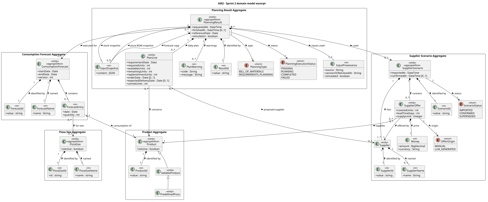
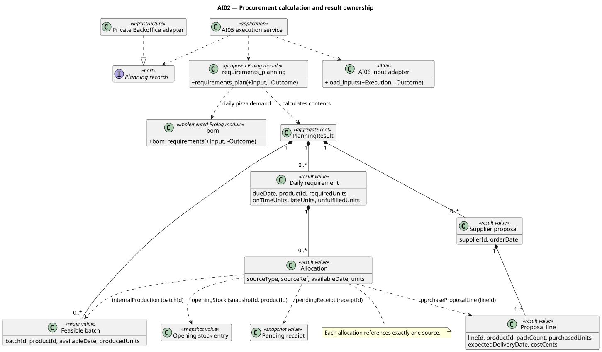
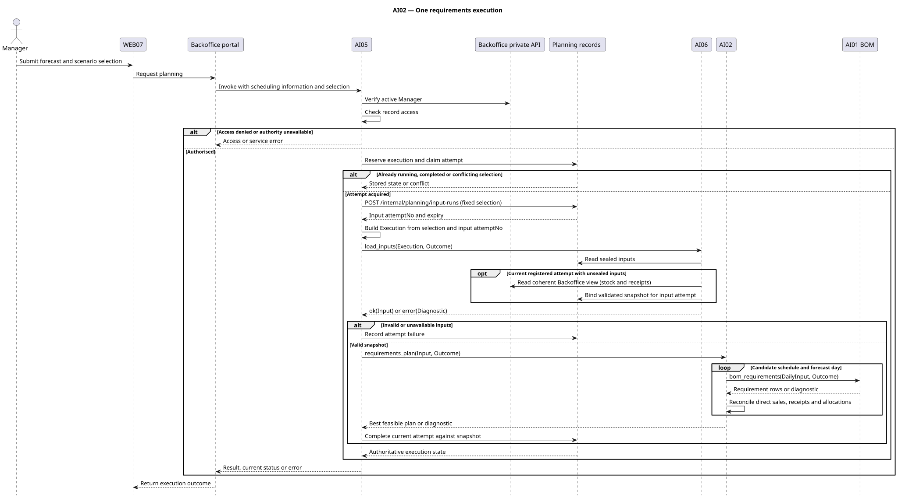

# US AI02 – Prolog Requirements Planning and Supplier Selection

## 1. Context & Scope

- **User Story ID:** AI02
- **Sprint:** Sprint 2 
- **Area:** Artificial Intelligence (AI)
- **Responsible:** Sofia Carvalho (1240898)
- **Specification:** *LEI-2026-27-Sem5-Project_v1-Sprint2US.pdf*
- **Architecture:** [Procurement responsibilities and context map](../../../architecture/SAD.md#24-procurement-component-diagram-c4-level-3), [planning access and records](../../../architecture/SAD.md#27-planning-access-and-records) and [architecture decisions](../../../architecture/ADR.md).

AI02 lets a Manager review daily replenishment options against a selected forecast, starting stock and confirmed supplier offers. It calculates hypothetical deliveries, stock and shortages over the forecast period. The Manager can consult proposals in Sprint 2. Operational purchasing and stock updates belong to Backoffice. 

| Dependency | Responsibility |
| --- | --- |
| [WEB07](../../web/web07/usWEB07.md) | Manages daily forecasts and supplier scenario confirmation, submits planning requests and presents results for Manager review. |
| [AI01](../ai01/usAI01.md) | Calculates pizza material requirements and stock coverage, including stock-first expansion of internally produced components for which the selected inputs supply a recipe. |
| [AI05](../ai05/usAI05.md) | Exposes Requirements Planning and its outcomes through the planning service. |
| [AI06](../ai06/usAI06.md) | Supplies a consistent set of forecast, catalogue, BOM, stock and confirmed offer inputs in product-specific stock units. |
| [AA04](../../aa/aa04/AA04.md#protected-operations) | Supplies the current session and access checks used by Backoffice to authorize Manager planning operations. |
| AI04 (Sprint 2 specification, printed p. 17) | Documents the Requirements Planning calculation, examples and findings for IARTI. |

## 2. Requirements & Analysis

### 2.1. User Story Description

> **As a** LaPrizza Manager,  
> **I want** a Prolog Requirements Planning module using daily forecast sellable-product consumption over a specified period,  
> **so that** suitable suppliers and replenishment plans can be proposed for review.

### 2.2. Acceptance Criteria (from Sprint 2 Specification)

The nine criteria follow the order of AI02 in the Sprint 2 specification, printed pp. 16–17.

- [ ] **AC 1:** Implement Requirements Planning in Prolog and expose it through the AI service defined in AI05.
- [ ] **AC 2:** Accept daily sellable-product consumption forecasts, including pizzas and applicable sizes, using the dates, quantities, and validation rules defined in WEB07.
- [ ] **AC 3:** Derive daily pizza material requirements from back-end BOM definitions. For directly sold stock-controlled products, use their back-end stock-consumption rules. Calculate replenishment for raw materials, purchased aggregates, and directly sold products without double counting.
- [ ] **AC 4:** Carry hypothetical remaining stock and planned deliveries forward between days without changing stored stock. Calculations must not create operational purchase orders; any operational order requires a separate explicit confirmation through the back end. Repeated requests must not create duplicate orders.
- [ ] **AC 5:** Select suppliers from the confirmed supplier scenario. Document and justify the selection criteria, including cost and delivery timing. Compare prices in euros (EUR) on a common stock-unit basis and flag incompatible units; currency conversion is not required.
- [ ] **AC 6:** Show the planning reference date, defaulting to the execution date. Proposed order dates must not precede it. Treat daily requirements as due at the start of that day, apply lead times in calendar days, and report late or unmet requirements. Historical simulations may use an explicit reference date recorded with the results.
- [ ] **AC 7:** Apply supply limits only when provided. Document assumptions about missing capacity information; do not interpret it as zero or verified unlimited availability.
- [ ] **AC 8:** Show a daily plan with required items and quantities, suppliers, order-placement dates, expected delivery dates, and unmet needs. Period totals may supplement the daily breakdown. Missing data or unsuitable suppliers must be explained rather than presented as a complete plan.
- [ ] **AC 9:** Use the forecasts and supplier scenarios available through WEB07 and AI06. Any use of simulated inputs must be labelled as a simulation; its results must not change stored stock or create operational purchase orders.

### 2.3. Client Clarifications & Questions

> **Question:** Can a Manager register an operational purchase from an AI02 plan in Sprint 2?  
> **Answer:** Review is the Sprint 2 scope. Confirming, changing or cancelling supplier orders and updating stock from a plan are outside it. 
> **Question:** How are pizza and standalone demand interpreted?  
> **Answer:** Pizzas use size-specific BOMs from the back-end configurations. Other directly sold, stock-controlled items, such as drinks and desserts, use the explicit stock consumption per unit sold. Missing consumption must be reported. The client's website scope requires no separate recipe management. AI01 documents chained internal preparations for the IARTI simulation with explicit recipe data. 

> **Question:** Can a saved forecast use products or sizes that are now inactive?  
> **Answer:** A first execution checks current eligibility and rejects inactive references. Earlier results remain available. A clearly labelled historical simulation may replay the saved original inputs. 

> **Question:** How do lead time and supplier capacity apply?  
> **Answer:** Lead times are whole calendar days. A configured limit is daily and applies to the particular supplier offer for a product. It can be used across several days when the schedule allows. The client describes an omitted limit as unlimited for calculation. Under AC 7 the plan applies no capacity cap in that case and discloses that actual availability is unknown. The Sprint 2 model also records the capacity as unknown. 

**IARTI demonstration guidance.** The support material illustrates a single supplier with several pack sizes and asks students to compare total costs across alternatives, products and suppliers. It calls for at least three suppliers per product type in the teaching dataset. WEB07 rejects multiple offers for the same supplier/product pair, so use pack sizes from different suppliers in the integrated demonstration. The class example's aggregate inventory per pack size differs from WEB07's optional daily offer limit in stock units. In the slide example, 5,010 g can be covered by 5,000 g plus 250 g for €80, compared with €150 for two 5,000 g packs. This illustrates why comparing whole-purchase cost matters when quantities are indivisible. 

Paulo Matos confirmed the following in the Requirements Clarification Forum.

> **Question:** How should the plan compare costs and allocate an insufficient delivery?  
> **Answer:** Seek the lowest total cost that satisfies demand under the timing, capacity and whole-pack constraints. Showing every combination is optional. Minimize delays and protect requirements that can still be fulfilled on time from already overdue demand. Justify the strategy and report on-time and late quantities separately. In the forum example, six units arriving before day 13 can reserve four for day 13 and cover two of day 12's three overdue units. All three remain recorded as having missed day 12's deadline. 

> **Question:** Is the quoted quantity an indivisible pack in integrated plans?  
> **Answer:** Buy whole packs. Each supplier/product pair has one quoted EUR price and one pack size, which may be one stock unit. If an offer is €10 for six units and demand is four, buy six for €10 and carry any unused units in hypothetical stock, subject to the daily capacity. 

> **Question:** How should the plan handle a requirement that no supplier can fulfil by its deadline?  
> **Answer:** Record the quantity as unmet by its original deadline. The plan may propose the earliest feasible late delivery and explicitly report the delay. There is no predefined maximum delay. The delivery can contribute to late fulfilment while the original shortfall remains visible. 

> **Question:** What counts as an incompatible offer unit?  
> **Answer:** Use the product's predefined stock unit and express the quoted quantity as a whole number of those units. Flag fractional quantities or a quote expressed on a different basis. The application needs no additional units of measure or conversion rules for this criterion. 

> **Question:** Can lead times be zero, can purchases be split, and when must stock be available?  
> **Answer:** Each offer's lead time is fixed for the scenario and can be zero for same-day delivery. A plan may order from several suppliers on the same day, including for the same product, within each offer's limit. Place orders early enough for stock to be available by the end of the day before consumption, starting from the reference date. A same-day delivery on the requirement date misses that deadline. The reply describes an explicit reference date in the request. AC 6 expressly permits that option for historical simulations, which is the scope adopted here. 

> **Question:** What inputs does one run use, and which can be simulated?  
> **Answer:** Each run uses one forecast. Days inside its period without entries have zero demand. Consider pending incoming deliveries as projected receipts using the product, quantity and expected delivery date alongside starting stock and new proposals. A simulation can use forecast demand, opening stock, supplier terms or pending deliveries, individually or in combination, subject to the usual validation and simulation labelling. 

> **Question:** Which planning reference date applies to a new execution and to a replay?
> **Answer:** A new execution defaults to its execution date. A new historical simulation may specify an explicit reference date. A replay uses exactly the data and parameters saved for the original execution, including its planning reference date, even when the replay takes place later.

> **Question:** For a new execution, how should the planner handle demand due before the planning reference date or on that date? Should it reject the forecast, skip the affected entries, or retain them and report late or unmet quantities?
> **Status:** Open. The handling of these demand entries awaits client clarification.

### 2.4. Business Rules & Invariants

- **Forecast identity and validity:** A run uses one selected saved forecast and its version. Its period is inclusive and its end date is on or after its start date. Each entry refers to an existing sellable product and a compatible size where required. Pizzas require a size and unsized products omit it. Within a forecast, the date, product and size identify a unique entry. Quantities are non-negative integers, and omission means zero demand. Apply current product and size eligibility on first execution. 
- **Daily material demand:** For each day, AI01 uses the selected pizza size and configured component quantities. Available stock covers demand first. For a required internally produced component with a valid scenario recipe, expand only the residual demand. Purchased aggregates are replenished directly. Direct sales of tracked products use forecast quantity multiplied by the configured stock units per sale. Identify missing factors, missing tracked balances and invalid BOMs, including cycles. Count a demand quantity once even when several demand lines share a component. 
- **Confirmed offers and whole packs:** Select offers from the confirmed scenario supplied by AI06 for the run. Each offer belongs to a listed supplier, references an existing product and is unique by supplier and product within that scenario. Its price is non-negative in EUR, its quoted quantity is a positive integer in the product's stock units, and its lead time is a non-negative whole number of calendar days fixed for the scenario. A zero lead time means delivery on the order date. Each proposed order line buys a positive whole number of packs. Purchased stock units equal pack count × quoted units, and cost equals pack count × quoted price. Compare rates on a common stock-unit basis and compare the total cost of feasible whole-pack purchases. Flag fractional quotes and quotes on a basis incompatible with the product's predefined stock unit. A relevant product with no offer stays visible and may have unmet demand.
- **Daily capacity:** When provided, enforce the offer's daily limit in product stock units, including an explicit zero. The quantity allocated across proposals for the same offer and order date must respect that limit. With an omitted limit, disclose any proposed quantity that relies on applying no cap and flag it as conditional on supplier availability. 
- **Planning calendar and balances:** Record the reference date with the result. For a new execution, default to its execution date unless a historical simulation supplies an explicit date. For a replay, read the reference date from the original execution. Place proposed orders on or after the reference date. Expected delivery is the placement date plus the offer's calendar-day lead time. For on-time coverage, stock must be available by the end of the previous day. Schedule new purchases in advance when lead times and daily capacity require it and the reference date permits it. Use pending deliveries as projected receipts on their expected dates, alongside receipts from proposed orders. Carry forward unused stock, including surplus from whole packs. Keep hypothetical remaining stock non-negative and report lateness or unmet demand on the affected days. Unreceived supplies or unachievable production are unavailable for stock coverage.
- **Plan review and diagnostics:** Show requirements, hypothetical balances, proposed quantities, suppliers, placement dates and expected deliveries by day and product. For each original requirement date, report quantities covered by the deadline, covered after it, and still unfulfilled in the proposed plan. The quantity unmet at the deadline equals the late quantity plus the quantity still unfulfilled. Show the expected delivery date for each late allocation. A proposal is addressed to one supplier and each of its lines uses an offer from that supplier. Report missing data, incompatible units and unsuitable offers explicitly, and distinguish a partial plan from a complete one. When multiple proposals contribute to a daily product plan, retain each proposal's quantity and dates. 
- **Provenance and history:** Preserve the forecast version and entries, starting stock snapshot, relevant BOM and consumption rules, confirmed supplier scenario, pending deliveries used and reference date. AI06 supplies the source and version or retrieval time. Any simulated input, including manually prepared or LLM-assisted offers, marks the result as simulated. Later edits preserve the meaning of saved results. A replay uses exactly the original execution’s saved data and parameters and identifies its historical origin.
- **Ownership and authorization:** Backoffice owns forecasts, operational stock and purchase orders. Procurement owns supplier scenarios and planning results. AI05 verifies the current Manager role and session through Backoffice and checks access to the selected records before executing or returning results. AI06 reads data through its permitted input APIs. These are application responsibilities. Prolog uses the selected input set to calculate and report planning outcomes. 
- **Read-only simulation and execution consistency:** Proposals and hypothetical balances are planning results. Every execution or retry leaves operational orders and stored stock, including scenario input stock, untouched. Procurement fixes the execution identity and selection, seals one effective input snapshot and records outcomes through the private Backoffice adapter. The adapter guards attempt ownership and atomic completion, so repeat submission can recover the same saved result. 
- **Delay minimization and late allocation:** Plan to minimize delays across forecast requirements. Allocate feasible stock and receipts so that overdue demand does not take units needed to meet other requirements on time. If a quantity cannot be covered by its deadline, retain the shortfall against its original date. The plan may propose the earliest feasible late delivery subject to lead times, whole packs, capacity and protection of on-time requirements. Assign each unit at most once across requirements or remaining stock. Choose the lowest total acquisition cost among plans that meet demand under the timing, capacity and whole-pack constraints. Where full on-time coverage is infeasible, justify the delay-minimizing strategy and explain how both cost and timing informed the selection. 

### 2.5. Domain Model Excerpt



The excerpt preserves the `ConsumptionForecast`, `SupplierScenario` and `PlanningResult` aggregate boundaries and their references to the catalogue and applicable sizes. The shared model makes result-to-forecast and result-to-scenario links optional because it also covers BOM-only executions. A fresh AI02 run requires both inputs. An individual `PlanLine` has an optional supplier, one pair of proposed dates and a single `unmetUnits` quantity. The Procurement context model represents a daily product plan and its contributing supplier order lines separately. It also describes the direct-sale consumption factor and BOM and stock inputs. The result needs enough detail to associate each allocation with its original requirement date and distinguish on-time, late and still unfulfilled units. Pack count can be derived from proposed stock units and the selected offer's `coveredUnits`. Section 3.2 defines the allocation references within the result. AI06 captures pending deliveries in the same read view as opening stock and retains both with the execution inputs. The Sprint 2 purchase plan remains consultation-only.

## 3. Design

### 3.1. Architecture & C4 alignment

The Manager selects a forecast version and confirmed supplier scenario in WEB07. The Backoffice portal invokes the AI05 Prolog service with the execution identity, scheduling information and selection. AI05 checks the current Manager session and access to the selected records through Backoffice. For an authorised new execution, AI05 fixes the reference date and selectors. Its records adapter registers the input run through `POST /internal/planning/input-runs` and obtains the input acquisition attempt number.

AI05 calls `load_inputs(Execution, Outcome)` with the registered selection plus `attemptNo`. The selection identifies the execution, scenario, mode, calculation, demand, catalogue and stock sources, reference date and confirmed supplier scenario version. AI06 first looks up the sealed snapshot. For a current registered attempt with unsealed inputs, it retrieves the selected business data, binds the validated snapshot and maps the stored version. Replay uses the original sealed inputs. AI05 passes the resulting dictionary to AI02's proposed `requirements_plan/2` and records the plan or diagnostic for consultation through the portal.

| Component | Responsibility and current state |
| --- | --- |
| AI01 BOM | [Implemented predicate](../../../../ai/src/bom.pl) for size-specific pizza demand, stock-first expansion, batch rounding and material deficits. Its public entry point is `bom_requirements/2`. |
| AI06 input adapter | The version on `ai/AI06-implementation` at `8833e1e` maps the sealed inputs, including outstanding deliveries. End-to-end verification depends on integrating this revision and the AI05 caller. |
| AI02 requirements planning | Proposed pure Prolog calculation. Owns the forecast calendar, whole-pack supplier selection, feasible stock balances and allocation of receipts to dated needs. |
| AI05 and planning records | Own authorization, execution identity, retries, snapshot binding and durable results. Procurement owns the result. Backoffice owns operational stock and purchases. |

### 3.2. Class diagram and calculation



**Daily demand and stock.** Walk the inclusive forecast calendar, including empty days. For each candidate purchase schedule, provide AI01 with only that day's original `pizza_demand/3` terms and a local copy of the balances available at the start of that day. Preserve balances for items absent from the BOM output. For each terminal or purchased product, combine AI01's **gross** `requiredUnits` with dated direct-sale units (quantity sold × configured units per sale), then withdraw from one balance. Equivalently, apply direct demand to the balance left after AI01's withdrawal. Charging the gross demand against that remaining balance would charge the pizza withdrawals twice. Validate zero-quantity rows and their references before ignoring their demand.

For produced aggregates, AI01 returns planned batches and potential surplus. Verify ingredient availability recursively against the candidate schedule before crediting production or rolling surplus into tomorrow. Keep the inputs and outputs of a feasible batch together. If ingredients are missing, expose the underlying shortage and affected demand. Keep purchased aggregates as purchase targets. A missing BOM, stock balance or required consumption factor yields a diagnostic identifying the field and product.

**Supplier selection.** Plan across the forecast period because an earlier pack surplus or capacity reservation can change the cheapest feasible choice on a later day. For each eligible offer and placement date consider integer pack counts, including zero. Purchased units equal packs × covered units. Cost is packs × price in integer EUR cents. Apply a supplied daily cap as `floor(limit / coveredUnits)` packs on the **order** date. An absent cap permits calculation and flags the proposed purchase as conditional. Compare unit rates exactly by cross multiplication and compare feasible combinations by their total purchase cost. Break cost ties deterministically using fewer surplus units and stable supplier/product/date ordering.

Use bounded search with pruning over pack combinations. For a product with a finite remaining purchase need, quantities exceeding that need by a full removable pack cannot improve a minimum-cost, minimum-surplus solution. Preserve candidates from different offers and days until feasibility and total cost are known. A lower bound exceeding the best feasible cost can prune a branch only when its service outcome cannot improve. The professors' `buy/5` supplies a pack-rounding example. Its first eligible pack choice can miss a cheaper combination. The oven example illustrates scoring candidate schedules, but its sum of elapsed cooking times is a different objective.

**Deadlines and allocations.** A placement on date D with lead L arrives on D + L calendar days. Opening stock and receipts already available before the due day can serve its start-of-day demand. Process receipts on the due day after the deadline. Protect quantities that can still meet future deadlines before assigning excess to an overdue requirement. For full on-time coverage, select the lowest total feasible cost. When full coverage is impossible, preserve on-time coverage and seek the earliest feasible late coverage, then compare cost for equivalent service. Record late allocations against the original due date even if delivery occurs beyond the forecast period. For offers with zero usable packs per day, terminate with the remaining shortage. For positive capacity, a constructive bound for late search is the date by which each outstanding purchasable item could be covered by repeating a feasible whole-pack order on successive days after the last due date, allowing its lead time and any selected pending receipts. This avoids imposing an arbitrary maximum delay.

**Result representation.** Each product/day records opening and closing hypothetical units, required units, on-time units, late units and units still unfulfilled. The latter three sum to required units. The original deadline deficit is late plus still unfulfilled. An allocation names its source and available date. A proposal groups lines by supplier and order date. Each line records its own identity, product, pack count, purchased units, expected delivery and cost. One line can cover several requirements and a requirement can draw on several lines. The sum allocated from a source cannot exceed its available units. Keep residual stock and warnings visible. A calculation can finish successfully with a partial plan.

AI02 consumes AI06's `pending_receipts` list of `pending_receipt(ReceiptId, ProductId, RemainingUnits, ExpectedDate)` terms. The date uses `date/3`. Add the outstanding quantity once on its expected date, after start-of-day demand. Quantities already posted are included in opening stock. An explicit empty list means zero pending deliveries. An unavailable feed yields AI06's `MISSING_RECEIPTS` diagnostic.

Each allocation contains a positive quantity, an availability date, a `sourceType` and a `sourceRef` object. Resolve the reference within the sealed snapshot or the saved plan. Carry surplus forward with its original reference and reduce the available quantity after each allocation.

| sourceType | Example sourceRef | Quantity available to allocate |
| --- | --- | --- |
| `openingStock` | `{"snapshotId":"S0","productId":"drink"}` | Product balance in the opening snapshot. Four units fully covered here require one allocation and zero proposals. |
| `pendingReceipt` | `{"receiptId":"R1"}` | Outstanding units in the selected receipt on its expected date. |
| `purchaseProposalLine` | `{"lineId":"L1"}` | Stock units from the identified proposal line on its delivery date. |
| `internalProduction` | `{"batchId":"B1"}` | Output of a feasible batch after its ingredients have been allocated. Retain the batch ID, product, available date and produced units in the saved plan. |

**Reference date at execution.** Resolve the date once for a new execution and seal it with the inputs. On replay, AI06 loads the original snapshot and saved parameters. AI02 uses the stored reference date for every deadline and placement calculation, even when the replay clock has advanced.

**Open client decision.** IT06 remains open for a new execution containing demand due before or on its reference date (Section 2.3).

### 3.3. Sequence diagram



A retry for the same identity and selection uses the state returned by planning records. A fresh attempt uses the bound snapshot when available. A stale attempt cannot replace the winning result. Operational data access happens outside the solver.

### 3.4. REST API specification (ARC03)

Submit Requirements Planning with `planningType: "REQUIREMENTS_PLANNING"` through the shared API. AI05 owns the request, status, history and replay envelope. AI02 supplies the calculation fields under `result.data`. The example covers nine drinks due on 22 November from four units in opening stock, three in a pending delivery and two from a six-unit pack. Both deliveries arrive on 21 November. [Shared planning execution API](../../../architecture/planning-execution-api.md)

```json
{
  "referenceDate": "2026-11-20",
  "days": [{"dueDate":"2026-11-22","productId":"drink","openingUnits":13,"closingUnits":4,
    "requiredUnits":9,"onTimeUnits":9,"lateUnits":0,"unfulfilledUnits":0,
    "allocations":[
      {"sourceType":"openingStock","sourceRef":{"snapshotId":"S0","productId":"drink"},"availableDate":"2026-11-20","units":4},
      {"sourceType":"pendingReceipt","sourceRef":{"receiptId":"R1"},"availableDate":"2026-11-21","units":3},
      {"sourceType":"purchaseProposalLine","sourceRef":{"lineId":"L1"},"availableDate":"2026-11-21","units":2}]}],
  "proposals": [{"supplierId":"S1","orderDate":"2026-11-20","lines":[
    {"lineId":"L1","productId":"drink","packCount":1,"purchasedUnits":6,
     "expectedDeliveryDate":"2026-11-21","costCents":1000}]}],
  "warnings": []
}
```

AI05 distinguishes invalid requests, denied access, execution conflicts, unusable inputs and unavailable dependencies. AI06 already specifies a 422 diagnostic on an incompatible quote basis. Preserve the field and product in that error. A valid confirmed scenario with no feasible offer instead returns a reviewable plan with a quantified shortage.

### 3.5. Persistence & data integrity (ARC04)

AI02 requires no table, database connection or transaction of its own. The proposed daily and allocation details belong to the versioned result payload. Historical reads use the saved payload and its snapshot. AI05 uses the private records adapter to lock the execution row, check the attempt number and expiry, and atomically store the outcome and terminal state. A failed transaction leaves no partially published plan. After a lost acknowledgement, read the authoritative state before retrying. Keep operational balances, orders and fixture stock untouched. The shared model also states a single running execution per forecast. Enforcing that cross-execution constraint belongs to the records adapter and requires verification independently of same-ID retry handling.

### 3.6. Applied patterns & architecture principles

AI02 acts as a domain service because supplier choice spans one forecast, several offers and multiple requirement dates. AI01 retains BOM and batch rules. AI06 translates external representations into ground terms. AI05 supplies the input and persists the output through ports, keeping transport, access credentials and database dependencies outside the calculation. Request-local balances replace the teaching examples' dynamic stock and best-score facts so concurrent runs cannot consume one another's stock.

## 4. Tests (ARC05)

### 4.1. Test plan & scenarios

Use SWI-Prolog PlUnit for the calculation, following AI01. Use integration fixtures for AI01/AI06 and Jest for observable service contracts when the corresponding endpoints exist. These are planned scenarios.

| Test ID | Level | Scenario / Description | Expected result |
| --- | --- | --- | --- |
| UT01 | Unit | AC2–3. Two pizza sizes share cheese with a direct sale. Gross pizza demand 6, direct demand 3, opening stock 7. | Require 9, withdraw 7 once, seek 2. Preserve untouched balances on an empty day. |
| UT02 | Unit | AC3–4. Nested produced aggregate with an unavailable ingredient, plus a purchased aggregate. | Report ingredient shortage, credit no infeasible batch surplus, replenish the purchased item directly. |
| UT03 | Unit | AC5. Demand 5,010 g. Confirmed offers from different suppliers quote 5,000 g for €75 and 250 g for €5, both timely with sufficient capacity. | Select one of each for €80, carry 240 g. Reordering offers gives the same result. |
| UT04 | Unit | AC5–7. Six-unit pack with daily cap 11, zero, or omitted. | At most one pack per placement day with cap 11, none with zero. Purchases relying on an omitted cap include an availability warning. |
| UT05 | Unit | AC4,6,8. Zero lead and a receipt on the due day. Repeat with delivery one calendar day earlier across a month boundary. | First receipt is late, second timely. No placement precedes the reference date. |
| UT06 | Unit | AC6,8. Day 12 lacks three units. Six arrive before day 13, which needs four. No other supply. | Reserve four for day 13. Day 12 retains deadline deficit 3, late 2, still unfulfilled 1. |
| UT07 | Unit | AC5,8. Two suppliers must split a requirement due to caps. Another item has no suitable offer. | Retain both line references, dates, quantities and costs. Report the other item's full shortage and its reason. |
| UT08 | Unit | AC4,6–8. Pack surplus covers a later day. A second product first arrives after the forecast ends. | Carry surplus once. Link the late receipt to its original day and preserve the deadline deficit. |
| UT09 | Unit | AC4,8. Use the mixed-source nine-unit drink requirement in Section 3.4 and a following day with four units of demand. | Allocate 4 from S0, 3 from R1 and 2 from L1 on the first day. Carry 4 from L1 and allocate them on the second day. The final balance is zero and total allocation from L1 equals the six units purchased. |
| IT01 | Integration | AC1–3. Pass AI06 dated terms via AI02 to real AI01, including size-specific BOMs, direct sales and a zero-demand date. | Daily quantities match the fixture. Missing consumption, invalid size or cyclic BOM is attributable to its field or item. |
| IT02 | Integration | AC5,7,9. Use confirmed, draft, mismatched-unit and fractional-pack inputs. | Confirmed terms retain cents, cap and provenance. Invalid selections or terms yield diagnostics before a successful plan is published. |
| IT03 | Integration | AC4,9. Retry the same execution concurrently and simulate loss of the completion response. | Recover one stored result for the sealed snapshot. A stale attempt cannot overwrite it. Stock and order counts stay unchanged. |
| IT04 | Integration | AC6,9. On 10 November run once with the default date and once as a historical simulation with an explicit date of 5 November. Change live stock and offers, then replay both executions on 20 November. | The replays use 10 and 5 November respectively. Each uses its original data and parameters and reproduces its original proposals, allocations and shortages. |
| IT05 | Integration | AC4,6,8–9. Load a ten-unit delivery with six already posted and four outstanding. Repeat with an explicitly empty list and an unavailable feed. | AI06 returns one term with four units. AI02 credits four once on the expected date, after that day’s deadline. The empty list adds zero. An unavailable feed yields `MISSING_RECEIPTS`. |
| IT06 | Integration, pending client answer | AC2,6,8. Submit a new execution with demand due the day before its reference date and on the date itself. | Expected handling of each entry awaits the answer in Section 2.3. |
| E2E01 | End to end | AC1–9. Manager submits a forecast through WEB07 and reads its saved result. Repeat with expired session or insufficient role. | Authorised view shows dated allocations, warnings, reference date and provenance. Denied requests disclose no planning data. |

### 4.2. Sample test implementations

Illustrative PlUnit case for the proposed predicate. The fixture supplies the two timely offers and no opening stock, pending receipts or other demand.

```prolog
test(whole_pack_cost_across_suppliers) :-
    ham_forecast_5010(Input),
    requirements_plan(Input, ok(Plan)),
    findall(Cents, (member(P, Plan.proposals), member(L, P.lines),
                    Cents = L.costCents), Costs),
    msort(Costs, [500, 7500]),
    member(Day, Plan.days),
    Day.productId == "ham",
    assertion(Day.onTimeUnits == 5010),
    assertion(Day.closingUnits == 240).
```

Illustrative Jest contract tests. The proposed integration harness submits through AI05 and reads through the authorised result endpoint. The fixture exposes only the six units in UT06.

```js
test('preserves the original shortage after a late allocation', async () => {
  const plan = await runForecastAsManager(protectedDay13Fixture);
  expect(plan.days).toEqual(expect.arrayContaining([
    expect.objectContaining({ dueDate: '2026-11-12', requiredUnits: 3,
      onTimeUnits: 0, lateUnits: 2, unfulfilledUnits: 1 }),
    expect.objectContaining({ dueDate: '2026-11-13', requiredUnits: 4,
      onTimeUnits: 4, lateUnits: 0, unfulfilledUnits: 0 })
  ]));
});

test('repeated submission preserves the saved result and operational state', async () => {
  const before = await readOperationalStockAndOrders();
  const first = await runForecastAsManager(fixedExecutionFixture);
  const retry = await runForecastAsManager(fixedExecutionFixture);
  expect(retry).toEqual(first);
  expect(await readOperationalStockAndOrders()).toEqual(before);
});
```

## 5. Implementation

`requirements_planning:requirements_plan/2` consumes AI06's sealed `planning_input` and returns `ok(Plan)` or `error(Diagnostic)`. An input with valid offers that cannot cover every deadline produces a successful, reviewable partial plan. AI06 owns acquisition and validation of the raw sources. AI02 works entirely with request-local values.

| File | Responsibility |
| --- | --- |
| [requirements_planning.pl](../../../../ai/src/requirements_planning.pl) | Walks the inclusive forecast, calls AI01 with each day's pizza demand and projected balances, combines direct sales, coordinates search and builds the result. |
| [plan_allocations.pl](../../../../ai/src/plan_allocations.pl) | Processes dated demand and supply events, allocates stock by source, and consumes the ingredients of feasible whole batches. |
| [replenishment_search.pl](../../../../ai/src/replenishment_search.pl) | Compares whole-pack schedules in integer cents, enforces offer limits on placement dates and retains the best candidate within each search. |
| [demo_inputs.pl](../../../../ai/demo_inputs.pl) | Invokes AI02 after AI06 has loaded a requirements snapshot. The demo returns the plan and acquisition metadata through the shared JSON integer guard. |

**Supplier selection.** Products connected through preparation recipes share a search group. Independent products can be solved separately. For full on-time coverage, the planner compares total purchase cost, then surplus and stable offer identifiers. For a fixed pack count, placing packs at the earliest permitted dates gives the same price and makes the units available to more deadlines. This uses the scenario's fixed prices and lead times and assumes that holding inventory carries no charge. A missing daily limit permits planning and produces an availability warning for purchases using that offer.

The search bounds counts using required quantities and pack sizes. Removing the last-arriving pack from a purchase that exceeds gross need by at least the largest pack preserves coverage. For an independent product, the search uses binary search for the smallest count of the final offer that attains the best service for a fixed combination of the other offers. For recipe groups it first tests the schedules obtained from AI01's projected material needs against physical batch feasibility. When those schedules miss a deadline, it compares combinations jointly. Pending supplies of a produced item also trigger joint evaluation.

**Allocation.** A day starts with the consumption deadline and ends with projected receipts. A batch becomes available when the planner can allocate all its ingredients. A failed attempt releases its tentative allocations. Each batch lists its ingredient sources, including preceding batches. The planner tests whether serving overdue demand would worsen any achievable future deadline. This lets an early receipt serve overdue demand when a later receipt can still protect tomorrow's requirement. When products compete for ingredients, requirements are considered in deadline and product-ID order.

**Result.** Each day's required quantity equals on-time, late and outstanding units combined. The deficit at the original deadline equals late plus outstanding units. Each allocation identifies the source, its availability date, the fulfilment date and the allocated stock units. The plan includes forecast dates with zero demand, proposal placement and arrival dates, exact pack costs, and warnings. A late delivery beyond the forecast remains linked to its original demand.

## 6. Integration, verification and demonstration

Run from the repository root with SWI-Prolog, Node.js and the backend dependencies available.

```sh
swipl -q -s ai/tests/bom_tests.pl -s ai/tests/input_mapper_tests.pl -s ai/tests/requirements_planning_tests.pl -g run_tests -t halt
node ai/tests/json_boundary_tests.mjs
node ai/tests/input_integration_tests.mjs
node ai/demo_inputs.mjs daily-sales --planning
node ai/demo_inputs.mjs iarti --planning
```

The PostgreSQL integration command is `npm --prefix backend test -- --runInBand tests/integration/planning-inputs`. Set `RUN_DATABASE_TESTS=1`, `SWIPL` and the standard PostgreSQL connection settings for a dedicated database whose name ends in `_test`. The shared [AI workflow](../../../../.github/workflows/ai-checks.yml) includes the new suite.

| Local suite | Evidence |
| --- | --- |
| [PlUnit calculation tests](../../../../ai/tests/requirements_planning_tests.pl), AI01 and AI06 regressions | 83 passed, including 17 AI02 cases. The €80 mixed-pack test leaves 240 g of ham. A separate small exhaustive oracle checks 64 combinations of demand and opening stock. |
| [JSON boundary tests](../../../../ai/tests/json_boundary_tests.mjs) | 13 passed. Exact Prolog integers are checked for safe transport to JavaScript. |
| [HTTP input integration tests](../../../../ai/tests/input_integration_tests.mjs) | 55 passed. Cover input diagnostics, direct sales, pending receipts, confirmed offers, the 63-offer scenario and replay from retained inputs. |
| [Backoffice planning integration](../../../../backend/tests/integration/planning-inputs/postgres.test.js) | 22 passed across two Jest suites using an isolated local PostgreSQL database. With one confirmed cheese offer and no drinks supplier, the plan costs €11.50 and reports eight drinks units outstanding. All operational stock balances match the pre-run query. |

In the daily-sales simulation the planner buys 250 g of cheese for €5.00 and ten drink stock units for €8.50. The 63-offer IARTI fixture returns €33.20 in proposals, three production records and 46 product/day rows with full on-time coverage. The test for replay compares proposals and daily quantities and resolves opening-stock allocations against the replay's sealed snapshot.

## 7. Decisions, dependencies and limitations

- **IT06 project decision.** Retain past and reference-day demand. Earlier deadlines are already missed. Opening stock is available at the start of the reference date. Receipts expected on that date arrive after its deadline. An outstanding receipt with an earlier expected date produces a warning and is excluded until rescheduled. These are the implementation decisions approved for this story.
- **Partial plans.** Protect achievable on-time demand, then prefer eventual coverage and shorter delay before comparing cost. During competition for shared ingredients, earlier deadlines and then product identity determine priority. Batch availability assumes zero preparation duration because the input contract supplies ingredients and yields.
- **Service and persistence.** AI05 owns the execution clock, historical date overrides, Manager authorization, durable outcomes and terminal retry recovery. WEB07 owns the Manager workflow. Real forecast and pending-delivery readers must be connected for operational use. AC1 public exposure, IT03 durable completion, the AI05 clock portion of IT04 and E2E01 await those integrations. The implemented replay check covers AI06 snapshot reuse and calculation reproducibility.
- **Operational effects.** AI02 returns proposals in memory. The database test checks real stock balances. This branch has no operational purchase-order table against which to compare row counts.
- **Scale.** Whole-pack selection can require combinatorial search, especially for recipe-linked products with many competing offers. The two demonstrated fixtures establish behavior at their sizes. They do not establish a maximum supported forecast or a production response-time guarantee.
