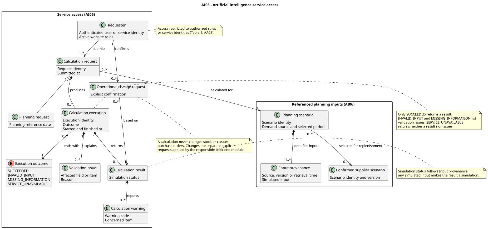

# US AI05 – Artificial Intelligence Service Access

## 1. Context & Scope

- **User story:** [AI05 (#TODO)](https://github.com/Departamento-de-Engenharia-Informatica/LEI-SEM5-PI-2026-27-3DE-01/issues/TODO)
- **Sprint:** 2 (IARTI Sprint B)
- **Status:** Analysis for review
- **Repository baseline:** `main` at `d7f00fa`. The architecture and AI01 contract follow the proposed design on `ai/ai01-design` at `b81e4b2`.

AI05 exposes the Prolog functionality as documented REST endpoints. AI01 calculates material needs and checks stock. AI02 plans daily replenishment and selects suppliers. AI06 reads the business data both calculations need. AI05 is the entry point through which the Manager starts those calculations from WEB07 and consults their results. [AI01](../ai01/usAI01.md) · [AI06](../ai06/usAI06.md) · [WEB07](../../web/web07/usWEB07.md)

The SPA calls the Gateway in the proposed design. Calculations and results go to Procurement, which calls the Prolog AI service and records each execution. Backoffice keeps stock and operational purchase orders. Each API authorises its own requests. [Target container view](https://github.com/Departamento-de-Engenharia-Informatica/LEI-SEM5-PI-2026-27-3DE-01/blob/b81e4b29774a6d23a92f607535a8e4cbbcf72d38/docs/architecture/SAD.md#23-container-diagram-c4-level-2)

AI05 covers access, request and response contracts, outcome classification and documentation. The calculation rules belong to AI01 and AI02, and the loading of inputs belongs to AI06.

## 2. Requirements & Analysis

### 2.1. User Story Description

> As a Development Team, I want service endpoints for the Prolog functionality, so that the Web Application and other authorized components can request planning results.

### 2.2. Acceptance Criteria

| ID | Sprint 2 requirement | Planned evidence |
| --- | --- | --- |
| AI05-AC01 | Expose documented REST endpoints for the Bill of Materials and Requirements Planning functionality. | AS01, AS02, AS10 |
| AI05-AC02 | Use JSON for requests and results, with identifiers consistent with the back end. | AS01, AS02, AS03 |
| AI05-AC03 | Allow authorised users to initiate calculations through the SPA and consult the resulting quantities, suppliers and warnings. | AS01, AS02, AS08 |
| AI05-AC04 | Validate required information and clearly distinguish successful calculation, invalid input, missing information and service unavailability. | AS04, AS05, AS06 |
| AI05-AC05 | Restrict access to the appropriate roles or authorised service identities and deny unauthorised users. | AS07 |
| AI05-AC06 | Calculation requests must not silently change stock or register purchase orders. Requested changes are explicit and applied through the responsible back-end functionality. | AS09 |
| AI05-AC07 | Document representative requests, responses and error cases, and demonstrate the integration in the common solution. | AS10 |

### 2.3. Client Clarifications

| Topic | Consequence for AI05 |
| --- | --- |
| Roles (Table 1) | The LaPrizza Manager executes BOM and Requirements Planning and consults their results. Restaurant Staff, Customers and Guests have no access to planning. Administrators need the Manager role for this functionality. |
| Current stock and demand | A forecast run uses current stock at execution and is independent of customer orders. AI01 can also run a selected order with its own stock snapshot. AI05 passes the selected scenario and does not choose the stock itself. |
| Active references and history | A saved forecast is checked again at its first execution and rejected if a reference is inactive. A historical replay uses the original inputs and is labelled historical. AI05 returns both cases distinctly. |
| Supplier offers | When an offer has no daily limit, AI02 applies no cap and reports that assumption. AI05 returns it as a warning with the result. |
| Simulations | Any simulated input makes the calculation a simulation. AI05 labels the result as a simulation and never turns it into a stock change or purchase order. |

### 2.4. Existing API and Integration Gaps

Paths are relative to `/api/v1`. The table lists what exists at the baseline and what AI05 still needs. [Module registration](../../../../backend/src/modules/index.js) · [OpenAPI specification](../../../../backend/src/shared/openapi/spec.js)

| Need | Existing source and access | Gap or implication for AI05 |
| --- | --- | --- |
| Calculation endpoints | No planning route is registered at the reviewed baseline. The target design assigns calculations and results to Procurement. | Define the BOM and Requirements Planning routes in Procurement and register them in the OpenAPI specification. Route them through the Gateway for the SPA. |
| Prolog AI service | The IARTI material uses the SWI-Prolog HTTP server (`SWIHTTP`, `PROLOG-JSON`). | Procurement calls the Prolog service internally. The SPA never calls Prolog directly. A Prolog timeout or connection failure is reported as service unavailability. |
| Authentication and roles | Protected Backoffice routes use user authentication and roles (AA04, AA05). | Procurement must check the Manager role on calculation and result routes. Service access for the Procurement → Backoffice reads is open in AI06 (OP01). |
| Input loading | AI06 defines the inputs, provenance and missing-data diagnostics. | AI05 does not read business data itself. It maps AI06 diagnostics to the AI05 outcome and error contract. |
| Forecasts and supplier scenarios | WEB07 defines saved forecasts and confirmed supplier scenarios. The routes are still pending. | A Requirements Planning request references a forecast version and a confirmed supplier scenario through the planning scenario. |
| Execution history | Procurement owns the planning results and their input references in the target design. | Each execution keeps its identity, outcome, scenario reference and result. Results can be consulted after the request ends. |
| Operational changes | Backoffice owns persistent stock and operational purchase orders. | Sprint 2 planning returns proposals for consultation under client clarification §17. |
| Error representation | The back end uses a shared error handler with `{ error: { message, status } }`. | Extend it with an outcome code and a list of validation issues, keeping internal details out of user messages (WEB04). |

### 2.5. Domain Model Excerpt

A `Calculation request` is submitted by a `Requester` for one `Planning scenario`. Its `Calculation execution` ends with exactly one outcome and returns a `Calculation result` only when it succeeds. The `BOM result` (AI01) and the `Requirements plan` (AI02) are the two kinds of result. [Shared Procurement domain model](https://github.com/Departamento-de-Engenharia-Informatica/LEI-SEM5-PI-2026-27-3DE-01/blob/b81e4b29774a6d23a92f607535a8e4cbbcf72d38/docs/architecture/domainModel/procurement/procurement_domain_model.puml)

[Full-size diagram](./excerptDomainModel/AI05-Domain-Model-Excerpt.svg) · [PlantUML source](./excerptDomainModel/domain_model_excerpt.puml)

| Concept | Role in AI05 |
| --- | --- |
| Requester | Authenticated user with the Manager role, or an authorised service identity. |
| Calculation request | One BOM or Requirements Planning request for a selected planning scenario. A planning request also states its reference date, defaulting to the execution date (AI02). |
| Calculation execution | Identity, timing and outcome of one run. Its identity matches the `Execution identity` of the AI01 `BOM result`. |
| Execution state | `RUNNING`, `COMPLETED` or `FAILED`. `retryable` identifies when another attempt may be claimed, including an expired `RUNNING` attempt. |
| Validation issue | Affected input, reference and field, with the reason. Uses the AI06 diagnostics. |
| Calculation result | Quantities and, for AI02, suppliers, dates and unmet needs. Carries the simulation status and the historical replay indicator. |
| Calculation warning | Non-blocking information, such as an assumed unlimited supplier capacity or a shortage. |
| Planning scenario, Input provenance, Confirmed supplier scenario | Defined in AI06. AI05 references them and does not change them. |

### 2.6. Business Rules & Invariants

- **BR01 — Documented contract.** Every calculation and result route is described in the OpenAPI specification with a representative request, a successful response and each error case.
- **BR02 — JSON and identifiers.** Requests and responses use JSON. Product, size, supplier, scenario and execution identifiers keep the values used by Backoffice and Procurement.
- **BR03 — Saved outcome.** An eligible retry can replace a retryable failure with a new attempt. Once completed, the saved result is final. Invalid input and missing information list the affected field and reference. Service unavailability has a service diagnostic.
- **BR04 — Distinguishable failures.** Invalid input (malformed or out-of-range values, unknown references) and missing information (incomplete BOM, missing tracked balance, missing direct-sale factor, unavailable saved inputs) are reported differently. Neither is presented as a valid result.
- **BR05 — Authorised access.** Calculation and result routes accept only the Manager role or an authorised service identity. An unauthenticated request and an unauthorised request receive different responses, without revealing protected data.
- **BR06 — Calculation only.** A calculation never changes operational or scenario stock and never registers a purchase order. Proposed purchases and hypothetical balances remain part of the result.
- **BR07 — Consultation in Sprint 2.** Purchase proposals are for consultation under client clarification §17. The calculation API only reads or writes planning records.
- **BR08 — Labelled results.** A result that uses any simulated input is labelled as a simulation. A replay of saved inputs is labelled historical. Both indicators are returned with the result.
- **BR09 — No duplicate submission.** While an execution for the same request is in progress, a repeated submission does not start a second calculation (WEB07).

### 2.7. Decisions for Design

| ID | Decision to confirm | Coordination |
| --- | --- | --- |
| OP01 | Register the [shared planning execution API](../../../architecture/planning-execution-api.md) for start, status, history and replay. | AI06 OP01, WEB07, Gateway |
| OP02 | Return the saved execution state. A running attempt uses `202` on POST and is consulted by ID. | AI01, AI02, WEB07 |
| OP03 | Agree how a service identity is represented and authorised for calculation requests. | AA05, AI06 OP01 |
| OP04 | Return the AI02 daily plan under `result.data` in the shared execution envelope. | AI02 |
| OP05 | Define the timeout after which a Prolog call is reported as service unavailability, and whether a retry is offered. | AI01, AI02, IARTI |

## 3. Acceptance Scenarios and Expected Evidence

| ID | Scenario | Expected AI05 evidence |
| --- | --- | --- |
| AS01 | As Manager, request a BOM calculation for a selected order of five medium pizzas with sufficient stock. | The saved state is `COMPLETED` and its result shows the required quantities per product using Backoffice IDs. |
| AS02 | As Manager, request Requirements Planning for a two-day forecast and a confirmed supplier scenario. | The result shows daily requirements, suppliers, order and delivery dates and unmet needs, with the forecast version and supplier scenario referenced. |
| AS03 | Consult the result of an earlier execution by its identity. | The stored result is returned unchanged, with its scenario reference and simulation status. |
| AS04 | Submit a malformed execution selector and run a saved forecast containing a now inactive product. | The malformed request returns `400`. The inactive reference is reported with its field and product, as a `422` rejection or a saved diagnostic if input loading had already started. |
| AS05 | Run with an incomplete BOM or a missing tracked balance. | After acceptance, the result read shows `FAILED` with a diagnostic identifying the missing input. |
| AS06 | Make the service unavailable before acceptance, then exercise a Prolog outage after an execution is accepted. | The first case returns `503`. The second saves a retryable failure with a service diagnostic. Both use the shared contract. |
| AS07 | Submit the same request as Guest, Customer, Restaurant Staff and with an expired session. | Each request is denied. Missing authentication and missing permission receive different responses. |
| AS08 | Run a scenario with simulated stock and an offer without daily limit. Separately, replay an earlier execution. | The first result is labelled as a simulation and includes the unlimited-capacity warning. The replay is labelled historical. |
| AS09 | Run AI01 and AI02 and compare stored stock and purchase orders before and after. | Stored stock and purchase orders are unchanged. Purchase proposals appear in the saved plan. |
| AS10 | Open the OpenAPI documentation and run the documented examples against the integrated solution. | Each route shows a representative request, a successful response and the documented error cases, and the examples run as described. |

## 4. References

- *LEI-2026-27-Sem5-Project_v1-Sprint2US.pdf*, AI01 and AI02 on printed pp. 15–17, AI05 and AI06 on printed pp. 18–19, WEB07 on pp. 6–7 and Table 1 on p. 11.
- [AI05 parent issue](https://github.com/Departamento-de-Engenharia-Informatica/LEI-SEM5-PI-2026-27-3DE-01/issues/TODO), [Sprint 2 plan](../../../Planning/Sprint2/sprintPlanning.md) and Paulo Matos's clarifications on stock at execution, forecast eligibility and supplier capacity.
- [AI01 analysis](../ai01/usAI01.md) and [AI06 analysis](../ai06/usAI06.md).
- *Interface Prolog HTTP – Ferramentas adicionais*, `SWIHTTP` and `PROLOG-JSON` for HTTP requests and JSON. `server-prolog2019-20` and `ServerProlog2020-21` for Prolog server examples.
