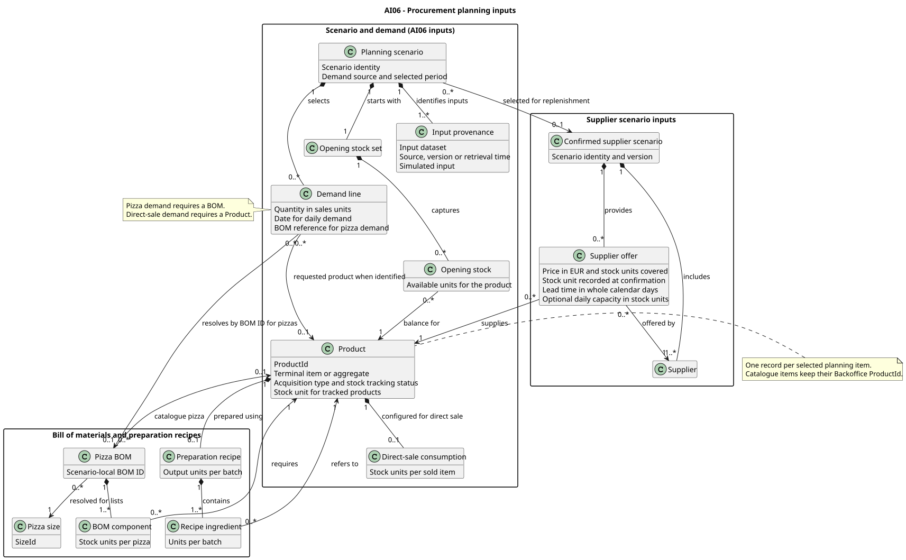

# US AI06 – Back-End Data and Prolog Knowledge Base

## 1. Context & Scope

- **User story:** [AI06 (#178)](https://github.com/Departamento-de-Engenharia-Informatica/LEI-SEM5-PI-2026-27-3DE-01/issues/178)
- **Sprint:** 2 (IARTI Sprint B)
- **Status:** Analysis for review
- **Repository baseline:** `main` at `d7f00fa`. The architecture and AI01 contract follow the proposed design on `ai/ai01-design` at `b81e4b2`.

AI06 reads the data that AI01 and AI02 need and converts it to Prolog. AI01 calculates material needs and checks stock. AI02 plans daily replenishment and selects suppliers. The Manager runs the calculations through WEB07 and AI05. [AI01](../ai01/usAI01.md) · [WEB07](../../web/web07/usWEB07.md)

The SPA calls the Gateway in the proposed design. Catalogue, order, forecast and stock requests go to Backoffice. Supplier scenarios, calculations and results go to Procurement. Each API authorises its own requests. [Target container view](https://github.com/Departamento-de-Engenharia-Informatica/LEI-SEM5-PI-2026-27-3DE-01/blob/b81e4b29774a6d23a92f607535a8e4cbbcf72d38/docs/architecture/SAD.md#23-container-diagram-c4-level-2)

## 2. Requirements & Analysis

### 2.1. User Story Description

> As a Development Team, I want the Artificial Intelligence module to obtain business data from back-end endpoints, so that its knowledge base reflects consistent restaurant information for the selected operational or demonstration scenario.

### 2.2. Acceptance Criteria

| ID | Sprint 2 requirement | Planned evidence |
| --- | --- | --- |
| AI06-AC01 | Retrieve pizza BOMs for the selected sizes from documented endpoints. Include products, aggregates, quantities in abstract stock units and the composition and production-or-purchase classification needed by the Prolog calculation. | AS01–AS03 |
| AI06-AC02 | Retrieve product and consumption rules, selected orders or daily forecasts, stock snapshots and supplier offers as required by each calculation. Include WEB07 scenarios and implement or extend endpoints where needed. | AS01–AS04, AS10 |
| AI06-AC03 | Build a Prolog knowledge base with consistent IDs, relationships and stock units. Preserve each offer's product reference, EUR price, quoted quantity and lead time. Report missing or invalid required data explicitly. | AS02–AS05, AS10 |
| AI06-AC04 | Support actual and identified simulated inputs in the same scenario. Record their origin and version or retrieval time, and mark the calculation as a simulation if any input is simulated. | AS03, AS04, AS08 |
| AI06-AC05 | Refresh data for each calculation or follow a documented refresh policy. Provide a consistent input set and report incomplete refreshes. | AS06, AS08 |
| AI06-AC06 | Access business data through authorised back-end endpoints. Each domain remains the authoritative source for its records. Request only planning data and exclude customer names, contacts and dietary profiles. | AS07, AS10 |
| AI06-AC07 | Keep operational and scenario-input stock and purchase-order records read-only during calculations. Operational changes require separate confirmation and validation in Backoffice. | AS03, AS04, AS09 |

### 2.3. Client Clarifications

| Topic | Consequence for AI06 |
| --- | --- |
| Pizza BOMs and internal aggregates | The operational catalogue has BOMs for pizzas, with quantities by size. The IARTI demonstration uses saved fixtures for internal recipes, their classifications and stock. An operational source for preparation recipes is still open. |
| Current stock and demand | A forecast uses the current stock at execution and runs independently of customer orders. AI01 can also run a selected order with its own stock snapshot. The demonstration can use predefined or generated orders. |
| Active references and history | Check applicable products and sizes again at the first execution of a saved forecast. Reject an inactive reference and preserve earlier results. A historical replay uses the original inputs and eligibility and is labelled as historical. |
| Direct-sale consumption | A stock-controlled item sold directly, such as a drink, needs a value for stock units used per sale. Report an error if that value is missing. |
| Supplier offers | Lead times are whole calendar days. Each offer can set a daily limit for its product. If the limit is absent, AI02 applies no cap and reports that assumption. WEB07 makes confirmed scenarios available for planning. |

### 2.4. Existing API and Integration Gaps

Paths are relative to `/api/v1`. The table lists what the APIs already return and what AI06 still needs for a run. [Module registration](../../../../backend/src/modules/index.js) · [OpenAPI specification](../../../../backend/src/shared/openapi/spec.js)

Operational reads follow **Customer/Supplier**. Backoffice owns and supplies the records. Procurement's needs shape the API. AI06 maps the fields Procurement needs and keeps the original `ProductId`. [Context Map and glossary](https://github.com/Departamento-de-Engenharia-Informatica/LEI-SEM5-PI-2026-27-3DE-01/blob/b81e4b29774a6d23a92f607535a8e4cbbcf72d38/docs/architecture/SAD.md#26-procurement-context-map-ddd)

In the Sprint 2 model, `OrderItem` has an optional link to `PizzaSize` because orders can include unsized products. AI06 needs the recorded size for each pizza. [Sprint 2 LaPrizza domain model](https://github.com/Departamento-de-Engenharia-Informatica/LEI-SEM5-PI-2026-27-3DE-01/blob/a5a622a15cda51400a56d630533e5383cc05281a/docs/architecture/domainModel/domainmodel.puml)

| Input | Existing source and access | Gap or implication for AI06 |
| --- | --- | --- |
| Product and classification | [BCK05](../../bck/bck05/usBCK05.md) exposes `GET /products` and `GET /products/{id}` to Managers and Employees. The response contains `id`, eligibility and role flags, `acquisitionType` and `compositionItems`. | Read the product IDs required by the selected scenario. Map Backoffice `id` to Procurement `productId` with the same value. Distinguish terminal items from aggregates and keep the applicable production or purchase classification. Generic composition does not establish a planning recipe or batch yield. |
| Default pizza composition | [BCK10](../../bck/bck10/usBCK10.md) exposes `GET /predefined-pizzas` and `GET /predefined-pizzas/{productId}` to Managers. The detail response contains the representative product ID and `componentIds`. | Join the composition to the selected size and the component configurations. A valid pizza must remain available as an input to calculation even if the public catalogue marks it unavailable due to low stock. |
| Pizza size | [BCK06](../../bck/bck06/usBCK06.md) exposes public reads at `GET /pizza-sizes` and `GET /pizza-sizes/{id}`. | Resolve the selected size and check its eligibility for the selected input view. A size ID alone does not establish that all components have a configuration for it. |
| Component consumption | [BCK08](../../bck/bck08/usBCK08.md) exposes `GET /products/{productId}/component-configurations` to Managers. Each configuration supplies `productId`, `sizeId` and `stockUnitsConsumed`. | Join by component ID and size ID. Preserve explicit zero. A null consumption value is valid for an explicitly untracked component. A missing configuration or missing consumption for a tracked component is invalid. |
| Opening stock | Managers can use `GET /stock` and `GET /stock/{productId}`. The detail route returns `availableUnits` and the tracking period. It returns 404 if there is no current record. [BCK09](../../bck/bck09/usBCK09.md) | AI06 needs the tracking status as well as the balance. Untracked stock, zero stock and a missing required balance are different cases. The API still needs to provide the balances for a run as one consistent snapshot. |
| Selected order and personalisation | The [Backoffice domain model](../../../architecture/domainModel/domainmodel.puml) includes `Order`, `OrderItem` and `PersonalizedPizzaConfiguration`. There is no registered order input route at the reviewed baseline. | Provide a back-end scenario source for the demonstration. The Sprint 2 model links `OrderItem` to `PizzaSize` and preserves the component IDs on `PersonalizedPizzaConfiguration`. Confirm how the real order API will make those values available to AI06. |
| Daily forecast | [WEB07](../../web/web07/usWEB07.md) defines saved forecasts. The reviewed Backoffice API has no forecast input route. | Backoffice supplies the selected forecast version. Keep dates, quantities and applicable sizes. Forecast demand is independent of customer orders. |
| Supplier scenarios and offers | WEB07 defines import and confirmation. The Procurement API for these operations is still pending. | Procurement owns the scenarios, suppliers and offers. For AI02, AI06 reads the confirmed version through the planning API and keeps the supplier and product IDs, EUR price, quoted units, lead time and daily limit. |
| Direct-sale consumption | The product response exposes catalogue roles and pricing. The size-based component configuration covers pizza consumption. | Agree where the explicit consumption per standalone sale is maintained and expose it for AI02. Missing consumption for a tracked sale yields a diagnostic with the product ID. |
| Execution history | Procurement owns the planning results and their input references in the target design. | Retain versions or an immutable copy of each input set. The Procurement planning API must let AI06 recover the exact set for a replay, including the selected product IDs. |
| Service access and scenario metadata | The current protected Backoffice routes use user authentication and roles. | Agree on authorised service access to the Backoffice and Procurement input endpoints. Keep the scenario ID and the source, version or retrieval time of each selected dataset. |

### 2.5. Domain Model Excerpt and Calculation Inputs

A `Planning scenario` brings together the demand, BOMs and opening stock for one run. An AI02 scenario also selects confirmed supplier offers. [Shared Procurement domain model](https://github.com/Departamento-de-Engenharia-Informatica/LEI-SEM5-PI-2026-27-3DE-01/blob/b81e4b29774a6d23a92f607535a8e4cbbcf72d38/docs/architecture/domainModel/procurement/procurement_domain_model.puml)

[Full-size diagram](./excerptDomainModel/AI06-Domain-Model-Excerpt.svg) · [PlantUML source](./excerptDomainModel/domain_model_excerpt.puml)

A pizza demand line needs a BOM. The catalogue product ID is kept when the order provides one. A personalised pizza without a catalogue reference is identified by its `bomId`. A directly sold item requires a `Product` reference. The excerpt proposes `0..1` on the `Demand line`–`Product` link for this reason. The shared Procurement model currently shows `1` (OP07).

| Input group | Required business information | Consumer |
| --- | --- | --- |
| Pizza demand and BOM | Demand line quantity in pizzas, selected size, product reference when catalogue-backed, and the corresponding BOM. Each BOM gives component IDs and the stock units used per pizza. The proposed AI01 contract uses a scenario-local `bomId`. Distinct personalised compositions for the same catalogue pizza and size need distinct BOM definitions. | AI01 and AI02 |
| Planning item and preparation | Product ID, tracking status, aggregate classification, and a recipe for internally produced aggregates requiring expansion. The demonstration recipe states its output yield and each ingredient's quantity per batch. | AI01 and AI02 |
| Stock | Opening balance in each tracked item's own abstract stock units, with the selected snapshot's origin and version or retrieval time. | AI01 and AI02 |
| Daily forecast | Selected forecast identity and version, planning period, date, product, applicable size and quantity for each entry. Include the explicit stock consumption per sale for directly sold tracked items. | AI02. A selected forecast can also supply pizza demand for a standalone AI01 run. |
| Supplier scenario | Selected confirmed Procurement scenario and version. For relevant offers, keep the supplier ID, product ID, price in EUR, the stock units covered by that price, whole-day lead time and optional daily capacity. | AI02 |
| Execution context | Selected scenario, input origins and versions or retrieval times, simulation flag and original execution link when replaying saved inputs. | AI01 and AI02 |

#### Products selected for a run

1. Start with the pizza lines in the selected order or forecast. Check each selected product and size. When the pizza comes from the catalogue, keep its ID on the BOM as `pizzaId`. AI01 uses opening stock for components and preparations.
2. Add the component IDs from those BOMs. For internally produced aggregates, follow their recipes and add all reachable ingredients and preparations. Include these definitions even when the aggregate has enough stock so AI01 can validate the recipe. Purchased aggregates stay whole. Their descriptive composition adds no products.
3. For AI02, also include directly sold products from the selected daily forecast. A tracked product needs its explicit consumption per sale and opening balance. A zero-quantity entry still needs a valid reference.
4. Keep one record per selected `ProductId` and one opening balance per tracked stock item. Use the same fixture ID wherever a simulated item appears. A catalogue entry, stock balance or offer alone does not add a product to the run.

AI06 supplies the confirmed offers for the products AI02 may need to buy. AI02 keeps relevant products with no offer so it can report a shortage. The WEB07 export can include more products because it serves to build supplier scenarios. [Selection rules in the SAD](https://github.com/Departamento-de-Engenharia-Informatica/LEI-SEM5-PI-2026-27-3DE-01/blob/b81e4b29774a6d23a92f607535a8e4cbbcf72d38/docs/architecture/SAD.md#which-products-are-loaded)

For five medium pizzas, AI06 can pass two units of cheese per pizza and six units in stock. AI01 calculates ten units of demand and a shortage of four.

### 2.6. Business Rules & Invariants

- **BR01 — Demand mapping.** For a forecast entry or a catalogue order line, use the selected size with the default composition from the selected catalogue data. For a personalised order line, use the size and component selection preserved by that line. Report incomplete input when a required size or composition cannot be resolved.
- **BR02 — References and quantities.** Preserve the existing product, size and supplier identities. Each demand, BOM component, recipe ingredient, stock balance and offer must resolve within the selected data. Preserve the difference between a pizza count, stock units consumed per pizza or sale, units available in stock and the units covered by an offer price.
- **BR03 — Missing and invalid data.** Identify the affected input, reference and field. Distinguish an incomplete BOM, missing tracked balance, missing direct-sale factor, invalid supplier offer, denied access and unavailable source. A product with no offer in a valid confirmed scenario remains identifiable for AI02 to report.
- **BR04 — Consistent reads.** A new run captures current operational data unless a saved or simulated source is selected. It also fixes the versions of the selected demand and any confirmed supplier scenario. An incomplete refresh fails with a diagnostic. Procurement retains the inputs or their version references. A replay uses those exact inputs and reports an error if they are unavailable.
- **BR05 — Provenance.** Give each selected input a source, a version or retrieval time and a simulation indicator. Mixed actual and simulated sources must resolve the same references and mark the whole run as a simulation. Keep simulation status distinct from historical replay.
- **BR06 — Authorised planning access.** Procurement authorises the Manager's request. AI06 reads through authorised Backoffice and Procurement endpoints. Those reads cover only the fields needed for the run, excluding customer names, contacts and dietary profiles.
- **BR07 — Stock and purchasing.** Backoffice owns persistent stock and operational purchase orders. Input reads and calculations leave operational and scenario stock intact. Procurement keeps purchase proposals as planning results. Operational changes require separate confirmation and validation in Backoffice.

### 2.7. Decisions for Design

| ID | Decision to confirm | Coordination |
| --- | --- | --- |
| OP01 | Agree on the input endpoints and service access for Backoffice reads and Procurement planning reads. AI01 proposes a read by execution reference. Confirm which routes the Gateway exposes to the SPA and how AI05 returns input errors. | AI05, WEB07, back-end security |
| OP02 | Decide how Backoffice captures a consistent view of catalogue, demand and stock, and how Procurement stores the input versions or copies for replay. Define what stays fixed when a read is retried. | WEB07, Backoffice and Procurement persistence, AI05 |
| OP03 | Confirm how the real order API exposes the selected size from the `OrderItem`–`PizzaSize` relationship, any preserved personalised composition, and the version of the data used. Use an explicit size in a back-end order fixture for the first integrated demonstration. | Backoffice ordering, AI01 |
| OP04 | Agree on the versioned fixture for internally produced aggregates and its yield and quantity semantics. Confirm how the AI01 input contract distinguishes terminal items, purchased aggregates and internally produced aggregates. | AI01, AI02, IARTI |
| OP05 | Agree where direct-sale consumption is configured and how tracking status is exposed with the stock balance. | BCK05, BCK09, WEB07, AI02 |
| OP06 | Align with WEB07 on how to select a Backoffice forecast version and a confirmed Procurement supplier scenario. Agree which offer fields the planning API returns for the selected products. | WEB07, AI02 |
| OP07 | Align the shared Procurement model with the demand mapping. A pizza row always needs a BOM and can have a catalogue product reference. A direct-sale row always needs a product reference. | Procurement domain model, AI01, AI02 |

## 3. Acceptance Scenarios and Expected Evidence

| ID | Scenario | Expected AI06 evidence |
| --- | --- | --- |
| AS01 | Load a selected order of five medium catalogue pizzas with an explicit size, a known composition and current or fixture stock. | The set contains five pizzas linked to the size-specific BOM and the opening balances. Omitting the order size yields an incomplete-input diagnostic. |
| AS02 | Load two personalised lines for the same catalogue pizza and size, one with ham and one without. Repeat with the catalogue reference omitted from the second line. | Each line resolves to its own BOM and keeps its quantity and size. On the repeat, the second BOM uses the recorded components and has no `pizzaId`. |
| AS03 | Load a versioned demonstration with an internal preparation, a purchased aggregate and identified simulated stock alongside eligible catalogue inputs. | Recipe yield, classifications and stock resolve against the same selected product references. Provenance identifies the mixed sources and marks the run as a simulation. |
| AS04 | Load a two-day Backoffice forecast with pizzas and a tracked drink. Select a confirmed Procurement supplier scenario with offers with and without capacity limits and one offer for an unrelated product. | AI02 receives the dates, pizza sizes, drink consumption and relevant offer terms. The unrelated offer stays outside the run. An omitted capacity remains absent. A draft supplier scenario is rejected. |
| AS05 | Supply missing component consumption, missing stock for a tracked item and an invalid supplier offer in separate runs. Include an explicit zero balance and a known untracked component in a valid run. | Errors identify their references and fields. Zero stock and explicitly untracked consumption remain valid inputs in their respective cases. |
| AS06 | Change operational stock and run the scenario again. In another run, make one source unavailable. | The new run uses the updated balance. An incomplete read stops the calculation with an error. |
| AS07 | Start a planning request through the Gateway and read its Backoffice and Procurement inputs through authorised service access. Repeat the reads with missing or insufficient permissions. | The Gateway routes the planning request to Procurement. Authorised reads return only the required planning fields. The other reads return access errors. |
| AS08 | Deactivate a size after saving a forecast but before its first run. Separately replay an earlier completed run using the same size. | The first execution is rejected. Replay uses the original snapshot, records the original execution and is labelled historical. A missing saved version is reported explicitly. |
| AS09 | Run AI01 and AI02 using prepared inputs and compare stored stock and purchase-order records before and after. | Both calculations keep operational stock, scenario stock and operational purchase-order records intact. |
| AS10 | Load an order with two BOMs that share a tracked component. Include a fully stocked internal aggregate with a recipe, a purchased aggregate whose children occur only in its descriptive composition, and an unrelated catalogue product. | AI06 supplies one product record and opening balance for the shared component. The internal recipe and its ingredients are present for validation. The purchased aggregate's children and the unrelated product stay outside the input set. |

## 4. References

- *LEI-2026-27-Sem5-Project_v1-Sprint2US.pdf*, AI01 and AI02 on printed pp. 15–17 and AI05 and AI06 on printed pp. 18–19.
- [AI06 parent issue](https://github.com/Departamento-de-Engenharia-Informatica/LEI-SEM5-PI-2026-27-3DE-01/issues/178), [Sprint 2 plan](../../../Planning/Sprint2/sprintPlanning.md) and Paulo Matos's clarifications on BOM scope, stock at execution, forecast eligibility and supplier capacity.
- *TP Support IARTI SprintB – Pizza Restaurant*, parts 1 and 2, for the BOM, stock and supplier offer examples.
- *Interface Prolog HTTP – Ferramentas adicionais*, `SWIHTTP` and `PROLOG-JSON` for HTTP requests and JSON. `server-prolog2019-20` and `ServerProlog2020-21` for Prolog server examples.
