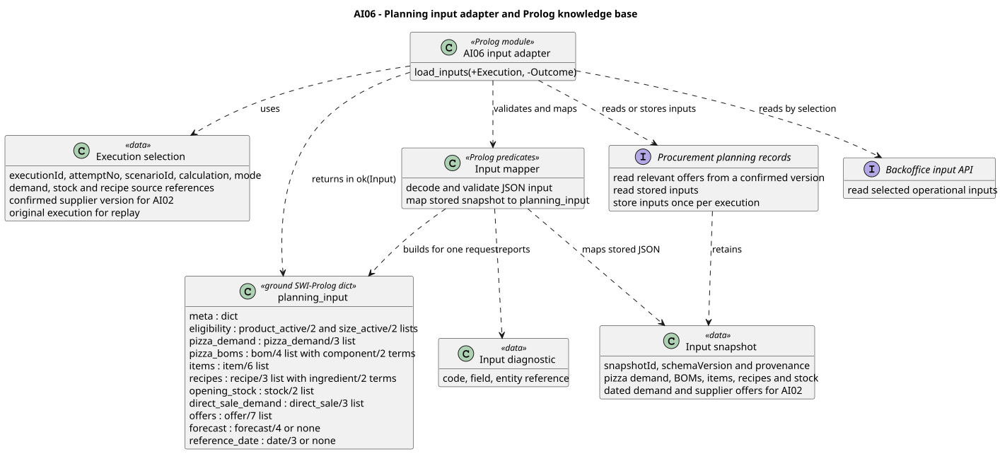
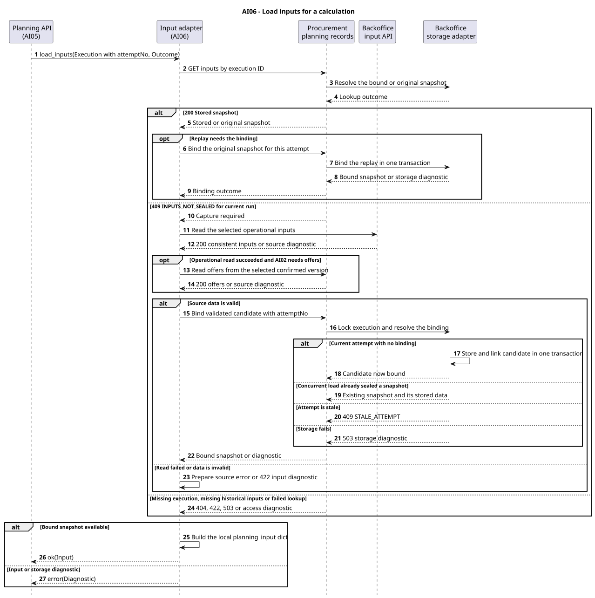

# US AI06 – Back-End Data and Prolog Knowledge Base

## 1. Context & Scope

- **User story:** [AI06 (#178)](https://github.com/Departamento-de-Engenharia-Informatica/LEI-SEM5-PI-2026-27-3DE-01/issues/178)
- **Sprint:** 2 (IARTI Sprint B)
- **Status:** Input adapter, internal HTTP sources and retained-input storage implemented. Public AI05 execution and WEB07 management remain their respective integrations.
- **Implementation baseline:** `9b237a3` on `main`, including the merged AI01 implementation. [AI01 consumer contract](../ai01/usAI01.md#421-input-model)

AI06 reads the data that AI01 and AI02 need and converts it to Prolog. AI01 calculates material needs and checks stock. AI02 plans daily replenishment and selects suppliers. The Manager runs the calculations through WEB07 and AI05. [AI01](../ai01/usAI01.md) · [WEB07](../../web/web07/usWEB07.md)

The latest client clarification makes the portal Backoffice the caller of Prolog, passing scheduling and selection information. Prolog then makes authorised HTTP reads to obtain business data and builds its knowledge base. The portal does not push a complete input dataset with every calculation. This implementation provides that input-loading path; the public caller and Gateway integration belongs to AI05/WEB07.

## 2. Requirements & Analysis

### 2.1. User Story Description

> As a Development Team, I want the Artificial Intelligence module to obtain business data from back-end endpoints, so that its knowledge base reflects consistent restaurant information for the selected operational or demonstration scenario.

### 2.2. Acceptance Criteria

| ID | Sprint 2 requirement | Planned evidence |
| --- | --- | --- |
| AI06-AC01 | Retrieve pizza BOMs for the selected sizes from documented endpoints. Include products, aggregates, quantities in abstract stock units and the composition and production-or-purchase classification needed by the Prolog calculation. | AS01–AS03 |
| AI06-AC02 | Retrieve product and consumption rules, selected orders or daily forecasts, stock snapshots and supplier offers as required by each calculation. Include WEB07 scenarios and implement or extend endpoints where needed. | AS01–AS04, AS10 cover the AI06 inputs. The full WEB07 acceptance run remains pending until WEB07 and AI05 are connected. |
| AI06-AC03 | Build a Prolog knowledge base with consistent IDs, relationships and stock units. Preserve each offer's product reference, EUR price, quoted quantity and lead time. Report missing or invalid required data explicitly. | AS02–AS05, AS10, AS12 |
| AI06-AC04 | Support actual and identified simulated inputs in the same scenario. Record their origin and version or retrieval time, and mark the calculation as a simulation if any input is simulated. | AS03, AS04, AS08 |
| AI06-AC05 | Refresh data for each calculation or follow a documented refresh policy. Provide a consistent input set and report incomplete refreshes. | AS06, AS08, AS11 |
| AI06-AC06 | Access business data through authorised back-end endpoints. Each domain remains the authoritative source for its records. Request only planning data and exclude customer names, contacts and dietary profiles. | AS07, AS10 |
| AI06-AC07 | Keep operational and scenario-input stock and purchase-order records read-only during calculations. Operational changes require separate confirmation and validation in Backoffice. | AS03, AS04, AS09 |

### 2.3. Client Clarifications

| Topic | Consequence for AI06 |
| --- | --- |
| Responsibility for obtaining data (forum question posted 18 November 2026; answer supplied for this implementation) | Follow option 1: Prolog calls documented Backoffice endpoints using a service identity and builds its KB. Dedicated internal source endpoints are allowed. Only selectors/scheduling context arrive on invocation. Prolog has no database access. |
| Pizza BOMs and internal aggregates | The operational catalogue has BOMs for pizzas, with quantities by size. Internal preparation recipes, classifications and stock are explicitly versioned IARTI fixtures; no additional operational recipe-management workflow is introduced. |
| Current stock and demand | A forecast uses the current stock at execution and runs independently of customer orders. AI01 can also run a selected order with its own stock snapshot. The demonstration can use predefined or generated orders. |
| Active references and history | Check applicable products and sizes again at the first execution of a saved forecast. Reject an inactive reference and preserve earlier results. A historical replay uses the original inputs and eligibility and is labelled as historical. |
| Direct-sale consumption | A stock-controlled item sold directly, such as a drink, needs a value for stock units used per sale. Report an error if that value is missing. |
| Supplier offers | Lead times are whole calendar days. Each offer can set a daily limit for its product. If the limit is absent, AI02 applies no cap and reports that assumption. WEB07 makes confirmed scenarios available for planning. |

### 2.4. Existing API and Integration Gaps

Paths are relative to `/api/v1`. The table lists what the APIs already return and what AI06 still needs for a run. [Module registration](../../../../backend/src/modules/index.js) · [OpenAPI specification](../../../../backend/src/shared/openapi/spec.js)

Operational reads follow **Customer/Supplier**. Backoffice owns and supplies the records. Procurement's needs shape the API. AI06 maps the fields Procurement needs and keeps the original `ProductId`. [Context Map and glossary](https://github.com/Departamento-de-Engenharia-Informatica/LEI-SEM5-PI-2026-27-3DE-01/blob/b81e4b29774a6d23a92f607535a8e4cbbcf72d38/docs/architecture/SAD.md#26-procurement-context-map-ddd)

In the Sprint 2 model, `OrderItem` has an optional link to `PizzaSize` because orders can include unsized products. AI06 needs the recorded size for each pizza. [Sprint 2 LaPrizza domain model](https://github.com/Departamento-de-Engenharia-Informatica/LEI-SEM5-PI-2026-27-3DE-01/blob/a5a622a15cda51400a56d630533e5383cc05281a/docs/architecture/domainModel/domainmodel.puml)

| Input | Existing source and access | Gap or implication for AI06 |
| --- | --- | --- |
| Product and classification | [BCK05](../../bck/bck05/usBCK05.md) exposes `GET /products` and `GET /products/{id}` to Managers and Employees. The response contains `id`, eligibility and role flags, `acquisitionType` and `compositionItems`. | Read the product IDs required by the selected scenario and keep their values. The internal product read adds explicitly configured stock units and direct-sale factors. Use the source-specific classification in section 4.4. |
| Default pizza composition | [BCK10](../../bck/bck10/usBCK10.md) exposes `GET /predefined-pizzas` and `GET /predefined-pizzas/{productId}` to Managers. The detail response contains the representative product ID and `componentIds`. | Join the composition to the selected size and the component configurations. A valid pizza must remain available as an input to calculation even if the public catalogue marks it unavailable due to low stock. |
| Pizza size | [BCK06](../../bck/bck06/usBCK06.md) exposes public reads at `GET /pizza-sizes` and `GET /pizza-sizes/{id}`. | Resolve the selected size and check its eligibility for the selected input view. A size ID alone does not establish that all components have a configuration for it. |
| Component consumption | [BCK08](../../bck/bck08/usBCK08.md) exposes `GET /products/{productId}/component-configurations` to Managers. Each configuration supplies `productId`, `sizeId` and `stockUnitsConsumed`. | Join by component ID and size ID. Preserve explicit zero. A null consumption value is valid for an explicitly untracked component. A missing configuration or missing consumption for a tracked component is invalid. |
| Opening stock | Managers can use `GET /stock` and `GET /stock/{productId}`. [BCK09](../../bck/bck09/usBCK09.md) | The new internal view exposes tracking and selected balances from the same read-only transaction. Zero, untracked and missing balances remain distinct. |
| Selected order and personalisation | The [Backoffice domain model](../../../architecture/domainModel/domainmodel.puml) includes `Order`, `OrderItem` and `PersonalizedPizzaConfiguration`. There is no registered order input route at the reviewed baseline. | Provide a back-end scenario source for the demonstration. The Sprint 2 model links `OrderItem` to `PizzaSize` and preserves the component IDs on `PersonalizedPizzaConfiguration`. Confirm how the real order API will make those values available to AI06. |
| Daily forecast | [WEB07](../../web/web07/usWEB07.md) defines saved forecasts. The operational WEB07 forecast reader is not registered at this baseline; versioned forecast fixtures are now served by the private source API. | Backoffice supplies the selected forecast version. Keep dates, quantities and applicable sizes. Forecast demand is independent of customer orders. |
| Supplier scenarios and offers | The private confirmation route stores immutable WEB07 supplier versions. Demonstrations can explicitly select fixture offers. | Procurement owns scenarios, suppliers and offers. AI06 reads the selected version and keeps supplier/product IDs, EUR price, quoted units, lead time and daily limit. |
| Direct-sale consumption | The public product response exposes catalogue roles and pricing. Size configurations cover pizza consumption. | `planning_product_settings` supplies explicitly configured `stockUnit` and `stockUnitsPerSale` on internal product reads. An administration script sets these without changing stock. Fixtures also state these values. Missing tracked consumption is an error. |
| Execution history | Procurement owns the planning results and their input references in the target design. | Retain versions or an immutable copy of each input set. The Procurement planning API must let AI06 recover the exact set for a replay, including the selected product IDs. |
| Service access and scenario metadata | Public Backoffice routes use user authentication and roles. | The new internal routes use separate opaque read and input-record credentials. User bearers do not grant service access. Source metadata and snapshot identities are retained. |

### 2.5. Domain Model Excerpt and Calculation Inputs

A `Planning scenario` brings together the demand, BOMs and opening stock for one run. An AI02 scenario also selects confirmed supplier offers. [Shared Procurement domain model](https://github.com/Departamento-de-Engenharia-Informatica/LEI-SEM5-PI-2026-27-3DE-01/blob/b81e4b29774a6d23a92f607535a8e4cbbcf72d38/docs/architecture/domainModel/procurement/procurement_domain_model.puml)


[Full-size diagram](./excerptDomainModel/AI06-Domain-Model-Excerpt.svg) · [PlantUML source](./excerptDomainModel/domain_model_excerpt.puml)

A pizza demand line needs a BOM. Each BOM refers to one `PizzaSize` and optionally to the catalogue pizza `Product`. A personalised pizza without a catalogue reference is identified by its `bomId`. A directly sold item requires a `Product` reference. The excerpt proposes `0..1` on the `Demand line`–`Product` link. The shared Procurement model currently shows `1` (OP07). The `Opening stock set` contains the balances available at the start. The stored `Input snapshot` in the class diagram contains that set plus the other inputs and their provenance.

| Input group | Required business information | Consumer |
| --- | --- | --- |
| Pizza demand and BOM | Demand line quantity in pizzas, selected size, product reference when catalogue-backed, and the corresponding BOM. Each BOM gives component IDs and the stock units used per pizza. The proposed AI01 contract uses a scenario-local `bomId`. Distinct personalised compositions for the same catalogue pizza and size need distinct BOM definitions. | AI01 and AI02 |
| Planning item and preparation | Product ID, tracking status, stock-unit code for tracked products, aggregate classification, and a recipe for internally produced aggregates requiring expansion. The demonstration recipe states its output yield and each ingredient's quantity per batch. | AI01 and AI02 |
| Stock | Opening balance in each tracked item's own abstract stock units, with the selected snapshot's origin and version or retrieval time. | AI01 and AI02 |
| Daily forecast | Selected forecast identity and version, planning period, date, product, applicable size and quantity for each entry. Include the explicit stock consumption per sale for directly sold tracked items. | AI02. A selected forecast can also supply pizza demand for a standalone AI01 run. |
| Supplier scenario | Selected confirmed Procurement scenario and version. For relevant offers, keep the supplier ID, product ID, price in EUR, the stock units covered by that price, whole-day lead time and optional daily capacity. | AI02 |
| Execution context | Selected scenario, input origins and versions or retrieval times, simulation flag and original execution link when replaying saved inputs. | AI01 and AI02 |

#### Products selected for a run

1. Start with the pizza lines in the selected order or forecast. Check each selected product and size. When the pizza comes from the catalogue, keep its ID on the BOM as `pizzaId`. AI01 uses opening stock for components and preparations.
2. Add the component IDs from those BOMs. For internally produced aggregates, follow their recipes and add all reachable ingredients and preparations. Include these definitions even when the aggregate has enough stock so AI01 can validate the recipe. Purchased aggregates stay whole. Their descriptive composition adds no products.
3. For AI02, also include directly sold products from the selected daily forecast. A tracked product needs its explicit consumption per sale and opening balance. A zero-quantity entry still needs a valid reference.
4. Keep one record per selected `ProductId` and one opening balance per tracked stock item. Use the same fixture ID wherever a simulated item appears. A catalogue entry, stock balance or offer alone does not add a product to the run.

AI06 supplies the confirmed offers for the products AI02 may need to buy. AI02 keeps relevant products with no offer so it can report a shortage. The WEB07 export can include more products because it serves to build supplier scenarios. [Selection rules in the SAD](https://github.com/Departamento-de-Engenharia-Informatica/LEI-SEM5-PI-2026-27-3DE-01/blob/b81e4b29774a6d23a92f607535a8e4cbbcf72d38/docs/architecture/SAD.md#which-products-are-loaded)

For five medium pizzas, AI06 can pass 120 g of cheese per pizza and 400 g in stock. AI01 calculates 600 g of demand and a shortage of 200 g.

### 2.6. Business Rules & Invariants

- **BR01 — Demand mapping.** For a forecast entry or a catalogue order line, use the selected size with the default composition from the selected catalogue data. For a personalised order line, use the size and component selection preserved by that line. Report incomplete input when a required size or composition cannot be resolved.
- **BR02 — References and quantities.** Preserve the existing product, size and supplier identities. Each demand, BOM component, recipe ingredient, stock balance and offer must resolve within the selected data. Preserve the difference between a pizza count, stock units consumed per pizza or sale, units available in stock and the units covered by an offer price.
- **BR03 — Missing and invalid data.** Identify the affected input, reference and field. Distinguish an incomplete BOM, missing tracked balance, missing direct-sale factor, invalid supplier offer, denied access and unavailable source. A product with no offer in a valid confirmed scenario remains identifiable for AI02 to report.
- **BR04 — Consistent reads.** A new run captures current operational data unless a saved or simulated source is selected. It also fixes the versions of the selected demand and any confirmed supplier scenario. An incomplete refresh fails with a diagnostic. Procurement retains the inputs or their version references. A replay uses those exact inputs and reports an error if they are unavailable.
- **BR05 — Provenance.** Give each selected input a source, a version or retrieval time and a simulation indicator. Mixed actual and simulated sources must resolve the same references and mark the whole run as a simulation. Keep simulation status distinct from historical replay.
- **BR06 — Authorised planning access.** Procurement authorises the Manager's request. AI06 reads through authorised Backoffice and Procurement endpoints. Those reads cover only the fields needed for the run, excluding customer names, contacts and dietary profiles.
- **BR07 — Stock and purchasing.** Backoffice owns persistent stock and operational purchase orders. Input reads and calculations leave operational and scenario stock intact. Procurement keeps purchase proposals as planning results. Operational changes require separate confirmation and validation in Backoffice.

### 2.7. Decisions for Design

| ID | Design decision | Coordination |
| --- | --- | --- |
| OP01 | Prolog calls the internal source routes in section 4.3. The read credential cannot write retained inputs; the records credential cannot read operational groups. AI05 translates diagnostics for public requests. | AI05, Backoffice and Procurement service access |
| OP02 | Open a bounded Backoffice read-only transaction and read selected groups through its view ID. Bind the first valid document in PostgreSQL. Retries reuse sealed inputs or restart the entire unsealed capture. | Backoffice and Procurement persistence, AI05 |
| OP03 | Read the recorded `OrderItem.sizeId` for every pizza and preserve the order line's selected components when personalised. Reject a missing size. The first integrated order demonstration uses a versioned Backoffice fixture with these fields. The live order read follows the same contract when available. | Backoffice ordering, AI01 |
| OP04 | Use versioned Backoffice fixtures for selected preparation recipes, explicit kinds, yields and ingredient quantities per batch. Supplier fixtures use confirmed Procurement scenario versions. Section 4.6 defines the demonstration datasets. | AI01, AI02, IARTI |
| OP05 | Backoffice derives tracking from the current stock period and reads unit/factor settings from `planning_product_settings`. Demonstration data also states these values. Reject missing consumption and preserve zero. | BCK05, BCK09, WEB07, AI02 |
| OP06 | Pin the forecast and confirmed supplier scenario versions. Keep one offer per supplier/product, as required by the Sprint 2 statement (WEB07, p. 7). Different pack sizes come from different suppliers. | WEB07, AI02 |
| OP07 | A pizza row requires a BOM and can omit the catalogue product reference. A direct-sale row always requires a product reference. Apply this rule in AI06 and carry the multiplicity change into the shared model when it is updated. | Procurement domain model, AI01, AI02 |

## 3. Acceptance Scenarios and Expected Evidence

| ID | Scenario | Expected AI06 evidence |
| --- | --- | --- |
| AS01 | Load a selected order of five medium catalogue pizzas with an explicit size, a known composition and current or fixture stock. | The set contains five pizzas linked to the size-specific BOM and the opening balances. Omitting the order size yields an incomplete-input diagnostic. |
| AS02 | Load two personalised lines for the same catalogue pizza and size, one with ham and one without. Repeat with the catalogue reference omitted from the second line. | Each line resolves to its own BOM and keeps its quantity and size. On the repeat, the second BOM uses the recorded components and has no `pizzaId`. |
| AS03 | Load the versioned pizza demonstration in section 4.6, including internal dough recipes, a purchased aggregate and simulated stock alongside eligible catalogue inputs. | Check the dataset counts, recipe yields, classifications and stock units. Provenance identifies the mixed sources and marks the run as a simulation. |
| AS04 | Load the two-day forecast with pizzas and a tracked drink and the confirmed supplier dataset in section 4.6. Include different pack sizes across suppliers, limits including zero, an omitted limit and an unrelated offer. Repeat after reordering the offers. | AI02 receives dated demand and the same ordered offers, including price in cents. Unrelated offers are excluded, zero stays zero and an omitted limit maps to `none`. A draft version is rejected. |
| AS05 | In separate runs omit required component consumption, tracked stock or consumption per sale, use an incompatible supplier stock unit, submit two offers for one supplier/product or submit a price with more than two fractional digits. Include zero balances and a known untracked component in a valid run. | Diagnostics identify the affected references and fields. Zero stock and explicit untracked consumption remain valid in their respective cases. |
| AS06 | Change operational stock and run the scenario again. In another run, make one source unavailable. | The new run uses the updated balance. An incomplete read stops the calculation with an error. |
| AS07 | The portal starts Prolog with execution selectors. Prolog reads its Backoffice and Procurement inputs with authorised service access. Repeat with missing or insufficient permissions. | Authorised reads return only planning fields. Missing credentials return 401 and insufficient service permission returns 403. Public Manager/session checks belong to the calling AI05/portal workflow. |
| AS08 | Deactivate a size after saving a forecast but before its first run. Separately replay an earlier completed run using the same size. | The first execution is rejected. Replay uses the original snapshot, records the original execution and is labelled historical. A missing saved version is reported explicitly. |
| AS09 | Run the same saved inputs twice. Run two requests concurrently with different opening balances for the same product. Compare stored stock and purchase-order records before and after. | Repeated loads give the same starting balance. Concurrent runs use their own inputs. Operational stock, scenario stock and purchase-order records stay intact. |
| AS10 | Load an order with two BOMs that share a tracked component. Include a fully stocked internal aggregate with a recipe, a purchased aggregate whose children occur only in its descriptive composition, and an unrelated catalogue product. | AI06 supplies one product record and opening balance for the shared component. The internal recipe and its ingredients are present for validation. The purchased aggregate's children and the unrelated product stay outside the input set. |
| AS11 | Run two loads that both receive `409 INPUTS_NOT_SEALED` for one current attempt. Let one store inputs and send the other candidate after that write. Repeat with missing historical inputs, an unknown execution and unavailable storage. | Both successful loads use the same stored snapshot ID and the same Prolog input. The lookup failures are `422`, `404` and `503` respectively. Only `INPUTS_NOT_SEALED` triggers a current-data capture. |
| AS12 | Pass the mapped cheese example to AI01's `prepare_bom/2` and `bom_requirements/2`. Separately select one day's dated rows as AI02 would and pass them with that day's stock. Attempt a first snapshot binding at `expiresAt` and with an obsolete attempt number. | Both calculation calls consume the documented `planning_input` keys and `pizza_demand/3`. The cheese example reports 600 g required and 200 g to replenish. Both stale bindings return `409 STALE_ATTEMPT` and AI05 checks the execution state. |

## 4. Design

### 4.1. Architecture and responsibilities

The Manager starts a calculation in WEB07. Following the latest clarification, the portal Backoffice invokes Prolog through AI05 with the authorised selection and scheduling context. AI06 makes the HTTP source reads, validates and retains the selected data, then builds the bound snapshot as a Prolog value for AI01 or AI02. No business dataset is accepted as an alternative invocation path. [Planning access and records](../../../architecture/SAD.md#27-planning-access-and-records)

| Component | Responsibility |
| --- | --- |
| Backoffice input API | Open a coherent raw-data view and serve the selected groups requested by Prolog. It does not expand BOMs or assemble the knowledge base. Provide explicit versioned demonstration sources where operational workflows are not yet available. |
| Procurement planning records | Retain confirmed supplier scenario versions and the input snapshots used by executions. Provide access to the selected version and store one snapshot per execution. |
| AI06 input adapter | Read both sources when needed. Check identifiers, fields and units. Map the input set to Prolog and return it with its provenance or an input diagnostic. |
| AI05, AI01 and AI02 | AI05 handles the execution request and exposes the result. AI01 calculates the BOM requirements. AI02 uses the dated forecast and supplier terms to plan replenishment. |

### 4.2. Class and sequence diagrams

The adapter entry point is `load_inputs(+Execution, -Outcome)`. `Execution` contains the authorised selection, execution ID, attempt number and replay reference when applicable. `Outcome` is `ok(Input)` with the ground SWI-Prolog `planning_input{...}` dict defined in [section 4.4](#44-data-mapping-to-prolog), or `error(Diagnostic)` with the input error.



[PlantUML source](./classDiagram/class_diagram_planning_inputs.puml)

The sequence starts when AI05 loads inputs for an authorised execution. A new execution reads the selected sources. A retry with a stored snapshot or a historical replay reads that snapshot from Procurement.



[PlantUML source](./sequenceDiagram/sequence_diagram_load_planning_inputs.puml)

### 4.3. Internal REST contracts

All paths are relative to `/api/v1`. Prolog opens a read view and requests the groups it needs. Opening the view returns demand lines, view identity and provenance, not a complete dataset. The Backoffice executes the raw reads; Prolog resolves pizzas, follows preparation references and constructs the KB.

| Method and path | Permission | Purpose |
| --- | --- | --- |
| `POST /internal/planning/input-runs` | Records | Register the fixed selection and claim/retry its input acquisition lease. The portal/AI05 records adapter calls this before invoking AI06. |
| `GET /internal/planning/input-runs/{id}/inputs` | Read | Retrieve retained inputs and their selection, or `409 INPUTS_NOT_SEALED` for a known unsealed run. |
| `PUT /internal/planning/input-runs/{id}/inputs` | Records | Bind the validated JSON document with `attemptNo`. Return the first stored winner on repeated or competing writes. |
| `POST /internal/planning/read-views` | Read | Open a coherent source view from the registered selectors. Return `viewId`, `revision`, `retrievedAt`, mapping policy, demand lines, forecast identity and provenance. |
| `POST /internal/planning/read-views/{id}/products` | Read | Read the requested product IDs, roles, eligibility, tracking, classification and configured units/factors. |
| `POST /internal/planning/read-views/{id}/sizes` | Read | Read selected sizes and eligibility. |
| `POST /internal/planning/read-views/{id}/pizza-configurations` | Read | Read the default component IDs and explicit multiplicities for selected catalogue pizzas. |
| `POST /internal/planning/read-views/{id}/component-configurations` | Read | Read the selected product/size consumption values. |
| `POST /internal/planning/read-views/{id}/recipes` | Read | Read explicitly selected preparation recipes, without expansion. |
| `POST /internal/planning/read-views/{id}/stock` | Read | Read selected opening balances. |
| `POST /internal/planning/read-views/{id}/incoming-deliveries` | Read | For AI02, read selected unreceived quantities and expected delivery dates, separately from opening stock. |
| `DELETE /internal/planning/read-views/{id}` | Read | Release the transient transaction. This does not delete or change business records. |
| `POST /internal/planning/supplier-offers` | Read | Read a fixed confirmed Procurement scenario/version for selected replenishable products. |

A current selection is registered with the records credential. For example:

```json
{
  "executionId": "a5242c8e-526a-4b5c-9539-a84887a492d1",
  "scenarioId": "five-medium-demo",
  "calculation": "BOM",
  "mode": "current",
  "demand": { "type": "fixture", "id": "five-medium", "version": "1" },
  "catalogue": { "type": "saved", "id": "five-medium", "version": "1" },
  "stock": { "type": "saved", "id": "five-medium", "version": "1" }
}
```

The response supplies `attemptNo` and server-assigned `expiresAt`. Invocation of `load_inputs/2` adds that attempt number to the selection. It passes no products, stock, BOMs or offers. `REQUIREMENTS_PLANNING` also requires `referenceDate` and `supplierScenario: {id, version}`. AI05 fixes the default reference date; AI06 never substitutes its own clock.

Each group read takes `{productIds: [...], sizeIds: [...]}` and returns `{viewId, revision, items}`. The adapter rejects an omitted requested identity, duplicates or a changed view/revision. It requests the selected pizza and size, their components and all ingredients of produced preparations. It never loads the entire catalogue. Purchased aggregates and live descriptive compositions do not add children. Stock reads include only selected tracked planning items.

For AI02, optional `receipts` selects a `current` or versioned `saved` delivery source. If omitted, it follows the stock selector so a simulated stock scenario also uses its declared receipt assumptions. Each row has `receiptId`, `productId`, positive `remainingUnits`, `stockUnit` and `expectedDeliveryDate`. Only unreceived quantities are included; quantities already received belong to current stock. An explicit `pendingDeliveries: []` means no pending receipts. An unavailable feed gives `MISSING_RECEIPTS`, never an assumed empty list. AI06 preserves these dates and quantities; AI02 decides when they become available.

A `saved` catalogue or stock selector names a versioned fixture. Fresh operational order/forecast demand requires `catalogue.type = current`. `current` uses the operational database through the Backoffice adapter. `preparationFixture` explicitly selects additional simulated preparations, including size-specific consumption for fixture-owned products. The selected catalogue remains the source of consumption for its own IDs. A configured `demandReader` connects the eventual live order/forecast source.

Opening stock returns `productId`, `availableUnits` and `stockUnit` from the stock source. Prolog rejects missing or incompatible stock units before retaining the input. Saved stock files must declare a unit per row. Older retained inputs with no verifiable unit return `MISSING_STOCK_UNIT` and require a new capture under a new execution ID.

The private WEB07 confirmation adapter uses `PUT /api/v1/internal/planning-records/supplier-scenarios/{scenarioId}/versions/{version}` with the dedicated `PLANNING_SUPPLIER_CONFIRM_TOKEN` service credential after explicit confirmation. The body contains `suppliers: [{id, name?}]` and `products: [{productId, stockUnit, offers}]`. The adapter checks product references, units and offers before storing the immutable version. An identical retry returns the same version. A conflicting write returns 409. The AI06 offer query reads that exact version by default. Use `supplierScenario.type = "fixture"` to select demonstration offers explicitly. Missing confirmed versions return 404. Confirmed manual or LLM-assisted offers retain simulation provenance.

Preparation fixture products must use IDs distinct from the selected catalogue records, whether current or saved. A collision returns `422 FIXTURE_PRODUCT_CONFLICT` with the product ID; it cannot replace eligibility, roles, classification or stock units. Non-conflicting fixture-only products and recipes are added to the catalogue inputs.

#### Service access and errors

`PLANNING_SERVICE_READ_TOKEN` and `PLANNING_RECORDS_TOKEN` are distinct opaque credentials, each at least 32 characters, configured only on servers. Reader access covers the source reads and retained-input lookup. The records credential only claims input leases and seals snapshots; it cannot read operational groups. Neither grants stock or purchase-order operations. Manager session bearers do not grant internal service access. AI05/the portal must still apply current Manager/session and record-access checks before invoking this internal path.

Prolog receives the service configuration from `LAPRIZZA_INPUT_API_URL`, `LAPRIZZA_INPUT_READ_TOKEN` and `LAPRIZZA_INPUT_RECORDS_TOKEN`, or from the explicit embedding configuration in `load_inputs/3`. It uses HTTPS with normal certificate verification. HTTP is accepted only on loopback for local tests and demonstrations. Redirects are disabled, requests time out after 10 seconds and response bodies are limited to 4 MiB. Credentials are not written to snapshots, diagnostics or demonstration output.

| HTTP status | Use |
| --- | --- |
| 400 | Invalid selectors, unsupported request properties or invalid IDs. The invocation cannot contain a complete business dataset. |
| 401 / 403 | Missing/invalid service credential, or valid credential with the wrong permission. |
| 404 | `EXECUTION_NOT_FOUND` or `SOURCE_NOT_FOUND`. Missing sources never start a fallback capture. |
| 409 | `INPUTS_NOT_SEALED` permits a current capture. Other conflicts include `STALE_ATTEMPT`, `EXECUTION_SELECTION_CONFLICT`, `READ_VIEW_EXPIRED`, `READ_VIEW_BUSY` and `SUPPLIER_VERSION_NOT_CONFIRMED`. |
| 422 | Missing or invalid business data, incompatible units, unsafe JSON integers, or `HISTORICAL_INPUTS_UNAVAILABLE`. |
| 503 | `INPUT_SOURCE_UNAVAILABLE`: database, source or storage failure. |

Expected server diagnostics contain `error.status`, `error.code`, `error.message` and optional `field`/`reference`. Prolog adds the execution and scenario context. A malformed response, changed revision or unsupported retained-input schema is an error; it never yields a partial KB. The shared JSON boundary guards integer precision in both directions. AI05 owns the public response mapping.

Prolog requires separate provenance for demand, catalogue and stock; selected preparation fixtures also require recipes provenance. AI02 additionally requires receipts and offers provenance. A missing group gives `MISSING_PROVENANCE`; duplicate groups are rejected. Each origin must match its selected source, version and simulation flag. Current inputs use the read view's retrieval timestamp. Versions must be non-empty strings and retrieval timestamps must be ISO-8601 values. Offer provenance is checked against the confirmed scenario/version separately and cannot replace missing operational provenance.

### 4.4. Data mapping to Prolog

| Input | Mapping |
| --- | --- |
| Order or forecast | Keep the quantity and selected size. Use the default components for a catalogue pizza and the recorded components for a personalised order. For AI02, keep dates and standalone sales. |
| Pizza definition | Reuse a `bomId` within the scenario when the catalogue reference, size and resolved component quantities match. For a pizza without a catalogue reference, use the size and resolved components. Include `pizzaId` when available. Join by `productId` and `sizeId` to get `unitsPerPizza`. Apply any explicit component multiplicity once. |
| Products and recipes | Keep the catalogue ID as `productId` and use one item per referenced ID. The live pizza BOM comes from the selected component configurations. A live component maps to `terminal` even if Backoffice marks it as `PRODUCED` or lists a descriptive composition. A fixture must declare each item's `kind` and each aggregate's acquisition type. Include the yield and ingredient quantities per batch for a produced aggregate. A purchased aggregate remains a single item. |
| Stock and eligibility | Carry one balance per selected tracked stock item and the product and size eligibility from the same view. Distinguish zero balance, untracked item and missing balance. An explicitly untracked pizza component may have null consumption. A known tracked item needs a value. |
| Pending deliveries | For AI02, preserve one line per receipt identity, its product, remaining unreceived quantity in the canonical stock unit and expected calendar date. Do not add it to opening stock. |
| Direct sales | Preserve date, `productId` and sale quantity for AI02. Attach the configured `stockUnitsPerSale` to the tracked product item. Missing consumption for a tracked sale is an error. |
| Supplier offers | Select the offers for products AI02 may replenish from the confirmed scenario version. Keep `supplierId`, `productId`, `stockUnit`, `priceEur`, `coveredUnits`, `leadTimeDays` and optional `dailyLimit`. An omitted limit remains absent in JSON. |

The adapter checks that references resolve within the snapshot, sizes match their configurations and required quantities are present and valid. A current forecast run rejects inactive products or sizes. A replay uses the saved eligibility. Stock and consumption quantities are integers in the relevant product's stock units. Demand and available stock can be zero. A recipe's yield and each ingredient quantity per batch are positive. A supplier offer has a non-negative EUR price, a positive integer quoted quantity and a non-negative lead time in whole days. A recorded daily capacity is a non-negative integer in stock units. There is no default for a missing required value.

The selection walk visits each product ID once, including ingredients of internal preparations even when their opening stock covers demand. It supplies the recipe graph to AI01, which checks for recipe cycles and calculates how much of each aggregate needs production.

#### Request-local Prolog knowledge base

AI06 opens each HTTP response with `http_open/3`, reads a bounded body and decodes it with `atom_json_dict/3` from `library(http/json)`. `default_tag(json)` makes object tags ground. It closes the stream after decoding. `http_read_json_dict/2` is for JSON requests received by an SWI-Prolog HTTP handler. Validate response shapes and field types before building the terms. Back-end IDs and dates arrive as JSON strings. IDs stay SWI-Prolog strings with their original case. Calendar dates become `date(Year, Month, Day)` after validation. Controlled values such as `terminal`, `aggregate`, `produced`, `purchased`, `true`, `false` and `none` are atoms.

`Input` in `ok(Input)` is a ground dict tagged `planning_input`. The mapping below defines each field. Collection fields are lists, including empty lists. Fields specific to AI02 use empty lists or `none` in an AI01 run, as indicated below. AI05 passes this dict to the selected calculation.

| Validated JSON | Key and Prolog value in `planning_input` |
| --- | --- |
| `pizzaDemand[]` | `pizza_demand`: list of `pizza_demand(Date, BomId, Qty)`. `Date` is `none` for standalone AI01 and `date(Year, Month, Day)` for AI02. |
| `pizzaBoms[]` | `pizza_boms`: list of `bom(BomId, PizzaId, SizeId, Components)`. An absent catalogue reference maps to `none`. Components are `component(ProdId, Units)` terms. Explicit null consumption for an untracked component maps to `none`. |
| `items[]` | `items`: list of `item(ProdId, Kind, Tracked, AcqType, StockUnit, UnitsPerSale)`. Absent fields that do not apply map to `none`. Stock units are strings. Required fields are validated before mapping. |
| `recipes[]` | `recipes`: list of `recipe(ProdId, Yield, Ingredients)` with `ingredient(ProdId, UnitsPerBatch)` terms. |
| `openingStock[]` | `opening_stock`: list of `stock(ProdId, Units)`. Validate each source row's `stockUnit` against the item's unit before mapping. Explicit zero is a balance. |
| `pendingDeliveries[]` | `pending_receipts`: list of `pending_receipt(ReceiptId, ProdId, RemainingUnits, ExpectedDate)`, with `date/3`. Empty for AI01. |
| `directSaleDemand[]` | `direct_sale_demand`: list of `direct_sale(Date, ProdId, Qty)` for AI02. Empty for AI01. |
| `supplierScenario.offers[]` | `offers`: list of `offer(SupId, ProdId, PriceCents, CoveredUnits, LeadDays, Limit, StockUnit)` for AI02. Absent `dailyLimit` maps to `none`. Empty for AI01. |
| `eligibility.products[]`, `eligibility.sizes[]` | `eligibility`: dict with `products` and `sizes` lists of `product_active(ProdId, Active)` and `size_active(SizeId, Active)` respectively. |
| `forecast`, `referenceDate` | `forecast`: `forecast(Id, Version, StartDate, EndDate)` and `reference_date`: `date(Year, Month, Day)` for AI02. Both are `none` for AI01. |
| Execution and provenance fields | `meta`: dict with `executionId`, `scenarioId`, `snapshotId`, `schemaVersion`, `calculation`, `mode`, `simulation` and `provenance`. Include `replayedFrom` and `supplierScenario` identity and version when applicable. Preserve the validated JSON values. |

AI01's `prepare_bom/2` consumes `pizza_demand/3`, `bom/4`, `item/6`, `recipe/3` and `stock/2` under these exact keys. AI02 selects one day's `pizza_demand/3` rows and replaces `opening_stock` in a local copy with that day's hypothetical balances before calling AI01. It keeps the terms' dates. AI01 totals the pizza rows supplied by the caller. AI02 owns the day selection and supplier planning. [AI01 input and daily handoff](../ai01/usAI01.md#421-input-model)

`part/1` in `pizza-BOM.pl` corresponds to terminal items. Its `setp/2` represents assemblies, which AI06 supplies as pizza BOMs or preparation recipes with explicit quantities. For example, two occurrences of `lock` become one `ingredient("lock", 2)`. AI06 consolidates multiplicity once. Equal numbers on different products still use each product's own stock unit.

The teacher's `attend_request` calls `retract/1` and `asserta/1` to consume dynamic `stock/2` facts. In a shared HTTP server, one run would then see another run's withdrawals. Sequential replays would also start with depleted balances. Here `stock/2` terms are values in the request's `opening_stock` list. AI01 and AI02 pass hypothetical balances through their calculation predicates. Each call starts from its own immutable input, which preserves AI06-AC07 and makes the AI01 scenarios reproducible.

The knowledge base consists of the validated demand, BOM, item, recipe, eligibility and stock terms for the selected scenario. The calculation predicates query those terms through the dict's lists and prepared indexes. The dict carries the knowledge available to one execution, and the Prolog predicates perform the inference and stock-first expansion. This is the representation to explain in the IARTI demonstration.

#### Offer units, price and package sizes

Each tracked product has a Backoffice stock-unit code, such as `g`, `ml` or `unit`, or an explicit abstract unit configured for that product. The WEB07 export supplies that code. On confirmation, Procurement records the basis for each quote from the selected export. If the imported quote also states a unit, it must agree with that basis. The versioned offer stores `stockUnit` so AI06 can compare it with the selected item's unit even if the catalogue changes. Missing units or a mismatch such as an offer in `kg` for a product tracked in `g` yield a `422` diagnostic identifying the product and field. The supplier data must express the quote and daily limit in the canonical stock unit before confirmation.

The internal supplier endpoint carries `priceEur` as a non-negative decimal string with at most two fractional digits. AI06 converts it to integer cents by parsing the digits and padding the fractional part on the right. For example, `"8.50"` becomes `850`. Reject extra fractional digits and malformed prices. Procurement must preserve exact decimal values when normalising a WEB07 import. Calculations use integer cents.

In `stock_supplier(Prod, N, WeightPerPack, Price)`, `Prod` maps to `productId`, `WeightPerPack` to `coveredUnits` in the product's stock unit, and `Price` to `priceEur` at the JSON boundary and `PriceCents` in the term. The teaching example identifies the supplier outside the fact. AI06 carries `supplierId` explicitly. `N` is total packs available in that example. The project has no equivalent field. `dailyLimit` is independently configured as stock units per day for that offer. Lead time is supplied separately in whole days. The fixture must state any limit explicitly. If absent, AI02 applies no cap and reports that assumption.

The Sprint 2 statement (WEB07, p. 7) requires rejection of duplicate supplier/product offers. A confirmed scenario has one offer per supplier and product, and AI06 checks uniqueness on that pair. Different pack sizes for the same product come from different suppliers. The IARTI packaging example is demonstrated with pack sizes from different suppliers. [WEB07 BR09](../../web/web07/usWEB07.md#24-business-rules--invariants)

Order the mapped offers by product ID ascending, covered units descending and supplier ID ascending. Compare ID strings case-sensitively. Apply the same order when rebuilding a replay. This gives AI02 a stable input order. AI02 still compares price, package quantities, lead times and capacity when choosing a plan.

#### Example for AI01

This example shows the cheese projection of an order fixture with catalogue data and current stock. The fixture marks the run as a simulation. The complete demonstration includes the other pizza components.

```json
{
  "executionId": "a5242c8e-526a-4b5c-9539-a84887a492d1",
  "scenarioId": "five-medium-pizzas",
  "snapshotId": "inputs-001",
  "schemaVersion": 1,
  "calculation": "BOM",
  "mode": "current",
  "simulation": true,
  "provenance": [
    { "dataset": "demand", "source": "iarti-order-five", "version": "1", "simulated": true },
    { "dataset": "catalogue", "source": "backoffice", "retrievedAt": "2026-11-17T10:00:00Z", "simulated": false },
    { "dataset": "stock", "source": "backoffice", "retrievedAt": "2026-11-17T10:00:00Z", "simulated": false }
  ],
  "pizzaDemand": [{ "bomId": "medium-cheese", "quantity": 5 }],
  "pizzaBoms": [{
    "bomId": "medium-cheese",
    "pizzaId": "PROD-90020",
    "sizeId": "PSIZE-0002",
    "components": [{ "productId": "PROD-90003", "unitsPerPizza": 120 }]
  }],
  "eligibility": {
    "products": [{ "productId": "PROD-90020", "isActive": true }, { "productId": "PROD-90003", "isActive": true }],
    "sizes": [{ "sizeId": "PSIZE-0002", "isActive": true }]
  },
  "items": [{ "productId": "PROD-90003", "kind": "terminal", "tracked": true, "stockUnit": "g" }],
  "recipes": [],
  "openingStock": [{ "productId": "PROD-90003", "availableUnits": 400, "stockUnit": "g" }]
}
```

The mapped input passed to `bom_requirements/2` has the following shape. It yields 600 g required, 400 g withdrawn and 200 g to replenish for `PROD-90003`.

```prolog
planning_input{
    meta: meta{
        executionId: "a5242c8e-526a-4b5c-9539-a84887a492d1",
        scenarioId: "five-medium-pizzas",
        snapshotId: "inputs-001",
        schemaVersion: 1,
        calculation: "BOM",
        mode: "current",
        simulation: true,
        provenance: [
            provenance{dataset: "demand", source: "iarti-order-five",
              version: "1", simulated: true},
            provenance{dataset: "catalogue", source: "backoffice",
              retrievedAt: "2026-11-17T10:00:00Z", simulated: false},
            provenance{dataset: "stock", source: "backoffice",
              retrievedAt: "2026-11-17T10:00:00Z", simulated: false}
        ]
    },
    eligibility: eligibility{
        products: [product_active("PROD-90020", true),
                   product_active("PROD-90003", true)],
        sizes: [size_active("PSIZE-0002", true)]
    },
    pizza_demand: [pizza_demand(none, "medium-cheese", 5)],
    pizza_boms: [bom("medium-cheese", "PROD-90020", "PSIZE-0002",
                     [component("PROD-90003", 120)])],
    items: [item("PROD-90003", terminal, true, none, "g", none)],
    recipes: [],
    opening_stock: [stock("PROD-90003", 400)],
    direct_sale_demand: [],
    offers: [],
    forecast: none,
    reference_date: none
}
```

#### Additional data for AI02

For `REQUIREMENTS_PLANNING`, keep the forecast ID, version and period. AI05 fixes the planning `referenceDate` when creating the execution, defaulting to the execution date as specified by AI02. AI06 retains it when saving or replaying the inputs. Each pizza demand line keeps its `date`. The following fragment shows a directly sold drink and a confirmed offer. The full input also carries the pizza demand if present and provenance for the confirmed supplier scenario.

```json
{
  "forecast": {
    "id": "forecast-001",
    "version": "2",
    "startDate": "2026-11-18",
    "endDate": "2026-11-19"
  },
  "referenceDate": "2026-11-17",
  "directSaleDemand": [{ "date": "2026-11-19", "productId": "PROD-90030", "quantity": 6 }],
  "items": [{ "productId": "PROD-90030", "kind": "terminal", "tracked": true, "stockUnit": "unit", "stockUnitsPerSale": 2 }],
  "openingStock": [{ "productId": "PROD-90030", "availableUnits": 4, "stockUnit": "unit" }],
  "supplierScenario": {
    "id": "supplier-scenario-001",
    "version": "3",
    "supplierIds": ["SUP-001"],
    "offers": [{
      "supplierId": "SUP-001",
      "productId": "PROD-90030",
      "stockUnit": "unit",
      "priceEur": "8.50",
      "coveredUnits": 10,
      "leadTimeDays": 1,
      "dailyLimit": 30
    }]
  }
}
```

The example encodes the sale and its quote as `direct_sale(date(2026, 11, 19), "PROD-90030", 6)` and `offer("SUP-001", "PROD-90030", 850, 10, 1, 30, "unit")`.

### 4.5. Snapshot and replay

For a current run, the portal/AI05 fixes the selectors and registers an input run. AI06 first reads its retained inputs. Only `409 INPUTS_NOT_SEALED` for that same current selection and attempt starts a capture. An unknown execution, access failure or unavailable storage stops the load.

For current catalogue or stock, Backoffice opens a `REPEATABLE READ READ ONLY` PostgreSQL transaction. A first metadata query pins its MVCC snapshot before any business read. All HTTP group reads for that `viewId` use the same connection and transaction. A changed recipe/stock committed by another transaction cannot split the capture between old and new versions. The view lasts at most 60 seconds, with at most four simultaneous views per service process. Prolog closes it with `setup_call_cleanup`; expiry also releases it. Failed or expired captures restart from the beginning, never by appending a new group to an old view.

Saved fixtures are immutable source versions copied into a view. Current and saved groups can be combined explicitly; their IDs must resolve and each source is recorded. Any simulated group makes the entire run a simulation. The captured supplier version is checked separately against the selected items and units.

AI06 validates the complete candidate before retaining it. The records adapter stores its raw selected groups, provenance and schema version in `planning_input_runs`, in the existing PostgreSQL database. New runs still obtain business records from their owners. This retained copy is only execution evidence and replay input, not a separate authoritative catalogue or stock database. Prolog has no database access.

The first binding locks the input-run row and checks `attemptNo`. The guarded write checks expiry with `clock_timestamp()` after acquiring the lock. Claims also obtain a fresh server timestamp after locking the row, so time spent waiting cannot preserve an expired lease. Input leases last 120 seconds. At expiry, an unsealed lease can be reclaimed with an incremented attempt number. A stale attempt cannot make the first binding. If another load already sealed inputs, the adapter returns that winner rather than overwriting it. Both loads map the stored document to `planning_input`, discarding any losing candidate.

A retry after sealing uses the retained document without fresh source reads. A historical replay uses a new execution ID and `replayedFrom`; its calculation and business selectors must match the original retained selection. The records adapter binds a copy of the original document to the replay. AI06 preserves original demand, eligibility, reference date, source versions and simulation flag, and changes only the new execution metadata. Missing original inputs are reported explicitly.

These leases coordinate input acquisition only. They do not authorize Manager operations or represent AI05's public execution status, completion or saved calculation result. AI05 must associate the retained snapshot with its execution and separately enforce its result-attempt and atomic completion rules. The internal input-run endpoints are not public replacements for that workflow.

### 4.6. Verification and integration

| Check | Evidence to collect |
| --- | --- |
| BOM inputs | Run AS01–AS03, AS05, AS10 and AS12. Check the exact dict keys and term arities at the AI06–AI01 boundary, recorded sizes, recipe quantities and diagnostics for missing data. |
| Forecast and offers | Run AS04 and AS05. Check dates, direct-sale consumption, exact prices in cents, unit compatibility, offer order and confirmed version. Keep a product with no offer and check the difference between `none` and zero capacity. |
| Access and refresh | Run AS06 and AS07. Check authorised reads and errors. Change stock during an operational read and verify that the response uses one Backoffice view. |
| Replay and concurrency | Run AS08, AS11 and AS12. Compare the original and replayed inputs and AI02 reference dates. Verify that both successful loads in the store race use the bound snapshot. Check expired attempts, missing historical data, unknown IDs and unavailable storage. |
| Calculation isolation and operational records | Run AS09 and compare stock and purchase-order records before and after the calculations. Verify that running requests together gives the same results as running each one independently. |

#### Versioned demonstration data

- **AS03, BOM.** Provide at least three pizza sizes, two doughs or bases, 20 ingredients and eight pizza types. Model the doughs as produced aggregates with recipes, measured ingredients and an explicit batch yield. Include a partly stocked preparation and a purchased aggregate. Record the fixture ID, version, stock units and expected material requirements. See IARTI part 1, slide 13.
- **AS04, requirements planning.** Use a confirmed supplier scenario with at least three distinct suppliers per product type, for example meats, cheeses, vegetables, and flours and yeasts. A supplier can cover several types. Use a two-day forecast and realistic pack sizes, prices, lead times and capacity assumptions. Include an expected plan showing why a selected combination covers the shortfall and what remains unmet when delivery is too late. The Sprint 2 proposal demonstrates different pack sizes across suppliers. See IARTI part 2, slide 10.

OP01–OP07 have decisions in section 2.7. Product planning settings and the confirmed supplier version adapter are implemented. Operational order/forecast sources remain an external integration.

## 5. Implementation

### 5.1. Files and boundaries

| File or directory | Implemented responsibility |
| --- | --- |
| [planning_inputs.pl](../../../../ai/src/planning_inputs.pl) | `load_inputs/2` and `load_inputs/3`: lookup, HTTP source traversal, validation, first binding and retained retry/replay. |
| [input_http.pl](../../../../ai/src/input_http.pl) | Server configuration, authenticated `http_open/3`, secure URLs, no redirects, bounded JSON and source diagnostics. |
| [input_mapper.pl](../../../../ai/src/input_mapper.pl) | Join component quantities to size consumption, preserve personalisation, create stable BOM IDs and construct the ground KB. Convert quoted EUR to integer cents and order offers deterministically. |
| [input_validation.pl](../../../../ai/src/input_validation.pl) | Required fields, IDs, dates, quantities, duplicate detection and JSON selection equality. |
| [json_boundary.pl](../../../../ai/src/json_boundary.pl) | Shared safe-integer validation for source reads and JSON output. |
| [Backoffice input module](../../../../backend/src/modules/planning-inputs/index.js) | Internal routes and distinct service permissions. `PlanningInputSource` reads raw selected rows; `InputViewService` bounds transaction lifetime and concurrency. |
| [InputRecords.js](../../../../backend/src/modules/planning-inputs/infrastructure/InputRecords.js) | PostgreSQL retained inputs with unique execution identity, server-clock leases and row-locked binding. The memory adapter is only for tests/demo. |
| [Migration 0031](../../../../backend/migrations/0031_planning_inputs.sql) | `planning_product_settings` and `planning_input_runs`; follows GDP01 migration 0030. |
| [Migration 0032](../../../../backend/migrations/0032_confirmed_supplier_scenarios.sql) | Persistent, versioned supplier scenarios confirmed through the private adapter. |
| [HTTP fixtures](../../../../backend/fixtures/planning/) | Versioned simulated demand, product/configuration/recipe/stock and confirmed supplier source documents. |
| [demo_inputs.mjs](../../../../ai/demo_inputs.mjs) and [demo_inputs.pl](../../../../ai/demo_inputs.pl) | Start a local source API and invoke Prolog with selectors on stdin. Show terms and, for BOM mode, the actual AI01 result. They do not implement AI05's public HTTP service. |
| [export_http_fixtures.pl](../../../../ai/tools/export_http_fixtures.pl) | Development exporter from the approved AI01 teaching fixtures. Not a dependency of `load_inputs` or of the running backend. |

The core `bom_requirements/2` calculation is reused unchanged. AI06 does not compute deficits, choose suppliers or create operational purchase orders. Its output is the documented `planning_input` value. The demo explicitly invokes AI01 after loading to verify the boundary.

### 5.2. Data resolution

The adapter starts with the selected pizza references and sizes. It fetches their default compositions unless a line preserves its own personalised selection. It then reads only the required products and follows each explicitly produced recipe once, including ingredients of sufficiently stocked preparations. Purchased aggregates stop this walk. This avoids unbounded reads for a cyclic definition while leaving recipe-cycle diagnosis to AI01.

A component's consumption is `composition quantity × configured stock units for the size`, applied once. Components are sorted for BOM identity. A SHA-256 digest of the catalogue reference (or `none`), size and resolved components gives the scenario-local `BOM-...` identifier. Equivalent definitions reuse an ID; different personalised compositions keep different IDs even with the same catalogue pizza and size.

Current catalogue components are terminal planning items under the client's pizza-only BOM rule. Generic descriptive composition is not traversed. Explicit fixture preparations require their declared kind, acquisition type, yield and measured ingredient quantities. Tracked items require a stock-unit setting and balance; zero is preserved. Ordinary untracked components use `none` consumption and no opening balance.

For AI02, the adapter retains dates, forecast identity/period and the fixed reference date. Tracked direct sales require explicit stock units per sale. It requests confirmed offers only for selected tracked terminal items and purchased aggregates, preserving items that have no offer. Offer units must match the canonical product unit. Quotes use whole stock-unit quantities, integer cents and an optional daily limit: `none`, zero and a positive limit remain distinct.

### 5.3. Sources and configuration

The backend enables the optional API when both `PLANNING_SERVICE_READ_TOKEN` and `PLANNING_RECORDS_TOKEN` are configured. They must be distinct server-only secrets. `backend/.env.example` documents them. Normal website tokens are not substitutes.

For live items, [configure-planning-products.js](../../../../backend/scripts/configure-planning-products.js) sets explicit unit/factor rows from a JSON file using existing product IDs. It is an administration command, never run by a calculation. Apply migrations 0031 and 0032 after GDP01 migration 0030. No unit or per-sale factor is inferred from a product name, price or stock balance.

The bundled sources are `five-medium@1`, `personalized@1`, `chained-dough@1`, `daily-sales@1` and `iarti-demo@2`. They are fixed simulations loaded at API startup. The chained-dough source includes a base made from premix, itself made from flour and yeast. `PLANNING_FIXTURE_DIRECTORY` can select a folder of other explicitly versioned source documents, including demand using current catalogue IDs. A changed source needs a new version and API restart; an unknown version returns an error.

Current products, size configurations and stock are read from their existing Backoffice tables. The order/forecast and pending-delivery demonstrations use backend fixtures until their operational readers are connected. Migration 0032 adds the authoritative store for immutable WEB07-confirmed supplier versions, wired into the application. The PostgreSQL integration test submits a confirmation directly to the private adapter with a service credential. Prolog receives the saved supplier version with a versioned fixture forecast and live stock.

To complete AC02 end-to-end, a Manager must save a forecast and confirm a supplier scenario through WEB07, then submit their saved versions through the AI05 execution path. Verify that AI06 loads those versions, captures current stock and retains the corresponding provenance. This acceptance run depends on WEB07's operational forecast and confirmation workflows and the AI05 caller.

The input-run lease is not an AI05 execution result. Public Manager/session checks, execution completion, saved calculation results, SPA/Gateway routing and a shared Prolog HTTP server remain AI05/WEB07 work. No direct SPA-to-AI06 route was added.

## 6. Verification and demonstrations

Run from the repository root with Node.js, SWI-Prolog and backend dependencies installed:

```sh
swipl -q -s ai/tests/bom_tests.pl -s ai/tests/input_mapper_tests.pl -g run_tests -t halt
node ai/tests/json_boundary_tests.mjs
node ai/tests/input_integration_tests.mjs
node ai/demo_inputs.mjs five-medium --trace
node ai/demo_inputs.mjs personalized
node ai/demo_inputs.mjs chained-dough
node ai/demo_inputs.mjs iarti
node ai/demo_inputs.mjs iarti --planning
node ai/demo_inputs.mjs daily-sales --planning
```

Set `SWIPL` if the executable is not on PATH. The two Node test scripts also accept its path as their first argument. The demonstration API uses temporary opaque credentials and memory-only input records; it never connects to your normal database. `--trace` prints methods, paths and HTTP status codes, without credentials.

| Evidence | Expected result |
| --- | --- |
| AS01/AS12, five medium pizzas | The Prolog HTTP loader builds one size-specific BOM. AI01 reports 600 g cheese required, 400 g withdrawn and 200 g missing. |
| AS02, personalisation | Two distinct BOMs for the same catalogue pizza/size; AI01 reports 4 cheese units and 1 ham unit missing. |
| AS03, large teaching dataset | 3 sizes, 8 pizzas, 24 BOMs, 20 terminal ingredients, 2 produced doughs and 1 purchased pesto aggregate. Pesto requires 280 g with 100 g stocked, leaving 180 g to replenish. |
| AS03, chained preparation | Two successive recipe reads resolve dough → premix → flour/yeast. AI01 leaves one premix unit and reports 4 cheese, 1 water and 2 flour units missing. |
| AS04, incoming deliveries | A test adds 6 drink units due on 24 November. The KB preserves the pending receipt and keeps opening stock at 4 units. Missing delivery data and incompatible units are rejected. |
| AS04, supplier/forecast input | A two-day dated forecast and 63 unique offers from 3 suppliers per product. EUR prices become exact cents. The daily-sales fixture also covers configured direct-sale consumption and zero, finite and omitted capacity. No AI02 plan is claimed. |
| AS05, invalid sources | Reject missing size, stock, consumption or price; inactive references; duplicate offers; incompatible units; invalid forecast dates/duplicates and unsafe JSON integers. Failed captures retain no partial snapshot. |
| AS06, coherent read | PostgreSQL test changes consumption from 120 to 150 and stock from 400 to 800 during capture. The first view remains at 120/400; a new view reads 150/800. A changed HTTP revision is also rejected. |
| AS07, access/privacy | Missing credentials return 401, wrong permission returns 403, and user bearers cannot access internal sources. Product/order projection excludes customer names, contacts and dietary profiles. |
| AS08, retry/replay | Repeated and historical loads reuse retained data without fresh source reads; inactive fresh data is rejected. The replay preserves original provenance and reference date. |
| AS09, read-only data | Source transactions reject SQL writes. The live PostgreSQL/HTTP/Prolog/AI01 test leaves the original 400 g balance unchanged. Concurrent input loads retain one winner. |
| AS10, selected closure | Fully stocked preparations still include recipes/ingredients for validation. Purchased descriptive children and unrelated catalogue records remain outside the KB. |
| AS11, binding and failures | Competing captures return one snapshot. Expired/obsolete attempts cannot first-bind. Unknown executions, storage failures and changed selections do not trigger fresh-data fallback. |

Backend API and PostgreSQL suites run with `npm --prefix backend test -- --runInBand tests/integration/planning-inputs`. The database tests require `RUN_DATABASE_TESTS=1` and a dedicated database name ending in `_test`; each suite owns an isolated schema. `SWIPL` enables the live PostgreSQL → HTTP → Prolog → AI01 test.

The shared [CI workflow](../../../../.github/workflows/ai-checks.yml) runs the Prolog, JSON, HTTP and backend suites with SWI-Prolog 9.2.9, the repository's Node.js version and PostgreSQL 18. It is called by scheduled CI and deployment. Local results and the remaining integration boundaries are recorded here; a GitHub-hosted run still requires pushing the branch.

Local verification on 20 November 2026 passed 96 Prolog checks (AI01 and AI06), 13 JSON round-trip tests, 51 Prolog/HTTP integration tests and 20 backend API/PostgreSQL tests. The database suite used a separate temporary PostgreSQL 18 cluster, including the real database → HTTP → Prolog → AI01 case. Backend lint and PlantUML generation also passed. No normal Backoffice database was used for these tests.

The implementation review regressions now cover catalogue/fixture ID collisions, preservation of inactive current products, valid fixture-only additions, and expiry while waiting for a row lock during binding or reclaiming a lease. Provenance tests cover missing operational or offer groups, duplicates, mismatched sources/versions/simulation flags, invalid timestamps and current timestamps that differ from the read view.

## 7. References

- *LEI-2026-27-Sem5-Project_v1-Sprint2US.pdf*, AI01 and AI02 on printed pp. 15–17 and AI05 and AI06 on printed pp. 18–19.
- [AI06 parent issue](https://github.com/Departamento-de-Engenharia-Informatica/LEI-SEM5-PI-2026-27-3DE-01/issues/178), [Sprint 2 plan](../../../Planning/Sprint2/sprintPlanning.md) and Paulo Matos's clarifications on BOM scope, stock at execution, forecast eligibility and supplier capacity.
- *TP Support IARTI SprintB – Pizza Restaurant*, parts 1 and 2, for the BOM, stock and supplier offer examples.
- *Interface Prolog HTTP – Ferramentas adicionais*, `SWIHTTP` and `PROLOG-JSON` for HTTP requests and JSON. `server-prolog2019-20` and `ServerProlog2020-21` for Prolog server examples.
