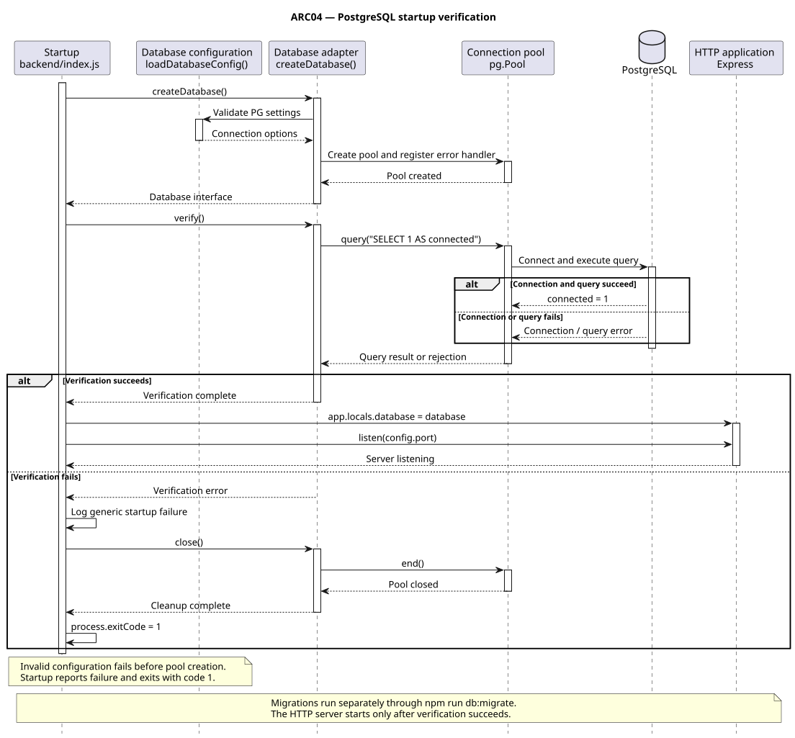

# US ARC04 – Persistence and Data Integrity

## 1. Context & Scope

- **User Story ID:** ARC04
- **Sprint:** 1
- **Area:** Architecture (ARC)
- **Responsible:** Development Team
- **Related stories:** [ARC01 — Domain Model](../../architecture/domainmodel.puml), [ARC02 — Architecture](../../architecture/SAD.md), ARC03 — REST API and ARC05 — Testing.

## 2. Requirements & Analysis

### 2.1. User Story Description

> **As a** Development Team, **we want** the business information managed by the
> back-end application to be persistently and consistently stored, **so that** the
> system preserves valid business information across its operations.

### 2.2. Acceptance Criteria 

- [ ] **AC 1:** The persistence model must support the business concepts and relationships required by the Sprint 1 implementation. 
- [ ] **AC 2:** Business identifiers and relevant uniqueness constraints must be appropriately enforced. Requires business migrations and constraint tests.
- [ ] **AC 3:** Relationships between persisted business information must preserve referential and business consistency. 
- [ ] **AC 4:** Persistence mechanisms must not allow the business invariants established by the implemented domain model to be bypassed.
- [x] **AC 5:** Persistence concerns should remain appropriately separated from core domain and business logic. 
- [x] **AC 6:** The solution must provide an appropriate mechanism for creating and evolving the persistence structures required by the application. 
- [ ] **AC 7:** The persistence solution must allow the application to be initialized in a reproducible manner. 
- [x] **AC 8:** Relevant design decisions concerning persistence, mapping, and data integrity must be documented.

### 2.3. Client Clarifications & Questions

No additional client clarification is recorded for this infrastructure increment.
PostgreSQL follows the persistence decision in the [SAD](../../architecture/SAD.md).

### 2.4. Business Rules & Invariants

Business identifiers, relationships and stock invariants will require domain validation
and database constraints in their respective modules. Transactions provide atomicity
but do not enforce these rules on their own.

### 2.5. Domain Model Excerpt

The [domain model](../../architecture/domainmodel.puml) defines the future persisted
concepts. 

## 3. Design

### 3.1. Architecture & C4 Alignment

The [C4 container view](../../architecture/containerDiagram/LaPrizza-C4-Container.svg)
places PostgreSQL behind the Back-End API. Only module infrastructure adapters should
access SQL; domain and application code remain independent of `pg` and Express.
The startup composition supplies the shared connection through `app.locals.database`
for later injection into adapters.

### 3.2. Class Diagram (CD)

No entity class diagram applies yet. The infrastructure consists of validated database
configuration, a `pg.Pool` wrapper and a migration runner; their files are listed in §5.1.

### 3.3. Sequence Diagram (SD)



The diagram shows connection
verification before HTTP startup and cleanup when verification fails.

### 3.4. REST API Specification (ARC03)

No new endpoint is introduced. `GET /api/v1/health` remains an HTTP liveness check,
returning `status`, `version` and `timestamp`. It does not continuously verify PostgreSQL;
`npm run db:check` performs an explicit connectivity check.

### 3.5. Persistence & Data Integrity (ARC04)

PostgreSQL supports the transactional business data defined in the SAD. The existing
`pg` dependency provides direct SQL access.
This keeps the foundation small, at the cost of explicit mappings and SQL maintenance.
MongoDB is deferred because no visual persistence is implemented yet.

#### Why PostgreSQL rather than MySQL?

Both PostgreSQL and MySQL can provide transactions and relational integrity;
ARC04 does not mandate one engine. PostgreSQL was selected for its fit with the SAD,
the existing `pg` driver, and the transactional SQL migration strategy.

| Aspect                | PostgreSQL                                                                                            | MySQL / impact on this project                                                                                                         |
| --------------------- | ----------------------------------------------------------------------------------------------------- | -------------------------------------------------------------------------------------------------------------------------------------- |
| Schema migrations     | Common DDL operations such as CREATE TABLE can participate in a transaction and roll back on failure. | Many DDL statements cause implicit commits; the current all-or-nothing migration runner would need redesign.                           |
| Integrity flexibility | Supports deferrable foreign keys, allowing selected checks at transaction completion.                 | InnoDB checks foreign keys immediately. Deferred checks may help future multi-step operations, but are not currently required or used. |
| Existing integration  | Matches the SAD and implemented pool, transaction and migration code.                                 | Switching requires a different driver, configuration and SQL review without a demonstrated requirement.                                |

MySQL remains a valid alternative, but offers no identified benefit that justifies changing the current
foundation. References: [PostgreSQL constraints](https://www.postgresql.org/docs/15/ddl-constraints.html),
[MySQL implicit commits](https://dev.mysql.com/doc/refman/8.4/en/implicit-commit.html)
and [MySQL foreign-key checks](https://dev.mysql.com/doc/refman/8.4/en/ansi-diff-foreign-keys.html).

### 3.6. Applied Patterns & Architecture Principles

- **Separation of concerns:** connection management is shared infrastructure; future repositories stay inside each module's `infrastructure/` layer.
- **Dependency injection:** future repository contracts belong in domain/application and receive concrete adapters at composition.
- **Unit of work:** `withTransaction()` uses one client for BEGIN, work and COMMIT; failures trigger ROLLBACK and client release. A failed rollback discards the connection.
- **Lifecycle management:** startup verifies connectivity before listening; SIGINT/SIGTERM stop HTTP and drain the pool, with a 10-second deadline.

## 4. Tests (ARC05)

### 4.1. Test Plan & Scenarios

| Level          | Scenario                                                 | Expected result                                                 |
| -------------- | -------------------------------------------------------- | --------------------------------------------------------------- |
| Unit           | Missing settings, invalid ports or unsafe production TLS | Configuration rejected without exposing credentials             |
| Unit           | Successful transaction                                   | Commit and client release                                       |
| Unit           | Work/commit failure; rollback failure                    | Rollback; discard unusable client; preserve original error      |
| Integration    | Real database connectivity and failed transaction        | SELECT 1 succeeds; temporary changes roll back                  |
| Integration    | Migration replay, edited file and invalid SQL            | Replay skipped; edit rejected; invalid migration rolled back    |
| HTTP / runtime | Health, startup and shutdown                             | Existing endpoint works; startup requires database; pool closes |

### 4.2. Sample Test Implementations

See the actual [unit tests](../../../backend/tests/unit/database.test.js) and
[database integration tests](../../../backend/tests/integration/database.test.js).
They verify infrastructure behaviour without introducing business entities.

## 5. Implementation

### 5.1. File Structure

```text
backend/
├── .env.example                       # PostgreSQL settings, empty password
├── index.js                           # Startup verification and shutdown
├── scripts/database.js                # db:check and db:migrate
├── migrations/.gitkeep                # Future versioned SQL files
├── src/shared/persistence/postgres/
│   ├── config.js                      # Validated database configuration
│   ├── index.js                       # Pool and transactions
│   └── migrate.js                     # Transactional migration runner
└── tests/
    ├── unit/database.test.js
    └── integration/database.test.js
infra/compose.yaml                     # Local PostgreSQL 15.19 service
```

`backend/package.json` provides the database commands. Repository, backend,
infrastructure and test READMEs link to this guide.

### 5.2. Core Implementation Highlights

`createDatabase()` exposes `query()`, `verify()`, `withTransaction()` and `close()`.
Use parameterized SQL for values and the supplied transaction client for every
operation inside a transaction. The default isolation is READ COMMITTED; stock
concurrency may require explicit locking. Nested transactions and retries are not provided.

## 6. Integration, Verification & Demonstration

### 6.1. Running the Automated Tests

From `backend`:

```sh
npm test -- --runInBand
npm run lint
npm run format:check
```

Real-database tests require a **dedicated database ending in `_test`**. They recreate
and remove its migration ledger. With Compose running and the default user `laprizza`,
create it from the repository root:

```sh
docker compose --env-file backend/.env -f infra/compose.yaml exec postgres createdb -U laprizza laprizza_test
cd backend
PGDATABASE=laprizza_test npm run test:db
```

Recorded verification on 14 October 2026: 7 regular backend tests and 2 PostgreSQL
integration tests passed; backend lint/formatting passed. Native PostgreSQL 15.19,
API startup/health/shutdown and failure with an unavailable database were verified.
Frontend test/build/lint and Compose configuration passed. Compose container startup
was not verified because the Docker daemon was unavailable during implementation.

### 6.2. Manual Verification & OpenAPI Contract

Prerequisites: Node.js ≥20, npm ≥10 and Docker Desktop running. From the repository root:

```sh
cp backend/.env.example backend/.env
cd backend
npm ci
cd ..
```

Set your own `PGPASSWORD` in `backend/.env`, then run:

```sh
docker compose --env-file backend/.env -f infra/compose.yaml up -d --wait
cd backend
npm run db:check
npm run db:migrate
npm run dev
```

Compose creates the database/user on first initialization and retains data in a named
volume, exposed only on localhost. Expect `PostgreSQL connectivity: OK`, initially
`Applied 0 migration(s)`, and the API listening on port 8080. Open
`http://localhost:8080/api/v1/health` and `http://localhost:8080/api-docs`.
For an existing native PostgreSQL installation, provision the user/database separately
and point the same PG settings at that server.

Connection refused usually means PostgreSQL is stopped or host/port is incorrect.
Changing `.env` does not change credentials in an existing volume: update the database
role if needed. A checksum failure requires restoring the applied file and adding a new
migration. Run npm commands inside `backend` so dotenv finds its `.env`.

### 6.3. Local Development and DEI Server

**For now, we are keeping one local PostgreSQL instance per developer**, using the same Compose
file and versioned migrations. This supports independent work and disposable tests
without one person's schema changes breaking the rest of the team. Git shares the
schema definition and code, not the running database or its volume. The existing local
setup is sufficient for this infrastructure increment; check deployment requirements
separately when planning the sprint demonstration.

The **server provided by DEI** will host the shared integration/demo environment for
merged features and demonstrations. We will keep local development and isolated test databases
even after that environment exists. Server provisioning and deployment are planned;
they have not been implemented or verified in this increment.

## 7. Observations, Dependencies & Limitations

Later MongoDB integration requires its own configuration, connection lifecycle and
visual-data adapters, injected at composition. 
