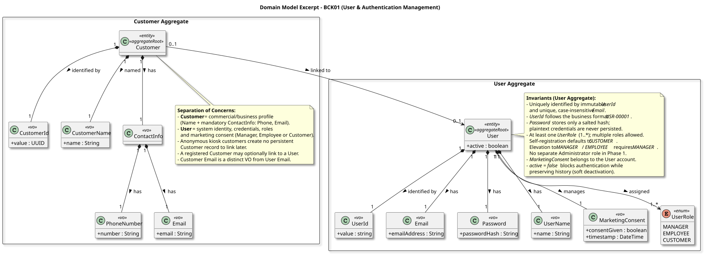
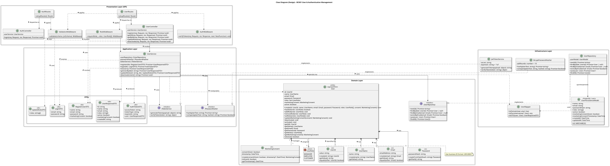
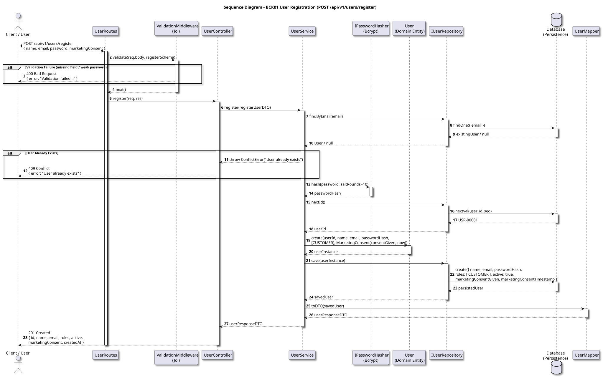
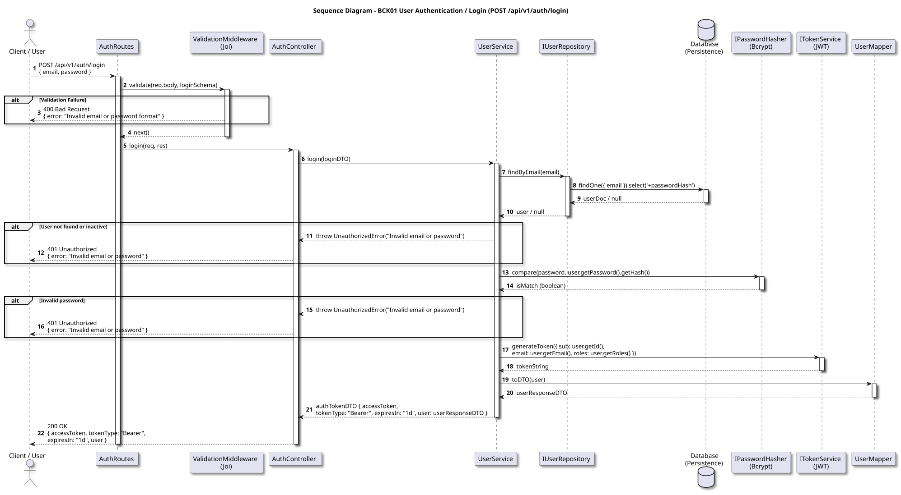
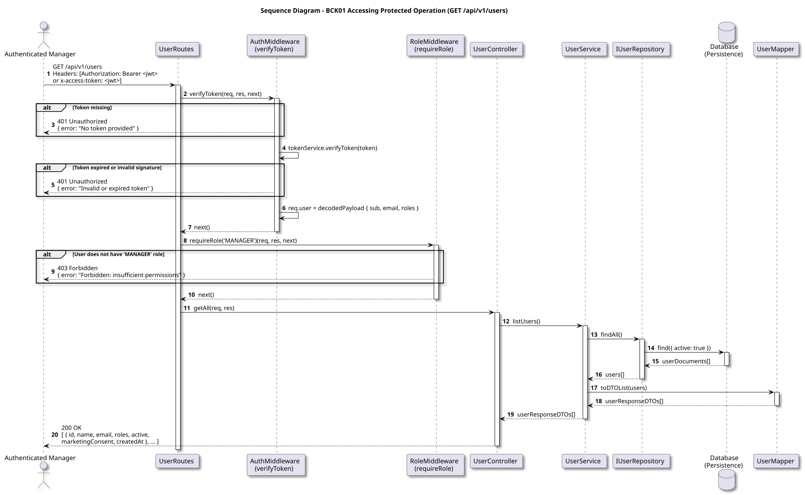

# US BCK01 – User and Authentication Management

## 1. Context & Scope

- **User Story ID:** BCK01
- **Sprint:** Sprint 1
- **Area:** Back-End (BCK)
- **Responsible:** All team members (Sofia Carvalho - 1240898, Francisco Sá - 1241341, Leonor De Moura - 1240914, Mariana Moreira - 1240905)
- **Related Requirements / Stories:**
  - System Specification: _PART II – System Specification, Section II.3.1 (Business Overview), Section II.3.2 (Web Application - Identity and Access Management), Section II.3.6 (Integration and General System Concerns - Security and Data Protection)_
  - Architectural Stories: [ARC01 (Domain Modelling)](../../architecture/domainmodel.puml), [ARC02 (System Architecture)](../../architecture/SAD.md), [ARC03 (REST API)](../../architecture/SAD.md), [ARC04 (Persistence)](../../architecture/SAD.md), [ARC05 (Automated Testing)](../../architecture/SAD.md)
  - Dependencies: _None (Foundational user story establishing authentication, identity verification, and role-based access control for all downstream protected endpoints from BCK02 to BCK11)_

---

## 2. Requirements & Analysis

### 2.1. User Story Description

> **As a** LaPrizza Manager,  
> **I want** the system to maintain users and roles and authenticate registered users,  
> **so that** access to protected operations can be associated with an identified and authorized user.

### 2.2. Acceptance Criteria

- [ ] **AC 1:** The system must support the registration and management of the users required to access protected system functionality.
- [ ] **AC 2:** Each user must have a unique identifier and appropriate authentication credentials.
- [ ] **AC 3:** The system must support the roles required to distinguish the responsibilities and permitted operations of different users.
- [ ] **AC 4:** Registered users must be able to authenticate using their credentials.
- [ ] **AC 5:** Successful authentication must establish the identity of the user for subsequent protected operations.
- [ ] **AC 6:** Invalid authentication attempts must not provide access to protected functionality.
- [ ] **AC 7:** Authentication credentials must be handled and stored using appropriate security practices.
- [ ] **AC 8:** The resulting authentication and role model must provide an appropriate foundation for the authorization requirements introduced throughout the project.

### 2.3. Client Clarifications & Questions

> **Question 1:** Are "Customer" and "User" the same record or two linked records?
>
> **Answer:** Customer and User should be considered distinct concepts, although they may be related. A Customer represents the business information associated with a customer, with Name, Phone Number, and Email as the minimum data. A User represents someone who uses the system and may correspond, for example, to a Customer, Manager, or Employee. Customers may exist without an associated User, namely in the case of an anonymous customer at a kiosk, in which case no persistent record is created that would later need to be associated with an account. In this first phase, the focus of this Sprint is the back-end/API: there is no need to implement a user application, such as a login screen, but you must implement through the API the management of Users/Roles and the authentication mechanisms required to identify users in protected operations.

> **Question 2:** Which roles should exist in the first phase? Can a user have more than one role?
>
> **Answer:** In this first phase, you should consider at least the roles **Manager**, **Customer**, and **Employee (Staff)**. A User may have **more than one role**, if necessary to represent different responsibilities in the system.

> **Question 3:** Does it make sense to have an administrator profile, with all the manager's functionalities and, in addition, the ability to manage manager permissions?
>
> **Answer:** For this phase, it is not necessary to introduce an additional Administrator profile. **User and Role management can be handled by the Manager**. The architecture can, naturally, be designed to allow the future introduction of other roles and different levels of permissions.

### 2.4. Business Rules & Invariants

- **BR 1 (User Identification):** Each User is uniquely identified by an immutable `UserId` and a valid, unique `Email`. Email comparisons are case-insensitive.
- **BR 2 (Credential Security):** Plaintext passwords must never be stored. Only a salted password hash is persisted, and credential material must not be exposed in normal queries or API responses. _(Concrete hashing algorithm and storage options are defined in Design / Persistence.)_
- **BR 3 (Role Assignment):** Every User must have at least one role from `{MANAGER, EMPLOYEE, CUSTOMER}`. A User may hold multiple roles. Public self-registration assigns `CUSTOMER` by default. Assignment or elevation to `MANAGER` or `EMPLOYEE` is restricted to a User with the `MANAGER` role. No separate Administrator role is required in this phase.
- **BR 4 (Authentication Outcome):** Successful authentication establishes the identity of the User (including roles) for subsequent protected operations. Invalid attempts (unknown email or wrong password) must not grant access and must not reveal which credential was incorrect (uniform failure).
- **BR 5 (Account Lifecycle):** Users linked to business transactions or audit records must not be hard-deleted. Soft deactivation (`active = false`) immediately blocks authentication while preserving historical consistency.
- **BR 6 (Marketing Consent):** Each User manages a `MarketingConsent` value object (`consentGiven`, `timestamp`). Consent is associated with the User account, not with the Customer commercial profile.
- **BR 7 (User vs Customer):** `User` and `Customer` are distinct concepts. A User represents system access (credentials, roles, marketing consent); a Customer represents commercial profile data with mandatory `ContactInfo` (Phone + Email). The link between them is optional (`0..1` ↔ `0..1`). Anonymous kiosk customers do not create a persistent Customer record to associate later.

### 2.5. Domain Model Excerpt

Relevant domain concepts and aggregates directly involved in this User Story:

| Concept                                           | Kind                    | Role in BCK01                                                                                     |
| ------------------------------------------------- | ----------------------- | ------------------------------------------------------------------------------------------------- |
| **User**                                          | Entity / Aggregate Root | System account: identity, credentials, roles, marketing consent, active flag                      |
| **UserId**, **Email**, **Password**, **UserName** | Value Objects           | Identify the user and encapsulate credentials / display name                                      |
| **MarketingConsent**                              | Value Object            | Consent flag + timestamp, owned by the User                                                       |
| **UserRole**                                      | Enumeration             | `MANAGER`, `EMPLOYEE`, `CUSTOMER` — at least one per User                                         |
| **Customer**                                      | External Aggregate Root | Commercial profile with mandatory ContactInfo; optionally linked to a User (not owned by this US) |

The excerpt isolates the **User Aggregate** and shows its conceptual relationship with the **Customer Aggregate**, consistent with the global domain model and client clarifications (distinct concepts; optional link; roles Manager / Employee / Customer; multi-role allowed).



> PlantUML source: [`excerptDomainModel/domain_model_excerpt.puml`](./excerptDomainModel/domain_model_excerpt.puml).

---

## 3. Design

### 3.1. Architecture & C4 Alignment

This User Story operates within the established **C4 Model** of the system ([SAD](../../architecture/SAD.md)):

- **C4 Level 1 (System Context):** Actors (Manager, Employee, Customer) interact with the _LaPrizza Information System_ via HTTPS. BCK01 realises the key scenario _Authentication, authorization, and access control by user role_.
- **C4 Level 2 (Containers):** Requests originate from the _Front-End_ (or API clients such as Swagger) and target the _Back-End API_ (Node.js / Express). User identity and credentials are persisted in the _Relational Database_ (PostgreSQL). The Front-End never validates credentials or enforces RBAC itself.
- **C4 Level 3 (Components):** Inside the Back-End, BCK01 lives in the modular boundary `user-authentication-management`, with Clean / Layered Architecture (`api` → `application` → `domain` ← `infrastructure`) plus shared cross-cutting middleware for authentication and role checks.

---

### 3.2. Class Diagram (CD)

Structural design of the classes participating in this User Story, organised by Clean / Layered Architecture (Presentation → Application → Domain ← Infrastructure):



> PlantUML source: [`classDiagram/class_diagram.puml`](./classDiagram/class_diagram.puml).

Key design points aligned with the domain model:

- Domain `User` owns `MarketingConsent` and `UserRole ∈ {MANAGER, EMPLOYEE, CUSTOMER}` (1..*).
- Application ports `IPasswordHasher` / `ITokenService` keep hashing and JWT out of the domain.
- `AuthMiddleware` + `RoleMiddleware` establish identity and enforce role checks on protected routes.

---

### 3.3. Sequence Diagrams (SD)

Three scenarios are documented separately because they cover distinct acceptance criteria and interaction paths (registration, authentication, and authorised access). Merging them into a single diagram would reduce readability without adding value.

#### SD 1 — User Registration (AC 1, AC 2, AC 3, AC 7)



> Source: [`sequence_diagram_register.puml`](./sequenceDiagram/sequence_diagram_register.puml)

#### SD 2 — Authentication / Login (AC 4, AC 5, AC 6, AC 7)



> Source: [`sequence_diagram_login.puml`](./sequenceDiagram/sequence_diagram_login.puml)

#### SD 3 — Protected Operation (AC 5, AC 6, AC 8)

Example: Manager lists users (`GET /api/v1/users`), showing token verification and `requireRole('MANAGER')`.



> Source: [`sequence_diagram_protected.puml`](./sequenceDiagram/sequence_diagram_protected.puml)

### 3.4. REST API Specification (ARC03)

All endpoints are versioned under `/api/v1` and documented via OpenAPI/Swagger. Authentication for protected routes uses a Bearer JWT in the `Authorization` header (or `x-access-token`).

| Method   | Endpoint                  | Description                                                  | Auth / Role |
| :------- | :------------------------ | :----------------------------------------------------------- | :---------- |
| `POST`   | `/api/v1/users/register`  | Public self-registration; assigns role `CUSTOMER` by default | Public      |
| `POST`   | `/api/v1/auth/login`      | Authenticates credentials and returns a JWT + user profile   | Public      |
| `GET`    | `/api/v1/users`           | Lists registered users                                       | Manager     |
| `GET`    | `/api/v1/users/:id`       | Gets a user by id                                            | Manager     |
| `PATCH`  | `/api/v1/users/:id/roles` | Updates the set of roles assigned to a user                  | Manager     |
| `DELETE` | `/api/v1/users/:id`       | Soft-deactivates a user (`active = false`)                   | Manager     |

#### Request & Response Schemas

- **Register — Request (`POST /api/v1/users/register`):**

  ```json
  {
    "name": "Ana Silva",
    "email": "ana.silva@example.com",
    "password": "Str0ngP@ss!",
    "marketingConsent": true
  }
  ```

- **Register — Success (`201 Created`):**

  ```json
  {
    "id": "USR-00001",
    "name": "Ana Silva",
    "email": "ana.silva@example.com",
    "roles": ["CUSTOMER"],
    "active": true,
    "marketingConsent": true,
    "createdAt": "2026-10-14T15:00:00.000Z"
  }
  ```

- **Login — Request (`POST /api/v1/auth/login`):**

  ```json
  {
    "email": "ana.silva@example.com",
    "password": "Str0ngP@ss!"
  }
  ```

- **Login — Success (`200 OK`):**

  ```json
  {
    "accessToken": "eyJhbGciOiJIUzI1NiIsInR5cCI6IkpXVCJ9...",
    "tokenType": "Bearer",
    "expiresIn": "1d",
    "user": {
      "id": "USR-00001",
      "name": "Ana Silva",
      "email": "ana.silva@example.com",
      "roles": ["CUSTOMER"],
      "active": true,
      "marketingConsent": true,
      "createdAt": "2026-10-14T15:00:00.000Z"
    }
  }
  ```

- **Update roles — Request (`PATCH /api/v1/users/:id/roles`):**

  ```json
  {
    "roles": ["CUSTOMER", "EMPLOYEE"]
  }
  ```

- **Error Responses:**
  - `400 Bad Request`: Input validation failed (missing field, invalid email, weak password, empty roles).
  - `401 Unauthorized`: Missing/invalid token, or login failure with uniform message `Invalid email or password`.
  - `403 Forbidden`: Authenticated user lacks the required role (e.g. non-Manager calling user management).
  - `404 Not Found`: User id not found.
  - `409 Conflict`: Email already registered.
  - Standard error format:
    ```json
    {
      "error": {
        "message": "Descriptive error message",
        "status": 400
      }
    }
    ```

JWT payload (design decision for AC 5 / AC 8): `{ "sub": "<userId>", "email": "<email>", "roles": ["MANAGER"|"EMPLOYEE"|"CUSTOMER", ...] }`, signed with `JWT_SECRET`, default expiry `1d`.

### 3.5. Persistence & Data Integrity (ARC04)

Per the persistence ADR in the [SAD](../../architecture/SAD.md), users are stored in **PostgreSQL** (relational / transactional data).

- **Table:** `users`
- **Fields & Constraints:**

| Column                        | Type          | Constraints / Notes                                                                            |
| :---------------------------- | :------------ | :--------------------------------------------------------------------------------------------- |
| `id`                          | VARCHAR(32)   | Primary key; immutable business identifier matching `^USR-[0-9]{5,}$`; maps to domain `UserId` |
| `name`                        | VARCHAR       | NOT NULL; maps to `UserName`                                                                   |
| `email`                       | VARCHAR       | NOT NULL, UNIQUE; stored normalised (lowercase) for case-insensitive uniqueness                |
| `password_hash`               | VARCHAR       | NOT NULL; bcrypt hash (work factor ≥ 10); never returned in API responses                      |
| `roles`                       | TEXT[] / JSON | NOT NULL; non-empty subset of `{MANAGER, EMPLOYEE, CUSTOMER}`                                  |
| `active`                      | BOOLEAN       | NOT NULL, DEFAULT TRUE; soft deactivation flag                                                 |
| `marketing_consent_given`     | BOOLEAN       | NOT NULL, DEFAULT FALSE                                                                        |
| `marketing_consent_timestamp` | TIMESTAMPTZ   | NOT NULL; set when consent value is recorded/updated                                           |
| `created_at`                  | TIMESTAMPTZ   | NOT NULL, DEFAULT now()                                                                        |
| `updated_at`                  | TIMESTAMPTZ   | NOT NULL, DEFAULT now()                                                                        |

- **Integrity Rules:**
  - Unique index on `email` enforces BR 1 under concurrent registration attempts.
  - Application/domain enforce at least one role; DB check constraint may additionally reject empty `roles`.
  - Users are **not hard-deleted** when referenced by business/audit data; `DELETE` API sets `active = false` (BR 5).
  - `password_hash` is excluded from default read projections / DTOs (BR 2).
  - The BCK02 `customers.user_id` foreign key stores the same `USR-...` business identifier as `users.id`, uses VARCHAR(32), and remains ON DELETE RESTRICT; BCK02 retains ownership of the Customer aggregate.
  - `user_id_seq` generates unique sequential business identifiers. The sequence is infrastructure-only; the domain and API expose strings such as `USR-00001`.
  - Migration `0014_user_business_ids.sql` converts existing UUID user IDs and preserves BCK02 Customer links using the new business IDs. Existing JWTs whose `sub` contains a UUID must be replaced by logging in again.

### 3.6. Applied Patterns & Architecture Principles

- **Clean / Layered Architecture:** Domain has zero framework dependencies. Presentation (Express routes/controllers/middleware) depends on Application; Application coordinates Domain and Infrastructure adapters.
- **Aggregate Root (DDD):** All state changes (role updates, deactivation, marketing consent) pass through the `User` aggregate root.
- **Value Objects:** `UserId`, `Email`, `Password`, `UserName`, and `MarketingConsent` encapsulate validation and immutability (aligned with the [domain model](../../architecture/domainmodel.puml)).
- **Repository Pattern:** `IUserRepository` decouples application/domain from PostgreSQL access; `UserRepository` + `UserMapper` live in Infrastructure.
- **DTO Pattern:** `RegisterUserDTO`, `LoginDTO`, `UpdateRolesDTO`, `UserResponseDTO`, and `AuthTokenDTO` isolate the HTTP contract from the domain model (password hashes never leak into responses).
- **Ports & Adapters (security):** `IPasswordHasher` (bcrypt) and `ITokenService` (JWT) are application ports implemented in Infrastructure, keeping crypto/token details out of the domain.
- **Middleware pipeline (RBAC foundation):** `ValidationMiddleware` → `AuthMiddleware` (identity) → `RoleMiddleware` (authorisation) provides the reusable foundation required by AC 8 for all later protected endpoints (BCK02–BCK11).

---

### 3.7 Implementation alignment notes

`User` exposes the specified factories, getters, role operations, consent update, activation and deactivation. `Password` stores only a private bcrypt hash, constructed through `createFromHash()` and accessed explicitly with `getHash()`. Domain methods are the entry point for account mutations before persistence.

The repository implements `findById(UserId)`,`findByEmail(Email)`, `existsByEmail(Email)`, `save(User)` and `findAll()`. It returns complete User aggregates.
New aggregates are inserted; loaded aggregates are saved using only their changed mutable fields, preserving independent concurrent updates. `findAll()` follows the protected-operation SD and lists active users. Credentials remain private in the aggregate and are excluded by the explicit response mapper; repository objects are never returned directly by controllers.

The agreed implementation qualifications are:

1. `UserPersistenceModel` is represented by typed `pg` rows. The implemented role storage uses constrained `TEXT[]`.
2. Infrastructure `UserMapper` handles `toDomain` and `toPersistence`. Application `UserResponseMapper` handles `toDTO` / `toDTOList`, so UserService does not import infrastructure.
3. JWTs contain the specified `sub`, `email` and `roles`, plus verified issuer/audience and timing claims. After verification, `UserService.resolveActor()` reloads the User so `req.user` uses current roles and active state. This security extension prevents stale token permissions and denies access after deactivation. Already-authorized requests are not retroactively cancelled. Both documented token headers are accepted onflicting headers are rejected.

Reusable middleware classes live under shared HTTP infrastructure and are injected at
module composition. The controller
constructs input DTOs after Joi validation; application mapping and login construct
response DTOs with the existing API fields. Ports use structural JSDoc contracts. The application retains an injectable factory for tests and validates runtime
security configuration before production startup.

Password policy is at least 8 JavaScript string code units and at most 72 UTF-8 bytes, without null characters; passwords are never trimmed. Login accepts nonempty passwords within the byte limit and performs dummy verification for unknown accounts. Public registration rejects privilege-bearing/unknown fields. Signup and login share a 30-attempt, 15-minute per-IP in-memory limiter. Unexpected failures use sanitized errors and user responses use `Cache-Control: no-store`.

JWT_EXPIRES_IN defaults to `1d` and accepts s/m/h/d durations up to one day. HTTPS and appropriate trusted-proxy/shared-limiter configuration are deployment responsibilities.

---

## 4. Tests (ARC05)

### 4.1. Test Plan & Scenarios

The following IDs identify scenarios in this document; executable Jest tests are identified by their descriptive names. Parameterized scenarios produce several test cases, so the number of rows below is not the total number of executed tests.

| Test ID | Level / Source                         | Scenario / Description                                                                        | Expected Result                                                                                      |
| ------- | -------------------------------------- | --------------------------------------------------------------------------------------------- | ---------------------------------------------------------------------------------------------------- |
| UT01    | Domain — `domain.test.js`              | Create a User through the specified factories and getters                                     | Valid immutable identity, normalized email, CUSTOMER role and private credential                     |
| UT02    | Domain — `domain.test.js`              | Blank/null/oversized names, malformed email, UUID or malformed `USR-` identifier              | Domain validation error                                                                              |
| UT03    | Domain — `domain.test.js`              | Empty/unsupported roles; add/remove roles; attempt to remove the last role                    | Valid multi-role sets succeed; invalid changes fail without corrupting state                         |
| UT04    | Domain — `domain.test.js`              | Activate/deactivate account, update consent and mutate returned dates                         | Identity is preserved, repeated deactivation is harmless and internal timestamps remain protected    |
| UT05    | Domain — `domain.test.js`              | Restore stored account, including missing identity or invalid state                           | Valid records retain stored identity/dates; incomplete or invalid records fail                       |
| UT06    | Application — `services.test.js`       | Register using normalized values and attempted privileged fields                              | Only CUSTOMER is assigned; aggregate is saved and UserResponseDTO excludes credentials               |
| UT07    | Application — `services.test.js`       | Duplicate email and invalid password boundaries, including multibyte input                    | Conflict or validation error; no account is saved                                                    |
| UT08    | Application — `services.test.js`       | Valid login; unknown account, wrong password or inactive account                              | AuthTokenDTO on success; uniform 401 failure and no token otherwise                                  |
| UT09    | Application — `services.test.js`       | Resolve current user state and enforce Manager access                                         | Current roles are used; absent/inactive users fail authentication and non-Managers are denied        |
| UT10    | Application — `services.test.js`       | Role change/deactivation and missing target                                                   | Changes pass through User before save; missing target produces 404                                   |
| UT11    | Security adapter — `security.test.js`  | Hash the same password twice and verify correct/incorrect passwords                           | Independent salted hashes; only the correct password verifies; oversized input is rejected           |
| UT12    | Security adapter — `security.test.js`  | Tampered, expired, unsigned, wrong-context or unsupported-algorithm JWT; unsafe configuration | Invalid tokens/configuration are rejected                                                            |
| UT13    | Bootstrap — `bootstrap.test.js`        | Initial Manager creation, missing credentials or existing active Manager                      | Explicit validated credentials and transaction are required; existing Manager prevents bootstrap     |
| UT14    | Controller — `controller.test.js`      | Map request data into RegisterUserDTO, LoginDTO and UpdateRolesDTO                            | Correct DTO instances, no extra copied fields and no shared mutable roles array                      |
| UT15    | OpenAPI — `openapi.test.js`            | Check operation/security contracts and safe output schemas                                    | Six operations documented, password write-only and no hash in response schema                        |
| IT01    | HTTP — `api.test.js`                   | Register, log in, list and retrieve users                                                     | 201 registration; 200 login; Manager access succeeds; Customer listing is 403                        |
| IT02    | HTTP — `api.test.js`                   | Malformed JSON, invalid fields or attempted mass assignment                                   | 400 without echoing credentials                                                                      |
| IT03    | HTTP — `api.test.js`                   | Duplicate mixed-case email; wrong password, unknown email or inactive account                 | Duplicate produces 409; authentication failures have the same 401 response body                      |
| IT04    | HTTP — `api.test.js`                   | Promote/remove roles and deactivate after token issuance                                      | Existing token observes current roles; deactivated account receives 401; repeated DELETE returns 204 |
| IT05    | HTTP — `api.test.js`                   | Missing/expired/forged tokens and alternative/conflicting token headers                       | Invalid tokens produce 401; documented alternative works; conflicting headers are rejected           |
| IT06    | HTTP — `api.test.js`                   | Invalid role set/identifier, absent target and unauthorized management                        | 400, 404, 401 or 403 according to validation, existence and permissions                              |
| IT07    | HTTP — `api.test.js`                   | Repository failure and repeated public authentication attempts                                | Sanitized 500 and fail-closed access; limiter returns 429 at the configured boundary                 |
| IT08    | PostgreSQL — `postgres.test.js`        | Upgrade existing UUID user rows and Customer links; replay migrations                         | Existing records map to `USR-...`, BCK02 links remain valid, and replay applies no migration again   |
| IT09    | PostgreSQL — `postgres.test.js`        | Aggregate round-trip and repository queries                                                   | Complete Users restored; existsByEmail works; mapped responses exclude credentials                   |
| IT10    | PostgreSQL — `postgres.test.js`        | Concurrent normalized duplicate email inserts                                                 | Exactly one save succeeds; the other receives a 409 conflict                                         |
| IT11    | PostgreSQL — `postgres.test.js`        | Direct SQL with invalid roles, email, name, hash or consent timestamp                         | PostgreSQL constraints reject invalid writes                                                         |
| IT12    | PostgreSQL — `postgres.test.js`        | Save role/consent/active-state changes, repeat deactivation and save a stale aggregate        | Valid changes persist, rows remain and a role update cannot undo independent deactivation            |
| IT13    | PostgreSQL — `postgres.test.js`        | Concurrent Manager bootstrap commands                                                         | Exactly one bootstrap succeeds while the other detects an existing active Manager                    |
| IT14    | PostgreSQL + HTTP — `postgres.test.js` | Register/login/manage/deactivate through Express with real persistence                        | Full flow succeeds and existing token is denied after deactivation                                   |
| IT15    | PostgreSQL suite — `postgres.test.js`  | Inspect bootstrap content of migration                                                        | Migration does not seed user credentials                                                             |

Acceptance-criteria traceability:

| AC  | Main scenarios                                                      |
| --- | ------------------------------------------------------------------- |
| AC1 | UT06, UT10, IT01, IT04, IT14                                        |
| AC2 | UT01, UT02, UT05, IT08–IT11                                         |
| AC3 | UT03, UT06, UT09, IT02, IT04, IT06                                  |
| AC4 | UT08, UT11, IT01, IT14                                              |
| AC5 | UT08, UT09, IT01, IT04, IT14                                        |
| AC6 | UT08, UT09, UT12, IT03–IT07                                         |
| AC7 | UT01, UT06–UT08, UT11–UT15, IT02, IT03, IT05 IT07, IT09, IT11, IT15 |
| AC8 | UT03, UT09, UT10, IT01, IT04–IT06, IT12, IT14                       |

The HTTP suite uses real bcrypt/JWT adapters with an in-memory repository. It does not prove SQL persistence. The PostgreSQL suite separately verifies real constraints, concurrency, mapping and the complete HTTP flow. Existing health/database-infrastructure suites remain part of the backend regression suite.

### 4.2. Sample Test Implementations

#### 4.2.1. Email validation

UT02; AC2. Parameterized domain validation rejects empty, malformed and null emails.

```javascript
test.each(["", "bad", null])("rejects invalid email %p", (email) => {
  expect(() => Email.create(email)).toThrow();
});
```

#### 4.2.2. Role cardinality and aggregate integrity

UT03; AC3. Demonstrates multiple roles, defensive copies and rejection of removal of the last role.

```javascript
test("add/remove/set roles preserve cardinality without leaking mutable state", () => {
  const user = createUser(input());
  user.addRole("MANAGER");
  user.addRole("MANAGER");
  expect(user.getRoles()).toEqual(["CUSTOMER", "MANAGER"]);
  user.getRoles().pop();
  expect(user.hasRole("MANAGER")).toBe(true);
  user.removeRole("CUSTOMER");
  expect(user.getRoles()).toEqual(["MANAGER"]);
  expect(() => user.removeRole("MANAGER")).toThrow();
  expect(() => user.addRole("ADMIN")).toThrow();
  expect(() => user.setRoles([])).toThrow();
  expect(user.getRoles()).toEqual(["MANAGER"]);
});
```

#### 4.2.3. Registration with CUSTOMER-only privileges and a safe response

UT06; AC1, AC2, AC3, AC7. The application ignores attempted privileged fields and returns an explicit UserResponseDTO. At the HTTP boundary Joi rejects those extra fields before the controller.

```javascript
test("registration creates CUSTOMER through domain values and save(User)", async () => {
  const { service, repository, hasher } = setup();
  const result = await service.register({
    name: "Ana",
    email: " ANA@example.com ",
    password: "long-password",
    roles: ["MANAGER"],
    active: false,
  });
  expect(result).toBeInstanceOf(UserResponseDTO);
  expect(result).toMatchObject({
    email: "ana@example.com",
    roles: ["CUSTOMER"],
    active: true,
  });
  expect(repository.findByEmail).toHaveBeenCalledWith(
    Email.create("ana@example.com"),
  );
  expect(hasher.hash).toHaveBeenCalledWith("long-password");
  const saved = repository.save.mock.calls[0][0];
  expect(saved).toBeInstanceOf(User);
  expect(saved.getPassword().getHash()).toBe(hash);
  expect(JSON.stringify(result)).not.toMatch(/password|hash/i);
});
```

#### 4.2.4. Duplicate email prevents persistence

UT07; AC2. The service reports 409 and does not hash or save another account. The setup() helper supplies a repository fake and a sample User.

```javascript
test("duplicate email prevents hashing and persistence", async () => {
  const { service, repository, user, hasher } = setup();
  repository.findByEmail.mockResolvedValue(user);
  await expect(
    service.register({
      name: "Ana",
      email: "ana@example.com",
      password: "long-password",
    }),
  ).rejects.toMatchObject({ status: 409 });
  expect(hasher.hash).not.toHaveBeenCalled();
  expect(repository.save).not.toHaveBeenCalled();
});
```

#### 4.2.5. Successful login issues AuthTokenDTO

UT08; AC4, AC5, AC7. Checks the signed identity/role payload, nested response DTO and absence of credential fields. The token service is mocked here; real cryptographic checks are in security.test.js.

```javascript
test("login signs the diagram payload and projects a safe response", async () => {
  const { service, repository, user, tokens } = setup();
  repository.findByEmail.mockResolvedValue(user);
  const result = await service.login({
    email: "ANA@example.com",
    password: "long-password",
  });
  expect(result).toBeInstanceOf(AuthTokenDTO);
  expect(result.user).toBeInstanceOf(UserResponseDTO);
  expect(tokens.generateToken).toHaveBeenCalledWith({
    sub: user.getId().getValue(),
    email: "ana@example.com",
    roles: ["CUSTOMER"],
  });
  expect(result).toMatchObject({
    accessToken: "signed-token",
    tokenType: "Bearer",
    expiresIn: "1d",
  });
  expect(JSON.stringify(result)).not.toMatch(/password|hash/i);
});
```

#### 4.2.6. Uniform credential failures at the HTTP boundary

IT03; AC2, AC6. The suite creates the customer through register() and supplies the Manager token. It compares wrong-password, unknown-email and inactive-account responses, and also checks mixed-case duplicate registration.

```javascript
test("normalizes duplicate email and returns uniform credential failures", async () => {
  await register();
  expect(
    (
      await request(app)
        .post("/api/v1/users/register")
        .send({ name: "Other", email: email.toUpperCase(), password })
    ).status,
  ).toBe(409);
  const failures = [];
  for (const body of [
    { email: "unknown@example.com", password },
    { email, password: "wrong" },
  ])
    failures.push(await request(app).post("/api/v1/auth/login").send(body));
  await request(app)
    .delete(`/api/v1/users/${customerId}`)
    .set(auth(managerToken));
  failures.push(
    await request(app).post("/api/v1/auth/login").send({ email, password }),
  );
  for (const result of failures)
    expect(result.body).toEqual({
      error: { message: "Invalid email or password", status: 401 },
    });
});
```

#### 4.2.7. Salted password hashing and verification

UT11; AC7. Uses the real bcrypt adapter: identical inputs produce different hashes, correct passwords verify, wrong ones fail and oversized UTF-8 input is rejected.

```javascript
test("salts passwords independently and verifies the original only", async () => {
  const hasher = new BcryptPasswordHasher();
  const first = await hasher.hash("long-password");
  const second = await hasher.hash("long-password");
  expect(first).not.toBe(second);
  expect(first).not.toContain("long-password");
  expect(await hasher.compare("long-password", first)).toBe(true);
  expect(await hasher.compare("wrong-password", first)).toBe(false);
  await expect(hasher.hash("é".repeat(37))).rejects.toThrow();
});
```

#### 4.2.8. Protected operation: Customer denied, Manager allowed

IT01; AC1, AC4, AC5, AC8. Exercises registration and login before comparing 403 for a Customer with 200 for the Manager, including safe user listing and lookup.

```javascript
test("registers, logs in and protects user queries", async () => {
  const registered = await register();
  expect(registered.status).toBe(201);
  expect(registered.headers.location).toBe(`/api/v1/users/${customerId}`);
  expect(registered.body).toMatchObject({
    roles: ["CUSTOMER"],
    active: true,
    marketingConsent: true,
  });
  expect(JSON.stringify(registered.body)).not.toMatch(/password|hash/i);
  const loggedIn = await login();
  expect(loggedIn.status).toBe(200);
  expect(loggedIn.body).toMatchObject({
    tokenType: "Bearer",
    expiresIn: "1d",
  });
  expect(
    (await request(app).get("/api/v1/users").set(auth(customerToken))).status,
  ).toBe(403);
  const listed = await request(app)
    .get("/api/v1/users")
    .set(auth(managerToken));
  expect(listed.status).toBe(200);
  expect(listed.body).toHaveLength(2);
  expect(JSON.stringify(listed.body)).not.toMatch(/password|hash/i);
  expect(
    (
      await request(app)
        .get(`/api/v1/users/${customerId}`)
        .set(auth(managerToken))
    ).body.id,
  ).toBe(customerId);
});
```

#### 4.2.9. Current roles and deactivation invalidate access

IT04; AC1, AC6, AC8. Reuses the same customer token after promotion/removal, then verifies 401 after deactivation. Repeated DELETE is idempotent and the account row remains in the test repository.

```javascript
test("uses current roles and rejects an existing token after deactivation", async () => {
  await register();
  await login();
  const changed = await request(app)
    .patch(`/api/v1/users/${customerId}/roles`)
    .set(auth(managerToken))
    .send({ roles: ["CUSTOMER", "MANAGER"] });
  expect(changed.status).toBe(200);
  expect(
    (await request(app).get("/api/v1/users").set(auth(customerToken))).status,
  ).toBe(200);
  await request(app)
    .patch(`/api/v1/users/${customerId}/roles`)
    .set(auth(managerToken))
    .send({ roles: ["CUSTOMER"] });
  expect(
    (await request(app).get("/api/v1/users").set(auth(customerToken))).status,
  ).toBe(403);
  expect(
    (
      await request(app)
        .delete(`/api/v1/users/${customerId}`)
        .set(auth(managerToken))
    ).status,
  ).toBe(204);
  expect(
    (
      await request(app)
        .delete(`/api/v1/users/${customerId}`)
        .set(auth(managerToken))
    ).status,
  ).toBe(204);
  expect(
    (await request(app).get("/api/v1/users").set(auth(customerToken))).status,
  ).toBe(401);
  expect(repository.users.has(customerId)).toBe(true);
});
```

#### 4.2.10. Concurrent duplicate registration in PostgreSQL

IT10; AC2, ARC04. This requires the opt-in PostgreSQL suite and its migrated isolated schema. user() constructs a domain aggregate; exactly one concurrent save succeeds and the other returns 409.

```javascript
test("enforces normalized unique emails during concurrent inserts", async () => {
  const attempts = await Promise.allSettled([
    repository.save(user("RACE@example.com")),
    repository.save(user("race@example.com")),
  ]);
  expect(attempts.filter((a) => a.status === "fulfilled")).toHaveLength(1);
  expect(attempts.find((a) => a.status === "rejected").reason).toMatchObject({
    status: 409,
  });
});
```

---

## 5. Implementation

### 5.1. File Structure

Relevant BCK01 files follow the existing domain-first modular structure, rather than
the global layer folders shown as placeholders in the user-story template:

```text
backend/
├── index.js                         # Validates config, composes module, starts HTTP
├── package.json / package-lock.json # Dependencies and verification/bootstrap scripts
├── .env.example                     # Configuration template, no real secrets
├── migrations/0001_users.sql          # Original schema migration
├── migrations/0014_user_business_ids.sql # Converts User IDs and BCK02 links to business IDs
├── scripts/bootstrap-manager.js
├── src/
│   ├── app.js                       # Injectable Express application factory
│   ├── modules/
│   │   ├── index.js                 # Module registration
│   │   └── user-authentication-management/
│   │       ├── index.js             # Composition of services, adapters and routes
│   │       ├── api/
│   │       │   ├── controllers/
│   │       │   │   ├── authController.js
│   │       │   │   └── userController.js
│   │       │   ├── middlewares/
│   │       │   │   ├── authMiddleware.js
│   │       │   │   └── roleMiddleware.js
│   │       │   ├── routes/
│   │       │   │   ├── authRoutes.js
│   │       │   │   ├── userRoutes.js
│   │       │   │   └── publicRateLimiter.js
│   │       │   ├── schemas.js
│   │       │   └── openapi.js
│   │       ├── application/
│   │       │   ├── dtos/
│   │       │   │   ├── RegisterUserDTO.js
│   │       │   │   ├── LoginDTO.js
│   │       │   │   ├── UpdateRolesDTO.js
│   │       │   │   ├── UserResponseDTO.js
│   │       │   │   └── AuthTokenDTO.js
│   │       │   ├── mapping/UserResponseMapper.js
│   │       │   ├── ports/security.js
│   │       │   └── services/
│   │       │       ├── UserService.js
│   │       │       └── passwordPolicy.js
│   │       ├── domain/
│   │       │   ├── model/User.js
│   │       │   ├── model/values.js
│   │       │   └── repositories/IUserRepository.js
│   │       └── infrastructure/
│   │           ├── bootstrapManager.js
│   │           ├── persistence/
│   │           │   ├── UserRepository.js
│   │           │   ├── UserMapper.js
│   │           │   └── UserPersistenceModel.js
│   │           └── security/
│   │               ├── BcryptPasswordHasher.js
│   │               └── JwtTokenService.js
│   └── shared/
│       ├── errors/AppError.js
│       ├── errors/errorHandler.js
│       ├── openapi/spec.js
│       ├── security/config.js
│       └── validation/ValidationMiddleware.js
└── tests/
    ├── helpers/
    │   ├── createUser.js
    │   ├── MemoryUserRepository.js
    │   └── isolatedDatabase.js
    ├── unit/user-authentication-management/
    │   ├── domain.test.js
    │   ├── services.test.js
    │   ├── security.test.js
    │   ├── bootstrap.test.js
    │   ├── controller.test.js
    │   └── openapi.test.js
    └── integration/user-authentication-management/
        ├── api.test.js
        └── postgres.test.js
```

### 5.2. Core Implementation Highlights

- **Aggregate invariants:** [User](../../../backend/src/modules/user-authentication-management/domain/model/User.js)
  exposes role, consent and active-state changes. `setRoles()` validates a nonempty set;
  removing the last role fails. Rehydration preserves stored identity and timestamps.
- **Explicit DTO boundaries:** the controller constructs input DTOs after Joi validation;
  [UserResponseMapper](../../../backend/src/modules/user-authentication-management/application/mapping/UserResponseMapper.js) creates UserResponseDTO, and login creates AuthTokenDTO. Both output classes allowlist public fields; Password stores its hash privately and is not serialized into responses.
- **Authentication and authorization:** [UserService](../../../backend/src/modules/user-authentication-management/application/services/UserService.js) verifies passwords through the injected hasher and issues tokens through ITokenService Unknown/wrong/inactive credentials share one error. AuthMiddleware resolves current account state and RoleMiddleware enforces the required role before the controller.
- **SQL isolation and integrity:** [UserRepository](../../../backend/src/modules/user-authentication-management/infrastructure/persistence/UserRepository.js)
  accepts domain IDs/emails, parameterizes query values and maps rows through UserMapper.
  The named email uniqueness violation becomes 409, including concurrent inserts.
  Loaded aggregate snapshots limit updates to changed mutable fields; deactivation never
  hard-deletes a row and repeated deactivation does not rewrite its timestamp.
- **Transactional bootstrap:** [bootstrapManager](../../../backend/src/modules/user-authentication-management/infrastructure/bootstrapManager.js)
  uses the existing transaction helper and an advisory lock. It checks for an active
  Manager, hashes explicit credentials and saves the initial account atomically.
- **Safe error handling:** the shared handler preserves the standard error envelope,
  sanitizes unexpected 500 errors and malformed JSON, while protected operations fail
  closed if identity lookup fails. Public signup/login are rate limited.

---

## 6. Integration, Verification & Demonstration

### 6.1. Running the Automated Tests

From the repository root, install backend dependencies if needed, then run:

```sh
cd backend
npm ci
npm test -- --runInBand
npm run lint
npm run format:check
```

To run only the BCK01 suites without enabling real database access:

```sh
npm test -- --runInBand tests/unit/user-authentication-management tests/integration/user-authentication-management/api.test.js
```

Real PostgreSQL verification requires an available server and a **dedicated database
whose name ends in `_test`**, with the PG settings pointing to that instance. For example,
after creating a dedicated `laprizza_test` database on the configured server:

```sh
PGDATABASE=laprizza_test npm run test:db
```

The command runs infrastructure and BCK01 PostgreSQL suites. Database tests create
random isolated schemas and their own migration ledgers, then remove those schemas;
they do not drop public application tables or the public migration ledger. The test
user must be allowed to create/drop schemas in the dedicated database. Regular tests
skip these suites unless RUN_DATABASE_TESTS is enabled. CI enables them with a dedicated
PostgreSQL service.

### 6.2. Manual Verification & OpenAPI Contract

1. Configure `backend/.env` with PostgreSQL settings and a random JWT_SECRET of at least 32 bytes. Start PostgreSQL; if using the project's Docker configuration, run from the repository root:

   ```sh
   docker compose --env-file backend/.env -f infra/compose.yaml up -d --wait
   ```

2. Apply migrations and start the API from `backend/`:

   ```sh
   npm run db:check
   npm run db:migrate
   npm run dev
   ```

3. If no active Manager exists, supply the three BOOTSTRAP_MANAGER environment values locally and run `npm run users:bootstrap` in another terminal from `backend/`. Remove those temporary credentials after successful creation. No default password or bootstrap HTTP endpoint exists.
4. Open [Swagger UI](http://localhost:8080/api-docs/) and confirm all six BCK01 operations, schemas, response codes and token security options appear. The source contract is composed from module `api/openapi.js` into shared `openapi/spec.js`.
5. Execute the following checklist in Swagger or Postman. All paths use the prefix
   `http://localhost:8080/api/v1`. Use a disposable customer for mutation tests and retain
   the Manager account. Body-bearing requests use `Content-Type: application/json`.

| Manual ID | Request / setup                                                                                                               | Expected result                                                                              |
| --------- | ----------------------------------------------------------------------------------------------------------------------------- | -------------------------------------------------------------------------------------------- |
| MV01      | POST `/users/register` with a new name/email/password and optional consent                                                    | 201, Location header, CUSTOMER-only User response and no credentials                         |
| MV02      | Repeat registration with the same email, including uppercase variation                                                        | 409                                                                                          |
| MV03      | Register with invalid email, short password, empty name or an extra roles field                                               | 400                                                                                          |
| MV04      | POST `/auth/login` with the registered customer's correct credentials                                                         | 200 with accessToken, Bearer token type, expiry and safe user data                           |
| MV05      | Compare wrong password for that account with a valid-format unregistered email                                                | Both return 401 and exactly `{"error":{"message":"Invalid email or password","status":401}}` |
| MV06      | GET `/users` without a token, then with a modified token                                                                      | 401 in both cases                                                                            |
| MV07      | GET `/users` with a valid CUSTOMER-only token                                                                                 | 403                                                                                          |
| MV08      | Log in as Manager; GET `/users` and GET `/users/{customerId}` with its token                                                  | 200; list includes active accounts only                                                      |
| MV09      | PATCH `/users/{customerId}/roles` as Manager with `{"roles":["CUSTOMER","EMPLOYEE"]}`; repeat with empty or unsupported roles | 200 for valid roles; 400 for invalid sets                                                    |
| MV10      | Promote the disposable customer to MANAGER, reuse its existing token for GET `/users`, then remove MANAGER and repeat         | 200 after promotion, 403 after removal; login again is not needed for the role lookup        |
| MV11      | DELETE `/users/{customerId}` as the retained Manager, then repeat DELETE                                                      | 204 without a body both times; account is soft-deactivated                                   |
| MV12      | Retry login and a protected request with the deactivated customer's old token                                                 | 401 in both cases; Manager lookup by ID still returns the inactive account                   |
| MV13      | GET `/users/{id}` as Manager with a malformed identifier, then an absent valid `USR-` identifier                              | 400 and 404 respectively                                                                     |

In Postman, select Authorization → Bearer Token and paste only the accessToken value.
In Swagger, use Authorize with the documented security scheme. Do not include passwords
or tokens in screenshots, shared collections or committed verification output.

---

## 7. Observations, Dependencies & Limitations

### Dependencies

- Runtime: Node.js, npm, PostgreSQL, the PG connection settings, applied users migration
  and JWT configuration. See the [backend setup guide](../../../backend/README.md).
- Architectural prerequisites: ARC01 domain decisions, ARC02 modular layering, ARC03
  API contract, ARC04 persistence infrastructure and ARC05 testing practices.
- BCK01 has no prerequisite Customer business implementation. BCK02–BCK11 can consume
  the identity/authorization foundation for their own protected operations. Each story
  still defines its own operation-level roles and ownership rules.

### Future Sprint Considerations

- Add frontend login/registration and client token-handling policy when frontend stories
  require them; the current frontend only checks backend health.
- Define recovery, consent withdrawal/update, reactivation, session/logout and any
  last-Manager policy before adding corresponding API operations.
