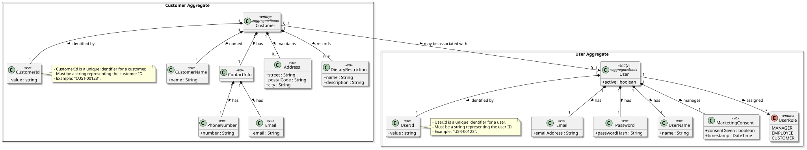
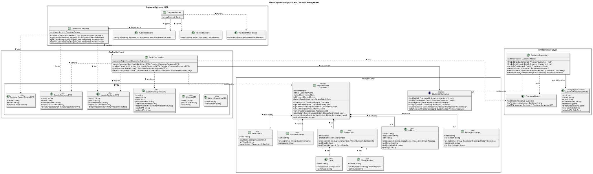
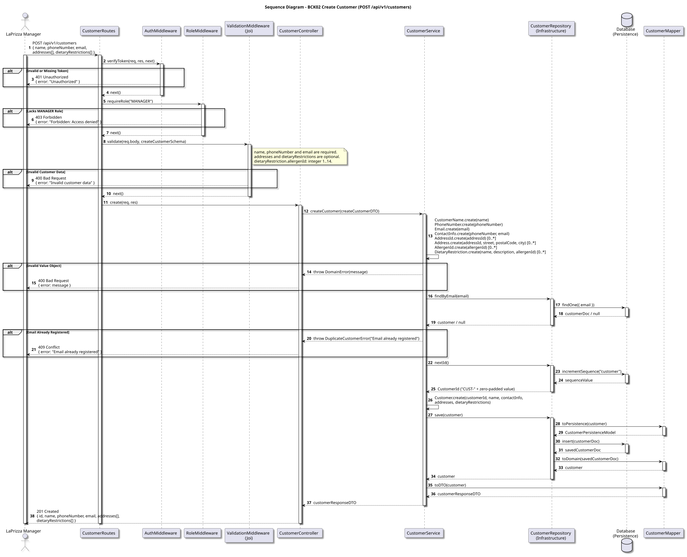
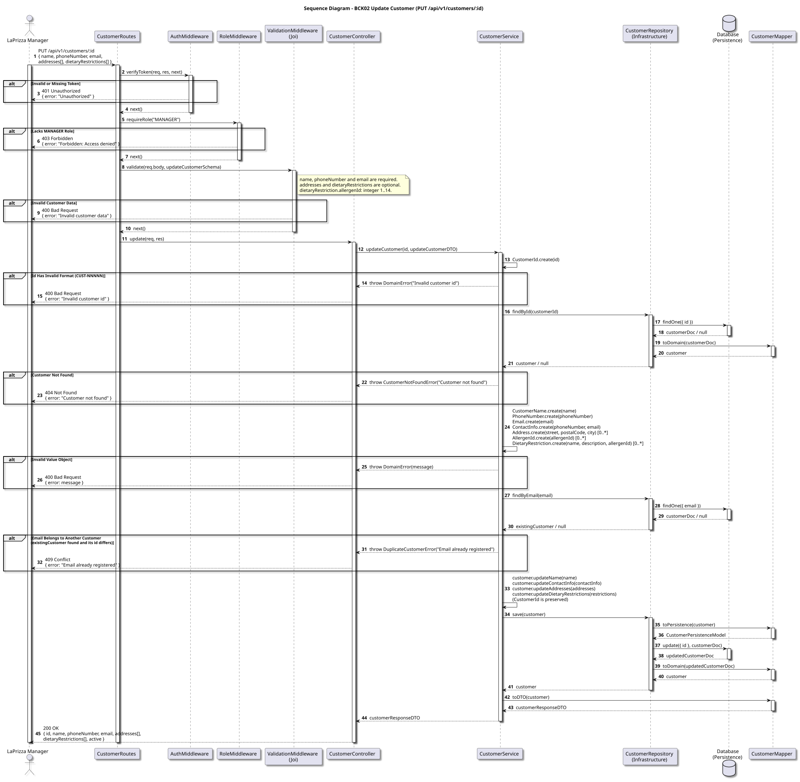
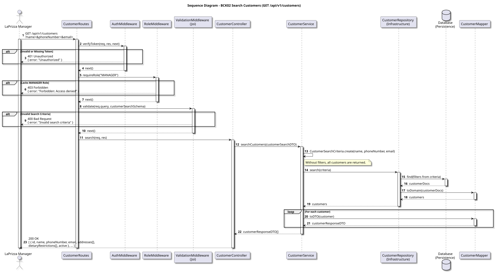
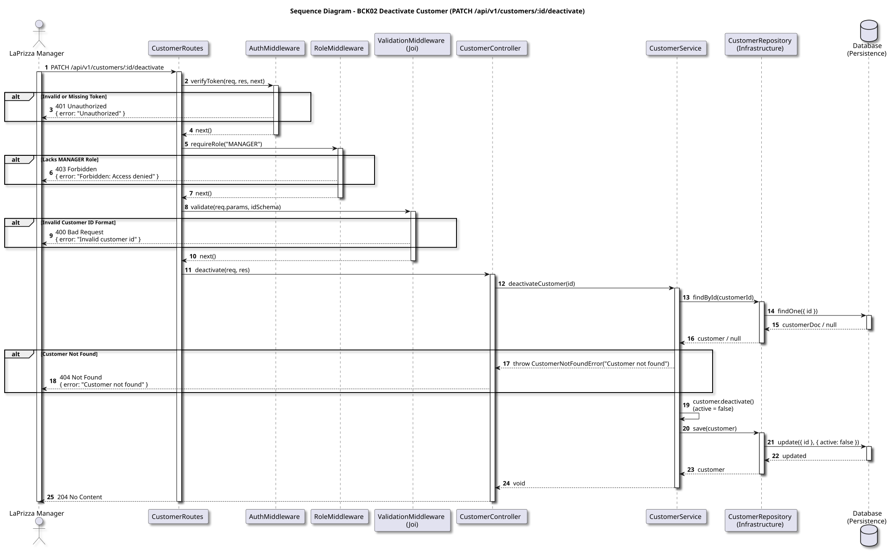

# US BCK02 – Customer Management

## 1. Context & Scope

- **User Story ID:** BCK02
- **Sprint:** Sprint 1
- **Area:** Back-End (BCK)
- **Responsible:** Mariana Moreira (1240905)
- **Related Requirements / Stories:**
  - System Specification: *PART II – System Specification, Section <X.Y>*
  - Architectural Stories: [ARC01 (Domain Modelling)](../../architecture/domainmodel.puml), [ARC02 (System Architecture)](../../architecture/SAD.md), [ARC03 (REST API)](../../architecture/SAD.md), [ARC04 (Persistence)](../../architecture/SAD.md), [ARC05 (Automated Testing)](../../architecture/SAD.md)
  - Dependencies: BCK01 (User and Authentication Management), for authentication and role-based authorization of the Customer endpoints. Customer is an independent aggregate: it does not depend on any other Sprint 1 business User Story. Customer information will be referenced by ordering functionality in later sprints.

---

## 2. Requirements & Analysis

### 2.1. User Story Description
> **As a** LaPrizza Manager,  
> **I want** to register and manage customers,  
> **so that** the restaurant can maintain the information required to provide its services to them.

### 2.2. Acceptance Criteria (from Sprint 1 Specification)

- [ ] **AC 1:** The system must support the creation and update of customer records.
- [ ] **AC 2:** Each customer must have a unique identifier.
- [ ] **AC 3:** Customer information must include, at least, the customer's name and appropriate contact information.
- [ ] **AC 4:** Data used to uniquely identify or contact customers must be appropriately validated.
- [ ] **AC 5:** Customers must be searchable using relevant identifying information.
- [ ] **AC 6:** The solution must allow relevant dietary restrictions associated with a customer to be represented.
- [ ] **AC 7:** Customer information that is referenced by other business information must not be removed in a manner that compromises the consistency of that information.

### 2.3. Client Clarifications & Questions

> **Question:** What are the mandatory data for a Customer? The minimum data mentioned included Name, Phone Number and a third field that we could not clearly identify.  
> **Answer:** The minimum Customer data is Name, Phone Number, and Email. (Prof. Paulo Matos, Moodle forum, 7 Oct 2026)

> **Question:** A Customer can exist without an associated User (e.g., kiosk scenario). If that Customer later creates an account, should the new User be associated with the existing Customer? If so, based on what information?  
> **Answer:** The Customer in the kiosk scenario is an anonymous Customer, so there is no persistent Customer record that later needs to be associated with a User. If the customer subsequently creates an account, the corresponding record is created, with no need to identify or associate the previous anonymous Customer. (Prof. Paulo Matos, Moodle forum, 7 Oct 2026)

### 2.4. Business Rules & Invariants
- **BR 1 (Identification):** Each customer has a unique identifier, which must not change after creation (AC 2).
- **BR 2 (Mandatory data):** A customer must have a name, a phone number and an email; none can be null or blank (AC 3, Client Clarification Q1).
- **BR 3 (Format / Validation):** Data used to uniquely identify or contact the customer (e.g., phone number, email) must be validated before being accepted (AC 4).
- **BR 4 (Dietary restrictions):** A customer may have dietary restrictions associated with them; the model must be able to represent zero or more (AC 6).
- **BR 5 (Referential Integrity):** A customer referenced by other business information cannot be removed in a way that compromises consistency (AC 7).
- **BR 6 (Anonymous customers):** Anonymous customers (e.g., kiosk scenario) have no persistent Customer record, so there is no Customer-to-User association to manage (Client Clarification Q2).

### 2.5. Domain Model Excerpt
Relevant domain concepts and aggregates directly involved in this User Story, following the exact structure of the global `LaPrizzaDomainModel`:

- **Customer:** aggregate root representing a registered customer with a unique `CustomerId` and `CustomerName`.
- **ContactInfo:** value object that groups the customer's mandatory contact mechanisms (`Email` and `PhoneNumber`).
- **Address & AddressId:** value objects representing zero or more physical addresses maintained by the customer, each identified by an `AddressId`.
- **DietaryRestriction:** value objects recording zero or more dietary restrictions (with name and description) associated with the customer.



> PlantUML source: [`excerptDomainModel/domain_model_excerpt.puml`](./excerptDomainModel/domain_model_excerpt.puml)
---

## 3. Design

### 3.1. Architecture & C4 Alignment

This User Story operates within the established **C4 Model** of the system:
- **C4 Level 1 (System Context):** The actor (LaPrizza Manager) interacts with the *LaPrizza Information System* via HTTPS ([System Architecture and Design](../../architecture/SAD.md)).
- **C4 Level 2 (Containers):** The request originates from the *UI* and targets the *Back-End API*, which persists state in the *Database* ([System Architecture and Design](../../architecture/SAD.md)).
- **C4 Level 3 (Component Diagram):** As defined in the global Back-End architecture ([System Architecture and Design](../../architecture/SAD.md)); this US belongs to the `customer-management` module.
---

### 3.2. Class Diagram (CD)
Structural design of the classes participating in this User Story, organized by Clean / Layered Architecture (Presentation → Application → Domain ← Infrastructure):



> PlantUML source: [`classDiagram/class_diagram.puml`](./classDiagram/class_diagram.puml).

---

### 3.3. Sequence Diagrams (SD)
Four key interaction paths are documented: customer creation, customer update, customer search, and customer deactivation, which preserves referenced information.

#### SD 1 — Create Customer (AC 1, AC 2, AC 3, AC 4, AC 6)



> Source: [`sequence_diagram_create_customer.puml`](./sequenceDiagram/sequence_diagram_create_customer.puml)

#### SD 2 — Update Customer (AC 1, AC 3, AC 4, AC 6)



> Source: [`sequence_diagram_update_customer.puml`](./sequenceDiagram/sequence_diagram_update_customer.puml)

#### SD 3 — Search Customers (AC 5)



> Source: [`sequence_diagram_search_customer.puml`](./sequenceDiagram/sequence_diagram_search_customers.puml)

#### SD 4 — Deactivate Customer (AC 7)



> Source: [`sequence_diagram_deactivate_customer.puml`](./sequenceDiagram/sequence_diagram_deactivate_customer.puml)

### 3.4. REST API Specification (ARC03)

| Method | Endpoint | Description | Auth / Role |
| :--- | :--- | :--- | :--- |
| `POST` | `/api/v1/customers` | Creates a new customer | Manager |
| `GET` | `/api/v1/customers` | Lists / searches customers (query: `name`, `phoneNumber`, `email`) | Manager |
| `GET` | `/api/v1/customers/:id` | Gets details of a customer | Manager |
| `PUT` | `/api/v1/customers/:id` | Updates an existing customer | Manager |
| `PATCH` | `/api/v1/customers/:id/deactivate` | Soft-deactivates a customer (active = false) | Manager |
| `PATCH` | `/api/v1/customers/:id/activate` | Reactivates a customer (active = true) | Manager |

#### Request & Response Schemas

- **Create Customer — Request (POST /api/v1/customers):**

```json
{
  "name": "Maria Silva",
  "phoneNumber": "+351912345678",
  "email": "maria.silva@example.com",
  "dietaryRestrictions": [
    {
      "name": "Vegetarian",
      "description": "Does not eat meat or fish"
    }
  ]
}
```

- **Create Customer — Success (201 Created):**

```json
{
  "id": "e4b2d3c1-0000-4000-8000-000000000001",
  "name": "Maria Silva",
  "phoneNumber": "+351912345678",
  "email": "maria.silva@example.com",
  "dietaryRestrictions": [
    {
      "name": "Vegetarian",
      "description": "Does not eat meat or fish"
    }
  ],
  "active": true
}
```

- **Update Customer — Request (PUT /api/v1/customers/:id):** same body as the creation request; all fields are required.

- **Search Customers — Success (200 OK):** `GET /api/v1/customers?name=Maria` returns an array of customers, in the same format as the creation response. Without query parameters, all customers are returned.

- **Deactivate / Activate — Success:** `204 No Content`, no body.

- **Error Responses:**
  - `400 Bad Request`: Validation failure (e.g., missing or blank name, phone number or email, invalid email or phone number format, invalid customer id).
  - `401 Unauthorized`: Missing or invalid JWT token.
  - `403 Forbidden`: Authenticated umser lacks MANAGER role.
  - `404 Not Found`: Customer ID not found.
  - `409 Conflict`: A customer with the same email already exists.
  - Standard error format:

```json
{
  "error": "Descriptive error message"
}
```


### 3.5. Persistence & Data Integrity (ARC04)
Customers are stored in PostgreSQL in a single relational table with integrity constraints. Dietary restrictions are stored in the same table, as a JSON array of `{ name, description }` objects, since they are value objects owned by the Customer aggregate.

- **Main Table:** `customers`

- **Fields & Constraints:**

| Column | Type | Constraints / Notes |
| :--- | :--- | :--- |
| `id` | UUID | Primary key; maps to domain `CustomerId` |
| `name` | VARCHAR | NOT NULL |
| `phone_number` | VARCHAR | NOT NULL |
| `email` | VARCHAR | NOT NULL, UNIQUE |
| `dietary_restrictions` | JSON | Array of `{ name, description }`; empty array when there are none |
| `active` | BOOLEAN | NOT NULL, DEFAULT TRUE (controls soft deactivation) |
| `created_at` | TIMESTAMPTZ | NOT NULL, DEFAULT now() |
| `updated_at` | TIMESTAMPTZ | NOT NULL, DEFAULT now() |

* **Integrity Rules:**
    * NOT NULL constraints on `name`, `phone_number` and `email` enforce BR 2 at database level.
    * The UNIQUE constraint on `email` enforces uniqueness even under concurrent requests.
    * Customers are never physically deleted: deactivation sets `active = false`, so data referenced by other entities stays consistent (BR 5).
    * Future tables that reference customers must declare the foreign key as `REFERENCES customers(id) ON DELETE RESTRICT`.


### 3.6. Applied Patterns & Architecture Principles
- **Clean / Layered Architecture:** Complete separation between Presentation, Application, Domain, and Infrastructure.
- **Aggregate Root (DDD):** The `Customer` aggregate root enforces its invariants and manages the active status.
- **Value Objects:** CustomerId, CustomerName, ContactInfo, PhoneNumber, Email, DietaryRestriction and CustomerSearchCriteria guarantee immutability and valid attribute formatting.
- **Repository Pattern:** ICustomerRepository isolates SQL persistence from business logic.
- **Mapper Pattern:** CustomerMapper converts between the domain, the persistence model and the response DTO.
- **DTO Pattern:** Decouples API request/response structures from internal domain state.

---

## 4. Tests (ARC05)

### 4.1. Test plan and scenarios

The IDs below identify test scenarios for traceability; they are not claims that the tests have already been implemented or executed. A parameterized test may produce several executable cases from one scenario. The suite should follow the project convention: unit tests for domain rules and application services, API integration tests for HTTP/authentication, and PostgreSQL tests for migrations and database constraints.

| Test ID | Level | Component / Source | Scenario | Expected result |
| :--- | :--- | :--- | :--- | :--- |
| **UT01** | Unit (Domain) | `Customer` | Create a customer with valid name, phone, email and no dietary restrictions | Valid customer; active by default; restrictions are an empty collection |
| **UT02** | Unit (Domain) | `CustomerId` | Create or restore an ID using a non-empty string, including a non-UUID string | Accepted and retained as a string; no UUID-only format is imposed |
| **UT03** | Unit (Domain) | `CustomerName` | Supply null, blank, non-string or a name over the configured maximum | Domain validation error |
| **UT04** | Unit (Domain) | `Email` | Supply malformed email; create a valid email with surrounding whitespace and mixed case | Invalid value rejected; valid value normalized consistently |
| **UT05** | Unit (Domain) | `PhoneNumber` | Supply blank or malformed phone number and a valid international number | Invalid value rejected; valid number retained in normalized/accepted form |
| **UT06** | Unit (Domain) | `DietaryRestriction` | Supply invalid restriction data; create zero or multiple valid restrictions | Invalid entries rejected; valid collection represented without losing entries |
| **UT07** | Unit (Domain) | `Customer` | Update profile and restrictions | Mutable fields change while the customer ID remains unchanged |
| **UT08** | Unit (Domain) | `Customer` | Deactivate and reactivate a customer | Active state changes as requested; ID and profile remain intact |
| **UT09** | Unit (Service) | `CustomerService` | Create a customer whose email is already used | Conflict error mapped to HTTP 409 |
| **UT10** | Unit (Service) | `CustomerService` | Update a customer using another customer's email | Conflict error; existing customer data is not overwritten |
| **UT11** | Unit (Service) | Customer/User association, if supplied | Link a customer to a missing, inactive, or non-CUSTOMER user; link a user already linked to another customer | Invalid link rejected; Customer ID remains independent of User ID |
| **UT12** | Unit (Service) | `CustomerService` | Create a customer without a User account | Valid persistent customer profile can be created without a User association; an anonymous kiosk customer itself is not persisted |
| **IT01** | Integration (API) | `POST /api/v1/customers` | Manager creates a valid customer without a User association | `201 Created`; response has a string customer ID and `active: true` |
| **IT02** | Integration (API) | `POST /api/v1/customers` | Manager creates a customer with a valid CUSTOMER User association, where supported by the chosen domain relationship | `201 Created`; Customer and User remain distinct and their IDs are not assumed to be equal |
| **IT03** | Integration (API) | Create/update customer | Omit required name, phone or email; provide invalid email, phone or dietary restriction | `400 Bad Request` with the API's standard error response |
| **IT04** | Integration (API) | Create/update customer | Submit an email already assigned to another customer | `409 Conflict`; no duplicate record is created |
| **IT05** | Integration (API) | Customer/User association, if supplied | Link to missing/inactive/non-CUSTOMER User or link an already-linked User | Appropriate not-found/conflict response; no partial customer mutation |
| **IT06** | Integration (API) | `GET /api/v1/customers/:id` | Request a well-formed but unknown string ID | `404 Not Found` |
| **IT07** | Integration (API) | `GET /api/v1/customers` | Search independently by name, phone number and email; search with no filters | `200 OK`; matching customer set returned, or all customers when filters are absent |
| **IT08** | Integration (API) | `PUT /api/v1/customers/:id` | Update customer fields and dietary restrictions | `200 OK` with updated representation; customer ID unchanged |
| **IT09** | Integration (API) | `PATCH /api/v1/customers/:id/deactivate` and `/activate` | Deactivate then reactivate a customer | `204 No Content`; subsequent read confirms the state while the record remains stored |
| **IT10** | Integration (API/Security) | All customer endpoints | Call without a token, with an invalid token, or as an authenticated non-Manager | `401 Unauthorized` or `403 Forbidden`, according to the authentication state |
| **IT11** | Integration (API) | OpenAPI contract | Inspect customer paths, request/response schemas, string IDs, and Manager security requirement | Contract documents the implemented API and does not constrain IDs to UUID format |
| **DB01** | Integration (PostgreSQL) | Migrations / schema | Apply migrations to an empty database and reapply according to migration-runner behavior | Schema is created once and migration history remains consistent |
| **DB02** | Integration (PostgreSQL) | `customers` constraints | Persist valid data and reject missing required fields and duplicate customer IDs/emails | Database enforces primary key, required fields and email uniqueness |
| **DB03** | Integration (PostgreSQL) | IDs and optional User relationship | Persist non-UUID string customer IDs; if the optional relationship is implemented, persist a distinct string `user_id`, enforce its foreign key and uniqueness | IDs remain strings; link is optional and does not equate the two identifiers; invalid references are rejected |
| **DB04** | Integration (PostgreSQL) | Dietary restrictions / lifecycle | Save and reload zero and multiple restrictions; deactivate a referenced customer | Restrictions round-trip; deactivation retains the row and references remain consistent |

### 4.2. Acceptance-criteria traceability

| Acceptance criterion | Covered scenarios | Evidence expected |
| :--- | :--- | :--- |
| **AC 1 — Create and update** | UT01, UT07, IT01–IT04, IT08, DB02 | Valid creation and update persist and return the expected customer representation |
| **AC 2 — Unique identifier** | UT02, UT07, IT01, IT06, DB02–DB03 | Customer ID is unique, immutable, and a string; tests do not require UUID syntax or equality with a User ID |
| **AC 3 — Name and contact information** | UT01, UT03–UT05, IT03, DB02 | Name, phone and email are required and validated |
| **AC 4 — Appropriate validation** | UT03–UT06, UT09–UT11, IT03–IT05 | Invalid values and conflicting associations are rejected with the documented error semantics |
| **AC 5 — Search** | IT07 | Each supported identifying field filters the returned customer set |
| **AC 6 — Dietary restrictions** | UT01, UT06, UT07, IT03, IT08, DB04 | Zero or more valid restrictions survive creation, update and persistence round-trip |
| **AC 7 — Referential consistency** | UT08, IT09, DB04 | Deactivation preserves the customer record and its references |

### 4.3. Test examples

These examples show the intended assertions and must be adjusted to the final exported factories and test setup. The existing project uses ESM imports and Jest; API tests should use the shared application/test setup and Supertest. PostgreSQL-dependent scenarios belong in the opt-in database suite described in `backend/tests/README.md`.

#### Domain example — string ID and separate customer identity

```javascript
import { CustomerId } from '../../../src/modules/customer-management/domain/values.js';

describe('CustomerId', () => {
  it('accepts a string identifier without requiring UUID syntax', () => {
    const id = CustomerId.create('customer-ana-01');

    expect(id.getValue()).toBe('customer-ana-01');
    expect(typeof id.getValue()).toBe('string');
  });
});
```

#### Application example — optional association

```javascript
it('creates a customer profile without requiring a User account', async () => {
  const customer = await customerService.create({
    name: 'Maria Silva',
    phoneNumber: '+351912345678',
    email: 'maria.silva@example.com',
    dietaryRestrictions: [],
  });

  expect(typeof customer.id).toBe('string');
  expect(customer.userId ?? null).toBeNull();
});
```

#### API example — create and validate the response

```javascript
const response = await request(app)
  .post('/api/v1/customers')
  .set('Authorization', `Bearer ${managerToken}`)
  .send({
    name: 'Maria Silva',
    phoneNumber: '+351912345678',
    email: 'maria.silva@example.com',
    dietaryRestrictions: [],
  });

expect(response.status).toBe(201);
expect(typeof response.body.id).toBe('string');
expect(response.body.active).toBe(true);
expect(response.body.name).toBe('Maria Silva');
```

### 4.4. Test execution and persistence boundary

Run unit and non-database integration tests using the repository's configured Jest scripts. PostgreSQL tests are a separate, opt-in suite; follow `backend/tests/README.md` to provision the test database and enable it. A passing in-memory/API suite alone does not prove migration, foreign-key, uniqueness-under-concurrency, or persistence-mapping behavior, so DB01–DB04 must be covered by that database suite.

---

## 5. Implementation

### 5.1. File Structure
List the files created or updated for this User Story:
```text
backend/
├── src/
│   ├── api/
│   │   ├── routes/<feature>Routes.js
│   │   └── controllers/<feature>Controller.js
│   ├── application/
│   │   ├── dtos/<feature>Dto.js
│   │   └── services/<feature>Service.js
│   ├── domain/
│   │   ├── model/<entity>.js
│   │   └── repositories/I<feature>Repository.js
│   └── infrastructure/
│       └── persistence/<feature>Repository.js
└── tests/
    ├── unit/<feature>.test.js
    └── integration/<feature>Api.test.js
```

---

## 6. Integration, Verification & Demonstration

### 6.1. Running the Automated Tests
```bash
cd backend
npm test -- tests/unit/<feature>.test.js tests/integration/<feature>Api.test.js
```

### 6.2. Manual Verification & OpenAPI Contract
1. Start the backend: `npm run dev`
2. Open Swagger UI at `http://localhost:8080/api-docs`
3. Execute `POST /api/v1/<resources>` with a Manager JWT token.
4. Execute `GET /api/v1/<resources>` to verify the created record.

---

## 7. Observations, Dependencies & Limitations

- **Dependencies:** BCK01 (Auth/RBAC) must be implemented first, to authenticate users and restrict the endpoints to the MANAGER role.
- **Downstream Impact:** Customer records will be referenced by the ordering functionality in later sprints. Foreign keys to `customers(id)` must use `ON DELETE RESTRICT`.
- **Decision (email uniqueness):** The client did not state that the email must be unique. The team assumes it, so that a customer can be identified and searched by email. This is enforced in the service (409) and by a database UNIQUE constraint.
- **Decision (soft delete):** Customers are deactivated, not deleted, to satisfy AC 7. Reactivation is supported so that a deactivated customer can be registered again without conflicting with the unique email.
- **Decision (search):** The search filters (`name`, `phoneNumber`, `email`) are plain strings, so partial values do not fail value object validation. Without filters, all customers are returned.
- **Out of scope for Sprint 1** (present in the global domain model): Address, MarketingConsent (handled in BCK01, User aggregate) and the relationship between Dietary Restriction and Allergen.
