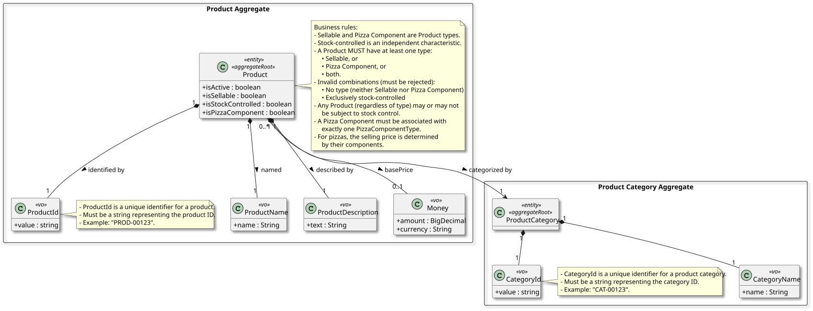
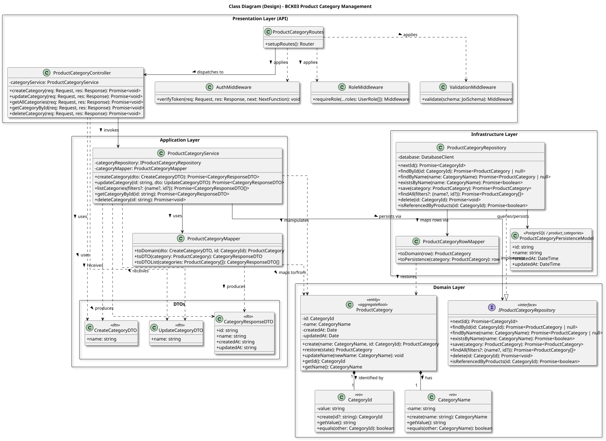
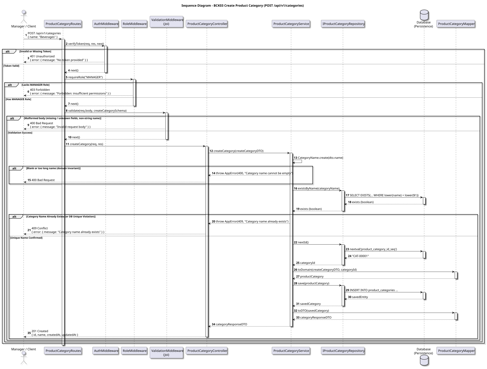
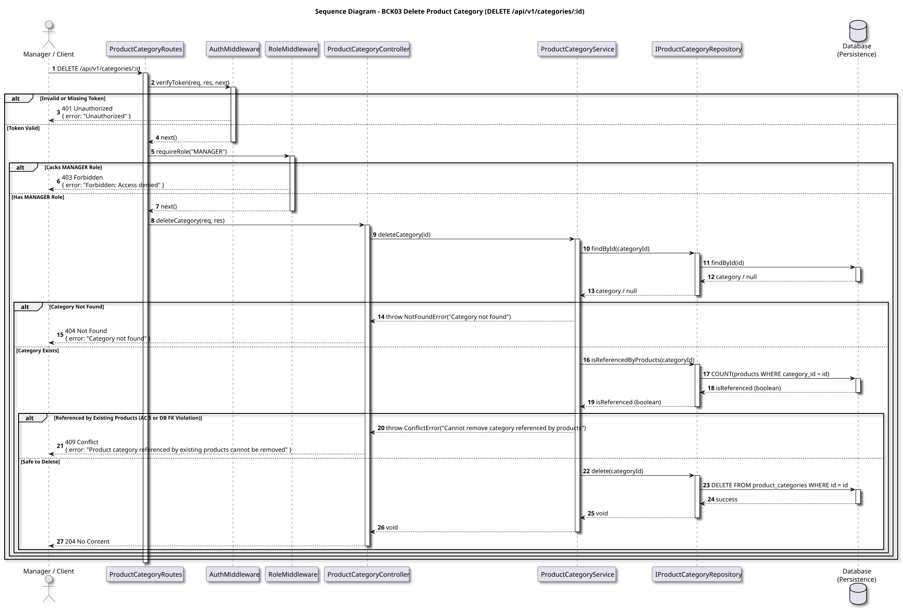

# US BCK03 – Product Category Management

## 1. Context & Scope

- **User Story ID:** BCK03
- **Sprint:** Sprint 1
- **Area:** Back-End (BCK)
- **Responsible:** Leonor De Moura (1240914)
- **Related Requirements / Stories:**
  - System Specification: *PART II – System Specification, Section II.3.1.2 (Products and Allergens), Section II.3.2 (Web Application - Product and Allergen Management)*
  - Architectural Stories: [ARC01 (Domain Modelling)](../../architecture/domainmodel.puml), [ARC02 (System Architecture)](../../architecture/SAD.md), [ARC03 (REST API)](../../architecture/SAD.md), [ARC04 (Persistence)](../../architecture/SAD.md), [ARC05 (Automated Testing)](../../architecture/SAD.md)
  - Dependencies: *BCK01 (User and Authentication Management - provides authentication and Manager role authorization for category management endpoints)*

---

## 2. Requirements & Analysis

### 2.1. User Story Description

> **As a** LaPrizza Manager,  
> **I want to** maintain product categories,  
> **so that** the products managed by the restaurant can be appropriately classified.

### 2.2. Acceptance Criteria

- [ ] **AC 1:** The system must maintain a catalogue of Product Categories.
- [ ] **AC 2:** Each Product Category must have a unique identifier and a descriptive name.
- [ ] **AC 3:** Products must be associable with an appropriate Product Category.
- [ ] **AC 4:** Product Categories must be searchable using relevant identifying information.
- [ ] **AC 5:** A Product Category referenced by existing products must not be removed in a manner that compromises the consistency of the corresponding business information.

### 2.3. Client Clarifications & Questions

> **Question 1 (Product Characteristics Combinations):** According to User Story BCK05, a product may adopt "any applicable combination" of characteristics (sellable, stock-controlled, or pizza component) based on business rules. Could you clarify if the system should block invalid combinations, such as a product with no assigned roles or one that is exclusively stock-controlled, or if it should remain flexible, leaving this responsibility to the Manager? If the system has to enforce these restrictions, could you also specify which exact combinations should be considered invalid?
>
> **Answer:** The system should validate the combinations. **Sellable** and **Pizza Component** should be considered types of Product, while **stock-controlled** is an independent characteristic. Therefore, all Products must have **at least one type**: Sellable, Pizza Component, or both. A Product cannot, therefore, be exclusively stock-controlled or exist without either of these two types. On the other hand, any Product, regardless of its type, may or may not be subject to stock control.

> **Question 2 (Search by ingredients):** When search by **Ingredients** is mentioned, does this mean searching for pizzas that contain a particular ingredient, searching directly for Products that are Pizza Components, or both?
>
> **Answer:** Both situations should be supported. The search is a **Product** search and, in the case of pizzas, it should also allow searching through their respective **Pizza Components**.

> **Question 3 (Search by Allergens/Diet):** In the case of Allergens, should the system search for products that **contain** a particular allergen, exclude products that contain it, or support both? And regarding "Diet", which categories should be considered (for example Vegetarian, Vegan, Gluten-Free, Lactose-Free)?
>
> **Answer:** The main goal is to allow users to **exclude products** that contain certain allergens/components, for example gluten, peanuts, or lactose. For restrictions such as `Vegetarian`, an equivalent approach can be considered: for example, identifying/excluding components that contain meat or, more generally, components of animal origin, depending on the restriction being considered.


### 2.4. Business Rules & Invariants

- **BR 1 (Category Identification & Uniqueness):** Each `ProductCategory` is uniquely identified by an immutable `CategoryId` (a string code, e.g. "CAT-00123") and a non-empty `CategoryName`. Category names must be unique across the system (case-insensitive).
- **BR 2 (Role Authorization):** Category management operations (`POST`, `PUT`/`PATCH`, `DELETE`) are restricted to users holding the `MANAGER` role. Public/Customer access is limited to read-only queries (`GET`).
- **BR 3 (Referential Integrity & Protection):** Deletion of a `ProductCategory` must be rejected if one or more `Product` entities currently reference it (`isReferencedByProducts = true`).
- **BR 4 (Catalogue Searchability):** Product Categories must support filtering and searching by name or identifier.
- **BR 5 (Concurrency & DB Constraints):** In addition to application-level checks (`existsByName`, `isReferencedByProducts`), database constraints (`UNIQUE` index on name, `FOREIGN KEY ... ON DELETE RESTRICT` on `products.category_id`) serve as the ultimate defense against race conditions under concurrent requests. Any database constraint violation is caught by the infrastructure layer and mapped to an HTTP `409 Conflict` response.
- **BR 6 (Initial Catalogue):** A default set of categories (`Beverages`, `Desserts`, `Starters`, `Pizza Ingredients`) is loaded as reference data (`npm run db:seed`, also run by `npm run db:reset`), receiving `CAT-00001`…`CAT-00004` on a fresh database. The seed is idempotent, skips names that already exist (case-insensitive) and never overwrites the Manager's changes. The Manager keeps full control through the API.

### 2.5. Domain Model Excerpt

Relevant domain concepts and aggregates directly involved in this User Story:

| Concept | Kind | Role in BCK03 |
|---|---|---|
| **ProductCategory** | Entity / Aggregate Root | Represents a product category with its own identity, descriptive name, and lifecycle |
| **CategoryId** | Value Object | Encapsulates the unique string code identifier of the category |
| **CategoryName** | Value Object | Encapsulates and validates the non-empty, unique descriptive name of the category |
| **Product** | External Aggregate Root | Product entity that references a `ProductCategory` by its `CategoryId` |

The excerpt isolates the **Product Category Aggregate** and illustrates its reference link from the **Product Aggregate**, consistent with the global domain model and DDD principles.



> PlantUML source: [`excerptDomainModel/domain_model_excerpt.puml`](./excerptDomainModel/domain_model_excerpt.puml).

---

## 3. Design

### 3.1. Architecture & C4 Alignment

This User Story operates within the established **C4 Model** of the system ([SAD](../../architecture/SAD.md)):

- **C4 Level 1 (System Context):** Restaurant Managers interact with the *LaPrizza Information System* to organize and classify the product catalogue.
- **C4 Level 2 (Containers):** API calls target the *Back-End API* (Node.js / Express). Categories are stored persistently in the *Relational Database* (PostgreSQL).
- **C4 Level 3 (Components):** BCK03 is implemented within the `product-category-management` modular boundary using Clean / Layered Architecture (`api` → `application` → `domain` ← `infrastructure`), protected by authentication and RBAC middlewares (`AuthMiddleware`, `RoleMiddleware`).

---

### 3.2. Class Diagram (CD)

Structural design of the classes participating in this User Story, organized by Clean / Layered Architecture (Presentation → Application → Domain ← Infrastructure):



> PlantUML source: [`classDiagram/class_diagram.puml`](./classDiagram/class_diagram.puml).

Key design points aligned with the domain model:
- `ProductCategory` aggregate root owns `CategoryId` and `CategoryName`.
- `IProductCategoryRepository` interface declares domain data access, including `isReferencedByProducts(id)` to enforce deletion invariants.
- `ProductCategoryService` implements application logic and transforms entities to/from DTOs via `ProductCategoryMapper`.

---

### 3.3. Sequence Diagrams (SD)

Two key interaction paths are documented to demonstrate category creation and protected category deletion with invariant enforcement.

#### SD 1 — Create Product Category (AC 1, AC 2, AC 4)



> Source: [`sequence_diagram_create_category.puml`](./sequenceDiagram/sequence_diagram_create_category.puml)

#### SD 2 — Delete Product Category with Integrity Verification (AC 5)



> Source: [`sequence_diagram_delete_category.puml`](./sequenceDiagram/sequence_diagram_delete_category.puml)

---

### 3.4. REST API Specification (ARC03)

All endpoints are versioned under `/api/v1` and documented via OpenAPI/Swagger. Protected operations require a Bearer JWT in the `Authorization` header.

| Method | Endpoint | Description | Auth / Role |
| :--- | :--- | :--- | :--- |
| `GET` | `/api/v1/categories` | Lists all product categories (supports search by name) | Public / All |
| `GET` | `/api/v1/categories/:id` | Gets details of a specific product category by ID | Public / All |
| `POST` | `/api/v1/categories` | Creates a new product category | Manager |
| `PUT` | `/api/v1/categories/:id` | Updates an existing product category name | Manager |
| `DELETE` | `/api/v1/categories/:id` | Deletes a product category (if not referenced by products) | Manager |

#### Request & Response Schemas

- **Create Category — Request (`POST /api/v1/categories`):**
  ```json
  {
    "name": "Beverages"
  }

- **Create Category — Success (201 Created):**
    ```json
    {
    "id": "CAT-00123",
    "name": "Beverages",
    "createdAt": "2026-10-15T10:00:00.000Z",
    "updatedAt": "2026-10-15T10:00:00.000Z"
    }

- **List Categories — Success (200 OK):**

    ```json
    [
    {
        "id": "CAT-00123",
        "name": "Beverages",
        "createdAt": "2026-10-15T10:00:00.000Z",
        "updatedAt": "2026-10-15T10:00:00.000Z"
    },
    {
        "id": "CAT-00124",
        "name": "Pizzas",
        "createdAt": "2026-10-15T10:05:00.000Z",
        "updatedAt": "2026-10-15T10:05:00.000Z"
    }
    ]

- **Error Responses:**
  * 400 Bad Request: Input validation failed (e.g. empty name).
  * 401 Unauthorized: Missing or invalid JWT token.
  * 403 Forbidden: User lacks MANAGER role.
  * 404 Not Found: Category ID does not exist.
  * 409 Conflict: Category name already exists, or category cannot be deleted because it is referenced by existing products.


### 3.5. Persistence & Data Integrity (ARC04)
Product categories are stored persistently in PostgreSQL (relational data store).
* **Table: 'product_categories'**
* **Fields & Constraints:**

| Column | Type | Constraints / Notes |
| :--- | :--- | :--- |
| `id` | VARCHAR | Primary key; maps to domain `CategoryId` |
| `name` | VARCHAR | NOT NULL,UNIQUE; stored normalized for case-insensitive uniqueness |
| `created_at` | TIMESTAMPTZ | NOT NULL,DEFAULT now() |
| `updated_at` | TIMESTAMPTZ | NOT NULL,DEFAULT now() |

- **Referential Multiplicity & Integrity Rules:**
  - Mandatory relationship: `products.category_id` is defined as `VARCHAR NOT NULL REFERENCES product_categories(id) ON DELETE RESTRICT`. A product must always belong to exactly one category (`1`), while a category can contain zero or more products (`0..*`).
  - Unique index on `name` prevents duplicate category names under concurrent writes (returns `409 Conflict`).
  - `ON DELETE RESTRICT` guarantees that deleting a referenced category fails safely at the database level if concurrent products are assigned to it during deletion (returns `409 Conflict`).

- **Reference data:** the initial categories are inserted by `seedProductCategories` (`infrastructure/seedProductCategories.js`), which allocates identifiers from `product_category_id_seq` only for names that do not exist yet. Seeding is kept out of migrations so test suites start from an empty table.  

### 3.6. Applied Patterns & Architecture Principles
* **Clean / Layered Architecture:** Complete separation between Presentation (Express routers/controllers), Application (services/DTOs), Domain (entities/value objects), and Infrastructure (PostgreSQL repositories).
* **Aggregate Root (DDD):** ProductCategory encapsulates its identifier and name invariants.
* **Value Objects:** CategoryId and CategoryName guarantee immutability and valid construction.
* **Repository Pattern:** IProductCategoryRepository abstracts database queries from application services.
* **DTO Pattern:** CreateCategoryDTO, UpdateCategoryDTO, and CategoryResponseDTO isolate external REST contracts from domain entities

## 4. Tests (ARC05)

### 4.1. Test Plan & Scenarios

| Test ID | Level | Scenario / Description | Expected Result |
| :--- | :--- | :--- | :--- |
| UT01| Unit (Domain) | Create ProductCategory with valid name | Success; entity instantiated |
| UT02 | Unit (Domain) | Create ProductCategory with blank/empty name | Throws domain validation error |
| UT03 | Unit (Domain) | Create category with duplicate name | Throws duplicate / conflict exception |
| UT04 | Unit (Domain) | Delete category that is referenced by products | Throws domain integrity violation error |
| IT01 | Integration (API) |POST /api/v1/categories with valid Manager token | HTTP 201 Created + persisted category |
| IT02 | Integration (API) | POST /api/v1/categories without Manager role | HTTP 403 Forbidden |
| IT03 | Integration (API) | DELETE /api/v1/categories/:id on referenced category | HTTP 409 Conflict |
| IT04 | Integration (API) | GET /api/v1/categories?name=Pizzas | HTTP 200 OK + filtered array |
| DB01 | Integration (PostgreSQL) | Seed the default categories; re-run after the Manager renames one | `CAT-NNNNN` ids; re-run inserts only missing names, renames kept |

### 4.2. Sample Test Implementations

Unit Test Example (Domain & Service Integrity)

    ```javascript 
    describe('ProductCategory Service & Domain Invariants', () => {
    it('should reject category creation with an empty name', () => {
        expect(() => CategoryName.create('')).toThrow(/Category name cannot be empty/i);
    });

    it('should prevent deletion of a category referenced by products', async () => {
        const categoryRepo = {
        findById: jest.fn().mockResolvedValue(new ProductCategory(...)),
        isReferencedByProducts: jest.fn().mockResolvedValue(true)
        };
        const service = new ProductCategoryService(categoryRepo);

        await expect(service.deleteCategory('valid-id')).rejects.toThrow(/cannot be removed/i);
    });
    });
    ```

Integration Test Example (HTTP Endpoint via Supertest)

    ```javascript 
    const request = require('supertest');
    const app = require('../../src/app');

    describe('DELETE /api/v1/categories/:id', () => {
    it('returns 409 Conflict when category has active products', async () => {
        const managerToken = getAuthTokenForRole('MANAGER');

        const response = await request(app)
        .delete('/api/v1/categories/category-with-products-id')
        .set('Authorization', `Bearer ${managerToken}`);

        expect(response.status).toBe(409);
        expect(response.body.error.message).toMatch(/referenced by existing products/i);
    });
    });
    ```


## 5. Implementation

### 5.1. File Structure


backend/
├── migrations/
│   └── 0003_product_categories.sql          # table, CAT-NNNNN sequence, lower(name) UNIQUE index
│   ├── scripts/
│   │   └── seed-reference-data.js                # npm run db:seed
├── src/
│   ├── modules/
│   │   └── product-category-management/
│   │       ├── api/
│   │       │   ├── controllers/ProductCategoryController.js
│   │       │   ├── routes/ProductCategoryRoutes.js   # Auth + Role(MANAGER) + Joi validation
│   │       │   ├── schemas.js                        # Joi request shapes
│   │       │   └── openapi.js                        # OpenAPI paths & schemas
│   │       ├── application/
│   │       │   ├── dtos/
│   │       │   │   ├── CreateCategoryDTO.js
│   │       │   │   ├── UpdateCategoryDTO.js
│   │       │   │   └── CategoryResponseDTO.js
│   │       │   ├── mapping/ProductCategoryMapper.js  # domain <-> DTO
│   │       │   └── services/ProductCategoryService.js
│   │       ├── domain/
│   │       │   ├── model/
│   │       │   │   ├── ProductCategory.js            # aggregate root
│   │       │   │   ├── CategoryId.js                 # VO, CAT-NNNNN
│   │       │   │   └── CategoryName.js               # VO, 1..100 chars
│   │       │   └── repositories/IProductCategoryRepository.js
│   │       ├── infrastructure/
│   │       │   ├── seedProductCategories.js          # default categories, idempotent
│   │       │   └── persistence/
│   │       │       ├── ProductCategoryPersistenceModel.js
│   │       │       ├── ProductCategoryRowMapper.js   # SQL row <-> domain
│   │       │       └── ProductCategoryRepository.js  # PostgreSQL adapter
│   │       └── index.js                              # composition root
│   └── shared/openapi/spec.js                        # merges categoryPaths/categorySchemas
└── tests/
      └── integration/reference-data/
          └── postgres.test.js
    ├── helpers/MemoryProductCategoryRepository.js
    ├── unit/product-category-management/
    │   ├── domain.test.js        # UT01, UT02 + VO/aggregate invariants
    │   ├── service.test.js       # UT03, UT04 + update/search/delete rules
    │   └── openapi.test.js       # API contract
    └── integration/product-category-management/
        ├── api.test.js           # IT01–IT04 (real JWT, in-memory repo)
        └── postgres.test.js      # opt-in: real PostgreSQL constraints & concurrency


### 5.2. Design Decisions Taken During Implementation

- **Identifier allocation:** `IProductCategoryRepository.nextId()` was added to the contract so `CAT-NNNNN` identifiers come from a PostgreSQL sequence, which is race-free under concurrent requests.
- **Search filters:** `findAll({ name, id })` performs case-insensitive *contains* matching (`?name=` / `?id=`), with LIKE wildcards escaped (BR4).
- **Two mappers:** `ProductCategoryMapper` (application, domain ↔ DTO) and `ProductCategoryRowMapper` (infrastructure, SQL row ↔ domain) keep HTTP and SQL concerns apart.
- **Validation split:** Joi only checks the request *shape* (400 `Invalid request body`); content rules (empty, > 100 chars, control characters) live in `CategoryName`, so clients get a specific message.
- **Name normalisation:** surrounding whitespace is trimmed and inner runs collapsed; uniqueness uses a `UNIQUE INDEX ON lower(name)` while preserving the Manager's capitalisation.
- **Referential integrity before BCK05:** `isReferencedByProducts` returns `false` while the `products` table does not exist; BCK05 must declare `category_id VARCHAR(32) NOT NULL REFERENCES product_categories(id) ON DELETE RESTRICT`. Repository maps PostgreSQL `23001`/`23503` to `409`.
- **Reference data:** default categories are seeded by a separate idempotent step (`npm run db:seed`) instead of a migration, so the API remains the only way the Manager maintains the catalogue and existing tests are unaffected.

## 6. Integration, Verification & Demonstration

### 6.1. Running the Automated Tests

```bash
cd backend
# Unit + HTTP integration (no database required)
npm test -- tests/unit/product-category-management tests/integration/product-category-management/api.test.js
```
# Real PostgreSQL suites (requires PGDATABASE ending in _test)
```
npm run test:db
```
### 6.2. Manual Verification & OpenAPI Contract

1. Start PostgreSQL, run `npm run db:migrate`, `npm run db:seed` and (first time only) `npm run users:bootstrap`, then start the backend server: `npm run dev`
2. Open Swagger UI at http://localhost:8080/api-docs
3. Execute GET /api/v1/categories to see the seeded categories, then POST /api/v1/categories with a Manager JWT token to create new ones.
4. Execute GET /api/v1/categories to verify listing and search functionality.
5. A full Postman walkthrough is available in [`BCK03_RUN_AND_TEST_GUIDE`](./usBCK03_TestsGuide.md).

## 7. Observations, Dependencies & Limitations
* **Dependencies:** Relies on BCK01 for JWT authentication and Manager role enforcement (RoleMiddleware).
* **Downstream Impact:** Provides foundational categories required by BCK05 (Product Management).
* **Reference data:** four default categories are seeded (`npm run db:seed` / `npm run db:reset`); the Manager can rename, delete (when unreferenced) and add categories.
