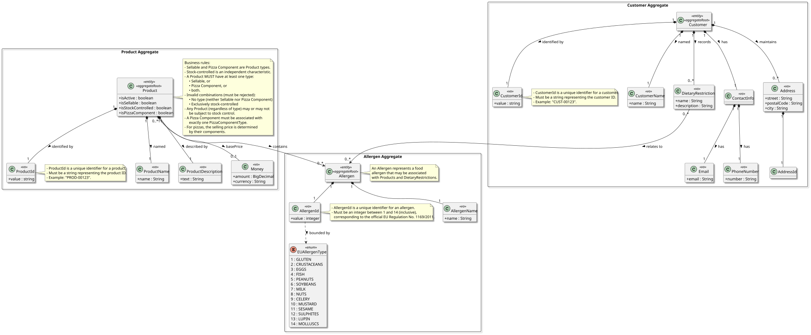
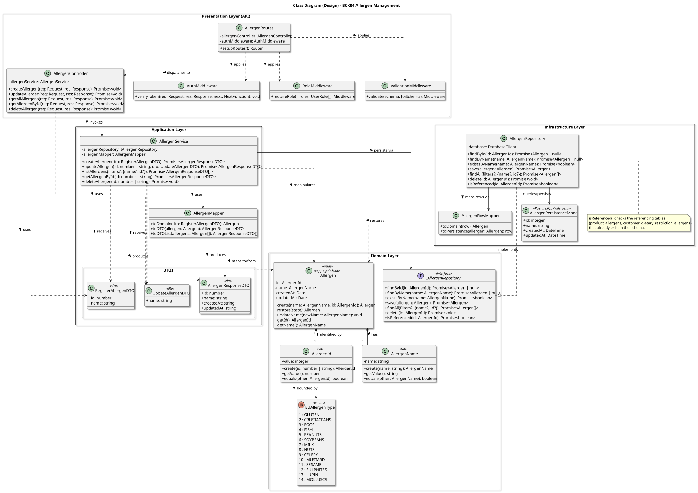
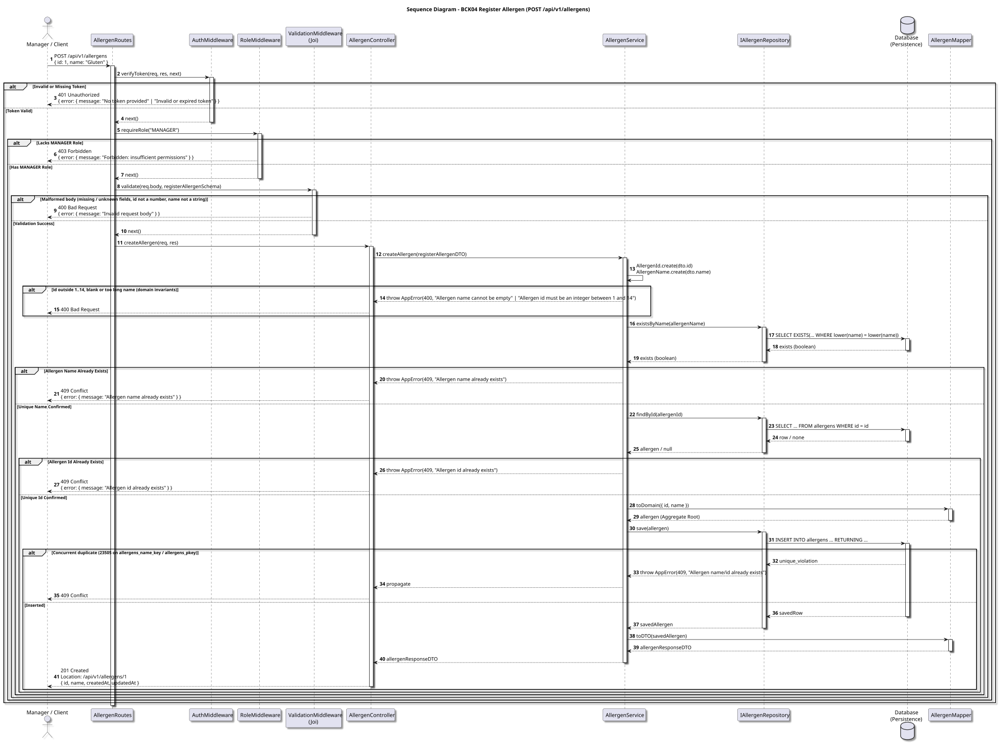
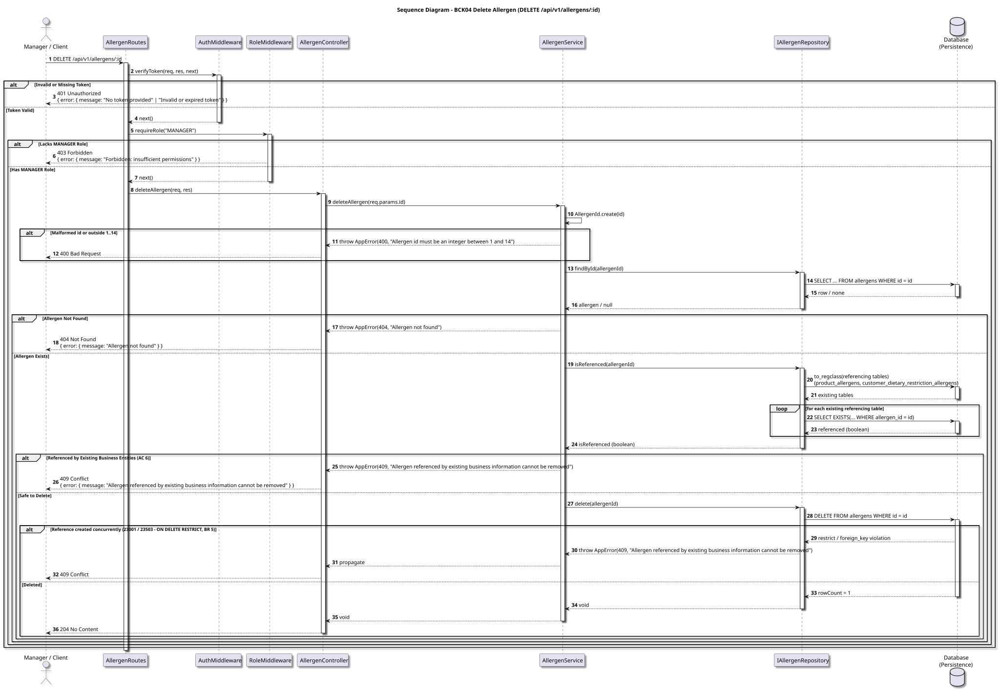

# US BCK04 – Allergen Management

## 1. Context & Scope

- **User Story ID:** BCK04
- **Sprint:** Sprint 1
- **Area:** Back-End (BCK)
- **Responsible:** Leonor De Moura (1240914)
- **Related Requirements / Stories:**
  - System Specification: *PART II – System Specification, Section II.3.1.2 (Products and Allergens), Section II.3.2 (Web Application - Product and Allergen Management)*
  - Architectural Stories: [ARC01 (Domain Modelling)](../../architecture/domainmodel.puml), [ARC02 (System Architecture)](../../architecture/SAD.md), [ARC03 (REST API)](../../architecture/SAD.md), [ARC04 (Persistence)](../../architecture/SAD.md), [ARC05 (Automated Testing)](../../architecture/SAD.md)
  - Dependencies: *BCK01 (User and Authentication Management - provides authentication and Manager role authorization for allergen management endpoints)*

---

## 2. Requirements & Analysis

### 2.1. User Story Description

> **As a** LaPrizza Manager,  
> **I want to** maintain the allergens recognized by the restaurant,  
> **so that** products can be associated with appropriate allergen information.

### 2.2. Acceptance Criteria

- [ ] **AC 1:** The system must maintain a catalogue of allergens.
- [ ] **AC 2:** Each allergen must have a unique identifier and a descriptive name.
- [ ] **AC 3:** Allergens must be available for association with products.
- [ ] **AC 4:** A product may be associated with one or more allergens.
- [ ] **AC 5:** Allergens must be searchable using relevant identifying information.
- [ ] **AC 6:** An allergen referenced by existing business information must not be removed in a manner that compromises the consistency of that information.

### 2.3. Client Clarifications & Questions

> **Question 1 (Search by Allergens/Diet):** In the case of Allergens, should the system search for products that **contain** a particular allergen, exclude products that contain it, or support both? And regarding "Diet", which categories should be considered (for example Vegetarian, Vegan, Gluten-Free, Lactose-Free)?
>
> **Answer:** The main goal is to allow users to **exclude products** that contain certain allergens/components, for example gluten, peanuts, or lactose. For restrictions such as `Vegetarian`, an equivalent approach can be considered: for example, identifying/excluding components that contain meat or, more generally, components of animal origin, depending on the restriction being considered.

> **Question 2 (Product & Allergen Removal):** What happens if an Allergen is referenced by existing Products or Customer Dietary Restrictions and a Manager tries to delete it?
>
> **Answer:** As defined in AC 6, an allergen referenced by existing business information must not be removed in a manner that compromises consistency. Deletion must be blocked if active products or customer dietary restrictions still reference the allergen.

---

### 2.4. Business Rules & Invariants

- **BR 1 (Allergen Identification & Uniqueness):** Each `Allergen` is uniquely identified by an immutable `AllergenId` (an integer between 1 and 14, matching the official EU Regulation No. 1169/2011 standard list, see `EUAllergenType`) and a non-empty `AllergenName` (1–100 characters, surrounding whitespace trimmed and inner whitespace collapsed). Both the identifier and the name must be unique across the system; name uniqueness is case-insensitive.
- **BR 2 (Role Authorization):** Allergen management write operations (`POST`, `PUT`, `DELETE`) are restricted to users holding the `MANAGER` role. Public/Customer access is limited to read-only queries (`GET`).
- **BR 3 (Referential Integrity & Protection):** Deletion of an `Allergen` must be rejected if one or more `Product` entities or `DietaryRestriction` records currently reference it (`isReferenced = true`).
- **BR 4 (Searchability):** Allergens must be searchable by name (case-insensitive partial match) or by identifier (exact match).
- **BR 5 (Concurrency & DB Constraints):** In addition to application-level checks (`existsByName`, `findById`, `isReferenced`), database constraints (`PRIMARY KEY` on id, `UNIQUE` index on `lower(name)`, `FOREIGN KEY ... ON DELETE RESTRICT` on join tables) serve as the final defense against race conditions under concurrent requests. Any such constraint violation is caught by the infrastructure layer and returned as an HTTP `409 Conflict` response.
- **BR 6 (Initial Catalogue):** The 14 allergens of EU Regulation No. 1169/2011 are loaded as reference data (`npm run db:seed`, also run by `npm run db:reset`) with default English names. The seed is idempotent and never overwrites the Manager's changes: renamed allergens keep their name; a deleted allergen is re-inserted only on the next seed run. The Manager keeps full control of the catalogue through the API (rename, delete when unreferenced, re-register).

---

### 2.5. Domain Model Excerpt

Relevant domain concepts and aggregates directly involved in this User Story:

| Concept | Kind | Role in BCK04 |
|---|---|---|
| **Allergen** | Entity / Aggregate Root | Represents a recognized allergen with its own identity, descriptive name, and lifecycle |
| **AllergenId** | Value Object | Encapsulates the unique integer identifier (1-14) of the allergen according to EU Regulation No. 1169/2011 |
| **EUAllergenType** | Enumeration | The 14 allergens of EU Regulation No. 1169/2011 that bound `AllergenId` |
| **AllergenName** | Value Object | Encapsulates and validates the non-empty, unique descriptive name of the allergen |
| **Product** | External Aggregate Root | Product entity that may contain/reference zero or more `Allergen` entities |
| **DietaryRestriction** | External Value Object | Customer restriction that may relate to an `Allergen` entity |

The excerpt isolates the **Allergen Aggregate** and illustrates its reference links from **Product** and **DietaryRestriction**, consistent with the global domain model and DDD principles.



> PlantUML source: [`excerptDomainModel/domain_model_excerpt.puml`](./excerptDomainModel/domain_model_excerpt.puml).

---

## 3. Design

### 3.1. Architecture & C4 Alignment

This User Story operates within the established **C4 Model** of the system ([SAD](../../architecture/SAD.md)):

- **C4 Level 1 (System Context):** Restaurant Managers interact with the *LaPrizza Information System* to maintain the recognized allergens list.
- **C4 Level 2 (Containers):** API calls target the *Back-End API* (Node.js / Express). Allergens are stored persistently in the *Relational Database* (PostgreSQL).
- **C4 Level 3 (Components):** BCK04 is implemented within the `allergen-management` modular boundary using Clean / Layered Architecture (`api` → `application` → `domain` ← `infrastructure`), protected by authentication and RBAC middlewares (`AuthMiddleware`, `RoleMiddleware`). The module is wired in its own composition root (`createAllergenModule`) and depends on BCK01 only through `userService` (token verification).

---

### 3.2. Class Diagram (CD)

Structural design of the classes participating in this User Story, organized by Clean / Layered Architecture (Presentation → Application → Domain ← Infrastructure):



> PlantUML source: [`classDiagram/class_diagram.puml`](./classDiagram/class_diagram.puml).

Key design points aligned with the domain model:
- `Allergen` aggregate root owns `AllergenId` and `AllergenName`; `AllergenId` is bounded by `EUAllergenType` (1–14).
- `Allergen.create(name, id)` builds a new allergen; `Allergen.restore(state)` rebuilds a persisted one re-validating every invariant.
- `IAllergenRepository` interface declares domain data access, including `isReferenced(id)` to enforce deletion invariants and optional `findAll` filters for searching (BR 4).
- `AllergenService` implements application logic directly without service interface boilerplate, transforming entities to/from DTOs via `AllergenMapper` (application layer).
- `AllergenRowMapper` (infrastructure layer) converts PostgreSQL rows to/from the domain aggregate, keeping SQL concerns out of the application mapper.

---

### 3.3. Sequence Diagrams (SD)

Two key interaction paths are documented to demonstrate allergen registration and protected allergen deletion with invariant enforcement.

#### SD 1 — Register Allergen (AC 1, AC 2)



> Source: [`sequence_diagram_register_allergen.puml`](./sequenceDiagram/sequence_diagram_register_allergen.puml)

#### SD 2 — Delete Allergen with Integrity Verification (AC 6)



> Source: [`sequence_diagram_delete_allergen.puml`](./sequenceDiagram/sequence_diagram_delete_allergen.puml)

---

### 3.4. REST API Specification (ARC03)

All endpoints are versioned under `/api/v1` and documented via OpenAPI/Swagger (tag **Allergens**). Protected operations require a Bearer JWT in the `Authorization` header.

| Method | Endpoint | Description | Auth / Role |
| :--- | :--- | :--- | :--- |
| `GET` | `/api/v1/allergens` | Lists all recognized allergens (supports search by name) | Public / All |
| `GET` | `/api/v1/allergens/:id` | Gets details of a specific allergen by ID | Public / All |
| `POST` | `/api/v1/allergens` | Registers a new allergen | Manager |
| `PUT` | `/api/v1/allergens/:id` | Updates an existing allergen name | Manager |
| `DELETE` | `/api/v1/allergens/:id` | Deletes an allergen (if not referenced by products or dietary restrictions) | Manager |

#### Request & Response Schemas

- **Register Allergen — Request (`POST /api/v1/allergens`):**
  ```json
  {
  "id": 1,
  "name": "Gluten"
  }
  ```

- **Register Allergen — Success (201 Created):**
```json
  {
    "id": 1,
    "name": "Gluten",
    "createdAt": "2026-10-15T11:00:00.000Z",
    "updatedAt": "2026-10-15T11:00:00.000Z"
  }
  ```

- **Update Allergen — Request (`PUT /api/v1/allergens/:id`):** only `name` is accepted; the identifier is immutable.
  ```json
  {
    "name": "Lactose"
  }
  ```

- **List Allergens — Success (200 OK):**
  ```json
  [
    {
      "id": 1,
      "name": "Gluten",
      "createdAt": "2026-10-15T11:00:00.000Z",
      "updatedAt": "2026-10-15T11:00:00.000Z"
    },
    {
      "id": 7,
      "name": "Lactose",
      "createdAt": "2026-10-15T11:05:00.000Z",
      "updatedAt": "2026-10-15T11:05:00.000Z"
    }
  ]
  ```

- **Error Responses** (all with the shape `{ "error": { "message": "...", "status": <code> } }`):
    - **400 Bad Request:** malformed body (`Invalid request body`), empty or too long name (`Allergen name cannot be empty`, `Allergen name must not exceed 100 characters`), id outside 1..14 or not an integer (`Allergen id must be an integer between 1 and 14`), invalid search filter (`Invalid name filter`, `Invalid id filter`), invalid JSON (`Invalid JSON body`).
    - **401 Unauthorized:** missing or invalid JWT token (`No token provided`, `Invalid or expired token`).
    - **403 Forbidden:** user lacks MANAGER role (`Forbidden: insufficient permissions`).
    - **404 Not Found:** allergen ID does not exist (`Allergen not found`).
    - **409 Conflict:** `Allergen name already exists`, `Allergen id already exists`, or `Allergen referenced by existing business information cannot be removed`.

### 3.5. Persistence & Data Integrity (ARC04)
Allergens are stored persistently in PostgreSQL (relational data store), created by migration `0004_allergens.sql`.

- **Table:** `allergens`
- **Fields & Constraints:**

| Column | Type         | Constraints / Notes |
| :--- |:-------------| :--- |
| `id` | INT          | PRIMARY KEY (`allergens_pkey`); `CHECK (id BETWEEN 1 AND 14)` (EU Regulation No. 1169/2011); maps to domain `AllergenId` |
| `name` | VARCHAR(100) | NOT NULL; `CHECK` 1–100 chars and already trimmed; UNIQUE case-insensitive index `allergens_name_key ON lower(name)` |
| `created_at` | TIMESTAMPTZ  | NOT NULL, DEFAULT now(), finite |
| `updated_at` | TIMESTAMPTZ  | NOT NULL, DEFAULT now(), finite |

- **Referential Multiplicity & Integrity Rules:**
  - Multi-entity relationships: Many-to-many link tables (e.g. `product_allergens`) are configured with `ON DELETE RESTRICT` at the database level to complement domain verification (`isReferenced`).
  - Unique index on `name` prevents duplicate allergen names under concurrent writes (returns `409 Conflict`).
  - `ON DELETE RESTRICT` guarantees that deleting a referenced allergen fails safely at the database level if a product or restriction is assigned simultaneously (returns `409 Conflict`).

- **Reference data:** the table is created empty by the migration; the initial rows are inserted by `seedAllergens` (`infrastructure/seedAllergens.js`) with `INSERT ... ON CONFLICT DO NOTHING`. Seeding is kept out of migrations so that schema changes and data stay separate and test suites start from an empty table.  

### 3.6. Applied Patterns & Architecture Principles
* **Clean / Layered Architecture:** Complete separation between Presentation (Express routers/controllers), Application (services/DTOs/mapper), Domain (entities/value objects), and Infrastructure (PostgreSQL repository and row mapper).
* **Aggregate Root (DDD):** Allergen encapsulates its identifier and name invariants.
* **Value Objects:** AllergenId and AllergenName guarantee immutability and valid construction.
* **Repository Pattern:** IAllergenRepository abstracts database queries from application services.
* **DTO Pattern:** RegisterAllergenDTO, UpdateAllergenDTO, and AllergenResponseDTO isolate external REST contracts from domain entities.
* **Composition Root / Dependency Injection:** `createAllergenModule` wires repository, service, controller and routes; tests inject an in-memory repository.

## 4. Tests (ARC05)

### 4.1. Test Plan & Scenarios

| Test ID | Level | Scenario / Description | Expected Result |
| :--- | :--- | :--- | :--- |
| UT01 | Unit (Domain) | Create AllergenName with a valid name (whitespace normalised) | Success; value object instantiated |
| UT02 | Unit (Domain / Service) | Create Allergen with blank/empty name or id outside 1..14 | Domain validation error (400), repository never called |
| UT03 | Unit (Service) | Register Allergen with duplicate name (case-insensitive) or duplicate id | `409` conflict error |
| UT04 | Unit (Service) | Delete Allergen that is referenced by products/dietary restrictions | `409` integrity error; `delete` never called |
| UT05 | Unit (Service) | Search by name (contains) and by id (exact); invalid filters | Filtered list; `400` for invalid filters |
| IT01 | Integration (API) | POST /api/v1/allergens with valid Manager token | HTTP 201 Created + `Location` + persisted allergen |
| IT02 | Integration (API) | Write operations without token / without Manager role | HTTP 401 / HTTP 403 |
| IT03 | Integration (API) | DELETE /api/v1/allergens/:id on referenced allergen | HTTP 409 Conflict, allergen kept |
| IT04 | Integration (API) | GET /api/v1/allergens?name=Gluten and ?id=5 | HTTP 200 OK + filtered array |
| DB01 | Integration (PostgreSQL) | Migration, CHECK constraints, unique index and PK | Constraint violations mapped to 409 / rejected rows |
| DB02 | Integration (PostgreSQL) | Two concurrent registrations with the same name | One success, one 409 |
| DB03 | Integration (PostgreSQL) | `ON DELETE RESTRICT` on `product_allergens` when the app check is bypassed | HTTP-level 409, allergen kept |
| DB04 | Integration (PostgreSQL) | Seed the 14 EU allergens; re-run after the Manager renames/deletes | 14 rows (ids 1..14); re-run inserts only missing ones, renames kept |

The suites live in:

| File | Content |
| :--- | :--- |
| `tests/unit/allergen-management/domain.test.js` | `AllergenId`, `AllergenName`, `Allergen`, `EUAllergenType` |
| `tests/unit/allergen-management/service.test.js` | `AllergenService` with the in-memory repository |
| `tests/unit/allergen-management/openapi.test.js` | OpenAPI contract of the 5 operations |
| `tests/integration/allergen-management/api.test.js` | HTTP contract with real security and in-memory persistence |
| `tests/integration/allergen-management/postgres.test.js` | Real PostgreSQL (opt-in, `npm run test:db`) |
| `tests/helpers/MemoryAllergenRepository.js` | In-memory adapter honouring the repository contract |
| `tests/integration/reference-data/postgres.test.js` | Allergen and category seed (opt-in, `npm run test:db`) |

### 4.2. Sample Test Implementations
Unit Test Example (Domain & Service Integrity)
```javascript
import { AllergenName } from '../../../src/modules/allergen-management/domain/model/AllergenName.js';
import { AllergenService } from '../../../src/modules/allergen-management/application/services/AllergenService.js';
import { MemoryAllergenRepository } from '../../helpers/MemoryAllergenRepository.js';

describe('Allergen Service & Domain Invariants', () => {
  test('should reject allergen creation with an empty name', () => {
    expect(() => AllergenName.create('')).toThrow(/Allergen name cannot be empty/i);
  });

  test('should prevent deletion of an allergen referenced by business information', async () => {
    const repository = new MemoryAllergenRepository();
    const service = new AllergenService(repository);
    await service.createAllergen({ id: 1, name: 'Gluten' });
    repository.referencedIds.add(1);

    await expect(service.deleteAllergen(1)).rejects.toThrow(/cannot be removed/i);
  });
});
```

Integration Test Example (HTTP Endpoint via Supertest)
```javascript
import request from 'supertest';
// app (createApp with createAllergenModule), managerToken, register() and the
// in-memory repository `allergens` are prepared in beforeEach
test('IT03 DELETE of a referenced allergen returns 409 and keeps it', async () => {
  await register(1, 'Gluten');
  allergens.referencedIds.add(1);

  const res = await request(app)
    .delete('/api/v1/allergens/1')
    .set('Authorization', `Bearer ${managerToken}`);

  expect(res.status).toBe(409);
  expect(res.body.error.message).toMatch(/referenced by existing business information/i);
});
```

## 5. Implementation
### 5.1. File Structure

```
backend/
├── migrations/
│   └── 0004_allergens.sql                    # table, CHECK 1..14, lower(name) UNIQUE index
│   ├── scripts/
│   │   └── seed-reference-data.js                # npm run db:seed
├── src/
│   ├── modules/
│   │   └── allergen-management/
│   │       ├── api/
│   │       │   ├── controllers/AllergenController.js
│   │       │   ├── routes/AllergenRoutes.js  # Auth + Role(MANAGER) + Joi validation
│   │       │   ├── schemas.js                # Joi request shapes
│   │       │   └── openapi.js                # OpenAPI paths & schemas
│   │       ├── application/
│   │       │   ├── dtos/
│   │       │   │   ├── RegisterAllergenDTO.js
│   │       │   │   ├── UpdateAllergenDTO.js
│   │       │   │   └── AllergenResponseDTO.js
│   │       │   ├── mapping/AllergenMapper.js # domain <-> DTO
│   │       │   └── services/AllergenService.js
│   │       ├── domain/
│   │       │   ├── model/
│   │       │   │   ├── Allergen.js           # aggregate root
│   │       │   │   ├── AllergenId.js         # VO, integer 1..14
│   │       │   │   ├── AllergenName.js       # VO, 1..100 chars
│   │       │   │   └── EUAllergenType.js     # EU Regulation No. 1169/2011 list
│   │       │   └── repositories/IAllergenRepository.js
│   │       ├── infrastructure/
│   │       │   ├── seedAllergens.js          # 14 EU allergen idempotent
│   │       │   └── persistence/
│   │       │       ├── AllergenPersistenceModel.js
│   │       │       ├── AllergenRowMapper.js  # SQL row <-> domain
│   │       │       └── AllergenRepository.js # PostgreSQL adapter
│   │       └── index.js                      # composition root (createAllergenModule)
│   ├── modules/index.js                      # registers allergenModule
│   ├── app.js                                # createApp({ ..., allergenModule })
│   └── shared/openapi/spec.js                # merges allergenPaths/allergenSchemas
├── index.js                                  # wires createAllergenModule in production
└── tests/
      └── integration/reference-data/
          └── postgres.test.js
    ├── helpers/MemoryAllergenRepository.js
    ├── unit/allergen-management/
    │   ├── domain.test.js
    │   ├── service.test.js
    │   └── openapi.test.js
    └── integration/allergen-management/
        ├── api.test.js
        └── postgres.test.js
```

## 6. Integration, Verification & Demonstration

### 6.1. Running the Automated Tests
```bash
cd backend
# Unit + HTTP integration (no database needed)
npm test -- tests/unit/allergen-management tests/integration/allergen-management/api.test.js

# Real PostgreSQL suites (database name must end in _test)
PGDATABASE=laprizza_test npm run test:db
```

### 6.2. Manual Verification & OpenAPI Contract
1. Run `npm run db:migrate` and `npm run db:seed` (or `npm run db:reset`), then start the backend server: `npm run dev`
2. Open Swagger UI at http://localhost:8080/api-docs (section **Allergens**)
3. Execute `GET /api/v1/allergens`: the 14 EU allergens are already registered. To demonstrate registration, delete an unreferenced allergen (e.g. `DELETE /api/v1/allergens/14`) and register it again with `POST /api/v1/allergens` (`{ "id": 14, "name": "Molluscs" }`) using a Manager JWT token.
4. Execute `GET /api/v1/allergens` to verify listing and search functionality.

The complete step-by-step manual test script (Postman) is in [`usBCK04_TestsGuide.md`](./usBCK04_TestsGuide.md).

## 7. Observations, Dependencies & Limitations
* **Dependencies:** Relies on BCK01 for JWT authentication and Manager role enforcement (RoleMiddleware).
* **Downstream Impact:** Provides foundational allergen catalog data required by BCK05 (Product Management) and BCK02 (Customer Dietary Restrictions).
* **Coordination with BCK02 / BCK05:** the referencing tables must be named `product_allergens` and `customer_dietary_restriction_allergens` (or `REFERENCING_TABLES` in `AllergenRepository` must be updated), use the foreign key described in 3.5, and use a migration number after `0004`.
* **Reference data:** the 14 EU allergens are seeded with default names (`npm run db:seed` / `npm run db:reset`); the Manager can rename them, delete unreferenced ones and re-register them.
* **Limitation:** only identifiers 1–14 are accepted, so allergens outside the EU list cannot be registered.
