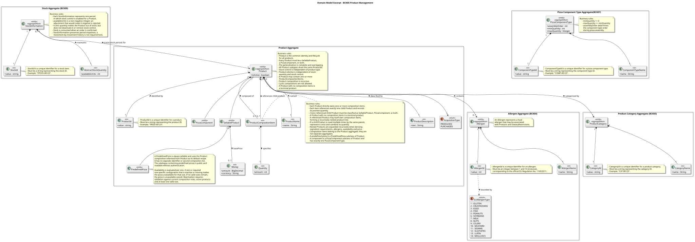
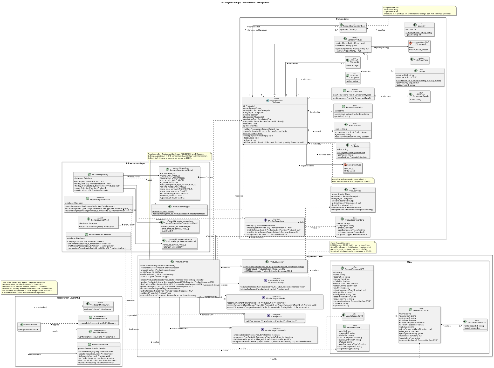
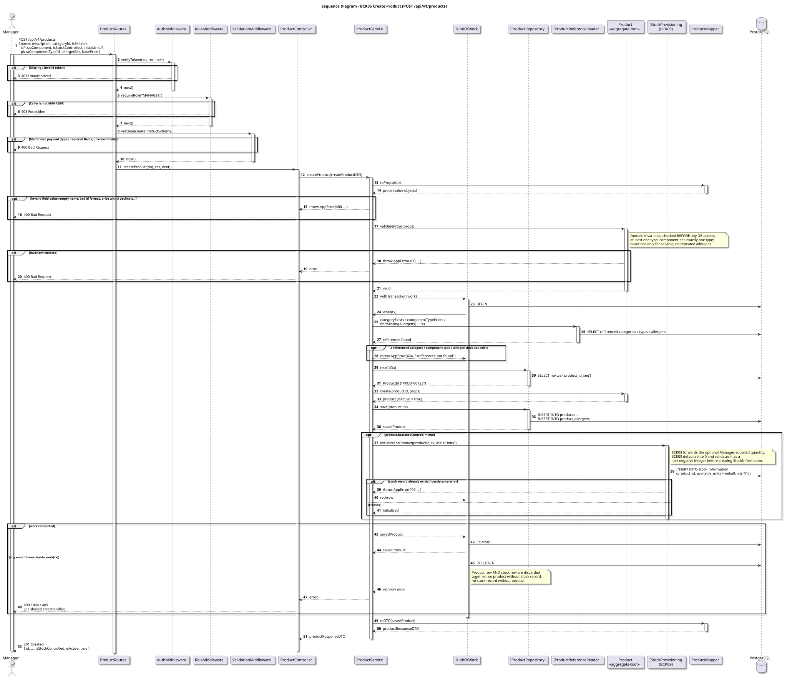
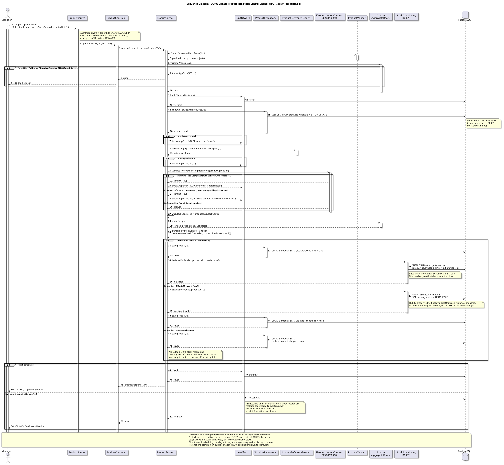
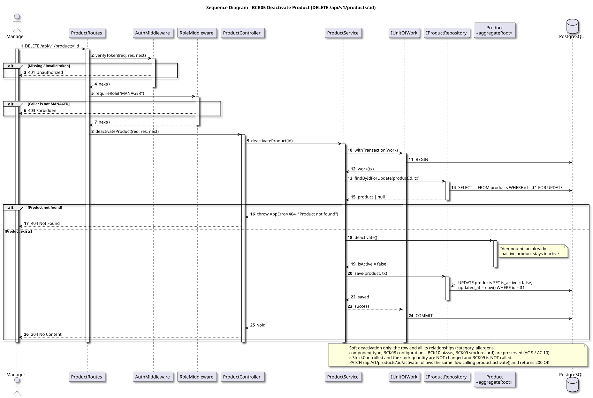
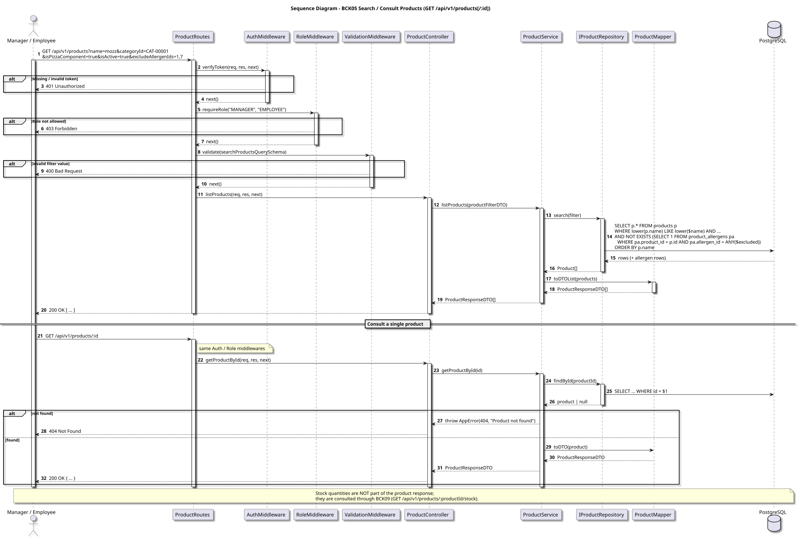

# US BCK05 – Product Management

## 1. Context & Scope

- **User Story ID:** BCK05
- **Sprint:** Sprint 1
- **Area:** Back-End (BCK)
- **Responsible:** Mariana Moreira (1240905), Leonor De Moura (1240914)
- **Related Requirements / Stories:**
    - System Specification: *PART II – System Specification, Section 3.1.2*
    - Architectural Stories: [ARC01 (Domain Modelling)](../../architecture/domainModel/domainmodel.puml), [ARC02 (System Architecture)](../../architecture/SAD.md), [ARC03 (REST API)](../../architecture/SAD.md), [ARC04 (Persistence)](../../architecture/SAD.md), [ARC05 (Automated Testing)](../../architecture/SAD.md)
    - Dependencies: BCK03 (Product Category Management), BCK04 (Allergen Management), BCK07 (Pizza Component Type Management) and BCK09 (Stock Information Management). Product information is referenced by BCK08 (Pizza Component Configuration), BCK10 (Predefined Pizza Management) and BCK11 (Product Catalogue and Product Information).

---

## 2. Requirements & Analysis

### 2.1. User Story Description
> **As a** LaPrizza Manager,  
> **I want** to register and manage products,  
> **so that** the restaurant can maintain the items relevant to its business operation.

### 2.2. Acceptance Criteria (from Sprint 1 Specification)

- [ ] **AC 1:** The system must support the creation and update of products.
- [ ] **AC 2:** Each product must have a unique identifier, a name, and a description.
- [ ] **AC 3:** A product must be associable with an appropriate Product Category.
- [ ] **AC 4:** A product may be designated as sellable, subject to stock control, suitable for use as a Pizza Component, or any applicable combination of these characteristics, according to the business rules defined in the System Specification.
- [ ] **AC 5:** A product designated as a Pizza Component must be associated with exactly one Pizza Component Type.
- [ ] **AC 6:** Sellable products must provide the commercial information required to make them available for sale.
- [ ] **AC 7:** Products may be associated with one or more allergens.
- [ ] **AC 8:** Products must be searchable and filterable using relevant information.
- [ ] **AC 9:** The system must allow products that should no longer be actively used to be distinguished without compromising historically relevant information.
- [ ] **AC 10:** Changes to product information must preserve the consistency of existing relationships with other business concepts.

### 2.3. Client Clarifications, Team Decisions & Open Questions

#### Client clarifications

> **Q6 — Product characteristics combinations:** Should the system block invalid combinations of product characteristics?  
> **Answer:** Yes. Sellable and Pizza Component are Product *types*; stock-controlled is an independent characteristic. Every Product must have at least one type (Sellable, Pizza Component or both). A Product cannot be exclusively stock-controlled nor exist without a type. Any Product, regardless of its type, may or may not be subject to stock control.

> **Q9 — Search by allergens:** Should search include or exclude products with a given allergen?  
> **Answer:** The main goal is to **exclude** products that contain certain allergens (e.g. gluten, peanuts, lactose). BCK05 search supports `excludeAllergenIds`.

> **Q3 / Pre-defined pizza prices:** The price of a predefined pizza is calculated from the size-dependent prices of its components; no base price is added. A sellable product whose price is derived from components (predefined pizza, BCK10) does not need its own `basePrice` (see BR 6).

#### Team decisions agreed with BCK09 (Stock Information Management)

| ID | Decision                                                                                                                                                                                                                                                                                                                   | Owner |
| :--- |:---------------------------------------------------------------------------------------------------------------------------------------------------------------------------------------------------------------------------------------------------------------------------------------------------------------------------| :--- |
| **D1** | BCK05 owns the Product and its `isStockControlled` characteristic. BCK09 owns the `StockInformation` record, tracking lifecycle and all stock quantities and operations.                                                                                                                                                   | BCK05 / BCK09 |
| **D2** | When a Product is created with `isStockControlled = true`, or the characteristic is enabled later (`false → true`), BCK05 calls `IStockProvisioning.initializeForProduct(productId, tx, initialUnits?)`. The Manager may provide a non-negative initial quantity; if omitted, BCK09 initializes it to `0`. BCK05 never accesses the stock repository/table. | BCK05 calls, BCK09 executes |
| **D3** | When stock control is disabled (`true → false`), BCK05 requests BCK09 to end active stock tracking and retain existing quantities/history. This succeeds even if `availableUnits > 0`; no historical information is deleted. | BCK05 calls, BCK09 executes |
| **D4** | A normal stock operation (BCK09) that brings the quantity to `0` does not deactivate the Product nor remove `isStockControlled`: the Product stays active and stock-controlled, only without available stock. BCK09 never calls BCK05 for this.                                                                            | BCK09 |
| **D5** | Product and stock changes of the same request run in one PostgreSQL transaction (`IUnitOfWork.withTransaction`). The `tx` is passed to BCK09, so any failing step rolls back both (see §3.4).                                                                                                                              | BCK05 |
| **D6** | `isActive` (activation/deactivation) is independent from stock control: deactivating/reactivating a product never calls BCK09 and never changes the stock quantity.                                                                                                                                                        | BCK05 |

### 2.4. Business Rules & Invariants

- **BR 1 (Identification):** Each product has a unique, immutable business identifier `ProductId` (`string`, format `PROD-00123`), generated by the database sequence (AC 2).
- **BR 2 (Mandatory data):** Name (1–100 characters, trimmed; **duplicate product names are fully permitted**) and description (1–500 characters, trimmed) are mandatory (AC 2).
- **BR 3 (Product Category):** A product references exactly one existing Product Category (**categories are Manager-configurable data, not a hardcoded enum**) (AC 3).
- **BR 4 (Product types):** `isSellable || isPizzaComponent` must be true. A product cannot be only stock-controlled. `isStockControlled` is independent and valid with any type (AC 4, Q6).
- **BR 5 (Pizza Component Type):** `isPizzaComponent = true` if and only if exactly one existing `pizzaComponentTypeId` is provided. A non-component product has no component type (AC 5).
- **BR 6 (Commercial information):** A sellable product with a fixed selling price must have a `basePrice` (`Money`, EUR, ≥ 0, maximum 2 decimal places - **zero price is permitted**). A sellable product whose price is derived from its component configuration, such as a predefined pizza (BCK10), must not have a `basePrice`. Non-sellable products must not have a selling `basePrice`. The pricing mode must make the fixed-price and component-derived cases distinguishable (AC 6). A sellable product requires a sale price before becoming available for sale.
- **BR 7 (Allergens):** A product references zero or more existing allergens, without duplicates (AC 7).
- **BR 8 (Search):** Products can be searched by name (partial, case-insensitive) and filtered by category, types, stock control, active state, component type, acquisition type, and by excluding allergens (AC 8, Q9).
- **BR 9 (Deactivation):** Products are never physically deleted by the API. `isActive = false` distinguishes products no longer in use while keeping every relationship and the stock record (AC 9).
- **BR 10 (Referential integrity):** Changes keep references valid. Database foreign keys with `ON DELETE RESTRICT` protect persisted references. Cross-story rules must also be checked by the application because foreign keys alone do not decide whether an existing relationship remains valid after a Product update (AC 10).
- **BR 10.1 (Cross-story references — client-confirmed policy):** A Product used by an existing BCK08 component-size configuration or BCK10 predefined pizza cannot be changed in a way that invalidates that reference. Until coordinated update operations are available, BCK05 rejects such changes with `409 Conflict`. Deactivation is allowed and preserves the existing references. The BCK08/BCK10 adapters must enforce this policy transactionally.
- **BR 11 (Stock-control lifecycle — client clarification):** `isStockControlled = true` requires an active stock tracking record. When disabled, tracking becomes inactive but previous stock information remains available historically. A historical record may therefore exist for a Product with `isStockControlled = false`; BCK09 represents this with current/historical tracking periods.
- **BR 12 (Active state vs. stock):** `isActive` and stock quantity are independent facts (D4, D6):

| `isActive` | `isStockControlled` | Stock (BCK09) | Meaning |
| :--- | :--- | :--- | :--- |
| `true` | `true` | `> 0` | Active, stock available |
| `true` | `true` | `0` | Active but out of stock; no automatic state change |
| `false` | `true` | any | Deactivated by the Manager; stock is kept |
| `true`/`false` | `false` | historical record may exist (not active) | No current stock control; history retained |

- **BR 13 (Acquisition type):** Every product has exactly one `acquisitionType`, `PRODUCED` or `PURCHASED`.
- **BR 14 (Composition):** A product may have zero or more composition items. Each item references exactly one existing child Product and a positive integer quantity. The child must be a Sellable Product, a Pizza Component, or both. The composition is recursive but must be acyclic, and a product cannot contain itself. If the same child appears more than once under the same parent, it is represented once with the quantities combined. A product with no composition items is a terminal product.

### 2.5. Domain Model Excerpt

- **Product** (aggregate root): identity, name, description, types (sellable / pizza component), stock-control characteristic, active state, pricing mode, optional fixed base price, acquisition type, and recursive composition items. It references its Category and Allergens by ID; a Pizza Component also references its Component Type.
- **Product Category (BCK03)**, **Allergen (BCK04)** and **Pizza Component Type (BCK07)** are separate referenced aggregates.
- **StockInformation (BCK09)** is a separate aggregate. Active tracking exists only for stock-controlled products; inactive historical records may remain and are managed only by BCK09.
- A predefined pizza's price is derived from the size-dependent prices of its components. Those component prices belong to BCK08 configurations, not to the Product's fixed `basePrice`.
- **Hierarchy:** `Product` is specialised into `SellableProduct` and `PizzaComponent` (complete and overlapping: a product is one, the other, or both). `PredefinedPizza` specialises `SellableProduct`.




> PlantUML source: [`excerptDomainModel/domain_model_excerpt.puml`](./excerptDomainModel/domain_model_excerpt.puml).

---

## 3. Design

### 3.1. Architecture & C4 Alignment

- **C4 Level 1 (System Context):** The LaPrizza Manager interacts with the *LaPrizza Information System* via HTTPS ([SAD](../../architecture/SAD.md)).
- **C4 Level 2 (Containers):** Requests target the *Back-End API* (Node.js / Express), which persists state in *PostgreSQL*.
- **C4 Level 3 (Components):** This US is the `product-management` module (`backend/src/modules/product-management`). It depends on the `stock-information-management` module (BCK09) only through the `IStockProvisioning` application contract, injected by the composition root. It does not import BCK09 repositories or access the `stock_information` table directly.

### 3.2. Class Diagram (CD)



> PlantUML source: [`classDiagram/class_diagram.puml`](./classDiagram/class_diagram.puml).

Key design points:

- `ProductService` orchestrates each use case. It depends on `IProductRepository`, `IProductReferenceReader`, `IProductImpactChecker`, `IUnitOfWork` and `IStockProvisioning`.
- The production composition root injects `stockModule.stockProvisioning` from BCK09 into BCK05. The temporary pending adapter has been removed; module construction fails if the cross-story contract is not supplied.
- `StockControlTransition.between(before, after)` returns `NONE`, `ENABLED` or `DISABLED`, so the service can coordinate the BCK09 call.
- `IProductRepository.findByIdForUpdate(id, tx)` locks the Product row before a stock-control transition. If BCK09 uses the same Product → stock lock order, this prevents a concurrent stock change between checking the quantity and removing stock control.
- `ProductMapper` (application) maps the aggregate to response DTOs. `ProductRowMapper` (infrastructure) maps database rows to and from the domain model.
- Query validation and route-parameter validation use dedicated schemas; the current body-validation middleware alone is not sufficient for filters and IDs.

### 3.3. Sequence Diagrams (SD)

#### SD 1 — Create Product (AC 1–7, BR 11)



> PlantUML source: [`sequenceDiagram/sequence_diagram_create_product.puml`](./sequenceDiagram/sequence_diagram_create_product.puml).

#### SD 2 — Update Product (AC 1, AC 10, BR 11)



> PlantUML source: [`sequenceDiagram/sequence_diagram_update_product.puml`](./sequenceDiagram/sequence_diagram_update_product.puml).

#### SD 3 — Deactivate / Reactivate Product (AC 9, BR 12)



> PlantUML source: [`sequenceDiagram/sequence_diagram_deactivate_product.puml`](./sequenceDiagram/sequence_diagram_deactivate_product.puml).

#### SD 4 — Search and Consult Products (AC 8)



> PlantUML source: [`sequenceDiagram/sequence_diagram_consult_search_products.puml`](./sequenceDiagram/sequence_diagram_consult_search_products.puml).

### 3.4. Cross-Story Contract with BCK09 (Stock Provisioning)

#### Responsibilities

| Concern | BCK05 (Product Management) | BCK09 (Stock Information) |
| :--- | :--- | :--- |
| `Product.isStockControlled` | Owns, validates and persists | Reads only when needed |
| Initialize / disable active `stock_information` tracking | Requests through `IStockProvisioning` | Executes |
| Initial quantity | Accepts optional Manager input and passes it during provisioning | Validates and stores the supplied non-negative integer; defaults to `0` |
| Increase / decrease quantity | Never | Owns (`POST /products/:id/stock-adjustments`) |
| Disable stock tracking regardless of units | Requests lifecycle transition | Preserves history and deactivates tracking |
| Transaction | Opens it with `withTransaction` and passes `tx` | Uses the received `tx` |

#### Contract (owned by BCK09)

`productId` crosses the module boundary as a business identifier string. BCK09 may convert it to its own internal `ProductId` value object.

```ts
interface IStockProvisioning {
  initializeForProduct(productId: string, tx: TransactionContext, initialUnits?: number): Promise<void>;
  disableForProduct(productId: string, tx: TransactionContext): Promise<void>;
}
````

- `initializeForProduct` creates a current tracking period with the supplied `initialUnits`, or `0` when omitted. A quantity is sent only when stock control is first enabled; an ordinary update that leaves it enabled never resets existing stock.
- `disableForProduct` stops active tracking regardless of quantity and retains the last quantity and historical information.
- BCK05 never reads or writes stock quantities.

**When BCK05 calls it**

| Operation | `isStockControlled` before → after | BCK05 call (same tx) | Order inside the transaction |
| :--- | :--- | :--- | :--- |
| `POST /products` | — → `false` | none | Insert Product |
| `POST /products` | — → `true` | `initializeForProduct(productId, tx, initialUnits?)` | Insert Product → initialize stock with supplied quantity or zero |
| `PUT /products/:id` | `false → false` / `true → true` | none | Lock Product → update Product |
| `PUT /products/:id` | `false → true` (ENABLED) | `initializeForProduct(productId, tx, initialUnits?)` | Lock Product → update Product → initialize stock with supplied quantity or zero |
| `PUT /products/:id` | `true → false` (DISABLED) | `disableForProduct(productId, tx)` | Lock Product → disable active tracking / preserve history → update Product |
| `DELETE /products/:id`, `PATCH …/activate` | unchanged | none | Update `is_active` only |

### 3.5. REST API Specification (ARC03)

| Method | Endpoint | Description | Auth / Role |
| :--- | :--- | :--- | :--- |
| `POST` | `/api/v1/products` | Creates a product (provisions stock if `isStockControlled`) | Manager |
| `GET` | `/api/v1/products` | Searches / filters products | Manager, Employee |
| `GET` | `/api/v1/products/:id` | Gets one product | Manager, Employee |
| `PUT` | `/api/v1/products/:id` | Replaces the editable state (may enable/disable stock control) | Manager |
| `DELETE` | `/api/v1/products/:id` | Soft-deactivates (`isActive = false`) | Manager |
| `PATCH` | `/api/v1/products/:id/activate` | Reactivates (`isActive = true`) | Manager |

`PUT` uses **full-replacement** semantics: the body carries the complete editable state (same fields as create). `isActive` is not accepted in `POST`/`PUT` bodies; it is changed through `DELETE` or `PATCH …/activate`. Stock quantities are never returned by BCK05; `initialUnits` is only a provisioning input (see 3.4). Use BCK09 `GET /api/v1/products/:productId/stock` to read stock.


### 3.5. REST API Specification (ARC03)

| Method | Endpoint | Description | Auth / Role |
| :--- | :--- | :--- | :--- |
| `POST` | `/api/v1/products` | Creates a product (provisions stock if `isStockControlled`) | Manager |
| `GET` | `/api/v1/products` | Searches / filters products | Manager, Employee |
| `GET` | `/api/v1/products/:id` | Gets one product | Manager, Employee |
| `PUT` | `/api/v1/products/:id` | Replaces the editable state (may enable/disable stock control) | Manager |
| `DELETE` | `/api/v1/products/:id` | Soft-deactivates (`isActive = false`) | Manager |
| `PATCH` | `/api/v1/products/:id/activate` | Reactivates (`isActive = true`) | Manager |

`PUT` uses **full-replacement** semantics: the body carries the complete editable state (same fields as create). `isActive` is not accepted in `POST`/`PUT` bodies; it is changed through `DELETE` or `PATCH …/activate`. Stock quantities are never returned by BCK05; `initialUnits` is only a provisioning input (see 3.4). Use BCK09 `GET /api/v1/products/:productId/stock` to read stock.

#### Request & Response Schemas

- **Create — `POST /api/v1/products`** (the `PUT` body has the same shape)

```json
{
  "name": "Mozzarella Cheese",
  "description": "Shredded fresh mozzarella cheese for pizza topping",
  "categoryId": "CAT-00001",
  "isSellable": false,
  "isPizzaComponent": true,
  "isStockControlled": true,
  "initialUnits": 50,
  "pizzaComponentTypeId": "<BCK07 component type ID>",
  "allergenIds": [7],
  "pricingMode": null,
  "basePrice": null,
  "acquisitionType": "PURCHASED",
  "compositionItems": []
}
```

- **Success — `201 Created`** (`PUT` → `200 OK`)

```json
{
  "id": "PROD-00123",
  "name": "Mozzarella Cheese",
  "description": "Shredded fresh mozzarella cheese for pizza topping",
  "categoryId": "CAT-00001",
  "isSellable": false,
  "isPizzaComponent": true,
  "isStockControlled": true,
  "isActive": true,
  "pizzaComponentTypeId": "<BCK07 component type ID>",
  "allergenIds": [7],
  "pricingMode": null,
  "basePrice": null,
  "acquisitionType": "PURCHASED",
  "compositionItems": [],
  "createdAt": "2026-10-15T12:00:00.000Z",
  "updatedAt": "2026-10-15T12:00:00.000Z"
}
```

For a stock-controlled Product, BCK09 returns the supplied `initialUnits`, or `0` when the field was omitted, from `GET /api/v1/products/PROD-00123/stock`. The value is a provisioning input, so it is not included in the Product response. An ordinary `PUT` that keeps stock control enabled does not reset the existing quantity.

A composed product lists its items in `compositionItems`, each with a child product identifier and a positive quantity:

```json
"compositionItems": [
  { "childProductId": "PROD-00045", "quantity": 2 }
]
```

- **Search — `GET /api/v1/products?name=mozz&categoryId=CAT-00001&isPizzaComponent=true&acquisitionType=PURCHASED&isActive=true&excludeAllergenIds=1,7`** returns `200 OK` with an array of product response objects.
- Query parameters and route IDs must be validated with dedicated schemas. Invalid values return `400 Bad Request`; a valid ID that does not identify a Product returns `404 Not Found`.

- **Error responses** use the standard shape `{ "error": { "message": "...", "status": 409 } }`:
    - `400 Bad Request`: invalid payload or filters; invalid type combination (BR 4); missing/extra component type (BR 5); invalid price/pricing-mode combination (BR 6); malformed route ID.
    - `401 Unauthorized`: missing/invalid token.
    - `403 Forbidden`: role not allowed.
    - `404 Not Found`: product or referenced category, component type or allergen not found.
    - `409 Conflict`: an update would invalidate an existing BCK08/BCK10 reference. Duplicate product names are permitted. Disabling stock control with non-zero units is permitted by the client and must preserve historical stock data.

### 3.6. Persistence & Data Integrity (ARC04)

Migration `backend/migrations/00XX_products.sql` must run after the migrations that create the referenced BCK03, BCK04 and BCK07 tables.

**Table `products`**

| Column | Type | Constraints / Notes |
| :--- | :--- | :--- |
| `id` | `VARCHAR(32)` | PK; `CHECK (id ~ '^PROD-[0-9]{5,}$')`; generated from sequence |
| `name` | `VARCHAR(100)` | `NOT NULL`; `CHECK (length(btrim(name)) BETWEEN 1 AND 100)` — **duplicates allowed (no UNIQUE constraint)** |
| `description` | `VARCHAR(500)` | `NOT NULL`; `CHECK (length(btrim(description)) BETWEEN 1 AND 500)` |
| `category_id` | `VARCHAR(32)` | `NOT NULL`, FK → `product_categories(id) ON DELETE RESTRICT` (**dynamic table, not an enum**) |
| `is_sellable` | `BOOLEAN` | `NOT NULL DEFAULT FALSE` |
| `is_pizza_component` | `BOOLEAN` | `NOT NULL DEFAULT FALSE` |
| `is_stock_controlled` | `BOOLEAN` | `NOT NULL DEFAULT FALSE` |
| `is_active` | `BOOLEAN` | `NOT NULL DEFAULT TRUE` |
| `pizza_component_type_id` | `VARCHAR(32)` | `NULL`, FK → `pizza_component_types(id) ON DELETE RESTRICT` |
| `pricing_mode` | `VARCHAR(32)` | `NULL` for non-sellable; `FIXED` or `COMPONENT_BASED` for sellable |
| `base_price_amount` | `NUMERIC(10,2)` | `NULL`, `CHECK (base_price_amount >= 0)` — **zero price permitted** |
| `base_price_currency` | `CHAR(3)` | `NULL`, `CHECK (base_price_currency = 'EUR')` |
| `acquisition_type` | `VARCHAR(32)` | `NOT NULL`, `PRODUCED` or `PURCHASED` |
| `created_at`, `updated_at` | `TIMESTAMPTZ` | `NOT NULL DEFAULT now()` |

**Table `product_allergens`**: `product_id VARCHAR(32)` FK → `products(id)`, `allergen_id INTEGER` FK → `allergens(id) ON DELETE RESTRICT`, `PRIMARY KEY (product_id, allergen_id)`.

**Table `product_compositions`**: `parent_product_id VARCHAR(32)`, `child_product_id VARCHAR(32)`, `quantity INT` (positive integer, BR 14), `PRIMARY KEY (parent_product_id, child_product_id)`.

**Integrity rules (DB as last line of defence):**

- `CHECK (is_sellable OR is_pizza_component)` → BR 4.
- `CHECK (is_pizza_component = (pizza_component_type_id IS NOT NULL))` → BR 5.
- CHECK: non-sellable → mode `NULL` and no base price; sellable `FIXED` → non-negative EUR price; sellable `COMPONENT_BASED` → no base price. `COMPONENT_BASED` is reserved for BCK10 predefined pizza configurations; validate eligibility in the application → BR 6.
- FKs with `ON DELETE RESTRICT` protect categories, component types and allergens referenced by products (BCK03/BCK04/BCK07 rely on this).
- BR 11 (`is_stock_controlled` if and only if active tracking exists) spans two modules/tables and is coordinated through the transaction in 3.4.
- BCK09's `stock_information` records reference `products(id)` with `ON DELETE RESTRICT`. A product has at most one active tracking period at a time; historical periods are kept (BR 11).
- All queries are parameterized. The repository maps unique identifier violations (`23505`) to `409`; duplicate names never cause conflicts; reference conflicts must be mapped consistently with the API contract.
- FKs protect persisted references but do not replace application checks for BCK08/BCK10 update rules.

### 3.7. Responsibilities, Patterns & Architecture Principles

- **Domain**: the Product aggregate validates local invariants such as required values, type combinations, component-type requirement and pricing rules.
- **Application**: use cases check referenced aggregates, check cross-story impact, coordinate transactions and call BCK09 through its port.
- **Database**: enforces uniqueness, foreign keys and persistent integrity constraints as the final line of defence.
- **API**: validates request shape, query parameters and route IDs, then maps application/domain errors to HTTP responses.
- **Clean / Layered Architecture**: API → Application → Domain ← Infrastructure.
- **Aggregate Root (DDD)**: `Product` protects its local rules; `StockInformation` remains a separate aggregate owned by BCK09.
- **Ports & Adapters**: `IProductRepository`, `IProductReferenceReader`, `IProductImpactChecker`, `IUnitOfWork` and `IStockProvisioning` are injected through the composition root.
- **Unit of Work**: Product and stock changes in the same request use the same transaction where supported by the BCK09 contract.
- **Value Objects**: `ProductId`, `ProductName`, `ProductDescription`, `Money`, `CategoryId`, `ComponentTypeId` and `AllergenId`.
- **DTO / Mapper**: application DTOs are mapped separately from persistence rows.

## 4. Tests (ARC05)

### 4.1. Test Plan & Scenarios

| Test ID | Level | Scenario | Expected |
| :--- | :--- | :--- | :--- |
| **UT01** | Unit (Domain) | Sellable product with valid data | Created, `isActive = true` |
| **UT02** | Unit (Domain) | No type (`isSellable = isPizzaComponent = false`) | Rejected as invalid domain state |
| **UT03** | Unit (Domain) | Only `isStockControlled = true` | Rejected as invalid domain state |
| **UT04** | Unit (Domain) | Pizza component without type / non-component with type | Error 400 |
| **UT05** | Unit (Domain) | Fixed-price sellable product without a price | Rejected |
| **UT06** | Unit (Domain) | Non-sellable product with a selling price | Rejected |
| **UT07** | Unit (Domain) | Component-derived sellable product with no base price | Accepted only when pricing mode and product use case permit it |
| **UT08** | Unit (Domain) | Negative price, unsupported currency or more than two decimal places | Rejected |
| **UT09** | Unit (Domain) | `StockControlTransition.between` for all before/after combinations | Correct transition returned |
| **UT10** | Unit (Application) | Create with stock control enabled | BCK09 receives `productId`, same transaction and `initialUnits` (default 0) |
| **UT11** | Unit (Application) | Create without stock control | BCK09 not called |
| **UT12** | Unit (Application) | Update stock control `false → true`, `true → false`, unchanged | Correct initialization/disable call and initial quantity; no reset when unchanged |
| **UT13** | Unit (Application) | Disable stock control with non-zero quantity | Success; history retained and active tracking disabled |
| **UT14** | Unit (Application) | Duplicate Product name | Accepted; two different `ProductId`s |
| **UT15** | Unit (Application) | Missing category, component type or allergen | Reference error; no Product update |
| **UT16** | Unit (Application) | Update would invalidate existing BCK08/BCK10 reference | 409 |
| **UT17** | Unit (Domain) | Missing or invalid `acquisitionType`; composition item with non-positive quantity; same child repeated under one parent | Invalid values rejected; repeated child represented once with quantities combined |
| **IT01** | Integration (API) | Create valid Product as Manager | 201 Created |
| **IT02** | Integration (API) | Invalid body/type/pricing combination | 400 Bad Request |
| **IT03** | Integration (API) | Missing token or disallowed role | 401 / 403 |
| **IT04** | Integration (API) | Invalid query value or malformed route ID | 400 Bad Request |
| **IT05** | Integration (API) | Search excluding an allergen | Products containing the excluded allergen are omitted |
| **IT06** | Integration (API) | Valid but unknown Product ID | 404 Not Found |
| **IT07** | Integration (API) | Search filtered by `acquisitionType` | Only products with that acquisition type are returned |
| **DB01** | PostgreSQL | Create stock-controlled Product | Product and stock row committed; quantity is Manager-supplied or 0 |
| **DB02** | PostgreSQL | Provisioning fails during Product creation | Rollback; no Product or stock row remains |
| **DB03** | PostgreSQL | Disable stock control while quantity is non-zero | Success; historical stock remains queryable |
| **DB04** | PostgreSQL | Disable stock control when quantity is zero | Current snapshot becomes historical; flag false; Product active state unchanged |
| **DB05** | PostgreSQL | BCK09 reduces quantity to zero | Product remains active and stock-controlled |
| **DB06** | PostgreSQL | Deactivate Product | Product becomes inactive; references and stock row remain |
| **DB07** | PostgreSQL | Concurrent stock update and stock-control removal | No inconsistent committed state; transaction/locking policy is respected |
| **DB08** | PostgreSQL | Update Product referenced by BCK08/BCK10 | Rejected with 409 under client-confirmed policy |
| **DB09** | PostgreSQL (BCK05+BCK09 integration) | Create or enable tracking with `initialUnits`; update Product while still controlled | Real BCK09 port receives quantity on enable; ordinary update preserves current quantity |

### 4.2. Sample Test Implementations

#### PostgreSQL test — rollback keeps product and stock consistent

```javascript
// tests/integration/product-management/postgres.test.js
// Runs with RUN_DATABASE_TESTS=1 and an isolated database.
it('does not persist the product when stock provisioning fails', async () => {
  const failingStock = {
    initializeForProduct: async () => {
      throw new Error('boom');
    },
  };

  const module = createProductManagementModule({
    database,
    userService,
    stockProvisioning: failingStock,
  });

  await expect(
    module.productService.createProduct(validDto({ isStockControlled: true })),
  ).rejects.toThrow();

  const { rows } = await database.query(
    'SELECT 1 FROM products WHERE id = $1',
    ['PROD-00123'],
  );

  expect(rows).toHaveLength(0);
});
```

---

## 5. Implementation
### 5.1. File Structure

```text
backend/
├── migrations/
│   └── 00XX_products.sql
├── src/modules/product-management/
│   ├── api/
│   │   ├── controllers/ProductController.js
│   │   ├── routes/ProductRoutes.js
│   │   ├── schemas.js
│   │   └── openapi.js
│   ├── application/
│   │   ├── dtos/{CreateProductDTO,UpdateProductDTO,ProductFilterDTO,ProductResponseDTO}.js
│   │   ├── mapping/ProductMapper.js
│   │   ├── ports/{IProductReferenceReader,IProductImpactChecker,IUnitOfWork}.js
│   │   └── services/ProductService.js
│   ├── domain/
│   │   ├── model/{Product,ProductId,ProductName,ProductDescription,Money,StockControlTransition}.js
│   │   ├── search/ProductSearchCriteria.js
│   │   └── repositories/IProductRepository.js
│   ├── infrastructure/persistence/
│   │   ├── ProductRepository.js
│   │   ├── ProductReferenceReader.js
│   │   ├── ProductRowMapper.js
│   │   └── ProductPersistenceModel.js
│   └── index.js
└── tests/
    ├── helpers/MemoryProductRepository.js
    ├── unit/product-management/{domain.test.js,service.test.js,openapi.test.js}
    └── integration/product-management/{api.test.js,postgres.test.js}
```

## 6. Integration, Verification & Demonstration

### 6.1. Running the Automated Tests
```bash
cd backend
npm test -- tests/unit/product-management tests/integration/product-management/api.test.js
npm run test:db
```

### 6.2. Manual Verification

Use Swagger UI at `http://localhost:8080/api-docs`:
1. `POST /api/v1/products` with a valid payload as Manager, optionally including `initialUnits` when enabling stock control → 201.
2. `GET /api/v1/products/{id}/stock` (BCK09) → supplied `availableUnits`, or `0` if `initialUnits` was omitted.
3. Increase stock through BCK09, then `PUT /api/v1/products/{id}` with `isStockControlled: false` → `200`, even when units remain.
4. Confirm BCK09 tracking is inactive and previous units/history remain queryable through its historical interface.
5. Reactivate stock control → tracking is re-enabled using the agreed BCK09 lifecycle policy; never silently discard historical records.
6. `DELETE /api/v1/products/{id}` → `204`; subsequent retrieval shows `isActive: false`; `PATCH .../activate` restores it.
7. Attempt to remove Pizza Component classification while referenced by BCK08/BCK10 → `409`.
8. Create two Products with the same name → **both succeed with distinct IDs** (duplicate names permitted).
9. Deactivate a referenced Pizza Component → operation succeeds; dependent Predefined Pizzas become unavailable.

---

## 7. Observations, Dependencies & Limitations

- **Dependencies**: BCK01 (Authentication/RBAC), BCK03 (Product Categories), BCK04 (Allergens), BCK07 (Pizza Component Types) and BCK09 (Stock Information).
- **Downstream Impact**: Product records are referenced by BCK08 (Component Size Configurations), BCK09 (Stock Information Management), BCK10 (Predefined Pizzas) and BCK11 (Product Catalogue).
- **Identifier alignment**: `categoryId` follows the `CAT-00123` format, `pizzaComponentTypeId` follows `COMP-00123` and `allergenIds` are integers from 1 to 14, as defined by the domain model. Examples, schemas and persistence use these types.
- **Cross-story update policy**: Rejecting changes that invalidate existing BCK08/BCK10 references with 409 Conflict is required by the client.


## Client clarifications — authoritative reconciliation (2026-10)

The client's explicit answers supersede earlier assumptions in this document. The revised business contract is:

- Product names need **not** be unique; ProductId is unique.
- Exactly one Product Category is mandatory on creation, including component-only products. Categories are Manager-configurable; the suggested six categories are initial data, not an enum.
- A Product must be Sellable, Pizza Component, or both. StockControlled is an independent optional characteristic.
- A Pizza Component has exactly one Pizza Component Type. A Predefined Pizza's Product must be Sellable and **not** Pizza Component.
- Sellable fixed-price Products may have price zero, never negative. A Sellable Product requires a sale price **before becoming available for sale**; predefined pizza pricing derives from size-specific component prices.
- Removing Pizza Component classification is forbidden while BCK08 configurations or BCK10 predefined pizzas still reference the product.
- Deactivating a component is allowed and retains references; predefined pizzas using it become unavailable until reconfiguration or reactivation. Deactivated Products remain administratively readable/editable and may be reactivated.
- Product active/inactive status is independent of stock quantity. Stock consumption occurs upon **order confirmation** (future ordering workflow).
- Disabling StockControlled is allowed even when units remain, and stock history must be preserved.


