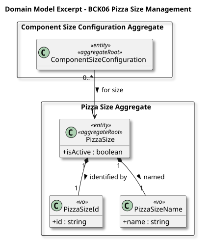
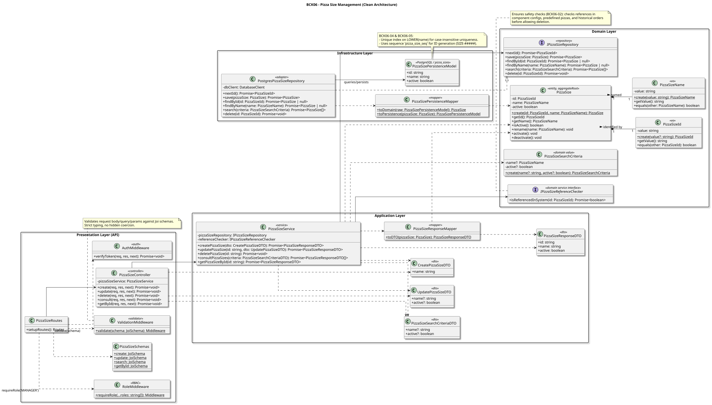
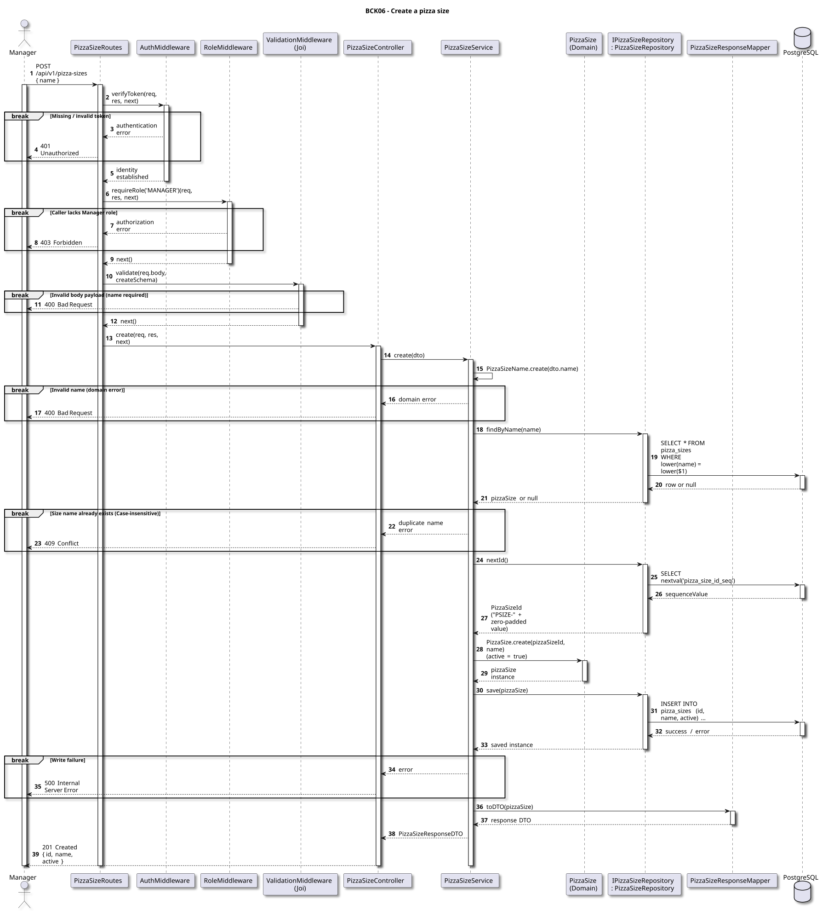

# US BCK06 – Pizza Size Management

## 1. Context & Scope

- **User Story ID:** BCK06
- **Sprint:** Sprint 1
- **Area:** Back-End (BCK)
- **Responsible:** Mariana Moreira (1240905)
- **Related Requirements / Stories:**
  - System Specification: *PART II – System Specification, Section II.3.1.3 (Pizzas, Sizes, and Components), Section II.3.2 (Web Application - Pizza Configuration)*
  - Architectural Stories: [ARC01 (Domain Modelling)](../../architecture/domainmodel.puml), [ARC02 (System Architecture)](../../architecture/SAD.md), [ARC03 (REST API)](../../architecture/SAD.md), [ARC04 (Persistence)](../../architecture/SAD.md), [ARC05 (Automated Testing)](../../architecture/SAD.md)
  - Dependencies: BCK01 (User and Authentication Management - provides authentication and Manager role authorization for pizza size write operations). Pizza Sizes are later referenced by BCK08 (Pizza Component Configuration) and BCK10 (Predefined Pizza Management).

---

## 2. Requirements & Analysis

### 2.1. User Story Description

> **As a** LaPrizza Manager,
> **I want** to maintain the pizza sizes offered by the restaurant,
> **so that** pizza configurations and size-dependent information can refer to a consistent set of available sizes.

### 2.2. Acceptance Criteria (from Sprint 1 Specification)

- [x] **AC 1:** The system must maintain the Pizza Sizes recognized by LaPrizza.
- [x] **AC 2:** Each Pizza Size must have a unique identifier and a descriptive name.
- [x] **AC 3:** Pizza Sizes must be available for use in pizza-related configurations.
- [x] **AC 4:** Pizza Sizes must be searchable using relevant identifying information.
- [x] **AC 5:** The system must allow the set of available Pizza Sizes to evolve without compromising existing business information.
- [x] **AC 6:** A Pizza Size referenced by existing business information must not be removed in a manner that compromises its consistency.

### 2.3. Implementation Decisions

- Pizza Size identifiers use the system-generated `PSIZE-` sequence format and are unique and immutable.
- The set of Pizza Sizes is configurable; no predefined values are inserted by the BCK06 migration.
- Deletion is rejected with `409 Conflict` when a Pizza Size is referenced and removing it would compromise data consistency.

### 2.4. Business Rules & Invariants

- **BR 1 (Identification):** Each Pizza Size has a unique identifier (`PizzaSizeId`, e.g., `PSIZE-0001`), generated by the system sequence and immutable after creation (AC 2).
- **BR 2 (Descriptive name):** A Pizza Size must have a descriptive name (e.g., "Small" or another manager-defined name); it cannot be null or blank (AC 2).
- **BR 3 (Name uniqueness):** Pizza Size names must be unique across the system (case-insensitive), so that two sizes cannot be confused with each other (AC 2, AC 4).
- **BR 4 (Availability for configurations):** Pizza Sizes are reference data that other domain concepts (e.g., `ComponentSizeConfiguration`) refer to; they must be available for selection when those configurations are defined (AC 3).
- **BR 5 (Searchability):** Pizza Sizes must be searchable/retrievable by identifier, descriptive name, and active status (AC 4).
- **BR 6 (Evolution of the set of sizes):** New Pizza Sizes may be added and existing ones updated (renamed, activated/deactivated) without invalidating existing reference configurations (AC 5).
- **BR 7 (Referential Integrity / Protected Deletion):** A Pizza Size referenced by active business information (e.g., `ComponentSizeConfiguration`) cannot be removed in a way that compromises system consistency (AC 6).

### 2.5. Domain Model Excerpt

Relevant domain concepts and aggregates directly involved in this User Story, following the exact structure of the global `LaPrizzaDomainModel`:

- **PizzaSize:** entity / aggregate root representing a pizza size offered by the restaurant.
- **PizzaSizeId:** value object encapsulating the unique identifier for a size (e.g., `PSIZE-0001`).
- **PizzaSizeName:** value object encapsulating the unique descriptive name for a size (e.g., "Small" or another manager-defined name).
- **ComponentSizeConfiguration:** external aggregate root that references a `PizzaSize` (`for size`) to define the price and stock units consumed by a Pizza Component for that specific size. This reference link enforces **BR 7** and protects the `PizzaSize` from deletion.



> PlantUML source: [`excerptDomainModel/domain_model_excerpt.puml`](./excerptDomainModel/domain_model_excerpt.puml).

---

## 3. Design

### 3.1. Architecture & C4 Alignment

This User Story operates within the established **C4 Model** of the system:

- **C4 Level 1 (System Context):** The actor (LaPrizza Manager) interacts with the *LaPrizza Information System* via HTTPS ([System Architecture and Design](../../architecture/SAD.md)).
- **C4 Level 2 (Containers):** The request originates from the *UI* and targets the *Back-End API*, which persists state in the *Database* ([System Architecture and Design](../../architecture/SAD.md)).
- **C4 Level 3 (Component Diagram):** As defined in the global Back-End architecture ([System Architecture and Design](../../architecture/SAD.md)); this US belongs to the `pizza-size-management` module.

---

### 3.2. Class Diagram (CD)

Structural design of the classes participating in this User Story, organized by Clean / Layered Architecture:



> PlantUML source: [`classDiagram/class_diagram.puml`](./classDiagram/class_diagram.puml).

---

### 3.3. Sequence Diagrams (SD)

Dynamic interaction views tracing message flows across the classes modeled above:

- **SD01 — Create Pizza Size (`POST /api/v1/pizza-sizes`):** Registers a new pizza size with system ID and descriptive name.
- **SD02 — Update Pizza Size (`PUT /api/v1/pizza-sizes/:id`):** Updates name and/or active state for an existing pizza size.
- **SD03 — Delete Pizza Size (`DELETE /api/v1/pizza-sizes/:id`):** Deletes a pizza size only if `isReferencedByOtherEntities()` confirms that it is not in use (AC 6).



> PlantUML sources:
> - [`sequence_diagram_create_pizza_size.puml`](./sequenceDiagram/sequence_diagram_create_pizza_size.puml)
> - [`sequence_diagram_update_pizza_size.puml`](./sequenceDiagram/sequence_diagram_update_pizza_size.puml)
> - [`sequence_diagram_delete_pizza_size.puml`](./sequenceDiagram/sequence_diagram_delete_pizza_size.puml)

---

### 3.4. REST API Specification (ARC03)

| Method | Endpoint | Description | Auth / Role |
| :--- | :--- | :--- | :--- |
| `POST` | `/api/v1/pizza-sizes` | Creates a new pizza size | Manager |
| `GET` | `/api/v1/pizza-sizes` | Lists / searches all pizza sizes, including active-state filtering | Public (including Staff and Manager) |
| `GET` | `/api/v1/pizza-sizes/:id` | Gets details of an individual pizza size | Public (including Staff and Manager) |
| `PUT` | `/api/v1/pizza-sizes/:id` | Updates pizza size details (rename / activate / deactivate) | Manager |
| `DELETE` | `/api/v1/pizza-sizes/:id` | Removes a pizza size (if not referenced) | Manager |

#### Request & Response Schemas

- **Create Pizza Size — Request (`POST /api/v1/pizza-sizes`):**

```json
{
  "name": "Small"
}
```

- **Create Pizza Size — Success (`POST /api/v1/pizza-sizes`):**
  - **Status Code:** `201 Created`
  - **Payload:**

```json
{
  "id": "PSIZE-0001",
  "name": "Small",
  "active": true
}
```

- **Update Pizza Size — Request (`PUT /api/v1/pizza-sizes/PSIZE-0001`):**

```json
{
  "name": "Small Special",
  "active": false
}
```

- **List / Search Pizza Sizes — Success (`GET /api/v1/pizza-sizes?name=Small&active=true`):**
  - **Status Code:** `200 OK`
  - **Example payload, assuming these sizes were previously created:**

```json
[
  { "id": "PSIZE-0001", "name": "Small", "active": true },
  { "id": "PSIZE-0002", "name": "Medium", "active": true },
  { "id": "PSIZE-0003", "name": "Large", "active": true }
]
```

- **Delete Pizza Size — Success (`DELETE /api/v1/pizza-sizes/PSIZE-0001`):**
  - **Status Code:** `204 No Content` (no body)

- **Error Responses:**
  - `400 Bad Request`: Validation failure (missing name, invalid path ID format, or invalid active filter).
  - `401 Unauthorized`: Missing or invalid JWT token on write operations.
  - `403 Forbidden`: Authenticated user lacks MANAGER role on write operations.
  - `404 Not Found`: Pizza size ID not found.
  - `409 Conflict`: Pizza size is referenced by component configurations and cannot be deleted, or name already exists.

- **Standard error format:**

```json
{
  "error": "Descriptive error message"
}
```

---

### 3.5. Persistence & Data Integrity (ARC04)

- **Persistence Entity / Table Name:** `pizza_sizes`
- **Fields & Constraints:**

| Column | Type | Constraints / Notes |
| --- | --- | --- |
| `id` | VARCHAR(32) | Primary Key (`PSIZE-0001`); maps to `PizzaSizeId` |
| `name` | VARCHAR(50) | NOT NULL, UNIQUE |
| `active` | BOOLEAN | NOT NULL, DEFAULT true |
| `created_at` | TIMESTAMPTZ | NOT NULL, DEFAULT now() |
| `updated_at` | TIMESTAMPTZ | NOT NULL, DEFAULT now() |

- **Integrity Rules:**
  - Primary Key constraint on `id` and UNIQUE constraint on `name` enforce uniqueness at the database level.
  - Foreign key constraints in tables referencing `pizza_sizes` (e.g., `component_size_configurations`) declare `ON DELETE RESTRICT` to protect referential integrity (AC 6).

---

### 3.6. Applied Patterns & Architecture Principles

- **Clean / Layered Architecture:** Complete separation between Presentation, Application, Domain, and Infrastructure.
- **Aggregate Root (DDD):** The `PizzaSize` aggregate root manages its state, identity, and invariants (`rename()`, `activate()`, `deactivate()`).
- **Value Objects:** `PizzaSizeId` and `PizzaSizeName` encapsulate domain constraints and validation logic.
- **Repository Pattern:** `IPizzaSizeRepository` isolates persistence from application logic; `PizzaSizeRepository` implements it using PostgreSQL.
- **Mappers:** `PizzaSizeResponseMapper` maps domain entities to API DTOs, and `PizzaSizeMapper` maps between domain entities and database rows.

---

## 4. Tests (ARC05)

### 4.1. Test Plan & Scenarios

| Test ID | Level | Scenario / Description | Expected Result |
| --- | --- | --- | --- |
| **UT01** | Unit (Domain) | Create `PizzaSize` with valid name | Success; entity instantiated with active=true |
| **UT02** | Unit (Domain) | Create `PizzaSize` with missing or blank name | Throws domain validation error |
| **UT03** | Unit (Service) | Prevent duplicate creation when name already exists | Throws duplicate / conflict exception (409) |
| **UT04** | Unit (Service) | Prevent deletion of a `PizzaSize` referenced in configurations | Throws conflict exception (409) |
| **IT01** | Integration (API) | `POST /api/v1/pizza-sizes` with valid payload and Manager token | HTTP `201 Created` + persisted entity in response |
| **IT02** | Integration (API) | `PUT /api/v1/pizza-sizes/:id` updating name and active status | HTTP `200 OK` + updated entity |
| **IT03** | Integration (API) | `DELETE /api/v1/pizza-sizes/:id` when referenced in configurations | HTTP `409 Conflict` (preserves referential integrity) |
| **IT04** | Integration (API) | Public read and active/inactive search; writes remain Manager-only | Public `200 OK`; non-Manager write `403 Forbidden` |

### 4.2. Sample Test Implementations

#### Unit Test Example (Domain Invariant)

```javascript
import { PizzaSize } from '../../../src/modules/pizza-size-management/domain/model/PizzaSize.js';
import {
  PizzaSizeId,
  PizzaSizeName,
} from '../../../src/modules/pizza-size-management/domain/model/values.js';

describe('PizzaSize Domain Invariants', () => {
  it('should successfully create a pizza size with valid attributes', () => {
    const size = PizzaSize.create(
      PizzaSizeId.create('PSIZE-0001'),
      PizzaSizeName.create('Small'),
    );
    expect(size.id.getValue()).toBe('PSIZE-0001');
    expect(size.name.getValue()).toBe('Small');
    expect(size.isActive).toBe(true);
  });

  it('should reject invalid or empty names', () => {
    expect(() => PizzaSizeName.create('')).toThrow();
  });
});
```

The endpoint integration tests, including app setup, authentication, and expected status codes, are in [`backend/tests/integration/pizza-size-management/api.test.js`](../../../backend/tests/integration/pizza-size-management/api.test.js).

---

## 5. Implementation

### 5.1. File Structure

List the files created or updated for this User Story:

```text
backend/
├── src/
│   └── modules/pizza-size-management/
│       ├── api/ (controllers, routes, schemas, OpenAPI)
│       ├── application/ (DTOs, mapping, services)
│       ├── domain/ (models, values, repository interface)
│       └── infrastructure/persistence/ (repository and mapper)
└── tests/
    ├── unit/pizza-size-management/
    └── integration/pizza-size-management/api.test.js
```

---

## 6. Integration, Verification & Demonstration

### 6.1. Running the Automated Tests

```bash
cd backend
npm test -- --runInBand tests/unit/pizza-size-management tests/integration/pizza-size-management/api.test.js
```

### 6.2. Manual Verification & OpenAPI Contract

1. Start the backend: `npm run dev`
2. Open Swagger UI at `http://localhost:8080/api-docs`
3. Execute `POST /api/v1/pizza-sizes` with a Manager JWT token.
4. Execute `GET /api/v1/pizza-sizes` to verify the created size record.
5. Execute `PUT /api/v1/pizza-sizes/PSIZE-0001` with `{"name": "Small Classic", "active": false}` to rename and deactivate a size.
6. Execute `GET /api/v1/pizza-sizes?active=false` to find inactive sizes, then `PUT /api/v1/pizza-sizes/PSIZE-0001` with `{"active": true}` to reactivate it.
7. Attempt `DELETE /api/v1/pizza-sizes/PSIZE-0001` on a size referenced by component configurations to confirm the `409 Conflict` integrity protection.

---

## 7. Observations, Dependencies & Limitations

- **Dependencies:** BCK01 (Auth/RBAC) must be implemented first to authenticate and authorize users with the MANAGER role.
- **Downstream Impact:** Pizza sizes are referenced by BCK08 (Pizza Component Configuration) to configure size-dependent pricing and stock units consumed, and by BCK10 (Predefined Pizza Management).
- **Decision (deletion protection):** To satisfy AC 6, deletion operations check if the size is referenced by any component configurations before proceeding, returning `409 Conflict` if in use. Managers are encouraged to deactivate sizes (`active: false` via `PUT`) when a size is no longer offered commercially, ensuring historic orders and configurations remain intact.
- **Initial configuration:** No Pizza Size values are inserted by the BCK06 migrations. Managers create the sizes offered by the restaurant through the API; the set is not restricted to predefined values.
- **Identifier format:** The implementation uses `PSIZE-` plus a zero-padded sequence number. This is an equivalent selected alphanumeric format to the example `SIZE-00001` and remains unique, immutable, and system-generated.
