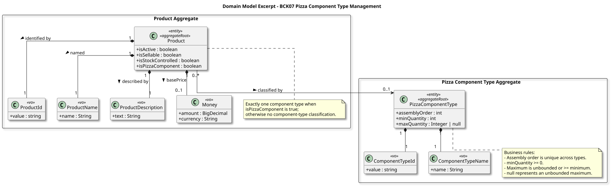
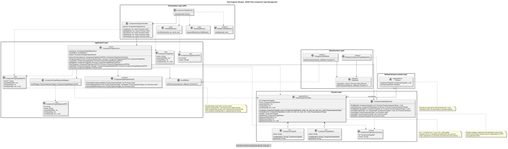
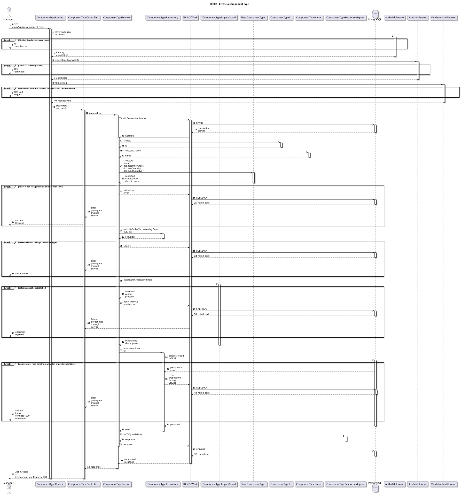
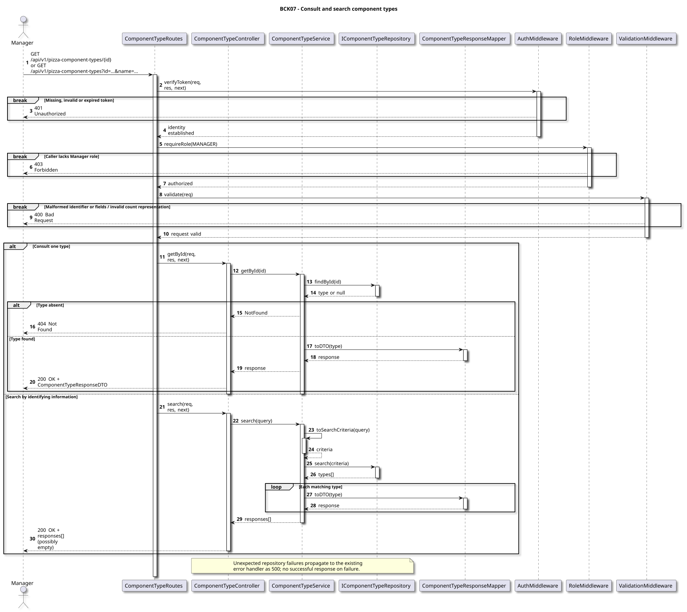
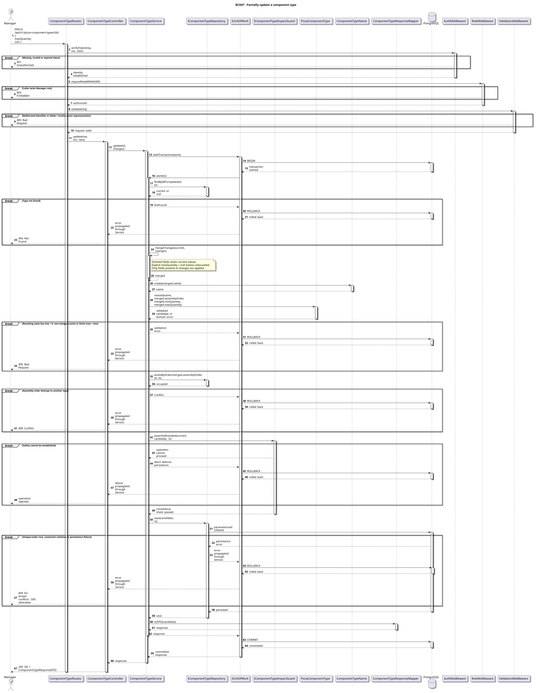
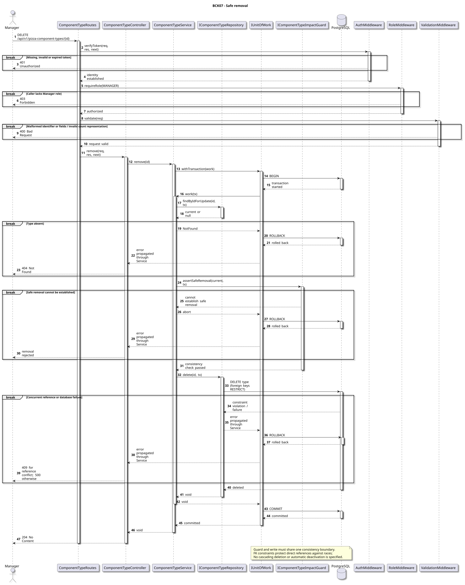

# US BCK07 – Pizza Component Type Management

## 1. Context & Scope

- **User Story ID:** BCK07
- **Sprint:** Sprint 1
- **Area:** Back-End (BCK)
- **Responsible:** Sofia Carvalho (1240898)
- **Related Requirements / Stories:**
  - System Specification: *PART II – System Specification, Section II.3.1.3 (Pizzas, Sizes, and Components)*.
  - Sprint 1 Specification: *BCK07, Acceptance Criteria and Comments*.
  - Architectural Stories: [ARC01 (Domain Modelling)](../../architecture/domainModel/domainmodel.puml), [ARC02 (System Architecture)](../../architecture/SAD.md), [ARC03 (REST API)](../../architecture/SAD.md), [ARC04 (Persistence)](../arc/ARC04.md), [ARC05 (Automated Testing)](../../architecture/SAD.md).
  - BCK01 supplies authentication and Manager authorization. BCK05 consumes the types to classify products designated as Pizza Components. BCK08 manages those products' size-dependent configurations; BCK10 consumes the type rules when validating predefined pizza configurations. Later personalized-pizza functionality must also respect these rules.

This story maintains the configurable classifications used during pizza configuration: creating, consulting, updating, searching, and safely removing Pizza Component Types. Each type defines its relative assembly order and permitted component counts. The initial configuration includes Base Dough, Base Sauce, Cheese, and Topping, while allowing additional types and changes to their properties.

Product registration and assignment to a type belong to BCK05. Size-dependent prices and stock consumption belong to BCK08. Pizza composition and its validation consume the rules maintained here; they are not additional BCK07 management operations. Component types are independent of pizza sizes and Product Categories.

---

## 2. Requirements & Analysis

### 2.1. User Story Description

> **As a** LaPrizza Manager,  
> **I want** to maintain Pizza Component Types,  
> **so that** products suitable for use in pizzas can be classified according to the role they play in a pizza configuration.

### 2.2. Acceptance Criteria (from Sprint 1 Specification)

Acceptance criteria from the Sprint 1 specification:

- [ ] **AC 1:** The system must maintain the Pizza Component Types recognized by LaPrizza.
- [ ] **AC 2:** Each Pizza Component Type must define its relative assembly order within a pizza configuration, and two Pizza Component Types must not have the same assembly order.
- [ ] **AC 3:** Each Pizza Component Type must define the minimum and maximum number of components of that type that may participate in a pizza configuration.
- [ ] **AC 4:** The maximum number of components may be left unbounded.
- [ ] **AC 5:** The set of Pizza Component Types and their properties must be configurable and must not be unnecessarily fixed in the application source code.
- [ ] **AC 6:** The initial configuration must include at least the types and values in the table below.
- [ ] **AC 7:** Pizza Component Types must be searchable using relevant identifying information.
- [ ] **AC 8:** A Pizza Component Type referenced by existing business information must not be removed in a manner that compromises its consistency.

| Initial type | Minimum components | Maximum components | Assembly order |
|---|---:|---:|---:|
| Base Dough | 1 | 1 | 1 |
| Base Sauce | 0 | 1 | 2 |
| Cheese | 0 | 1 | 3 |
| Topping | 0 | Unbounded | 4 |

### 2.3. Client Clarifications

#### Confirmed specification information

> **Question 1:** Does designating a product as a Pizza Component create a separate component entity, and can it have several component types?  
> **Answer:** The designation adds pizza-specific classification and configuration to the existing Product. A Product designated as a Pizza Component is associated with exactly one Pizza Component Type. Traditional Dough and Wholemeal Dough can both be classified as Base Dough. *(System Specification, II.3.1.3; BCK05.)*

> **Question 2:** Are the four initial types the only supported types?  
> **Answer:** No. Types and their properties are configurable business information. BCK07 requires the initial configuration to include **at least** those four types. *(System Specification, II.3.1.3; BCK07, AC 5–6.)*

#### Client Answers

> **Question 3:** Is being stock-controlled a prerequisite for a Product to be a Pizza Component?  
> **Answer:** No. Sellable and Pizza Component are Product types; stock control is an independent characteristic. Every Product must be sellable, a pizza component, or both, and may independently be subject to stock control. This does not change the requirement that a pizza component has exactly one component type. 

> **Question 4:** Do component-type restrictions apply to pizzas built completely from scratch?  
> **Answer:** A Personalized Pizza may be created entirely from scratch and need not originate from a Predefined Pizza. The resulting pizza must still comply with the requirements' constraints. Therefore, the component-type rules are also relevant to that later workflow. 

> **Question 5:** Can the four basic Pizza Component Types be deactivated or removed, and how may other types be managed?
>
> **Answer:** The four basic types (Base Dough, Base Sauce, Cheese and Topping) are mandatory and must remain available; they cannot be deactivated or removed. Deactivation of Pizza Component Types is not required. The Manager may manage other types provided existing Products and configurations remain consistent. 

### 2.4. Business Rules & Invariants

The following rules cover type identity, configuration bounds and reference integrity.

- **Identity and name:** A Pizza Component Type has its own stable string identity (`ComponentTypeId`) in the `type-NN` format (`type-01`, `type-02`, …). PostgreSQL allocates generated numeric suffixes from a sequence, padding to at least two digits. Renaming a type must preserve the identity referenced by Products. Names are required and unique ignoring case.
- **Assembly order:** Every type has a positive integer relative assembly order, unique across the maintained set of types. Creation and update must reject an order assigned to another type. Gaps are permitted, and changing an order does not reorder other types. Updating a type without changing its own order is valid.
- **Minimum:** `minQuantity` is a required non-negative integer. Fractional and negative component counts have no valid interpretation.
- **Maximum:** `maxQuantity` is either unbounded or a non-negative integer greater than or equal to `minQuantity`. A missing upper bound must not disable minimum validation. A finite maximum below the minimum is invalid.
- **Configuration cardinality:** For each configured type `t`, the number `n(t)` of selected components of that type in a valid completed pizza satisfies `n(t) >= minQuantity(t)` and, when bounded, `n(t) <= maxQuantity(t)`. A positive minimum makes that type mandatory even when no component of that type has yet been selected. Enforcement in pizza creation belongs to consuming stories.
- **Initial state:** The initial configuration includes the four types with exactly the values in section 2.2. Additional types are permitted. Initial data must not prevent subsequent authorized configuration changes.
- **Configurable information:** New types and changes to their properties must be managed as business information without requiring new source-code subclasses or a fixed type enumeration.
- **Product classification:** Each Product designated as a Pizza Component references exactly one type; one type can classify many Products. Multiple catalogue products may be Base Dough even though an individual pizza initially permits only one dough. BCK05 owns assignment and reassignment validation.
- **Name:** Names are required, can be changed through `PATCH`, and are unique ignoring case. The stable ID is preserved when a name changes.
- **Search:** ID and exact name are identifying attributes. Name matching is case-insensitive. If both filters are provided, matching either is sufficient; without filters, the collection endpoint returns all types.
- **Safe removal:** The four initial types (`type-01` through `type-04`) cannot be removed, even when unreferenced. Other types may be removed only when no existing Product or configuration depends on them; removal must never cascade-delete associated Products or pizza/order information. Type deactivation is not required.
- **Consistent changes:** A rejected creation, update, or removal leaves the prior valid state intact. Predefined pizzas must be updated to satisfy changed minimum/maximum bounds before the bound change is accepted. Previously accepted orders retain their configuration; changed rules apply to future orders.

### 2.5. Domain Model Excerpt

The excerpt follows the concepts and names in the [global domain model](../../architecture/domainModel/domainmodel.puml). `PizzaComponentType` is an independent aggregate root containing `ComponentTypeId`, `ComponentTypeName`, assembly order, and cardinality bounds. Product references the type; the type does not own the Product lifecycle. The association includes the conditional Product classification.



---

## 3. Design

### 3.1. Architecture & C4 Alignment

This User Story operates within the established **C4 Model** of the system:
- **C4 Level 1 (System Context):** The Manager interacts with the *LaPrizza Information System* via HTTPS ([System Architecture and Design](../../architecture/SAD.md)).
- **C4 Level 2 (Containers):** The request originates from the *UI* and targets the *Back-End API*, which persists state in the *Database*([System Architecture and Design](../../architecture/SAD.md)).
- **C4 Level 3 (Component Diagram):** As defined in the global Back-End architecture ([System Architecture and Design](../../architecture/SAD.md)).

---

### 3.2. Class Diagram (CD)



- Request validation appears as `ValidationMiddleware.validate(req)` in the diagrams. In the backend, `validate(schema)` creates the middleware for `req.body`; parameter and query validation require separate handling. Creation requires all configurable fields. PATCH preserves omitted fields and accepts explicit `null` only for `maxQuantity`. The aggregate validates the resulting state, and the service/repository enforce assembly-order uniqueness. Names are unique ignoring case, enforced by a PostgreSQL unique index.
- `PizzaComponentType` is the aggregate root. It owns its stable `ComponentTypeId` and descriptive `ComponentTypeName`; its scalar order and bounds follow the existing excerpt. `revised()` constructs a validated candidate preserving identity, so a rejected change never mutates persisted state.
- Minimum is a non-negative integer; a bounded maximum is an integer at least equal to minimum. Persistence encoding: `null` means unbounded; `0` remains a finite maximum. No sentinel such as `-1` is used. Creation requires an explicit maximum value or `null`. In a partial update, omission preserves the existing maximum, while an explicit `null` makes it unbounded.
- One type classifies zero or more Products. A Product has exactly one reference when designated a Pizza Component, otherwise none. This association is not composition; BCK07 does not manage Products or create a separate Pizza Component entity.
- `IComponentTypeRepository` is in the domain layer. Its search contract uses domain-owned `ComponentTypeSearchCriteria`; the service maps the API-facing query DTO through `toSearchCriteria()`, avoiding a domain dependency on application DTOs. It returns aggregates, not HTTP responses. The PostgreSQL adapter implements the repository contract.
- `ComponentTypeResponseMapper` maps aggregate getters to the response DTO. The shared PostgreSQL `PostgresUnitOfWork` delegates to the existing database transaction function. Domain objects and the service do not depend on infrastructure adapters.
- `IComponentTypeImpactGuard` checks the effect of creation, updates and removal on existing business information.

### 3.3. Sequence Diagram (SD)

#### SD 1 — Create a Component Type

Covers order uniqueness and invalid bounds.



#### SD 2 — Consult and Search Component Types

Covers individual consultation, not-found responses and searches with no matches.



#### SD 3 — Update a Component Type

Covers partial updates through PATCH, unchanged assembly order and consistency checks before saving.



#### SD 4 — Remove a Component Type

Covers safe removal and concurrent reference failures.



Creation and update validate local invariants before repository writes. `existsByOrder()` excludes the current ID on update. A database unique constraint remains authoritative under concurrent requests. Transactions roll back on errors, and success is returned only after commit.

### 3.4. REST API Specification (ARC03)

The API design uses JSON under `/api/v1`. All routes require a valid Bearer token and the Manager role.

| Method | Endpoint | Description | Auth / Role |
| :--- | :--- | :--- | :--- |
| `POST` | `/api/v1/pizza-component-types` | Create a type | Manager |
| `GET` | `/api/v1/pizza-component-types` | Search by identifier and/or name | Manager |
| `GET` | `/api/v1/pizza-component-types/:id` | Consult one type | Manager |
| `PATCH` | `/api/v1/pizza-component-types/:id` | Partially update configurable properties, preserving omitted fields and identity | Manager |
| `DELETE` | `/api/v1/pizza-component-types/:id` | Safe removal after reference checks | Manager |

#### Request & Response Schemas

Creation request (`ComponentTypeData`):

```json
{
  "name": "Topping",
  "assemblyOrder": 4,
  "minQuantity": 0,
  "maxQuantity": null
}
```

Partial update uses `ComponentTypeUpdateDTO` with optional fields and `Content-Type: application/json`. For example:

```json
{"maxQuantity": null}
```

The service loads and locks the current aggregate, then `mergeChanges(current, changes)` combines only present fields with the existing values using the aggregate getters. Presence must be checked explicitly: neither `null` nor a valid zero may be mistaken for omission. The merged full state is passed to `revised()` for domain validation. Thus, raising the minimum above an unchanged finite maximum is rejected. Order uniqueness is checked using the resulting order and excluding the same ID; existing impact checks, atomic persistence and rollback behavior remain in place.

A response adds `id` (string) to those same fields. POST returns `201 Created`, GET/PATCH return `200 OK`, search returns an array (empty when no matches), and successful DELETE returns `204 No Content`.

- `400`: malformed transport data or confirmed local invariant violation.
- `401` / `403`: authentication failure / missing Manager role.
- `404`: requested type does not exist.
- `409`: duplicate assembly order or known referential-integrity conflict.
- `500`: unexpected infrastructure failure; no successful response or partial write.

Existing JSON error shape:

```json
{ "error": { "message": "Descriptive error message", "status": 400 } }
```

### 3.5. Persistence & Data Integrity (ARC04)

PostgreSQL table `pizza_component_types`:

| Column           | Constraints / mapping                           |
| ---------------- | ----------------------------------------------- |
| `id`             | TEXT primary key; stable string identity        |
| `assembly_order` | INTEGER NOT NULL UNIQUE CHECK > 0               |
| `name`           | TEXT NOT NULL, non-blank, UNIQUE ignoring case  |
| `min_quantity`   | INTEGER NOT NULL CHECK >= 0                     |
| `max_quantity`   | Nullable INTEGER; CHECK null or >= min_quantity |

### 3.6. Applied Patterns & Architecture Principles

- **Aggregate and encapsulation:** The aggregate validates cardinality and preserves identity on updates. Pizza validation remains in BCK10 and later consuming workflows; the type does not own pizza creation.
- **Repository and dependency inversion:** The service depends on repository and transaction contracts; PostgreSQL adapters implement them. Repository-wide uniqueness complements local domain validation.
- **Application orchestration:** The service loads current state, creates a candidate, checks cross-aggregate safety, persists atomically and maps the response. HTTP handling and SQL stay outside the domain.
- **Reuse:** Existing domain names, module boundaries, PostgreSQL transaction plumbing, error shape and BCK01 security contracts are reused.
- **Scope:** Type management remains separate from Product assignment, size configuration and pizza composition.
- **Impact guard:** The BCK07 guard contract is injected. Until related pizza/order checks are integrated, bound changes, mandatory new types and removals that require those checks are rejected in production.

## 4. Tests (ARC05)

### 4.1. Test Plan & Scenarios

The test plan covers domain rules, application services, API responses and PostgreSQL persistence. Automated unit and API tests are implemented. PostgreSQL integration tests are present but require a dedicated test database.

| Test ID | Level | Scenario / Description | Expected Result |
| :--- | :--- | :--- | :--- |
| UT01 | Domain | Valid finite bounds; zero minimum/maximum | Valid aggregate |
| UT02 | Domain | Unbounded maximum with positive minimum | Null maximum is accepted and the declared minimum is retained; pizza selection validation belongs to consuming stories |
| UT03 | Domain | Negative/fractional counts or finite max below min | Reject invalid candidate |
| UT04 | Domain | Revise name/order/bounds | Same stable identity; original unchanged on rejection |
| UT05 | Service | Duplicate order; unchanged own order | Conflict for another ID; own order allowed |
| IT01 | API | Create/consult/update valid type | 201/200 and matching DTO |
| UT06 | Service | PATCH omits fields, including an existing unbounded maximum | Omitted values and identity preserved |
| UT07 | Service | PATCH explicitly sets maxQuantity to null or sets a count to zero | Null makes maximum unbounded; zero is retained and validated |
| UT08 | Service | PATCH changes minimum above an unchanged finite maximum | Reject resulting invalid state; no persisted change |
| UT09 | Service | PATCH leaves its own assembly order unchanged | No false duplicate-order conflict |
| IT02 | Persistence | Concurrent writes with equal order | At most one succeeds; other rolls back |
| IT03 | API | Missing/invalid token; non-Manager | 401/403 |
| IT04 | API | Missing target; search without matches | 404; empty search array |
| IT05 | Persistence | Direct concurrent Product reference and removal | No orphan or cascading deletion |
| IT06 | Provisioning | Initial installation and migration replay after an edit | Exact four initial rows from section 2.2; replay preserves edits |
| IT07 | API / Persistence | Search by string ID and name | Correct records under the agreed matching semantics; no matches gives an empty array |
| UT10 | Application / Integration contract | Reference-check rejection | Unsafe removal is rejected before the repository deletes anything |
| UT11 | Service / Integration contract | Creation or update fails its impact check | No insert/save; transaction is rolled back; no successful result |
| UT12 | Module | Default removal guard for the four mandatory seeded IDs and an additional type | Initial types are rejected; an additional type proceeds to referential-integrity checks |
| IT08 | API / Persistence | PATCH produces invalid combined bounds | 400; a follow-up GET returns the prior values |
| IT09 | Persistence / Application | Repository write or commit fails | Rollback/no committed partial change; unexpected errors are sanitized as 500 |

### 4.2. Sample Test Implementations

The examples use `ComponentTypeId` in service and repository calls. HTTP paths and DTOs use string IDs.

#### 4.2.1. Cardinality validation and an unbounded maximum

Parameterized cases cover zero, finite bounds, an unbounded maximum and invalid counts. The helper uses the aggregate factory and getters.

```javascript
const createType = ({ id = 'type-a', name = 'Topping', order = 4,
  min = 0, max = 1 } = {}) => PizzaComponentType.create(
    ComponentTypeId.create(id), ComponentTypeName.create(name), order, min, max,
  );

test.each([[0, 0], [1, 1], [1, null]])(
  'accepts component bounds %p..%p', (min, max) => {
    const type = createType({ min, max });
    expect(type.getMinQuantity()).toBe(min);
    expect(type.getMaxQuantity()).toBe(max);
  },
);

test.each([[-1, null], [0.5, null], [0, -1], [2, 1], [0, 1.5]])(
  'rejects invalid component bounds %p..%p', (min, max) => {
    expect(() => createType({ min, max })).toThrow();
  },
);
```

#### 4.2.2. Revision preserves identity and aggregate integrity

A valid revision preserves the string identity. An invalid revision must leave the original state unchanged.

```javascript
test('revision preserves identity without changing the original', () => {
  const original = createType();
  const revised = original.revised(
    ComponentTypeName.create('Cheese'), 3, 0, 1,
  );
  expect(revised.getId().getValue()).toBe('type-a');
  expect(revised.getName().getValue()).toBe('Cheese');
  expect(original.getName().getValue()).toBe('Topping');
  expect(() => original.revised(
    ComponentTypeName.create('Invalid'), 3, 2, 1,
  )).toThrow();
  expect(original.getMinQuantity()).toBe(0);
  expect(original.getMaxQuantity()).toBe(1);
});
```

#### 4.2.3. Duplicate assembly order prevents persistence

The service setup uses repository and impact-guard mocks. Its unit of work executes the transaction callback. In this case, the repository reports an occupied order.

```javascript
test('duplicate assembly order prevents persistence', async () => {
  const { service, repository } = setupService();
  repository.existsByOrder.mockResolvedValue(true);
  await expect(service.create({ name: 'Extra', assemblyOrder: 4,
    minQuantity: 0, maxQuantity: null }))
    .rejects.toMatchObject({ status: 409 });
  expect(repository.insert).not.toHaveBeenCalled();
});
```

#### 4.2.4. PATCH distinguishes omission, null and zero

The fixture loads minimum 0 and maximum 1, reports no conflicting order, and accepts the impact check. Invalid merged bounds are rejected before saving.

```javascript
test.each([
  [{ name: 'Renamed' }, { name: 'Renamed', minQuantity: 0, maxQuantity: 1 }],
  [{ maxQuantity: null }, { name: 'Topping', minQuantity: 0, maxQuantity: null }],
  [{ maxQuantity: 0 }, { name: 'Topping', minQuantity: 0, maxQuantity: 0 }],
])('PATCH applies only supplied fields: %p', async (changes, expected) => {
  const { service, repository } = setupService();
  repository.findByIdForUpdate.mockResolvedValue(createType());
  repository.existsByOrder.mockResolvedValue(false);
  const result = await service.update(ComponentTypeId.create('type-a'), changes);
  expect(result).toMatchObject({ id: 'type-a', assemblyOrder: 4, ...expected });
  expect(repository.existsByOrder).toHaveBeenCalledWith(
    4, expect.any(ComponentTypeId), expect.anything(),
  );
  expect(repository.save).toHaveBeenCalledTimes(1);
});

test('invalid combined PATCH state is not saved', async () => {
  const { service, repository } = setupService();
  repository.findByIdForUpdate.mockResolvedValue(createType());
  await expect(service.update(ComponentTypeId.create('type-a'), { minQuantity: 2 }))
    .rejects.toMatchObject({ status: 400 });
  expect(repository.save).not.toHaveBeenCalled();
});
```

#### 4.2.5. Protected operation: Customer denied, Manager allowed

This scenario checks Manager-only access. The API setup uses Express, BCK01 JWT authentication, an in-memory repository and Manager/Customer tokens. Persistence checks belong to the PostgreSQL test plan.

```javascript
test('only Managers can list component types', async () => {
  const { app, customerToken, managerToken } = await setupApi();
  const endpoint = '/api/v1/pizza-component-types';
  expect((await request(app).get(endpoint)).status).toBe(401);
  expect((await request(app).get(endpoint)
    .auth(customerToken, { type: 'bearer' })).status).toBe(403);
  const response = await request(app).get(endpoint)
    .auth(managerToken, { type: 'bearer' });
  expect(response.status).toBe(200);
  expect(Array.isArray(response.body)).toBe(true);
});
```

#### 4.2.6. Mandatory types are protected from removal

The module's default impact guard rejects removal of each mandatory seeded type (`type-01` through `type-04`) and allows an additional type to proceed to the repository's referential-integrity checks. The test is `default impact guard protects the four mandatory seeded types only` in `backend/tests/unit/pizza-component-type-management/module.test.js`. A Product reference prevents deletion through the PostgreSQL `ON DELETE RESTRICT` constraint.

The service test `reference rejection prevents deletion` also verifies that a rejection from an injected reference-check guard is propagated and the repository is not called.

```javascript
test('reference rejection prevents deletion', async () => {
  const { service, repository, impact } = setupService();
  repository.findByIdForUpdate.mockResolvedValue(createType());
  const rejection = new Error('Component type is referenced');
  impact.assertSafeRemoval.mockRejectedValue(rejection);
  await expect(service.remove(ComponentTypeId.create('type-a')))
    .rejects.toBe(rejection);
  expect(repository.delete).not.toHaveBeenCalled();
});
```

#### 4.2.7. Concurrent duplicate assembly orders in PostgreSQL

The PostgreSQL setup uses a migrated, isolated schema and removes it after the test. Order 9 is unused, and neither test ID exists beforehand. Each insert runs in a separate transaction.

```javascript
test('concurrent inserts cannot share an assembly order', async () => {
  const { database, repository } = await setupPostgres();
  const attempts = await Promise.allSettled([
    createType({ id: 'type-a', order: 9 }),
    createType({ id: 'type-b', order: 9 }),
  ].map(type => database.withTransaction(
    tx => repository.insert(type, tx),
  )));
  expect(attempts.filter(result => result.status === 'fulfilled'))
    .toHaveLength(1);
  expect(attempts.find(result => result.status === 'rejected').reason)
    .toMatchObject({ status: 409 });
});
```

#### 4.2.8. Initial configuration and migration replay

The database starts with a fresh isolated schema. The test checks the four required initial types while allowing additional records. A direct table query keeps initial-data verification independent of search behavior and ID format.

```javascript
test('initial types are seeded once and remain editable', async () => {
  const { database, repository } = await setupUnmigratedPostgres();
  await migrate(database);
  const { rows } = await database.query(
    'SELECT id, name, assembly_order, min_quantity, max_quantity FROM pizza_component_types',
  );
  expect(rows).toEqual(expect.arrayContaining([
    expect.objectContaining({ name: 'Base Dough', min_quantity: 1,
      max_quantity: 1, assembly_order: 1 }),
    expect.objectContaining({ name: 'Base Sauce', min_quantity: 0,
      max_quantity: 1, assembly_order: 2 }),
    expect.objectContaining({ name: 'Cheese', min_quantity: 0,
      max_quantity: 1, assembly_order: 3 }),
    expect.objectContaining({ name: 'Topping', min_quantity: 0,
      max_quantity: null, assembly_order: 4 }),
  ]));
  expect(rows.every(row => typeof row.id === 'string')).toBe(true);
  expect(new Set(rows.map(row => row.id)).size).toBe(rows.length);
  const doughRow = rows.find(row => row.assembly_order === 1);
  const dough = await repository.findById(ComponentTypeId.create(doughRow.id));
  await database.withTransaction(tx => repository.save(
    dough.revised(ComponentTypeName.create('Updated dough'), 1, 1, 1), tx,
  ));
  expect(await migrate(database)).toBe(0);
});
```

#### 4.2.9. Search maps string input into domain-owned criteria

 The service receives a search DTO, converts its string ID to `ComponentTypeId`, queries the repository and maps the aggregates to responses.

```javascript
test('search passes domain criteria to the repository', async () => {
  const { service, repository } = setupService();
  const type = createType();
  repository.search.mockResolvedValue([type]);
  const result = await service.search({ id: 'type-a' });
  expect(repository.search).toHaveBeenCalledWith({
    id: expect.any(ComponentTypeId),
  });
  expect(repository.search.mock.calls[0][0].id.getValue()).toBe('type-a');
  expect(result).toEqual([{
    id: 'type-a', name: 'Topping', assemblyOrder: 4,
    minQuantity: 0, maxQuantity: 1,
  }]);
  repository.search.mockResolvedValue([]);
  expect(await service.search({ id: 'missing-type' })).toEqual([]);
});
```

#### 4.2.10. Failed creation/update impact checks prevent persistence

```javascript
test.each(['create', 'update'])('%s stops after impact rejection', async operation => {
  const { service, repository, impact } = setupService();
  const rejection = new Error('Unsafe configuration change');
  repository.existsByOrder.mockResolvedValue(false);
  repository.findByIdForUpdate.mockResolvedValue(createType());
  impact.assertSafeCreate.mockRejectedValue(rejection);
  impact.assertSafeUpdate.mockRejectedValue(rejection);
  const work = operation === 'create'
    ? service.create({ name: 'Extra', assemblyOrder: 9,
        minQuantity: 0, maxQuantity: null })
    : service.update(ComponentTypeId.create('type-a'), { maxQuantity: 0 });
  await expect(work).rejects.toBe(rejection);
  expect(repository.insert).not.toHaveBeenCalled();
  expect(repository.save).not.toHaveBeenCalled();
});
```

## 5. Implementation

### 5.1. File Structure

I implemented BCK07 inside the existing `pizza-component-type-management` module. The module keeps its API, application, domain and PostgreSQL persistence code together, following the structure already used by the backend.

```text
backend/
├── migrations/0007_pizza_component_types.sql
├── index.js
├── src/
│   ├── app.js
│   ├── modules/
│   │   ├── index.js
│   │   └── pizza-component-type-management/
│   │       ├── index.js
│   │       ├── api/
│   │       │   ├── controllers/ComponentTypeController.js
│   │       │   ├── routes/ComponentTypeRoutes.js
│   │       │   ├── schemas.js
│   │       │   └── openapi.js
│   │       ├── application/
│   │       │   ├── dtos/
│   │       │   ├── mapping/ComponentTypeResponseMapper.js
│   │       │   ├── ports/contracts.js
│   │       │   └── services/ComponentTypeService.js
│   │       ├── domain/
│   │       │   ├── model/PizzaComponentType.js
│   │       │   ├── model/ComponentTypeSearchCriteria.js
│   │       │   ├── model/values.js
│   │       │   └── repositories/IComponentTypeRepository.js
│   │       └── infrastructure/persistence/
│   │           └── PostgresComponentTypeRepository.js
│   └── shared/
│       ├── openapi/spec.js
│       └── persistence/postgres/PostgresUnitOfWork.js
└── tests/
    ├── helpers/MemoryComponentTypeRepository.js
    ├── unit/pizza-component-type-management/
    └── integration/pizza-component-type-management/
```

### 5.2. Core Implementation Highlights

- **Domain model:** [PizzaComponentType](../../../backend/src/modules/pizza-component-type-management/domain/model/PizzaComponentType.js) validates the assembly order and quantity bounds. A revision creates an updated aggregate with the same ID, leaving the original instance unchanged.
- **Application service:** [ComponentTypeService](../../../backend/src/modules/pizza-component-type-management/application/services/ComponentTypeService.js) coordinates create, search, update and removal. It merges PATCH fields with current values, checks assembly-order uniqueness and performs changes through the repository and unit-of-work contracts.
- **Persistence:** [PostgresComponentTypeRepository](../../../backend/src/modules/pizza-component-type-management/infrastructure/persistence/PostgresComponentTypeRepository.js) uses parameterised SQL. Database constraints protect unique names and assembly orders, including concurrent writes. Migration `0007_pizza_component_types.sql` creates the table, seeds the four initial types and configures the sequence used for later `type-NN` IDs.
- **API and security:** The controller validates requests and maps results to response DTOs. BCK01 authentication and role middleware protect management operations; the domain has no dependency on Express or PostgreSQL.
- **Cross-story checks:** BCK05 Product references are protected by the foreign key to `pizza_component_types` with `ON DELETE RESTRICT`. BCK10 and order-related modules own pizza/order configuration and impact information; any additional reference contracts required by those modules must be integrated through the impact-guard port before enabling removal where they can hold references independently of Products.

---

## 6. Integration, Verification & Demonstration

### 6.1. Running the Automated Tests

From `backend/`, I run the regular test and quality checks with:

```sh
npm test -- --runInBand
npm run lint
npm run format:check
```

The BCK07 unit and API tests can be run without PostgreSQL:

```sh
npm test -- --runInBand tests/unit/pizza-component-type-management tests/integration/pizza-component-type-management/api.test.js
```

The PostgreSQL tests need a dedicated database whose name ends in `_test`, as described in the [ARC04 setup guide](../arc/ARC04.md). With the database settings configured, I run the BCK07 persistence suite with:

```sh
RUN_DATABASE_TESTS=1 npm test -- --runInBand tests/integration/pizza-component-type-management/postgres.test.js
```

`npm run test:db` selects the database infrastructure and all opt-in PostgreSQL suites, including BCK07 and BCK11. The CI workflow enables database tests through `npm run test:coverage`. Each PostgreSQL suite creates and removes its own isolated schema.

### 6.2. Manual Verification & OpenAPI Contract

The BCK07 OpenAPI contract is included in Swagger UI at `http://localhost:8080/api-docs/`. To run the checks below, I configure `backend/.env`, start PostgreSQL, apply the migrations with `npm run db:migrate`, start the API with `npm run dev`, and authenticate as a Manager through BCK01.

The requests use `http://localhost:8080/api/v1` as the base URL. I use `managerToken` for successful management operations and `customerToken` or `expiredToken` for authorization checks. Requests use Bearer authentication and JSON bodies with `Content-Type: application/json`. Write operations also require the consistency adapter and valid test data described in Section 7.

| Test ID | Request / setup | Expected result | Requirement |
|---|---|---|---|
| PM01 | GET `/pizza-component-types` with no filters | 200; the responses include Base Dough (1, 1, order 1), Base Sauce (0, 1, order 2), Cheese (0, 1, order 3) and Topping (0, null, order 4). Additional types are allowed. | AC1, AC6 |
| PM02 | POST `/pizza-component-types` with a descriptive name, unused order, minimum 0 and maximum null | 201; returned string ID and properties match the request. Save `typeId`. | AC1, AC3–AC5 |
| PM03 | GET `/pizza-component-types/{{typeId}}` | 200; same ID, name, order and bounds as PM02. | AC1 |
| PM04 | GET collection with an existing `id`, then exact `name`, then both with different matching records | 200; name match is exact ignoring case; both filters return records matching either criterion. | AC7 |
| PM05 | GET collection with identifying information that matches no type | 200; empty array. | AC7 |
| PM06 | GET `/pizza-component-types/{{missingTypeId}}` | 404; standard error body. | AC1 |
| PM07 | POST a second type with PM02's assembly order | 409; first type remains unchanged and no second record is created. | AC2 |
| PM08 | PATCH `/pizza-component-types/{{typeId}}` with only a new name, then GET it | 200; identity, order and omitted bounds remain unchanged; the new name is persisted. | AC1, AC5 |
| PM09 | PATCH `/pizza-component-types/{{typeId}}` with its unchanged assembly order | 200; no duplicate-order conflict against itself. | AC2 |
| PM10 | PATCH `/pizza-component-types/{{typeId}}` with `maxQuantity: 0` while its minimum is 0, then GET it | 200; zero is stored as a finite maximum. | AC3, AC4 |
| PM11 | PATCH `/pizza-component-types/{{typeId}}` with `maxQuantity: null`, then GET it | 200; null restores an unbounded maximum; other properties remain unchanged. | AC4 |
| PM12 | Set `{{typeId}}` to minimum 0 / maximum 1; PATCH `/pizza-component-types/{{typeId}}` with only minimum 2 | 400; subsequent GET still returns minimum 0 / maximum 1. | AC3, AC5 |
| PM13 | Create a second test type with a distinct order, then PATCH it to PM02's order | 409; both existing records preserve their prior orders. | AC2 |
| PM14 | POST/PATCH negative or fractional counts, a finite maximum below the minimum, explicit null in `name`/`assemblyOrder`/`minQuantity`, or omit required fields in POST (omission in PATCH is valid) | 400; invalid requests do not create or change a type. | AC3, AC4 |
| PM15 | POST/PATCH malformed JSON | 400; standard error response; no partial write. | API validation |
| PM16 | Repeat all five endpoint operations without a token, with an invalid token and with an expired token | 401 for each operation; no protected data change. | Authentication |
| PM17 | Repeat all five endpoint operations with `customerToken` | 403 for each operation; no protected data change. | Authorization |
| PM18 | PATCH/DELETE `/pizza-component-types/{{missingTypeId}}` | 404 with an otherwise valid PATCH body; standard error body. | AC1 |
| PM19 | DELETE an unreferenced test type, then GET it | 204 with an empty body; subsequent GET returns 404. Requires the reference-check integration. | AC1, AC8 |
| PM20 | DELETE a type referenced by a Product/pizza fixture | Removal is rejected and all referenced information remains unchanged. Requires consumer fixtures and reference-check integration. | AC8 |
| PM21 | Change bounds so an existing pizza configuration would become invalid | The SD rejects unsafe updates before saving; GET confirms the old bounds. Requires consumer fixtures and integration. | AC3, AC8 |
| PM22 | Repeat GET after a successful update in a new request/session | 200; updated values remain visible across requests. Durability is verified separately by the PostgreSQL tests. | AC1, AC5 |
| PM23 | DELETE each of the four initial types without references | 409; each type remains available through GET. | AC1, AC6, AC8 |

## 7. Observations, Dependencies & Limitations

- **Dependencies:** BCK01 security and BCK05 Product references are integrated. BCK08 owns size-specific component data; BCK10 and later order consumers own pizza/order configuration and impact information.
- **Pending integration:** Confirm and integrate any BCK10/order reference checks that can refer to a component type independently of its Products before enabling affected removals. PostgreSQL integration uses a dedicated database ending in `_test`.
- **Status:** Automated unit, API and PostgreSQL tests are complete. Postman verification and any required BCK10/order reference checks remain pending.
