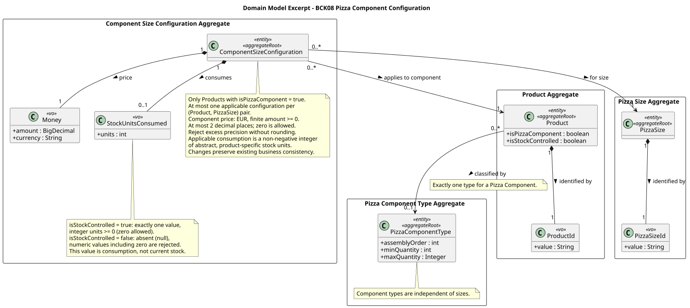
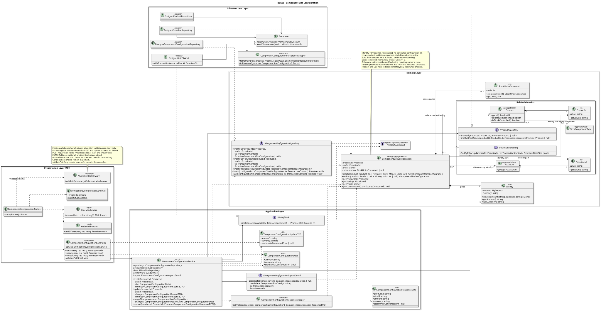
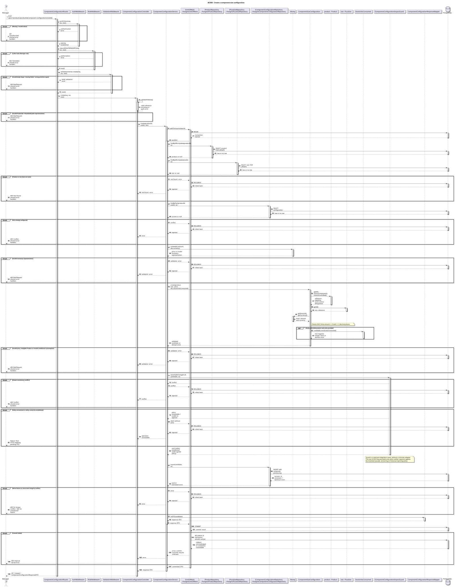
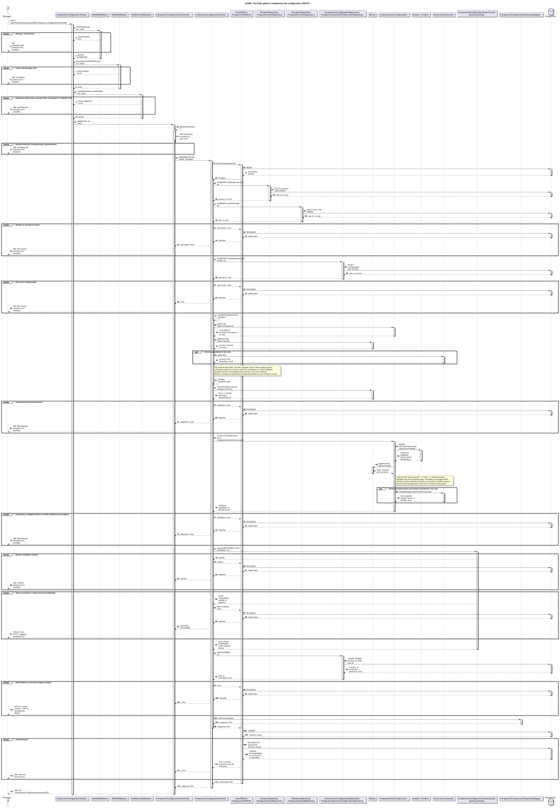
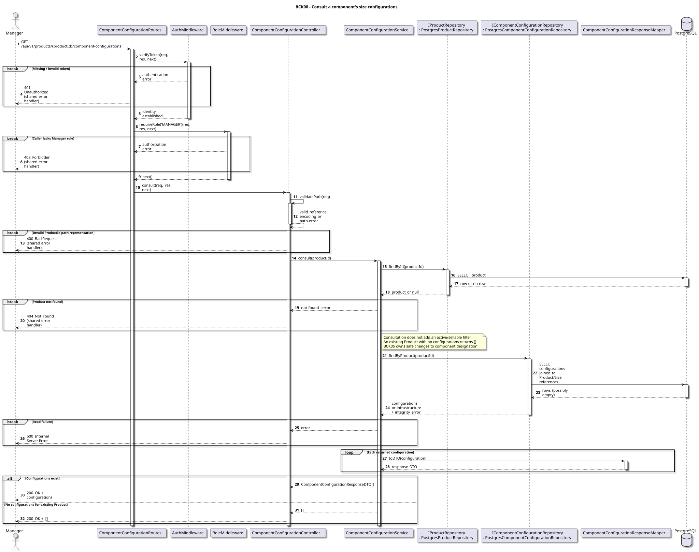

# US BCK08 – Pizza Component Configuration

## 1. Context & Scope

- **User Story ID:** BCK08
- **Sprint:** Sprint 1
- **Area:** Back-End (BCK)
- **Responsible:** Sofia Carvalho (1240898)
- **Related Requirements / Stories:**
  - System Specification: *PART II – System Specification, Sections II.3.1.2 (Products and Allergens), II.3.1.3 (Pizzas, Sizes, and Components), and II.3.1.4 (Stock Control)*.
  - Sprint 1 Specification: *BCK08 – Pizza Component Configuration, Acceptance Criteria and Comments*
  - Architectural Stories: [ARC01 (Domain Modelling)](../../architecture/domainModel/domainmodel.puml), [ARC02 (System Architecture)](../../architecture/SAD.md), [ARC03 (REST API)](../../architecture/SAD.md), [ARC04 (Persistence)](../arc/ARC04.md), [ARC05 (Automated Testing)](../../architecture/SAD.md).
  - Dependencies: BCK01 (authentication and Manager authorization), BCK05 (Product designation and component classification), BCK06 (Pizza Sizes), and BCK07 (Pizza Component Types).
  - Related consumers: BCK09 maintains current stock; BCK10 and BCK11 consume size-dependent configurations for predefined pizzas and catalogue information.

This story configures the price and applicable abstract stock consumption of an existing Pizza Component for an existing Pizza Size. The same component may have different configurations for different sizes. A Pizza Component remains a Product; configuring it does not create a separate component product or a new component type.

Product, size, and component-type management belong to their respective stories. Current stock adjustments, pizza composition, and final catalogue availability are downstream responsibilities. The BCK08 module is integrated with the current Product and Pizza Size composition through their repository contracts.


## 2. Requirements & Analysis

### 2.1. User Story Description

> **As a** LaPrizza Manager,  
> **I want** to configure the size-dependent characteristics of products used as pizza components,  
> **so that** the system can determine the information applicable when a component is used in a pizza of a particular size.

### 2.2. Acceptance Criteria (from Sprint 1 Specification)

The following criteria correspond to the eight requirements stated in BCK08. The BCK08-specific implementation covers the criteria; the final integration status is recorded in Section 7.

- [x] **AC 1:** Only products designated for use as Pizza Components may have Component Size Configurations.
- [x] **AC 2:** A Component Size Configuration must associate a Pizza Component with a Pizza Size.
- [x] **AC 3:** For a given Pizza Component and Pizza Size, at most one applicable Component Size Configuration may exist.
- [x] **AC 4:** A Component Size Configuration must define the price applicable to the component when used in a pizza of the corresponding size.
- [x] **AC 5:** When the corresponding product is subject to stock control, the Component Size Configuration must allow the number of abstract stock units consumed for that Pizza Size to be represented.
- [x] **AC 6:** Prices and stock-consumption values must satisfy the corresponding business validation rules.
- [x] **AC 7:** The system must allow the size-dependent configurations of a Pizza Component to be consulted.
- [x] **AC 8:** Changes to Component Size Configurations must preserve the consistency of existing business information.

### 2.3. Client Clarifications & Questions

> **Question 1:** Does the component price require an additional production/labour charge when calculating a pizza price?  
> **Answer:** Component prices already include production/labour costs. A predefined pizza's price is the sum of its component prices for the selected size, without an additional base price. After customization, the price is recalculated from the final components. BCK08 supplies the size-dependent prices used by those calculations. 

> **Question 2:** Is any positive stock sufficient for a component to be available for a size?  
> **Answer:** No. Available stock must cover the consumption configured for that size. With 2 units available and consumption of 1, 2, and 4 units for Small, Medium, and Large, respectively, Small and Medium are available while Large is unavailable. 

> **Question 3:** How does a component without stock control affect availability?  
> **Answer:** It is considered available for stock purposes. This does not remove the need for a configuration defining its price for the selected size. 

> **Question 4:** Must consumption use physical units such as kilograms or litres?  
> **Answer:** The System Specification uses non-negative integer counts of abstract stock units. Their meaning and granularity are product-specific and established by LaPrizza; physical units and conversions are outside this prototype model. 

> **Question 5:** Must a Pizza Component also be sellable or stock-controlled?  
> **Answer:** No. Sellable and Pizza Component are Product types, and a Product must have at least one of them. Stock control is independent, so a Pizza Component may be sellable or not and stock-controlled or not.

> **Question 6:** Does the stock currently available in the restaurant restrict the creation or update of a BCK08 configuration?
> **Answer:** No. BCK08 stores the number of abstract stock units consumed by a component for each Pizza Size, independently of the quantity currently available. BCK09 stores the current stock quantity and later determines availability by comparing it with this configured consumption. Creating or updating a BCK08 configuration does not require sufficient stock and does not deduct stock.

- **Stock consumption representation:** `StockUnitsConsumed` exists exactly when `Product.isStockControlled = true`. For a stock-controlled component, its value is mandatory and must be an integer greater than or equal to zero. For a component without stock control, such as oregano or salt when their stock is not tracked, the value is absent (`null`); supplying a numeric consumption, including `0`, is invalid. A missing value means “not applicable”; `0` is an explicit zero consumption for a stock-controlled component. Absence never means that the component or its size-dependent price is missing.
- **Component price validation:** The price is mandatory, finite, non-negative, expressed in `EUR`, and has at most two decimal places. Zero is allowed for components with no additional charge. Examples accepted: `0`, `0.00`, `0.50`, and `2.75` EUR. Reject missing amounts, negative amounts, non-finite values, other currencies, and amounts with more than two decimal places (for example `1.234`). These rules apply to the price in `ComponentSizeConfiguration`, independently of a Product's direct-sale price.

### 2.4. Business Rules & Invariants

- **Eligibility:** A configuration may reference only a Product designated as a Pizza Component. Being sellable or stock-controlled alone does not make a Product eligible. 
- **Association:** Each configuration references exactly one existing Product and exactly one existing Pizza Size. A component can have configurations for several sizes, and a size can be used by several components. Sizes and component types are independent concepts.
- **Pair uniqueness:** At most one applicable configuration exists for each `(Product, PizzaSize)` pair. Configurations for different pairs may coexist. A component need not have a configuration for every size; missing configurations do not imply a default price or consumption.
- **Price:** Every configuration defines a mandatory, finite price in `EUR`, with amount >= 0 and at most two decimal places. Zero is accepted; negative amounts, other currencies, missing/non-finite amounts, and excess decimal precision are rejected without automatic rounding. This price is distinct from a Product's direct-sale price.
- **Consumption:** For a stock-controlled component, each configuration must have a `StockUnitsConsumed` value representing a non-negative integer of abstract stock units; zero is accepted, while absence, negative values, and fractional values are rejected. For a component without stock control, consumption must be absent (`null`), and a supplied numeric value is rejected. No physical measurement units or conversions are introduced.
- **Consultation:** The Manager can consult a component's size-dependent configurations, identifying the associated size, applicable price, and stock consumption where relevant.
- **Consistency:** Accepted changes must preserve pair uniqueness, valid prices, the conditional presence of consumption, and valid Product/Size references without compromising existing business information. Changes to stock-control designation must satisfy the team decision above across all affected configurations.

### 2.5. Domain Model Excerpt



`ComponentSizeConfiguration` is the aggregate root identified by the **ordered pair `(ProductId, PizzaSizeId)`**, with a mandatory `Money` price and optional `StockUnitsConsumed`. There is no independent `ComponentSizeConfigId`: the pair identifies a business configuration, rather than a database record. It references independent `Product` and `PizzaSize` aggregates. `PizzaComponentType` provides classification context and does not own size-dependent prices or consumption.

The composition to `StockUnitsConsumed` has multiplicity `0..1`: exactly one value for a stock-controlled Product and none otherwise. The excerpt and design class diagram record the component-price rules (`EUR`, non-negative finite amount, at most two decimal places).

## 3. Design

### 3.1. Architecture & C4 Alignment

This User Story operates within the established **C4 Model** of the system:
- **C4 Level 1 (System Context):** The actor (<Role>) interacts with the *LaPrizza Information System* via HTTPS ([System Architecture and Design](../../architecture/SAD.md)).
- **C4 Level 2 (Containers):** The request originates from the *UI* and targets the *Back-End API*, which persists state in the *Database* ([System Architecture and Design](../../architecture/SAD.md)).
- **C4 Level 3 (Component Diagram):** As defined in the global Back-End architecture ([System Architecture and Design](../../architecture/SAD.md)).
---

### 3.2. Class Diagram (CD)



`ComponentSizeConfiguration` is an entity/aggregate root with composite domain identity. It owns its price and optional consumption, but does not own a Product, Pizza Size or Component Type. Changing price/consumption preserves the pair. Changing either identity reference is not an update operation. 

`create(product, size, price, units)` uses resolved domain aggregates to establish valid references and enforce Pizza Component eligibility. `revised(product, price, units)` checks the matching Product identity, validates against its current stock-control designation, preserves both identity references, and returns a new validated candidate. It leaves the current object intact on rejection. `Money` uses the excerpt's conceptual `BigDecimal`;`StockUnitsConsumed.create(units)` enforces non-negative integral units. The aggregate requires it for stock-controlled Products and rejects any numeric value for other Products.

The existing `ValidationMiddleware` is reused as implemented: `validate(schema)` is a static **factory** returning an Express function `(req, res, next)` that validates **`req.body`**, replaces it with the validated value and calls `next()`. The schema checks transport shape; the aggregate independently owns eligibility, EUR/precision/non-negative price and conditional consumption rules.

`setupRoutes()` registers `ValidationMiddleware.validate(schemas.create)` for POST and `ValidationMiddleware.validate(schemas.update)` for PATCH alongside the existing role middleware factory. GET has no required request body and therefore does **not** use this body middleware.

The SDs show a `ValidationMiddleware` lifeline with `validate(schemas.create)(req, res, next)` for POST and `validate(schemas.update)(req, res, next)` for PATCH, returning `next()` on success or 400 on invalid input. As with RoleMiddleware, this is shorthand for executing the registered function; the factory is configured once in `setupRoutes()`. No separate `bodyValidator : Middleware` participant or `invoke()` operation is shown. The full-state domain validation after merging PATCH fields remains unchanged.

Authorization follows the BCK01 diagram notation: the `RoleMiddleware` lifeline receives `requireRole('MANAGER')(req, res, next)` and continues with `next()` when authorized; a caller without that role receives 403. This notation represents execution of the registered middleware function: `requireRole('MANAGER')` is configured once in `setupRoutes()`, not called as a factory on every request. No separate `manager : Middleware` participant is needed. 

`ComponentConfigurationService` exposes create, partial update and consultation operations. Create rejects an existing pair; update requires an existing pair and never silently creates one. The update takes `ComponentConfigurationUpdateDTO`, while creation takes the complete `ComponentConfigurationData`. After locking the current configuration, `mergeChanges(current, changes)` obtains its price/consumption through domain getters and builds complete `ComponentConfigurationData` by checking property presence. It preserves omitted fields, retains explicit zero/null and never mutates the current aggregate. `Money.create(merged.amount, merged.currency)` and `current.revised(product, price, merged.stockUnitsConsumed)` then validate the full resulting state, not only the submitted fields. Consultation returns all configurations of an existing Product, including an empty list. No active/sellable filtering, default price, deletion or additional search workflow is invented.

`IComponentConfigurationRepository` belongs to the domain and uses domain types. Its PostgreSQL adapter implements every declared operation, including row-locking lookup. The persistence mapper reconstructs valid domain objects from rows and joined current Product/Size data; mapping of related aggregates must reuse the owning modules' mapping contracts once available. Invalid persisted state is an integrity failure, not silently normalized business data. 

`ComponentConfigurationResponseMapper` maps domain getters to an application DTO. Request DTOs carry primitive amount/currency/consumption values, not domain behaviour. The controller resolves path references into the owning domains' identifier types; no new identifier encoding is defined here. DTOs contain no configuration ID because the two references already identify the configuration.

`IComponentConfigurationImpactGuard.assertSafeChange(current, candidate, tx)` expresses AC 8 for both new and revised configurations. It is an injected application port, keeping consistency checks outside the aggregate. The current production composition uses `ComponentConfigurationImpactGuard`, which protects the immutable Product/Pizza Size pair; later stories can replace or decorate this adapter when they introduce dependent business data. A rejected impact check is a client-side business conflict and is mapped to HTTP 409; unexpected adapter or database failures are mapped to HTTP 500.

### 3.3. Sequence Diagram (SD)

#### SD 1 — Create a Component Size Configuration

.

After authentication, Manager authorization and transport validation, the service starts a transaction and resolves/locks the Product and Size through their repository contracts. Missing references return 404; an existing pair returns 409. Domain creation rejects ineligible Products, invalid prices and mismatched consumption with 400. A successful impact check precedes insertion. A composite database key protects against duplicate creation races. The response is sent only after acknowledged commit; failures before commit trigger rollback. Loss of the commit acknowledgement is a separate uncertain-outcome case, described below.

#### SD 2 — Update a Component Size Configuration



The service locks Product, Size and then the current configuration. A missing pair returns 404. The update schema accepts a non-empty subset of amount, currency and consumption. The service merges supplied properties with the locked current state using explicit presence checks, then creates Money and calls `revised()` to validate the complete result against the current Product designation. The same component-size pair is retained. Omission preserves the current value; explicit null does not mean omission and is valid only for consumption on a non-stock-controlled Product. Numeric zero is retained and validated. Invalid resulting values return 400 without a write. The impact guard evaluates the old and candidate states before saving. Known consistency conflicts return 409, and rejected candidates leave the previous state intact. The workflow does not implement BCK05 stock-control changes, deduct BCK09 stock or calculate availability.

#### SD 3 — Consult a Component's Configurations



The service confirms the Product exists, queries configurations through the repository interface and maps each aggregate to a response DTO. Missing Product returns 404; an existing Product without configurations returns `200 []`. A missing size configuration is not replaced with a default. No consultation-time component eligibility or sellability rule is added by inference.

All three SDs use explicit `activate` and `deactivate` execution bars for calls and returns, including the nested transaction callback and short-lived domain, repository, mapper and database operations. Error `break` fragments terminate the request alternative; the continuing execution bars describe the successful trace.

All SDs include 401/403, malformed path rejection and relevant failure paths; create/update additionally reject malformed bodies through the existing shared middleware. Unexpected repository/mapping failures propagate to the shared error handler as 500; callback failure triggers rollback. A commit error never returns a success response, but a lost acknowledgement can leave the outcome unknown: rollback is attempted only where possible, and the design does not promise that an already committed write can be undone or blindly retried. API error responses depicted from controllers/routes are shorthand for their existing shared error-handler path. The factory's Product/Size getter interactions concern related domain objects, never repositories masquerading as entities.

| Acceptance criterion | Design responsibility | Scenario |
|---|---|---|
| AC 1 | Aggregate checks current Product eligibility | Create, Update |
| AC 2 | Required Product/Size references; pair identity | Create, Update, Consult |
| AC 3 | Pair lookup plus composite primary key | Create, Update |
| AC 4 | Mandatory Money and price policy | Create, Update, Consult |
| AC 5 | Conditional StockUnitsConsumed | Create, Update, Consult |
| AC 6 | Aggregate/VO validation | Create, Update |
| AC 7 | Repository query and DTO mapping | Consult |
| AC 8 | Impact port, reference locking, atomic writes | Create, Update |

### 3.4. REST API Specification (ARC03)

All routes require a valid Bearer token and Manager role.

| Method | Endpoint | Description | Auth / Role |
| :--- | :--- | :--- | :--- |
| `POST` | `/api/v1/products/:productId/component-configurations/:sizeId` | Create the specified pair; reject duplicates | Manager |
| `PATCH` | `/api/v1/products/:productId/component-configurations/:sizeId` | Partially update price/consumption of an existing pair | Manager |
| `GET` | `/api/v1/products/:productId/component-configurations` | Consult the Product's configurations | Manager |


#### Request & Response Schemas

POST uses the complete `ComponentConfigurationData`. Decimal amounts are strings at the API boundary to preserve input precision before validation. This is a transport decision, not a new monetary rule.

```json
{
  "amount": "2.75",
  "currency": "EUR",
  "stockUnitsConsumed": 2
}
```

For creation, all three fields are required. A non-stock-controlled Product uses explicit `"stockUnitsConsumed": null`; a stock-controlled Product requires an integer including zero. The business rules in section 2 are unchanged.

PATCH uses `ComponentConfigurationUpdateDTO` and `Content-Type: application/json`. Each of the three fields is optional, but the body must contain at least one known field. This is a field-update object with the explicit semantics below; it is not a JSON Patch operation array or JSON Merge Patch document.

```json
{"amount": "3.00"}
```

This changes only the amount; current currency and consumption remain unchanged. Other examples:

```json
{"stockUnitsConsumed": 0}
```

Zero is an explicit value, accepted for a stock-controlled Product and rejected for a non-stock-controlled Product.

```json
{"stockUnitsConsumed": null}
```

Null is explicit absence of consumption, valid only for a non-stock-controlled Product. A stock-controlled Product cannot have its required consumption cleared. Omitted consumption preserves the current value, including an existing null or zero. `amount` and `currency` do not accept null. `{}`, unknown fields (including identity fields), wrong primitive types and missing request bodies are rejected with 400 by the update schema.

#### API validation schema design

Both schemas are supplied to the existing `ValidationMiddleware.validate(schema)`. They validate `req.body` only, reject unknown keys and preserve input property presence. No defaults, coercion, stripping of unknown properties, decimal rounding or implicit zero values are permitted.

| Field / rule | `schemas.create` (POST) | `schemas.update` (PATCH) |
|---|---|---|
| Body | Required object | Required non-empty object with at least one known key |
| `amount` | Required string | Optional string; null rejected |
| `currency` | Required string | Optional string; null rejected |
| `stockUnitsConsumed` | Required strict integer or null | Optional strict integer or null|
| Unknown / identity keys | Reject | Reject |
| EUR, finite/non-negative price, precision and conditional consumption | Domain validates complete new state | Domain validates complete merged state, including omitted/current values |

The controller passes a presence-preserving DTO to the application service. Inside the transaction, the service locks the current pair and combines current values with the supplied changes using property existence, never truthiness or a nullish fallback. It then builds Money and a revised aggregate from all resulting values. For example, changing only currency to a non-EUR value is rejected while preserving the previous amount; setting consumption to null on a stock-controlled component is rejected even if the amount is unchanged. Impact checks and save/commit happen only after this complete validation succeeds. Schema validation does not replace domain validation.

The response always contains the complete current amount, currency and consumption, plus `productId` and `sizeId`; it is not limited to the supplied patch fields. POST returns 201, PATCH returns 200, GET returns a 200 array. Zero monetary values may be formatted consistently on output without accepting excess input precision.

- **400:** malformed request, empty/unknown-only patch, forbidden null, invalid complete resulting business values or Product not designated as a component on a write.
- **401 / 403:** missing/invalid authentication or missing Manager role.
- **404:** missing Product/Size on a write, missing pair on update, or missing Product on consultation.
- **409:** duplicate pair or a known business/reference consistency conflict.
- **500:** unexpected infrastructure, integrity or mapping failure; no success response.
- **Impact/consistency conflict:** HTTP `409 Conflict`; the previous state is preserved.

Existing shared error shape:

```json
{"error":{"message":"Descriptive error message","status":400}}
```

### 3.5. Persistence & Data Integrity (ARC04)

The BCK08 migration creates the PostgreSQL table `component_size_configurations`:

| Column | Implemented mapping / constraints |
|---|---|
| `product_id` | Product reference, NOT NULL; FK to BCK05 Product key |
| `size_id` | Size reference, NOT NULL; FK to BCK06 Size key |
| `(product_id, size_id)` | Composite primary key; domain identity and pair uniqueness |
| `price_amount` | Exact NUMERIC, NOT NULL, non-negative, with at most two decimal places |
| `price_currency` | NOT NULL; CHECK = EUR for this table |
| `stock_units_consumed` | Nullable INTEGER; CHECK null or >= 0 |

`TransactionContext` is a domain-owned opaque repository-contract token, explicitly shown in the CD so domain signatures do not refer to an application/infrastructure type. It exposes no database API. Inner layers must not import `pg.Client`. `PostgresUnitOfWork` wraps the client supplied by existing ARC04 `withTransaction`; only infrastructure repositories unwrap the token to use that client. `insert` never overwrites; `save` targets the existing pair. Known uniqueness/reference violations become conflicts; unexpected database messages remain internal. The migration is `0012_component_size_configurations.sql`, after the current Product, Stock and Pizza Size migrations.

### 3.6. Applied Patterns & Architecture Principles

- **Domain identity and aggregate boundary:** the business question is “which component, at which size?”. Price and consumption belong inside this consistency boundary; Product, Size and Type lifecycles remain independent.
- **Encapsulation:** factories/revision methods validate complete resulting states. Immutable candidates prevent partial changes on error. Repository-wide uniqueness supplements local aggregate validation.
- **Application service:** one cohesive service coordinates the three workflows; it does not calculate final pizza prices, consume stock or own classification changes. Those remain in their existing stories.
- **Dependency inversion:** domain repositories and application ports are the service's dependencies. Infrastructure implements them and references inner types. Domain classes never reference an application DTO or persistence adapter.
- **Dependency injection:** the module composition root supplies repositories, unit of work, approved impact adapter and mapper/controller wiring, following BCK01's factory pattern. It is the only place that selects concrete adapters; services do not instantiate them. 
- **DTOs and mapping:** primitive requests and explicit responses keep HTTP and serialization outside the domain. Persistence mapping is separate from response mapping.
- **Reuse:** existing AuthMiddleware, RoleMiddleware, shared ValidationMiddleware and its static factory contract, Joi schema conventions, shared error format and ARC04 transaction support are reused. Product/Size contracts and related aggregate mapping are supplied by their owning modules, not duplicated in BCK08.
- **Validation allocation:** the shared body middleware validates POST/PATCH shape using API schemas and the controller validates path representation; Money/consumption values and the aggregate enforce business invariants; the service orchestrates reference existence and impact checks; persistence enforces concurrent uniqueness/reference integrity.

---

## 4. Tests (ARC05)

### 4.1. Test Plan & Scenarios

These scenarios cover the implemented BCK08 behavior. The executable tests are under `backend/tests/unit/pizza-component-configuration/` and `backend/tests/integration/pizza-component-configuration/`; the sample specifications below remain as design examples for future extensions.

| Test ID | Level | AC | Scenario / Description | Expected Result |
| :--- | :--- | :--- | :--- | :--- |
| UT01 | Domain | 1, 2, 4, 5 | Create a valid component-size configuration, with or without stock control | Product/Size references and EUR price retained; consumption is an integer when stock-controlled and null otherwise |
| UT02 | Domain | 1 | Configure a Product not designated as a Pizza Component | Reject the configuration |
| UT03 | Domain / Money | 4, 6 | Validate component price, including zero, negative amounts, non-EUR currency and excess precision | Accept zero and valid EUR prices; reject invalid prices without rounding |
| UT04 | Domain | 5, 6 | Validate consumption: zero, null, negative and fractional values | Stock-controlled components require non-negative integers; other components require null |
| UT05 | Service | 3 | Create a configuration for an existing component-size pair | Conflict; no duplicate insertion |
| UT06 | Service | 2, 4–6, 8 | Partially update price/consumption, including explicit zero and invalid null | Preserve omitted values and pair identity; reject invalid merged state without saving |
| UT07 | Service / Impact contract | 8 | Impact guard rejects creation or update | No insert/save; previous state preserved; unresolved safety policy remains a dependency |
| IT01 | API | 2, 4, 5, 7 | Manager creates, updates and consults configurations; include empty results and missing references | 201/200 with complete DTOs; empty list for an existing Product without configurations; 404 for missing Product/Size or update pair |
| IT02 | API | 4–6, 8 | Submit an invalid POST/PATCH payload | 400 with error details; existing configuration unchanged |
| IT03 | API / Security | BCK01 | Access POST, PATCH and GET without valid authentication or without the Manager role | 401 for missing/invalid token; 403 for non-Manager |

### 4.2. Sample Test Specifications 

#### 4.2.1. Valid configuration and conditional stock consumption 

```javascript
test.each([
  [true, 2],
  [true, 0],
  [false, null],
])('stockControlled=%s accepts consumption=%s', (stockControlled, units) => {
  const product = componentFixture({ stockControlled });
  const size = sizeFixture();
  const configuration = ComponentSizeConfiguration.create(
    product, size, Money.create('2.75', 'EUR'), units,
  );
  expect(configuration.getProductId()).toEqual(product.getId());
  expect(configuration.getSizeId()).toEqual(size.getId());
  expect(configuration.getPrice().getAmount()).toBe('2.75');
  expect(configuration.getPrice().getCurrency()).toBe('EUR');
  expect(configuration.getConsumption()?.getUnits() ?? null).toBe(units);
});

test.each([
  [true, null], [true, undefined], [true, -1], [true, 1.5],
  [false, 0], [false, 2],
])('stockControlled=%s rejects consumption=%s', (stockControlled, units) => {
  const product = componentFixture({ stockControlled });
  expect(() => ComponentSizeConfiguration.create(
    product, sizeFixture(), Money.create('2.75', 'EUR'), units,
  )).toThrow();
});
```

#### 4.2.2. Price boundaries

```javascript
test.each(['0', '0.00', '0.50', '2.75'])('accepts EUR amount %s', amount => {
  const price = Money.create(amount, 'EUR');
  expect(price.getCurrency()).toBe('EUR');
  // Allow consistent output formatting, such as 0 becoming 0.00.
  expect(Number(price.getAmount())).toBe(Number(amount));
});

test.each([
  [undefined, 'EUR'], ['', 'EUR'], ['-0.01', 'EUR'],
  ['NaN', 'EUR'], ['Infinity', 'EUR'], ['1.234', 'EUR'],
  ['2.75', undefined], ['2.75', 'USD'],
])('rejects amount=%s currency=%s', (amount, currency) => {
  expect(() => Money.create(amount, currency)).toThrow();
});
```

#### 4.2.3. Duplicate pair prevents insertion 

```javascript
test('creating an existing component-size pair does not insert', async () => {
  const current = configurationFixture();
  const { service, repository, productId, sizeId } = setupService({ current });
  await expect(service.create(productId, sizeId, {
    amount: '2.75', currency: 'EUR', stockUnitsConsumed: 2,
  })).rejects.toMatchObject({ status: 409 });
  expect(repository.insert).not.toHaveBeenCalled();
  expect(repository.save).not.toHaveBeenCalled();
});
```

#### 4.2.4. PATCH preserves omission and explicit zero, invalid null never saves 

```javascript
test.each([
  [{ amount: '3.00' }, { amount: '3.00', stockUnitsConsumed: 2 }],
  [{ stockUnitsConsumed: 0 }, { amount: '2.75', stockUnitsConsumed: 0 }],
])('PATCH merges only supplied properties: %p', async (changes, expected) => {
  const current = configurationFixture();
  const { service, repository, productId, sizeId } = setupService({ current });
  const result = await service.update(productId, sizeId, changes);
  expect(result).toMatchObject({
    productId: productId.getValue(), sizeId: sizeId.getValue(),
    currency: 'EUR', ...expected,
  });
  expect(repository.save).toHaveBeenCalledTimes(1);
  expect(current.getPrice().getAmount()).toBe('2.75');
  expect(current.getConsumption().getUnits()).toBe(2);
});

test('PATCH cannot clear mandatory consumption', async () => {
  const current = configurationFixture();
  const { service, repository, productId, sizeId } = setupService({ current });
  await expect(service.update(productId, sizeId, { stockUnitsConsumed: null }))
    .rejects.toMatchObject({ status: 400 });
  expect(repository.save).not.toHaveBeenCalled();
  expect(current.getConsumption().getUnits()).toBe(2);
});

test('amount-only PATCH preserves non-applicable consumption', async () => {
  const product = componentFixture({ stockControlled: false });
  const current = configurationFixture({ product, stockUnitsConsumed: null });
  const { service, repository, productId, sizeId } = setupService({ current, product });
  await expect(service.update(productId, sizeId, { amount: '3.00' }))
    .resolves.toMatchObject({ amount: '3.00', currency: 'EUR', stockUnitsConsumed: null });
  expect(repository.save).toHaveBeenCalledTimes(1);
});
```

#### 4.2.5. Impact rejection prevents either write 

```javascript
test.each(['create', 'update'])('%s stops when impact safety is unresolved', async operation => {
  const current = operation === 'update' ? configurationFixture() : null;
  const { service, repository, impact, productId, sizeId, tx } = setupService({ current });
  const rejection = new Error('Impact safety is unresolved');
  impact.assertSafeChange.mockRejectedValue(rejection);
  await expect(service[operation](productId, sizeId, {
    amount: '3.00', currency: 'EUR', stockUnitsConsumed: 2,
  })).rejects.toBe(rejection);
  expect(impact.assertSafeChange).toHaveBeenCalledWith(
    current, expect.any(ComponentSizeConfiguration), tx,
  );
  expect(repository.insert).not.toHaveBeenCalled();
  expect(repository.save).not.toHaveBeenCalled();
});
```

#### 4.2.6. API create, partial update and consultation 

```javascript
test('Manager creates, revises and consults a component-size configuration', async () => {
  const { app, managerToken, pairEndpoint, collectionEndpoint, productId, sizeId } =
    await setupApi({ stockControlled: true });
  const created = await request(app).post(pairEndpoint)
    .auth(managerToken, { type: 'bearer' })
    .send({ amount: '2.75', currency: 'EUR', stockUnitsConsumed: 2 });
  expect(created.status).toBe(201);
  expect(created.body).toEqual({
    productId, sizeId, amount: '2.75', currency: 'EUR', stockUnitsConsumed: 2,
  });

  const updated = await request(app).patch(pairEndpoint)
    .auth(managerToken, { type: 'bearer' }).send({ amount: '3.00' });
  expect(updated.status).toBe(200);
  expect(updated.body).toEqual({ ...created.body, amount: '3.00' });

  const rejected = await request(app).patch(pairEndpoint)
    .auth(managerToken, { type: 'bearer' }).send({ stockUnitsConsumed: null });
  expect(rejected.status).toBe(400);
  expect(rejected.body.error).toMatchObject({
    status: 400, message: expect.any(String),
  });

  const consulted = await request(app).get(collectionEndpoint)
    .auth(managerToken, { type: 'bearer' });
  expect(consulted.status).toBe(200);
  expect(consulted.body).toEqual([updated.body]);
});
```

## 5. Implementation

### 5.1. Implemented file structure

```text
backend/
├── migrations/0012_component_size_configurations.sql
├── src/modules/pizza-component-configuration/
│   ├── api/
│   │   ├── controllers/ComponentConfigurationController.js
│   │   ├── openapi.js
│   │   ├── routes/ComponentConfigurationRoutes.js
│   │   └── schemas.js
│   ├── application/
│   │   ├── dtos/{ComponentConfigurationData,ComponentConfigurationResponseDTO,ComponentConfigurationUpdateDTO}.js
│   │   ├── mapping/ComponentConfigurationResponseMapper.js
│   │   ├── ports/contracts.js
│   │   └── services/{ComponentConfigurationService,ComponentSizeConfigurationService}.js
│   ├── domain/
│   │   ├── model/{ComponentSizeConfiguration,values}.js
│   │   └── repositories/IComponentConfigurationRepository.js
│   ├── infrastructure/persistence/
│   │   ├── ComponentConfigurationPersistenceMapper.js
│   │   ├── ComponentConfigurationImpactGuard.js
│   │   └── PostgresComponentConfigurationRepository.js
│   └── index.js
└── tests/
    ├── integration/pizza-component-configuration/api.test.js
    └── unit/pizza-component-configuration/{api,application,domain,infrastructure}/*.test.js
```

The implementation also updates the shared application composition and OpenAPI registration points in `backend/src/app.js`, `backend/src/modules/index.js` and `backend/src/shared/openapi/spec.js`.

### 5.2. Core implementation highlights

- `ComponentSizeConfiguration` is the aggregate root and uses `(ProductId, PizzaSizeId)` as its composite identity.
- `Money` canonicalizes valid EUR amounts to two decimal places and rejects negative, non-finite or over-precise values.
- `StockUnitsConsumed` accepts only non-negative integers. The aggregate requires it for stock-controlled Products and requires `null` otherwise.
- The application service resolves and locks Product and Pizza Size, prevents duplicate pairs, merges PATCH fields by property presence, checks impact and writes inside one transaction.
- `PostgresComponentConfigurationRepository` persists the canonical aggregate state and delegates Product/Pizza Size reconstruction to the owning repositories.
- The API exposes Manager-protected POST, PATCH and GET routes and preserves strict request field presence.
- The response contains the complete configuration, including `productId`, `sizeId`, canonical amount, currency and stock consumption.
- BCK08 does not calculate final pizza prices, inspect current stock quantities, deduct stock or implement orders. It stores the data needed by those later workflows.

---

## 6. Integration, Verification & Demonstration

### 6.1. Running the automated tests

```bash
cd backend
npm test -- tests/unit/pizza-component-configuration tests/integration/pizza-component-configuration/api.test.js
```

The full backend test suite remains available through `npm test`. The BCK08 integration test intentionally supplies test doubles for the external Product, Pizza Size and impact dependencies.

### 6.2. Manual verification & OpenAPI contract

The BCK08 module is wired into the current composition root and its migration is placed after the Product, Stock and Pizza Size migrations:

1. Run the database migrations with `npm run db:migrate`.
2. Start the backend with `npm run dev`.
3. Open Swagger UI at `http://localhost:8080/api-docs`.
4. Authenticate as a Manager and verify the POST, PATCH and GET routes under `/api/v1/products`.
5. Verify that a configuration can be created even when BCK09 has insufficient current stock, because BCK08 stores consumption independently of availability.

---

## 7. Observations, Dependencies & Limitations

### 7.1. Current implementation status

The BCK08 feature is integrated in the current repository: domain rules, application service, API routes/controllers, OpenAPI contract, PostgreSQL adapter, migration, automated tests and production composition are present. The HTTP tests use test doubles by design; database-backed verification still requires a configured PostgreSQL environment.

### 7.2. Confirmed scope boundaries

- BCK08 stores explicit price and abstract stock consumption for each component-size pair.
- Current stock belongs to BCK09. BCK08 neither requires available stock nor changes stock quantities.
- A Product's direct-sale price is independent of its Component Size Configuration price.
- There is no default configuration for missing sizes, additional production charge, deletion workflow, audit ledger, soft-delete flag, historical repricing or versioning algorithm in this story.
- Product classification, Pizza Size lifecycle, component types, pizza composition, orders and catalogue availability remain in their respective stories.
