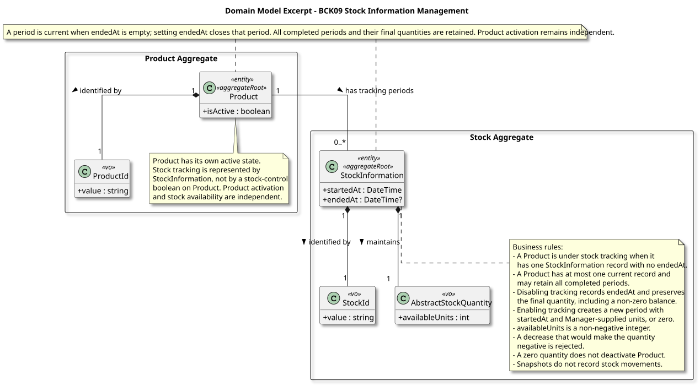
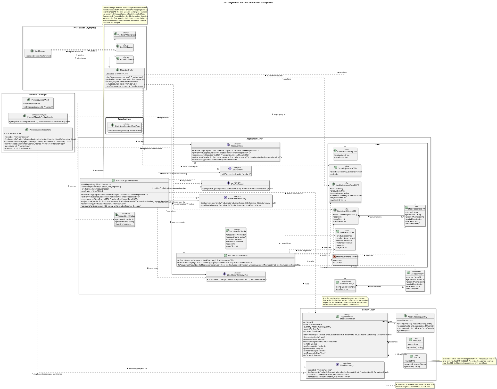
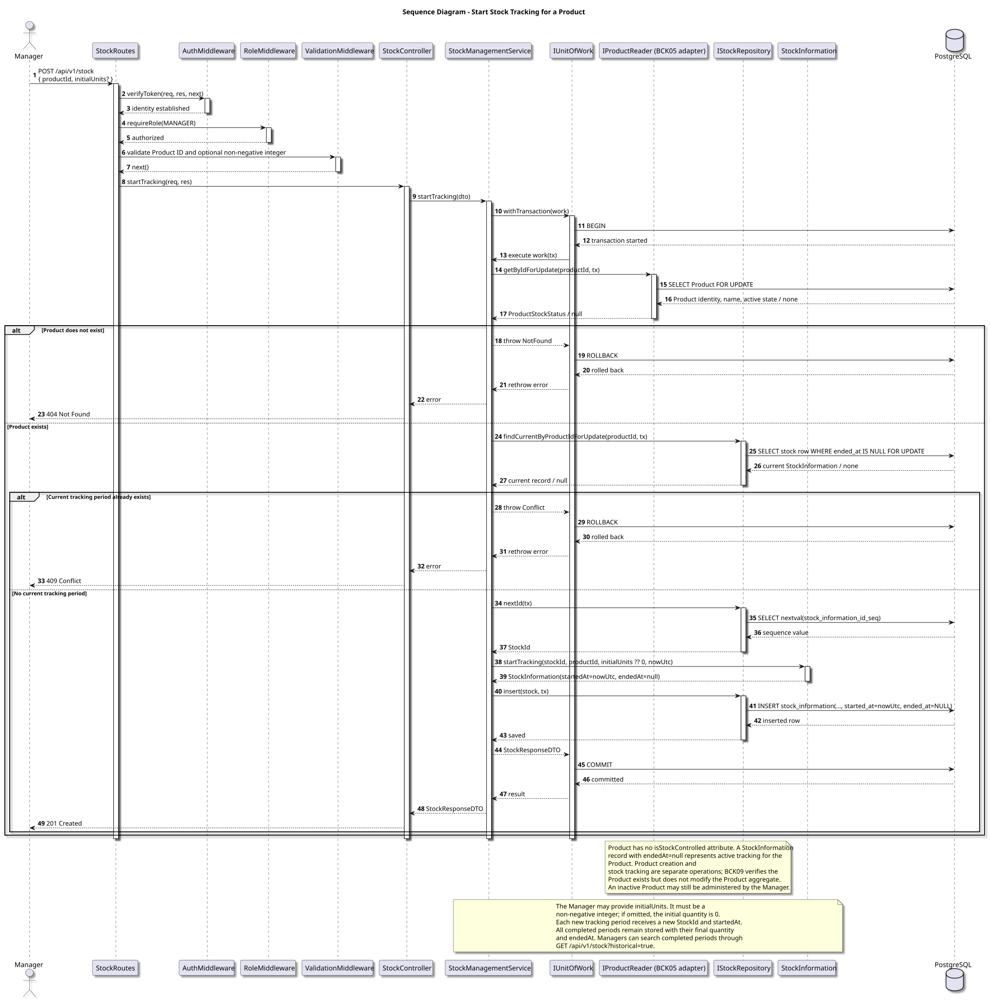
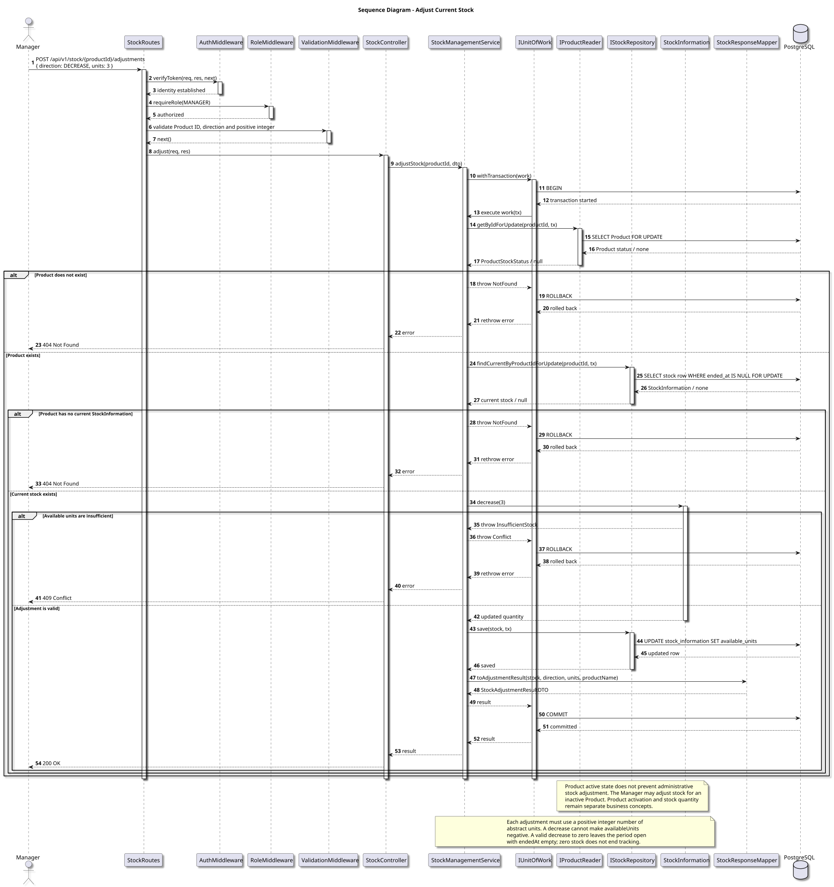
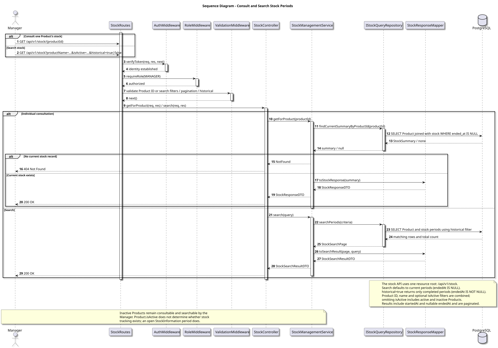
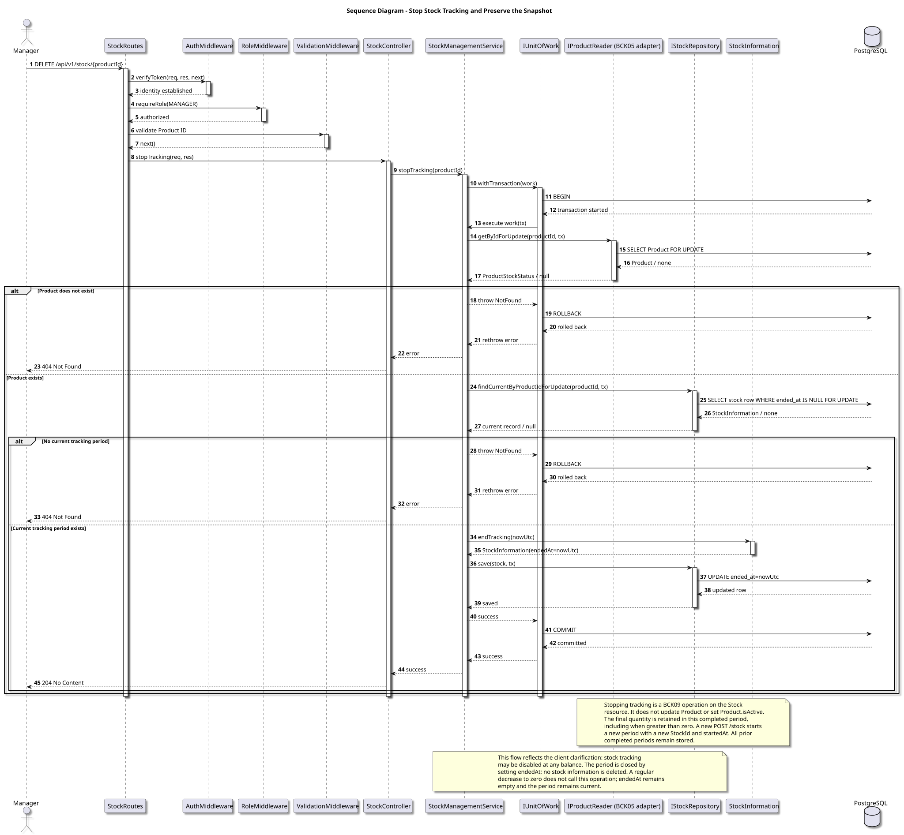

# US BCK09 – Stock Information Management

## 1. Context & Scope

- **User Story ID:** BCK09
- **Sprint:** Sprint 1
- **Area:** Back-End (BCK)
- **Responsible:** Francisco Sá (1241341)
- **Related Requirements / Stories:**
  - System Specification: _PART II – System Specification, Section II.3.1.4 (Stock Control)_
  - Architectural Stories: [ARC01 (Domain Modelling)](../../architecture/domainModel/domainmodel.puml), [ARC02 (System Architecture)](../../architecture/SAD.md), [ARC03 (REST API)](../../architecture/SAD.md), [ARC04 (Persistence)](../../user_stories/arc/ARC04.md), [ARC05 (Automated Testing)](../../architecture/SAD.md)
  - Dependencies: **BCK05** (Product identity, name and active-state data); related downstream stories include BCK08 (size-dependent stock consumption) and BCK10/BCK11 (availability of pizzas and catalogue information).

---

## 2. Requirements & Analysis

### 2.1. User Story Description

> **As a** LaPrizza Manager,  
> **I want** to maintain stock information for products subject to stock control,  
> **so that** the restaurant knows the quantity currently available for each applicable product.

### 2.2. Acceptance Criteria (from Sprint 1 Specification)

- **AC 1:** Stock information must only be maintained for products designated as subject to stock control.
- **AC 2:** Each stock-controlled product must have an identifiable current stock quantity.
- **AC 3:** Stock quantities must use the abstract stock-unit model defined in the System Specification.
- **AC 4:** Stock quantities must be non-negative integers of abstract stock units.
- **AC 5:** The current stock level of an individual stock-controlled product must be consultable.
- **AC 6:** Stock information must be searchable using relevant product information.
- **AC 7:** The system must provide operations to increase or decrease the current stock quantity by a specified number of abstract stock units.
- **AC 8:** A stock reduction must not result in a negative stock quantity.
- **AC 9:** Operations that change stock quantities must validate the requested change and preserve the consistency of the resulting stock information.
- **AC 10:** The stock model must provide an appropriate foundation for ordering and operational functionality introduced in subsequent sprints.

The acceptance criteria remain the functional scope of BCK09. This Sprint 2 implementation aligns the stock lifecycle and persistence with the updated global domain model; test outcomes are recorded in §4 and §6.

**AC 1 interpretation:** “Stock information” in the applicability criterion refers to the current operational stock period. The client requires prior information to be preserved when stock control is removed. Under the team's design decision, every completed period is retained with its final quantity and end date, excluded from current stock operations, and available through the historical search filter.

### 2.3. Client Clarifications & Questions

> **Question 1:** What does one stock unit represent, and must the system represent physical units such as kilograms or litres?  
> **Answer:** Stock is represented using abstract stock units. A unit is a normalized, product-specific quantity whose meaning and granularity are established by LaPrizza. The prototype does not need to model physical measurement units or perform unit conversion. _(System Specification, II.3.1.4 — Stock Control.)_

> **Question 2:** At what point in an order or operational workflow must stock be reduced?  
> **Answer:** Stock is consumed when the order is confirmed. The ordering workflow calls the BCK09 internal consumption contract as part of the order-confirmation transaction. If any required stock consumption fails, the caller must roll back the confirmation transaction so the order and all stock changes remain consistent.

> **Question 3:** How much stock must be available for a pizza component to count as available for a particular pizza size?  
> **Answer:** The client clarification says there must be enough stock to cover the configured `StockUnitsConsumed` for that size. Under the updated domain model, a component without a current `StockInformation` period has no stock-tracking constraint and is considered available for this purpose. These rules affect downstream availability decisions (for example BCK10/BCK11); BCK09 owns the current stock quantity and safe changes to it. _(Client Clarifications, Questions 5–6; current-record interpretation is the team/professor domain-model decision.)_

> **Client clarification — Stock control changes:** The client said stock control may be enabled or removed while preserving historical stock information and data consistency. Removal does not require the current quantity to be zero.

> **Client clarification — Initial stock quantity:** When stock control is enabled, the Manager may supply the initial quantity. If no value is supplied, it is `0`. Stock quantity can never be negative.

> **Client clarification — Stock consumption and movement history:** Stock is deducted when an order is confirmed. A stock movement history is not required in this sprint.

> **Other documented decisions:** Product activation is independent of stock availability. Stock reaching zero does not deactivate the Product or remove stock control. Stock search uses Product ID, Product name, and optional filters for Product active state and period history; supplied filters are combined. Omitting `isActive` includes both states. A zero-unit adjustment is rejected because each adjustment must change the quantity by a positive integer.

> **Client clarification — inactive Products and stock administration:** Current stock remains consultable when its Product is inactive. The Manager may increase or decrease stock for inactive Products. Inactive Products remain searchable; the Manager may filter by active state, and omitting the filter does not exclude inactive Products. An inactive Product cannot be used in a new sale; the order-confirmation flow must enforce this Product-state rule.

> **BCK09 design interpretation:** To preserve stock information without adding a movement ledger, each stock-control period is represented by one record. Disabling control marks that record historical and retains its final quantity. Re-enabling starts a new period with the Manager-supplied initial quantity or zero if omitted. The client clarified the preservation requirement, while this snapshot representation is the BCK09 design choice.

> **Team design decision — retain all periods:** Keep every completed stock-control period for a Product, rather than replacing older snapshots with only the latest one. Each period records `startedAt` and nullable `endedAt`; `endedAt = null` means the period is current. The timestamps make periods chronologically distinguishable. This is a team design decision; the client required preservation of previous stock information but did not specify period dates or retention count. This does not add a movement-by-movement history.

> **Team API decision — search current or historical periods:** `GET /api/v1/stock` accepts an optional `historical` boolean. Omitted or `false` returns only current periods (`endedAt = null`); `true` returns only completed periods (`endedAt != null`). Existing Product ID, Product name, Product active-state, and pagination filters still apply. Search results include `startedAt` and `endedAt` so each retained period can be identified. This exposes the snapshots retained by the team design decision; it does not expose individual stock movements.

> **Domain-model decision (team/professor):** `Product` does not own an `isStockControlled` attribute. Stock tracking belongs to BCK09 and is represented by the existence of one open `StockInformation` period (`endedAt = null`). The Manager starts and stops tracking through `/stock`. BCK09 reads Product identity, name and active state but does not modify the Product aggregate. The currently merged BCK05 code still calls a temporary internal compatibility adapter; it must be retired when BCK05 is aligned with this domain decision.

### 2.4. Business Rules & Invariants

- **BR 1 (Applicability and lifecycle):** A Product is under stock tracking exactly when it has one `StockInformation` period whose `endedAt` is null. A Product may have no current period and any number of completed periods. A Product has at most one open period at a time. Stock tracking is independent of Product type and active state.
- **BR 2 (Abstract units):** `availableUnits` is a count of normalized, product-specific abstract stock units. The domain does not store physical units or perform conversions between them.
- **BR 3 (Quantity):** `availableUnits` is always a non-negative integer. Fractional values, negative values, and non-integer values are invalid. When tracking starts, the Manager may specify the initial quantity; if omitted, it defaults to `0`. Reaching zero through a decrease does not deactivate the Product or end the current tracking period; the item is unavailable to operations that require stock until replenished.
- **BR 4 (Adjustment validation):** An increase or decrease must specify a valid integer adjustment. Applying a decrease must be rejected if the resulting quantity would be negative; an accepted operation leaves the aggregate in a valid state.
- **BR 5 (Consistency and concurrency):** Stock changes must be applied against the current quantity without allowing concurrent updates to bypass the non-negative invariant. Persistence must preserve the association between the stock record and its product. The implementation mechanism (for example a transaction or guarded update) is a persistence/design choice.
- **BR 6 (Tracking lifecycle and historical snapshots):** Starting tracking creates a `StockInformation` period with a new `StockId`, `startedAt`, the Manager-supplied initial quantity or `0` when omitted, and no `endedAt`. Stopping tracking sets `endedAt` on that period and preserves its final quantity, even when the balance is non-zero; the record is not deleted and no Product field is updated. All completed periods are retained when tracking starts again. Product activation remains independent. Period records do not record individual stock movements.
- **BR 10 (Period timestamps):** `startedAt` and non-null `endedAt` are UTC instants; `endedAt` cannot be earlier than `startedAt`. A period is current exactly when `endedAt` is null. The status is derived from the dates rather than stored separately.
- **BR 7 (Product state and availability):** `Product.isActive` represents the Manager-controlled active/suspended state. The Manager may activate or deactivate a Product independently of its stock quantity. Stock availability is evaluated separately: an active Product with a current stock period and zero units remains active but is unavailable for operations that require stock. Manager deactivation does not mean the stock quantity is zero, and a zero quantity does not automatically deactivate the Product. Downstream availability flows must consider the relevant Product state and stock requirement independently.
- **BR 9 (Inactive Product administration and sales):** Inactive Products remain available for administrative stock consultation, search and stock adjustments. Search may filter by `isActive`; when omitted, both active and inactive Products are included. An inactive Product must not be used in a new sale. The ordering flow enforces this rule; BCK09's order-consumption contract rejects an inactive Product before checking for a current stock period.

| `Product.isActive` | Current `StockInformation` | `availableUnits`   | Business interpretation                                                                  |
| :----------------- | :------------------------- | :----------------- | :--------------------------------------------------------------------------------------- |
| `true`             | Exists                     | Greater than zero  | Active; tracked stock is available subject to the quantity required by the operation.    |
| `true`             | Exists                     | `0`                | Active but out of stock; operations requiring stock are unavailable until replenishment. |
| `false`            | Exists                     | Any valid quantity | Inactive by Manager decision; stock remains administratively manageable.                 |
| `true`             | Does not exist             | Not applicable     | No stock tracking; stock quantity does not constrain availability.                       |

An inactive Product's current stock remains available for Manager consultation, search, and administrative adjustment. Inactivity prevents its use in new sales, independently of whether stock is positive.

- **BR 8 (Scope boundary):** BCK09 maintains and adjusts stock and exposes an internal operation to consume specified abstract units during order confirmation. The ordering story supplies each Product and required quantity and includes calls in its transaction; BCK09 does not own the order aggregate, order confirmation rules, or retry/idempotency policy. BCK09 does not record a movement ledger. Component consumption by pizza size is represented by BCK08 and used by the ordering flow.

### 2.5. Domain Model Excerpt

The excerpt focuses on the `Product` and `StockInformation` aggregates and their association. `Product` has no stock-control boolean: an open `StockInformation` period (`endedAt = null`) represents active stock tracking. Each period has its own `StockId` and `startedAt`; stopping tracking records `endedAt` and preserves the final quantity. All completed periods are retained. The Manager may provide the initial quantity for a new period, defaulting to zero. A zero quantity does not change `Product.isActive` or end tracking. `ProductId` and `StockId` are business identifiers represented as strings. The stock unit remains an abstract, product-specific integer as defined by the System Specification.



> PlantUML source: [`excerptDomainModel/domain_model_excerpt.puml`](./excerptDomainModel/domain_model_excerpt.puml).

---

## 3. Design

### 3.1. Architecture & C4 Alignment

BCK09 is implemented inside the `stock-information-management` back-end module, following the domain-first modular architecture documented in the [SAD](../../architecture/SAD.md).

- **C4 Level 1 (System Context):** The Restaurant Manager uses LaPrizza to consult and maintain stock. Customers and staff do not manage raw stock quantities through these BCK09 endpoints.
- **C4 Level 2 (Containers):** The Front-End sends HTTPS/JSON requests to the Node.js / Express Back-End API. The Back-End is the authority for stock rules and reads/writes the stock and product data in PostgreSQL. The Front-End never updates stock directly.
- **C4 Level 3 (Back-End module):** The `stock-information-management` module owns the `/stock` API, tracking lifecycle, stock aggregate and PostgreSQL adapter. Shared authentication/authorization middleware protects Manager operations. BCK09 reads Product identity/name/active state through a narrow adapter; it does not depend on a Product stock-control flag or update the Product aggregate. The order-confirmation consumer remains an internal application contract.

The request path is `API → Application → Domain`, with infrastructure adapters implementing the persistence and Product-read ports. `POST /stock` starts a period with `startedAt` and the Manager-supplied initial quantity or `0` if omitted; `DELETE /stock/{productId}` sets `endedAt` on the open period and preserves its final quantity. All completed periods remain stored. The Product and stock tracking lifecycles are separate and each operation uses a BCK09 transaction. At order confirmation, the ordering story calls BCK09's internal consumption contract with each Product ID, the required abstract units, and the same transaction used to confirm the order. BCK09 owns stock validation and persistence; it does not create or update Product or Order data.

This design follows the updated global domain model: stock tracking is represented by an open `StockInformation` period, not a `Product.isStockControlled` property. The Manager creates or stops tracking through the BCK09 `/stock` resource after the Product exists. The read adapter uses Product identity, name and active state. Ordering consumption remains an internal integration with the ordering story.

### 3.2. Class Diagram (CD)

The class diagram shows the module layers, the stock aggregate and value objects, persistence ports, Product read data (including `isActive`), and the public stock-tracking lifecycle plus internal order-consumption contract.



> PlantUML source: [`classDiagram/class_diagram.puml`](./classDiagram/class_diagram.puml).

Key design points:

- `StockInformation` is the aggregate root for one stock-control period and owns a `StockId`, a reference to `ProductId`, an `AbstractStockQuantity`, `startedAt`, and nullable `endedAt`. The period is current when `endedAt` is null and historical when it is set; the status is derived rather than stored separately.
- `StockId` is allocated by the PostgreSQL sequence `stock_information_id_seq` and formatted as `STOCK-` followed by at least five digits (for example, `STOCK-00001`). Sequence values are not reused, so gaps may occur after a transaction rolls back.
- The aggregate accepts only positive integer adjustments. A decrease that would make the quantity negative is rejected by the domain before persistence.
- `StockManagementService` implements the API-facing use cases and depends on the Domain Layer's `IStockRepository` for aggregate persistence, the Application Layer's `IStockQueryRepository` for read queries, and product-status and unit-of-work contracts; it does not depend on Express or `pg`.
- `IStockRepository` contains aggregate persistence operations and works with `StockInformation`. `IStockQueryRepository` contains consultation/search operations and returns `StockSummary` / `StockSearchPage` read models. These are two contracts, not two separate database repositories: one `PostgresStockRepository` adapter implements both. The split keeps application query read models out of the Domain repository contract. `StockResponseMapper` converts query results into REST response DTOs; the adapter does not construct API response DTOs.
- Before tracking starts, the Product reader verifies that the Product exists. A stock row with `endedAt = null`, not a Product boolean, indicates that tracking is enabled; a second open period is rejected. The optional Manager-supplied initial quantity is validated as a non-negative integer and defaults to zero. Stock changes use a consistent transaction and lock order. The Product adapter reads Product data but does not create or update it.
- `ProductId` and `StockId` are business identifiers represented as strings. UUIDs may be used only as internal PostgreSQL keys; they are not domain values or public API identifiers.
- The `/stock` resource owns stock tracking start/stop. Requests identify the Product with its business-ID string (for example, `PROD-00123`); the Product reader uses that ID to validate existence and retrieve name/active state without importing BCK05's domain class. Product CRUD does not carry a stock-control boolean.
- The adjustment response includes the existing `StockId`, `ProductId`, product name, direction, adjusted units, and resulting quantity. The stock identifier is not regenerated during adjustments.
- `POST /stock` starts tracking and `DELETE /stock/{productId}` stops it. Stopping sets `endedAt` on the open period and preserves its final quantity, regardless of its balance. Re-enabling creates a new period with a new `StockId` and `startedAt`; all earlier periods remain unchanged. A regular decrease to zero does not invoke the stop operation or change `Product.isActive`. At order confirmation, the ordering flow invokes `consumeForOrder(productId, units, tx)` for each Product; BCK09 consumes only when an open stock period exists. Product creation/update, order data, and order idempotency remain outside BCK09 ownership.

### 3.3. Sequence Diagrams (SD)

The sequence diagrams show starting tracking, adjusting stock, consultation/search, and stopping tracking. All public stock operations use the `/stock` resource. The consultation/search diagram documents the optional active-state filter; adjustment and consultation remain available for inactive Products. The order-consumption contract rejects inactive Products as described in BR 9.

#### SD 1 — Start stock tracking for a Product (AC 1, AC 2, AC 9)



> PlantUML source: [`sequence_diagram_provision_stock.puml`](./sequenceDiagram/sequence_diagram_provision_stock.puml).

#### SD 2 — Adjust stock (AC 1, AC 4, AC 7, AC 8, AC 9)



> PlantUML source: [`sequence_diagram_adjust_stock.puml`](./sequenceDiagram/sequence_diagram_adjust_stock.puml).

#### SD 3 — Consult an individual stock level and search stock (AC 5, AC 6)



> PlantUML source: [`sequence_diagram_consult_search.puml`](./sequenceDiagram/sequence_diagram_consult_search.puml).

#### SD 4 — Stop stock tracking and preserve its snapshot

SD4 is a public Manager operation, `DELETE /api/v1/stock/{productId}`. It ends the current tracking period and preserves the final quantity as a historical snapshot regardless of balance. It does not update Product.



> PlantUML source: [`sequence_diagram_disable_stock_control.puml`](./sequenceDiagram/sequence_diagram_disable_stock_control.puml).

### 3.4. REST API Specification (ARC03)

All endpoints are versioned under `/api/v1`, use JSON, and require a valid Bearer JWT with the `MANAGER` role. Authentication and role authorization are performed by the shared BCK01 middleware before the controller runs.

| Method   | Endpoint                                | Description                                                                                                                           | Auth / Role |
| :------- | :-------------------------------------- | :------------------------------------------------------------------------------------------------------------------------------------ | :---------- |
| `POST`   | `/api/v1/stock`                         | Start tracking for an existing Product, with optional initial units                                                                   | Manager     |
| `GET`    | `/api/v1/stock/{productId}`             | Consult the current stock level for one Product                                                                                       | Manager     |
| `GET`    | `/api/v1/stock`                         | Search current periods by default, or historical periods with `historical=true`; filter by `productId`, `productName`, and `isActive` | Manager     |
| `POST`   | `/api/v1/stock/{productId}/adjustments` | Increase or decrease current stock by a positive number of abstract units                                                             | Manager     |
| `DELETE` | `/api/v1/stock/{productId}`             | Stop current tracking and retain its final quantity as historical data                                                                | Manager     |

All public stock-management operations are grouped under the `/stock` resource. `POST /stock` starts tracking for a Product that already exists; `initialUnits` is optional, must be a non-negative integer, and defaults to `0`. `DELETE /stock/{productId}` ends the current tracking period and preserves its final quantity, including a non-zero balance. Starting tracking again creates a new current period. These operations change BCK09 stock information only and do not update the Product aggregate. A regular stock decrease to zero leaves the current record and Product state unchanged.

Order confirmation uses the internal `stockConsumption.consumeForOrder(productId, units, tx)` contract; it is not a public Manager endpoint. The ordering flow must enforce the inactive-Product restriction for every Product in a sale. BCK09 rejects an inactive Product before stock decrement, returns `true` when stock was consumed, and rejects a missing Product or insufficient stock. If the Product is active but has no current stock record, the consumer returns `false` without changing stock. The ordering story owns confirmation, retry/idempotency and rollback of the whole order transaction.

Product identifiers in path parameters and request filters are Product business identifiers (strings), matching `products.id VARCHAR(32)`. They follow the agreed `PROD-` plus at least five digits format (for example, `PROD-00123`). API examples use representative Product IDs in that string format.

#### Request and response schemas

- **Start tracking — `POST /api/v1/stock`**

  Request:

  ```json
  {
    "productId": "PROD-00123",
    "initialUnits": 42
  }
  ```

  `initialUnits` may be omitted, in which case it defaults to `0`. The Product must already exist and must not have an open stock period (`endedAt = null`).

  Success: `201 Created`, returning the new current stock record.

- **Consult one product — `GET /api/v1/stock/{productId}`**

  Success: `200 OK`

  ```json
  {
    "stockId": "STOCK-00123",
    "productId": "PROD-00123",
    "productName": "Mozzarella",
    "availableUnits": 42,
    "startedAt": "2026-11-04T10:00:00.000Z",
    "endedAt": null
  }
  ```

- **Search stock — `GET /api/v1/stock?productName=mozz&isActive=false&historical=true&page=1&pageSize=20`**

  `productId` is an exact identifier filter; `productName` is a case-insensitive partial match; `isActive` optionally filters the Product state; `historical` selects the period state. Supplied filters are combined. `isActive` accepts `true` or `false`; when omitted, active and inactive Products are both included. `historical` defaults to `false`: omitted/false returns only current periods (`endedAt = null`), while true returns only completed periods (`endedAt != null`). Each result contains `startedAt` and `endedAt`; a null end date identifies the current period. Products with zero units remain consultable and searchable and return `availableUnits: 0`. Stock consultation, search and adjustment remain available for inactive Products; deactivation prevents use in new sales but does not prevent administrative stock management. `page` defaults to `1`; `pageSize` defaults to `20` and is limited to `100`.

  Success: `200 OK`

  ```json
  {
    "items": [
      {
        "stockId": "STOCK-00123",
        "productId": "PROD-00123",
        "productName": "Mozzarella",
        "availableUnits": 42,
        "startedAt": "2026-11-04T10:00:00.000Z",
        "endedAt": "2026-11-04T11:00:00.000Z"
      }
    ],
    "page": 1,
    "pageSize": 20,
    "totalItems": 1
  }
  ```

- **Adjust stock — `POST /api/v1/stock/{productId}/adjustments`**

  Request:

  ```json
  {
    "direction": "DECREASE",
    "units": 3
  }
  ```

  `direction` is `INCREASE` or `DECREASE`; `units` must be a positive integer. Zero is rejected as an invalid adjustment. The endpoint applies a relative adjustment rather than allowing a caller to overwrite the current balance.

  Success: `200 OK`

  ```json
  {
    "stockId": "STOCK-00123",
    "productId": "PROD-00123",
    "productName": "Mozzarella",
    "direction": "DECREASE",
    "adjustedUnits": 3,
    "availableUnits": 39
  }
  ```

- **Stop tracking — `DELETE /api/v1/stock/{productId}`**

  Success: `204 No Content`. The current record becomes historical and retains its quantity. This operation is valid for any non-negative balance.

#### Error responses

- `400 Bad Request`: Invalid business identifier, direction, quantity, search filter, or pagination value.
- `401 Unauthorized`: Missing, invalid, or expired authentication token.
- `403 Forbidden`: Caller is authenticated but does not have the `MANAGER` role.
- `404 Not Found`: Product does not exist, or the requested Product has no current stock record for an operation that requires one.
- `409 Conflict`: Stock is insufficient for an adjustment, a current record already exists when tracking starts, the resulting quantity exceeds the supported PostgreSQL integer range, or another concurrent tracking lifecycle operation conflicts.
- `500 Internal Server Error`: Unexpected failure; the response must not expose SQL, credentials, or stack traces.

Errors use the project's standard JSON shape:

```json
{
  "error": {
    "message": "Insufficient stock for the requested decrease",
    "status": 409
  }
}
```

After the implementation is aligned with this design, the BCK09 endpoint definitions and schemas must be registered in the shared OpenAPI document and exposed through Swagger UI.

The internal order-consumption contract rejects inactive Products and insufficient stock; the ordering use case maps these failures into its own order-confirmation error response and rolls back the shared transaction.

### 3.5. Persistence & Data Integrity (ARC04)

Stock is transactional business data and is stored in PostgreSQL, consistent with the [SAD](../../architecture/SAD.md) and [ARC04](../arc/ARC04.md).

- **Table:** `stock_information`
- **Fields and constraints:**

| Column            | Type          | Constraints / Notes                                                                                                                               |
| :---------------- | :------------ | :------------------------------------------------------------------------------------------------------------------------------------------------ |
| `id`              | `UUID`        | Primary key used only as an internal database surrogate; Infrastructure only and never mapped to `StockId` or exposed through the API             |
| `stock_code`      | `VARCHAR`     | `NOT NULL`, `UNIQUE`, format check `^STOCK-[0-9]{5,}$`; stores the business `StockId` string used by the domain and API                           |
| `product_id`      | `VARCHAR(32)` | `NOT NULL`, foreign key to `products(id)` (`VARCHAR(32)`) with `ON DELETE RESTRICT`; stores the Product business ID directly                      |
| `available_units` | `INTEGER`     | `NOT NULL`, `CHECK (available_units >= 0)`; maps to `AbstractStockQuantity`                                                                       |
| `started_at`      | `TIMESTAMPTZ` | `NOT NULL`; UTC start time of this stock-control period                                                                                           |
| `ended_at`        | `TIMESTAMPTZ` | Nullable; UTC end time. `NULL` means the period is current; a value means the period is historical. Must be greater than or equal to `started_at` |

- A partial unique index on `product_id` where `ended_at IS NULL` enforces at most one current period per Product while allowing any number of historical periods. A check constraint enforces `ended_at IS NULL OR ended_at >= started_at`. Historical rows are retained; stopping and restarting tracking never overwrites or deletes an earlier period. `product_id` directly stores the same Product business identifier as `products.id`; there is no UUID-to-ProductId mapping for this relationship.
- `stock_information_id_seq` generates the numeric part of `stock_code`; the repository left-pads values to five digits and prefixes them with `STOCK-`. PostgreSQL sequence gaps after rollbacks are expected and do not affect identifier uniqueness.
- Migration `0009_stock_information.sql` creates the stock table. Migration `0010_stock_tracking_history.sql` is retained unchanged because it may already be recorded in developer databases. Migration `0016_stock_tracking_periods.sql` adds `started_at` and nullable `ended_at`, converts every legacy `HISTORICAL` row to a closed period, drops the persisted status, and indexes open periods. The migration cannot reconstruct real timestamps for legacy rows because the previous schema did not record them; it uses the migration time as the best available boundary and retains each quantity and StockId.
- Historical periods are not inferred at runtime from a Product flag. BCK09 records `ended_at` when tracking stops. The forward migration uses the old `tracking_status` value only once to preserve existing historical rows while converting the schema.
- The foreign key prevents orphaned stock information when a Product is deleted.
- BCK09 validates Product existence through its Product reader; it does not read or write an `is_stock_controlled` column. An open stock period is the BCK09 representation of active tracking. Stopping tracking sets `ended_at` and preserves the final quantity.
- Starting/stopping tracking and stock adjustment execute in BCK09-owned transactions. A flow that reads or locks Product data must lock Product before `StockInformation`, consistently. The aggregate validates the requested change, and the repository saves the result. This serializes conflicting lifecycle/adjustment operations for one Product and prevents stale updates.
- The database `CHECK` remains a final guard if another code path bypasses domain validation. All query values are parameterized.
- Search joins `stock_information` to `products` to return the Product identifier and name. A dedicated name-search index is not included; its need depends on data volume and query measurements.
- BCK09 preserves the final quantity at stock-control removal but does not store individual stock movements. During order confirmation, the order workflow calls the BCK09 consumption port in its transaction.

### 3.6. Applied Patterns & Architecture Principles

- **Clean / Layered Architecture:** Express controllers map HTTP requests and responses; application use cases orchestrate domain behavior; PostgreSQL and Product-read adapters remain in Infrastructure.
- **Aggregate Root and Value Objects:** `StockInformation` controls quantity changes and its period boundaries; each tracking period has a `StockId`. `endedAt` determines whether the period is current or historical, avoiding a separately stored status that could contradict the dates. `ProductId` and `StockId` encapsulate business identity as strings, and `AbstractStockQuantity` validates the quantity. PostgreSQL UUIDs, where used, are technical keys held inside Infrastructure.
- **Repository and Query Port Patterns:** The Domain Layer's `IStockRepository` loads and persists the `StockInformation` aggregate for transactional changes. The Application Layer's `IStockQueryRepository` handles consultation and search, returning `StockSummary` / `StockSearchPage` read models. `PostgresStockRepository` implements both contracts while keeping SQL in Infrastructure.
- **Application Mapper:** `StockResponseMapper` converts domain and read-model results into REST response DTOs, keeping API response construction out of the PostgreSQL adapter.
- **Ports and Adapters:** `IStockUseCases`, `IProductReader`, and `IStockOrderConsumption` document application boundaries. JavaScript does not enforce interfaces at runtime; the module exposes objects that implement these contracts, and unit tests can provide fakes.
- **Unit of Work / Transactions:** BCK09 owns transactions for its public stock tracking lifecycle and adjustments. Order confirmation calls the internal consumption port using the order transaction; the ordering caller rolls back its whole transaction if confirmation fails.
- **DTO Pattern:** Request and response DTOs isolate the REST payload from domain objects and database rows.
- **RBAC:** Shared authentication middleware establishes identity; a Manager-role check protects all BCK09 administrative stock endpoints. Later ordering use cases call the application stock operation server-side and do not receive raw stock write access from the client.
- **Explicit design decisions:** The Manager may provide a non-negative integer initial quantity when starting tracking; omission defaults to zero. Stopping tracking preserves the final quantity and closes the period with `endedAt`, even when the balance is non-zero. Every completed period is retained; starting again creates a new period with a new `StockId` and `startedAt`. Adjustment amounts must be positive integers and zero adjustments are rejected. Order confirmation consumes stock through an internal contract in the caller's transaction. Individual stock movements are not recorded this Sprint.

## 4. Tests (ARC05)

### 4.1. Test Plan & Scenarios

The scenarios below cover the corrected Sprint 2 implementation. The unit tests for the domain, application service, repository contracts, OpenAPI document, and catalogue read adapter have been executed. API and PostgreSQL results are recorded separately after execution.

| Test ID | Level       | Scenario / Description                                                       | Requirement / Rule                                        | Expected Result                                                      | Actual Result                                       |
| :------ | :---------- | :--------------------------------------------------------------------------- | :-------------------------------------------------------- | :------------------------------------------------------------------- | :-------------------------------------------------- |
| UT01    | Domain      | Create a stock period with zero or supplied units                            | AC 1–4; BR 1–3                                            | `startedAt` set, `endedAt = null`, quantity validated                | Pass — `domain.test.js`, `period-lifecycle.test.js` |
| UT02    | Domain      | Reject invalid IDs, quantities and period timestamps                         | AC 3–4; BR 2–3, BR 10                                     | Invalid values are rejected                                          | Pass — `domain.test.js`, `period-lifecycle.test.js` |
| UT03    | Domain      | Increase/decrease by positive integer and reject underflow                   | AC 7–9; BR 4                                              | Quantity remains non-negative                                        | Pass — `domain.test.js`                             |
| UT04    | Domain      | End a period and then attempt adjustment                                     | BR 6                                                      | End time and final quantity remain; completed period cannot change   | Pass — `period-lifecycle.test.js`                   |
| AT01    | Application | Start tracking for existing Product with omitted or supplied `initialUnits`  | Client clarification — initial quantity; BR 1, BR 3, BR 6 | Defaults to zero or uses supplied units                              | Pass — `service.test.js`                            |
| AT02    | Application | Start tracking for an unknown Product or when a current period exists        | BR 1                                                      | `404` for missing Product; `409` for duplicate current period        | Pass — `service.test.js`                            |
| AT03    | Application | Stop tracking at non-zero balance; adjust inactive Product                   | Clarifications — tracking and inactive Products           | Period closes retaining quantity; administrative adjustment succeeds | Pass — `service.test.js`                            |
| AT04    | Application | Consume stock for inactive, untracked, missing or insufficient-stock Product | BR 8–9                                                    | Correct rejection/false result; no unintended write                  | Pass — `service.test.js`                            |
| AT05    | Application | Search/consult current periods with active-state filters                     | Client clarification — stock search                       | Filters apply; inactive records are included unless filtered         | Pass — `service.test.js`                            |
| IT01    | API         | Manager and non-Manager access; validate requests                            | API authorization and validation contracts                | Manager succeeds; `401`/`403` and `400` as applicable                | Pass — `api.test.js`                                |
| IT02    | API         | Start, consult, search, adjust, stop, and restart a period                   | AC 1–9; API contract                                      | Documented statuses and quantities; prior period is retained         | Pass — `api.test.js`                                |
| IT03    | Persistence | Concurrent adjustment and rollback of a caller transaction                   | BR 5–6; transaction design                                | No negative units or partial commit                                  | Pass — `postgres.test.js`                           |
| IT04    | Persistence | Stop and restart tracking; reject invalid period bounds                      | Team retention decision; BR 6, BR 10                      | All periods retained; only one open period; bounds constrained       | Pass — `postgres.test.js`                           |

The public lifecycle is owned by BCK09. A compatibility adapter remains temporarily exposed for the currently merged BCK05 implementation, which still calls the earlier provisioning contract. It delegates to the same timestamped BCK09 lifecycle and is not a mock. The adapter can be removed when BCK05 stops orchestrating stock tracking. Order-confirmation integration remains an internal dependency of the applicable ordering story.

### 4.2. Sample Test Implementations

The following examples are implemented in the named test files.

**Domain — closing a period preserves its balance** (`tests/unit/stock-information-management/period-lifecycle.test.js`):

```js
stock.endTracking(endedAt);
expect(stock.getEndedAt()).toEqual(endedAt);
expect(stock.isCurrent()).toBe(false);
expect(stock.getAvailableUnits()).toBe(8);
```

**Application — inactive Products remain administratively adjustable** (`tests/unit/stock-information-management/service.test.js`):

```js
const result = await context.service.adjustStock(productId, {
  direction: "INCREASE",
  units: 2,
});
expect(result.availableUnits).toBe(7);
```

**Persistence — the current period is selected by its end timestamp** (`tests/unit/stock-information-management/repository.test.js`):

```js
expect(database.query.mock.calls[0][0]).toContain("s.ended_at IS NULL");
expect(database.query.mock.calls[0][0]).not.toContain("is_stock_controlled");
```

### 4.3. TDD and Execution Notes

TDD was applied to stock-period lifecycle and historical search. The domain, repository, API and PostgreSQL tests cover period dates, selection of current versus historical periods, and pagination/filter combinations. The recorded verification below was executed against the current revision.

## 5. Implementation

The Sprint 2 implementation represents stock as dated tracking periods. `GET /stock` defaults to current periods (`ended_at IS NULL`) and returns completed periods (`ended_at IS NOT NULL`) when `historical=true`; both are paginated and expose period dates. The legacy `0010` migration remains immutable and `0016` performs the forward schema conversion.

### 5.1. File Structure

BCK09 is implemented in the `stock-information-management` module. Its API, application, domain and infrastructure responsibilities are grouped in that module, while authentication, database configuration and transaction support use shared backend components.

```text
backend/
├── migrations/0009_stock_information.sql
├── migrations/0010_stock_tracking_history.sql
├── migrations/0016_stock_tracking_periods.sql
├── src/
│   ├── app.js
│   ├── modules/
│   │   ├── index.js
│   │   └── stock-information-management/
│   │       ├── index.js
│   │       ├── api/
│   │       │   ├── controllers/StockController.js
│   │       │   ├── routes/StockRoutes.js
│   │       │   ├── schemas.js
│   │       │   └── openapi.js
│   │       ├── application/
│   │       │   ├── dtos/StartStockTrackingDTO.js
│   │       │   ├── mapping/StockResponseMapper.js
│   │       │   ├── ports/contracts.js
│   │       │   ├── queries/StockSearchCriteria.js
│   │       │   ├── readModels/
│   │       │   └── services/StockManagementService.js
│   │       ├── domain/
│   │       │   ├── model/StockInformation.js
│   │       │   ├── model/values.js
│   │       │   └── repositories/IStockRepository.js
│   │       └── infrastructure/
│   │           ├── persistence/PostgresStockRepository.js
│   │           └── products/ProductModuleProductReader.js
└── tests/
    ├── helpers/MemoryStockRepository.js
    ├── unit/stock-information-management/
    └── integration/stock-information-management/
```

### 5.2. Core Implementation Highlights

- **Domain model:** `StockInformation` owns `StockId`, `ProductId`, quantity, `startedAt` and nullable `endedAt`. Current/historical is derived from `endedAt`; completed periods cannot be adjusted.
- **Application service:** `StockManagementService` implements `startTracking`, `stopTracking`, consultation, search, adjustment and transactional order consumption.
- **Persistence:** `PostgresStockRepository` inserts, reads and updates period rows. Current reads use `ended_at IS NULL`; a partial unique index and timestamp check constrain the data.
- **Product and order integration:** `ProductModuleProductReader` reads Product ID, name and active state without reading `is_stock_controlled`. BCK11 catalogue availability now uses the presence of a current stock period. Order confirmation uses `stockConsumption.consumeForOrder` in the caller transaction. A temporary `stockProvisioning` compatibility adapter remains for the currently merged BCK05 implementation.
- **API and security:** All five public operations are under `/stock` and protected by the shared authentication and Manager-role middleware.
- **Composition:** `createStockModule` wires the service, controller, routes, PostgreSQL adapter, Product-status adapter and transaction boundary. Repository and adapter dependencies can be injected, which supports isolated tests with in-memory fakes.

## 6. Integration, Verification & Demonstration

### 6.1. Running the Automated Tests

From `backend/`, the BCK09 unit and API tests run without PostgreSQL:

```sh
npm test -- --runInBand tests/unit/stock-information-management tests/integration/stock-information-management/api.test.js
```

The full backend suite and quality checks are:

```sh
npm test -- --runInBand
npm run lint
```

The BCK09 PostgreSQL suite uses a dedicated test database whose name ends in `_test`. With the test database configured, the PowerShell commands are:

```powershell
$env:PGDATABASE = "laprizza_test"
$env:RUN_DATABASE_TESTS = "1"
npm test -- --runInBand tests/integration/stock-information-management/postgres.test.js
Remove-Item Env:PGDATABASE
Remove-Item Env:RUN_DATABASE_TESTS
```

Verification results:

- `npm test -- --runInBand tests/unit/stock-information-management tests/unit/product-catalogue-and-information tests/unit/pizza-component-configuration` — passed, 14 suites and 112 tests.
- `npm test -- --runInBand tests/integration/stock-information-management/api.test.js` — passed, 1 suite and 8 tests.
- `npm test -- --runInBand tests/unit/stock-information-management` — passed, 6 suites and 54 tests, including the historical-period search criteria.
- `npm test -- --runInBand tests/integration/stock-information-management/postgres.test.js` — passed, 1 suite and 6 tests against the local Docker `laprizza_test` database.
- `npm run test:db` — passed, 10 suites and 72 tests against the local Docker `laprizza_test` database.
- `$env:PGHOST='127.0.0.1'; $env:PGPORT='5432'; $env:PGDATABASE='laprizza_test'; $env:RUN_DATABASE_TESTS='1'; npm test -- --runInBand` — passed, 71 suites and 590 tests, including PostgreSQL integration tests against the local Docker test database.
- `npm run lint` and targeted Prettier checks for changed JavaScript and Markdown files — passed.

The BCK09 PostgreSQL suite exercises the corrected start/stop lifecycle, history retention, inactive-product administration, concurrent adjustment and transaction rollback. The BCK05 integration suite still exercises the temporary compatibility adapter.

### 6.2. Manual Verification & OpenAPI Contract

The implemented OpenAPI contract is available in Swagger UI at `http://localhost:8080/api-docs/`. Requests use `http://localhost:8080/api/v1` as the base URL and require a valid Manager Bearer token for all five public BCK09 endpoints. The local database must contain the BCK05 `products` structure and Product fixtures before stock migrations and endpoint checks can run.

| Test ID | Request / setup                                                                                     | Expected result                                                                                                                        | Requirement                                                    |
| ------- | --------------------------------------------------------------------------------------------------- | -------------------------------------------------------------------------------------------------------------------------------------- | -------------------------------------------------------------- |
| SW01    | `POST /stock` with an existing Product ID and optional `initialUnits`                               | `201`; creates a current stock record using the supplied quantity or zero                                                              | AC1–AC4                                                        |
| SW02    | `GET /stock/{productId}` for a Product with current stock                                           | `200`; response includes stock identity, quantity, `startedAt`, and null `endedAt`                                                     | AC5                                                            |
| SW03    | `GET /stock` with `productName`, `productId`, pagination and optional `isActive` filters            | `200`; default results contain only current periods; zero-unit stock remains visible                                                   | AC6                                                            |
| SW04    | `POST /stock/{productId}/adjustments` with `{"direction":"INCREASE","units":5}`                     | `200`; quantity increases by five                                                                                                      | AC7, AC9                                                       |
| SW05    | Decrease by an amount at or below current quantity                                                  | `200`; quantity decreases; reaching zero leaves the current record and Product state intact                                            | AC7–AC9                                                        |
| SW06    | `DELETE /stock/{productId}` with zero and non-zero balances                                         | `204`; records `endedAt` and retains this and all earlier completed periods with their final quantities                                | Clarification — stock control changes; team retention decision |
| SW07    | Submit invalid units, direction, Product ID or pagination, or start tracking for an unknown Product | `400` for invalid data; `404` for unknown Product                                                                                      | AC1–AC5                                                        |
| SW08    | Repeat a protected endpoint without a token and with a non-Manager token                            | `401` without authentication; `403` for an authenticated non-Manager                                                                   | Authorization contract                                         |
| SW09    | `GET /stock?historical=true`, optionally with `productId` and other filters                         | `200`; only periods with `endedAt` set are returned with period dates and final quantities; `historical=false` returns current periods | Team API decision                                              |

The automated API suite verifies Manager authorization, request validation, start/stop/restart, consultation, search, adjustment, and inactive-Product administration. PostgreSQL scenarios are listed in §4.1.

## 7. Observations, Dependencies & Limitations

- **Dependencies:** BCK01 provides authentication and role authorization. BCK05 owns Product data, including `isActive`; BCK09 reads Product identity/name/active state and its stock repository does not query `is_stock_controlled`. A temporary BCK05 provisioning adapter remains for the currently merged Product implementation. The applicable ordering story must call `IStockOrderConsumption.consumeForOrder(productId, units, tx)` at confirmation and roll back the shared transaction on failure.
- **Integration boundary:** Starting/stopping tracking is a BCK09 responsibility exposed by the `/stock` API. The currently merged BCK05 code still invokes the compatibility adapter on Product create/update; that transitional orchestration remains to be removed in BCK05. Order consumption remains an internal downstream integration.
- **Database setup:** Migration `0009_stock_information.sql` references `products(id)`, so the BCK05 Product table must exist before it is applied. The current BCK09 PostgreSQL integration suite and the project's `test:db` suite passed against the local Docker `laprizza_test` database.
- **Stock record history:** BCK09 preserves every completed stock-control period, with its start/end timestamps and final quantity; it does not keep individual movement history. Retaining every period is a team design decision made to satisfy the client's preservation clarification without adding a movement ledger. Managers can search those periods through `GET /api/v1/stock?historical=true`.
- **Scope limitation:** Order confirmation and its idempotency/rollback policy are owned by the ordering story. BCK09 provides the per-Product consumption operation and rejects insufficient stock. A regular adjustment reaching zero does not deactivate the Product or remove stock control.
- **Status:** The Sprint 2 period model and historical-period search are implemented in BCK09 code, migration `0016`, OpenAPI and tests. Ordering integration remains a downstream dependency.
