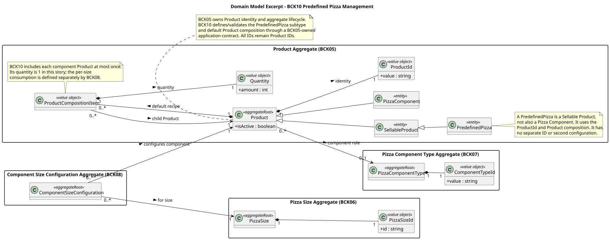
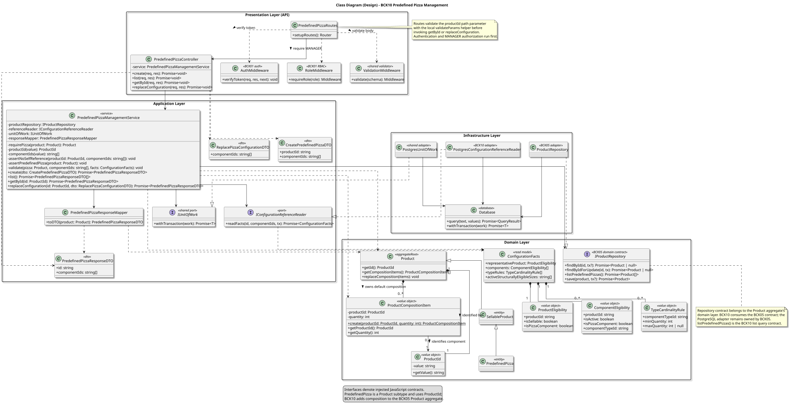
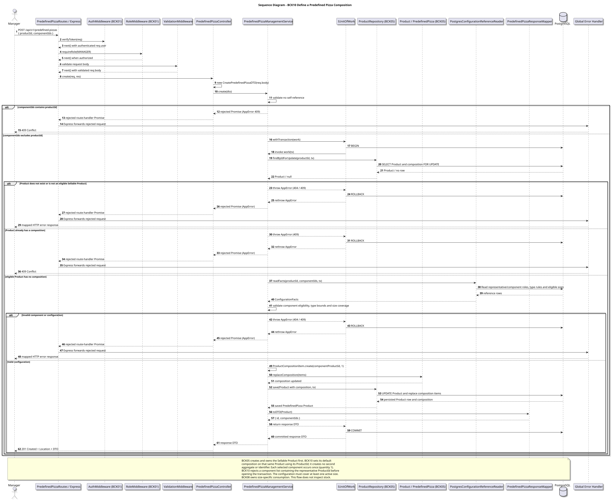
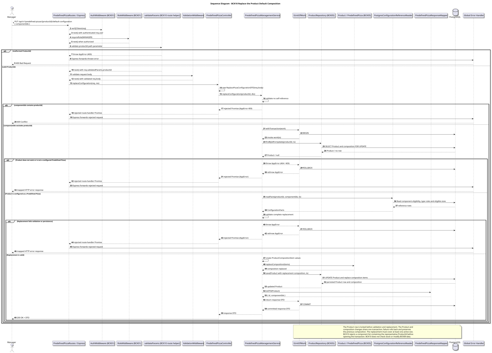
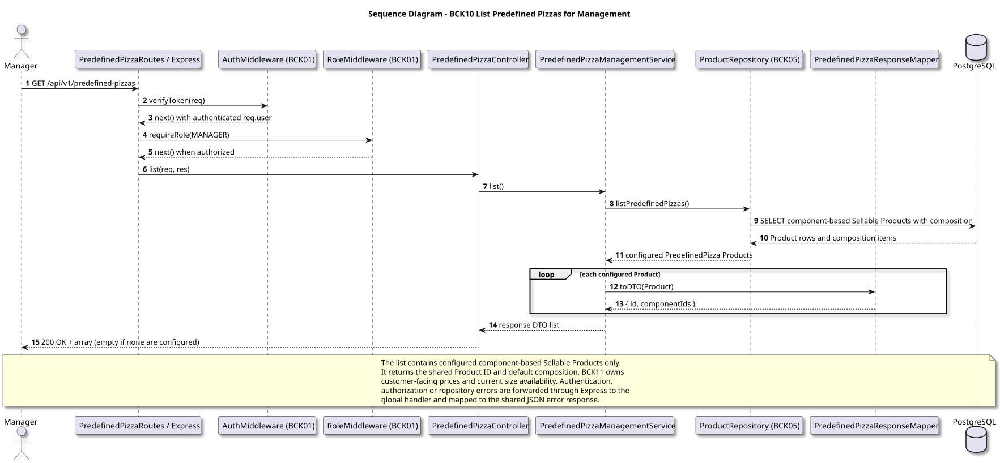
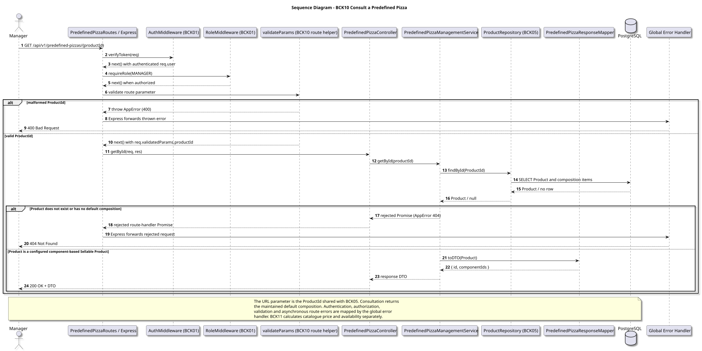

# US BCK10 – Predefined Pizza Management

## 1. Context & Scope

- **User Story ID:** BCK10
- **Sprint:** Sprint 1
- **Area:** Back-End (BCK)
- **Responsible:** Francisco Sá (1241341)
- **Related Requirements / Stories:**
  - Sprint Project: *PART III – Sprint 1, Section III.2.1, BCK10 (Predefined Pizza Management)*.
  - System Specification: *PART II – System Specification, Section II.3.1.2 (Products and Allergens), Section II.3.1.3 (Pizzas, Sizes, and Components), and Section II.3.1.4 (Stock Control)*.
  - Sprint planning: [BCK05–BCK09 implementation tasks and dependencies](../../Planning/Sprint1/SprintPlanning.md).
  - Architectural Stories: [ARC01 (Core Domain Analysis and Modelling)](../../architecture/domainModel/domainmodel.puml), [ARC02 (System Architecture)](../../architecture/SAD.md), [ARC03 (REST API)](../../architecture/SAD.md), [ARC04 (Persistence and Data Integrity)](../arc/ARC04.md), [ARC05 (Automated Testing)](../../architecture/SAD.md).
  - Dependencies: **BCK05** (sellable Products, active status and Pizza Component designation), **BCK07** (Pizza Component Types and cardinality limits), **BCK08** (Component Size Configurations), and **BCK06** (Pizza Size state). **BCK01** provides the authentication and role foundation for protected manager operations. **BCK11** uses the maintained default configuration together with size-specific component configuration and stock information to present catalogue sizes and prices.
  - Tracking sub-issue: not provided in the request.

## 2. Requirements & Analysis

### 2.1. User Story Description

> **As a** LaPrizza Manager,  
> **I want** to define and manage predefined pizzas,  
> **so that** the restaurant can maintain the standard pizza configurations offered to its customers.

### 2.2. Acceptance Criteria (from the Sprint Project)

- [ ] **AC 1:** A Predefined Pizza must be represented by an appropriate sellable Product.
- [ ] **AC 2:** A Predefined Pizza must define a default pizza configuration composed of Products designated as Pizza Components.
- [ ] **AC 3:** Only active Products currently designated as Pizza Components may be included in a default pizza configuration.
- [ ] **AC 4:** The same Pizza Component must not occur more than once in the same default pizza configuration.
- [ ] **AC 5:** The default configuration must satisfy the minimum and maximum cardinality rules defined for each Pizza Component Type.
- [ ] **AC 6:** A Predefined Pizza may only be made available in Pizza Sizes for which all Pizza Components in its default configuration have a corresponding Component Size Configuration.
- [ ] **AC 7:** The system must allow the default configuration of a Predefined Pizza to be consulted.
- [ ] **AC 8:** The information maintained for a Predefined Pizza must provide an appropriate basis for the pizza customization functionality introduced in subsequent sprints.

The Sprint Project states these criteria in *PART III, Section III.2.1, BCK10* (document page 10; PDF viewer page 11). The additional price and stock-availability rules below come from the recorded client clarifications, rather than from additional BCK10 acceptance-criteria text in that section.

### 2.3. Client Clarifications & Questions

The repository's [Client Clarifications](../../architecture/clientClarifications/clarifications.md) records the following answers relevant to BCK10. These are summaries, not verbatim quotations:

- **Question 3 — Predefined Pizza price:** Component prices already include production/labour costs, and the pizza price is determined by its components. The client has clarified that a predefined-pizza price for a chosen size is the sum of the configured components' prices for that size. BCK10 management responses in this design do not expose a price or per-size price; customer-facing price presentation belongs to the relevant catalogue/order workflow.

- **Questions 5–6 — Pizza availability by size and stock:** The stock available must cover the consumption configured for the size. A component that is not stock-controlled is considered available for this check. The clarification also frames availability as depending on the components existing for the size.

- **Question 7 — Catalogue visibility when unavailable:** If stock makes some or all sizes unavailable, the pizza remains in the catalogue and is presented as partially or fully unavailable. The confirmed interpretation for this design is that the pizza is available in the catalogue when at least one size is currently available, and unavailable when no sizes are currently available. This also applies when a later component-size configuration change leaves the pizza with no structurally eligible sizes. BCK10 consultation still returns the maintained default configuration; BCK11 presents the catalogue availability state.

- **Question 4 — Customization price:** The price is recalculated from the final component set. This is a downstream customization rule; BCK10 provides the default configuration as a starting point and does not define the customization workflow.

**Additional client clarifications received for this review:**

- The Product representing a Predefined Pizza must be Sellable and must not also be designated as a Pizza Component.
- The four basic Pizza Component Types — Base Dough, Base Sauce, Cheese and Topping — are mandatory and must remain available; they cannot be deactivated or removed. Other types may be managed by the Manager while preserving the consistency of existing Products and configurations.
- Every Product must have a Product Category, including Products used exclusively as Pizza Components.

**Interpretations adopted for this analysis:**

- The specification's “Pizza Component” means a Product role, not a separate Product or aggregate. Each Product currently designated as a Pizza Component is classified by exactly one Pizza Component Type, as recorded in the global domain model.
- The count for a Pizza Component Type absent from a configuration is zero when applying its minimum-cardinality rule. This follows the meaning of a minimum quantity; it is not a separate configuration feature.
- For a given size, structural eligibility (all component size configurations exist) and stock availability (sufficient stock where controlled) are separate checks. A size must pass both to be considered available under the clarification.
- A size is not offerable while its Pizza Size is inactive. For catalogue availability, a size must be active, structurally eligible, and satisfy the clarified stock-availability rule.
- The confirmed price rule is that, for a selected size, the predefined-pizza price is the sum of its configured components' prices for that same size. BCK10 stores the component configuration; price presentation is outside the manager response specified here.

**BCK10 design decision confirmed for this correction:** Every create or replacement operation must leave at least one active Pizza Size with a Component Size Configuration for every selected component. Stock is not checked. This is a BCK10 save-time validity rule agreed by the team and confirmed by the story owner; it is stricter than AC 6's wording about when a pizza may be made available, and is not presented as a separate client clarification.

**Confirmed decisions:**

- **BCK05 Product changes (decided):** Removing the Pizza Component designation is rejected while the Product is referenced by a BCK08 configuration or a BCK10 predefined pizza. Deactivation is allowed and preserves those references; predefined pizzas using the inactive component remain in the catalogue but become unavailable until the component is reactivated or the pizza configuration is updated. BCK10 create/update validation continues to accept only active component Products.
- **BCK07 cardinality changes (decided):** If changing a Pizza Component Type limit would invalidate existing Predefined Pizzas, the limit change must be prevented until the Manager updates the affected pizzas.
- **BCK07 basic types (client clarification):** Base Dough, Base Sauce, Cheese and Topping are mandatory Pizza Component Types and must remain available; they cannot be deactivated or removed. Other types may be managed by the Manager while preserving consistency of existing Products and configurations. BCK10 consumes the type definitions and cardinality limits; it does not manage the type lifecycle. A basic type is not necessarily selected in every pizza when its configured minimum is zero.
- **BCK05 Product Category (client clarification):** Every Product has exactly one Product Category, including Products used only as Pizza Components. BCK03/BCK05 own category assignment and integrity. BCK10 uses Product business identifiers and component/type eligibility; category management and category-based validation are outside this story.
- **BCK08 component-size configuration changes (decided):** Removing a component's configuration for a size makes that size unavailable for every associated Predefined Pizza. The change is not blocked merely because it removes the last structurally eligible size. The pizza remains in the catalogue and is presented as unavailable when no sizes are available.
- **Predefined Pizza identity (updated domain model):** A Predefined Pizza is a subtype of `SellableProduct` and shares its Product `ProductId` (`PROD-...`). BCK05 creates and manages the Product; BCK10 defines or replaces its default composition. No separate `PIZZA-*` identifier is used.

These decisions distinguish BCK10 configuration validity from BCK11 catalogue availability. BCK10 operates on an existing BCK05 Product with component-based pricing and stores the default recipe as the Product aggregate's composition. Product identity, general attributes, category and lifecycle remain owned by BCK05. By the BCK10 design decision above, a configuration must have at least one active, structurally eligible size when created or replaced, without a stock check; later BCK05 deactivation or BCK08 configuration changes may make it unavailable without deleting its composition.

### 2.4. Business Rules & Invariants

- **BR 1 (Product subtype):** Every Predefined Pizza is a `PredefinedPizza` subtype of `SellableProduct`, sharing the Product's `ProductId`; it is not designated as a Pizza Component. BCK10 does not allocate a second ID or copy component Products. *(Global domain model; Sprint Project, BCK10; client clarification recorded in §2.3.)*
- **BR 2 (Default composition membership):** Every child Product in the default Product composition must be active and designated as a Pizza Component when the composition is accepted. BCK05 may later deactivate it while preserving the reference; the pizza remains maintained but unavailable until reactivation or reconfiguration. *(Sprint Project, BCK10; BCK05 client-confirmed lifecycle policy.)*
- **BR 3 (Composition membership):** A Product designated as a Pizza Component may occur at most once in a given default configuration, and the representative Product cannot be included as one of its own components. BCK10 rejects self-reference with `409 Conflict`; the database also prevents self-reference and cycles. *(Sprint Project, BCK10 AC 4; BCK10 composition integrity rule; migration 0017.)*
- **BR 4 (Type cardinality):** For every Pizza Component Type, the number of selected components in the default configuration must satisfy that type's configured minimum and maximum quantities; BCK07 allows the maximum to be unbounded. A type with no selected component has a count of zero for this check; this is the cardinality interpretation of the Sprint Project criterion. *(Sprint Project, BCK10; Sprint Planning, BCK07 Task 2.)*
- **BR 5 (Size configuration completeness):** A Pizza Size is structurally eligible only if every component in the default configuration has a corresponding `ComponentSizeConfiguration` for that size. *(Sprint Project, BCK10.)*
- **BR 6 (At least one active, structurally eligible size):** A created or updated default configuration must have at least one active Pizza Size for which every selected component has a corresponding `ComponentSizeConfiguration`. This is the BCK10 save-time validity decision confirmed for this correction; it does not require current stock and is stricter than AC 6's availability wording. *(BCK10 team design decision, confirmed by the story owner; Sprint Project, BCK10 AC 6 provides the availability context.)*
- **BR 7 (Component-derived price):** For a selected size, the predefined-pizza price is the sum of the configured components' prices for that size; component prices already include production/labour costs, and no separate base price is added. BCK10 does not return a per-size price in management operations. *(Client Clarification 3; price response excluded from BCK10 by scope decision.)*
- **BR 8 (Customization boundary):** The default configuration is the basis from which later customization may start. BCK10 does not define the resulting order-specific configuration or its recalculation workflow. *(Sprint Project, BCK10, AC 8; System Specification, II.3.1.3; Client Clarification 4.)*
- **BR 9 (Catalogue visibility and availability):** A Predefined Pizza remains in the catalogue. It is presented as available when at least one Pizza Size is available, and unavailable when no sizes are available. A size is available only when it is active, structurally eligible for the default configuration, all configured component Products are active, and its components satisfy the stock-availability rule. BCK05 deactivation may therefore make a dependent pizza unavailable while retaining its references. BCK11 determines and presents this state; BCK10 does not store or return it in manager responses. *(Client Clarification 7; BCK05 client-confirmed lifecycle policy.)*

### 2.5. Domain Model Excerpt

The excerpt represents `PredefinedPizza` as a subtype of `SellableProduct` and shows the inherited Product composition. It uses the Product's `ProductId`; no separate pizza identifier is created. Composition items reference child Products and have positive quantity. For BCK10 default recipes, each component appears once (quantity 1); BCK08 separately defines size-specific consumption. UUIDs are not domain identifiers. Money and Stock Information are omitted because BCK10 management does not calculate prices or stock availability.

The relationships follow the global model: PredefinedPizza inherits Product identity and composition; each item references a child Product and quantity. The representative Product is sellable and not a Pizza Component. Each component Product has a Pizza Component Type, and each BCK08 size configuration applies to a component Product and Pizza Size. All Products have one category, managed by BCK03/BCK05. Later removal of size configuration can make all sizes unavailable without deleting the Product or composition; BCK11 presents that state.



> PlantUML source: [`excerptDomainModel/domain_model_excerpt.puml`](./excerptDomainModel/domain_model_excerpt.puml).

## 3. Design

### 3.1. Architecture & C4 Alignment

BCK10 is a feature module of the Back-End API and follows the modular Clean / Layered Architecture documented in the [SAD](../../architecture/SAD.md).

- **C4 Level 1 (System Context):** The LaPrizza Manager uses the system to define, update and consult predefined pizzas. Customer catalogue presentation and availability belong to BCK11; BCK10 maintains the default configuration. A catalogue pizza is presented as available if at least one size is available, otherwise as unavailable while remaining listed.
- **C4 Level 2 (Containers):** The Front-End sends HTTPS/JSON requests to the Node.js / Express Back-End API. PostgreSQL stores Product composition with the Product aggregate. BCK10 validates the component-based Sellable Product and its default recipe; it does not calculate stock availability or expose management prices.
- **C4 Level 3 (Back-End module):** predefined-pizza-management provides Manager use cases that load and update the BCK05 Product aggregate through its repository contract. PredefinedPizza is a Product subtype with shared ProductId and composition; BCK10 owns no second aggregate or composition store. A read port obtains Product/type/size facts from BCK05/BCK07/BCK06/BCK08.

Manager endpoints use the shared BCK01 security pipeline: authentication, Manager-role authorization, request validation, then the controller. Express composition, shared error handling and OpenAPI remain at the API boundary. The diagrams show conceptual contracts as UML interfaces; JavaScript does not provide native interfaces.

The design validates and writes Product composition in one PostgreSQL transaction. It requires an existing Product with component-based pricing and at least one active size with complete component-size configuration coverage; stock is not checked. Product identity/category/lifecycle remain BCK05 responsibilities.

### 3.2. Class Diagram (CD)

The class diagram shows BCK10 presentation and application responsibilities, the BCK05 Product aggregate/repository contract, the BCK10 reference-reader contract, shared transaction handling, and PostgreSQL adapters. The conceptual interface notation represents JavaScript contracts; it is not a native JavaScript interface.



> PlantUML source: [`class_diagram.puml`](./classDiagram/class_diagram.puml).

PredefinedPizza is the component-based Sellable Product subtype. Product owns its shared ProductId and ProductCompositionItem collection; BCK10 uses the BCK05 Product repository to persist it. The reference reader validates component eligibility, type cardinality and active size coverage.

### 3.3. Sequence Diagrams (SD)

The diagrams cover defining a default composition on an existing BCK05 Product, replacing it, listing configured component-based Products, and consulting one by ProductId. Creation/replacement lock and update the Product aggregate in one shared transaction. The size-coverage check excludes stock. BCK11 reads the same Product composition for catalogue presentation.

#### SD 1 — Create a predefined pizza



> PlantUML source: [`sequence_diagram_create.puml`](./sequenceDiagram/sequence_diagram_create.puml).

#### SD 2 — Replace its default configuration



> PlantUML source: [`sequence_diagram_update.puml`](./sequenceDiagram/sequence_diagram_update.puml).

#### SD 3 — List predefined pizzas for management



> PlantUML source: [`sequence_diagram_list.puml`](./sequenceDiagram/sequence_diagram_list.puml).

#### SD 4 — Consult a predefined pizza



> PlantUML source: [`sequence_diagram_consult.puml`](./sequenceDiagram/sequence_diagram_consult.puml).

### 3.4. REST API Specification (ARC03)

The implemented versioned JSON endpoints provide the four BCK10 Manager workflows. All require a valid Bearer JWT and the `MANAGER` role through BCK01. Before BCK10 is used, BCK05 must create the Sellable Product with component-based pricing; BCK10 then sets its default composition. The Product ID and component IDs use Product business identifiers as strings, not database UUIDs. The representative Product must not be designated as a Pizza Component.

| Method | Endpoint | Description | Auth / Role |
| :--- | :--- | :--- | :--- |
| `POST` | `/api/v1/predefined-pizzas` | Define a predefined pizza and its default configuration | Manager |
| `GET` | `/api/v1/predefined-pizzas` | List predefined pizzas for management | Manager |
| `GET` | `/api/v1/predefined-pizzas/:productId` | Consult a predefined pizza and its default component IDs | Manager |
| `PUT` | `/api/v1/predefined-pizzas/:productId/default-configuration` | Replace the default component set after full validation | Manager |

The collection endpoint supports the Manager in finding configured Products to consult or update; it is a management operation and does not replace BCK11's customer-facing product catalogue. It returns the shared Product ID and default component IDs, without customer prices or current availability. `POST` requires the component-based Sellable Product to exist already in BCK05. No search or pagination parameters are introduced because none are specified for BCK10. `PUT` replaces the complete default composition; partial edits are not supported by this contract.

`GET /api/v1/predefined-pizzas` returns `200 OK` with an array of the same response objects as `GET /:productId`; an empty collection returns an empty array.

#### Request & response schemas

- **Create — `POST /api/v1/predefined-pizzas`**

  ```json
  {
    "productId": "PROD-00123",
    "componentIds": [
      "PROD-00124",
      "PROD-00125"
    ]
  }
  ```

  Success: `201 Created`, with a `Location` header for the new resource and a `PredefinedPizzaResponseDTO` body.

- **Replace configuration — `PUT /api/v1/predefined-pizzas/:id/default-configuration`**

  ```json
  {
    "componentIds": ["PROD-00124", "PROD-00125"]
  }
  ```

  Success: `200 OK` and the updated `PredefinedPizzaResponseDTO`. Product attributes and identity are not changed by this operation.

- **Consult — `GET /api/v1/predefined-pizzas/:id`**

  Success: `200 OK`. The response contains the shared Product ID and default component Product IDs. They are strings, not database UUIDs. The response does not include per-size prices or stock availability. BCK11 handles customer-facing size availability according to its requirements and the recorded stock clarifications.

  ```json
  {
  "id": "PROD-00123",
    "componentIds": ["PROD-00124", "PROD-00125"]
  }
  ```

#### Error responses

- `400 Bad Request`: Missing fields, invalid JSON shape, malformed business IDs, or duplicate IDs in `componentIds`. `productId` must match `PROD-[0-9]{5,}`; Product business IDs must match the Product ID convention.
- `401 Unauthorized`: Missing, invalid, or expired Bearer token.
- `403 Forbidden`: Authenticated caller does not have the `MANAGER` role.
- `404 Not Found`: Predefined Pizza or referenced Product does not exist.
- `409 Conflict`: The Product is not a component-based Sellable Product, already has a composition, the component list contains the representative Product itself, a component is not active/designated as a Pizza Component, type cardinality is violated, or no active Pizza Size is structurally eligible for the configuration. A later BCK08 change may leave an existing pizza with no structurally eligible sizes; the Product and composition remain, and BCK11 presents it as unavailable.
- `500 Internal Server Error`: Unexpected failure; do not expose SQL, credentials, or stack traces.

Business validation uses the shared error response shape:

```json
{
  "error": {
    "message": "The default configuration violates a Pizza Component Type limit",
    "status": 409
  }
}
```

The implemented API uses this shared error response shape and does not expose SQL, credentials, or stack traces.

### 3.5. Persistence & Data Integrity (ARC04)

Predefined-pizza data is stored in the Product aggregate. Migration 0017 creates product_composition_items with parent_product_id and child_product_id foreign keys to products(id), a positive quantity, and a unique parent/child pair. Existing BCK10 links are migrated as quantity 1. Migration 0013 remains in migration history and its legacy tables are no longer used by BCK10. Product ID is the only business identifier. BCK10 does not persist independent pizza identity, price, or stock availability.


Foreign keys and uniqueness protect Product references and prevent duplicate child entries. Application validation enforces active/type eligibility, cardinality, and at least one active size with complete BCK08 configuration coverage. Product composition writes occur through the BCK05 Product repository in the shared transaction. Later BCK05/BCK07/BCK08 lifecycle changes preserve existing composition and can make catalogue sizes unavailable; BCK11 evaluates current availability.

The unit of work makes each BCK10 create/update write atomic. PostgreSQL `READ COMMITTED` is the configured default. BCK05 blocks removal of a component designation while referenced but permits Product deactivation; BCK07 blocks type/cardinality changes that would break existing references and prevents deactivation/removal of the four basic types. BCK08 may remove a size's component configuration; this changes current size eligibility without deleting or rewriting the Predefined Pizza, and the pizza remains listed as unavailable if no sizes remain. BCK10 does not make a stock availability decision; BCK11 applies the current size, component and stock rules when preparing catalogue information.

### 3.6. Applied Patterns & Architecture Principles

- **Clean / Layered Architecture:** API routes/controllers depend on application contracts; application use cases coordinate domain behavior and ports; PostgreSQL adapters remain in Infrastructure. The domain has no Express, SQL-driver, or framework dependency.
- **Aggregate Root and Value Objects:** Product is the aggregate root. PredefinedPizza is a SellableProduct subtype that shares ProductId and uses ProductCompositionItem values; BCK10 has no separate pizza aggregate or identifier.
- **Repository and Query Port Patterns:** BCK10 uses the BCK05 Product repository contract to load and save the Product aggregate. A BCK10 read port supplies Product, type-cardinality, active-size and BCK08 size-configuration facts for validation.
- **Application DTO and Mapper Patterns:** Request/response DTOs expose ProductId and the default component IDs; persistence mapping remains with the BCK05 Product adapter.
- **Ports and Adapters:** UML interfaces are conceptual JavaScript contracts implemented by injected objects; JavaScript does not enforce native interfaces. This keeps the application independent of Express, `pg`, and other feature modules.
- **Unit of Work / ACID Transactions:** The shared PostgreSQL unit of work owns `BEGIN`, callback execution, `COMMIT`/`ROLLBACK`, and connection release. Every SQL operation in create/update uses its transaction client. Cross-story ownership is explicit: BCK05 blocks removal of referenced component designations but allows deactivation; BCK07 protects the four basic types and prevents cardinality changes that invalidate existing configurations; BCK08 changes may reduce eligible sizes, including to zero, without deleting the pizza.
- **Configuration Eligibility:** Create and replace operations verify that at least one active Pizza Size has a Component Size Configuration for every configured component. They do not check stock. Later BCK08 changes may leave zero structurally eligible sizes; that does not delete the Predefined Pizza, and BCK11 presents it as unavailable. Stock availability and per-size price are outside the BCK10 management response.
- **RBAC:** The shared authentication and `MANAGER` role middleware protect management endpoints. The actor's role is not reimplemented in the domain.

## 4. Tests (ARC05)

### 4.1. Test Plan & Scenarios

The following scenarios are the BCK10 test plan and the basis for the implementation's Red-Green-Refactor cycle. Tests use the existing project framework. Domain and application tests use test doubles for cross-story Product, Pizza Size and Component Size Configuration facts. The API integration tests use in-memory Product persistence and a reference reader; they verify HTTP behavior and authorization, not real PostgreSQL integration. The execution record distinguishes those results from a PostgreSQL run, which is still pending.

| Test ID | Level | Scenario / Description | Expected Result |
| :--- | :--- | :--- | :--- |
| UT01 | Domain | Restore a component-based Sellable Product with a unique composition | Product is restored as PredefinedPizza with shared ProductId and composition |
| UT02 | Domain | A component-based Product is not Sellable or is also a Pizza Component | Reject the invalid PredefinedPizza state |
| UT03 | Domain | Representative Product is also designated as a Pizza Component | Reject creation and configuration replacement; the representative Product role invariant is enforced |
| UT04 | Domain | A configured Product is inactive or is not designated as a Pizza Component | Reject creation or replacement; retain no invalid configuration |
| UT05 | Domain | The default configuration is empty or a Product ID occurs more than once | Reject creation or replacement |
| UT06 | Domain | Component counts violate a Pizza Component Type minimum or maximum, including a missing type with a positive minimum | Reject creation or replacement; a missing type is counted as zero |
| UT07 | Domain | All configured components have Component Size Configurations for at least one active Pizza Size | Accept the configuration when the remaining invariants also hold |
| UT08 | Domain / Service | No active Pizza Size has complete Component Size Configuration coverage, or only stock is insufficient | Reject the former; do not query or use stock for BCK10 eligibility |
| UT09 | Service | The requested Product does not exist or is not a component-based Sellable Product | Return not-found or conflict; do not create a composition |
| UT10 | Service | The Product already has a default composition | Return conflict; do not overwrite it through the create operation |
| UT11 | Service | Replace a default configuration with a valid component set | Persist the complete replacement atomically and return the updated management DTO |
| UT12 | Service | Replacement fails domain validation or the target Predefined Pizza does not exist | Return the mapped error; do not persist a partial or invalid replacement |
| UT13 | Service | A persistence operation or transaction commit fails during create/replacement | Roll back the transaction; no partial BCK10 write is committed |
| UT14 | Service | The representative Product ID appears in `componentIds` during create or replacement | Return `409 Conflict` before reading reference facts or saving composition |
| IT01 | API | Create with a valid Manager token and valid request | `201 Created`, `Location` header and response DTO with business IDs |
| IT02 | API | Missing/invalid token or authenticated non-Manager calls a management endpoint | `401 Unauthorized` or `403 Forbidden`; use the shared BCK01 middleware |
| IT03 | API | Representative Product is not Sellable or is designated as a Pizza Component | `409 Conflict`; Product composition remains unchanged |
| IT04 | API | List and consult predefined pizzas as Manager | `200 OK`; return management configuration, without catalogue price or availability |
| IT05 | API | Consult/list a stored pizza whose component Product was later deactivated | Return the maintained configuration unchanged; BCK10 does not remove the component or calculate catalogue availability |
| DB01 | PostgreSQL | Concurrent configuration writes target the same parent Product or repeat a child Product | Unique constraints and transaction handling prevent duplicate composition items |
| DB02 | PostgreSQL | Configuration replacement fails after replacing composition items | Transaction rollback preserves the previously committed Product composition |
| DB03 | PostgreSQL | Delete a Product referenced as a composition parent or child | Referential integrity prevents hard deletion; no cascade removes Product composition |

### 4.2. Representative Test Implementations

The application tests use a Product aggregate restored as a component-based Sellable Product. BCK10 validates the requested components and then saves ProductCompositionItem values with quantity 1 through the BCK05 Product repository contract. This confirms that the shared ProductId is the only pizza identifier and that no second aggregate is created.

The test suite also verifies rejection of duplicate component IDs, inactive or non-component Products, cardinality violations, missing active-size coverage, attempts to configure a fixed-price Product, and attempts to define an already configured Product. The BCK10 service additionally rejects a self-referencing component list before it reaches the BCK05 Product aggregate. The Supertest tests exercise the Manager API with in-memory Product persistence and reference facts; they do not substitute for PostgreSQL integration tests.

### 4.3. Execution Record

| Scope | Test command / file | Actual result |
| :--- | :--- | :--- |
| BCK10 unit tests and Product composition repository contract | npm test -- --runInBand tests/unit/predefined-pizza-management tests/unit/product-management/repository.test.js | Passed: 5 suites, 11 tests. |
| Cross-story unit and API suites (BCK05, BCK07, BCK10, BCK11) | npm test -- --runInBand tests/unit/predefined-pizza-management tests/integration/predefined-pizza-management/api.test.js tests/unit/product-management tests/unit/product-catalogue-and-information tests/unit/pizza-component-type-management tests/integration/product-catalogue-and-information/api.test.js | Passed: 21 suites, 137 tests. |
| PostgreSQL migration and persistence integration | Gated tests with a dedicated clean _test database | Not run. The migration copies legacy component links to Product composition at quantity 1 and drops the old BCK10 tables. |

The current implementation has not yet been verified against a live PostgreSQL database. Migration 0017 references the existing BCK05 Product table, creates Product composition storage and migrates legacy associations; its PostgreSQL cycle trigger and BCK05/BCK07/BCK11 queries require a clean test database to verify.

---

## 5. Implementation

### 5.1. File Structure

BCK10 management operations are implemented in the existing `predefined-pizza-management` module. The module coordinates use cases, while the Product aggregate and its PostgreSQL repository remain owned by BCK05. The API and application composition changes register the module with the existing Express app, PostgreSQL connection, OpenAPI document and BCK01 authorization.

```text
backend/
├── migrations/
│   └── 0017_product_composition_items.sql
├── index.js                                      # production composition root
├── src/
│   ├── app.js                                    # Express application registration
│   ├── modules/index.js                          # module registry
│   ├── shared/openapi/spec.js                    # shared OpenAPI composition
│   └── modules/predefined-pizza-management/
│       ├── index.js
│       ├── api/
│       │   ├── controllers/PredefinedPizzaController.js
│       │   ├── routes/PredefinedPizzaRoutes.js
│       │   ├── schemas.js
│       │   └── openapi.js
│       ├── application/
│       │   ├── dtos/
│       │   ├── mapping/PredefinedPizzaResponseMapper.js
│       │   └── services/PredefinedPizzaManagementService.js
│       ├── domain/model/
│       │   └── ConfigurationFacts.js
│       └── infrastructure/persistence/
│           └── PostgresConfigurationReferenceReader.js
│   └── modules/product-management/
│       ├── domain/model/Product.js
│       ├── domain/model/ProductCompositionItem.js
│       └── infrastructure/persistence/
│           ├── ProductRepository.js
│           └── ProductRowMapper.js
└── tests/
    ├── unit/predefined-pizza-management/
    └── integration/predefined-pizza-management/api.test.js
```

The files `backend/index.js`, `backend/src/app.js`, `backend/src/modules/index.js` and `backend/src/shared/openapi/spec.js` are shared integration points. Product composition and `ProductCompositionItem` are implemented in the BCK05 Product aggregate because the global domain model assigns them there. BCK10 adds its management routes, use cases, validation reader and migration integration; it does not implement BCK06 or BCK08.

### 5.2. Core Implementation Highlights

- **Domain model:** PredefinedPizza is a subtype of SellableProduct; it shares ProductId and uses the ProductCompositionItem collection for its default recipe.
- **Application service:** `PredefinedPizzaManagementService` defines or replaces composition on an existing Product, lists configured pizzas, and consults by ProductId. Create and replacement run through the shared unit of work. Existing compositions and invalid Product types are rejected.
- **Cross-story reads:** `PostgresConfigurationReferenceReader` reads Product facts from BCK05, type limits from BCK07, active sizes from BCK06 and component-size coverage from BCK08. It does not read stock, prices or catalogue availability. This correction branch is based on `origin/main`, including the BCK06/BCK08 migrations.
- **Persistence:** The BCK05 ProductRepository saves composition items to product_composition_items; migration 0017 creates the table and migrates legacy links with quantity 1.
- **API and authorization:** Four Manager-only endpoints expose create, management list, consultation and complete configuration replacement. Shared BCK01 middleware handles authentication and the `MANAGER` role.
- **Response boundary:** Management DTOs contain the shared Product `id` and `componentIds`. They do not expose prices, stock or customer-facing availability. Product deletion/deactivation remain BCK05 responsibilities.

---

## 6. Integration, Verification & Demonstration

### 6.1. Running the Automated Tests

From `backend/`, the BCK10 domain, application, persistence-contract, OpenAPI and in-memory API tests can be selected with:

```sh
npm test -- --runInBand tests/unit/predefined-pizza-management tests/integration/predefined-pizza-management/api.test.js
```

The existing project quality checks are:

```sh
npm run lint
npm run format:check
```

The API integration test uses Supertest with in-memory persistence and reference facts. The persistence tests use a PostgreSQL query double. There is no BCK10-specific PostgreSQL integration suite in the current repository; a successful database check and migration do not replace tests for constraints, rollback or the cross-story reference queries.

To prepare a local database using the existing project configuration, start PostgreSQL, set `PGDATABASE` in `backend/.env` to a dedicated name ending in `_test`, create that database if it does not exist, and run:

```sh
npm run db:check
npm run db:migrate
```

The exact number of migrations applied depends on the state of the local database; a clean database should apply the migration set present on the current branch. If a local test database records migration checksums or filenames from an older branch state, use a separate clean `_test` database rather than editing migration history. A Manager was bootstrapped for Swagger access and the temporary bootstrap settings were then cleared from `.env`. Do not use the normal local database for destructive test fixtures.

### 6.2. Manual Verification & OpenAPI Contract

Swagger UI is available at `http://localhost:8080/api-docs/`. Start the API with `npm run dev`, sign in through `POST /auth/login` as a Manager, and authorize Swagger with the returned `accessToken`. The documented API server prefix is `/api/v1`. All BCK10 endpoints require the `MANAGER` role.

Before a successful create or replacement, the database must contain:

1. A representative Product with `isSellable = true` and `isPizzaComponent = false`.
2. Active component Products designated as Pizza Components, each with a valid BCK07 type; the selected set must satisfy each type's minimum and maximum cardinality.
3. At least one active Pizza Size for which every selected component has a Component Size Configuration.

Stock is not part of this BCK10 validation. The IDs in the request examples below are illustrative business IDs; use IDs of real records when the corresponding fixtures exist.

| Test ID | Request / setup | Expected result | Actual result / requirement |
|---|---|---|---|
| B10-M01 | Call `GET /predefined-pizzas` without a token | `401 Unauthorized`; no management data returned. | Manual Swagger result not recorded. Authentication. |
| B10-M02 | Call `GET /predefined-pizzas` with a non-Manager token | `403 Forbidden`. | Manual Swagger result not recorded. Manager-only scope. |
| B10-M03 | As Manager, call `GET /predefined-pizzas` on the fresh database | `200 OK` and an empty array before any Products have a default composition. | Manual Swagger result not recorded. Manager listing. |
| B10-M04 | As Manager, call `GET /predefined-pizzas/PROD-99999` | `404 Not Found`. | Manual Swagger result not recorded. AC 7. |
| B10-M05 | Submit `POST /predefined-pizzas` with an invalid business ID such as `pizza-123` | `400 Bad Request`; Product composition is unchanged. | Manual Swagger result not recorded. ID validation. |
| B10-M06 | Submit `POST /predefined-pizzas` with a repeated Product ID in `componentIds` | `400 Bad Request`; duplicate input is rejected. | Manual Swagger result not recorded. AC 4. |
| B10-M07 | Submit a valid-shaped create request referencing a missing representative Product | `404 Not Found`; no Product composition is written. | Manual Swagger result not recorded. Product reference. |
| B10-M08 | Submit `PUT /predefined-pizzas/PROD-99999/default-configuration` | `404 Not Found`; no replacement is written. | Manual Swagger result not recorded. Missing target. |
| B10-M09 | Define a configuration with a valid Manager token, existing representative Product, valid components and complete active-size coverage | `201 Created`, `Location` header and response with business IDs only. | In-memory API tests passed; PostgreSQL/Swagger verification remains pending. AC 1–6, 8. |
| B10-M10 | List and consult the successfully created pizza | `200 OK`; stored component IDs are returned without price or availability fields. | The in-memory API test passed; real PostgreSQL/Swagger execution is pending. AC 7–8. |
| B10-M11 | Replace the full component set with another valid set and consult again | `200 OK`; new configuration is persisted atomically and appears in consultation. | The in-memory API test passed; real PostgreSQL/Swagger execution is pending. AC 2–6, 8. |
| B10-M12 | Use a representative Product that is also designated as a Pizza Component during create and replacement | `409 Conflict`; no invalid composition is persisted. | Domain and in-memory API tests passed; real reference-query execution is pending. Client decision. |
| B10-M13 | Change BCK08 coverage after creation so no active size remains eligible, then list and consult the pizza | BCK10 retains and returns the pizza and configuration; BCK11 presents it as unavailable. | Service test with changed reference facts passed; cross-story integration is pending. BCK08/BCK11 boundary. |
| B10-M14 | Submit a create or replacement request with the representative Product ID also listed as a component | `409 Conflict`; no composition is saved. | Added as a BCK10 regression scenario; execution not recorded. Composition integrity. |

For a successful create, the request shape is:

```json
{
  "productId": "PROD-00123",
  "componentIds": ["PROD-00124", "PROD-00125"]
}
```

For a full configuration replacement, use:

```json
{
  "componentIds": ["PROD-00124", "PROD-00126"]
}
```

The replacement keeps the existing representative Product. Do not expect a successful create or replacement with fabricated IDs: BCK10 reads the real reference data, and its API composition does not inject test doubles.

---

## 7. Observations, Dependencies & Limitations

- **Integrated dependencies:** BCK01 provides real Manager authentication; BCK05 Products and BCK07 component types have PostgreSQL migrations and read contracts in this branch. The BCK10 migration and application use those business records without duplicating their ownership.
- **Integrated dependencies:** BCK06 owns Pizza Sizes and BCK08 owns Component Size Configurations. Their migrations (`0011_pizza_sizes.sql` and `0012_component_size_configurations.sql`) are present on this correction branch, based on `origin/main`.
- **Test doubles:** Domain, application, PostgreSQL adapter-contract and Supertest API tests use doubles for cross-story facts or persistence. Their successful cases prove BCK10 rules and HTTP orchestration in isolation; they do not prove the real PostgreSQL reference queries.
- **Scope boundaries:** BCK10 does not manage Product Categories, Product lifecycle, Pizza Component Type lifecycle, Pizza Size lifecycle, Component Size Configurations, stock, customer catalogue prices or customer availability. It does not automatically remove components and does not delete/deactivate predefined pizzas.
- **Current database setup:** The local `_test` database used for earlier Swagger checks may have an older migration layout. Use a separate clean `_test` database for verification if its recorded migration history predates the current `main` schema.
- **Manual verification:** Swagger is exposed through the real PostgreSQL composition. The manual matrix in §6.2 records expected outcomes and marks flows that have not been exercised through Swagger; update its actual-result column after execution.
- **Known limitation:** No BCK10-specific PostgreSQL integration suite currently covers concurrent uniqueness, transaction rollback, foreign-key restrictions or the real BCK06/BCK08 queries. The automated API integration tests use in-memory adapters.
