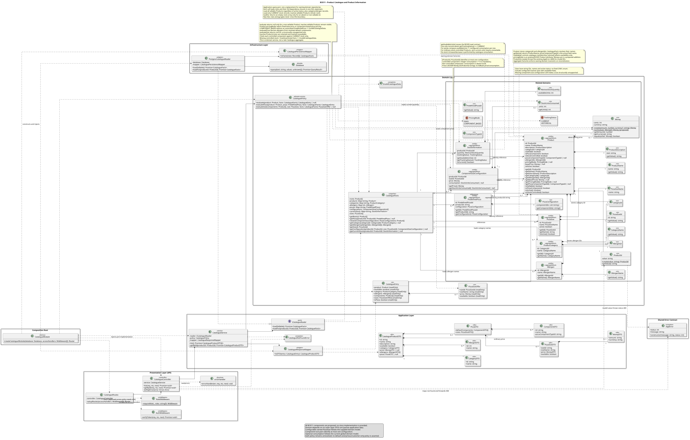
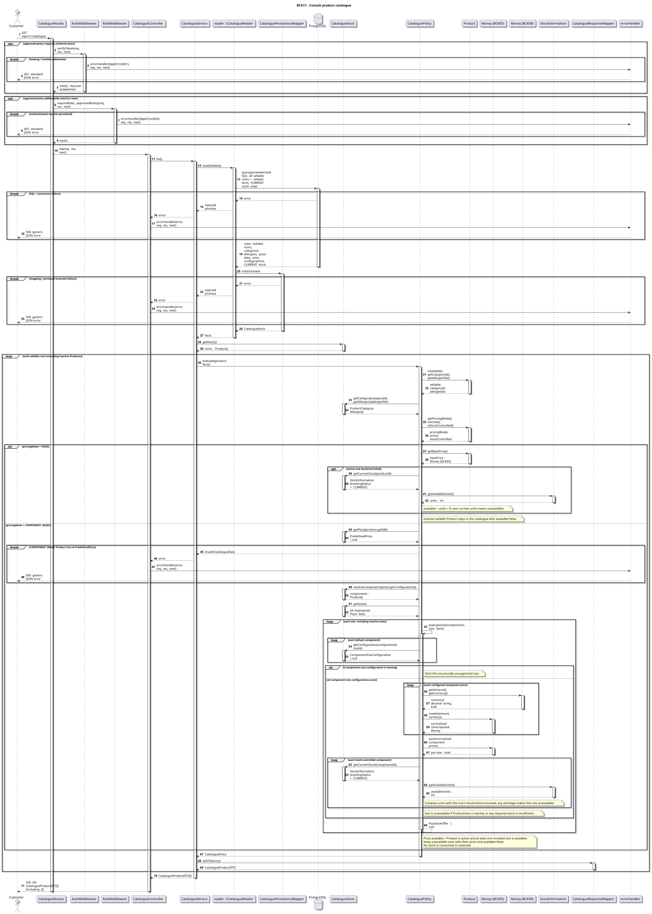
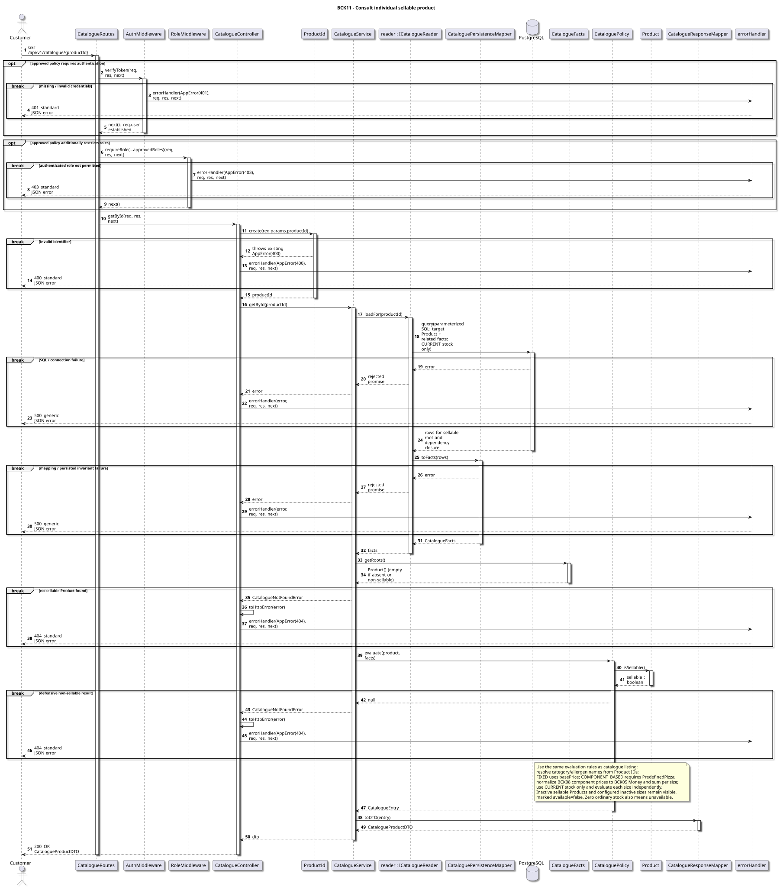

# US BCK11 – Product Catalogue and Product Information

## 1. Context & Scope

- **User Story ID:** BCK11
- **Sprint:** Sprint 1
- **Area:** Back-End (BCK)
- **Responsible:** Sofia Carvalho (1240898) and Francisco Sá (1241341)
- **Related Requirements / Stories:**
  - Sprint 1 Specification: _PART III, Section III.2.1, BCK11_ (printed pages 10–11; PDF pages 11–12).
  - System Specification: _PART II, Sections II.3.1.2 (Products and Allergens), II.3.1.3 (Pizzas, Sizes, and Components), II.3.1.4 (Stock Control), and II.3.2 (Web Application, allergen information)_.
  - Architectural Stories: ARC01 (Domain Modelling; current model on `origin/main`, commit `569b07f`), [ARC02 (System Architecture)](../../architecture/SAD.md), [ARC03 (REST API)](../../architecture/SAD.md), [ARC04 (Persistence)](../arc/ARC04.md), and [ARC05 (Automated Testing)](../../architecture/SAD.md).
  - Dependencies: BCK03 (Product Categories), BCK04 (Allergens), BCK05 (Products and their commercial properties), BCK06 (Pizza Sizes), BCK07 (Pizza Component Types), BCK08 (size-dependent component prices and consumption), BCK09 (current stock), and BCK10 (Predefined Pizzas and default configurations).
  - Team allocation: [BCK11 Sprint Planning](../../Planning/Sprint1/SprintPlanning.md#bck11--product-catalogue-and-product-information).

BCK11 provides read-only consultation of the restaurant's sellable products and individual product details. For predefined pizzas it also exposes the default components, prices for the corresponding sizes, and size availability. Product maintenance belongs to the dependent management stories. Ordering, pizza customization, stock changes, and a customer-facing application are outside this analysis's Sprint 1 functionality.

---

## 2. Requirements & Analysis

### 2.1. User Story Description

> **As a** Customer,  
> **I want** to consult the products offered by LaPrizza,  
> **so that** I can understand the available options, their pricing, and other relevant product information.

### 2.2. Acceptance Criteria (from Sprint 1 Specification)

- [x] **AC 1:** The system must provide access to the products currently offered for sale by LaPrizza.
- [x] **AC 2:** The catalogue must provide relevant information about each sellable product, including, where applicable, its name, description, category, pricing information, and allergen information.
- [x] **AC 3:** Users must be able to consult the details of an individual sellable product.
- [x] **AC 4:** For a Predefined Pizza, the catalogue must provide its default configuration and the Pizza Sizes in which it is available.
- [x] **AC 5:** The information presented in the catalogue must be consistent with the corresponding business information maintained by the system.

### 2.3. Client Clarifications & Questions

> **Question 1:** How is a predefined pizza priced?  
> **Answer:** Sum the component prices for the corresponding size. Component prices already include production/labour costs, so no additional base price or surcharge is added.

> **Question 2:** Does availability mean positive stock or sufficient stock for the size?  
> **Answer:** Stock must cover the configured consumption for that size. With two dough units and consumption of one, two, and four units, Small and Medium are available and Large is unavailable.

> **Question 3:** How are components without stock control treated?  
> **Answer:** They are considered available for the stock check; the size-specific configuration must still exist.

> **Question 4:** Should pizzas disappear when a size becomes unavailable?  
> **Answer:** Keep the pizza visible and indicate unavailability for the affected sizes, or complete unavailability when no size is available.

> **Question 5:** What is meant by ingredient search?
>
> **Answer:** Both forms must be supported: searching directly for Products that are Pizza Components, and searching Products (including pizzas) through their respective components.

> **Question 6:** How should future allergen/diet search work?
>
> **Answer:** Its main goal is to exclude Products containing selected allergens or components. For restrictions such as Vegetarian, this may mean identifying or excluding components containing meat or, more generally, animal-origin products, depending on the restriction.

> **Question 7:** Is ingredient search included in BCK11, and how does a component name match?
> **Answer:** It is included in this sprint. Match the full component name exactly, without case sensitivity. Return sellable Pizza Component Products and sellable Products, including predefined pizzas, whose default configuration contains a component with that name.

> **Question 8:** What access policy applies to catalogue consultation?
> **Answer:** Both catalogue endpoints require authentication. Any authenticated role may consult them; there is no role-specific allowlist.

### 2.4. Business Rules & Invariants

- **Catalogue membership:** Every sellable Product is an independent catalogue entry regardless of `isActive()`. A non-sellable Product is not listed independently, but may be resolved as a component of a predefined pizza.
- **Product availability:** An inactive sellable Product remains in the response with `available: false`. An active, non-stock-controlled ordinary Product is available; an active stock-controlled ordinary Product is available only when its current stock is positive. Historical stock is ignored. A predefined pizza's top-level availability is true when at least one size is available.
- **Product information:** Catalogue and detail responses use maintained Product identity, name, description, category, applicable price, and allergen associations. The Product stores category and allergen identifiers; the reader loads the related records to provide DTO names. BCK11 does not duplicate this information.
- **Pricing source:** A Product with a `PredefinedPizza` is priced from its configured components by size; otherwise, a Product with a maintained `basePrice` uses that fixed price. Having both sources, or neither, is invalid catalogue data. BCK05 currently persists `pricingMode`, but BCK11 does not need it to choose between these sources.
- **Predefined pizza details:** Resolve the default `PizzaConfiguration.componentIds` to Products. Components retain their identities and obey BCK10's active-component, uniqueness, and component-type cardinality rules. BCK11 reads the configuration without creating or changing it.
- **Size eligibility:** A pizza size is structurally eligible only if every default component has a `ComponentSizeConfiguration` for that size. A global Pizza Size without complete component configuration is insufficient.
- **Size visibility and availability:** Include every structurally supported size, whether active or inactive. An inactive size is retained with `available: false`. For an active size, every stock-controlled component must have current `availableUnits >= StockUnitsConsumed.units`; components without stock control pass the stock check. An inactive Product makes each of its sizes unavailable. Consultation does not reserve or consume stock.
- **Size-specific pizza price:** For a structurally supported size `s`, `price(pizza, s) = sum(price(component, s))` over its default components. Use the BCK08 component prices, normalize their EUR decimal strings to BCK05's cents-backed `Money`, and sum using BCK05 `Money.sum`. Add no separate base price or labour charge. Availability does not alter the calculated price.
- **Unavailable pizzas remain visible:** A sellable predefined pizza remains in the catalogue when its Product is inactive, its sizes are inactive, or stock makes some or all sizes unavailable. A size with insufficient stock is marked unavailable while other sizes may remain available. A missing size configuration remains a structural issue and that size is omitted.
- **Historical stock:** Availability calculations use only `StockInformation` with `trackingStatus = CURRENT`. Historical records do not contribute to stock levels.
- **Pizza allergens:** The pizza's allergen set is derived from all default components, without duplicates. A component need not be independently sellable for its allergens to contribute.
- **Ingredient search:** An optional `componentName` query matches a full Product name exactly, case-insensitively. The results include sellable components and sellable products whose predefined-pizza configuration references a matching component. A non-sellable component can match a pizza but is never returned as an independent catalogue entry.
- **Catalogue access:** Both consultation endpoints require a valid authenticated user. No role-specific restriction is applied.
- **Consistency:** Listing and detail use the corresponding current Product, category, allergen, default-configuration, size-configuration, and current-stock information. Changes maintained by dependent stories must be reflected in subsequent consultations; caching and transaction mechanisms remain design decisions.

### 2.5. Domain Model Excerpt


It includes Product, Product Category, Allergen, Predefined Pizza and its default Pizza Configuration, Pizza Size, Pizza Component Type, Component Size Configuration, and Stock Information. Product retains `categoryId` and `allergenIds`; the catalogue reader resolves those identifiers to the maintained Category and Allergen records. Multiplicities follow the current global model. A Pizza Component remains a role of Product; the catalogue is a consultation of these concepts, so no new Catalogue aggregate is introduced.

`PizzaConfiguration.componentIds` references component Products by their string Product IDs. Component-size prices and stock consumption support per-size pricing and availability. The excerpt distinguishes Product's stored IDs from BCK11's read-time lookup of category and allergen names. Price and availability are derived information, not new persistent entities. User, Customer, Orders, and preparation concepts are omitted because they do not determine the product information in this excerpt.

---

## 3. Design

### 3.1. Architecture & C4 Alignment

BCK11 belongs to the `product-catalogue-and-information` back-end module and follows the module structure defined in the [SAD](../../architecture/SAD.md): `api`, `application`, `domain`, and `infrastructure`.

- **C4 Level 1 — System Context:** The Customer consults the catalogue and individual sellable products through the LaPrizza Information System.
- **C4 Level 2 — Containers:** A client sends HTTPS/JSON requests to the Back-End API. PostgreSQL supplies the business information used to build the response.
- **C4 Level 3 — Components:** Routes dispatch requests to `CatalogueController`, which delegates to `CatalogueService`. The service loads domain information through `ICatalogueReader`, invokes `CataloguePolicy`, and maps the result to response DTOs.

Static dependencies point inward: **API → Application → Domain**, with **Infrastructure → Application/Domain**. The domain contains no Express, SQL, database-driver, or HTTP-status dependencies. The application depends on the read-port interface; its concrete PostgreSQL adapter is supplied by dependency injection at the module composition root.

The implementation uses the existing module structure and related-domain contracts for BCK03–BCK10. The BCK11 PlantUML diagrams remain unchanged as requested; they predate the confirmed authentication and ingredient-search decisions and do not show those details.

### 3.2. Class Diagram (CD)



`CatalogueFacts` groups the sellable Products, category and allergen records resolved from Product IDs, predefined configurations, component-size configurations, all maintained Pizza Sizes, and current stock required for one request. It is a view of information at one moment, not a new persisted aggregate or a stock reservation. Its references do not transfer ownership of the related aggregates to BCK11.

`CataloguePolicy.evaluate(product, facts)` returns a `CatalogueEntry` for every sellable Product, regardless of active status, and returns null for a non-sellable Product. A `PredefinedPizza` association selects per-size prices derived from its default components; without that association, the Product must have a maintained `basePrice`. A Product with both sources or neither is invalid persisted data. BCK05's persisted `pricingMode` is not used as BCK11's type switch. Category and allergen names are resolved from `CatalogueFacts`; an inactive Product remains in the entry with `available: false`.

For each maintained `PizzaSize`, including inactive sizes, `evaluateSize` checks that every component has a corresponding configuration. An absent configuration means the size is structurally unsupported and is omitted. Otherwise, each BCK08 EUR decimal-string component price is normalized to BCK05's cents-backed `Money`; `Money.sum` adds those values using integer cents. Availability is false when the Product or size is inactive. For active sizes, every stock-controlled component must have current stock at least equal to its configured consumption; non-stock-controlled components skip that comparison. Historical stock is never used. Insufficient stock preserves the size and calculated price with `available: false`.

Missing required references, invalid monetary data, or missing stock/consumption for a controlled component are integrity failures; they must not be converted to fabricated zero values. Component-derived allergens are deduplicated by identity. The component-derived set is the allergen set returned for a predefined pizza.

The Product model follows the current BCK05 implementation: it stores `categoryId`, `allergenIds`, `pizzaComponentTypeId`, and `pricingMode`; `getName()` returns `ProductName`. BCK11 uses the presence of a `PredefinedPizza` or a fixed `basePrice` as the pricing source, as clarified by the client; it does not add or require a pricing-mode concept. `isSellable()` controls catalogue membership, while `isActive()` affects availability only. The current BCK06 `PizzaSize` exposes `name` and `isActive` as properties; BCK11 reads those fields while preserving inactive sizes as unavailable. `StockInformation` includes `trackingStatus`, and BCK11 reads only `CURRENT` records.

The `(ProductId, PizzaSizeId)` pair identifies at most one component-size configuration. `StockUnitsConsumed` is required for stock-controlled Products and absent for non-stock-controlled Products. `PizzaConfiguration.componentIds` uses string Product IDs. BCK05 `Money` stores integer cents and returns a number; BCK08's distinct `Money` returns a canonical decimal string. BCK11 normalizes BCK08 values to BCK05 `Money` before summation. BCK05 `Money.sum` is the small shared addition needed for exact totals.

### 3.3. Sequence Diagram (SD)

#### SD 1 — Consult the product catalogue



The controller invokes `CatalogueService.list()`. The service calls `ICatalogueReader.loadSellable()` to obtain all sellable Products, including inactive ones, and the related facts in one consistent read. Each root is evaluated by `CataloguePolicy`; non-null results are converted through `CatalogueResponseMapper.toDTO` and returned as an array. An empty catalogue returns `200 []`.

The domain evaluation uses the `PredefinedPizza` association for per-size component pricing and the Product's `basePrice` for fixed-price items. It resolves category and allergen names by ID, marks inactive Products unavailable without excluding them, and checks current stock for stock-controlled ordinary Products. Pizza evaluation retains inactive sizes with `available: false`, calculates per-size prices from BCK08 component prices normalized to BCK05 `Money`, and checks each controlled component against current stock and size-specific consumption. Non-sellable Products are not independent roots, but can be resolved as pizza components. Read or integrity failures terminate the request instead of silently producing an incomplete catalogue.

**Acceptance criteria:** AC 1, AC 2, AC 4, and AC 5.

#### SD 2 — Consult an individual sellable product



The controller constructs `ProductId` from the path value and invokes `CatalogueService.getById(productId)`. Invalid input causes the existing `ProductId.create()` implementation to throw `AppError` with status 400. The service loads the relevant snapshot through `ICatalogueReader.loadFor(productId)`. A missing or non-sellable Product produces `CatalogueNotFoundError` and a 404 response; an inactive sellable Product is returned with `available: false`. A defensive null result from domain evaluation also terminates with 404 before response mapping.

A sellable Product follows the same domain policy and response mapper as catalogue listing. This keeps product information, pizza prices, allergens and stock-based availability consistent across the two use cases.

**Acceptance criteria:** AC 2, AC 3, AC 4, and AC 5.

Both diagrams show repository-port dispatch through the injected `PostgresCatalogueReader`, explicit execution bars, return messages and error alternatives. The persistence lifeline combines the existing `Database.query` facade and PostgreSQL; its query selects only current stock records and loads category/allergen records. It does not represent direct SQL access from the application. Domain getter expressions in arguments abbreviate the read methods shown in the CD.

Both endpoints require authentication. Any authenticated role may use them; the implementation does not apply `RoleMiddleware`. The listing also accepts an optional exact, case-insensitive `componentName` filter. Invalid identifiers and search queries produce 400 through the existing `AppError` path, missing or non-sellable Products produce 404, and unexpected infrastructure/integrity failures produce a sanitized 500 through the shared error handler. Inactive Products, inactive sizes, and insufficient stock are successful unavailable results, not errors. The PlantUML files remain unchanged and therefore do not depict the confirmed access and search behavior.

| Acceptance criterion | Design responsibility                                                             | Scenario      |
| :------------------- | :-------------------------------------------------------------------------------- | :------------ |
| AC 1                 | Sellable root selection; inactive entries remain visible with availability status | SD 1          |
| AC 2                 | Maintained domain data, domain evaluation and DTO mapping                         | SD 1 and SD 2 |
| AC 3                 | Identifier validation, individual lookup and not-found handling                   | SD 2          |
| AC 4                 | Default components, size configurations, pricing and availability                 | SD 1 and SD 2 |
| AC 5                 | Consistent snapshot and shared evaluation/mapping                                 | SD 1 and SD 2 |

### 3.4. REST API Specification (ARC03)

| Method | Endpoint                       | Description                                                                                                         | Auth / Role   |
| :----- | :----------------------------- | :------------------------------------------------------------------------------------------------------------------ | :------------ |
| `GET`  | `/api/v1/catalogue`            | Consult sellable Products, including inactive entries marked unavailable; optionally filter by exact component name | Authenticated |
| `GET`  | `/api/v1/catalogue/:productId` | Consult one sellable Product, including inactive entries marked unavailable                                         | Authenticated |

Both operations have no required request body. `GET /catalogue` accepts optional `componentName`; it matches the entire component Product name case-insensitively. Results contain independently sellable Pizza Component Products and sellable products, including pizzas, whose default configuration contains a component with that name. Non-sellable components can match pizzas but are not returned independently. No allergen/diet search contract is part of this implementation. Product IDs use the owning domain's `ProductId` contract; invalid values produce the existing `AppError` 400 response. Both endpoints require authentication and accept any authenticated role.

#### Request & Response Schemas

Listing returns `200 OK` with a `CatalogueProductDTO[]`. Individual consultation returns one `CatalogueProductDTO`. The following predefined-pizza response is illustrative:

```json
{
  "id": "PROD-00123",
  "name": "Margherita",
  "description": "Traditional dough, tomato sauce and mozzarella",
  "available": true,
  "category": { "id": "CAT-00123", "name": "Pizzas" },
  "price": null,
  "allergens": [
    { "id": 1, "name": "Gluten" },
    { "id": 7, "name": "Milk" }
  ],
  "pizza": {
    "defaultComponents": [
      {
        "id": "PROD-001",
        "name": "Traditional dough",
        "pizzaComponentTypeId": "type-02"
      },
      {
        "id": "PROD-002",
        "name": "Tomato sauce",
        "pizzaComponentTypeId": "type-03"
      },
      {
        "id": "PROD-003",
        "name": "Mozzarella",
        "pizzaComponentTypeId": "type-04"
      }
    ],
    "sizes": [
      {
        "sizeId": "SIZE-SMALL",
        "sizeName": "Small",
        "price": { "amount": "6.00", "currency": "EUR" },
        "available": true
      },
      {
        "sizeId": "SIZE-MEDIUM",
        "sizeName": "Medium",
        "price": { "amount": "8.00", "currency": "EUR" },
        "available": false
      },
      {
        "sizeId": "SIZE-LARGE",
        "sizeName": "Large",
        "price": { "amount": "10.00", "currency": "EUR" },
        "available": false
      }
    ]
  }
}
```

For an ordinary Product, `price` contains its applicable maintained selling price and `pizza` is null. `available` is false when the Product is inactive or a stock-controlled Product has zero current units. For a predefined pizza, the top-level price is null and `available` is true when the Product is active and at least one size is available. Each structurally supported size contains its derived price and availability; inactive sizes remain present with `available: false`. Size IDs and names are maintained data, not a fixed enumeration. Category is mandatory.

A stock-unavailable or inactive size remains in `sizes` with `available: false`; a size without complete component configuration is omitted. A pizza with no structurally supported sizes has an empty size array and remains listed as unavailable. Prices serialize as decimal strings in the DTO. Stock balances, tracking status and consumption values are not exposed to the customer.

- **400 Bad Request:** invalid Product identifier.
- **404 Not Found:** individual Product is absent or not sellable. Inactive sellable Products return 200 with `available: false`.
- **401 Unauthorized:** missing or invalid authentication token.
- **500 Internal Server Error:** unexpected persistence, mapping or established domain-integrity failure.

`ProductId.create()` throws the existing shared `AppError` with status 400 for an invalid identifier. `CatalogueController.toHttpError` maps `CatalogueNotFoundError` to `AppError` 404; other errors pass to the shared handler for sanitization. `InvalidProductId` does not exist. BCK11-specific domain errors remain HTTP agnostic; the ProductId error behavior is an existing BCK05 contract and is documented as-is.

```json
{
  "error": {
    "message": "Product not found",
    "status": 404
  }
}
```

The GET contracts, authentication requirements, response schemas, and `componentName` query parameter are included in the shared OpenAPI definition.

### 3.5. Persistence & Data Integrity (ARC04)

BCK11 reads the PostgreSQL business information maintained by BCK03–BCK10. It introduces no catalogue table, duplicated product store, stock write or migration. `PostgresCatalogueReader` depends on the existing [ARC04 database facade](../../../backend/src/shared/persistence/postgres/index.js).

Each read-port call obtains sellable roots and their full dependency closure in one parameterized SQL statement, regardless of Product active status. The query also loads category and allergen records by the IDs stored on Product and selects only `trackingStatus = CURRENT` stock. The optional component-name filter is applied to the resulting domain entries. This supplies a single statement snapshot under PostgreSQL's existing READ COMMITTED configuration.

`CataloguePersistenceMapper.toFacts` uses the owning domains' factories and mappings to reconstruct valid information. It preserves the difference between absent size configuration, zero price, zero consumption, and non-applicable consumption. It resolves each Product's `categoryId` and `allergenIds` into the records needed for response names. Missing mandatory categories or references, duplicate configuration pairs, missing current stock for a stock-controlled Product, and invalid required values are integrity failures. Join fan-out must not duplicate components or inflate monetary sums.

Catalogue consultation neither reserves nor consumes stock. Its response is consistent at read time; later requests may reflect subsequently committed changes. Ordering must perform its own availability checks when introduced.

### 3.6. Applied Patterns & Architecture Principles

- **Aggregate boundaries:** Product, category, allergen, predefined pizza, size configuration and stock retain their existing owners. The catalogue is a derived view rather than a new mutable aggregate.
- **Domain service:** `CataloguePolicy` owns the business calculations spanning these aggregates. Controllers, application orchestration and DTOs contain no pricing or stock rules.
- **Dependency inversion:** `ICatalogueReader` is an Application query port implemented by an Infrastructure adapter. It returns all sellable roots regardless of active status and only current stock. No aggregate write repository is introduced for this read-only use case.
- **Dependency injection:** the outer module factory supplies concrete dependencies, following the existing BCK01 composition pattern. Services do not instantiate PostgreSQL adapters.
- **DTOs and mapping:** persistence mapping reconstructs domain facts; application mapping serializes evaluated results. DTOs remain passive transport data.
- **Shared components:** reuse the existing database facade, `AppError`, error handler, and BCK01 authentication middleware. `ProductId.create()` currently throws `AppError(400)`; the design reflects that actual contract and does not invent `InvalidProductId`. The existing `ValidationMiddleware.validate(schema)` checks `req.body` only and is not used as a GET path/query validator.
- **Cross-story contracts:** reuse BCK09's `getAvailableUnits()` and BCK08's component/size identity, price and conditional-consumption conventions. The implementation uses the integrated owning-domain models and row mappers.

### 3.7. Design Decisions

- **Derived read model, no Catalogue aggregate:** Product, category, allergen, pizza, size configuration and stock remain owned by their existing stories. BCK11 composes them at read time, including category/allergen lookups from Product IDs, so it adds no duplicated mutable catalogue state or write repository.
- **Sellable membership and availability status:** sellability determines whether a Product is a catalogue root. Active status and current stock determine availability, so inactive sellable Products stay visible. Pizza size availability is evaluated per size; inactive configured sizes remain visible and unavailable.
- **Pricing source and derived pizza price:** a `PredefinedPizza` association selects component-based pricing; otherwise, `basePrice` supplies a fixed price. Both or neither is an integrity error. This follows the client's rule and does not add a pricing-mode requirement to BCK11.
- **One query port for both use cases:** `ICatalogueReader` provides the two read workflows and returns a `CatalogueFacts` snapshot. A single parameterized SQL statement loads sellable roots, categories, allergens, related pizza data and only current stock, giving each request a consistent database statement snapshot; a multi-statement implementation would need an explicit read-only transaction.
- **Domain policy for cross-aggregate rules:** `CataloguePolicy` calculates component-derived allergens, size eligibility, per-size prices and stock availability. It normalizes BCK08's EUR decimal-string Money into BCK05's cents-backed Money and uses BCK05 `Money.sum`. Incompatible currencies are not a reachable case in the current EUR-only implementations.
- **Two mapping boundaries:** `CataloguePersistenceMapper` reconstitutes facts from database rows through owning-domain contracts; `CatalogueResponseMapper` turns evaluated results into API DTOs. Neither mapper owns business decisions.
- **Confirmed access and ingredient search:** both routes require BCK01 authentication without a role-specific restriction. The list route accepts `componentName`, matched against the exact full component name without case sensitivity.

---

## 4. Tests (ARC05)

### 4.1. Test Plan & Scenarios

| Test ID  | Test name                                                           | Type                           | Objective / Given / When / Then                                                                                                                                                                                                                                                                                     | Related AC             |
| :------- | :------------------------------------------------------------------ | :----------------------------- | :------------------------------------------------------------------------------------------------------------------------------------------------------------------------------------------------------------------------------------------------------------------------------------------------------------------ | :--------------------- |
| **UT01** | Exclude a non-sellable Product                                      | Unit — Domain                  | **Objective:** enforce catalogue membership. **Given** a non-sellable Product, **when** `CataloguePolicy.evaluate` runs, **then** it returns no independent catalogue entry.                                                                                                                                        | AC 1, 3                |
| **UT02** | Project ordinary Product information and availability               | Unit — Domain                  | **Objective:** preserve maintained values and calculate availability. **Given** a sellable fixed-price Product with category/allergen IDs and current stock facts, **when** evaluated, **then** the entry contains resolved names, its maintained price, and availability based on active status and current stock. | AC 1, 2                |
| **UT03** | Derive predefined-pizza price by size                               | Unit — Domain                  | **Objective:** apply the clarified pricing rule. **Given** a Product has an associated predefined pizza and all default components have valid size configurations, **when** evaluated, **then** each size price is the sum of its component prices with no extra base or labour charge.                             | AC 2, 4                |
| **UT04** | Normalize BCK08 component prices before summing                     | Unit — Domain                  | **Objective:** preserve exact EUR amounts across the two Money contracts. **Given** BCK08 component prices are canonical two-decimal strings, **when** normalized to BCK05 cents-backed `Money` and summed, **then** the total is exact to cents.                                                                   | AC 2, 4, 5             |
| **UT05** | Omit a structurally unsupported size                                | Unit — Domain                  | **Objective:** distinguish configuration coverage from availability. **Given** one default component has no configuration for a size, **when** the size is evaluated, **then** that size is omitted as unsupported.                                                                                                 | AC 4                   |
| **UT06** | Treat non-stock-controlled components as available                  | Unit — Domain                  | **Objective:** apply client clarification 6. **Given** each component has a size configuration and a component is not stock-controlled with no consumption, **when** availability is evaluated, **then** it passes the stock check.                                                                                 | AC 4                   |
| **UT07** | Compare current stock with per-size consumption                     | Unit — Domain                  | **Objective:** check sufficient quantity at the boundary per size. **Given** current available units equal a size's configured consumption, **when** evaluated, **then** that size is available; one fewer unit makes it unavailable without changing another size's result.                                        | AC 4, 5                |
| **UT08** | Keep unavailable size price and pizza visible                       | Unit — Domain                  | **Objective:** preserve catalogue visibility under stock shortage. **Given** a structurally eligible size has insufficient stock, **when** a predefined pizza is evaluated, **then** its price is retained, the size is marked unavailable, and the pizza entry remains.                                            | AC 1, 4                |
| **UT09** | Deduplicate component-derived allergens                             | Unit — Domain                  | **Objective:** avoid duplicate allergen entries. **Given** two default components reference the same allergen, **when** pizza allergens are derived, **then** that allergen appears once by identity.                                                                                                               | AC 2, 5                |
| **UT10** | Reject incomplete current-stock facts                               | Unit — Domain                  | **Objective:** fail visibly on broken persisted invariants. **Given** a stock-controlled Product/component has no current stock record or required consumption, **when** evaluated, **then** an integrity error is raised instead of treating it as available. Historical stock does not satisfy this requirement.  | AC 4, 5                |
| **UT11** | Return an empty catalogue                                           | Unit — Application             | **Objective:** define the empty-list result. **Given** the reader returns no sellable root Products, **when** `CatalogueService.list()` runs, **then** it returns an empty DTO array.                                                                                                                               | AC 1                   |
| **UT12** | Map a missing or non-sellable lookup to not found                   | Unit — Application             | **Objective:** prevent individual consultation of absent or non-sellable Products. **Given** the reader returns no sellable root for the identifier, **when** `getById` runs, **then** it raises `CatalogueNotFoundError`; an inactive sellable root is returned.                                                   | AC 3                   |
| **UT13** | Match sellable products by component name                           | Unit — Application             | **Objective:** apply clarified ingredient-search semantics. **Given** a sellable predefined pizza has a component whose full name matches, **when** `CatalogueService.list` receives `componentName`, **then** the pizza is included once.                                                                          | Client clarification 7 |
| **UT14** | Do not return a non-sellable component directly                     | Unit — Application             | **Objective:** enforce the confirmed result scope. **Given** a Pizza Component is not sellable, **when** direct ingredient search is evaluated, **then** that Product is not returned independently, while it may still match a sellable pizza.                                                                     | Client clarification 7 |
| **UT15** | Keep inactive sellable Products visible                             | Unit — Domain                  | **Objective:** separate catalogue membership from availability. **Given** an inactive sellable Product, **when** evaluated, **then** it remains in the catalogue entry with `available: false`.                                                                                                                     | AC 1, 3                |
| **UT16** | Keep inactive configured Pizza Sizes visible                        | Unit — Domain                  | **Objective:** preserve size information while reporting unavailability. **Given** a structurally supported inactive Pizza Size, **when** a predefined pizza is evaluated, **then** the size remains in the response with `available: false`.                                                                       | AC 4, 5                |
| **UT17** | Ignore historical stock records                                     | Unit — Domain                  | **Objective:** use only BCK09 current stock. **Given** both current and historical records exist for a Product, **when** availability is evaluated, **then** only the record with `trackingStatus = CURRENT` is considered.                                                                                         | AC 4, 5                |
| **UT18** | Mark an ordinary stock-controlled Product unavailable at zero stock | Unit — Domain                  | **Objective:** apply the confirmed ordinary-product stock rule. **Given** an active sellable fixed-price Product has zero current stock, **when** evaluated, **then** it remains in the catalogue with `available: false`.                                                                                          | AC 1, 2                |
| **UT19** | Reject Product with no pricing source                               | Unit — Domain                  | **Objective:** detect inconsistent commercial data. **Given** a sellable Product has neither a fixed `basePrice` nor an associated `PredefinedPizza`, **when** evaluated, **then** `InvalidCatalogueData` is raised.                                                                                                | AC 2, 5                |
| **UT20** | Reject Product with conflicting pricing sources                     | Unit — Domain                  | **Objective:** enforce the client's either-or pricing rule. **Given** a sellable Product has both a fixed `basePrice` and an associated `PredefinedPizza`, **when** evaluated, **then** `InvalidCatalogueData` is raised.                                                                                           | AC 2, 5                |
| **IT01** | List catalogue products                                             | Integration — API / PostgreSQL | **Objective:** verify the listing contract end to end. **Given** maintained ordinary Products and a predefined pizza, **when** the catalogue GET is requested, **then** it returns 200 with the expected DTOs and derived pizza information.                                                                        | AC 1, 2, 4, 5          |
| **IT02** | Consult one sellable Product                                        | Integration — API / PostgreSQL | **Objective:** verify individual details. **Given** an inactive sellable Product, **when** its detail GET is requested, **then** it returns 200 with `available: false` and the same maintained information as the listing.                                                                                         | AC 2, 3, 5             |
| **IT03** | Reject malformed Product identifier                                 | Integration — API              | **Objective:** validate the path identifier. **Given** an identifier rejected by the owning `ProductId` contract, **when** the detail GET is requested, **then** it returns 400 in the shared error shape.                                                                                                          | AC 3                   |
| **IT04** | Hide absent or non-sellable Product details                         | Integration — API / PostgreSQL | **Objective:** enforce the public query boundary. **Given** an absent or non-sellable Product, **when** its detail GET is requested, **then** it returns 404; inactive sellable Products return 200 unavailable.                                                                                                    | AC 1, 3                |
| **IT05** | Sanitize persistence or mapping failures                            | Integration — API              | **Objective:** avoid exposing internal errors. **Given** a database or integrity-mapping failure, **when** either GET request is processed, **then** the shared handler returns a generic 500 error without SQL or stack details.                                                                                   | AC 5                   |
| **IT06** | Require authentication without restricting roles                    | Integration — API              | **Objective:** verify the agreed route middleware. **Given** a missing or invalid token, **when** either GET is requested, **then** the API returns 401; an authenticated Customer can consult the catalogue.                                                                                                       | AC 1, 3                |
| **IT07** | Search by exact full component name                                 | Integration — API / PostgreSQL | **Objective:** verify exact case-insensitive matching. **Given** sellable and non-sellable Pizza Components and a sellable pizza using a matching component, **when** `componentName` is supplied, **then** matching sellable components and the pizza are returned, and partial names do not match.                | Client clarification 7 |

### 4.2. Representative Jest Examples

#### 4.2.1. Sum component prices and evaluate each size independently

The domain fixture gives the pizza two components. Their shared allergen is returned once. Current stock covers the Small size's consumption but not the Large size's consumption, while both prices are still calculated.

```javascript
expect(result.allergens).toEqual([gluten, milk]);
expect(
  result.sizes.map(({ price, available }) => [price.getAmount(), available]),
).toEqual([
  [5.25, true],
  [8.75, false],
]);
```

#### 4.2.2. Retain an inactive configured size as unavailable

The test includes one active size, one inactive but fully configured size, and one unsupported size. The inactive size remains visible; the unsupported size is omitted.

```javascript
expect(
  result.sizes.map(({ sizeName, available }) => [sizeName, available]),
).toEqual([
  ["Small", true],
  ["Large", false],
]);
```

#### 4.2.3. Match the full component name without case sensitivity

The application test verifies that a non-sellable component can match its sellable pizza, and that a partial name does not match.

```javascript
test("searches exact component names case-insensitively on products and pizzas", async () => {
  const { service, reader } = catalogueContext();

  const result = await service.list({ componentName: "hIdDeN mOzzarella" });

  expect(result.map(({ id }) => id)).toEqual(["PROD-00003"]);
  expect(reader.loadSellable).toHaveBeenCalledTimes(1);
});
```

#### 4.2.4. Require authentication while accepting any authenticated role

The HTTP contract test uses a Customer token. It expects an unauthenticated request to receive 401 and the authenticated Customer request to receive 200.

```javascript
test("requires authentication and accepts an authenticated Customer role", async () => {
  expect((await request(app).get("/api/v1/catalogue")).status).toBe(401);
  expect(
    (await request(app).get("/api/v1/catalogue").set(auth(token))).status,
  ).toBe(200);
});
```

#### 4.2.5. Verify size availability against PostgreSQL stock

The PostgreSQL fixture contains two current dough units and a separate historical record of 99 units. The real database test verifies that only current stock is used: Small is available and Large is not.

```javascript
expect(pizza).toMatchObject({
  available: true,
  category: { id: "CAT-00001", name: "Pizzas" },
  allergens: [
    { id: 1, name: "Gluten" },
    { id: 7, name: "Milk" },
  ],
  pizza: {
    defaultComponents: [
      { id: "PROD-00002", name: "Dough" },
      { id: "PROD-00003", name: "Tomato Sauce" },
    ],
    sizes: [
      {
        sizeId: "PSIZE-0002",
        sizeName: "Large",
        price: { amount: "8.75", currency: "EUR" },
        available: false,
      },
      {
        sizeId: "PSIZE-0001",
        sizeName: "Small",
        price: { amount: "5.25", currency: "EUR" },
        available: true,
      },
    ],
  },
});
```

#### 4.2.6. Add monetary values using integer cents

The BCK05 `Money.sum` unit test verifies that decimal inputs with fractional cents in binary floating-point produce the exact expected EUR amount.

```javascript
const total = Money.sum([
  Money.create(1.1),
  Money.create(2.22),
  Money.create(0.68),
]);

expect(total.getAmount()).toBe(4);
expect(total.getCurrency()).toBe("EUR");
```

## 5. Implementation

### 5.1. File Structure

BCK11 is implemented in the `product-catalogue-and-information` module and registered with the existing Express app, PostgreSQL facade, OpenAPI document and BCK01 authentication middleware.

```text
backend/
├── index.js                                          # production composition root
├── src/
│   ├── app.js                                        # Express app registration
│   ├── modules/index.js                              # module registry
│   ├── shared/openapi/spec.js                        # shared OpenAPI composition
│   ├── modules/product-management/domain/model/
│   │   └── Money.js                                  # shared cents-based Money.sum
│   └── modules/product-catalogue-and-information/
│       ├── index.js
│       ├── api/
│       │   ├── controllers/CatalogueController.js
│       │   ├── routes/CatalogueRoutes.js
│       │   ├── schemas.js
│       │   └── openapi.js
│       ├── application/
│       │   ├── CatalogueNotFoundError.js
│       │   ├── CatalogueResponseMapper.js
│       │   ├── CatalogueService.js
│       │   └── ICatalogueReader.js
│       ├── domain/
│       │   ├── CatalogueEntry.js
│       │   ├── CatalogueFacts.js
│       │   ├── CataloguePolicy.js
│       │   ├── InvalidCatalogueData.js
│       │   └── PizzaSizeOffer.js
│       └── infrastructure/
│           ├── CataloguePersistenceMapper.js
│           └── PostgresCatalogueReader.js
└── tests/
    ├── helpers/catalogueFixtures.js
    ├── unit/product-catalogue-and-information/
    ├── unit/product-management/money-sum.test.js
    └── integration/product-catalogue-and-information/
```

The app, module registry, OpenAPI composition and BCK05 `Money` are shared integration points. BCK11 adds no migration or table, and does not modify stock or the PlantUML diagrams.

### 5.2. Core Implementation Highlights

- **Catalogue membership and availability:** `CataloguePolicy` includes every sellable Product regardless of active status. An inactive Product remains visible as unavailable. For pizzas, each fully configured size is retained, including inactive sizes; stock sufficiency is calculated independently for each size.
- **Pricing and allergens:** a `PredefinedPizza` association selects component-derived pricing by size; otherwise, the Product's fixed `basePrice` is used. Missing or conflicting pricing sources raise `InvalidCatalogueData`. Component prices are normalized from BCK08 EUR strings and summed by BCK05 `Money.sum`; pizza allergens are the deduplicated set from all default components.
- **Application use cases:** `CatalogueService` supports listing, detail retrieval and exact full-name component search without case sensitivity. Search can return a sellable component Product and sellable pizzas that reference a matching component; a non-sellable component is never an independent result.
- **Persistence and consistency:** `PostgresCatalogueReader` loads the required data in one parameterized statement. `CataloguePersistenceMapper` reconstructs owning-domain models and resolves category/allergen names from their IDs. Only `CURRENT` stock records are loaded; catalogue reads do not reserve or change stock.
- **API and access:** both routes require authentication and accept any authenticated role. Joi validates the search query and Product ID; the shared error handler maps invalid input, not-found lookups and unexpected failures to the established HTTP responses. Both endpoints are included in the shared OpenAPI document.
- **Verification scope:** unit tests cover domain rules and application behavior, Supertest covers the authenticated HTTP contract, and the isolated PostgreSQL suite exercises the catalogue query against migrated tables. The remaining backend regression results are recorded in Section 4.3.

---

## 6. Integration, Verification & Demonstration

### 6.1. Running the Automated Tests

Run these commands from `backend/`.

The focused Jest suite covers the BCK11 domain, application, adapter contract, OpenAPI, HTTP routes and shared BCK05 `Money.sum` behavior:

```sh
npm test -- --runInBand tests/unit/product-management/money-sum.test.js tests/unit/product-catalogue-and-information tests/integration/product-catalogue-and-information/api.test.js
```

To exercise the PostgreSQL reader against the real migrations, configure `PGDATABASE` in `backend/.env` to an existing dedicated database whose name ends in `_test`, then run:

```sh
RUN_DATABASE_TESTS=1 npm test -- --runInBand tests/integration/product-catalogue-and-information/postgres.test.js
```

The test creates and drops an isolated schema inside that database. Do not point it at the normal development database. The full backend regression and lint commands are:

```sh
npm test -- --runInBand
npm run lint
```

Section 4.3 records the results from the implementation run. The repository-wide `npm run format:check` currently reports formatting issues in 62 untouched backend files; all BCK11 files were checked separately.

`GET /api/v1/catalogue` and `GET /api/v1/catalogue/:productId` are included in the shared OpenAPI document at `http://localhost:8080/api-docs`.

### 6.2. Manual Verification & OpenAPI Contract

The following walkthrough exercises BCK11 through the running API. It uses a Customer account to demonstrate that catalogue access requires authentication but has no role-specific restriction.

#### Prepare the local API and catalogue data

1. From the repository root, copy `backend/.env.example` to `backend/.env`. Set local PostgreSQL credentials and a random `JWT_SECRET` of at least 32 bytes. Keep `.env` local and do not commit it.

2. Install the backend dependencies and start PostgreSQL:

   ```sh
   cd backend
   npm ci
   cd ..
   docker compose --env-file backend/.env -f infra/compose.yaml up -d --wait
   ```

3. From `backend/`, verify the database and apply the current migrations:

   ```sh
   cd backend
   npm run db:check
   npm run db:migrate
   cd ..
   ```

   BCK11 introduces no migration of its own.

4. If the database has no active Manager and you need to create catalogue data, set `BOOTSTRAP_MANAGER_NAME`, `BOOTSTRAP_MANAGER_EMAIL` and `BOOTSTRAP_MANAGER_PASSWORD` in `backend/.env`. From `backend/`, run the one-time bootstrap command, then remove those temporary values:

   ```sh
   cd backend
   npm run users:bootstrap
   cd ..
   ```

   Follow the full local environment instructions in the [repository README](../../../README.md#run-locally). If an active Manager already exists, skip this step. A Manager is only needed to create or change the source data; BCK11 consultation itself accepts any authenticated role.

5. Start the API from `backend/` in a terminal and leave it running:

   ```sh
   cd backend
   npm run dev
   ```

   The default API address is `http://localhost:8080`; check `http://localhost:8080/api/v1/health` before continuing.

6. Ensure the database contains catalogue data. If it is already populated with suitable records, skip this step. Otherwise, open `http://localhost:8080/api-docs`, call `POST /auth/login` with the Manager credentials, copy `accessToken`, and authorize Swagger with that Bearer token. Use `Try it out` on the owning BCK03–BCK10 endpoints to create records in this order:

   1. Create a Product Category, any needed Allergens and Pizza Component Types, and the Pizza Sizes.
   2. Create the component Products. Choose whether each is sellable and whether it uses stock control, according to the case you want to demonstrate.
   3. Create a Component Size Configuration for every pizza component and each size you want displayed. For stock-controlled components, set size consumption and adjust current stock through BCK09. Set current stock so one size's consumption is met and another's is not if you want to demonstrate per-size availability.
   4. Create a fixed-price sellable Product for the ordinary-product example. Create the sellable pizza Product and its BCK10 Predefined Pizza after its component configurations exist. The representative pizza Product must be sellable and not itself a Pizza Component. BCK05's Product contract requires `pricingMode = COMPONENT_BASED` and `basePrice = null` on this record; BCK11 itself identifies pizza pricing through the `PredefinedPizza` association.
   5. For the inactive cases, use the owning Product or Pizza Size operation to deactivate a sellable Product or a size that has complete component configuration. Restore its active state after the demonstration if needed.

   Use actual business IDs returned by those endpoints. BCK11 only reads this data; it does not create products, configure pizzas or change stock. A size without complete component configuration is omitted, while a configured inactive size is returned unavailable.
   
## 7. Observations, Dependencies & Limitations

### Dependencies and Design Status

BCK11 uses the integrated BCK03–BCK10 domain and PostgreSQL structures in this branch, plus BCK01 authentication. It adds no catalogue schema. Pizza allergens are derived from the default components and deduplicated. Catalogue consultation does not reserve stock; ordering must perform its own availability checks.

### Validation

The PlantUML files were left unchanged at your direction. The implementation and API documentation record the confirmed authentication and ingredient-search behavior that those diagrams do not depict.
