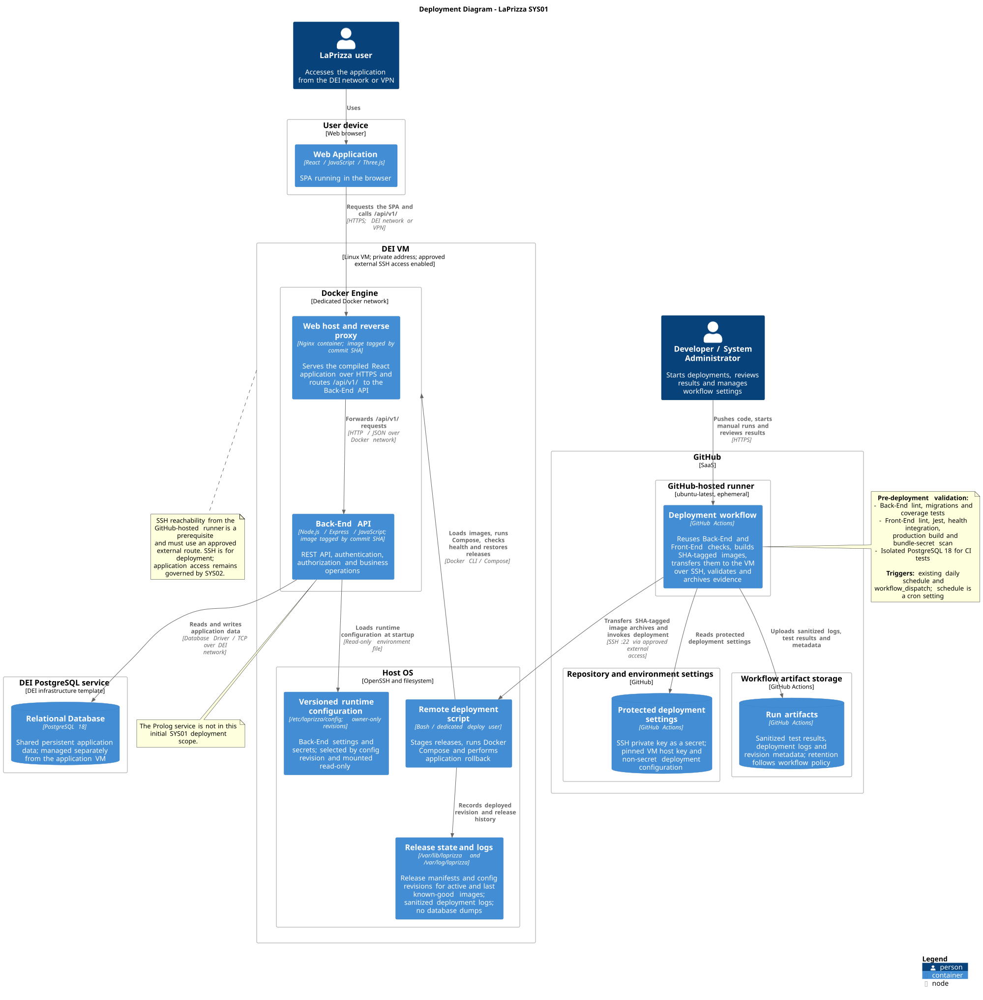

# SYS — Systems Administration and Business Continuity

The SYS work defines how LaPrizza is deployed, accessed and operated in the DEI environment. It covers the deployment pipeline, network and administrative access, shared resources, operational risks, continuity objectives, and backup and recovery. Together, these stories support a controlled and demonstrable Sprint 2 system.

## User Stories

| ID | User Story | Documentation |
|---|---|---|
| SYS01 | Automated Deployment and Validation | [Detailed story](sys01/SYS01.md)|
| SYS02 | Institutional Network Access Restriction | [Detailed story](sys01/SYS01.md)|
| SYS03 | Configurable Allowed Endpoints | [Detailed story](sys01/SYS01.md) |
| SYS04 | Shared Resource Folder | [Detailed story](sys01/SYS01.md) |
| SYS05 | Controlled Linux Remote Shell Access | [Detailed story](sys01/SYS01.md) |
| SYS06 | Operational Risk Assessment | [Detailed story](sys01/SYS01.md) |
| SYS07 | Minimum Business Continuity Objective | [Detailed story](sys01/SYS01.md) |
| SYS08 | Backup Strategy and Recovery Validation | [Detailed story](sys01/SYS01.md) |

## Deployment Representation

The diagram is a C4 deployment view: it shows where the application components run and how they communicate, rather than the internals of each software component. It shows the proposed deployment: GitHub Actions deploys the Back-End API and static Front-End to the DEI VM over an approved SSH route; Nginx serves the Front-End and reverse-proxies `/api/v1/`; PostgreSQL remains a separate DEI service. 

## How the SYS Stories Fit Together

- **Deployment and access:** SYS01 automates application deployment and validation. SYS02 restricts application access to the DEI network or VPN, while SYS03 makes allowed endpoints manageable.
- **Operational access and resources:** SYS04 controls access to shared files and SYS05 controls and monitors remote Linux shell access.
- **Continuity:** SYS06 identifies operational, technical and security risks. SYS07 sets measurable continuity objectives and SYS08 implements and validates backup and recovery procedures.

The SYS network controls complement the application's authentication and authorization. A reverse proxy such as Nginx can enforce network rules when selected for that role, while host or network controls may also be used where appropriate.
