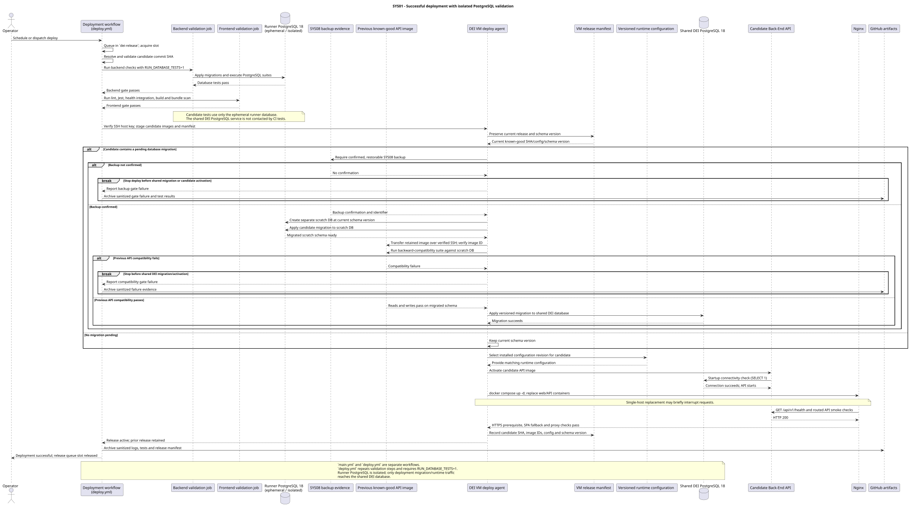
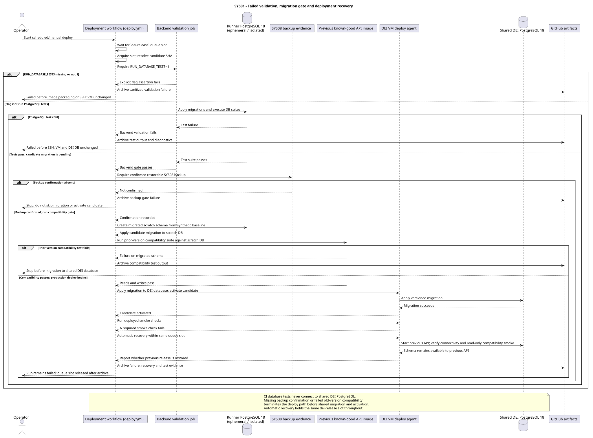
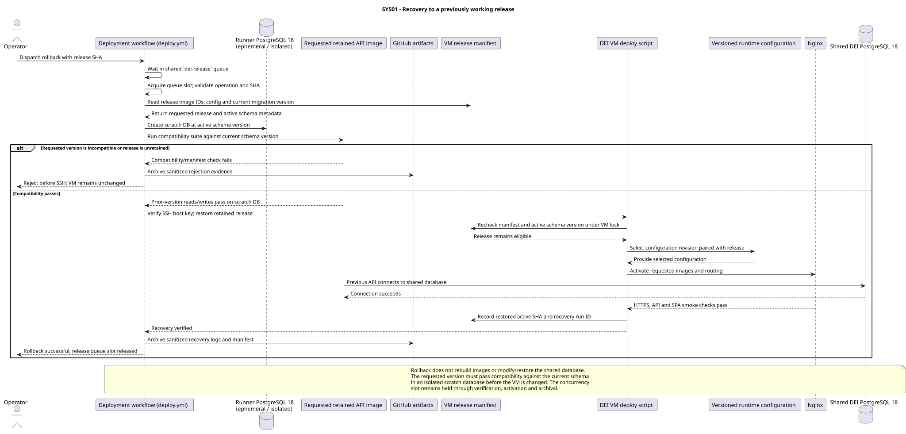
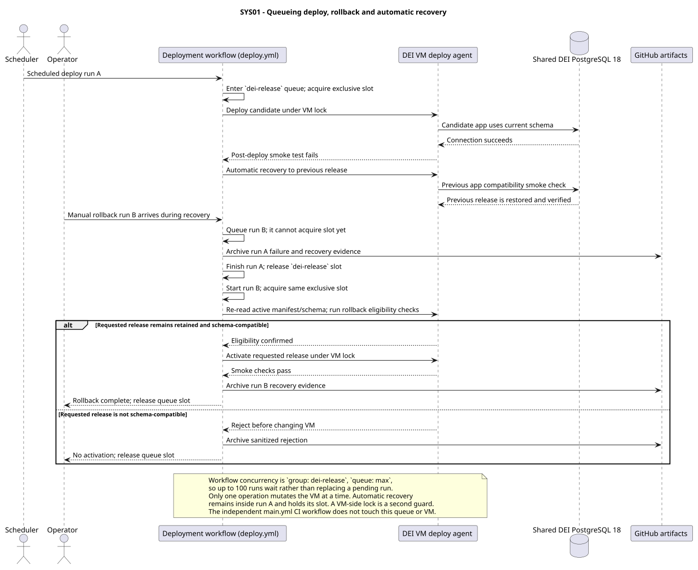

# SYS01 - Automated Deployment and Validation

## 1. Context & Scope

- **User Story ID:** SYS01
- **Sprint:** Sprint 2
- **Area:** System Administration and Business Continuity (SYS)
- **Responsible:** Sofia Carvalho (1240898)


## 2. Requirements & Analysis

### 2.1. User Story Description
> **As a** System Administrator,  
> **I want** a systematic and automated deployment pipeline for a system module in a controlled environment of the Department of Informatics Engineering (VM or containerized setup),  
> **so that** deployments can be validated regularly using the test plan.

### 2.2. Acceptance Criteria 

- [ ] **AC 1:** Deploy at least one module through an automated pipeline to a reproducible, isolated environment suitable for the selected module.
- [ ] **AC 2:** Execute validation based on the project test plan.
- [ ] **AC 3:** Archive deployment logs and test results.
- [ ] **AC 4:** Make the deployment schedule configurable.
- [ ] **AC 5:** A failed validation must prevent a deployment from being presented as successful.
- [ ] **AC 6:** The deployed version and configuration must be identifiable, and a documented procedure must allow recovery to a previously working version.
- [ ] **AC 7:** Sensitive configuration must be managed separately from published source and deployment logs.

### 2.3. Client Clarifications & Questions

> **Question:** Deployment to the DEI VM needs to be handled via GitHub Actions; however, the VM only has private addresses, meaning GitHub’s public runners have no route to it. The alternative—a self-hosted runner installed directly on the VM—has been disabled by the GitHub organization administrator. What is the expected approach: should self-hosted runners be enabled for the repository, is there a designated way for GitHub to reach the VM (e.g., via VPN), or is there another solution? 
> **Answer:** Public GitHub Actions runners cannot directly access machines available only on private DEI networks without an appropriate connectivity mechanism; Deployment via SSH is possible, provided that external SSH access is enabled for the VM hosted in the DEI cloud and a secure authentication mechanism is used, without storing private keys or other credentials directly in the repository. Appropriate secret management mechanisms, such as GitHub Actions Secrets, should be used.

### 2.4 Goal 

The goal of this user story is to automate the deployment of the LaPrizza application in a controlled DEI environment, ensuring a reliable and consistent process. To achieve this, an automated pipeline will be configured to deploy the application, execute validation tests and record the results of each deployment.

---

## 3. Design

### 3.1. Deployment scope and dependencies

The SYS01 deployment target is the integrated Web Application's **Back-End API** and **static Front-End** in the controlled DEI integration/demo environment. This fulfils the Sprint 2 planning task to automate deployment of the integrated application while preserving the service boundaries in the existing architecture. This environment is not designated as production.

| Deployable | Runtime and packaging | Runtime dependencies |
|---|---|---|
| Back-End API | Node.js / Express, packaged as a versioned Docker image | DEI PostgreSQL 18 service; backend environment configuration; outbound access to the database endpoint |
| Static Front-End and web host | Vite production bundle served by Nginx in a versioned Docker image | HTTPS certificate and Nginx configuration; `/api/v1/` routed to the Back-End API; browser access through the DEI network or VPN |

CI uses an isolated PostgreSQL 18 service and never resets or tests against the shared DEI database. 

The Vite bundle is built with `VITE_BACKEND_BASE_URL=/api/v1`; this value is public and contains no credentials. Nginx serves the bundle, routes `/api/v1/` to the Back-End API over the private Docker network, serves hashed assets directly, and falls back to `index.html` for SPA routes.

### 3.2. Deployment architecture, topology and isolation

The deployment architecture view shows the GitHub-hosted runner, the DEI VM, the browser, Nginx, the API and the separate PostgreSQL service.


- The GitHub-hosted runner is ephemeral. It runs checks and prepares the release, then connects to the DEI VM over SSH. It does not host application state or database data.
- The DEI VM hosts the Nginx web container and the Back-End API container on a dedicated Docker network. Only Nginx accepts application HTTPS traffic; the API port is not published to user networks.
- The backend reaches the separate PostgreSQL service over the DEI network using a least-privilege application role. The database is not placed in the application Compose stack, and deployment must not recreate, reset or expose its persistent storage.
- The DEI VM is a single-host environment, not a high-availability cluster. Container and network separation limit service exposure but do not provide host-level redundancy.
- SYS02 governs which user networks may reach the application. SSH is a separate administrative channel. A GitHub-hosted runner cannot route to a private-only address, so an approved external SSH route for deployment is a prerequisite; no gateway or public address is assumed by this design.
- The VM's operating-system image/version, hostname, HTTPS certificate source and approved SSH route are DEI provisioning facts 

### 3.3. Environment provisioning and configuration

The server configuration will be documented in a separate PDF file.

### 3.4. Pipeline stages and execution order

A new GitHub Actions workflow, `.github/workflows/deploy.yml`, will be created specifically for the automated deployment of the project to the controlled DEI environment.

This workflow will be independent of the existing CI workflow (`.github/workflows/main.yml`). The existing workflow will continue to handle its current validation triggers, while the new workflow will manage deployment, release identification and recovery operations.

These are two independent workflows. `.github/workflows/main.yml` remains the existing CI workflow. `.github/workflows/deploy.yml` is a separate scheduled/manual deployment workflow and contains its own backend and frontend validation steps. The validation commands and test settings are intentionally repeated so a deployment run proves the exact candidate SHA before it can deploy.

The deployment workflow must:

- Support scheduled deployments and manual execution through `workflow_dispatch`.
- Be restricted to the repository's default branch.
- Use the protected GitHub Actions environment named `dei`.
- Support manual selection of the operation (`deploy` or `rollback`) and the target release SHA.
- Ensure that all candidate checks and image builds use the exact commit SHA selected for deployment.
- Prevent deployment whenever required validation or build stages fail.
- Archive deployment logs, test results and release metadata for traceability.
- Serialize every deployment and rollback operation for the `dei` environment through one shared concurrency group; keep automatic recovery inside the active deployment run and lock.

The workflow must distinguish between two operations:

- **Deploy:** Deploy the selected release SHA or, if none is provided, the latest commit from the default branch. All required candidate checks must pass before the release is packaged and deployed. Scheduled executions perform deployments using the default-branch commit.
- **Rollback:** Restore a previously successful and retained release by verifying the requested SHA, local Docker image IDs and configuration revision against the VM's release manifest. This operation is manual only and skips candidate build and ordinary candidate validation. Before loading images or installing release files, the VM reads the active database schema and accepts only a retained manifest whose `validated_schema_version` exactly matches it. The rollback then activates that release and runs the deployed smoke checks. If the requested SHA is unknown, not retained, or has not been validated against the exact active schema, the workflow fails without changing the VM. Manual rollback does not run a scratch-database compatibility rehearsal.

The deployment workflow must distinguish between the deployment and rollback execution paths. Scheduled executions may only perform deployments. Manual deployments must complete all candidate validation and build stages before accessing the DEI VM. Manual rollbacks must bypass candidate validation and image-building stages, verifying the requested release against the VM's successful-release manifest before performing any recovery operation.

Both operations must be restricted to the default branch. Deploy uses the `dei` GitHub Actions environment without required reviewers so scheduled runs remain unattended; manual rollback uses `dei-rollback` with required reviewers.

Use the same workflow-level concurrency key for scheduled deploys and manual deploy/rollback operations: `group: dei-release` and `queue: max` (up to 100 pending workflow runs). Do not set `cancel-in-progress: true`. GitHub Actions runs one operation in the group at a time; pending runs are processed by the service's queue ordering, which is not a strict dispatch-time FIFO guarantee. If the queue is full, a new run is cancelled and must be visibly reported. Do not use the default single-pending behavior, which replaces an existing pending run when another arrives. The active workflow holds the concurrency slot from pre-deployment validation through deployment and any automatic recovery, smoke checks and archival. A manual rollback submitted during deployment recovery waits behind that run. Add a VM-side exclusive lock in the remote deploy script as a second guard for out-of-band invocations. The existing `main.yml` CI workflow does not use this deployment lock because it never connects to or mutates the DEI VM. See [GitHub Actions concurrency queue semantics](https://docs.github.com/en/actions/how-tos/write-workflows/choose-when-workflows-run/control-workflow-concurrency).

The workflow stages and execution order are described below.

| Order | Stage | Required result / failure handling |
|---:|---|---|
| 1 | Resolve trigger, operation and release revision | Scheduled runs use the default-branch commit and perform deployment only. Manual runs identify the selected operation and release SHA. Reject unsupported operations, non-default branches and invalid release revisions. |
| 2 | Checkout and prepare ephemeral runner | Checkout the exact selected SHA for deployment. Use lockfiles and the repository's Node versions. Prepare the isolated CI environment when candidate validation is required. |
| 3 | Validate Back-End API (deploy only) | Start the runner's isolated PostgreSQL 18 service and set `RUN_DATABASE_TESTS=1` explicitly for the backend test step. Assert the variable equals `1`; install dependencies, run lint, apply migrations to the runner database, then run `npm run test:coverage`. This flag is required because database suites are skipped when it is absent. Fail if the database suites are skipped or fail. Do not access the shared DEI database. |
| 4 | Validate and build Front-End (deploy only) | Install dependencies; run lint, Jest, health integration, production build with `VITE_BACKEND_BASE_URL=/api/v1`, and `npm run check:bundle`. |
| 5 | Apply validation gate (deploy only) | Continue only if every required check passes. On failure, do not contact or modify the VM; collect diagnostics and archive results. |
| 6 | Package and identify release (deploy only) | Build the Nginx/static bundle and API images with immutable commit-SHA tags. Validate the Compose configuration and create a non-secret release manifest. |
| 7 | Verify deployment access and stage release (deploy only) | Verify SSH host key and authentication, transfer image archives over the approved SSH path, and load them into the VM's Docker Engine. Preserve the currently active release. |
| 8 | Verify retained release (rollback only) | Read the active schema and find a retained manifest for the requested SHA whose `validated_schema_version` exactly equals that schema. Check its image IDs, archive, Compose file and configuration before loading images or installing release files. Reject without changing the VM if any check fails. Do not build candidate images or run a scratch-database rehearsal for manual rollback. |
| 9 | Gate and validate schema migration (deploy only, when migrations are pending) | If no migration is pending, continue without changing the database schema. If a migration is pending, require a current verified SYS08 backup unless `database.js state` reports `empty_database: true` (no migration ledger and no public tables). After the backup gate, the VM creates a disposable PostgreSQL 18 container on an internal Docker network. The candidate image builds the exact current schema there; the retained previous API performs synthetic registration/read checks; candidate migrations are applied; and the previous API then must pass health, catalogue-read, persisted-data and write checks. No DEI database credentials or contents enter the rehearsal. If any rehearsal check fails, stop before migrating the shared DEI database. |
| 10 | Apply migration to DEI database (deploy only, when migrations are pending) | Only after the applicable backup gate and isolated migration rehearsal pass, apply the version-controlled migration to the shared DEI PostgreSQL database. A migration failure stops activation; never reset or automatically roll back the shared database. |
| 11 | Activate release (deploy only) | Start API and web images with the matching runtime configuration. The API must pass `SELECT 1` at startup; this is connectivity only and is not evidence of backward compatibility. `docker compose up -d` can briefly interrupt requests on the single host. |
| 12 | Activate retained release (rollback only) | Restore the verified application images and corresponding configuration revisions. Do not modify the database or rebuild application images. |
| 13 | Run deployed smoke and compatibility checks | Check API health, Front-End entry, SPA fallback and Nginx-to-API route. After migration, run the designated read-only backward-compatibility smoke suite against the active database with the previous API release if automatic recovery is needed. If deployment checks fail, reactivate the previous application release while retaining the same concurrency slot; verify restoration and leave the workflow failed. If rollback checks fail, require operator intervention. |
| 14 | Archive evidence and report status | Validate the remote operation-result JSON against the operation, workflow run/attempt and requested SHA, then upload sanitized test reports, migration-compatibility results, deployment/recovery logs and release metadata on success and failure. A remote success without a valid success manifest fails the workflow. Release the concurrency slot only after any automatic recovery and archival finish. |

### 3.5. Validation plan and success/failure criteria

The independent deployment workflow must execute the project's defined validation plan before deploying a candidate release. It duplicates the validation steps from `main.yml`; there is no reusable workflow. All candidate checks use the exact selected commit SHA.

The backend job must provision an isolated PostgreSQL 18 service on the ephemeral runner and explicitly set `RUN_DATABASE_TESTS=1` on the migration/test step. The current `main.yml` already sets this variable for `backend-checks`; the independent `deploy.yml` must declare its own setting. The deploy job must assert this value before running tests; if the flag is missing or not `1`, validation fails rather than allowing the database suites to be silently skipped. Both CI and deployment PostgreSQL test suites connect only to their runner's isolated service. The shared DEI database is not reachable from the candidate-test step.

The deployment workflow's backend job must keep this setting visible in its own YAML (it must not rely on `main.yml` to supply it):

```yaml
env:
  RUN_DATABASE_TESTS: '1'
```

| Area | Project command or scenario | Gate / evidence |
|---|---|---|
| Backend static check | `npm run lint` from `backend/` | Duplicated in `main.yml` and `deploy.yml`; the deploy job checks the selected SHA. |
| Backend PostgreSQL tests | Set `RUN_DATABASE_TESTS=1`, run `npm run db:migrate`, then `npm run test:coverage` from `backend/` with the PostgreSQL 18 service | The database suites must execute (not skip) against only the isolated runner service. Flag assertion, migrations and tests are mandatory deploy gates; coverage and test output are archived. |
| Frontend lint and unit tests | `npm run lint` and `npm test -- --runInBand` from `frontend/` | Duplicated in `main.yml` and `deploy.yml`; the deploy job checks the selected SHA. |
| Frontend API health integration | Install backend dependencies with `npm --prefix ../backend ci`, then run `npm run test:integration` from `frontend/` | Confirms the Express health contract and CORS behavior. |
| Production build and bundle check | `VITE_BACKEND_BASE_URL=/api/v1 npm run build` followed by `npm run check:bundle` from `frontend/` | Fails on build/configuration errors or detected server-only secrets/private-key markers. |
| Migration/rollback compatibility | SYS01-AT16 rehearses the prior retained API against the candidate-migrated disposable schema on the VM using synthetic fixtures; manual rollback checks exact schema validation in the retained manifest | A pending migration cannot reach the shared DEI database or activate the candidate until the applicable backup gate and prior-version rehearsal pass. Manual rollback is rejected unless the manifest's `validated_schema_version` exactly matches the active database schema. `SELECT 1` and `/health` alone do not establish migration compatibility. |
| Deployed smoke checks | The API startup `SELECT 1` succeeds; GET `/api/v1/health` expects HTTP 200 and `{ "status": "ok" }`; request `/register`, a nested SPA route and an unknown route; verify Nginx routes API traffic to the backend and returns the same SPA entry document for client routes. | These checks verify connectivity and routes, not schema compatibility. Also verify Google callback/session behavior when deployed identity-provider configuration is available. |

**Deployment succeeds** only when all pre-deployment gates pass, the immutable release is activated, all required post-deployment smoke checks pass and evidence is archived.

**Deployment fails** if any check, transfer, startup, migration or smoke check fails, if SSH host identity cannot be verified, or if artifacts cannot be archived. A failed pre-deployment gate makes no VM changes. A failed post-deployment check triggers application rollback; it remains a failed deployment run even when rollback restores service.

**Rollback succeeds** only when the requested release manifest's `validated_schema_version` exactly matches the active database schema, its retained images and configuration are restored, all required smoke checks pass and recovery evidence is archived.

**Rollback fails** if the requested SHA is unknown or unretained, image IDs or configuration cannot be verified, the requested app is incompatible with the active schema, activation fails or smoke checks do not pass. Such a request must be rejected before any VM modification.

### 3.6. Workflow, logging and artifact retention

Each workflow run archives evidence in GitHub Actions for **90 days**. The remote
deploy and rollback scripts also persist one restricted log per operation under
`/var/log/laprizza/deployments/`, named with the workflow run ID and operation.
The VM's `logrotate` policy retains these logs for up to 90 days. The release's
Compose file and deployment scripts are retained under
`/opt/laprizza/releases/<sha>/<config-revision>/`; image archives and release
manifests remain under `/var/lib/laprizza/releases/<sha>/<config-revision>/`.

The evidence archived depends on the operation performed.

**Deployment evidence:**

- Backend coverage and test output, frontend test/build output and bundle-scan result.
- Sanitized deployment-script output and post-deployment smoke-check results.
- A `deployment.json` manifest with commit SHA, image tags and local Docker image IDs, workflow run ID/attempt, timestamp, target environment, non-secret configuration revision and migration version.

**Rollback evidence:**

- Requested release SHA and successful-release manifest verification results.
- Verified image IDs and restored configuration revision.
- Sanitized recovery logs and post-rollback smoke-check results.
- A recovery manifest recording the restored release SHA, image IDs, workflow run ID/attempt, timestamp and target environment.

Rollback executions must not produce candidate image build artifacts because they restore an existing retained release rather than building a new candidate.

VM log files are created with mode `0600`. All logs and artifacts must be
sanitized to ensure that no secrets, credentials, private keys or sensitive
configuration values are exposed.

The workflow archives the compatibility-test result for the synthetic migrated-schema database, but never uploads database contents or seed data. Every run, including a rejected run due to missing `RUN_DATABASE_TESTS=1`, missing SYS08 backup confirmation, or failed compatibility testing, archives a sanitized reason and available results.

### 3.7. Schedule, version/configuration traceability and recovery

- **Schedule:** The deployment workflow is defined independently in `.github/workflows/deploy.yml`, allowing its execution policy to be configured without affecting the existing CI workflow (`main.yml`). It supports scheduled deployments and manual execution through `workflow_dispatch`. Scheduled executions perform deployments using the default-branch commit. Manual execution allows the operator to select the operation (`deploy` or `rollback`) and specify the target release SHA. The deployment schedule can be modified directly in the workflow's cron configuration. GitHub Actions cron expressions use UTC.

- **Version identity:** Application images are built and tagged using the full Git commit SHA, ensuring immutable identification of each release. Image IDs are recorded in the release manifest to verify loaded image identity. Mutable tags such as `latest` are not used for deployment. The VM stores successful release manifests under `/var/lib/laprizza/releases/`, retaining the images required for the active and last known-good releases.

- **Configuration identity:** Each deployment records a non-secret `DEI_CONFIG_REVISION` identifying the VM-local configuration file `/etc/laprizza/config/<revision>.env`. The revision identifies the configuration used by a release without exposing sensitive values. When configuration secrets change, a new revision is installed while the previous revision is retained for recovery.

- **Recovery:** Each successful release record contains the source commit SHA, image IDs, Compose/Nginx configuration revision, non-secret runtime configuration revision and the schema version against which the API was validated. The VM retains the corresponding images and configuration revisions for the active and last known-good releases. A release is eligible for automatic or operator-requested application rollback only when its `validated_schema_version` exactly matches the current schema version. Before a deploy applies pending migrations to the shared database, its compatibility gate runs the prior known-good API against a disposable PostgreSQL database on an internal Docker network on the VM, after candidate migrations have been applied. Manual rollback uses the exact-schema manifest check before it loads images or installs files; it does not run that migration rehearsal.

  If post-deployment checks fail, the deployment process automatically restores the previous application image and configuration, then verifies application health and runs the prior-version compatibility smoke suite against the migrated DEI schema. The deployment workflow retains its `dei-release` concurrency slot throughout automatic recovery; a queued manual rollback cannot start until recovery and archival finish. The workflow remains failed even if automatic recovery succeeds. If recovery cannot be verified, stop further queued mutations and require operator intervention.

  For operator-requested recovery, the workflow must be manually dispatched with `operation=rollback` and a `release_sha` corresponding to a previously successful and retained release. Before making any changes to the VM, the recovery process verifies the SHA, retained image IDs, configuration revision and compatibility with the currently active database migration version. If any check fails, recovery fails without modifying the VM.

  A successful rollback restores the selected application images and their corresponding configuration revisions, followed by automated smoke checks. Database migrations must remain backward-compatible with the previous application release. Database restoration is handled separately under SYS08 and is never performed implicitly during application rollback.

The sequence diagrams document successful deployment, failed validation/migration, recovery and serialization of concurrent runs. PlantUML source is alongside each rendered SVG.









### 3.8. Automated validation and recovery scenarios

These scenarios are required for the SYS01 pipeline implementation. They are identified here but have not yet been executed against a DEI deployment environment.

| ID | Scenario | Expected result |
|---|---|---|
| SYS01-AT01 | All backend and frontend checks pass; deploy a commit SHA. | New release is active, smoke checks pass, artifacts identify the deployed SHA. |
| SYS01-AT02 | Backend lint, migration or coverage test fails. | Deployment job is skipped; VM release remains unchanged; failure logs/results are archived. |
| SYS01-AT03 | Frontend lint, Jest, health integration, build or bundle-secret scan fails. | Deployment job is skipped; VM release remains unchanged; failure evidence is archived. |
| SYS01-AT04 | SSH unavailable or host key does not match the pinned value. | No image activation occurs; workflow fails without bypassing host-key verification; diagnostic artifact is archived. |
| SYS01-AT05 | New containers start but a post-deployment health/route check fails. | Previous known-good application SHA is restored and checked against the migrated schema; current run stays failed and contains deployment and recovery evidence. |
| SYS01-AT06 | Manual recovery requests a retained SHA whose manifest was validated against the exact current schema. | The workflow checks the SHA and exact schema match before loading images or installing release files, restores the corresponding release, passes smoke checks and archives recovery evidence. No candidate images are rebuilt. |
| SYS01-AT07 | Manual recovery requests an unknown or unretained SHA, an image-ID mismatch, or a manifest whose `validated_schema_version` differs from the current schema. | The recovery operation fails before modifying the VM. No release is activated, and diagnostic evidence is archived. |
| SYS01-AT08 | Scan logs and artifacts after a run with configured secrets. | No secret value or private key appears in logs or artifacts. |
| SYS01-AT09 | Run scheduled and manual triggers. | Scheduled executions deploy the default-branch revision. Manual executions record the selected operation and SHA. The cron schedule can be changed independently of the existing CI workflow. |
| SYS01-AT10 | Deployment workflow is triggered from a non-default branch. | Deployment is rejected and the DEI VM remains unchanged. |
| SYS01-AT11 | Rollback is triggered automatically by a scheduled event. | Rollback is not executed because recovery operations are restricted to manual dispatch. |
| SYS01-AT12 | Manual deployment selects a specific release SHA. | All candidate checks and image builds use the selected SHA rather than the latest default-branch commit. |
| SYS01-AT13 | A rollback restores a valid release but its deployed smoke checks fail. | The workflow reports failure, archives recovery evidence and requires operator intervention if service restoration cannot be verified. |
| SYS01-AT14 | Run the deploy workflow with `RUN_DATABASE_TESTS` unset or set to `0`; then run it with the value set to `1`. | Missing/incorrect flag fails before image packaging or SSH. With `1`, PostgreSQL migrations and database test suites execute on the isolated runner PostgreSQL 18 service; logs confirm suites ran and no connection to the shared DEI database occurred. |
| SYS01-AT15 | A deployment has a pending migration but no confirmed restorable SYS08 backup. | Workflow stops before applying a shared-database migration or activating images; it does not skip the migration and continue. Failure evidence is archived. |
| SYS01-AT16 | Satisfy the applicable SYS08 backup gate, start the retained previous API against a synthetic baseline in the VM's disposable internal PostgreSQL rehearsal, apply candidate migrations, and run the configured compatibility probes. Include a forced failing probe. | A passing rehearsal permits the workflow to apply the migration to the shared DEI database. A failing rehearsal blocks the shared migration and candidate activation; compatibility is tested with reads and writes, not inferred from `SELECT 1` or `/health`. |
| SYS01-AT17 | Trigger scheduled deploy and manual rollback concurrently; additionally force a deployment smoke failure that invokes automatic recovery while another operation is queued. | One `dei-release` operation mutates the VM at a time. The active deployment retains the queue slot through automatic recovery and archival; the rollback remains pending, then rechecks the active SHA and schema compatibility before acting. No run silently replaces another pending run; queue-capacity rejection is surfaced. |
