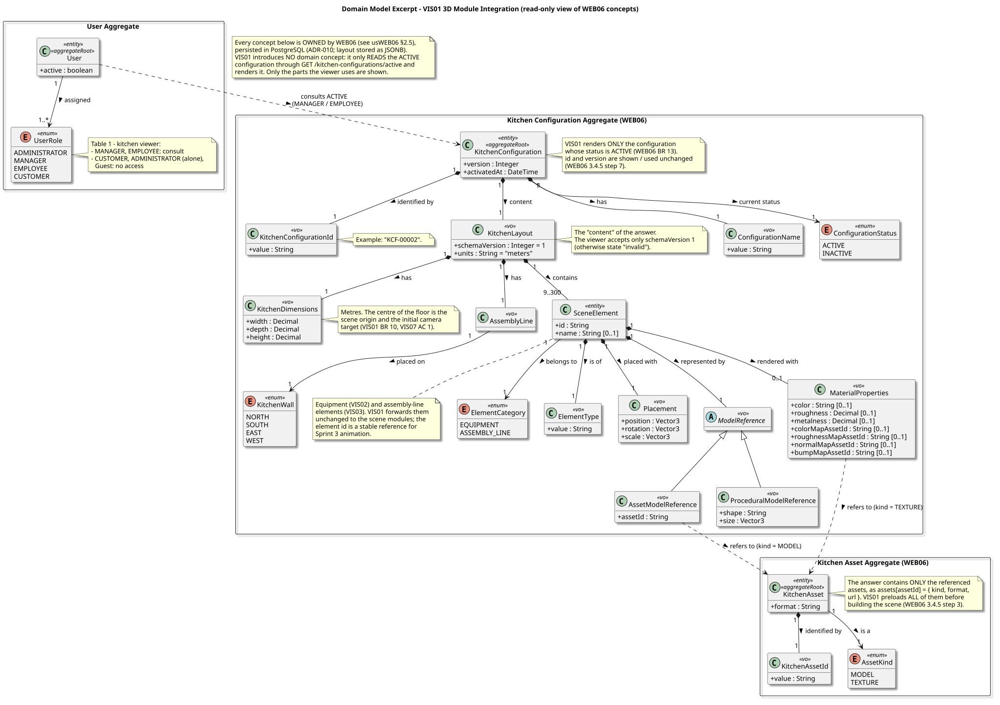
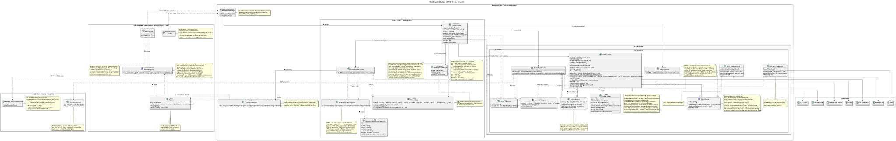
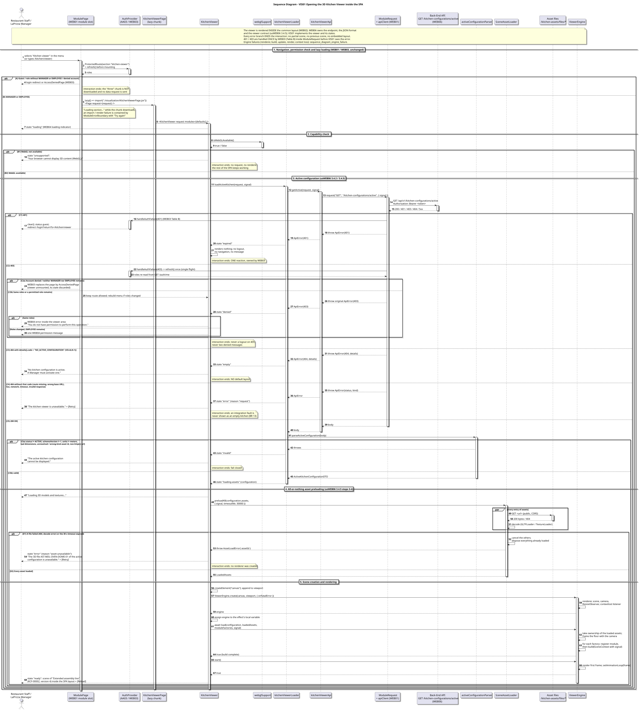
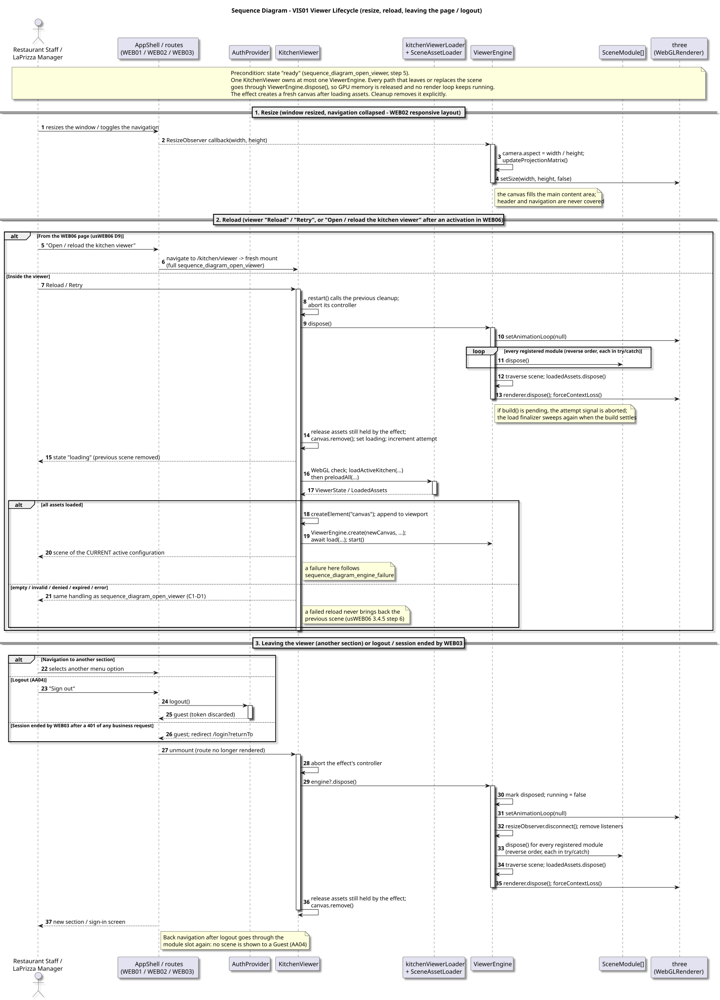
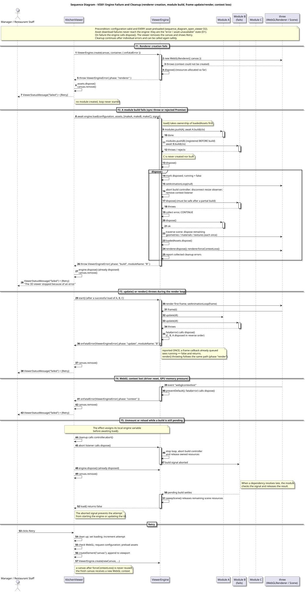

# US VIS01 – 3D Module Integration

## 1. Context & Scope

*   **User Story ID:** VIS01
*   **Sprint:** Sprint 2
*   **Area:** 3D Kitchen Visualization (VIS)
*   **Responsible:** All Members (shared story – see [Sprint 2 Planning](../../../Planning/Sprint2/sprintPlanning.md))
*   **Related Requirements / Stories:**
    *   Sprint 2 User Stories, *PART IV – Sprint 2 – User Stories*, VIS01, the VIS introduction ("the module must be integrated into the SPA and obtain layout and asset information from the back end") and *Table 1 – Website roles and accessible functionality* (kitchen viewer).
    *   System Specification: *PART II – System Specification*, II.3.3 3D Visualization and Interaction.
    *   Architecture: [System Architecture Description](../../../architecture/SAD.md) (*Client-side 3D rendering*, *Back-end authority*, project structure `frontend/src/visualization`), [ADR-001 – Monorepo](../../../architecture/ADR.md) and [ADR-010 – PostgreSQL as the single database](../../../architecture/ADR.md#adr-010-use-postgresql-as-the-single-database) (supersedes ADR-005; kitchen configurations and the asset catalogue are stored in PostgreSQL by WEB06).
    *   Sprint 2 planning: integration checkpoint *WEB06 ↔ VIS01–VIS03 – active kitchen configuration and documented JSON format must be agreed jointly* ([sprintPlanning.md](../../../Planning/Sprint2/sprintPlanning.md)).
    *   Related stories:
        *   **WEB01 – SPA Setup and Integration:** module slot (`ModulePage` → `ProtectedRoute` → `ConfirmedModule` → `LazyModule` + `ModuleErrorBoundary`), `moduleRoutes` entry `kitchenViewer` (`/kitchen/viewer`, `EMPLOYEE`, `MANAGER`), the session-bound `request` function (`ModuleRequest`), `apiClient` / `ApiError`, the `<feature>Api` convention and the feature dependency rules (BR 2, BR 3, BR 13).
        *   **WEB02 – Consistent Layout and Navigation:** common layout and PT/EN texts of the viewer messages.
        *   **WEB03 – Role-Based Navigation:** the `kitchenViewer` section (`EMPLOYEE`, `MANAGER`), menu, direct URL protection and the shared `401`/`403` response (Table B, `handleAuthFailure`).
        *   **WEB04 – User Feedback and Validation:** loading indicator, error with retry, permission error.
        *   **WEB06 – Kitchen Configuration and 3D Integration Page:** owns the `KitchenConfiguration` aggregate, the JSON format (`schemaVersion` 1), the asset catalogue, `GET /kitchen-configurations/active` (usWEB06 3.4.2) and the **viewer integration contract** (usWEB06 3.4.5) that VIS01 implements (ALN-5, ALN-6).
        *   **AA03 / AA04 / AA05:** `AuthProvider`, `ProtectedRoute`, `AccessDeniedPage`, session end and back-end permission per route (`401` vs `403`).
        *   **VIS02 – VIS07:** build the scene content (layout, assembly line, textures, lighting, light controls, camera) as scene modules on top of the engine delivered by VIS01.
    *   **Dependencies:** VIS01 depends on WEB01 (module slot, `request`), WEB02 (layout, i18n), WEB03 (section, `401`/`403` reaction), WEB04 (feedback) and WEB06 (endpoint, JSON format, asset files, viewer contract). VIS02–VIS07 depend on VIS01 (engine, scene-module extension point, loaded assets).

### Scope boundary

VIS01 concerns **how the 3D engine lives inside the SPA and how the active configuration becomes a scene**. It does not define *what* is drawn (VIS02–VIS05), *how* the user moves the camera or changes the lights (VIS06–VIS07), *how* kitchen configurations are stored, validated and activated nor *which* data the endpoint returns (WEB06), *how* the module is lazily mounted and permission-checked (WEB01 / WEB03) nor *how* a `401` / `403` is handled (WEB03).

VIS01 owns:

1. Adding the 3D engine (Three.js) to the front end and embedding it as a React component (`KitchenViewer`) inside the page supplied to the WEB01 module slot (`KitchenViewerPage`).
2. Registering the `kitchenViewer` loader so that the existing `/kitchen/viewer` route and the WEB03 section become available.
3. Implementing the **viewer side of the WEB06 contract** (usWEB06 3.4.5): one source, configuration check, all-or-nothing asset preloading, explicit state for every outcome, reload.
4. The viewer lifecycle: WebGL capability check, renderer / scene / camera creation, render loop, resize, reload and release of every WebGL resource — **including when the engine itself fails** (renderer creation, module build, per-frame update or render, context loss).
5. The extension point (`SceneModule`) through which VIS02–VIS07 add content without changing the engine.
6. The source organisation of the module in the existing repository structure (`frontend/src/visualization`).

---

## 2. Requirements & Analysis

### 2.1. User Story Description

> **As a** Project Manager,  
> **I want** the team to develop and integrate a 3D visualization module into the SPA,  
> **so that** users can interact with a visual representation of the LaPrizza kitchen.

The requester is the **Project Manager**; the users of the resulting viewer are the roles that Table 1 allows to *consult the kitchen viewer*: **LaPrizza Manager** (`MANAGER`) and **Restaurant Staff** (`EMPLOYEE`).

### 2.2. Acceptance Criteria

- [ ] **AC 1:** The 3D engine (e.g., Three.js or WebGL) is embedded as a component in the SPA.
- [ ] **AC 2:** The viewer uses the SPA's navigation and layout while preserving existing functionality and authentication.
- [ ] **AC 3:** The module source is integrated into the existing repository structure.

Criteria from related stories that constrain VIS01 (not owned, but must hold):

*   **VIS introduction:** the module obtains layout and asset information from the back end.
*   **WEB01 AC 5 / BR 11 / BR 13:** the viewer preserves the common navigation, authentication and visual identity; it is loaded on demand and a failure while loading or rendering it is contained inside the shell.
*   **WEB01 BR 2 / BR 3:** the `visualization` feature never imports another feature (e.g. `kitchen/`) and never calls `fetch` for REST; every REST request goes through `apiClient` (here, the injected `request`).
*   **WEB03 AC 2 / AC 3 / AC 6 and Table B:** navigation to the viewer without permission is prevented, also by URL; the access-denied message reveals nothing; `401` ends the session and `403` re-reads the roles **once**, both handled globally before the page sees the error.
*   **WEB04 AC 3 / AC 4 / AC 7:** loading indicators while data is obtained; failures in clear language without internal details; connection failures can be retried.
*   **WEB06 AC 7 / AC 8 and contract 3.4.5:** the viewer retrieves the active configuration only from `GET /kitchen-configurations/active`, embeds no layout, preloads every asset before showing the scene (30 s timeout), shows an explicit state for every outcome (including `asset-unavailable` with the asset id) and never a partial, previous or default scene; it can be reloaded after an activation.
*   **WEB06 ALN-6:** a `material` override of an `ASSET` element is applied to every mesh of that model; model files follow the WEB06 modelling convention (glTF / GLB, metres, Y-up, origin at the bottom centre).
*   **Table 1:** the kitchen viewer is available to LaPrizza Manager and Restaurant Staff; Guest and Customer have no access; Administrator only with an additional role.
*   **AA04 AC 7:** returning to a page after logout does not reveal protected information.
*   **Sprint 2 scope / VIS03:** animation is only in Sprint 3, but the models must be prepared for it → the engine offers a per-frame update hook and element ids are kept unchanged.


### 2.3. Client Clarifications & Questions

| Source | Clarified requirement and effect on VIS01 |
| --- | --- |
| **Client 15, paragraph 1** (as recorded in [WEB02 §2.3](../../web02/usWEB02.md#23-client-clarifications--questions)) | The main navigation must remain easily accessible. The viewer stays inside the common shell, keeps its header and navigation usable, and exposes its own Reload / Retry controls with keyboard access and visible focus. |
| **Client 15, paragraph 2** (as recorded in [WEB02 §2.3](../../web02/usWEB02.md#23-client-clarifications--questions)) | The selected PT/EN language persists across navigation and refreshes. Viewer status, error and permission messages, plus button labels and accessible names, use that locale; changing or restoring the locale does not change the loaded configuration. |
| **Client 16** (as recorded in [WEB02 §2.3](../../web02/usWEB02.md#23-client-clarifications--questions)) | Users may hold multiple roles, and a removed role does not remove access granted by another role. After WEB03 refreshes roles, the viewer remains mounted when the user still has `MANAGER` or `EMPLOYEE`; WEB03 replaces the page only when neither role remains or the account is denied. |

### 2.4. Business Rules & Invariants

Each rule states its source: **S** = Sprint 2 specification, **C** = client clarification, **D** = team design decision (section 3.8), **W** = rule of another story's design that VIS01 must follow.

| ID | Rule | Source |
| --- | --- | --- |
| **BR 1** | The 3D engine is Three.js, embedded through a React component (`KitchenViewer`) that owns one active `<canvas>` per load attempt; a later attempt receives a new canvas after the previous renderer is disposed. There is no separate 3D application, iframe or window. | S – VIS01 AC 1; SAD; D1, D3, D17 |
| **BR 2** | The viewer is mounted through the WEB01 module slot at `/kitchen/viewer` and rendered inside the main content area of the common layout; header, logo and primary navigation remain visible and usable. Reload, Retry and status feedback are keyboard accessible, visibly focused and localized in PT/EN. | S – VIS01 AC 2; C – Client §15 paragraphs 1–2; W – WEB01 BR 11, WEB02; D4, D6 |
| **BR 3** | Only `MANAGER` and `EMPLOYEE` can open the viewer. The route is protected by the WEB01 slot / WEB03 section, and the back end enforces the same roles on the endpoint. | S – Table 1; W – WEB03, WEB06 BR 1; D5 |
| **BR 4** | The kitchen layout and the asset URLs come only from `GET /api/v1/kitchen-configurations/active`. The front end contains no default or fallback layout and keeps no previous layout. | S – VIS intro; W – WEB06 BR 13, 3.4.5 steps 1, 6; D7 |
| **BR 5** | Every outcome is mapped to exactly one viewer state (`loading`, `loading-assets`, `ready`, `empty`, `invalid`, `denied`, `expired`, `error`, `unsupported`, `failed`, `cancelled`); only `ready` shows a scene. No partial, previous or default scene is shown in any other state. | W – WEB06 3.4.5 step 5, BR 20; S – WEB04; D9 |
| **BR 6** | VIS01 never handles authentication failures itself. All requests go through the injected `request` (WEB01). A `401` is handled once by WEB03 (session cleared, redirect to login); the viewer goes to `expired` and renders nothing. A `403` is handled by WEB03 with one role refresh. If the account is denied or no longer has either `MANAGER` or `EMPLOYEE`, WEB03 replaces the page; if at least one permitted role remains, the viewer stays mounted and shows the WEB04 permission error in its own area (`denied`). The viewer never logs out, refreshes roles or navigates. | S – VIS01 AC 2; C – Client §16; W – WEB03 Table B, AA05; D10 |
| **BR 7** | Existing functionality is not affected: the Three.js code is in a separate chunk loaded by the module slot only after the permission check; other pages do not download it. | S – VIS01 AC 2; W – WEB01 BR 13; D4 |
| **BR 8** | Each viewer instance owns at most one `ViewerEngine` and at most one `LoadedAssets`. Leaving the page, logging out, reloading or unmounting aborts pending requests and downloads, stops the render loop and releases every WebGL resource exactly once. `dispose()` is idempotent; after disposal the attempt's canvas is removed and never reused. | S – VIS01 AC 2; D3, D11, D17 |
| **BR 9** | Scene content is added only through `SceneModule`s (`build`, `update`, `dispose`). VIS02–VIS07 extend the viewer by adding modules, without changing `ViewerEngine` or `KitchenViewer`. | S – VIS02–VIS07, Sprint 3; D2, D12 |
| **BR 10** | The scene uses metres, Y-up, with the origin at the centre of the kitchen floor (`-Z` = `NORTH`); the initial camera target is that origin. | S – VIS07 AC 1; W – WEB06 3.4.1; D13 |
| **BR 11** | All module source is placed under `frontend/src/visualization/` with colocated tests; `three` is declared in `frontend/package.json` and pinned by `package-lock.json`; the feature imports only shared modules. | S – VIS01 AC 3; W – WEB01 BR 2, 3.2; D2 |
| **BR 12** | A failure **inside the engine** (renderer creation, `SceneModule.build()` – synchronous or asynchronous, `update()`, `render()`, WebGL context loss) moves the viewer to `failed`: the render loop is stopped before the next frame, every resource already allocated is released and no partial scene stays on screen. One failing module never prevents the other modules, the loaded assets and the renderer from being disposed. | S – VIS01 AC 2; D14 |
| **BR 13** | Only a `404` whose `details` contain the code `NO_ACTIVE_CONFIGURATION` means "no active configuration" (`empty`). Any other `404` (unknown route, wrong base URL, proxy answer) is an integration fault and is shown as `error`, never as an empty kitchen. | D15; VIS-ALN-1 |
| **BR 14** | The viewer becomes `ready` only after the configuration **and every asset in `assets`** have been loaded, in parallel, within one 30 s timeout. If any file is missing, cannot be decoded or times out, everything already loaded is released and the viewer shows `error` with reason `asset-unavailable` and the asset id, plus Retry. | W – WEB06 BR 20, 3.4.5 steps 3–4; D16 |

### 2.5. Domain Model Excerpt



PlantUML source: [`excerptDomainModel/domain_model_excerpt.puml`](./excerptDomainModel/domain_model_excerpt.puml).

| Concept | Kind | Role in VIS01 |
| --- | --- | --- |
| **KitchenConfiguration** (+ `KitchenConfigurationId`, `ConfigurationName`, `ConfigurationStatus`) | Aggregate Root (WEB06) | Read-only: only the `ACTIVE` one is requested and rendered; id and version shown unchanged |
| **KitchenLayout** | Value Object (WEB06) | The `content` of the answer; accepted only with `schemaVersion` 1 and `units` `"meters"` |
| **KitchenDimensions** | Value Object (WEB06) | Floor size; centre of the floor = scene origin and initial camera target |
| **AssemblyLine** / **KitchenWall** | Value Object / Enumeration (WEB06) | Forwarded to VIS03 |
| **SceneElement**, **ElementCategory**, **ElementType**, **Placement** | Entity in the layout / Enumeration / Value Objects (WEB06) | Forwarded unchanged to the scene modules (VIS02, VIS03); element ids are stable references |
| **ModelReference** (asset / procedural), **MaterialProperties** | Value Objects (WEB06) | Tell the modules which preloaded model / texture to use (VIS02–VIS04) |
| **KitchenAsset**, **KitchenAssetId**, **AssetKind** | Aggregate Root (read-only) / Value Object / Enumeration (WEB06) | Resolved by the back end into `assets[assetId] = { kind, format, url }`; preloaded by VIS01 |
| **User**, **UserRole** | Aggregate Root / Enumeration (AA03) | `MANAGER` and `EMPLOYEE` may open the viewer |

VIS01 introduces **no new domain concept and no persistence**. The 3D objects (`Scene`, `Mesh`, `Camera`, loaded `GLTF` / `Texture`) are presentation objects rebuilt from the answer on every load.

---

## 3. Design

### 3.1. Architecture & C4 Alignment

This User Story operates within the established **C4 Model** of the system ([SAD](../../../architecture/SAD.md)):

*   **C4 Level 1 (System Context):** the LaPrizza Manager and the Restaurant Staff consult the kitchen through the *LaPrizza Information System*; no external system is added.
*   **C4 Level 2 (Containers):** the viewer is part of the *Front-End* container (React + Three.js); rendering happens in the browser (WebGL). The configuration is requested from the *Back-End API* over HTTPS/JSON, which reads it from the *Relational Database* (PostgreSQL, ADR-010); the model and texture files are served read-only by the Back-End API (WEB06). No new container is created.
*   **C4 Level 3 (Components):** in the Front-End, VIS01 adds the **Visualization feature** (`frontend/src/visualization`) plugged into the WEB01 module slot: the page and the REST adapter, `viewer/` (React components and loading rules, no Three.js) and `scene/` (Three.js engine, asset loader and scene modules, no React). On the back end it consumes the **Kitchen Configuration Component** of WEB06, protected by the **Security Component** (`AuthMiddleware` / `RoleMiddleware`).

---

### 3.2. Class Diagram (CD)

Structural design of the classes participating in this User Story, organised by the parts of the visualization feature (page / adapter → `viewer` → `scene` → `three`).



> PlantUML source: [`classDiagram/class_diagram.puml`](./classDiagram/class_diagram.puml).

Key design points:

*   **Reused unchanged:** `ModulePage` / `ConfirmedModule` / `LazyModule` / `ModuleErrorBoundary`, `moduleRoutes` (`kitchenViewer`), `ModuleRequest`, `apiClient` / `ApiError` (WEB01); `ProtectedRoute`, `AccessDeniedPage`, `AuthProvider` with WEB03's `handleAuthFailure`; WEB04 feedback components; on the back end, the WEB06 endpoint and asset files.
*   **Extended:**
    *   `frontend/src/main.jsx`: `<App modules={{ kitchenViewer: () => import('./visualization/KitchenViewerPage.jsx') }} />` (WEB01 D7, composition root).
    *   WEB03's `isSectionEnabled` enables the existing `kitchenViewer` section when its loader is registered in `main.jsx`.
    *   `frontend/package.json`: dependency `three`.
    *   `frontend/src/visualization/README.md`: structure, `SceneModule` contract, coordinate convention, viewer states.
*   **New:** `KitchenViewerPage`, `kitchenViewerApi`, `KitchenViewer`, `ViewerStatusMessage`, `kitchenViewerLoader`, `activeConfigurationParser`, `SceneAssetLoader`, `LoadedAssets`, `AssetLoadError`, `ViewerEngine`, `ViewerEngineError`, `SceneModule` (contract), `SceneContext`, `KitchenFloorModule`, `BaseLightingModule` and `webglSupport`.
*   **Separation of concerns:** `scene/` does not import React; `kitchenViewerLoader` and `activeConfigurationParser` import neither React nor Three.js. The engine is reusable by VIS02–VIS07 and the loading rules are testable without a browser.
*   **Own REST adapter:** WEB01 BR 2 forbids importing `kitchen/kitchenConfigurationApi` (WEB06). VIS01 therefore has `kitchenViewerApi.getActive(request, signal)`, a thin adapter on the injected `request` for the **same** endpoint and contract. (WEB01 SD 4 and WEB06 SD 5 label this participant "kitchenConfigurationApi"; see VIS-ALN-2.)

#### Viewer state handling (WEB06 3.4.5 / WEB03 / WEB04)

| Outcome | State | Shown to the user | Who reacts |
| --- | --- | --- | --- |
| WebGL not available | `unsupported` | "Your browser cannot display 3D content (WebGL)." | viewer (no request) |
| Request in progress | `loading` | WEB04 loading indicator | viewer |
| `200`, valid body | `loading-assets` | "Loading 3D models and textures…" | viewer |
| Every asset loaded, engine started | `ready` | the scene + "Reload" | viewer |
| An asset `404` / decode error / 30 s timeout | `error` (`asset-unavailable`, `assetId`) | "The 3D file `<assetId>` of the active configuration is unavailable." + Retry | viewer |
| `200`, `status` ≠ `ACTIVE`, `schemaVersion` ≠ 1, `units` ≠ `meters`, unresolved / wrong-kind asset, non-http(s) URL | `invalid` | "The active kitchen configuration cannot be displayed." | viewer |
| `404` + `details[].code = NO_ACTIVE_CONFIGURATION` | `empty` | "No kitchen configuration is active. A Manager must activate one." | viewer |
| `404` without that code, `5xx`, `network`, `timeout`, `invalid-response` | `error` (`request`) | "The kitchen viewer is unavailable." + Retry | viewer |
| `403`, same roles after refresh | `denied` | WEB04 "You do not have permission to perform this operation." | WEB03 refresh; viewer message |
| `403`, roles changed; user still has `MANAGER` or `EMPLOYEE` | `denied` | WEB04 permission message; viewer remains mounted | WEB03 refreshes and rebuilds menu; viewer message |
| `403`, neither permitted role remains / account denied | – (unmounted) | WEB03 `AccessDeniedPage` | WEB03 only |
| `401` | `expired` | nothing from the viewer | WEB03 only (clear + login) |
| Request / preload aborted (unmount, reload) | `cancelled` | nothing | nobody (late answer ignored) |
| Engine failure (renderer, build, update, render, context loss) | `failed` | "The 3D viewer stopped because of an error." + Retry | viewer |

Only `ready` displays a scene. Each effect keeps its engine in a local variable so cleanup can dispose it during an async build. Reload and Retry clean up the previous attempt before starting another one.

#### Ownership of authentication / authorization failures (WEB01 / WEB03 integration)

| Failure | Single owner | What VIS01 does | What VIS01 does **not** do |
| --- | --- | --- | --- |
| `401` | WEB03 `handleAuthFailure(401)`: `clear()`, guest, redirect `/login?returnTo` | Maps the rethrown `ApiError{401}` to `expired`, renders nothing | No `logout()`, no navigation, no message, no retry |
| `403` | WEB03 `handleAuthFailure(403)`: one single-flight `refresh()` | Same roles → `denied` with the WEB04 permission message inside the viewer area | No logout, no `refresh()`, no full-page `AccessDeniedPage` |
| Roles changed; at least one required role remains | WEB03 refreshes roles and rebuilds the menu | Stays mounted; maps the original `ApiError{403}` to `denied` | No role refresh, logout or navigation |
| No required role remains / account denied | WEB03 (menu rebuilt, page replaced by `AccessDeniedPage`) | Nothing – it is unmounted and its cleanup runs | No role refresh, logout or navigation |

#### Engine failure and cleanup

- `SceneAssetLoader` loads the assets before renderer creation. A failed download cancels the rest and releases the assets already loaded.
- If `ViewerEngine.create()` throws, it calls `dispose()` on the partially initialized engine. The effect disposes the assets it still owns and removes the canvas.
- `load()` takes ownership of the assets and registers each module before calling `build()`. Aborting a pending build disposes the engine and returns `false` when the build settles. The final scene sweep releases any resources created in the meantime. A build error disposes the engine and throws a `ViewerEngineError`.
- A frame error or WebGL context loss calls `dispose()` before `onFatalError`. The viewer removes the canvas and shows Retry.
- `dispose()` stops the loop, aborts the build, disconnects the observer and listener, and disposes modules in reverse order. It releases remaining scene resources, assets and the renderer, then releases the WebGL context. Cleanup continues after individual errors and can be called again safely.
- Each React effect keeps `engine`, `canvas` and `assets` in local variables. Cleanup aborts the attempt, disposes the engine and any assets the effect still owns, and calls `canvas.remove()` when a canvas exists. The next effect creates and appends a fresh canvas after preloading succeeds.

---

### 3.3. Sequence Diagrams (SD)

Three scenarios are documented separately because they cover distinct acceptance criteria and interaction paths. Error branches always end the interaction explicitly.

#### SD 1 — Opening the 3D Kitchen Viewer inside the SPA (AC 1, AC 2)

Navigation through the menu or typed URL; permission check and lazy loading by the WEB01 slot; WebGL check; request of the active configuration through `request` with every outcome (`401` / `403` handled by WEB03, `404` with and without `NO_ACTIVE_CONFIGURATION`, `5xx` / network, invalid body); all-or-nothing asset preloading; creation of the engine, scene modules and render loop.



> Source: [`sequence_diagram_open_viewer.puml`](./sequenceDiagram/sequence_diagram_open_viewer.puml)

#### SD 2 — Viewer Lifecycle: Resize, Reload and Leaving the Page (AC 2)

Adaptation of the canvas to the layout; reload after an activation in WEB06 ("Open / reload the kitchen viewer" → fresh mount) or through Reload / Retry in the viewer; release of every WebGL resource when navigating away, logging out or when WEB03 ends the session.



> Source: [`sequence_diagram_viewer_lifecycle.puml`](./sequenceDiagram/sequence_diagram_viewer_lifecycle.puml)

#### SD 3 — Engine Failure and Cleanup (AC 2, BR 12)

Renderer creation failing, a `SceneModule.build()` (sync or async) throwing, an `update()` / `render()` throwing or the WebGL context being lost; in every case the loop stops, all registered modules, the loaded assets and the renderer are disposed even if one `dispose()` throws, and the viewer enters `failed` with Retry.



> Source: [`sequence_diagram_engine_failure.puml`](./sequenceDiagram/sequence_diagram_engine_failure.puml)

---

### 3.4. REST API Specification (ARC03)

VIS01 **does not create back-end endpoints**. It consumes the endpoint and files designed by WEB06; the **normative** definition is [usWEB06 §3.4](../../web06/usWEB06.md) (format 3.4.1, schemas 3.4.2, errors 3.4.3, viewer contract 3.4.5). This section lists only what the viewer relies on.

| Method | Endpoint | Used for | Auth / Role |
| :--- | :--- | :--- | :--- |
| `GET` | `/api/v1/kitchen-configurations/active` | The active configuration with resolved asset URLs (`Cache-Control: no-store`) | `MANAGER`, `EMPLOYEE` |
| `GET` | `/api/v1/kitchen-assets/files/{path}` | Model and texture files (URLs taken from `assets`, never built by the SPA) | Public, read-only |
| `GET` | `/api/v1/auth/me` | Roles re-read by WEB01 / WEB03 (not called by VIS01) | Authenticated |

#### Request & Response Schemas

- **Request:** `kitchenViewerApi.getActive(request, signal)` → `request("GET", "/kitchen-configurations/active", { signal })`; the bearer token is added by the WEB01 slot.

- **Success (`200 OK`)** (usWEB06 3.4.2):
  ```json
  {
    "id": "KCF-00002",
    "name": "Extended assembly line",
    "status": "ACTIVE",
    "version": 4,
    "activatedAt": "2026-11-12T10:45:31.000Z",
    "content": {
      "schemaVersion": 1,
      "units": "meters",
      "kitchen": { "dimensions": { "width": 12, "depth": 8, "height": 3.2 }, "floor": { "material": { "...": "..." } }, "walls": { "material": { "...": "..." } } },
      "assemblyLine": { "wall": "NORTH" },
      "elements": [ { "id": "line-oven", "category": "ASSEMBLY_LINE", "type": "WOOD_FIRED_OVEN", "model": { "source": "ASSET", "assetId": "AST-MDL-OVEN-DOME-01" }, "placement": { "...": "..." } } ]
    },
    "assets": {
      "AST-MDL-OVEN-DOME-01": { "kind": "MODEL", "format": "glb", "url": "http://localhost:8080/api/v1/kitchen-assets/files/models/oven-dome-01.glb" },
      "AST-TEX-TILES-COLOR": { "kind": "TEXTURE", "format": "webp", "url": "http://localhost:8080/api/v1/kitchen-assets/files/textures/tiles-color.webp" }
    }
  }
  ```

- **What the viewer checks (`parseActiveConfiguration`)** – fail closed, before any download:
  1. WEB06 3.4.5 step 2: `status === "ACTIVE"` and `content.schemaVersion === 1`;
  2. `content.units === "meters"`; `content.kitchen.dimensions.width / depth / height` finite numbers `> 0`; `content.elements` is an array;
  3. every `model.assetId` (elements) and every `*MapAssetId` (elements, `kitchen.floor`, `kitchen.walls`) exists in `assets` with the expected `kind` (`MODEL` / `TEXTURE`);
  4. every `assets[*].url` is an absolute `http:` or `https:` URL (no `data:`, `blob:`, `javascript:`).
  Any failure → `invalid`. Unknown fields are ignored. Full validation of the layout (VIS03 arrangement, texture sets, bounds) is WEB06's (back-end authority); VIS01 does not repeat it.

- **No active configuration (`404`)** – as proposed by **VIS-ALN-1**, using the `details` array introduced by WEB06 ALN-1 / ALN-2:
  ```json
  {
    "error": {
      "message": "No active kitchen configuration",
      "status": 404,
      "details": [ { "path": "", "code": "NO_ACTIVE_CONFIGURATION", "message": "No active kitchen configuration" } ]
    }
  }
  ```
  A `404` for a missing route keeps the existing body without `details` (`notFoundHandler`) and is mapped to `error`:
  ```json
  { "error": { "message": "Cannot GET /api/v1/kitchen-configurations/active", "status": 404 } }
  ```

- **Mapping of `ApiError`** (WEB01 3.2) – see the state table in 3.2: `401` → `expired`; `403` → `denied`; `404` + code → `empty`; other `404`, `http` `5xx`, `network`, `timeout`, `invalid-response` → `error`; `aborted` → `cancelled`.

- **Asset files:** loaded with Three.js `GLTFLoader` (`glb` / `gltf`) and `TextureLoader` (`webp` / `png` / `jpg`) from the absolute URL; a non-`2xx` answer, a decode error or the 30 s overall timeout gives `error` / `asset-unavailable` with the asset id (WEB06 3.4.5 step 4).

#### Integration requirements

| ID | Change | Owner | Verified by |
| --- | --- | --- | --- |
| **VIS-ALN-1** | When no configuration is active, `KitchenConfigurationService.getActiveConfiguration()` throws `AppError("No active kitchen configuration", 404, details: [{ path: "", code: "NO_ACTIVE_CONFIGURATION", message }])`. It reuses ALN-1 (`details` for `4xx`) and ALN-2 (`ApiError.details`), so no new mechanism is added. WEB06 UT15 / IT05 assert the code; usWEB06 3.4.2 shows it. | WEB06, requested by VIS01 | WEB06 UT15, IT05; VIS01 UT06, UT07 |
| **VIS-ALN-2** | The participant of WEB01 SD 4 and WEB06 SD 5 that reads the active configuration for the viewer is `kitchenViewerApi` (visualization feature), not `kitchen/kitchenConfigurationApi`, as required by WEB01 BR 2. Same endpoint and contract. | WEB01 / WEB06 (diagram labels) | Review |
| **WEB06 ALN-5** | VIS01 implements the viewer contract of usWEB06 3.4.5 and refers to ADR-010. | VIS01 | This document; UT13–UT16, MT05 |
| **WEB06 ALN-6** | A `material` override of an `ASSET` element is applied to every mesh of the model (implemented by the VIS04 module through `SceneContext.assets`). | VIS01 / VIS04 | VIS04 tests |
| **ALN-REG** | `main.jsx` registers the `kitchenViewer` loader. WEB03 uses that registration to enable the section. | VIS01 with WEB01 / WEB03 | FT08 |

### 3.5. Persistence & Data Integrity (ARC04)

VIS01 **does not add or change any persistence**.

- **Back end:** configurations, asset links and the asset catalogue are stored in PostgreSQL by WEB06 (ADR-010; layout as `JSONB`); asset files are served read-only. VIS01 never writes to them.
- **Front end:**
  - The configuration and the loaded assets live only in the `KitchenViewer` state / `ViewerEngine` while the page is mounted; nothing is cached in `localStorage` / `sessionStorage`, and the answer is `no-store`, so every load reflects the configuration currently active.
  - The token stays with `AuthProvider` (AA04); the viewer never reads or stores it (the slot's `request` adds it).
- **Integrity rules:**
  - The viewer renders only a configuration that passed `parseActiveConfiguration` and whose assets were **all** loaded (BR 5, BR 14).
  - Each attempt has its own `AbortController`; a new attempt aborts the previous one, so an older answer or download can never replace a newer one.

### 3.6. Applied Patterns & Architecture Principles

- **Feature-based modular structure (WEB01):** `visualization` imports only shared modules; its own REST adapter on the injected `request`.
- **Layered inside the feature:** page / adapter → `viewer` (React, loading rules) → `scene` (Three.js, no React).
- **Adapter:** `KitchenViewer` adapts the imperative Three.js lifecycle to the React lifecycle (effect create / cleanup dispose); `kitchenViewerApi` adapts the endpoint to a DTO.
- **Plugin / Strategy (`SceneModule`):** VIS02–VIS07 add interchangeable modules with the same `build / update / dispose` contract (Open / Closed).
- **Game loop:** `renderer.setAnimationLoop()` calls `update(delta)` on every module and renders the frame; ready for Sprint 3 animation.
- **Dependency injection.** Tests can supply `request`, a `rendererFactory`, a download function through `new SceneAssetLoader(loadAsset)`, or a canvas factory through `isWebGLAvailable(createCanvas)`.
- **Lazy loading:** provided by the WEB01 module slot.
- **All-or-nothing loading:** the scene is built only from a complete set of assets (WEB06 D18).
- **Fail-safe cleanup:** every disposal step is isolated; the loop is stopped before an error is reported, so a failing `update()` is reported once.
- **Single owner per cross-cutting failure:** `401` / `403` belong to WEB03; the viewer only maps the rethrown error to a state.
- **Security:** defence in depth (slot + back-end role check), fail closed, no token in URLs or storage, asset URLs accepted only as `http(s)`.

### 3.7. New Components and Justification

| Component | Layer | Why it is needed / why an existing one is not enough |
| --- | --- | --- |
| `three` dependency | Build | AC 1 requires a 3D engine; Three.js is the engine of the SAD and of the VIS stories (GLTFLoader, TextureLoader, lil-gui for VIS06, OrbitControls for VIS07). |
| `KitchenViewerPage` | visualization – page | Default export loaded by the WEB01 slot; receives `request`. |
| `kitchenViewerApi` | visualization – adapter | WEB01 BR 2 / BR 3: own adapter on `request`; cannot import WEB06's adapter. |
| `KitchenViewer` | visualization – viewer | AC 1: the only place that bridges React and the engine; owns one attempt at a time. |
| `ViewerStatusMessage` | visualization – viewer | WEB04 / WEB06 3.4.5: one clear message per non-ready state, Retry where useful. |
| `kitchenViewerLoader` | visualization – viewer | Centralises "answer → state" (BR 5, BR 13), testable without a browser. |
| `activeConfigurationParser` | visualization – viewer | WEB06 3.4.5 step 2 plus the checks needed so that the engine never receives an unusable answer. |
| `SceneAssetLoader`, `LoadedAssets`, `AssetLoadError` | visualization – scene | WEB06 3.4.5 steps 3–4 (all-or-nothing, 30 s, asset id in the error); single owner of loaded resources. |
| `ViewerEngine`, `ViewerEngineError` | visualization – scene | Renderer, scene, camera, loop, resize and disposal for one viewer, with one failure path (D14). |
| `SceneModule`, `SceneContext` | visualization – scene | Extension point for VIS02–VIS07 and Sprint 3 animation (BR 9). |
| `KitchenFloorModule`, `BaseLightingModule` | visualization – scene | Minimal visible content proving the integration end to end until VIS02 / VIS05 replace them. |
| `webglSupport` | visualization – scene | Clear message instead of a renderer exception on machines without WebGL (D8). |

### 3.8. Design Decisions

| ID | Decision |
| --- | --- |
| **D1** | The 3D engine is **Three.js** (`three` npm package), used directly through its imperative API inside the existing React SPA. The engine owns the renderer and supports scene modules independent of React. See the [framework integration assessment](#framework-integration-assessment). |
| **D2** | Source structure (WEB01 3.2: `visualization/` – `KitchenViewerPage`, `scene/`): `KitchenViewerPage.jsx` and `kitchenViewerApi.js` at the feature root, `viewer/` for React components and loading rules, `scene/` for the engine, asset loader and `scene/modules/`; tests colocated (`*.test.js(x)`). The feature imports only shared modules (`api`, `auth`, `feedback`, `i18n`). |
| **D3** | Each effect has its own `AbortController` and keeps `engine`, `canvas` and `assets` in local variables. It assigns `engine` before awaiting `load()`, so cleanup can abort and dispose it during a pending build. |
| **D4** | Mounting, permission check, lazy loading and render-error containment are those of the WEB01 module slot; VIS01 only supplies the `kitchenViewer` loader in `main.jsx` (composition root). |
| **D5** | WEB03 takes the `kitchenViewer` section and its roles from `moduleRoutes`. The WEB06 endpoint applies `requireRole('MANAGER', 'EMPLOYEE')`. |
| **D6** | The viewer is a page of its own at `/kitchen/viewer`. WEB06 does not embed it (WEB01 BR 2); its "Open / reload the kitchen viewer" navigates there and the viewer re-reads the active configuration on mount (usWEB06 D9). The viewer also offers Reload. The canvas fills the main content area; header and navigation are never covered. |
| **D7** | The only source of the layout and asset URLs is `GET /api/v1/kitchen-configurations/active` (usWEB06 3.4.2). No layout, asset URL or previous scene is kept in the front end. |
| **D8** | WebGL is checked before any request; without WebGL the `unsupported` message is shown and no 2D fallback is provided. |
| **D9** | One state machine (3.2) aligned with the outcome table of usWEB06 3.4.5 and extended with `loading-assets`, `unsupported`, `failed` and `cancelled`; only `ready` renders; `error` and `failed` offer Retry. Messages come from WEB02 i18n (PT / EN) and show no internal details; technical details go only to the development console. |
| **D10** | **Single owner per failure:** `401` / `403` are handled by WEB03 Table B inside the `request` / `apiClient` path before the error reaches VIS01. `401` → `expired` (viewer renders nothing); `403` → `denied` with the WEB04 permission message if WEB03 kept the page; the viewer never calls `logout()`, `refresh()` or navigates. |
| **D11** | `ViewerEngine.dispose()` stops the loop before aborting the build. It releases each resource once and continues if a cleanup step throws. See §3.2 for the cleanup order. |
| **D12** | Scene content is provided by `SceneModule` factories. `SceneContext` gives each module the scene, camera, renderer, configuration, `LoadedAssets` and the engine-owned build `AbortSignal`. `ViewerEngine.load()` links the attempt signal to its own build controller; `dispose()` aborts that controller. Every module is registered before `build()` begins. An async `build()` checks the signal before and after each await, disposes any result that arrives after abort, and settles on cancellation; `dispose()` is safe and idempotent during a partial or pending build. The engine performs an immediate cleanup on abort and a final sweep when the pending build settles, disposing each resource once. VIS01 provides `KitchenFloorModule` and `BaseLightingModule`; VIS02–VIS07 add or replace modules. Modules dispose what they create; `LoadedAssets` owns the loaded files. |
| **D13** | Coordinates as in usWEB06 3.4.1: metres, Y-up, origin at the centre of the floor, `-Z` = `NORTH`, rotations in degrees. Default camera: `PerspectiveCamera` (fov 50°, near 0.1, far 200) looking at the origin from a diagonal above the floor; VIS07 adds mouse controls. Pixel ratio capped at 2. |
| **D14** | Engine failures call `dispose()` before throwing or reporting a `ViewerEngineError`. The viewer removes the canvas and shows Retry. Modules are registered before `build()` so cleanup can reach a partially built module. |
| **D15** | **`404` disambiguation:** only `404` with `details[].code === "NO_ACTIVE_CONFIGURATION"` is `empty` (VIS-ALN-1). Matching on the message text was rejected (translation / wording changes would silently break it); a new `code` field in the error envelope was rejected because WEB06 already introduces `details` for `4xx` answers. |
| **D16** | The viewer calls `preloadAll(assets, { signal, timeoutMs })` on a `SceneAssetLoader` instance. The 30-second timeout applies to all files together. Tests inject the download function through the constructor. |
| **D17** | Reload and Retry clean up the old attempt and increment the attempt counter to rerun the effect. After preloading, the effect calls `createElement('canvas')` and appends the canvas to the viewport. Cleanup and engine failure remove it with `canvas.remove()`. MT07 covers recovery after context loss. |
| **D18** | The effect passes its abort signal to `engine.load()`, which takes ownership of `LoadedAssets` and passes an engine-owned signal to scene modules. Modules check that signal around each await and release late results. After cancellation, `load()` performs a final scene sweep when the pending build settles. |

#### Framework integration assessment

The SGRAI *Sprint 2 Support Slide Deck*, slides 2–3, requires the 3D
component to use the existing SPA and asks teams to evaluate integration
libraries. LaPrizza's SPA already uses [React and Vite](../../web01/usWEB01.md#38-design-decisions)
for its authenticated routes and shared layout.

| Option | Benefit | Fit for VIS01 |
| --- | --- | --- |
| [Angular Three](https://angularthree.org/) | Declarative scene graphs in Angular templates | Suits an Angular SPA. Adopting it here would introduce an Angular runtime alongside the existing React one. |
| [TresJS](https://tresjs.org/) | Declarative Three.js components for Vue | Suits a Vue SPA. It would introduce a second UI runtime for a single route. |
| [React Three Fiber](https://r3f.docs.pmnd.rs/getting-started/introduction) | Describes Three.js scenes in JSX and provides frame hooks. Its v9 line supports React 19. | A viable option. It would add a renderer and move management of the canvas and its frame loop into that renderer's lifecycle. |
| Direct Three.js inside a React component | The application controls renderer creation, frame scheduling and disposal through the Three.js API. | Selected. The small baseline scene uses imperative factories. The engine can be tested with a fake renderer and can coordinate asset loading, scene assembly and replacement of a lost WebGL context independently of React rendering. |

The trade-off is that VIS01 owns cancellation and cleanup. The corresponding
tests cover navigation away, repeated attempts, failed scene builds and
context loss.

---

## 4. Tests (ARC05)

### 4.1. Test Plan & Scenarios

Fixtures: WEB06 sample answers (`kitchen-compact.json` / `kitchen-extended.json` wrapped as active answers) and front-end-only malformed variants. Engine and loader tests use a **fake renderer** (`rendererFactory`), fake loaders and fake modules, so they run in Jest without a GPU. Component tests use `/** @jest-environment jsdom */`, `createRoot` and `act`, as `src/App.test.jsx`.

#### Loading rules and adapter

| Test ID | Level / Source | Scenario / Description | Expected Result |
| ------- | -------------- | ---------------------- | --------------- |
| UT01 | Viewer — `activeConfigurationParser.test.js` | Valid active answers (compact, extended) | DTO with the same ids, version, content and assets |
| UT02 | Viewer — `activeConfigurationParser.test.js` | `status: "INACTIVE"`; `schemaVersion: 2`; `units: "cm"`; `width: 0`; `elements` not an array; body `null` | Every case throws |
| UT03 | Viewer — `activeConfigurationParser.test.js` | `model.assetId` missing from `assets`; floor `colorMapAssetId` pointing to a `MODEL`; asset `url` `data:…` / `javascript:…` / relative | Every case throws |
| UT04 | Viewer — `kitchenViewerLoader.test.js` | API returns a valid body | State `loading-assets` with the configuration |
| UT05 | Viewer — `kitchenViewerLoader.test.js` | API returns an invalid body | State `invalid`; no configuration |
| UT06 | Viewer — `kitchenViewerLoader.test.js` | `ApiError 404` with `details: [{ code: "NO_ACTIVE_CONFIGURATION" }]` | State `empty` |
| UT07 | Viewer — `kitchenViewerLoader.test.js` | `ApiError 404` without `details` (`Cannot GET …`); `404` with another code | State `error` (`request`) – never `empty` |
| UT08 | Viewer — `kitchenViewerLoader.test.js` | `ApiError` `http 500`, `network`, `timeout`, `invalid-response` | State `error` (`request`) |
| UT09 | Viewer — `kitchenViewerLoader.test.js` | `ApiError 403` | State `denied`; no auth function called |
| UT10 | Viewer — `kitchenViewerLoader.test.js` | `ApiError 401` | State `expired`; no auth function called, no navigation |
| UT11 | Viewer — `kitchenViewerLoader.test.js` | `ApiError aborted` | State `cancelled` |
| UT12 | Adapter — `kitchenViewerApi.test.js` | `getActive(request, signal)` with a fake `request` | Called once with `("GET", "/kitchen-configurations/active", { signal })`; `ApiError` propagated unchanged; no `fetch` used |

#### Asset preloading

| Test ID | Level / Source | Scenario / Description | Expected Result |
| ------- | -------------- | ---------------------- | --------------- |
| UT13 | Scene — `SceneAssetLoader.test.js` | Two models and three textures, fake loaders all succeed | `LoadedAssets` with the five entries; loads started in parallel |
| UT14 | Scene — `SceneAssetLoader.test.js` | One texture answers `404` while the others are pending / loaded | `AssetLoadError{assetId, cause:"not-found"}`; pending loads aborted; loaded ones disposed once |
| UT15 | Scene — `SceneAssetLoader.test.js` | Fake loader never resolves; fake timers advance 30 s | `AssetLoadError{cause:"timeout"}`; everything loaded disposed |
| UT16 | Scene — `SceneAssetLoader.test.js` | Caller aborts the signal during loading | Rejects as aborted (no `AssetLoadError`); everything loaded disposed |
| UT17 | Scene — `SceneAssetLoader.test.js` | `LoadedAssets.dispose()` called twice; one model shared by three elements | Each geometry / material / texture disposed exactly once |

#### Engine (setup, rendering, failure and cleanup)

| Test ID | Level / Source | Scenario / Description | Expected Result |
| ------- | -------------- | ---------------------- | --------------- |
| UT18 | Scene — `webglSupport.test.js` | Fake canvas returning a WebGL context / `null` / throwing | `true` / `false` / `false` |
| UT19 | Scene — `ViewerEngine.test.js` | `load()` with two fake modules, then `start()` and one frame | `build()` in order with a `SceneContext` holding configuration and assets; `update(delta)` on each; `render(scene, camera)` called |
| UT20 | Scene — `ViewerEngine.test.js` | `resize(800, 400)` | `camera.aspect === 2`, projection updated, `setSize(800, 400, false)` |
| UT21 | Scene — `ViewerEngine.test.js` | `dispose()` called twice after a normal run | Loop stopped, modules disposed once in reverse order, `LoadedAssets.dispose()`, `renderer.dispose()` and `forceContextLoss()` once |
| UT22 | Scene — `ViewerEngine.test.js` | `rendererFactory` throws | `ViewerEngineError{phase:"renderer"}`; no module created; no observer / listener left; loop never started |
| UT23 | Scene — `ViewerEngine.test.js` | Modules A, B, C; **B.build() throws** (sync) | `phase:"build", moduleName:"B"`; C never built; **A and B disposed**; assets and renderer disposed; loop never started |
| UT24 | Scene — `ViewerEngine.test.js` | B.build() returns a **rejected Promise** | Same as UT23 |
| UT25 | Scene — `ViewerEngine.test.js` | **B.update() throws** on the first frame | `setAnimationLoop(null)` before `onFatalError`; `onFatalError` called **once** (a queued frame does not report again); A, B, C, assets and renderer disposed |
| UT26 | Scene — `ViewerEngine.test.js` | `renderer.render()` throws | `phase:"render"`; same cleanup as UT25 |
| UT27 | Scene — `ViewerEngine.test.js` | **One failing module cannot block cleanup:** A, B, C where **B.dispose() throws** (normal dispose and after UT23 / UT25) | A and C still disposed; scene traversal, `LoadedAssets.dispose()`, `renderer.dispose()` and `forceContextLoss()` still called once; one aggregated error logged; `dispose()` does not throw |
| UT28 | Scene — `ViewerEngine.test.js` | `renderer.dispose()` throws | `forceContextLoss()` still attempted; observer disconnected; `dispose()` does not throw |
| UT29 | Scene — `ViewerEngine.test.js` | `dispose()` while B.build() is pending; abort-aware B has an async dependency resolve after cancellation and creates a resource before checking the signal | Build settles as cancelled; B cleans the late result and the engine's final sweep catches any scene resource; each resource disposed once; no later module, loop or `onFatalError` |
| UT30 | Scene — `ViewerEngine.test.js` | `webglcontextlost` dispatched on the canvas | `phase:"context"`; loop stopped; full cleanup; `onFatalError` once |
| UT31 | Scene — `KitchenFloorModule.test.js` | `build()` with dimensions 12 × 8 and the floor texture set | Floor mesh 12 × 8 centred at the origin using the preloaded maps; `dispose()` removes it and disposes only what it created |
| UT32 | Viewer — `KitchenViewer.test.jsx` (jsdom) | Trigger Retry after the current canvas has been marked context-lost | Old canvas is removed; a distinct new canvas node is passed to the next `ViewerEngine.create()`; previous engine disposed before the new attempt |
| UT33 | Scene — `ViewerEngine.test.js` | `load()` receives an already-aborted signal before the first module build | No module starts; assets and renderer are released once; load settles as cancelled; no `onFatalError` |

#### Component and SPA integration

| Test ID | Level / Source | Scenario / Description | Expected Result |
| ------- | -------------- | ---------------------- | --------------- |
| FT01 | Viewer — `KitchenViewer.test.jsx` (jsdom) | Fake loader `loading-assets`, fake preload succeeds, then unmount | Messages `loading` → `loading-assets`; engine created once and disposed on unmount; request aborted |
| FT02 | Viewer — `KitchenViewer.test.jsx` (jsdom) | Fake loader returns `empty`, `invalid`, `error`, `denied` | Matching message in the viewer area; no preload; no engine; Retry only for `error`; no auth function called |
| FT03 | Viewer — `KitchenViewer.test.jsx` (jsdom) | Fake loader returns `expired` / `cancelled` | Viewer renders nothing of its own; no navigation |
| FT04 | Viewer — `KitchenViewer.test.jsx` (jsdom) | Fake preload rejects with `AssetLoadError{assetId:"AST-MDL-OVEN-DOME-01"}` | `error` / `asset-unavailable` naming the asset + Retry; no engine created |
| FT05 | Viewer — `KitchenViewer.test.jsx` (jsdom) | Fake engine whose `create()` throws / `load()` rejects / `onFatalError` fires | `failed` + Retry; engine disposed once; `LoadedAssets` disposed once; no state update after unmount |
| FT06 | Viewer — `KitchenViewer.test.jsx` (jsdom) | Reload in `ready`; Retry in `error` / `failed` | Previous engine and assets disposed before the new attempt; previous scene never shown again |
| FT07 | Viewer — `KitchenViewer.test.jsx` (jsdom) | Unmount while the request / preload is pending; late answer arrives | Late answer ignored; nothing created; no state update |
| FT08 | SPA — `App.test.jsx` (extended) | `/kitchen/viewer` with the real `kitchenViewer` loader as Guest, `[CUSTOMER]`, `[ADMINISTRATOR]`, `[EMPLOYEE]`, `[MANAGER]` | Login / access denied for the first three (chunk not loaded, no request); viewer page for the last two |
| FT09 | SPA — integration (jsdom, fake fetch) | Endpoint answers `401` | **Exactly one** session clear and redirect (WEB03); viewer shows nothing |
| FT10 | SPA — integration (jsdom, fake fetch) | Endpoint answers `403`; `/auth/me` returns (a) same roles, (b) `[EMPLOYEE]` after `[MANAGER, EMPLOYEE]`, or (c) `[CUSTOMER]` after `[MANAGER, EMPLOYEE]` | (a) viewer-area permission message; (b) viewer stays mounted, menu is rebuilt and the original `403` becomes one viewer-area message; (c) WEB03 replaces the page with `AccessDeniedPage`. Session is kept in (a)/(b); no duplicate messages or logout. |
| FT11 | SPA — integration (`apiClient` + `kitchenViewerApi` + `kitchenViewerLoader`, mocked HTTP response) | Active endpoint returns the WEB06 `404` body with `error.details[].code = NO_ACTIVE_CONFIGURATION` | `apiClient` throws `ApiError` preserving `details`; adapter propagates it; loader returns `empty` and the viewer shows the activation guidance |
| FT12 | Viewer — `KitchenViewer.test.jsx` (jsdom) | Retry after a context-loss engine failure | Old canvas node is removed and the next attempt creates a distinct canvas; new engine uses only the new node |
| FT13 | Viewer — `KitchenViewer.test.jsx` (jsdom) | Unmount while a `SceneModule.build()` Promise is pending | Cleanup aborts the signal and disposes the engine held by the effect. The cancelled build cannot start the render loop. |
| BT01 | Build — `npm run build` | Production build | Separate chunk containing `three`; entry chunk does not contain it |

#### Manual

| Test ID | Scenario | Expected Result |
| ------- | -------- | --------------- |
| MT01 | Manager activates the compact demo in WEB06 and opens "Kitchen viewer" from the menu | The viewer shows the active configuration's name and ID above a textured floor of 12 × 8 m. The SPA header and navigation remain usable. |
| MT02 | Activate the extended demo in WEB06 and select "Open / reload the kitchen viewer" (WEB06 MT01) | The viewer shows the extended configuration's name and ID and renders its 16 × 10 m floor. The camera frames each floor automatically, so their sizes on screen may look similar. |
| MT03 | Resize the window; navigate away and back; logout and press Back | Canvas adapts; no WebGL context warnings; after logout no scene is shown |
| MT04 | No active configuration; back end stopped; endpoint not deployed (route missing); WebGL disabled | `empty`; `error` + Retry; `error` (not `empty`); `unsupported` |
| MT05 | (with WEB06 MT06, on a local test instance) Disable the browser cache, rename one model file of the active configuration, then open the viewer. Restore the file and click Retry. | `error` naming the asset, no scene; after restoring, `ready` |
| MT06 | Development build with a test module that throws in `update()` | `failed` message once; one console error; context released after leaving the page |
| MT07 | Browser with WebGL: open the viewer, activate another configuration, Reload; then use `WEBGL_lose_context` to lose the active context and click Retry | The new active configuration appears after Reload. After context loss, the old canvas is removed, a fresh canvas is mounted and a successful Retry renders the active scene without reloading the page or reusing the lost context. |
| MT08 | Use keyboard only to reach the viewer, operate Reload and Retry, and inspect status/error messages. Set PT, refresh the viewer, then switch to EN and back to PT. | Navigation and controls have clear accessible names, visible focus and usable keyboard order; all viewer buttons and messages use the selected language; PT remains selected after refresh; changing language does not reset the current viewer task. |
| MT09 | Open the viewer as a user with `[MANAGER, EMPLOYEE]`; trigger a business `403` while `/auth/me` refreshes to `[EMPLOYEE]`, then repeat with roles `[CUSTOMER]` | With `[EMPLOYEE]`, the viewer remains mounted and shows one permission message while WEB03 rebuilds the menu. With `[CUSTOMER]`, WEB03 replaces it with `AccessDeniedPage`; no duplicate messages or logout. |

Acceptance-criteria and rule traceability:

| AC / BR | Main scenarios |
| --- | --- |
| AC1 | UT18–UT21, UT31, FT01, FT06, MT01 |
| AC2 | UT04–UT12, FT02–FT13, BT01, MT01–MT09 |
| AC3 | BT01 (module built from `frontend/src/visualization`), `npm test` running the colocated tests, repository review |
| BR 4 / BR 5 / WEB06 3.4.5 | UT01–UT08, UT13–UT16, FT01–FT04, FT06, MT02, MT04, MT05 |
| BR 6 (single owner `401` / `403`, roles re-evaluated) | UT09, UT10, FT02, FT03, FT09, FT10, MT09 |
| BR 12 (engine failure cleanup, async build cancellation and fresh canvas) | UT22–UT33, FT05, FT12, FT13, MT06, MT07 |
| BR 13 (`404` disambiguation) | UT06, UT07, FT11, MT04; WEB06 UT15, IT05 (VIS-ALN-1) |
| Client §15 / §16 (navigation, locale and role changes) | FT08, FT10, MT08, MT09 |
| BR 14 (all-or-nothing assets) | UT13–UT17, FT04, MT05 |

---

## 5. Implementation

### 5.1. File Structure

The SPA registers the viewer via its existing module loader. The WEB03
navigation policy enables it from that registration. The WEB06 implementation
already supplies the active configuration endpoint and the coded empty response.

```text
frontend/
├── package.json                                      (extended: dependency "three")
└── src/
    ├── main.jsx                                      (extended: modules={{ kitchenViewer: () => import(...) }})
    └── visualization/
        ├── README.md                                 (updated: structure, states, SceneModule contract, coordinates)
        ├── KitchenViewerPage.jsx                     (new: default export for the module slot)
        ├── kitchenViewerApi.js                       (new)
        ├── viewer/
        │   ├── KitchenViewer.jsx                     (new)
        │   ├── KitchenViewer.test.jsx                (new)
        │   ├── ViewerStatusMessage.jsx               (new)
        │   ├── kitchenViewerLoader.js                (new)
        │   ├── kitchenViewerLoader.test.js           (new)
        │   ├── activeConfigurationParser.js          (new)
        │   └── activeConfigurationParser.test.js     (new)
        └── scene/
            ├── ViewerEngine.js                       (new)
            ├── ViewerEngine.test.js                  (new)
            ├── ViewerEngineError.js                  (new)
            ├── SceneAssetLoader.js                   (new: preloadAll, LoadedAssets, AssetLoadError)
            ├── SceneAssetLoader.test.js              (new)
            ├── disposeResources.js                   (resource cleanup shared by engine and loader)
            ├── sceneModule.js                        (new: contract documentation + SceneContext factory)
            ├── webglSupport.js                       (new)
            ├── webglSupport.test.js                  (new)
            └── modules/
                ├── KitchenFloorModule.js             (new)
                ├── KitchenFloorModule.test.js        (new)
                └── BaseLightingModule.js             (new)
frontend/test/app/App.test.jsx                        (real viewer route and WEB03 integration)
```

### 5.2. Mapping from the SGRAI starter tutorial

Paulo Matos's *Setting up an Angular/Three.JS Application* (2025/26, §1–2)
demonstrates the integration with a standalone Angular component containing
a rotating cube. In LaPrizza the same integration steps use the existing SPA
and the WEB06 kitchen data:

| Tutorial step | VIS01 implementation |
| --- | --- |
| Set up the SPA and install Three.js | Use the existing React/Vite frontend, its [Node version and setup instructions](../../../../frontend/README.md#run-locally), and `npm ci` with `three` pinned in the lockfile. |
| Obtain the canvas after the component view is ready | `KitchenViewer` uses a viewport ref and attaches a fresh canvas in the React effect after the active configuration and assets are ready. |
| Create a scene, perspective camera and WebGL renderer | `ViewerEngine` creates these objects, uses the viewport dimensions and observes resizes. The camera looks at the centre of the kitchen floor. |
| Add content and render frames | The baseline draws the floor from the dimensions and texture references in WEB06. The engine runs `setAnimationLoop` and supplies elapsed seconds to scene modules for later extensions. |
| Register the component route | The SPA registers `/kitchen/viewer` through the existing module slot. Its common navigation, layout and authentication continue to apply. |

The tutorial cube is a teaching example. Sprint 2 uses WEB06's kitchen layouts,
and the assembly-line animation belongs to Sprint 3. The floor and ambient
light demonstrate VIS01's integration. The full kitchen scene and final
models, textures and lighting belong to the subsequent VIS stories.

---

## 6. Integration, Verification & Demonstration

### 6.1. Running the Automated Tests

```bash
cd frontend
npm test -- --runInBand src/visualization test/app/App.test.jsx
VITE_BACKEND_BASE_URL=/api/v1 npm run build
npm run check:bundle
```

### 6.2. Manual Verification & OpenAPI Contract

1. Start the database (`infra`), run `npm run db:migrate` and `npm run db:seed` (WEB06 asset catalogue), start the backend and the frontend (`npm run dev`).
2. Open Swagger UI at `http://localhost:8080/api-docs` and check `GET /kitchen-configurations/active` (WEB06): `200` schema, `401`, `403`, `404` with `details[].code = NO_ACTIVE_CONFIGURATION`.
3. As a Manager, import and activate `kitchen-compact.json` in WEB06 and open **Kitchen viewer** from the menu. Confirm that the toolbar shows the active configuration's name and ID and that the textured floor renders within the SPA. VIS02 provides the kitchen walls and equipment, and VIS03 provides the assembly line.
4. Import and activate `kitchen-extended.json` in WEB06 and select **Open / reload the kitchen viewer**. Confirm that the name and ID changed. In the browser's Network tab, the active configuration response should contain `content.kitchen.dimensions` with width `16` and depth `10`, compared with width `12` and depth `8` for the compact demo.
5. As a Customer, type `/kitchen/viewer`: access denied, no request and no `three` chunk in the Network tab.
6. Execute MT03–MT09 from section 4.1, including the browser context-loss recovery (MT07), keyboard / PT/EN journey (MT08) and refreshed-role case (MT09).

### 6.3. Verification on the implementation branch

- The frontend suite passed all 336 tests. Lint, the production build and the
  bundle check also passed. The build places the viewer and Three.js outside the
  entry chunk.
- Chrome with WebGL 2, the real Express API and a disposable PostgreSQL 18
  database verified sign-in, the empty state, import and activation of both
  WEB06 layouts, Reload, resize, context-loss recovery and blocked Customer
  access. With the browser cache disabled, a local proxy returned a 404 for one
  model file. The viewer named the asset, removed the scene and recovered after
  the file became available and Retry was selected.

---

## 7. Observations, Dependencies & Limitations

- **Dependencies:** WEB01 (module slot, `request`, `ApiError`), WEB02 (layout, i18n), WEB03 (section, Table B), WEB04 (feedback), WEB06 (endpoint, asset catalogue and files, viewer contract 3.4.5, ALN-1 / ALN-2 `details`), AA03 / AA04 / AA05.
- **Alignment with other stories:**
  - **WEB06:** VIS-ALN-1 (`404` with `details` code `NO_ACTIVE_CONFIGURATION` – add to usWEB06 3.4.2, SD 5, UT15, IT05); confirm at the WEB06 ↔ VIS checkpoint the state names of 3.4.5 extended by `loading-assets`, `unsupported`, `failed` and `cancelled`.
  - **WEB01 / WEB06:** VIS-ALN-2 (diagram label of the viewer's adapter: `kitchenViewerApi`).
  - **WEB03:** the registered loader enables the viewer section. Table B handles `401` and `403`, and access is checked again against the refreshed roles after a `403`.
  - **VIS02 – VIS07:** implement their content as `SceneModule`s using `SceneContext.assets`; VIS02 replaces `KitchenFloorModule`, VIS05 replaces `BaseLightingModule`, VIS04 implements ALN-6, VIS07 adds camera controls (initial target = origin).
- **Known Limitations:** without WebGL the viewer is unavailable (no 2D fallback). One failing asset or scene module makes the whole viewer unavailable (no degraded partial scene) – deliberate, to never present an incomplete kitchen as complete. Changes activated by another Manager appear only after a reload (no push / polling in Sprint 2). The Three.js chunk and the assets are downloaded the first time the viewer is opened (browser cache afterwards).
- **Future Sprint Considerations:** Sprint 3 animation of the dispenser, conveyor belt and robotic arms through `SceneModule.update(delta)` and the stable element ids; animation properties in a new `schemaVersion` (usWEB06 D2).
