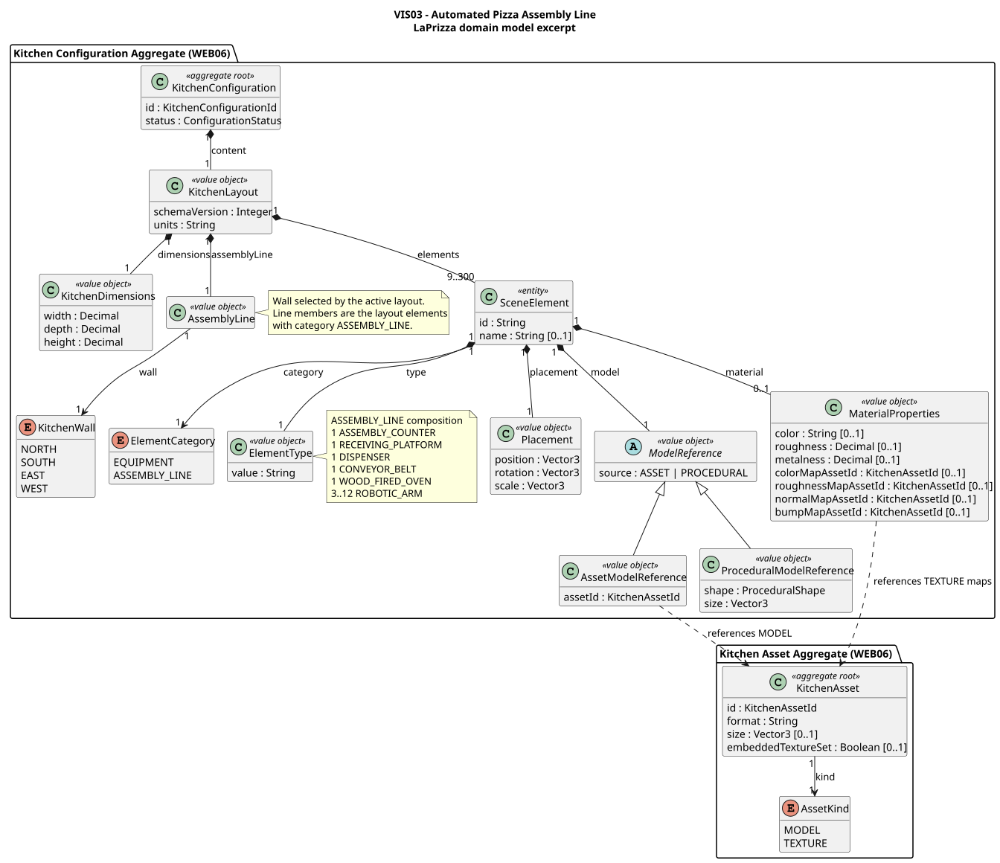
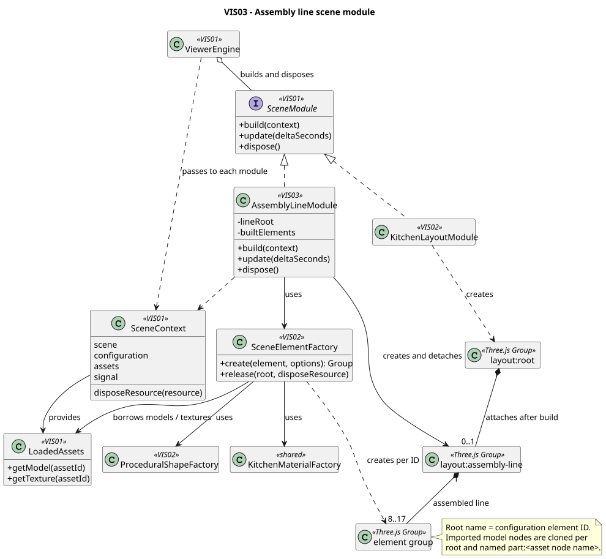
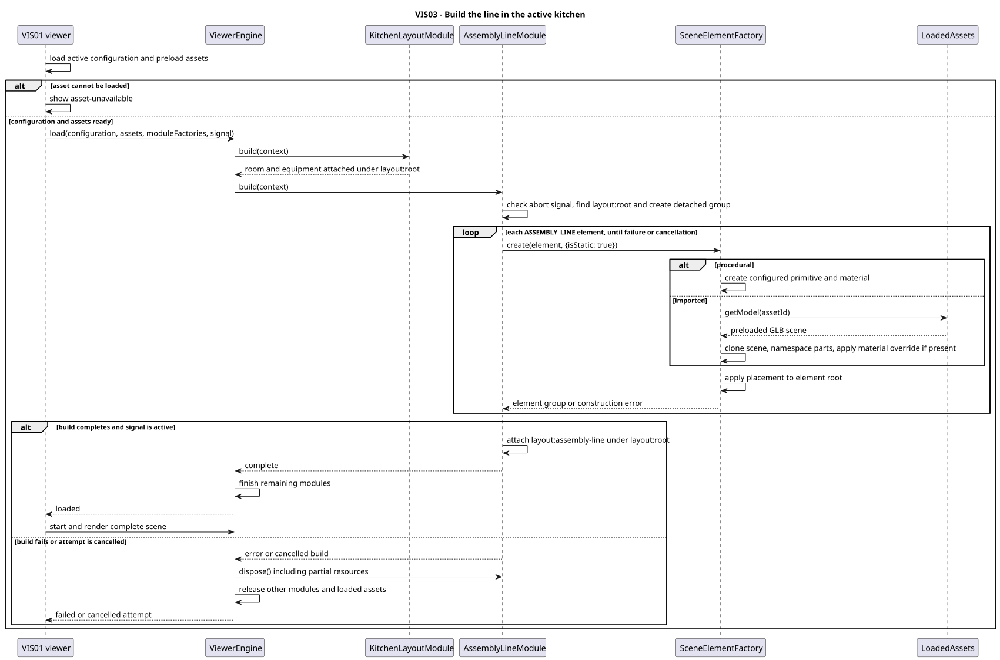
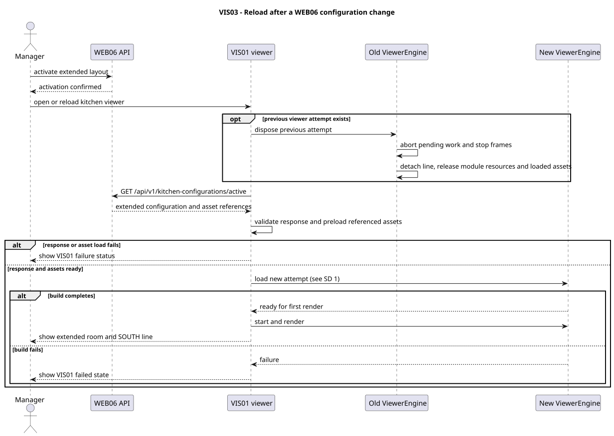

# US VIS03 – Automated Pizza Assembly Line Representation

## 1. Context & Scope

* **User Story ID:** VIS03
* **Sprint:** Sprint 2
* **Area:** 3D Kitchen Visualization (VIS / SGRAI)
* **Responsible:** Francisco Sá ([Sprint 2 Planning](../../../Planning/Sprint2/sprintPlanning.md))
* **Primary sources**
  * *PART IV – Sprint 2 – User Stories*, §IV.2.1, VIS03, printed pp. 13–14 (PDF pp. 14–15). The Sprint 2 implementation scope on printed p. 3 requires models prepared for animation in Sprint 3.
  * *PART II – System Specification*, §§II.3.3 and II.3.3.2, 3D Visualization and Interaction and Kitchen and Food Preparation Visualization.
  * *Sprint 2 Support Slide Deck*, slides 5, 7 and 10–13. Slide 10 restates the line requirements, slides 11–12 illustrate possible levels of visual detail, and slides 5, 7 and 13 give modelling, asset and material guidance.
  * *HowTo_Angular-ThreeJS*, §§1–2, illustrates how Three.js fits inside a web component and a routed application. The project already uses React and Three.js through VIS01. Its existing module integration applies here. [System Architecture Description](../../../architecture/SAD.md) · [VIS01](../vis01/usVIS01.md)

| Related story | Dependency |
| --- | --- |
| **WEB06 – Kitchen Configuration and 3D Integration Page** | Owns the active layout, versioned JSON, asset catalogue and spatial validation. The WEB06 ↔ VIS01–VIS03 checkpoint establishes the shared layout contract. [WEB06 business rules](../../web06/usWEB06.md#24-business-rules--invariants) · [Viewer integration contract](../../web06/usWEB06.md#345-viewer-integration-contract-for-vis01) |
| **VIS01 – 3D Module Integration** | Provides the authenticated viewer, active configuration and asset loading, the scene-module lifecycle, error handling and Reload / Retry. [VIS01](../vis01/usVIS01.md) |
| **VIS02 – Kitchen Layout and Equipment** | Provides the room, the `EQUIPMENT` elements and the reusable `SceneElementFactory`. Its implementation and subsequent review changes are in the local `main` history (`ae8ccfd`, `39874c4` and `bfd57cb`, work item #223). VIS03 owns the complementary `ASSEMBLY_LINE` elements. [VIS02 integration requirements](../../vis02/usVIS02.md#integration-requirements) |
| **VIS04–VIS07** | VIS04 owns materials and textures, VIS05–VIS06 own lighting and its controls, and VIS07 owns the camera and inspection controls. The line is part of the same scene and follows their contracts. [VIS02 integration requirements](../../vis02/usVIS02.md#integration-requirements) |

### Scope boundary

VIS03 covers the static 3D representation of one automated pizza assembly line on the selected kitchen wall. The line must make the physical sequence legible from inside the kitchen: the overhead supply delivers pre-formed crusts onto the receiving platform, the conveyor carries them alongside the articulated arms, and the line terminates at the wood-fired oven.

Sprint 2 includes the arrangement, model selection and preparation of movable parts. Sprint 3 covers motion and sequencing for the dispenser, conveyor and arms. Configuration editing, storage and activation remain with WEB06. The existing viewer supplies navigation, camera interaction and access control.

## 2. Requirements & Analysis

### 2.1. User Story Description

> **As a** LaPrizza Manager,\
> **I want** to see an automated pizza assembly line on one kitchen wall,\
> **so that** I can inspect its spatial arrangement.

The Manager is the requester. The existing kitchen viewer is available to `MANAGER` and `EMPLOYEE`, who see the same active layout. [VIS01 §2.1](../vis01/usVIS01.md#21-user-story-description)

### 2.2. Acceptance Criteria

The five criteria below follow the order of the official VIS03 statement. The evidence describes what to verify when the implementation is available.

| ID | Acceptance criterion | Acceptance evidence |
| --- | --- | --- |
| **AC 1** | Represent a large counter with a **rectangular receiving platform on the left** for pre-formed crusts supplied by an **overhead system**. | From inside the kitchen facing the configured wall, identify the counter, the platform at the receiving end and the dispenser directly above the receiving area. |
| **AC 2** | Place a **traditional wood-fired oven on the right**, connected to the receiving platform by an **integrated conveyor belt**. | Inspect the layout from above and from the side. The conveyor reaches the platform and the visible oven intake at a credible transfer height. Check position, scale, gaps, overlaps and facing in both sample layouts. |
| **AC 3** | Place **several articulated robotic arms** strategically along the line to represent ingredient deposition as pizzas advance. | Identify the base, articulated joints and end effector of each arm in its rest pose. Confirm the arms are between the two ends and their poses suggest deposition onto the belt. |
| **AC 4** | Line models may be procedural or imported. For imported models, obtain their URLs in JSON from the back end. | Compare the scene with the active JSON, including each element's model and transform. Exercise both model sources and verify imported resources are loaded from the resolved asset URLs supplied by WEB06. |
| **AC 5** | Create or select the **dispenser, conveyor belt and robotic arms** with Sprint 3 animation in mind. | Exercise the independent motions in BR 7 in a model inspection or test. Move a part on one instance and verify that a second instance of the same model retains its pose. The Sprint 2 viewer opens in a static rest pose. |

### 2.3. Client Clarifications & Questions

The [Sprint 2 client clarification record](https://github.com/Departamento-de-Engenharia-Informatica/LEI-SEM5-PI-2026-27-3DE-01/blob/d3f1b4295b3feb219423e91b28c8b729aae44945/docs/architecture/clientClarifications/clarifications.md) at `d3f1b42` contains no answer specific to the assembly line. The following answers apply through the existing viewer.

| Source | Effect on VIS03 |
| --- | --- |
| **Client §15 – Interface, Localization, and Usability** | Keep main navigation accessible while the scene is in use. Viewer controls and feedback follow the selected PT/EN locale, which persists across visits and refreshes. Line geometry and placement come from the same active layout in either locale. |
| **Client §16 – Administrator, Roles, and Authentication** | Restaurant Staff corresponds to `EMPLOYEE`. VIS01 and WEB03 apply the existing role rules, including continued access when another assigned role still permits the viewer. |

The numerical interpretation of “several”, wall proximity, dispenser offset and conveyor tolerances comes from the WEB06 ↔ VIS checkpoint. These are team decisions already reflected in the validator. The exact asset hierarchy and pivot names should be agreed with the Sprint 3 animation work during design. Figure 1 of the statement and the support slides are visual references for the arrangement.

### 2.4. Business Rules & Invariants

**S** = Sprint 2 specification or support slides, **C** = client clarification, **W** = existing story contract, **T** = team interpretation implemented by WEB06.

| ID | Rule | Source |
| --- | --- | --- |
| **BR 1** | The scene represents the single active configuration selected in WEB06. Its `content.assemblyLine.wall` identifies one wall, and the line uses exactly the elements with category `ASSEMBLY_LINE` in `content.elements`. VIS02 draws `EQUIPMENT`. A `WOOD_FIRED_OVEN` in each category is valid and identifies two different elements. | S – story goal, AC 1–3; W – WEB06, VIS02 BR 2 and VIS02-ALN-3 |
| **BR 2** | The line contains one `ASSEMBLY_COUNTER`, one `RECEIVING_PLATFORM`, one `DISPENSER`, one `CONVEYOR_BELT`, one `WOOD_FIRED_OVEN` and **3–12** `ROBOTIC_ARM` elements. Every element's base point is within **1.5 m** of the selected wall. | S – AC 1–3; T – WEB06 BR 17 and `KitchenLayoutFormat` |
| **BR 3** | Left and right are relative to an observer inside the kitchen facing the selected wall. In increasing wall coordinate `u`, the platform precedes the oven and every arm lies strictly between them. The belt's base point lies between the endpoints, inclusively. The dispenser base is above the platform base and its along-wall offset from the platform is at most **0.75 m**. | S – AC 1–3; T – WEB06 §2.4.2 and `KitchenLayoutValidator` |
| **BR 4** | The counter, platform, belt and oven use rotations around Y in multiples of 90°. The belt's local X axis is parallel to the wall. The belt reaches both endpoints in width, depth and height using the scaled footprints and tolerances below. WEB06 validates these conditions. | S – AC 2; T – WEB06 §2.4.3 and `AssemblyLineFrame` |
| **BR 5** | Render the configured world position in metres, Euler rotation (XYZ in degrees) and unitless scale factors per local axis. The scene is Y-up, with its origin at the centre of the floor and each model's placement origin at its bottom centre. Preserve the layout's unique ID as the root name of each scene element. Apply the WEB06 limits below when assessing model fit. | W – WEB06 §2.4.1 and §3.4.1, VIS02 BR 3 and BR 6 |
| **BR 6** | A procedural element uses the layout's shape, size and material. An imported element references a model asset by ID and uses the model preloaded by VIS01 from the back-end URL. Materials and map assets follow VIS04 and WEB06, including a colour map plus at least one roughness, bump or normal map when required. The model source comes from `model.source`; both sources are supported. | S – AC 4, VIS04; W – WEB06 §3.4, VIS02 BR 4 |
| **BR 7** | Animation-ready models expose separately addressable moving parts, with local pivots or motion axes and a pose owned by each instance. The dispenser release, conveyor surface or rollers, and arm joints and end effector must support the motions below. The Sprint 2 scene shows their rest pose. | S – AC 3 and AC 5, Sprint 2 implementation scope; acceptance checks in §2.6 |
| **BR 8** | VIS03 contributes its line through the existing scene lifecycle, after VIS02's room and equipment. On Reload after activation all elements come from the newly active configuration. Build failures use the viewer's existing failure and cleanup path so the scene is presented only when complete. | W – VIS02-ALN-3, VIS01 BR 5, BR 8 and BR 12, WEB06 §3.4.5 |
| **BR 9** | The line uses the viewer's existing roles, navigation and localized feedback. | C – Client §§15–16; W – VIS01 §2.3 |

#### Model fit limits

| Field | WEB06 limits (inclusive) |
| --- | --- |
| Kitchen dimensions | Width and depth **2–100 m** each. Height **2–10 m**. |
| `placement.position` | `x` from `−width/2` to `+width/2`, `y` from `0` to `height`, and `z` from `−depth/2` to `+depth/2`. |
| `placement.scale` | **0.01–100** per local axis, as a unitless multiplier. |
| Procedural `model.size` | **0.01–50 m** per local axis at scale 1. |

The room bounds check in WEB06 applies to the **element's placement origin**. During acceptance, inspect the full geometry after scale, rotation and translation for clipping through the walls or floor, extension above the room height and unintended overlap with other equipment. Connections and intended contact, such as the platform resting on the counter, are part of the layout. [WEB06 validation rules](../../web06/usWEB06.md#241-content-validation-rules-kitchenlayoutvalidator)

#### Wall coordinates and connection

For a position `(x, y, z)`, WEB06 uses the following wall frame for validation. Kitchen `width` and `depth` are in metres. [WEB06 §§2.4.2–2.4.3](../../web06/usWEB06.md#242-assembly-line-coordinates-vis03)

| Wall | `u`, increasing from left to right | `d`, distance into the room |
| --- | --- | --- |
| `NORTH` | `x` | `z + depth/2` |
| `SOUTH` | `−x` | `depth/2 − z` |
| `EAST` | `z` | `width/2 − x` |
| `WEST` | `−z` | `x + width/2` |

WEB06 derives each footprint from `model.size` for procedural shapes or the seeded GLB/glTF bounds for imported models, multiplied by the layout scale and aligned by the Y rotation. With `P` = platform, `B` = belt and `O` = oven, `U` is the footprint interval along the wall and `D` its depth interval.

* **Start:** `P.U.min ≤ B.U.min ≤ P.U.max + 0.05 m`.
* **End:** `O.U.min − 0.05 m ≤ B.U.max ≤ O.U.max`.
* **Depth:** `B.D` overlaps both `P.D` and `O.D` with positive overlap.
* **Height:** `|B.top − P.top| ≤ 0.15 m` and `O.bottom − 0.15 m ≤ B.top < O.top`.

These checks establish geometric reach against bounding boxes. Inspect the model geometry as well to establish that the belt reaches a usable intake and that the dispenser's outlet and arms' end effectors line up with the receiving platform and belt. Wall alignment accepts either direction along the wall. The direction from platform to oven is increasing `u`, which stays meaningful when the belt model's local `+X` points the other way.

#### Animation readiness and single-mesh models

| Element | Independent motion to support in Sprint 3 |
| --- | --- |
| `DISPENSER` | Move the release gate or equivalent mechanism relative to the fixed housing so it can open and close over the receiving platform. |
| `CONVEYOR_BELT` | Advance the visible belt surface along the travel direction, or rotate the separately addressable rollers about their local axes. The conveyor frame stays fixed. |
| `ROBOTIC_ARM` | Rotate articulated joints about their own local pivots. Child links and the end effector follow the resulting pose. The end effector must be independently addressable for the ingredient-release action. |

**Design decision for schema version 1.** Keep the configured representation of a WEB06-valid single-mesh model as a static compatibility path, with its original ID and placement. For example, both sample layouts still validate when `line-arm-1` is changed to a procedural `BOX` of 0.4 × 1.2 × 0.4 m with the required material maps. The shared factory creates one mesh for that box. An imported placeholder with one mesh has the same articulation limitation. A compatibility render is evidence of layout support only. Both acceptance layouts must use models with movable parts for the dispenser, belt and arms to satisfy AC 3 and AC 5. The VIS03 design will specify the multipart models or procedural builders and their pivots. Any future requirement that every accepted WEB06 configuration guarantee articulation would need an agreed WEB06 contract change.

#### Data consumed by the viewer

VIS01 gets the active configuration from `GET /api/v1/kitchen-configurations/active`. In the response, `content` supplies the schema version, wall and element list, while `assets[assetId]` supplies the resolved URL, kind and format. VIS03 receives the configuration and preloaded assets through the existing viewer. The same model asset can be reused by several independently positioned scene elements.

### 2.5. Domain Model Excerpt



[PlantUML source](./excerptDomainModel/domain_model_excerpt.puml)

| Concept | Kind | Role in VIS03 |
| --- | --- | --- |
| `KitchenConfiguration`, `KitchenLayout`, `KitchenDimensions` | WEB06 aggregate root and value objects | The active configuration supplies the layout and room dimensions used to inspect the placement. |
| `AssemblyLine`, `KitchenWall` | WEB06 value object and enumeration | `assemblyLine.wall` selects the wall. Line membership is represented by the category of entries in the layout's own element collection. |
| `SceneElement`, `ElementCategory`, `ElementType`, `Placement` | Layout entity, enumeration and value objects | Identify each line member, its physical role and its scene transform. ID uniqueness is within a layout. |
| `ModelReference`, `MaterialProperties` | WEB06 value objects | Reference a catalogue model or specify a procedural shape and size. Material properties may reference catalogue texture maps. |
| `KitchenAsset`, `KitchenAssetId`, `AssetKind` | WEB06 catalogue aggregate root, value object and enumeration | Identify models and textures by ID and kind. The API resolves their URLs and provides inspected model sizes where applicable. |

VIS03 reads the existing WEB06 domain. The scene groups, meshes, robot joints and pivots belong to the presentation model. Their Sprint 2 representation requires no new persistent domain concepts.

The excerpt uses the aggregate structure from the [WEB06 domain model](../../web06/excerptDomainModel/domain_model_excerpt.puml) and the current [WEB06 JSON format](../../web06/usWEB06.md#341-kitchen-configuration-json-format-schemaversion-1). The JSON calls the scene element identifier `id` (shown as `elementId` in the WEB06 domain model). The current layout has **9–300 elements** because it requires at least one equipment element and eight line elements (five single elements plus three arms). The earlier WEB06 diagram still shows `2..300` and lists `CRUST_FEEDER`. The current contract uses `DISPENSER` for the overhead crust supply.

### 2.6. Analysis Findings & Acceptance Scenarios

#### Reusable model inventory

| Line element | Existing representation in the WEB06 samples | Reuse and remaining work |
| --- | --- | --- |
| Assembly counter | Procedural `BOX`, `line-counter` | Reuse the configured geometry and material. The compact counter is 8 × 0.9 × 1.2 m and the extended one is 13 × 0.9 × 1.2 m. |
| Receiving platform | Procedural `BOX`, `line-platform` | Reuse the configured rectangular platform and material, 0.8 × 0.1 × 0.8 m in both samples. Check the dispenser outlet and belt handoff against it. |
| Wood-fired oven | `AST-MDL-OVEN-DOME-02` | Reuse the VIS02 dome oven geometry and configured material. Resolve the intake orientation and belt reach in both samples. |
| Dispenser | `AST-MDL-DISPENSER-01` | Single-mesh placeholder. Supply identifiable fixed housing and a release mechanism with its own motion axis. |
| Conveyor belt | `AST-MDL-CONVEYOR-01` | Single-mesh placeholder. Supply the frame and a separately movable belt surface or rollers. Recheck travel direction and handoffs after scaling. |
| Robotic arm | `AST-MDL-ROBOT-ARM-01` | Single-mesh placeholder. Supply base, links, joint pivots and an independently addressable end effector. Verify that instances sharing the model have independent poses. |

[Compact sample](../../web06/samples/kitchen-compact.json) · [Extended sample](../../web06/samples/kitchen-extended.json) · [Asset credits](../../../../backend/assets/kitchen/CREDITS.md)

#### Acceptance scenarios

| Scenario | Expected evidence or open point |
| --- | --- |
| Activate [compact](../../web06/samples/kitchen-compact.json) and open the viewer | `NORTH` wall, eight line elements and three articulated arms. Compare the visible arrangement and transforms with the JSON. |
| Activate [extended](../../web06/samples/kitchen-extended.json) and reload the viewer | `SOUTH` wall, ten line elements and five articulated arms. Left/right remain relative to the wall even though world X is reversed. Every configured ID appears once, including when both line and equipment contain a wood-fired oven. |
| Exercise the other supported walls and a rejected layout | Equivalent valid transforms work on `EAST` and `WEST`. A reversed order, missing arm, or disconnected belt is rejected at WEB06 validation. The viewer still loads the valid active configuration. |
| Review the oven and belt orientations with VIS02 and WEB06 | VIS02-ALN-1 calls for checking the line oven. The `AST-MDL-OVEN-DOME-02` opening is on local `+Z`. The compact sample rotates it 180° on `NORTH` and the extended sample uses 0° on `SOUTH`, so both openings face their wall. Using the current transforms and GLB bounds, the belt falls **0.35 m** short of the opening along the wall in the compact sample and **0.30 m** in the extended sample, even though both pass the whole-oven footprint check. Verify the intended intake orientation and actual transfer path before accepting AC 2. On `SOUTH`, also verify that the planned travel follows platform → oven, since the sample belt's local `+X` points toward the platform. |
| Test a WEB06-valid single-mesh model | In each sample, replace one arm with the procedural `BOX` described above. WEB06 accepts it and the viewer renders the static compatibility representation with the original ID and transform. Use multipart models when verifying articulation. |
| Check motion and instance isolation for Sprint 3 | In a model inspection or test, move the dispenser release, advance the belt surface or rotate a roller, and operate an arm joint and end effector. Verify that the fixed frames stay still and that child links follow their parent joints. For two arms built from the same model, record the second arm's pose before moving a joint or actuating the end effector on the first. Compare joint and end-effector transforms afterwards. Only the first arm's pose changes. The Sprint 2 viewer shows both arms at rest. |
| Inspect fit in the compact and extended layouts | Check the transformed geometry from above and from the side. Verify that scaling and rotation leave each model inside the room and preserve intended contacts. Check clearance between unrelated equipment and the full line, including walls and floor. For changed assets, verify catalogue bounds, bottom-centre origin, textures and credits. |
| Check failure handling and repeated loading | An unavailable imported asset follows VIS01's `asset-unavailable` state. Reload and route re-entry rebuild the line once, with stable IDs and independently addressable cloned parts. |

## 3. Design

### 3.1. Architecture & C4 Alignment

VIS03 adds `AssemblyLineModule` to the existing React/Three.js viewer. At C4 Level 2, the browser renders the line, the Back-End API serves the WEB06 configuration and assets, and PostgreSQL stores their configuration and catalogue metadata. At Level 3, VIS03 is a scene module in the frontend's visualization component. It receives the same `SceneContext` as VIS02. [System Architecture Description](../../../architecture/SAD.md)

In `defaultSceneModules`, register `createAssemblyLineModule` immediately after `createKitchenLayoutModule` and before lighting and camera modules. Return a fresh module for each viewer load attempt. Build under the VIS02 group `layout:root` using the existing reserved name `layout:assembly-line`. The active JSON stores scene coordinates already, so the wall selection gives context for inspection and never applies a second transform. [VIS02-ALN-3](../../vis02/usVIS02.md#integration-requirements)

### 3.2. Class Diagram (CD)



[PlantUML source](./classDiagram/class_diagram.puml)

| Component | Responsibility |
| --- | --- |
| `ViewerEngine`, `SceneContext` | Create and own the scene, module lifecycle and preloaded assets. Supply the active configuration, abort signal and deduplicating disposer. |
| `KitchenLayoutModule` | Build `layout:root` with the room and `EQUIPMENT` group. VIS03 uses the reserved root name to attach the line. |
| `AssemblyLineModule` | Filter `content.elements` by `category === 'ASSEMBLY_LINE'`. Build one object per configured ID, attach the completed group and release the resources it owns. `update(deltaSeconds)` is a no-op in Sprint 2. |
| `SceneElementFactory`, `ProceduralShapeFactory`, `KitchenMaterialFactory` | Reuse VIS02 construction. Build procedural geometry or clone the preloaded model, preserve the configured root transform and apply any permitted material override. Use shape and material factories scoped to the line module. |
| `LoadedAssets` | Supply preloaded GLB/glTF scenes and textures. Own the source resources borrowed by clones. |

The scene tree is `Scene → layout:root → layout:assembly-line → <elementId> → model or mesh`. The element group keeps VIS02's ID and metadata. Imported node names become `part:<name>` through the shared factory. Part lookups start at the element group so three or five arms can each have a node named `part:elbow`. The shared factory sets shadow flags on the meshes. VIS05 owns the lights and shadow-map settings, and VIS07 owns the camera and controls.

**Resource ownership.** Track successfully returned element groups as soon as they are created. Attachment to the scene happens after the build completes. On dispose, detach the line, release clone-owned skeletons through `SceneElementFactory.release`, dispose the line's shape and material factory caches and clear module references. Use the context disposer and continue cleanup if one resource fails. Keep disposal safe after an abort, partial build or repeated call. Imported geometry, default materials and preloaded textures belong to `LoadedAssets`. If the shared factory allocates a clone and fails before returning it, the factory must release its clone-owned resources on that path as well.

### 3.3. Sequence Diagrams (SD)

#### SD 1 — Build the line in the active kitchen



[PlantUML source](./sequenceDiagram/sequence_diagram_build_assembly_line.puml)

1. VIS01 loads the active response and preloads its assets before starting the engine.
2. VIS02 builds the layout root and equipment. VIS03 checks the abort signal before allocating resources and builds the line synchronously in a detached group. It checks the signal again before attachment. The shared factory selects the construction path from `model.source` and applies the configured placement.
3. VIS03 attaches the finished group. The engine finishes building the remaining modules and presents the complete kitchen.
4. If the layout root is missing or an element cannot be built, the module raises a build error. VIS01 handles the resulting `failed` state. An unavailable model file fails earlier with VIS01's `asset-unavailable` state. A cancelled build returns without attaching the group and leaves cleanup to the engine's abort path.

#### SD 2 — Reload and replace the active configuration



[PlantUML source](./sequenceDiagram/sequence_diagram_reload_assembly_line.puml)

After a manager changes the active configuration in WEB06, opening or reloading the viewer starts a new load attempt. VIS01 disposes the old engine and its scene modules. The new scene uses the new configuration, assets and fresh object instances, even where the two layouts reuse element IDs. A failed load shows the relevant VIS01 status.

### 3.4. REST API Specification (ARC03)

Use the existing authenticated `GET /api/v1/kitchen-configurations/active` through VIS01. VIS03 consumes the following already-parsed data in `SceneContext`. [WEB06 viewer contract](../../web06/usWEB06.md#345-viewer-integration-contract-for-vis01)

| Data | Use |
| --- | --- |
| `id`, `version`, `content.schemaVersion` | Identify the active response and its layout format. VIS01 checks version 1 of the format. |
| `content.kitchen.dimensions`, `content.assemblyLine.wall` | Describe the room boundaries and chosen wall used for demonstration and inspection. |
| `content.elements[]` | Select the line by category and take its IDs, models, placement and materials directly from the response. |
| `assets[assetId]` | VIS01 resolves the preloaded models and textures from the response's URLs. The line factory works with the loaded objects by asset ID. |

WEB06 validates composition, wall position and connection before activation. VIS03 handles rendering and reports construction failures through the existing viewer. A valid schema-1 `BOX` arm is rendered by the same procedural path as any other primitive. The presence of articulation is verified against the demonstration models during acceptance.

### 3.5. Persistence & Data Integrity (ARC04)

WEB06 owns the stored layout and catalogue entries. VIS03 adds new catalogue entries and updates the demo JSON during implementation. A catalogue entry and its model file must be deployed and seeded before a configuration can reference it. Keep the original asset IDs, model files and catalogue metadata so saved layouts can reload using the same references. Store local pivots and rest poses in the GLB node hierarchy. Keep any future mutable pose per scene instance.

### 3.6. Applied Patterns & Architecture Principles

* **Scene module:** plug the line into the existing build, update and dispose lifecycle.
* **Factory reuse:** use the same construction and transformation rules as VIS02. The model source selects the representation, while category selects the module that builds it.
* **Instance ownership:** borrow immutable assets and clone the scene graph per configured ID. Changing a clone's local transform leaves the source and all other clones in their original poses.

### 3.7. New Components and Justification

| Planned change | Reason |
| --- | --- |
| `frontend/src/visualization/scene/modules/AssemblyLineModule.js` | Own the line subtree and resource lifecycle. Use the existing `LAYOUT_ASSEMBLY_LINE` name and register the module in `defaultSceneModules.js`. |
| Asset recipes, GLBs, catalogue entries and credits in the existing kitchen asset workflow | Provide named parts and pivots. Extend `npm run kitchen:models` with recipes for the new IDs. The current exporter writes flat mesh nodes and material factors. Add support for child nodes, local transforms and embedded textures while preserving the existing equipment recipes and placeholder assets. |
| WEB06 compact and extended demo JSON | Reference the new files by asset ID and represent two complete lines on different walls. |

### 3.8. Design Decisions

#### 3.8.1. Model selection and part contracts

Use procedural boxes for the counter and platform. Use project-authored GLBs for the dispenser, conveyor and arm, with new IDs so the existing placeholders remain available. Derive the line-oven variant from `AST-MDL-OVEN-DOME-02`. Its existing mouth is made from solid overlay geometry, so turning the model can align the front with the belt but cannot create an open intake. Reuse the dome profile, base and chimney, and build the surround around a recessed opening at belt height. Leave the first section of the hearth clear for the handoff. The equipment oven keeps its current catalogue entry.

| Proposed catalogue ID | Rest geometry and named local nodes |
| --- | --- |
| `AST-MDL-DISPENSER-02` | Keep 0.6 × 0.8 × 0.6 m as the target envelope. Fixed `housing` and independently addressable `release-gate` under it. In rest pose the gate is closed over the outlet. Set its pivot at the hinge with local X as the rotation axis. The outlet centre sits over the platform centre. |
| `AST-MDL-CONVEYOR-02` | Keep 1 × 0.1 × 0.6 m as the reference bounds used by the layout's X scale. Use fixed `frame` and distinct `belt-surface`. Local +X is the travel direction. Align the surface's U coordinate with local X and use repeat wrapping along U. A future per-instance UV offset can move the pattern while the frame and bounds stay fixed. For that animation, use an instance-owned material and texture state so the source and other clones stay still. |
| `AST-MDL-ROBOT-ARM-02` | Fixed `base`, then nested pivots `base-yaw → shoulder → elbow → end-effector`. Turn the base around local Y and pitch shoulder and elbow around each pivot's local X. Put an independently addressable `release-gate` under `end-effector` so the nozzle can release ingredients independently of the joints. In rest pose, target width 0.4 m, height up to 1.2 m and local Z extent −0.13 to +0.47 m. Use a base at most 0.26 m deep so its front edge leaves 0.02 m to the belt. The nozzle reaches the belt centre 0.45 m forward along local +Z. Inspect the actual transformed link geometry before accepting the asset. |
| `AST-MDL-OVEN-LINE-01` | Preserve the dome style and 1.8 × 1.6 × 1.8 m envelope of the VIS02 oven. Place the front opening on local +Z at the +0.9 m edge, centred on local X, with a clear width of at least 0.70 m and the hearth at local Y = 1.0 m for the handoff. Keep the aperture and the visible hearth immediately behind it clear of solid parts from the original model. |

Use metres, Y-up and a bottom-centre placement origin. Author movements on local child nodes. Keep IDs unique within a layout and node names unique within each model, with pivots at actual connection points. The shared factory namespaces the nodes on clone. Root transforms stay static in Sprint 2 and moving child nodes keep their local transforms editable. Exercise those transforms in tests or model inspection, without adding animation playback to the viewer.

Use existing texture maps with the new GLBs. Embed a colour map and a roughness or normal map in every material used by the models, including the darker intake and belt, to pass the WEB06 inspector without a whole-model override. In the two samples, omit the oven's existing whole-model override when using the new textured variant so the opening and surround retain their material distinction. In other valid layouts, the shared factory still honours any configured material override. [Asset credits](../../../../backend/assets/kitchen/CREDITS.md)

#### 3.8.2. Demonstration layouts and handoff coordinates

The following are proposed JSON changes for implementation. Coordinates are in metres. Keep all existing element IDs and equipment placements. Use the line centre `z = −3.05` for compact and `z = 4.00` for extended, with arm bases behind the belt. Both platforms retain their width and depth. Set the platform height to 0.105 m so its top is at 1.005 m, a 5 mm drop to the belt at the join. The belt top and the oven hearth meet at 1.0 m.

| Element | Compact, NORTH (12 × 8 × 3.2 m) | Extended, SOUTH (16 × 10 × 3.5 m) |
| --- | --- | --- |
| Counter | Position `(−0.175, 0, −3.05)`, yaw 0°, size 7.65 × 0.9 × 1.2 m | Position `(0.925, 0, 4.00)`, yaw 0°, size 11.15 × 0.9 × 1.2 m |
| Platform | Position `(−3.5, 0.9, −3.05)` | Position `(5.5, 0.9, 4.00)` |
| Dispenser | Position `(−3.5, 2.1, −3.05)`, yaw 0° | Position `(5.5, 2.2, 4.00)`, yaw 180° |
| Belt | Position `(0.30, 0.9, −3.05)`, yaw 0°, X scale 6.8 | Position `(0.20, 0.9, 4.00)`, yaw 180°, X scale 9.8 |
| Arms | Existing three X positions, `y = 0.9`, `z = −3.50`, yaw 0° | Existing five X positions, `y = 0.9`, `z = 4.45`, yaw 180° |
| Line oven | Position `(4.6, 0, −3.05)`, yaw −90° | Position `(−5.6, 0, 4.00)`, yaw +90° |

The compact belt runs from world X −3.10 to +3.70. The extended belt runs from +5.10 to −4.70. In both cases the ends meet the platform edge and the oven intake plane. The oven turns toward the arriving belt, and local +X on the conveyor points from platform to oven on both walls. Counter ends stop 0.05 m before the oven body, with the conveyor spanning that last section. The oven's outer bounds leave 0.05 m to the north wall in compact and 0.10 m to the south wall in extended. Inspect mesh clearances and the appearance of both handoffs after generating the models.

## 4. Tests (ARC05)

### 4.1. Test Plan & Scenarios

| ID | Scenario | Expected result |
| --- | --- | --- |
| **UT01** | Build the line alongside VIS02 with a line oven and an equipment oven. | Exactly one root per configured ID. Line and equipment ovens are placed under their own groups. Model source, transform and metadata match the input. |
| **UT02** | Replace one arm with a procedural `BOX` in otherwise valid input. | The shared factory builds its configured static mesh. Its element ID and transform are preserved. |
| **UT03** | Build two arms from the same GLB. Rotate one shoulder and operate its end effector. Exercise the dispenser gate and conveyor surface targets separately. | The mutated arm's descendants follow its joints. The second arm and the cached source retain their original transforms. Fixed frames are unaffected. All target nodes resolve within their respective instance. |
| **UT04** | Fail on the second element after allocating clone resources, cancel before attachment, and call disposal twice. | No line group is published after an incomplete build. The factory cleans up its unreturned clone and the module cleans up the completed element. Owned allocations are released once. Loaded assets remain under VIS01 ownership, and retry starts with a fresh module. |
| **AT01** | Generate the GLBs, run them through `GltfModelInspector`, seed the catalogue and validate both updated demo layouts. | The inspector finds supported textures and expected bounds. Imported part names and parent-child relationships survive loading with the viewer's GLTF loader. Both updated layouts and earlier samples using the existing IDs validate. |
| **AT02** | Verify handoffs using the transformed geometry, including the visible intake plane, then inspect both demos from above and from the side. | The track reaches the platform and oven entrance without clipping, the belt and hearth align, the nozzle and release areas are over the belt and platform, and the line clears the room and unrelated equipment. |
| **FT01** | Load compact, activate extended in WEB06 and reload. Compare part transforms across two frames. Also check a missing asset and a module build failure. | The visible line changes from eight elements on NORTH to ten on SOUTH. Shared IDs occur once in the new scene and the line stays in its rest pose across frames. The two failures surface as `asset-unavailable` and `failed` respectively. |
| **FT02** | Verify analogous valid layouts on EAST and WEST, and reject a disconnected belt in WEB06. | The renderer applies the configured world transforms on every wall. WEB06 rejects the invalid layout and the viewer continues to obtain the valid active configuration. |

AC 1 and AC 2 are covered by AT02 and FT01. AC 3 is covered by UT03 and AT02. AC 4 is covered by UT01, UT02 and AT01. AC 5 is covered by UT03 and AT01, with FT01 confirming that the scene opens in its rest pose.

During design, the WEB06 validator accepted the original samples and the proposed transforms with mock catalogue entries using the target bounds. The numerical checks confirmed the handoff coordinates and nominal clearances in §3.8.2. See §6.3 for verification with the shipped assets.

## 5. Implementation

### 5.1. File Structure

| Path | Implementation |
| --- | --- |
| [AssemblyLineModule.js](../../../../frontend/src/visualization/scene/modules/AssemblyLineModule.js) and [defaultSceneModules.js](../../../../frontend/src/visualization/scene/defaultSceneModules.js) | Build and dispose the line in the default viewer. |
| [SceneElementFactory.js](../../../../frontend/src/visualization/scene/elements/SceneElementFactory.js) | Reuse the VIS02 rendering paths and release clone-owned skeletons if construction fails. |
| [Assembly-line model recipes](../../../../backend/scripts/kitchen-models/assemblyLine.js) and [GLB exporter](../../../../backend/scripts/kitchen-models/glb.js) | Generate model geometry, named pivots and embedded texture references. |
| [Asset manifest](../../../../backend/assets/kitchen/manifest.json) and [asset credits](../../../../backend/assets/kitchen/CREDITS.md) | Register the four new GLB files with WEB06. |
| [Compact sample](../../web06/samples/kitchen-compact.json) and [extended sample](../../web06/samples/kitchen-extended.json) | Reference the new models and apply the placements in §3.8.2. |

### 5.2. Implemented behaviour

`createAssemblyLineModule` is registered between the room module and lighting. It builds the active layout's line using the shared element factory, keeps the configured IDs and attaches the completed group to `layout:root`. The shared factory releases a clone's skeleton if building that element fails before it can return the clone. Procedural and legacy imported elements still use their configured static representations.

The four VIS03 catalogue IDs in §3.8.1 are shipped as GLBs with embedded maps. The dispenser and arm use named local pivots, the belt has a separate surface with longitudinal repeat UVs, and the oven has a recessed opening. The new samples use those IDs and the placements in §3.8.2. The arm's inspected height in rest pose is 0.995 m, within the 1.2 m design envelope. The asset files and IDs listed in the analysis inventory remain available for existing configurations.

## 6. Integration, Verification & Demonstration

### 6.1. Running the Automated Tests

From `backend/`:

```powershell
npm.cmd test -- --runInBand --roots tests/unit --testPathPatterns kitchen-configuration-management
npm.cmd test -- --runInBand --runTestsByPath tests/integration/kitchen-configuration-management/api.test.js --roots tests
```

From `frontend/`:

```powershell
npm.cmd test -- --runInBand --roots test --testPathPatterns visualization kitchen-configurations
npm.cmd run build
```

### 6.2. Manual Verification & OpenAPI Contract

1. Start PostgreSQL, apply the migrations and run `npm run db:seed` in `backend` to register the new model IDs. To regenerate the shipped GLBs, run `npm run kitchen:models` before seeding. Start the backend and frontend with `npm run dev` in their respective directories. [Local setup](../../../../README.md)
2. Sign in as a Manager and go to **Kitchen configurations** (`/kitchen/configurations`). Import, validate, save and activate the [compact sample](../../web06/samples/kitchen-compact.json). Open the kitchen viewer and confirm the active configuration name and ID, the NORTH wall and three arms. Facing that wall from inside, follow the line from the rectangular platform on the left, with the dispenser above it, to the wood-fired oven on the right. The conveyor should reach the oven opening and the entire line should stay at rest.
3. Import, validate, save and activate the [extended sample](../../web06/samples/kitchen-extended.json). Open or reload the viewer. Confirm the new name and ID, the SOUTH wall and five arms. Verify the left-to-right arrangement facing that wall.
4. With the extended configuration still active, import the [invalid sample](../../web06/samples/kitchen-invalid.json) and select **Validate**. Expect validation errors including the missing assembly counter, too few arms and a disconnected conveyor at both ends. Reload the viewer and confirm that the extended line is still active.
5. In Swagger UI (`http://localhost:8080/api-docs`) or the browser Network tab, inspect `GET /api/v1/kitchen-configurations/active`. Confirm that `content.assemblyLine.wall` matches the active sample and that `assets` resolves the four VIS03 model IDs to GLB URLs.

### 6.3. Verification on the implementation branch

- **Automated:** 82 backend unit tests, 10 WEB06 HTTP tests and 143 frontend tests passed. The frontend production build and lint on the changed frontend files passed. The compatibility suite inspected the shipped GLBs and verified both current and legacy fixtures. The dedicated PostgreSQL integration suite was outside this run.
- **Chromium with WebGL:** The production viewer engine loaded the shipped assets for both samples. The conveyor reached the hearth at 1 m and the platform stood 5 mm above the conveyor. Rays through each entrance reached the inside back wall of the oven. Both lines fit within their rooms. Changing one arm's shoulder moved its end effector while the other arm and cached model retained their pose.
- **Manual WEB06 validation:** The compact and extended layouts rendered as expected. The invalid sample returned nine validation problems, including the missing counter, insufficient arms and disconnected conveyor, and the application reported that the saved configuration was unchanged.

## 7. Observations, Dependencies & Limitations

- WEB06 provides the active layout and the asset catalogue. VIS01 owns loading and reload, VIS02 supplies the room and shared element factory, and VIS04–VIS07 handle materials, lighting and camera interaction within their respective scopes.
- The line stays in its rest pose in Sprint 2. Named parts and pivots are available for Sprint 3 animation. Existing configurations with single-mesh assets retain their static representation.
