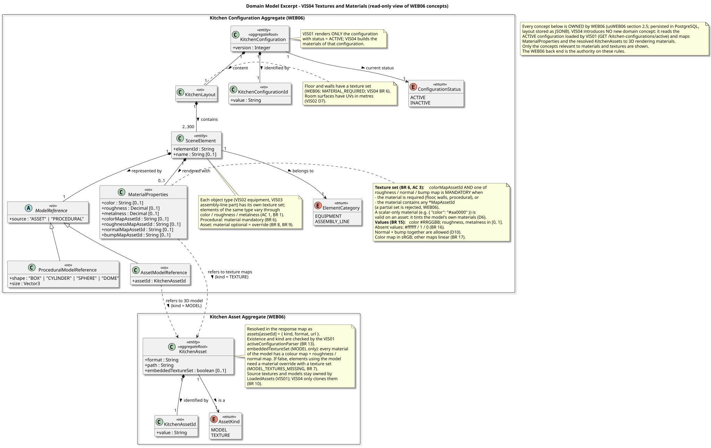
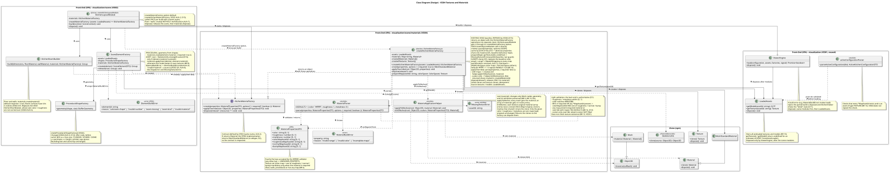
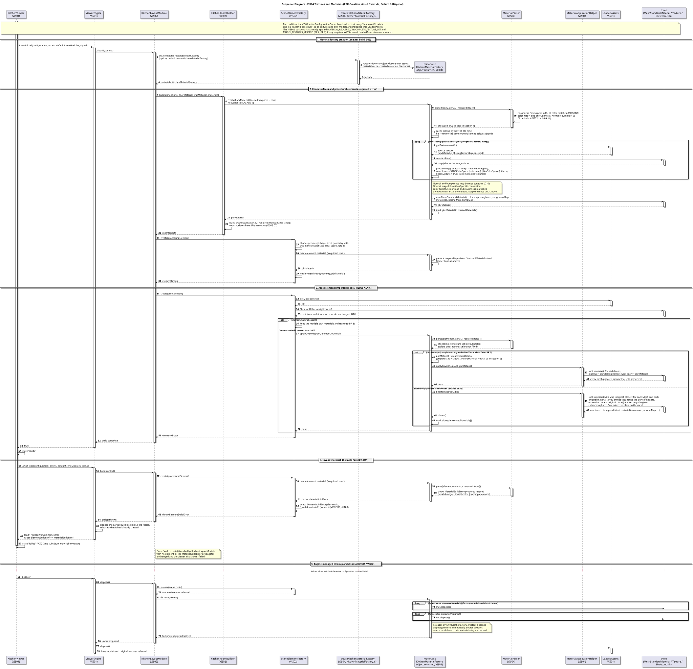

# US VIS04 – Textures and Materials

## 1. Context & Scope

* **User Story ID:** VIS04
* **Sprint:** Sprint 2
* **Area:** 3D Kitchen Visualization (VIS)
* **Responsible:** Mariana Moreira (1240905)
* **Related Requirements / Stories:**
  * Sprint 2 User Stories, *PART IV – Sprint 2 – User Stories*, VIS04 (official statement).
  * System Specification: *PART II – System Specification*, section II.3.3 3D Visualization and Interaction.
  * SGRAI course material on textures (Sprint 2). It is **supporting material**, not a client clarification: the decisions it supports are marked **D** (section 3.8).
  * Architecture: [System Architecture Description](../../../architecture/SAD.md) (*Client-side 3D rendering*, *Back-end authority* and project structure `frontend/src/visualization`), [ADR-001 – Monorepo](../../../architecture/ADR.md) and [ADR-010 – PostgreSQL as the single database](../../../architecture/ADR.md#adr-010-use-postgresql-as-the-single-database).
  * Related stories:
    * **VIS01 – 3D Module Integration:** owns the viewer engine, the `activeConfigurationParser` (asset references exist and have the right type), asset loading, the lifecycle of `LoadedAssets` and the `failed` state.
    * **VIS02 – Kitchen Scene Construction:** creates scene elements, clones imported models (`SkeletonUtils.clone`) and receives the material factory through `createKitchenMaterialFactory(assets)` (VIS02 ALN-2).
    * **VIS03 – Assembly Line:** its objects receive materials through the same factory.
    * **WEB06 – Kitchen Configuration and 3D Integration Page:** owns the kitchen configuration and its JSON format. The WEB06 back-end validator (`KitchenLayoutValidator`) is the authority on the accepted material keys and on when a texture set is mandatory.
  * **Dependencies:** VIS04 depends on the kitchen configuration supplied through WEB06, the asset provider and lifecycle defined by VIS01, and the scene construction contract defined by VIS02. VIS02 invokes VIS04 while constructing the scene.

### Scope boundary

VIS04 concerns **how the textures and materials of the kitchen scene are created from the configuration and applied to scene elements**. It does not define the kitchen configuration API, check that asset references exist, load the original assets, construct the complete scene, or own the viewer lifecycle.

VIS04 owns:

1. A light front-end validation of the material properties (`MaterialParser`), following the same texture-set rules as the WEB06 back-end.
2. The default values used when a property is absent.
3. Resolving configured texture references through `LoadedAssets`.
4. Cloning each texture map and configuring it (wrapping, color space) for the material that uses it.
5. Creating and tracking `MeshStandardMaterial` instances through `createKitchenMaterialFactory(assets)`.
6. Applying an asset-level material override to every mesh in an imported model: replacing the material when the override has maps, or tinting clones of the original materials when it has scalars only.
7. Disposing the materials and cloned textures created by the material factory.
8. Selecting, preparing and crediting the PBR texture set used by each object type.

VIS04 does not own the source models or source textures in `LoadedAssets`. VIS01 remains responsible for disposing those base assets after the layout and VIS04 resources have been released.

---

## 2. Requirements & Analysis

### 2.1. User Story Description

> **As a** LaPrizza Manager,  
> **I want** 3D models rendered with appropriate textures,  
> **so that** each element looks realistic.

Source: *PART IV – Sprint 2 – User Stories*, VIS04 Textures and Materials. The LaPrizza Manager consults the kitchen viewer as defined in Table 1; Restaurant Staff may also consult it, but the story's actor is the Manager.

### 2.2. Acceptance Criteria

The acceptance criteria below are the **official** ones from the Sprint 2 statement.

- [ ] **AC 1:** Each 3D object has distinct textures and materials.
- [ ] **AC 2:** For procedural models, retrieve texture and material properties and URLs from the back end as JSON.
- [ ] **AC 3:** Textures must include at least a colour map and one of a roughness, bump, or normal map.
- [ ] **AC 4:** Textures and materials must not significantly degrade performance or loading time.

### 2.3. Client Clarifications & Questions

There are **no client clarifications about VIS04** (`clientClarifications.md` has none). The requirements come from the official statement and from WEB06; the SGRAI textures deck is supporting material and only backs team decisions.

| Source | Content and effect on VIS04 |
| --- | --- |
| **Official statement** (*PART IV*, VIS04) | Defines the story, its actor (LaPrizza Manager) and the four acceptance criteria in 2.2. |
| **Official statement** (*PART IV*, IV.2.3 Sprint 2 Deliverable) | The deliverable must show "appropriate textures, materials, lighting" in the integrated viewer. |
| **Official statement** (*PART IV*, WEB06) | The configuration JSON includes the model references and visual properties required by the VIS stories; asset references are validated by the back end. |
| **WEB06 – `KitchenLayoutValidator`** | Accepted material keys (`UNKNOWN_PROPERTY` otherwise); material mandatory on floor, walls and procedural elements (`MATERIAL_REQUIRED`); complete texture set when the material is mandatory or has any map (`INCOMPLETE_TEXTURE_SET`); imported models without embedded textures need a textured override (`MODEL_TEXTURES_MISSING`). → BR 6, BR 7. |
| **SGRAI deck** (supporting) | No procedural textures; PBR sources with a CC licence; "Diffuse == Color Map"; ignore DirectX normal maps (use OpenGL); `TextureLoader`; credits "in your codebase"; 1k is usually enough and JPG is usually the best balance; imported models probably already bring textures; not every object needs a different texture, but there must be diversity (pizza example); think about the quality of each texture (important object vs. background). → D4, D12, D17, D18. |

### 2.4. Business Rules & Invariants

Each rule states its source: **S** = Sprint 2 specification, **W** = a rule of another story (WEB06, VIS01, VIS02) that VIS04 must follow, **D** = team design decision (section 3.8), possibly supported by the SGRAI deck.

#### 2.4.1. Requirements of VIS04

| ID | Rule | Source |
| --- | --- | --- |
| **BR 1** | Each 3D object has distinct textures and materials: each object type uses its own texture set, and elements of the same type vary through `color` (tint over the color map), `roughness` and `metalness`. | S (AC 1), D17 |
| **BR 2** | For procedural models, texture and material properties and texture references come from the back end as JSON (active configuration, WEB06). Texture asset IDs resolve to URLs loaded by VIS01 into `LoadedAssets`; no material is hard-coded in the front end. | S (AC 2), W (WEB06) |
| **BR 3** | Every visible object is textured with a color map and at least one of a roughness, bump or normal map: room surfaces and procedural elements through their mandatory material (BR 6); imported models through their embedded textures or a textured override (BR 7). | S (AC 3), W (WEB06) |
| **BR 4** | Textures and materials must not significantly degrade performance or loading time (budget in D9, texture quality in D12). | S (AC 4), D9, D12 |
| **BR 5** | Every material created by the factory is a `MeshStandardMaterial` built only from the keys accepted by WEB06: `color`, `roughness`, `metalness`, `colorMapAssetId`, `roughnessMapAssetId`, `normalMapAssetId`, `bumpMapAssetId`. | W (WEB06), D2 |

#### 2.4.2. Constraints from WEB06 and related stories

| ID | Rule | Source |
| --- | --- | --- |
| **BR 6** | **Texture set.** A material must contain `colorMapAssetId` and at least one of `roughnessMapAssetId` / `normalMapAssetId` / `bumpMapAssetId` when **(a)** the material is mandatory (floor, walls, procedural elements) **or (b)** it contains any `*MapAssetId`. An `ASSET` override with scalars only (`color`, `roughness`, `metalness`) is valid. | W (WEB06: `MATERIAL_REQUIRED`, `INCOMPLETE_TEXTURE_SET`) |
| **BR 7** | **Model textures.** An `ASSET` whose model has no embedded texture set (`embeddedTextureSet = false`) must have a material override with a complete texture set; otherwise the configuration is rejected. | W (WEB06: `MODEL_TEXTURES_MISSING`) |
| **BR 8** | Imported models keep their own textures unless the configuration defines a material override for that element. | W (WEB06), D6 |
| **BR 9** | An override on an `ASSET` element is applied to every mesh in the imported model hierarchy, preserving geometry and UV attributes. | W (WEB06 ALN-6), D6 |
| **BR 10** | `LoadedAssets` owns the original models and textures. VIS04 may read and clone them but must not mutate or dispose the originals. | W (VIS01) |
| **BR 11** | Layout and scene references are released before VIS01 disposes base assets through `LoadedAssets`. | W (VIS01 / VIS02) |
| **BR 12** | Scene construction receives its material factory from `createKitchenMaterialFactory(assets)`: `KitchenLayoutModule` (through its injected `createMaterialFactory` option) and the VIS03 `AssemblyLineModule` each create one instance per build and dispose only that instance; VIS02 and VIS03 never construct materials directly. | W (VIS02 ALN-2), D15 |
| **BR 13** | Every `*MapAssetId` exists and refers to an asset of type `TEXTURE`; this is checked by the VIS01 `activeConfigurationParser` before construction. | W (VIS01) |
| **BR 14** | Imported models are cloned with `SkeletonUtils.clone`, so skinned and animated models (Sprint 3 robotic arms) keep a working skeleton. | W (VIS02 D6), D16 |

#### 2.4.3. Team design rules

| ID | Rule | Source |
| --- | --- | --- |
| **BR 15** | `MaterialParser` checks that `roughness` and `metalness`, when provided, are within `[0, 1]`, that `color` matches `#RRGGBB`, and that BR 6 holds for the context (`required` or not). Otherwise a `MaterialBuildError` with property and reason is raised. | D1 |
| **BR 16** | Defaults when a property is absent: `color = #ffffff`, `roughness = 1`, `metalness = 0`, so the maps are shown unchanged. They are filled **whenever the material has maps** (a required material or an override with maps). Only in a scalar-only override is an absent property left unchanged on the original material. | D14 |
| **BR 17** | Every texture map used by a material is cloned, set to `RepeatWrapping`, and given the right color space: `SRGBColorSpace` for the color map, `NoColorSpace` (linear) for roughness, normal and bump maps. | D3, D4 |
| **BR 18** | The factory tracks every material and cloned texture it creates (including tinted clones of model materials) and disposes only those. | D5 |
| **BR 19** | An override with maps replaces the material of every mesh; a scalar-only override tints **one clone per distinct original material** (meshes that shared a material share its clone); meshes with an array of materials apply the same rule to every entry. | D6 |
| **BR 20** | A material build failure is propagated: the whole build fails and VIS01 shows the `failed` state; no material or texture is silently substituted. For a procedural element or an asset override, the `MaterialBuildError` reaches the engine wrapped in `ElementBuildError(element.id, 'invalid-material')`, as VIS02 D9 requires. | D7, D11 |
| **BR 21** | Procedural shapes have UVs in metres, so `RepeatWrapping` tiles every texture at the same density as on the room surfaces. | D13 |
| **BR 22** | Textures come from CC-licensed PBR image files (no procedural textures), are credited in `CREDITS.md`, are 1k JPG by default (D12) and use OpenGL normal maps. | D18 |

#### 2.4.4. Open points

There are no open points. The former OP1 (normal and bump maps together) became **D10**; the former OP2 (scope of a material error) became **D11**.

### 2.5. Domain Model Excerpt



PlantUML source: [`excerptDomainModel/domain_model_excerpt.puml`](./excerptDomainModel/domain_model_excerpt.puml).

The diagram shows the WEB06 concepts that VIS04 reads; the table below lists the technical objects that map them to rendering materials (detailed in 3.2).

| Concept | Kind | Role in VIS04 |
| --- | --- | --- |
| **MaterialPropertiesDTO** | Data Transfer Object | Scalar properties (`color`, `roughness`, `metalness`) and texture asset identifiers, all `[0..1]`, as accepted by WEB06. The texture set is mandatory only under BR 6. |
| **MaterialBuildError** | Technical error | Identifies the invalid property and reason material construction failed (`invalid-range`, `invalid-color`, `incomplete-maps`). A texture missing from `LoadedAssets` raises the existing `MissingTextureError` (VIS02 baseline). |
| **KitchenMaterialFactory** | Interface (VIS02 contract, implemented by VIS04) | Material creation, asset override and disposal operations used by VIS02; obtained through `createKitchenMaterialFactory(assets)`. |
| **createKitchenMaterialFactory** | Implementation (function, VIS02 baseline refined by VIS04) | Returns the factory object: validates, creates and caches materials, clones textures, tints cloned model materials, and tracks factory-owned resources. |
| **LoadedAssets** | VIS01 resource owner | Provides base models and textures. VIS04 does not own or dispose the original resources. |
| **Object3D / Mesh** | Three.js scene objects | Receive materials during scene construction or asset override (one material for all meshes with maps; one tinted clone per distinct original material with scalars only). |

VIS04 introduces no business aggregate or persistence. Its concepts are technical objects used by the visualization module. Kitchen configuration and asset identifiers remain owned by WEB06 and are passed through unchanged.

---

## 3. Design

### 3.1. Architecture & C4 Alignment

This User Story operates within the established **C4 Model** of the system ([SAD](../../../architecture/SAD.md)):

* **C4 Level 1 (System Context):** the LaPrizza Manager uses the kitchen viewer through the LaPrizza Information System. VIS04 adds no separate application or external system.
* **C4 Level 2 (Containers):** the Front-End renders the kitchen scene using Three.js in the browser. The Back-End API supplies the kitchen configuration and asset references and validates the material rules. VIS04 does not access the database or call the API directly.
* **C4 Level 3 (Components):** VIS01 owns the viewer engine, the configuration parser and `LoadedAssets`; VIS02 owns layout and scene construction; VIS04 validates material properties, creates materials, applies asset overrides and releases its own resources.

The material creation flow is:

```text
WEB06 kitchen configuration (validated by the back-end)
        │
        ▼
VIS01 activeConfigurationParser (asset ids exist, type TEXTURE) → LoadedAssets
        │
        ▼
VIS02 KitchenLayoutModule ── createKitchenMaterialFactory(assets)  (VIS04, once per build;
        │                            VIS03 AssemblyLineModule creates its own instance)
        │                            │
        ├── room builder ───────────►│ create(material, { required: true })
        ├── SceneElementFactory ────►│ create(material, { required: true })  (procedural)
        └── SceneElementFactory ────►│ applyOverride(root, material)          (ASSET)
                                     ├── MaterialParser: rules of BR 6, BR 15, defaults (BR 16)
                                     ├── LoadedAssets.getTexture() → texture clones
                                     ├── MeshStandardMaterial
                                     └── MaterialApplicationHelper: replace or tint per mesh
```

### 3.2. Class Diagram (CD)

The class diagram describes the material parser, factory, helper and resource ownership across VIS04, VIS02 and VIS01.



PlantUML source: [`classDiagram/class_diagram.puml`](./classDiagram/class_diagram.puml).

Key design points:

- **Reused unchanged:** `SceneElementFactory` and `KitchenRoomBuilder` from VIS02 (they call `create(material)` without options and the default `required = true` applies), `KitchenLayoutModule` apart from VIS04-ALN-7, `LoadedAssets` (`getTexture()` / `getModel()`) and `activeConfigurationParser` from VIS01, the WEB06 material configuration and Three.js scene objects.
- **Changed in VIS02 code (VIS04-ALN-4):** `ProceduralShapeFactory` writes UVs in metres (D13).
- **Refined by VIS04 (existing VIS02 baseline, `frontend/src/visualization/scene/materials/KitchenMaterialFactory.js`):**
  - `KitchenMaterialFactory` — the contract defined by VIS02 ALN-2 (`create`, `applyOverride`, `dispose`); VIS04 keeps the name and the operations.
  - `createKitchenMaterialFactory(assets)` — the function that returns the factory object. `KitchenLayoutModule` receives it through its `createMaterialFactory` option (default `createKitchenMaterialFactory`); the VIS03 `AssemblyLineModule` calls it directly. The baseline already caches materials by their properties, throws `MissingTextureError` for a missing texture and disposes only its materials and texture clones; VIS04 adds the parser, the new defaults, always-cloned maps with `RepeatWrapping` on every map, the tint for scalar-only overrides and array materials.
- **New (VIS04, same folder):**
  - `MaterialParser` — light validation with the back-end texture-set rules and defaults.
  - `MaterialBuildError` — a validation or material construction failure.
  - `MaterialApplicationHelper` — applies an override to every mesh of an imported model (replace or tint, arrays included).
- **Location:** `frontend/src/visualization/scene/materials/` (`KitchenMaterialFactory.js` existing; `MaterialParser.js`, `MaterialApplicationHelper.js` and `MaterialBuildError.js` new).
- **Texture handling:** every map is cloned from `LoadedAssets`, set to `RepeatWrapping`, and given `SRGBColorSpace` (color map) or `NoColorSpace` (other maps).
- **Disposal:** the factory disposes only the materials and texture clones it created.

#### Material configuration handling

| Case | Result | Handling |
| --- | --- | --- |
| `roughness` / `metalness` outside `[0, 1]` | `MaterialBuildError` (`invalid-range`) | Reject before material creation. |
| `color` does not match `#RRGGBB` | `MaterialBuildError` (`invalid-color`) | Reject before material creation. |
| Material mandatory (floor, walls, procedural) or with any map, but without color map + one of roughness / normal / bump (BR 6) | `MaterialBuildError` (`incomplete-maps`) | Reject before material creation. |
| `ASSET` override with scalars only | Valid | Tint clones of the original materials (D6). |
| Referenced texture missing | Rejected earlier by VIS01 `activeConfigurationParser` (BR 13) | `LoadedAssets.getTexture()` returns `undefined` for an unknown id; as a last guard the factory throws the existing `MissingTextureError(assetId)`. The parser does not repeat the check. |
| Valid configuration | `MaterialPropertiesDTO` | Defaults filled whenever the material has maps (required material or override with maps, BR 16); in a scalar-only override absent properties are left out. |

Unknown keys never reach the viewer: they are rejected earlier by the WEB06 back-end (`UNKNOWN_PROPERTY`).

#### Default values (BR 16, D14)

| Property | Default | Reason |
| --- | --- | --- |
| `color` | `#ffffff` | `color` multiplies the color map; white shows the texture unchanged. |
| `roughness` | `1` | Multiplies the roughness map; 1 keeps the map value. |
| `metalness` | `0` | Kitchen surfaces are dielectric unless stated. |

These are the `MeshStandardMaterial` defaults. They are filled whenever the material has maps, including an `ASSET` override with maps (`required = false`), so no property reaches Three.js as `undefined`. In a scalar-only override an absent property is not changed on the original material. They replace the defaults of the VIS02 baseline factory (`#d9d6cf`, `0.8`, `0`, inherited from the removed VIS01 `KitchenFloorModule`), so the floor built by `KitchenRoomBuilder` now shows its texture unchanged.

#### Asset override handling (BR 8, BR 9, BR 19, D6)

| Override on the `ASSET` element | Effect on each mesh |
| --- | --- |
| None | Original materials and textures kept. |
| With maps (complete set, BR 6) | One factory material replaces the material of every mesh. |
| Scalars only | Each distinct original material is cloned once (meshes that shared it share the clone); the given `color` / `roughness` / `metalness` are set on the clone; the model's textures stay (`color` = tint). |
| Mesh with an array of materials | The rule above is applied to every entry of the array. |

#### Ownership of material and texture resources

| Resource | Owner | VIS04 responsibility |
| --- | --- | --- |
| Source model | `LoadedAssets` (VIS01) | Cloned by VIS02 with `SkeletonUtils.clone`; never disposed by VIS04. |
| Source texture | `LoadedAssets` (VIS01) | Clone it; do not mutate or dispose the original. |
| Cloned / configured texture | material factory (VIS04) | Track it and dispose it when the factory is disposed. |
| `MeshStandardMaterial` / tinted clone of a model material | material factory (VIS04) | Track and dispose it. |
| Mesh geometry | Scene / imported asset owner | Preserve it while applying material overrides. |

#### Material build failure and cleanup

- The parser rejects invalid properties before a material is created.
- For a procedural element or an asset override, `SceneElementFactory` wraps the `MaterialBuildError` in `ElementBuildError(element.id, 'invalid-material', { cause })` (VIS02 D9, VIS04-ALN-8), so the failing element id reaches the development console. On the floor and walls there is no element id: the `MaterialBuildError` propagates unchanged.
- The error is propagated through the scene module to `ViewerEngine.load()`; VIS01 disposes the partial build and shows the `failed` state (D11).
- Resources created before the failure remain tracked and are released when the factory is disposed.
- When the layout is reloaded, switched or closed, its scene references are released and the material factory disposes its materials and cloned textures; VIS01 then disposes base resources through `LoadedAssets`.

### 3.3. Sequence Diagram (SD)

#### SD 1 — Textures and Materials: PBR Creation, Asset Override and Engine Disposal

Before construction, the VIS01 `activeConfigurationParser` checks the asset references and all referenced textures and glTF models are preloaded into `LoadedAssets`. `KitchenLayoutModule` calls the injected `createKitchenMaterialFactory(assets)` and passes the factory to the room builder and the scene element factory.

For the floor, the walls and every procedural element (`SceneElementFactory`), the factory calls `MaterialParser` with `required = true`. For each map present (color, roughness, normal, bump) it gets the base texture with `getTexture()`, clones it, sets `RepeatWrapping` and the right color space, and tracks the clone. It then builds a `MeshStandardMaterial` with the defaults of BR 16 and tracks it. Procedural shapes already have metre UVs.

For an imported asset, VIS02 clones the model with `SkeletonUtils.clone`. Without an override the model keeps its own textures. With an override, `MaterialParser` runs with `required = false`: with maps, the defaults are filled and one factory material is applied to every mesh; with scalars only, each distinct original material is cloned once and tinted; array materials are handled entry by entry.

If validation fails, the `MaterialBuildError` propagates to `ViewerEngine.load()`, wrapped by `SceneElementFactory` in `ElementBuildError(element.id, 'invalid-material')` when it comes from an element (unchanged for the floor and walls), and VIS01 shows `failed`.

When the layout is reloaded, closed or switched, `ViewerEngine` disposes the layout first. The layout disposes its material factory, which releases only the materials and cloned textures it created. `ViewerEngine` then disposes `LoadedAssets`.



> Source: [`sequenceDiagram/sequence_diagram_vis04_materials.puml`](./sequenceDiagram/sequence_diagram_vis04_materials.puml).

---

### 3.4. REST API Specification (ARC03)

VIS04 adds no HTTP endpoint and does not make REST requests. Material configuration and texture references arrive as part of the kitchen configuration loaded by VIS01.

#### Endpoints consumed (WEB06, through VIS01)

| Method | Endpoint | Used for | Owner |
| --- | --- | --- | --- |
| GET | `/api/v1/kitchen-configurations/active` | Active kitchen configuration with material properties and asset references | WEB06; consumed by VIS01 |
| GET | Asset URL supplied in the configuration | Model or texture file | WEB06; loaded by VIS01 |

#### Internal operations (VIS04)

| Operation | Used for |
| --- | --- |
| `createKitchenMaterialFactory(assets): KitchenMaterialFactory` | Creates the factory for one build (injected into `KitchenLayoutModule`). |
| `MaterialParser.parse(properties, { required })` | Light validation (BR 6, BR 15); returns the DTO with defaults (BR 16). |
| `KitchenMaterialFactory.create(properties, { required = true }): Material` | Creates a `MeshStandardMaterial` for a room surface or procedural element. |
| `KitchenMaterialFactory.applyOverride(root, properties): void` | Applies an override to an imported model (replace or tint, D6). |
| `KitchenMaterialFactory.dispose(release?): void` | Releases factory-created materials and cloned textures, through the engine's `release` (`disposeResource`) when given. |

#### Request & Response Schemas

Material configuration is JSON within the kitchen configuration. It is not posted to a VIS04 endpoint.

Mandatory material (procedural element), complete texture set:

```json
{
  "color": "#8b5e3c",
  "roughness": 0.72,
  "metalness": 0.05,
  "colorMapAssetId": "AST-TEX-COLOR-001",
  "roughnessMapAssetId": "AST-TEX-ROUGHNESS-001",
  "normalMapAssetId": "AST-TEX-NORMAL-001"
}
```

Scalar-only override on an `ASSET` with embedded textures (tint):

```json
{ "color": "#aa0000" }
```

The factory returns a `MeshStandardMaterial` or propagates a `MaterialBuildError`. Texture objects and Three.js materials are runtime resources; they are not written back into the configuration.

#### Integration requirements

| ID | Change or contract | Owner | Verified by |
| --- | --- | --- | --- |
| VIS04-ALN-1 | `MaterialParser`, `MaterialPropertiesDTO`, the diagrams and the JSON examples use exactly the keys and texture-set rules of the WEB06 validator. | VIS04 / WEB06 | T1–T8, T29 |
| VIS04-ALN-2 | Texture clones and tinted material clones are tracked and disposed by the factory; source textures and models remain owned by `LoadedAssets`. VIS02 ALN-2, its ownership table and its `KitchenMaterialFactory` note must mention the texture clones. | VIS04 / VIS01 / VIS02 | T13–T16 |
| VIS04-ALN-3 | `KitchenLayoutModule` receives the factory function through its `createMaterialFactory` option (VIS02 ALN-2); the VIS03 `AssemblyLineModule` creates its own instance with `createKitchenMaterialFactory(assets)`; `SceneElementFactory` clones models with `SkeletonUtils.clone`. | VIS02 / VIS04 | T23, T24 |
| VIS04-ALN-4 | `ProceduralShapeFactory` writes UVs in metres per face after scaling (D13); VIS02 D4 and Known Limitations updated accordingly. | VIS02 / VIS04 | T25, T26 |
| VIS04-ALN-5 | Floor and walls are built by `KitchenRoomBuilder` (VIS02) with the factory; the baseline defaults (`#d9d6cf`, `0.8`, from the removed VIS01 `KitchenFloorModule`) are replaced by those of BR 16. | VIS02 / VIS04 | T27 |
| VIS04-ALN-6 | `LoadedAssets` methods are `getModel(id)` / `getTexture(id)` (VIS01 `SceneAssetLoader` and README); VIS02 diagrams and text use `model()` / `texture()` and must be aligned. | VIS02 / VIS01 | Review (T29) |
| VIS04-ALN-7 | `KitchenLayoutModule` stops passing `{ worldScaleUv: true }` to `create()` for the floor and walls: with D3 and D13 every map uses `RepeatWrapping`, so the baseline option `worldScaleUv` is removed. | VIS02 / VIS04 | T11, T27 |
| VIS04-ALN-8 | `SceneElementFactory` wraps a `MaterialBuildError` in `ElementBuildError(element.id, 'invalid-material', { cause })`, as it already does for `ShapeError` and `MissingTextureError`; VIS02 D9 and the `ElementBuildError` reasons add `invalid-material`. Floor and wall errors keep propagating unchanged (no element id). | VIS02 / VIS04 | T28 |

---

### 3.5. Persistence & Data Integrity (ARC04)

VIS04 introduces no database persistence and does not store material data.

- **Configuration source:** material properties and texture asset identifiers come from the kitchen configuration supplied through the WEB06 / VIS01 flow.
- **Identifier integrity:** asset identifiers are passed unchanged to `LoadedAssets`; VIS04 does not generate or rewrite them.
- **Source texture and material integrity:** the factory never mutates shared textures or the materials of source models; it always works on clones.
- **Geometry integrity:** applying an override changes mesh material references only; it preserves geometry and UV attributes.
- **Resource integrity:** every material and cloned texture created by the factory is tracked and released by that factory.
- **Ownership boundary:** base models and textures remain owned by `LoadedAssets` and are released by VIS01.
- **No browser persistence:** VIS04 does not store materials or texture state in `localStorage`, `sessionStorage` or `IndexedDB`.

---

### 3.6. Applied Patterns & Architecture Principles

- **Layered inside the visualization feature:** validation, material creation and application to scene meshes have separate responsibilities.
- **Validator:** `MaterialParser` applies the same texture-set rules as the back end before Three.js objects are created; the back end stays authoritative.
- **Factory + Dependency Injection:** `createKitchenMaterialFactory(assets)` is injected into `KitchenLayoutModule`; one factory per build encapsulates PBR material creation and tracks its resources.
- **Dependency inversion:** VIS02 uses the `KitchenMaterialFactory` contract and does not construct Three.js materials directly.
- **Helper:** `MaterialApplicationHelper` traverses imported assets and replaces or tints the material of every mesh.
- **Explicit resource ownership:** the factory disposes only what it created; `LoadedAssets` owns the originals.
- **Fail-closed construction:** invalid properties produce a `MaterialBuildError` and the build fails; no silent substitution.
- **Engine-managed lifecycle:** `ViewerEngine` disposes the layout before `LoadedAssets`.

---

### 3.7. New Components and Justification

| Component | Layer | Why it is needed / why an existing one is not enough |
| --- | --- | --- |
| `KitchenMaterialFactory` | Visualization – Contract (existing, VIS02 ALN-2) | Lets VIS02 and VIS03 request materials without depending on Three.js material classes. |
| `createKitchenMaterialFactory` | Visualization – Three.js adapter (existing VIS02 baseline, refined) | The baseline creates and caches materials but has no validation, uses other defaults, clones only some maps and always replaces the material on an override; VIS04 adds what AC 1–AC 4 need. |
| `MaterialParser` | Visualization – Validation | Catches invalid ranges, colors and incomplete texture sets with a clear error before Three.js objects are created. |
| `MaterialBuildError` | Visualization – Error handling | Identifies the invalid property and reason a material could not be built. |
| `MaterialPropertiesDTO` | Visualization – Configuration | Mirrors the material keys accepted by WEB06. |
| `MaterialApplicationHelper` | Visualization – Scene utility | Applies an override to every mesh (arrays included) without changing geometry or UV attributes. |

---

### 3.8. Design Decisions

| ID | Decision |
| --- | --- |
| **D1** | Keep `MaterialParser` as a **light** front-end validation: ranges, `#RRGGBB` color, the BR 6 texture-set rule (with `required` for floor, walls and procedural elements, `false` for `ASSET` overrides) and defaults. It does not re-check texture existence or type (VIS01 `activeConfigurationParser`, BR 13). `LoadedAssets.getTexture()` returns `undefined` for an unknown id (VIS01 `SceneAssetLoader`), so the factory checks the result and throws the existing `MissingTextureError(assetId)` (VIS02 baseline) as a last guard instead of building a material without its map. The WEB06 back end remains the authoritative validator. |
| **D2** | Use only `MeshStandardMaterial`, aligned with WEB06. The DTO has no `type`, `clearcoat`, `opacity`, `transparent` or `wireframe`, since the back end rejects them (`UNKNOWN_PROPERTY`). |
| **D3** | **Always** clone each texture map from `LoadedAssets` and set `RepeatWrapping` on every map. A clone shares the image data, so it is cheap, and avoids conditional logic and any mutation of shared textures. This replaces the VIS02 baseline rule (clone only the color map or maps with world-scale UVs, share the others), which would leave linear maps of procedural shapes without `RepeatWrapping`. |
| **D4** | Color map in `SRGBColorSpace`; roughness, normal and bump maps in `NoColorSpace` (linear), since they hold data, not color ("Diffuse == Color Map", SGRAI deck). |
| **D5** | Track created materials, cloned textures and tinted material clones so factory disposal releases only resources owned by VIS04. As in the VIS02 baseline, `create()` caches materials by their parsed properties (key = JSON of the DTO), so elements with identical properties share one material and one set of texture clones (fewer materials and shader programs, AC 4). |
| **D6** | **Overrides on imported models.** With maps: the override replaces the material of every mesh by one `MeshStandardMaterial` from the factory. Scalars only: each original material is **cloned** and only the given `color` / `roughness` / `metalness` are set on the clone, so the model keeps its own textures (`color` acts as a tint). Meshes with an array of materials apply the same rule to every entry. The helper keeps a `Map<original, clone>` during the traversal, so a material shared by several meshes produces a single clone (fewer materials and shader programs, AC 4). Replacing the whole material on a scalar-only override was rejected: a scalar-only override is only possible when the model has embedded textures (BR 7), and replacing its material would throw them away and break AC 3. |
| **D7** | A `MaterialBuildError` is propagated; no silent substitution of material or texture. |
| **D8** | Keep base textures and models under `LoadedAssets` ownership; VIS04 must not dispose those shared resources. |
| **D9** | Performance budget for AC 4, measured on the team's reference machine with the demonstration kitchen: textures and materials add at most 2 s to the viewer loading time and the scene keeps at least 30 FPS. 1k JPG textures (D12), shared image data between clones (D3) and disposal of factory resources (D5) keep the cost low. |
| **D10** | Normal and bump maps may be supplied together (former OP1): the WEB06 back end accepts it and `MeshStandardMaterial` applies both. |
| **D11** | A material error fails the whole build (former OP2), aligned with VIS02: the error reaches `ViewerEngine.load()` and VIS01 shows the `failed` state. When it comes from an element, it carries the element id as `ElementBuildError(element.id, 'invalid-material', { cause })` (VIS02 D9, VIS04-ALN-8); the id appears only in the development console. |
| **D12** | **Texture quality per object (AC 4),** following the SGRAI deck's advice to weigh important objects against background ones. Objects the user inspects closely (assembly line, ovens, counters) use 1k maps. Large tiled surfaces (floor, walls) also use 1k, because metre UVs repeat them every metre. Small or background items may use 512 px. No map above 2k. JPG is used for every map. |
| **D13** | **Metre UVs on procedural shapes:** `ProceduralShapeFactory` rewrites the UVs in metres per face after scaling, as the room surfaces do (VIS02 D7). The configuration has no `repeat` key (the back end rejects unknown keys), so without this `RepeatWrapping` would have no effect on 0–1 UVs and a large counter would show a stretched texture. This **replaces VIS02 D4** (default UVs on procedural shapes) and removes the stretched-texture item from the VIS02 Known Limitations, both updated in VIS02. The VIS02 geometry cache keyed by shape + size remains valid, because metre UVs depend only on the size. **Method** (in `createProceduralShapeFactory()`, `scene/elements/ProceduralShapeFactory.js`, after the scale and before the geometry is cached): `BOX` multiplies the 0–1 UVs of each face by that face's dimensions; `CYLINDER`, `SPHERE` and `DOME` use `u × perimeter` and `v × height`, and the cylinder caps use the vertex `x` / `z` (planar, in metres). The perimeter of an elliptical base is approximated by `π · (x + z) / 2`, which is enough to avoid stretched textures. The bounding box is unchanged, so VIS02 UT02 / UT03 still hold. |
| **D14** | **Defaults** `color = #ffffff`, `roughness = 1`, `metalness = 0` (the `MeshStandardMaterial` defaults), because `color` and `roughness` multiply their maps. Any other default would tint or change the texture. They are filled whenever the material has maps (also in an override with maps, where `required = false`); only a scalar-only override leaves absent properties unchanged. |
| **D15** | **Refine the VIS02 baseline instead of replacing it.** The implementation stays the function `createKitchenMaterialFactory(assets)` in `scene/materials/KitchenMaterialFactory.js`, which returns an object with the `KitchenMaterialFactory` operations (the same functional style as `createProceduralShapeFactory`); no separate class is introduced, so `KitchenMaterialFactory` names only the contract. `KitchenLayoutModule` receives the function through its `createMaterialFactory` option (VIS02 ALN-2) and calls it once per build; the VIS03 `AssemblyLineModule` creates its own instance. The contract returns `Material`; the implementation returns a `MeshStandardMaterial`. `create(properties, options?)` takes `{ required }` (default `true`), which replaces the baseline option `worldScaleUv` (VIS04-ALN-7); only `applyOverride` uses `required = false`. `dispose(release?)` keeps the baseline signature, so the engine's `disposeResource` can be passed. |
| **D16** | Imported models are cloned with `SkeletonUtils.clone` (`three/addons/utils/SkeletonUtils.js`), as in VIS02 D6. `Object3D.clone()` was rejected because skinned meshes would share the source skeleton, and the robotic arms are animated in Sprint 3. |
| **D17** | **Diversity:** each object type uses its own texture set; elements of the same type vary through `color`, `roughness` and `metalness`. This is the team's interpretation of the SGRAI deck (not every object needs a different texture, but there must be diversity, as in the pizza example). |
| **D18** | **Texture sourcing:** PBR image files with a CC licence, no procedural textures, OpenGL normal maps (DirectX ignored), loaded with `TextureLoader` by VIS01, as recommended by the SGRAI deck. Credits are kept in `CREDITS.md` at the root of the texture folder, which is how the team meets the deck's request for credits "in your codebase". |

---

## 4. Tests

### 4.1. Test plan

| ID | Type | Target | Scenario | Expected result | Covers |
| --- | --- | --- | --- | --- | --- |
| T1 | Unit | `MaterialParser` | Valid DTO with all fields | Same values returned | BR 15 |
| T2 | Unit | `MaterialParser` | DTO with color map and no `color` / `roughness` / `metalness` | `#ffffff`, `1`, `0` | BR 16 |
| T3 | Unit | `MaterialParser` | `roughness = 1.2` / `metalness = -0.1` | `MaterialBuildError` (`invalid-range`) with the property name | BR 15 |
| T4 | Unit | `MaterialParser` | `color = "brown"` / `"#abc"` | `MaterialBuildError` (`invalid-color`) | BR 15 |
| T5 | Unit | `MaterialParser` | `required = true`, no `colorMapAssetId` | `MaterialBuildError` (`incomplete-maps`) | BR 3, BR 6 |
| T6 | Unit | `MaterialParser` | `required = true`, only `colorMapAssetId` | `MaterialBuildError` (`incomplete-maps`) | BR 3, BR 6 |
| T7 | Unit | `MaterialParser` | `required = false`, one map but no complete set | `MaterialBuildError` (`incomplete-maps`) | BR 6 |
| T8 | Unit | `MaterialParser` | `required = false`, `{ "color": "#aa0000" }` | Valid; absent scalars not filled | BR 6, BR 16 |
| T9 | Unit | `KitchenMaterialFactory.create` | Valid DTO | `MeshStandardMaterial` with `color`, `roughness`, `metalness` and the configured maps | BR 3, BR 5 |
| T10 | Unit | `KitchenMaterialFactory.create` | DTO with normal **and** bump map | Both maps applied | D10 |
| T11 | Unit | `KitchenMaterialFactory.create` | DTO with all 4 maps | Every map is a clone (≠ source), `wrapS = wrapT = RepeatWrapping` | BR 10, BR 17 |
| T12 | Unit | `KitchenMaterialFactory.create` | DTO with all 4 maps | `map.colorSpace = SRGBColorSpace`; other maps `NoColorSpace` | BR 17 |
| T13 | Unit | `KitchenMaterialFactory.create` | Two materials from the same source texture | Source texture's wrapping and color space unchanged | BR 10 |
| T14 | Unit | `KitchenMaterialFactory.dispose` | After creating N materials and tinted clones | `dispose()` called on every created material and cloned texture, never on `LoadedAssets` resources | BR 18 |
| T15 | Unit | `KitchenMaterialFactory.dispose` | Called twice | No error | BR 18 |
| T16 | Unit | `createKitchenMaterialFactory` | Called twice | Two independent factories; disposing one does not affect the other | BR 12 |
| T17 | Unit | `MaterialApplicationHelper` | Override with maps on a model with nested groups and meshes | Every mesh gets the factory material; groups untouched; geometry and UV attributes unchanged | BR 9, BR 19 |
| T18 | Unit | `MaterialApplicationHelper` | Scalar-only override `{ "color": "#aa0000" }` | Each mesh has a clone of its original material with the new color and the **same** `map`; originals unchanged | BR 8, BR 19 |
| T19 | Unit | `MaterialApplicationHelper` | Mesh with an array of materials (with maps and scalar-only) | The rule is applied to every entry | BR 19 |
| T20 | Integration | `SceneElementFactory` + factory | `ASSET` with embedded textures and without `material` | Original materials and textures kept | BR 8 |
| T21 | Integration | `SceneElementFactory` + factory | `ASSET` with `embeddedTextureSet = false` and a complete override | Factory material on all meshes (configuration accepted by WEB06 only because of the override, `MODEL_TEXTURES_MISSING`) | BR 3, BR 7 |
| T22 | Integration | `SceneElementFactory` + factory | Procedural element | `create(material, { required: true })` called; material applied | BR 2, BR 6 |
| T23 | Integration | `KitchenLayoutModule` / `AssemblyLineModule` | Build with an injected `createMaterialFactory` | Each module creates one factory per build and disposes it with its own objects | BR 12, D15 |
| T24 | Integration | `SceneElementFactory` | Clone of an imported model | `SkeletonUtils.clone` used; source model unchanged | BR 14, D16 |
| T25 | Unit | `ProceduralShapeFactory` | Box 4 × 1 × 0.9 m | UVs in metres per face; the texture repeats 4 times along the 4 m length; bounding box unchanged | BR 21, D13 |
| T26 | Unit | `ProceduralShapeFactory` | Cylinder, sphere and dome | Side UVs follow the perimeter (`π · (x + z) / 2`) and height in metres; cylinder caps planar in metres; cache key unchanged | BR 21, D13 |
| T27 | Integration | `KitchenRoomBuilder` | Floor material without `color` / `roughness` | Factory defaults `#ffffff` / `1` (no baseline `#d9d6cf` / `0.8`); `create()` called without `worldScaleUv` | BR 16, VIS04-ALN-5, VIS04-ALN-7 |
| T28 | Integration | Viewer + active configuration | Invalid material in a procedural element; invalid floor material | Element: build fails with `ElementBuildError` (element id, `invalid-material`) whose `cause` is the `MaterialBuildError`; floor: the `MaterialBuildError` propagates unchanged. VIS01 state `failed`; no substitute material | BR 20, D11, VIS04-ALN-8 |
| T29 | Review | Configuration contract | Compare DTO, parser, diagrams and JSON examples with the WEB06 validator | Same keys and texture-set rules everywhere | BR 5, BR 6, VIS04-ALN-1 |
| T30 | Review | Texture assets | Inspect texture folder and `CREDITS.md` | CC-licensed, credited; normal maps OpenGL; no procedural textures; one texture set per object type; 1k (512 px only for small / background items, nothing above 2k), JPG | BR 1, BR 22, D12 |
| T31 | Integration | Viewer + active configuration | Change a procedural element's material in the active JSON (WEB06) and reload | The element shows the new material; no material values come from front-end code | BR 2 |
| T32 | Integration | Viewer lifecycle | Switch active configuration | Factory disposed before `LoadedAssets.dispose()` | BR 11 |
| T33 | Performance | Viewer | Load the demonstration kitchen with and without textures (browser dev tools) | Loading time increase ≤ 2 s and ≥ 30 FPS while orbiting; no growth in GPU memory after switching configuration several times | BR 4, D9 |
| T34 | Manual (visual) | Viewer | Load a kitchen with several object types | Each object type shows its own texture; tint / roughness variation visible between elements of the same type; textures not stretched on large counters; normal maps light correctly | BR 1, BR 21, BR 22 |
| T35 | Unit | `MaterialParser` | `required = false`, complete texture set, no `color` / `roughness` / `metalness` | `#ffffff`, `1`, `0` filled (no `undefined` value reaches Three.js) | BR 16, D14 |
| T36 | Unit | `MaterialApplicationHelper` | Scalar-only override on a model where two meshes share one material | One clone created and shared by both meshes; `tintMeshes` returns one clone | BR 19, D6 |
| T37 | Unit | `KitchenMaterialFactory.create` | `getTexture()` returns `undefined` for a configured map | `MissingTextureError` with the asset id; no material created | BR 20, D1 |
| T38 | Unit | `KitchenMaterialFactory.create` | Two elements with identical material properties; a third with a different `color` | First two get the same material instance and texture clones; the third gets a new material | BR 4, D5 |

### 4.2. Mapping to the official acceptance criteria

| AC | Tests |
| --- | --- |
| AC 1 – distinct textures and materials | T18, T20, T30, T34 |
| AC 2 – procedural models get properties and URLs from the back end | T1, T22, T29, T31 |
| AC 3 – color map + roughness, bump or normal map | T5, T6, T7, T9, T21, T30 |
| AC 4 – no significant performance / loading-time degradation | T30 (texture sizes), T33, T36, T38 |

Resource ownership and disposal (T13–T16, T32) are covered by BR 10, BR 11 and BR 18, not by AC 4.

---

## 5. Implementation

### 5.1. File Structure

```text
frontend/src/visualization/scene/
├── materials/
│   ├── KitchenMaterialFactory.js          (refined: parser, defaults, cloned RepeatWrapping maps, tint)
│   ├── MaterialParser.js                  (new: D1, BR 6, BR 15, BR 16)
│   ├── MaterialApplicationHelper.js       (new: applyToMeshes / tintMeshes, D6)
│   └── MaterialBuildError.js              (new)
├── elements/
│   ├── SceneElementFactory.js             (VIS02, extended: invalid-material, VIS04-ALN-8)
│   ├── ElementBuildError.js               (VIS02, JSDoc: invalid-material)
│   └── ProceduralShapeFactory.js          (VIS02, extended: metre UVs, D13)
└── modules/
    └── KitchenLayoutModule.js             (VIS02, worldScaleUv removed, VIS04-ALN-7)
frontend/test/visualization/scene/
├── materials/
│   ├── MaterialParser.test.js             (new: T1–T8, T35)
│   ├── KitchenMaterialFactory.test.js     (rewritten: T9–T16, T37, T38)
│   └── MaterialApplicationHelper.test.js  (new: T17–T19, T36)
├── elements/
│   ├── SceneElementFactory.test.js        (VIS02, updated: complete texture sets, T28)
│   └── ProceduralShapeFactory.test.js     (VIS02, extended: T25, T26)
└── modules/
    └── KitchenLayoutModule.test.js        (VIS02, extended: T27)
```

### 5.2. Implementation Notes

- The parser returns the DTO with a fixed key order, so equal materials give the same cache key (D5, T38).
- Every map is a clone of the `LoadedAssets` texture (shared image data), with `RepeatWrapping`; the colour map is `SRGBColorSpace`, the other maps `NoColorSpace` (D3, D4).
- A scalar-only override clones each distinct original material once and keeps its maps; the clones are disposed by the factory (D6, BR 18).
- `applyOverride` returns nothing, as in the contract (3.4).

## 6. Integration, Verification & Demonstration

### 6.1. Running the Automated Tests

```bash
cd frontend
npx jest test/visualization
npm run lint
```

### 6.2. Manual Verification

1. Start the backend and the frontend, import and activate `kitchen-compact.json` (WEB06) and open **Kitchen viewer**.
2. T34: floor tiles and wall plaster show their own colours (no grey tint); the steel of the assembly counter repeats about once per metre instead of being stretched; wood and steel elements are clearly distinct.
3. T33: the viewer opens within the D9 budget and keeps at least 30 FPS (browser performance tools).
4. T31: change the `roughness` or `color` of a procedural element in the active configuration and reload: the change is visible.
5. Set an invalid material (for example `roughness: 1.2`) in a local configuration: the viewer shows `failed` (BR 20).

## 7. Observations, Dependencies & Limitations

- **Dependencies:** VIS01 (`LoadedAssets.getTexture/getModel`, states), VIS02 (`SceneElementFactory`, `KitchenRoomBuilder`, `ProceduralShapeFactory`, `KitchenLayoutModule`), WEB06 (material keys and texture-set rules).
- **Changes in VIS02 files:** VIS04-ALN-4, ALN-7 and ALN-8 (metre UVs, `worldScaleUv` removed, `invalid-material`) and the updated VIS02 tests; the VIS02 owner was informed.
- **Known Limitations:** the textures in the manifest are PNG, not JPG as recommended in D12 (changing them requires a manifest update in the asset catalogue); the perimeter of elliptical shapes is approximated, so a small seam can appear on cylinders, spheres and domes.