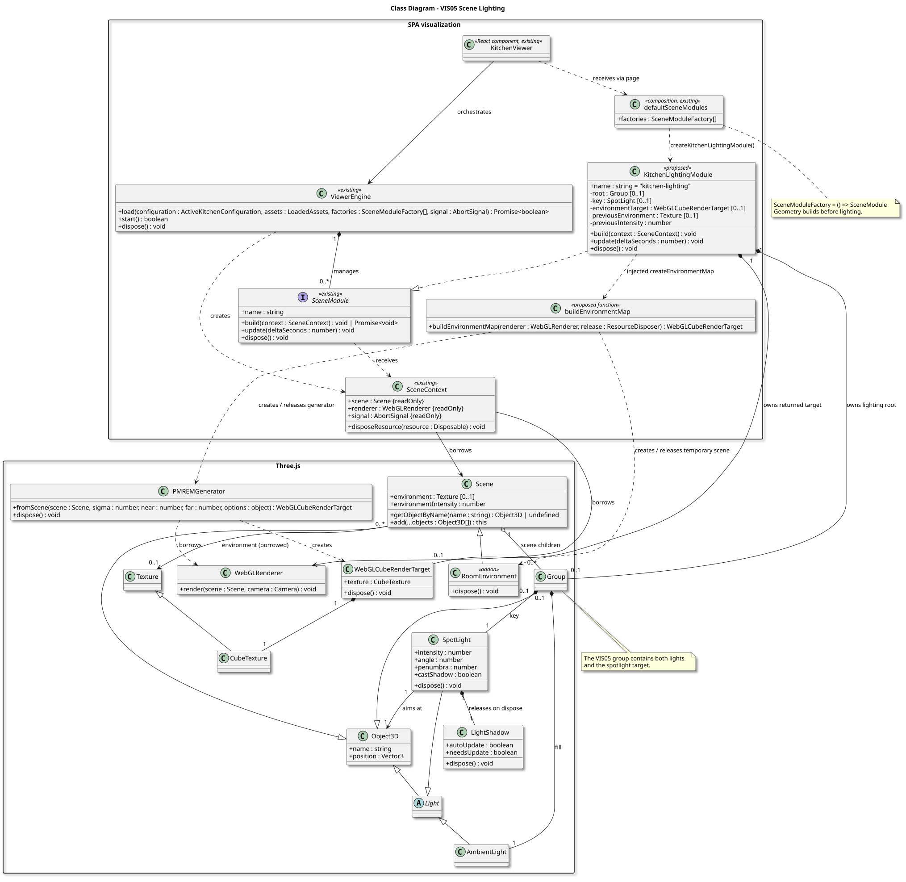
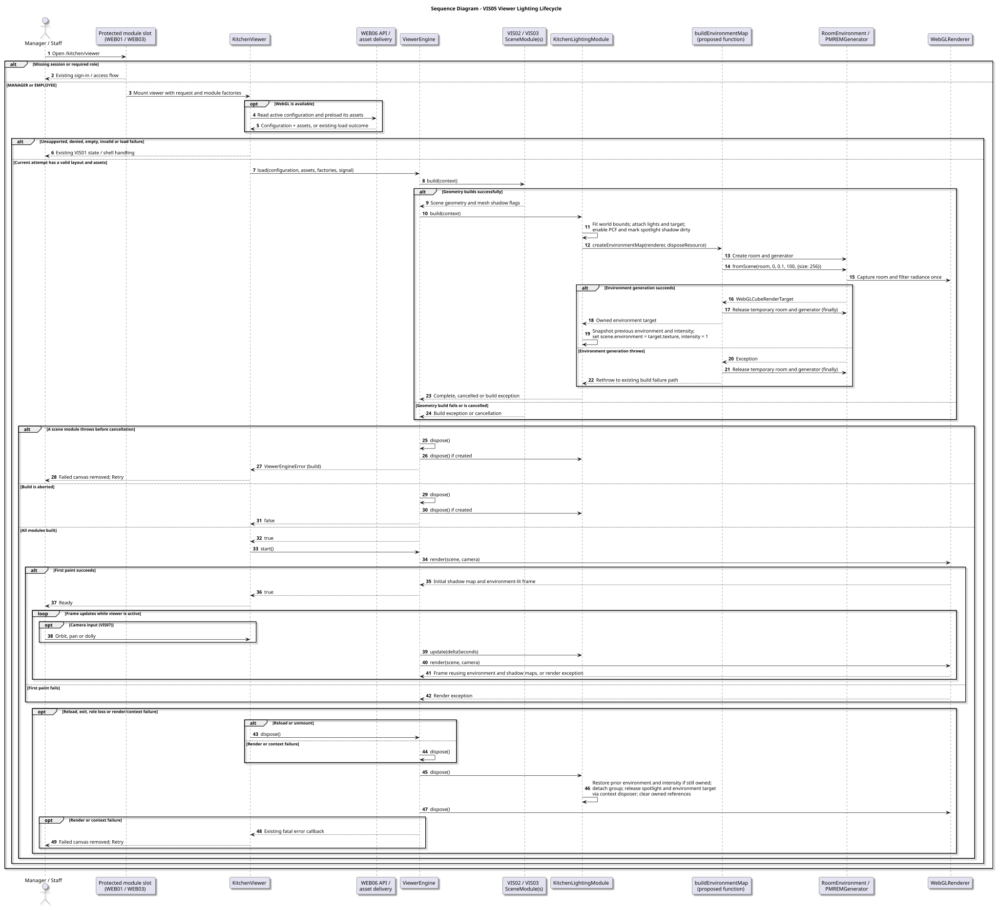
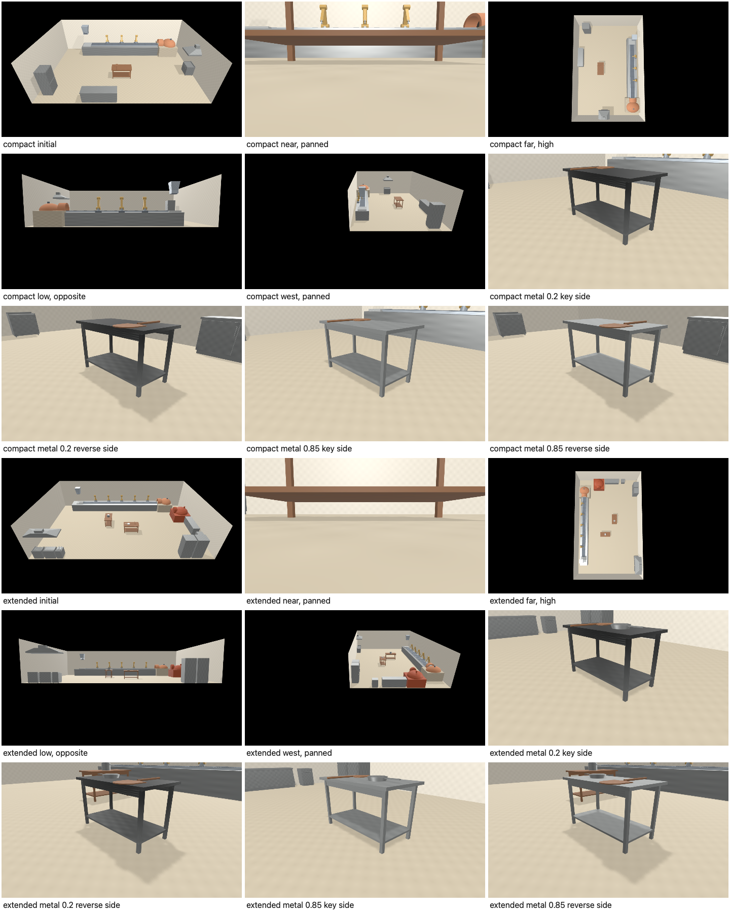

# US VIS05 – Scene Lighting

## 1. Context & Scope

- **User Story ID:** VIS05
- **Sprint:** Sprint 2
- **Area:** 3D Kitchen Visualization (VIS / SGRAI)
- **Responsible:** Sofia Carvalho (1240898)
- **Specification:** *PART IV – Sprint 2 – User Stories*, IV.2.1, VIS05, printed p. 14 (PDF p. 15), in `LEI-2026-27-Sem5-Project_v1-Sprint2US.pdf`. Table 1 (printed p. 11) establishes viewer access.
- **Architecture:** [SAD 2](../../../architecture/SAD.md#2-system-context--overview) places Three.js in the front-end presentation layer. [ADR-001](../../../architecture/ADR.md#adr-001-organize-the-repository-as-a-monorepo) locates visualization in the SPA, [ADR-002](../../../architecture/ADR.md#adr-002-use-domain-first-modules-with-layered-architecture) defines back-end domain boundaries, and [ADR-010](../../../architecture/ADR.md#adr-010-use-postgresql-as-the-single-database) covers persistent kitchen configuration.

VIS05 provides the default illumination and shadows for the active kitchen scene. The Manager must be able to make out the shapes and arrangement of equipment, work surfaces and the assembly line while inspecting the scene.

| Related story | Dependency |
| --- | --- |
| VIS01 – 3D Module Integration | Supplies the protected viewer, renderer and scene-module lifecycle. Its baseline lighting is a single ambient light. |
| WEB06 – Kitchen Configuration and 3D Integration Page | Publishes the active layout and resolved model and texture references consumed by VIS01. |
| VIS02 – Kitchen Layout and Equipment | Supplies room and equipment geometry and defines which meshes cast or receive shadows. VIS03 supplies the assembly-line geometry, and VIS04 owns the textures and materials whose appearance VIS05 must preserve. See Sprint 2 IV.2.1, VIS02–VIS04. |
| VIS06 – Interactive Light Controls | Consumes the scene’s light sources for on/off, colour and intensity changes, plus cutoff angle and penumbra for spotlights. VIS06 owns the controls. See Sprint 2 IV.2.1, printed pp. 14–15. |
| VIS07 – Perspective Camera Interaction | Owns the camera and its allowed viewing range. VIS05 must work throughout that range. See Sprint 2 IV.2.1, printed p. 15. |
| WEB03 – Role-Based Navigation | Enforces access to the existing viewer with VIS01 and the back-end authorization boundary. |

## 2. Requirements & Analysis

### 2.1. User Story Description

> **As a** LaPrizza Manager,\
> **I want** appropriate scene lighting,\
> **so that** objects are visible, realistically rendered, and easy to interpret under different viewing conditions.

Restaurant Staff (`EMPLOYEE`) also consult the lit scene through the existing viewer under Sprint 2 Table 1. The Manager is the story's requester. 

### 2.2. Acceptance Criteria

The acceptance criteria followed are:

- [ ] **AC 1:** Include at least ambient light and one spotlight to ensure visibility of all 3D objects.
- [ ] **AC 2:** Lighting enhances depth perception and object contours without overexposure or excessive darkness.
- [ ] **AC 3:** Use shadows without significant performance degradation.
- [ ] **AC 4:** The lighting setup works consistently across zoom levels and camera angles.

### 2.3. Client Clarifications & Questions

No clarifications were provided by the client regarding this user story.

### 2.4. Business Rules & Invariants

The acceptance criterias are constraints on the rendered scene. WEB06 owns the domain invariants and the back-end validation and activation workflow for the data that the scene reads. 

- **Default light coverage:** The ready scene has ambient light and at least one spotlight. Equipment and assembly-line objects must be visible wherever their geometry is in view. 
- **Visual legibility:** The combined lighting must reveal depth and contours, including on work surfaces, while avoiding overexposed or excessively dark regions.
- **Shadows and performance:** The scene uses shadows and meets AC 3's performance requirement. VIS02 supplies equipment meshes that cast and receive shadows and room surfaces that receive them. VIS05 owns scene lighting and shadow rendering. 
- **Viewing range:** Lighting remains usable across the permitted zoom levels and camera angles. VIS07 owns camera movement and limits. Proposed acceptance evidence covers near and far views from several allowed angles in the two WEB06 demonstration layouts.
- **Authorized presentation:** The lit scene follows the existing viewer permissions for `MANAGER` and `EMPLOYEE`. Manager-only configuration writes and activation are enforced through WEB06 and back-end authorization. 
- **Active layout boundary:** VIS05 lights the geometry and materials built from the active configuration loaded by VIS01. WEB06 owns which valid configuration is active and resolves model and texture assets by identifier and kind. WEB06's back-end application service coordinates atomic activation and its persistence constraints enforce at most one active configuration. 
- **Lighting lifecycle:** Lighting state belongs to the viewer's scene lifecycle. VIS01 owns scene creation, rebuild and cleanup, while VIS06 owns interactive changes to the live lights. WEB06's stored layout describes kitchen geometry and rendering assets. 

### 2.5. Domain Model Excerpt


The excerpt shows the authorized user and the configuration-owned inputs that affect illumination. Each `KitchenConfiguration` owns one `KitchenLayout` with one `KitchenDimensions` value and layout-scoped `SceneElement` entities. Placement and material properties describe geometry as rendered. Model and texture asset references resolve through the separate `KitchenAsset` aggregate. The model gives `KitchenLayout` a `2..300` element multiplicity and makes element `MaterialProperties` optional. 

The model contains no light source or shadow entity. WEB06 AC 3 requires back-end layout, model and visual-property data used by the viewer. The WEB06 contract supplies geometry, materials and asset references and treats the lights and shadow settings as viewer state. VIS05 therefore belongs in the presentation layer and requires no domain model or storage extension. 

## 3. Design

### 3.1. Architecture & C4 Alignment

| C4 level | VIS05 placement |
| --- | --- |
| Level 1 – System context | LaPrizza Managers and Restaurant Staff consult the kitchen in LaPrizza. The existing session must grant `MANAGER` or `EMPLOYEE`. A user with only `ADMIN` or `CUSTOMER` has no viewer access. |
| Level 2 – Containers | The React SPA renders the scene with Three.js and WebGL in the browser. It reads the WEB06 active configuration and asset files through the existing Backoffice API and Gateway. PostgreSQL remains behind Backoffice. Light placement, shadow generation and camera movement execute in the browser. |
| Level 3 – Components | WEB01/WEB03 gate `KitchenViewerPage`. `KitchenViewer` orchestrates loading, rendering and disposal through `ViewerEngine`. Its scene composition point, `defaultSceneModules`, supplies VIS02 geometry and the proposed VIS05 module. VIS03 geometry precedes VIS05 when integrated. VIS06 controls and VIS07 camera interaction build after lighting when integrated. |

The `createKitchenLightingModule()` replaces the existing `createBaseLightingModule()` entry in the default list. The module implements VIS01's existing `SceneModule` interface and receives the scene, renderer, build signal and resource disposer through `SceneContext`. The engine calls the same lifecycle methods for each module. The lighting module depends on Three.js, its `RoomEnvironment` addon and the mesh groups produced by VIS02/VIS03. It generates a prefiltered environment map for specular illumination of PBR materials, including fully metallic surfaces.

### 3.2. Class Diagram (CD)



`KitchenLightingModule` denotes the object returned by `createKitchenLightingModule()`. A fresh instance owns one Three.js group named `lighting:root` with two lights, `lighting:ambient` and `lighting:key`, and the spotlight target `lighting:key-target`. These names use the reserved scene-object namespace described in VIS02. Because the target is attached to the scene graph at an explicit world-space location under an identity-transform group, Three.js can update its world matrix before the first render. VIS06 can resolve the two lights by name in the current scene after build and keep references for that viewer attempt. It owns the controls and their applicable permissions.

#### Light placement and coverage 

1. At build, check the abort signal before acquiring resources. Read the world-space bounds of `layout:root` from VIS02. Include `layout:assembly-line` if VIS03 publishes it as a sibling. A line nested in the layout root is already covered. Use Three.js `Box3.setFromObject()` after the roots are attached and their world transforms are current. This includes scaled and rotated meshes, including assets whose geometry extends beyond placement origins. A missing layout root or empty, non-finite or degenerate bounds is a build failure.
2. Let `C` and `R > 0` be the centre and radius of the sphere enclosing that box. Keep the spotlight target at `C`. Place the light at `C + D × normalize(0.35, 1, 0.25)`, with `D = 2.5R`. The slight offset gives surfaces a directional cue. Use cutoff half-angle `1.25 × asin(R / D)` radians and penumbra `0.15` as starting settings. The sphere's angular radius fits inside the full-intensity portion of the cone at these defaults.
3. Use neutral white for both lights. Start with ambient intensity `0.85` and spotlight intensity `3 × D²` (Three.js spotlight intensity in candela), with decay `2` and distance `0` for inverse-square attenuation without an additional range cutoff. Scaling the starting intensity with distance gives the same nominal illumination at the target across layout sizes. Ambient fill supports the diffuse contribution of non-metallic surfaces. For `MeshStandardMaterial` with `metalness: 1`, the diffuse contribution is zero, so the environment lighting below supplies specular fill to surfaces facing away from the spotlight. Tune the balance in the browser using the VIS04 materials in both samples. Leave material and texture data under VIS04 ownership and use the viewer's existing colour output and exposure settings for the initial tuning.
4. The environment orientation, lights and their target stay fixed in scene coordinates during pan, orbit, dolly and resize. The camera may reveal different faces and view-dependent highlights. Compare visibility, contours and shadow attachment throughout VIS07's allowed range.

#### Environment lighting and metallic surfaces (AC 1, AC 2, AC 4)

`KitchenLightingModule` installs a neutral indoor environment through `scene.environment` before first paint. The proposed `buildEnvironmentMap(renderer, release)` function in the lighting module creates `RoomEnvironment` from `three/addons/environments/RoomEnvironment.js`, then `PMREMGenerator(renderer)`, and calls `fromScene(room, 0, 0.1, 100, { size: 256 })`. In the pinned Three.js 0.187.0 this returns a `WebGLCubeRenderTarget` containing radiance filtered for different material roughness values. The room supplies illumination from several directions, allowing a metal surface facing away from the key light to reflect its surroundings. The environment is an approximation of indoor illumination. Browser acceptance must check the actual material detail and contours on both sides of a metallic workbench.

The function returns the render target and releases the temporary room and generator in a `finally` block through the supplied resource disposer. The module immediately takes ownership of the returned target, snapshots the scene's previous environment and intensity, assigns `target.texture` to `scene.environment` and starts with `scene.environmentIntensity = 1`. Tune that value together with ambient and key intensity on both demonstration layouts, including `metalness: 1` and low and high roughness. Keep the environment orientation constant in scene coordinates. `scene.environment` supplies physical materials that have no explicit material-level `envMap`. Imported materials with an explicit `envMap` retain that map and require the same visual check.

Generate the map once during build and reuse it across frames and camera changes. Its 256-pixel cube-face size bounds the additional texture allocation. Record its filtering cost in first-paint timing and include its texture memory in the browser profile. The environment is produced from the library's lighting scene in the browser. VIS04's colour, roughness, bump and normal textures continue to come from the WEB06-resolved assets, and the environment adds no asset URL or layout field. The scene background is independent of the reflection environment. The ambient light and spotlight remain the named light sources used by VIS06. The environment is a fixed lighting baseline for this design. [Three.js RoomEnvironment](https://threejs.org/docs/pages/RoomEnvironment.html) · [Three.js PMREMGenerator](https://threejs.org/docs/pages/PMREMGenerator.html)

The module factory accepts an optional `{ createEnvironmentMap = buildEnvironmentMap }` dependency with signature `(renderer: WebGLRenderer, release: ResourceDisposer) => WebGLCubeRenderTarget`. This lets scene tests inject a fake target and verify ownership without invoking GPU rendering. The function owns its temporary room and generator. The caller owns the successfully returned target.

#### Shadows and lifecycle 

- Enable `renderer.shadowMap.enabled` with `PCFShadowMap` before first paint. Only the spotlight casts shadows. Start with a single square `1024 × 1024` shadow map, reduced to the supported limit if needed. Keep the spotlight shadow camera's focus and aspect at `1`. Set its near and far planes to `D − 1.1R` and `D + 1.1R` and update its projection matrix. Use the tight depth range to preserve depth precision. Tune depth and normal bias on actual surfaces if shadow acne or detached shadows appear.
- VIS02 flags equipment as casters and receivers and flags room surfaces as receivers only. VIS03 should use the same mesh policy for opaque assembly-line geometry. VIS05 leaves these flags and VIS04's materials under their respective owners. Light coverage and shadow detail depend on the rendered geometry and materials. Very large layouts can lose fine detail with a capped map.
- Set the spotlight's `shadow.autoUpdate = false` and `shadow.needsUpdate = true` before first paint. The engine continues to render on its existing frame loop. A static layout uses the cached map after that first render, and `update(deltaSeconds)` has no lighting work. Orbiting, panning, dollying and resizing preserve the map because the caster transforms, light and shadow frustum are unchanged and the viewer uses the same visible layers.
- VIS06 should set `key.shadow.needsUpdate = true` when the spotlight is re-enabled or its cutoff changes. Colour, intensity and penumbra changes leave the depth map valid. A future module that moves or hides casters, changes the shadow frustum or switches camera layers must invalidate the map before rendering, or enable per-light automatic updates for continuous changes. Sprint 2 VIS03 geometry is static.
- Register owned resources as they are created so the VIS01 cleanup can handle a partial build. On dispose, detach the light group and release the spotlight via `SceneContext.disposeResource(spotlight)`. The pinned Three.js `SpotLight.dispose()` disposes its `LightShadow` and the allocated render targets. Release it once, clear module references, and keep cleanup safe before build or on a repeated call. Three.js creates the map lazily on render. The viewer owns renderer disposal, and the lighting module borrows the layout meshes and assets. Reload, Retry, route exit, role loss, cancellation and renderer failures use VIS01's cleanup.
- On disposal, if the scene still references the owned environment texture, restore the previous environment and intensity before releasing the environment render target through the same disposer. Release the target as one resource, so its texture is freed by the target and is detached from the scene before VIS01 sweeps scene textures. Continue cleanup if a release step fails, and make repeated disposal safe. The next attempt creates fresh light objects and a fresh environment target and recomputes bounds for its own layout.

### 3.3. Sequence Diagram (SD)



The sequence shows creation after authorization and loading, environment generation and assignment before first paint, a shadow pass, reuse during camera movement and disposal of both shadow and environment resources. VIS01 retains its existing statuses for denied, empty, invalid, asset and unsupported cases. An environment generation failure or another lighting build exception follows `ViewerEngineError('build', { moduleName: 'kitchen-lighting', cause })`. A first-paint or later rendering exception follows the existing renderer failure path. Both remove the failed canvas and expose Retry. Cancellation discards the attempt through the existing abort path.

### 3.4. REST API Specification (ARC03)

VIS05 consumes the existing WEB06 contract through VIS01. The paths below are relative to `/api/v1`. Lighting creates zero HTTP requests.

| Method | Endpoint | Description | Auth / Role |
| --- | --- | --- | --- |
| GET | `/kitchen-configurations/active` | WEB06 active layout and resolved asset URLs. No path or query parameters or request body. | Authenticated `MANAGER` or `EMPLOYEE` |
| GET | `/kitchen-assets/files/*` | Fetch a deployed model or texture from a URL in the active answer during VIS01 preload. | Public, read-only |

The active endpoint returns `200` with `Cache-Control: no-store` and the existing configuration envelope, including `id`, `version`, `content` and `assets`. The viewer uses the loaded layout and model instances to fit the light. VIS01 handles `401` and `403` through the existing session and access flow. A `404` with issue code `NO_ACTIVE_CONFIGURATION` in `error.details` maps to the empty viewer. Other request errors or invalid responses follow the existing VIS01 failure states. Missing asset files follow the existing asset failure path. 

### 3.5. Persistence & Data Integrity (ARC04)

WEB06's `KitchenConfiguration` aggregate owns the layout, dimensions and layout-local elements. It references models and textures by ID in the separate `KitchenAsset` aggregate. Backoffice validates layout and asset kinds and maps the active configuration to the viewer DTO. The authoritative model defines `2..300` layout elements with optional element material properties. Lights and shadows exist only during the viewer attempt.

| Existing WEB06 interface and adapter | Existing PostgreSQL mapping |
| --- | --- |
| `IKitchenConfigurationRepository` → `KitchenConfigurationRepository` | `kitchen_configurations` has an ID primary key, non-null JSONB `content`, positive integer `version`, `ACTIVE` or `INACTIVE` status and nullable `activated_at`. A partial unique index permits at most one active row. |
| `IKitchenAssetCatalogue` → `KitchenAssetCatalogue` | `kitchen_assets` has an ID primary key, required kind and unique file path. `kitchen_configuration_assets` has a composite primary key and foreign keys to both tables. Deleting an inactive configuration cascades its links. Linked asset deletion is restricted. |

The WEB06 application service controls activation in a unit of work. It locks activation, validates the target and replaces the active configuration atomically. Failure rolls back the replacement. WEB06 prevents removal of the active configuration. VIS05 uses one loaded configuration ID and version per attempt. If activation occurs while the viewer is open, the next load obtains the active answer and rebuilds the layout and lights together. There is no VIS05 write, transaction, migration or light history. 

### 3.6. Applied Patterns & Architecture Principles

- **Dependency inversion and interface segregation.** `ViewerEngine` consumes `SceneModule` factories supplied by the SPA composition point. The lighting module implements the same small lifecycle interface as the layout and camera modules. Its use of Three.js stays in the visualization layer. Backoffice continues to consume repository and catalogue ports within its application boundary.
- **Single responsibility and GRASP Controller.** `ViewerEngine` coordinates build, first paint, frame updates and cleanup. The lighting module owns the light group, shadow settings, reflection environment and their resource lifetimes. `buildEnvironmentMap` encapsulates temporary room and PMREM generation resources. Mesh and material ownership stays with the producing modules. VIS06 and VIS07 consume the scene through their own responsibilities for controls and camera.
- **DDD boundaries.** The active configuration and asset catalogue remain the business sources for scene inputs. Lighting rules are rendering constraints evaluated from the built scene. The client forms no new aggregate and performs no cross-aggregate operation.

## 4. Tests (ARC05)

### 4.1. Test Plan & Scenarios

Use real Three.js scene objects in Jest and the renderer injection used by `ViewerEngine.test.js` for integration tests. Use the two WEB06 sample configurations, with VIS02/VIS03 geometry and VIS04 materials, for browser evidence. The Jest renderer double records the lighting state at first paint. Inject `createEnvironmentMap` to provide a fake target in these tests. Test `buildEnvironmentMap` separately with mocked RoomEnvironment and PMREMGenerator constructors and real Three.js target objects where useful. Browser tests establish the GPU rendering result.

| Test ID | Level | Scenario / Description | Expected Result |
| --- | --- | --- | --- |
| UT01 | Unit | Build the lighting module on a scene with layout geometry (AC 1, default light coverage). | One named ambient light and one named spotlight are attached under `lighting:root`, with the target attached to that group. Only the spotlight casts shadows. |
| UT02 | Unit | Fit bounds around an asymmetric layout with transformed equipment and a sibling assembly-line group. Exercise compact and wide bounds (AC 1, AC 4, active layout boundary). | The target matches the combined box centre. Its enclosing sphere fits inside the inner light cone and between the shadow planes. The result is independent of the view camera. |
| UT03 | Unit | Build with an already aborted signal, a missing layout root and a layout with invalid bounds (lighting lifecycle). | Aborted build adds nothing. Invalid geometry throws before attaching lights. Disposal is safe in each case. |
| UT04 | Unit | Inspect the first-frame shadow configuration and call `update()` after simulating the renderer clearing the dirty flag (AC 3). | PCF is enabled, the requested map is capped at 1024 per side and only the initial shadow pass is requested. Update leaves the cached map valid. |
| UT05 | Unit | Dispose after build with a simulated allocated shadow target. Call dispose again (AC 3, lighting lifecycle). | The group and target leave the scene and the shadow render target is disposed once through the module's resource ownership. The previous scene environment and intensity are restored before the owned environment target is disposed once. Layout, materials and assets are still available to their owners. |
| UT06 | Unit | Generate the environment map with the RoomEnvironment and PMREMGenerator adapters mocked (AC 1, AC 2, AC 3). | `fromScene` receives the neutral room and size 256. The function returns its target and releases the room and generator once. If filtering throws, temporary resources are still released and the failure propagates. |
| UT07 | Unit | Build with an injected environment target, then update and move the view camera (AC 1, AC 2, AC 4). | The scene uses the target texture with intensity 1 before first paint. Generation is called once per attempt and camera changes reuse it. The configured `metalness: 1` material retains its value. |
| IT01 | Integration | Run the composed module list with real Three.js objects and VIS01's fake renderer. Open then reload with the other active layout (AC 1, AC 3, active layout boundary). | The first paint already includes the fitted lights, shadow configuration and environment texture. The old module is disposed. A new scene contains one pair of lights fitted to the new geometry and a fresh environment target. |
| IT02 | Integration | Force environment generation failure and, separately, failure after successful lighting build, then retry using a fresh engine (lighting lifecycle). | The prior loop stops or never starts, temporary generation resources and any owned shadow and environment targets are released, and the replacement attempt renders with fresh lighting resources. |
| E2E01 | End-to-end | Open the protected viewer as Manager and Staff, then try the route with a session lacking both roles and with no session (authorized presentation). | Manager and Staff reach the lit active layout. The existing access flow blocks the other sessions before a lit scene is shown. |
| E2E02 | End-to-end | Inspect both layouts at the initial view and at VIS07 near and far limits, low and high permitted elevations, representative azimuths on all four sides and panned targets near opposite edges. Include a WEB06-valid workbench fixture with `metalness: 1`, the required texture maps, and representative low and high roughness. Observe its spotlight-facing side and opposite side while orbiting and dollying (AC 1, AC 2, AC 4). | Visible equipment, work surfaces and assembly parts retain interpretable contours and surface detail. Highlights preserve material detail, recesses remain legible and shadows stay attached as the camera moves. Both sides of the fully metallic workbench retain readable contours and surface detail, including the side receiving no direct spotlight. Record paired screenshots at matching distances, including any failure. |
| E2E03 | End-to-end | Profile the same browser camera path with shadows enabled and disabled for each sample layout (AC 3). | Equipment and assembly meshes cast visible shadows onto the room and work surfaces. The static scene produces a single shadow map and reuses it. Record first paint, median and p95 frame times and confirm responsive camera motion. |

For E2E03, compare repeated runs under the same device, browser, viewport, pixel ratio, layout, materials and camera path. Keep both lights and the same environment active in both variants and change only shadow rendering in the test harness. Include environment generation in first-paint measurements and record environment texture allocation during repeated reloads and cleanup. After disposal settles, allocations must return to a stable baseline across repeated attempts. Record first-paint cost separately from warmed camera-motion timings, and inspect GPU work with a browser capture where available. Run the comparison on the intended demonstration device. The brief leaves significance qualitative. Before acceptance, use those measurements and the device’s target frame budget to agree an explicit threshold with the team. Jest checks shadow configuration and lifecycle, and the browser checks establish visibility, shadow quality and performance.

### 4.2. Sample Test Implementations

Illustrative Jest examples for `frontend/test/visualization/scene/modules/KitchenLightingModule.test.js`. They use the same real Three.js objects and renderer doubles as the existing scene tests.

```javascript
import { BoxGeometry, Mesh, MeshStandardMaterial, Group, Scene, Texture } from 'three';
import { createKitchenLightingModule } from
  '../../../../src/visualization/scene/modules/KitchenLightingModule.js';

function setupLighting() {
  const scene = new Scene();
  const layout = new Group();
  layout.name = 'layout:root';
  const mesh = new Mesh(new BoxGeometry(12, 3, 8), new MeshStandardMaterial({ metalness: 1 }));
  mesh.position.y = 1.5;
  layout.add(mesh);
  scene.add(layout);
  const renderer = {
    shadowMap: { enabled: false },
    capabilities: { maxTextureSize: 4096 },
  };
  const environmentTarget = { texture: new Texture(), dispose: jest.fn() };
  const createEnvironmentMap = jest.fn(() => environmentTarget);
  const module = createKitchenLightingModule({ createEnvironmentMap });
  const context = {
    scene,
    renderer,
    signal: new AbortController().signal,
    disposeResource: jest.fn((resource) => resource.dispose()),
  };
  return {
    scene, layout, mesh, renderer, module, context,
    environmentTarget, createEnvironmentMap,
  };
}

test('builds a fill light and one shadow-casting key light before first paint', () => {
  const h = setupLighting();

  h.module.build(h.context);

  const ambient = h.scene.getObjectByName('lighting:ambient');
  const key = h.scene.getObjectByName('lighting:key');
  expect(ambient.isAmbientLight).toBe(true);
  expect(ambient.castShadow).toBe(false);
  expect(key.isSpotLight).toBe(true);
  expect(key.castShadow).toBe(true);
  expect(key.target.parent).toBe(key.parent);
  expect(key.target.position.toArray()).toEqual([0, 1.5, 0]);
  expect(h.renderer.shadowMap.enabled).toBe(true);
  expect(key.shadow.needsUpdate).toBe(true);
  expect(h.scene.environment).toBe(h.environmentTarget.texture);
  expect(h.scene.environmentIntensity).toBe(1);
  expect(h.mesh.material.metalness).toBe(1);
});

test('reuses the shadow map on later frames for a static layout', () => {
  const h = setupLighting();
  h.module.build(h.context);
  const key = h.scene.getObjectByName('lighting:key');
  key.shadow.needsUpdate = false; // Simulate the first successful shadow pass.

  h.module.update(1 / 60);

  expect(key.shadow.autoUpdate).toBe(false);
  expect(key.shadow.needsUpdate).toBe(false);
  expect(h.createEnvironmentMap).toHaveBeenCalledTimes(1);
});

test('releases shadow and environment targets on repeated cleanup', () => {
  const h = setupLighting();
  const previousEnvironment = new Texture();
  h.scene.environment = previousEnvironment;
  h.scene.environmentIntensity = 0.6;
  h.module.build(h.context);
  const key = h.scene.getObjectByName('lighting:key');
  const target = { dispose: jest.fn() };
  key.shadow.map = target;

  h.module.dispose();
  h.module.dispose();

  expect(h.scene.getObjectByName('lighting:root')).toBeUndefined();
  expect(target.dispose).toHaveBeenCalledTimes(1);
  expect(h.environmentTarget.dispose).toHaveBeenCalledTimes(1);
  expect(h.scene.environment).toBe(previousEnvironment);
  expect(h.scene.environmentIntensity).toBe(0.6);
  expect(h.scene.getObjectByName('layout:root')).toBe(h.layout);
});
```

## 5. Implementation

### 5.1. File structure

| File | Responsibility |
| --- | --- |
| [KitchenLightingModule.js](../../../../frontend/src/visualization/scene/modules/KitchenLightingModule.js) | Fits the spotlight to the built geometry, generates the reflection environment, and manages light and shadow resources for one viewer attempt. |
| [defaultSceneModules.js](../../../../frontend/src/visualization/scene/defaultSceneModules.js) | Registers kitchen lighting after the layout and assembly line and before camera controls. It replaces the former `BaseLightingModule.js`. |
| [KitchenLightingModule.test.js](../../../../frontend/test/visualization/scene/modules/KitchenLightingModule.test.js) | Covers UT01–UT07 using Three.js scene objects, including transformed sibling geometry, cancellation, invalid bounds and resource ownership. |
| [KitchenLightingModule.engine.test.js](../../../../frontend/test/visualization/scene/modules/KitchenLightingModule.engine.test.js) | Covers IT01–IT02 through the production module list, first paint, reload, build failure, render failure and retry. |
| [Viewer test fixture](../../../../frontend/test/visualization/scene/__fixtures__/viewerEngine.js), [layout integration tests](../../../../frontend/test/visualization/scene/modules/KitchenLayoutModule.engine.test.js) and [composition tests](../../../../frontend/test/visualization/scene/defaultSceneModules.test.js) | Provide renderer capabilities to the existing geometry checks and verify module order. |
| [Viewer README](../../../../frontend/src/visualization/README.md) | Documents scene composition and the lighting lifecycle. |

### 5.2. Lighting and resource ownership

Each viewer attempt creates one ambient light, one spotlight and its target under `lighting:root`. The spotlight covers the world-space bounds of the room, equipment and assembly line. The camera can move without shifting the light or regenerating the shadows.

Browser tuning on the two WEB06 samples produced an ambient intensity of `0.45`, a spotlight intensity of `1.7 × D²` and an environment intensity of `0.65`, where `D` is the distance from the spotlight to the centre of the layout. The initial design settings washed out the compact kitchen’s back wall. The tuned settings preserve its texture and give the counter, workbench and robotic arms distinct silhouettes. Lighting consumes the existing models and materials directly.

The module filters a 256-pixel indoor reflection environment once per build. It requests one spotlight shadow pass with a PCF map capped at 1024 pixels per side and at the renderer’s texture limit. The viewer’s disposer releases the light and its shadow map, restores the prior environment if the module still owns the active one, and releases the filtered target. A failed build or first render uses the existing viewer retry path.

## 6. Integration, Verification & Demonstration

### 6.1. Automated verification

Run from `frontend/`:

```sh
npm test -- --runInBand
npm run lint
npm run build
npm run check:bundle
```

### 6.2. Browser verification

The views below cover the initial camera position, the near and far distance limits, high and low elevations, opposite sides and off-centre targets. For the four workbench close-ups in each layout, the test fixture applied a steel colour map, a normal map and `metalness = 1` to the existing table. At roughness `0.2` and `0.85`, the legs, shelf and worktop remained distinguishable from both sides. Shadows stayed anchored to the floor during the orbit.



### 6.3. Shadow performance

The profile used a 640 × 360 CSS-pixel viewport at device pixel ratio 2 (1280 × 720 render buffer). For each layout, the runs used the same assets, lights, environment and orbit. Shadow rendering was switched on, off, off and on across four fresh viewer attempts. First paint includes module build, environment filtering, drawing and GPU synchronization after asset decoding. Frame intervals were sampled over the final 64 frames of each 80-frame orbit.

| Layout | Shadows | First paint, both runs (ms) | Median frame interval (ms) | 95th percentile, both runs (ms) | Shadow passes per run |
| --- | --- | --- | --- | --- | --- |
| Compact | On | 159 / 94 | 17 / 17 | 19 / 18 | 1 |
| Compact | Off | 84 / 71 | 17 / 17 | 18 / 51 | 0 |
| Extended | On | 61 / 74 | 17 / 17 | 17 / 18 | 1 |
| Extended | Off | 60 / 66 | 17 / 17 | 18 / 18 | 0 |

Both layouts maintained the same median frame interval with shadows enabled. The compact shadow-disabled run also shows why the upper percentile should be interpreted across repeated runs. 

## 7. Observations, Dependencies & Limitations

- Current layouts are static. A future change to a caster’s transform or the spotlight’s shadow frustum must invalidate the cached shadow before the next render.
