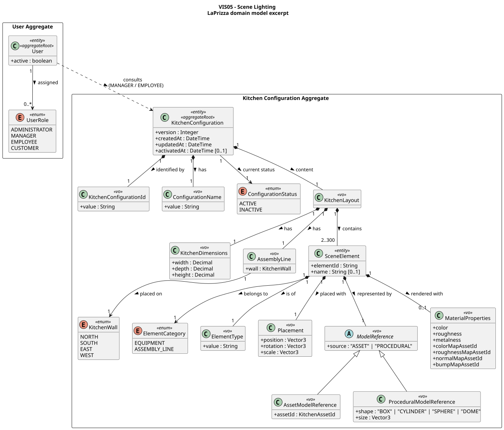

# US VIS05 – Scene Lighting

## 1. Context & Scope

- **User Story ID:** VIS05
- **Sprint:** Sprint 2
- **Area:** 3D Kitchen Visualization (VIS / SGRAI)
- **Responsible:** Sofia Carvalho (1240898)
- **Specification:** *PART IV – Sprint 2 – User Stories*, §IV.2.1, VIS05, printed p. 14 (PDF p. 15), in `LEI-2026-27-Sem5-Project_v1-Sprint2US.pdf`. Table 1 (printed p. 11) establishes viewer access.
- **Architecture:** [SAD §2](../../../architecture/SAD.md#2-system-context--overview) places Three.js in the front-end presentation layer. [ADR-001](../../../architecture/ADR.md#adr-001-organize-the-repository-as-a-monorepo) locates visualization in the SPA, [ADR-002](../../../architecture/ADR.md#adr-002-use-domain-first-modules-with-layered-architecture) defines back-end domain boundaries, and [ADR-010](../../../architecture/ADR.md#adr-010-use-postgresql-as-the-single-database) covers persistent kitchen configuration.

VIS05 provides the default illumination and shadows for the active kitchen scene. The Manager must be able to make out the shapes and arrangement of equipment, work surfaces and the assembly line while inspecting the scene.

| Related story | Dependency |
| --- | --- |
| VIS01 – 3D Module Integration | Supplies the protected viewer, renderer and scene-module lifecycle. Its baseline lighting is a single ambient light. |
| WEB06 – Kitchen Configuration and 3D Integration Page | Publishes the active layout and resolved model and texture references consumed by VIS01. |
| VIS02 – Kitchen Layout and Equipment | Supplies room and equipment geometry and defines which meshes cast or receive shadows. VIS03 supplies the assembly-line geometry, and VIS04 owns the textures and materials whose appearance VIS05 must preserve. See Sprint 2 §IV.2.1, VIS02–VIS04. |
| VIS06 – Interactive Light Controls | Consumes the scene’s light sources for on/off, colour and intensity changes, plus cutoff angle and penumbra for spotlights. VIS06 owns the controls. See Sprint 2 §IV.2.1, printed pp. 14–15. |
| VIS07 – Perspective Camera Interaction | Owns the camera and its allowed viewing range. VIS05 must work throughout that range. See Sprint 2 §IV.2.1, printed p. 15. |
| WEB03 – Role-Based Navigation | Enforces access to the existing viewer with VIS01 and the back-end authorization boundary. |

## 2. Requirements & Analysis

### 2.1. User Story Description

> **As a** LaPrizza Manager,\
> **I want** appropriate scene lighting,\
> **so that** objects are visible, realistically rendered, and easy to interpret under different viewing conditions.

Restaurant Staff (`EMPLOYEE`) also consult the lit scene through the existing viewer under Sprint 2 Table 1. The Manager is the story's requester. [VIS01 §2.1](../vis01/usVIS01.md#21-user-story-description)

### 2.2. Acceptance Criteria

The acceptance criteria followed are:

- [ ] **AC 1:** Include at least ambient light and one spotlight to ensure visibility of all 3D objects.
- [ ] **AC 2:** Lighting enhances depth perception and object contours without overexposure or excessive darkness.
- [ ] **AC 3:** Use shadows without significant performance degradation.
- [ ] **AC 4:** The lighting setup works consistently across zoom levels and camera angles.

### 2.3. Client Clarifications & Questions

No clarifications were provided by the client regarding this user story.

### 2.4. Business Rules & Invariants

The acceptance criterias are constraints on the rendered scene. WEB06 owns the domain invariants and the back-end validation and activation workflow for the data that the scene reads. 

- **Default light coverage:** The ready scene has ambient light and at least one spotlight. Equipment and assembly-line objects must be visible wherever their geometry is in view. 
- **Visual legibility:** The combined lighting must reveal depth and contours, including on work surfaces, while avoiding overexposed or excessively dark regions.
- **Shadows and performance:** The scene uses shadows and meets AC 3's performance requirement. VIS02 supplies equipment meshes that cast and receive shadows and room surfaces that receive them. VIS05 owns scene lighting and shadow rendering. 
- **Viewing range:** Lighting remains usable across the permitted zoom levels and camera angles. VIS07 owns camera movement and limits. Proposed acceptance evidence covers near and far views from several allowed angles in the two WEB06 demonstration layouts.
- **Authorized presentation:** The lit scene follows the existing viewer permissions for `MANAGER` and `EMPLOYEE`. Manager-only configuration writes and activation are enforced through WEB06 and back-end authorization. 
- **Active layout boundary:** VIS05 lights the geometry and materials built from the active configuration loaded by VIS01. WEB06 owns which valid configuration is active and resolves model and texture assets by identifier and kind. WEB06's back-end application service coordinates atomic activation and its persistence constraints enforce at most one active configuration. 
- **Lighting lifecycle:** Lighting state belongs to the viewer's scene lifecycle. VIS01 owns scene creation, rebuild and cleanup, while VIS06 owns interactive changes to the live lights. WEB06's stored layout describes kitchen geometry and rendering assets. 

### 2.5. Domain Model Excerpt

The excerpt shows the authorized user and the configuration-owned inputs that affect illumination. Each `KitchenConfiguration` owns one `KitchenLayout` with one `KitchenDimensions` value and layout-scoped `SceneElement` entities. Placement and material properties describe geometry as rendered. Model and texture asset references resolve through the separate `KitchenAsset` aggregate. The model gives `KitchenLayout` a `2..300` element multiplicity and makes element `MaterialProperties` optional. 

The model contains no light source or shadow entity. WEB06 AC 3 requires back-end layout, model and visual-property data used by the viewer. The WEB06 contract supplies geometry, materials and asset references and treats the lights and shadow settings as viewer state. VIS05 therefore belongs in the presentation layer and requires no domain model or storage extension. 
