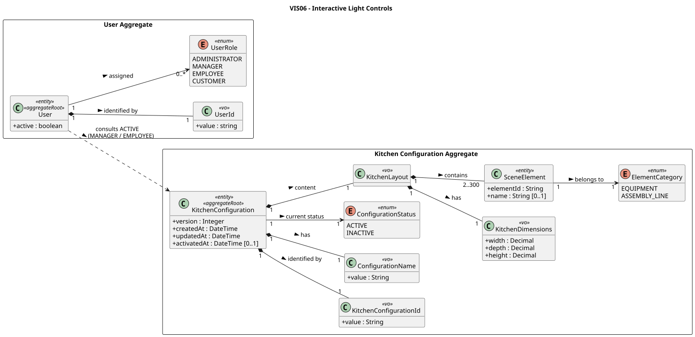
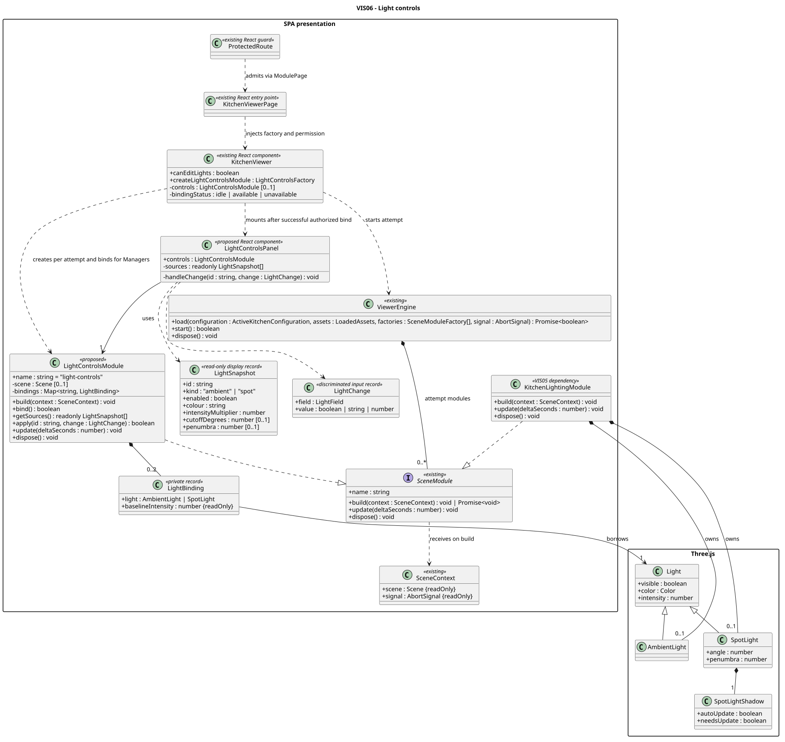
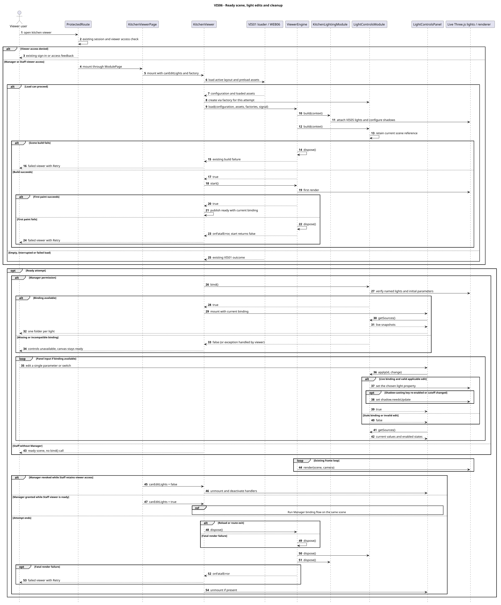

# US VIS06 – Interactive Light Controls

## 1. Context & Scope

- **User Story ID:** VIS06
- **Sprint:** Sprint 2
- **Area:** 3D Kitchen Visualization (VIS / SGRAI)
- **Responsible:** Sofia Carvalho (1240898) & Francisco Sá (1241341)
- **Specification:** *PART IV – Sprint 2 – User Stories*, IV.2.1, VIS06, printed pp. 14–15 (PDF pp. 15–16). Table 1, printed p. 11 (PDF p. 12), defines viewer access.
- **Applicability:** VIS06 and all its acceptance criteria apply only to teams with four or more members.
- **Architecture:** [SAD 2.3](../../../architecture/SAD.md#23-container-diagram-c4-level-2) places Three.js in the SPA presentation layer. [ADR-001](../../../architecture/ADR.md#adr-001-organize-the-repository-as-a-monorepo), [ADR-002](../../../architecture/ADR.md#adr-002-use-domain-first-modules-with-layered-architecture) and [ADR-010](../../../architecture/ADR.md#adr-010-use-postgresql-as-the-single-database) establish source placement, domain boundaries and persistent-data ownership.

VIS06 lets an authorized Manager adjust the light sources of the loaded kitchen scene through a GUI. The value is immediate control of how the scene is illuminated while inspecting it. The controls are Manager-only; Restaurant Staff retain viewer access without light controls.

| Related story | Relevant dependency or boundary |
| --- | --- |
| [VIS05 – Scene Lighting](../vis05/usVIS05.md) | Supplies the default scene illumination, ambient light, spotlight and shadow behavior. VIS06 adjusts those live sources; it does not create a second lighting setup. |
| [VIS01 – 3D Module Integration](../vis01/usVIS01.md) | Supplies the protected viewer, scene loading and lifecycle. Controls must refer to the current successful scene and be released with it. |
| [WEB06 – Kitchen Configuration and 3D Integration Page](../../web06/usWEB06.md) | Owns stored layouts, validation, asset references and atomic activation. |
| [VIS07 – Perspective Camera Interaction](../vis07/usVIS07.md) | Owns camera input and movement. Interacting with the light GUI must not also pan, orbit or dolly the camera. |
| [WEB02 – Consistent Layout and Navigation](../../web02/usWEB02.md) | Supplies accessible layout and PT/EN interface conventions, which apply to the GUI's labels and controls. |
| [WEB03 – Role-Based Navigation](../../web03/usWEB03.md) / [AA05 – Authorization Enforcement](../../aa/aa05/AA05.md) | Own session-based access and authorization. Viewer access and permission to adjust lights are distinct. |

VIS02–VIS04 supply the geometry and materials illuminated by VIS05. They are downstream visual-acceptance inputs, not new domain dependencies owned by VIS06. 

---

## 2. Requirements & Analysis

### 2.1. User Story Description

> **As a** LaPrizza Manager,
> **I want** to switch light sources on and off and control their colour and intensity,
> **so that** I can adjust the scene lighting.

### 2.2. Acceptance Criteria

All five criteria below are necessary to achieve VIS06 successfully:

- [ ] **AC 1:** Implement a Graphical User Interface (GUI) organized into one folder per light source.
- [ ] **AC 2:** Switch each light on or off through a checkbox.
- [ ] **AC 3:** Use a colour picker for colour selection and a slider within reasonable limits for intensity.
- [ ] **AC 4:** For spotlights, provide sliders within reasonable limits for cutoff angle and penumbra.
- [ ] **AC 5:** When a light is off, disable its colour, intensity, and applicable cutoff-angle and penumbra controls.

**Specification recommendation:** use `lil-gui` for the lighting controls; it is bundled with Three.js.

### 2.3. Client Clarifications & Questions

No client clarification was recorded for VIS06.

**Project interpretation of the Sprint 2 specification.** VIS06 in IV.2.1 names the LaPrizza Manager as the actor who adjusts the lights. Table 1 grants both the Manager and Restaurant Staff access to consult the kitchen viewer. The project treats adjustment as a Manager action and grants Staff consultation access. With the website role mapping, `MANAGER` can operate the controls and `EMPLOYEE` alone can consult the scene.

### 2.4. Business Rules & Invariants

- **Authorization:** Only an active, authorized user with `MANAGER` receives and can operate light controls. `EMPLOYEE` alone can view the scene without them. Multiple roles combine their permitted functionality; losing `MANAGER` removes controls even if another role preserves viewer access. Existing authentication and role-resolution mechanisms retain authority; a disabled or hidden control is not a substitute for those mechanisms.
- **Per-source identity and grouping:** Each light source made available by the current lighting setup has its own GUI folder, checkbox, colour picker and intensity slider. A control must resolve to exactly its intended live source; editing one source must not inadvertently change another. 
- **On/off state:** Each source can be enabled and disabled independently through its checkbox. While off, its colour and intensity controls are disabled; spotlight cutoff-angle and penumbra controls are also disabled. The checkbox remains operable so that the source can be switched on again. Turning a source off must actually stop that source's contribution. 
- **Applicable parameters and validation:** Colour uses a colour picker; intensity uses a bounded slider; only spotlights require cutoff-angle and penumbra sliders. Values applied to the live source must be valid for its parameter and remain within the declared limits. This is presentation validation, not HTTP validation or a database constraint.  
- **Current scene and lifecycle:** Controls act on the current successfully loaded scene and reflect its live light values. Reload, retry, scene replacement, leaving the page or loss of access must not leave duplicate controls, listeners or references to disposed lights. Controls cannot operate a missing or failed scene. Their creation and disposal follow VIS01's existing scene lifecycle. 
- **Configuration ownership and consistency:** A local light adjustment does not edit, activate or delete a `KitchenConfiguration`, mutate its JSON, increment its version, or change an asset or another user's scene. The back end continues to supply the active layout and asset references. WEB06 retains configuration validation, referential consistency and transactional activation; 
- **Lighting and shadow integration:** VIS05 owns the baseline light sources and shadows; VIS06 edits those sources and preserves valid rendering after an adjustment. VIS05's current design requires shadow refresh when its spotlight is re-enabled or its cutoff changes; it must coordinate this dependency rather than assume that changing GUI values alone refreshes cached shadows. Colour, intensity and penumbra have the different cache behavior documented there. 
- **Intentional lighting overrides:** VIS05 supplies a visible, balanced default scene, while VIS06 explicitly permits the Manager to turn individual sources off and adjust their settings. An intentional adjustment can reduce visibility; the GUI must not silently force a source back on merely to preserve the default brightness. Switching all controlled sources off is not specified to make the scene completely black: 
- **Shared interaction conventions:** The GUI keeps the SPA navigation usable, follows shared PT/EN and accessibility conventions, and preserves lighting values when the language changes. Input on its controls must not also trigger camera pan, orbit or dolly. 

### 2.5. Domain Model Excerpt



The focused excerpt preserves `User` and `KitchenConfiguration` aggregate roots, their shown value objects and enumerations, and the authoritative associations and multiplicities. `KitchenConfiguration` owns one `KitchenLayout`; that layout owns one `KitchenDimensions` value and `2..300` `SceneElement` entities, each with one `ElementCategory`. `SceneElement.elementId` is unique within its layout. `User` has one `UserId` and `0..*` assigned roles. The consultation dependency remains `MANAGER / EMPLOYEE`; it does not grant light-control permissions.

WEB06 retains generated immutable configuration identity, unique configuration names, layout validity, asset references, version checks and activation consistency. At most one configuration is active; after first activation, one remains active until it is atomically replaced. The excerpt omits unrelated user credentials and the layout's placement, model-reference inheritance, material properties, assembly-line wall and separate `KitchenAsset` aggregate to keep the VIS06 context readable. Those omitted relationships and constraints remain unchanged in the authoritative model.


## 3. Design

### 3.1. Architecture & C4 Alignment

| C4 level | VIS06 placement |
| --- | --- |
| Level 1 – System context | A LaPrizza Manager adjusts the kitchen illumination. Restaurant Staff can consult the same protected viewer. No external system participates in a light edit. Sprint 2 IV.2.1, printed pp. 14–15 (PDF pp. 15–16), specifies the five GUI criteria. Table 1, printed p. 11 (PDF p. 12), permits both roles to consult the viewer. Section 2.3 records the project interpretation that assigns editing to Managers. |
| Level 2 – Containers | The React SPA renders the GUI and the Three.js scene in the browser. VIS01 reads the active layout and asset URLs through the Gateway and Backoffice API. PostgreSQL remains behind Backoffice. |
| Level 3 – Components | The existing `ModulePage` and `ProtectedRoute` enforce viewer access. `KitchenViewerPage` derives `canEditLights` from `useAuth().hasAnyRole('MANAGER')`, which evaluates the authenticated session's resolved roles. `KitchenViewer` coordinates the load and mounts the proposed `LightControlsPanel` only for an authorized, ready attempt with a successful light binding. The proposed `LightControlsModule` binds to VIS05's live lights and applies validated edits. The existing `ViewerEngine` owns module build, rendering and disposal. |

This follows the [SAD](../../../architecture/SAD.md#23-container-diagram-c4-level-2) and [ADR-002](../../../architecture/ADR.md#adr-002-use-domain-first-modules-with-layered-architecture). The page passes the stable scene factories and the proposed `createLightControlsModule` factory to `KitchenViewer`. For each attempt, the viewer creates one binding module and appends a factory returning that instance to the attempt's module list. `ViewerEngine.load()` invokes its `build()` after VIS05. This step only retains the current scene reference when the build signal is active. It performs no light discovery, validation, DOM work or GPU allocation. The engine owns the module's disposal through the existing `SceneModule` contract.

After `load()` and `start()` succeed, `KitchenViewer` publishes the ready scene. In a separate effect keyed by the ready attempt and `canEditLights`, it calls `bind()` only when the session has `MANAGER`. This also covers a Staff session that gains the Manager role while viewing the same scene. On success the panel mounts. A false result or exception from `bind()` only marks the controls unavailable for that attempt and shows a localized notice to the Manager. The viewer stays ready, with the same canvas, render loop and Reload action. Staff-only sessions skip binding and receive the ready viewer without the notice. A normal Reload creates a fresh attempt and can recover the controls. The VIS01 failure and Retry path still handles genuine scene build and rendering failures.

The route and active-layout read retain their existing `MANAGER` or `EMPLOYEE` access. A Manager with additional roles still receives controls. When session refresh reports loss of `MANAGER` and `EMPLOYEE` still grants viewer access, React unmounts the panel and the current scene keeps its last lighting values for the remainder of that attempt. Loss of viewer access unmounts the whole viewer. Role or locale changes alone do not restart the scene while the route remains mounted. Authorization relies on the existing session refresh and route enforcement, including role refresh on return to the window.

### 3.2. Class Diagram (CD)



`LightControlsModule` is the object returned by `createLightControlsModule()`. Its `bind(): boolean` method resolves `lighting:ambient` (`AmbientLight`) and `lighting:key` (`SpotLight`) under VIS05's `lighting:root` in the retained scene. It checks one direct child of the expected type per reserved name, positive finite baseline intensities, and initial spotlight parameters within the VIS06 limits. It publishes both bindings together on success. Missing or incompatible lights return false, leaving the scene untouched and the bindings empty. A previously successful binding is reused within the same attempt, including after loss and restoration of the Manager role, so the original intensity baselines are preserved. The current checkout supplies only `BaseLightingModule`. Integration requires the named VIS05 lights and its shadow policy. The environment map, spotlight target and renderer resources remain owned by VIS05 and the engine.

`getSources()` returns detached snapshots of live values in ambient-then-key order. Each includes its stable ID, type, enabled state, sRGB hex colour and intensity multiplier. Spotlight snapshots also contain cutoff half-angle in degrees and penumbra. The panel keeps the snapshots for display. `apply(id, change)` validates a discriminated command with field `enabled`, `colour`, `intensityMultiplier`, `cutoffDegrees` or `penumbra` against the bound source, mutates that light synchronously on success and returns a boolean. The panel reads back the accepted values after every input, so a rejected edit leaves the previous control and scene values in place. Disposal clears the scene reference and all bindings. Without a successful live binding, `getSources()` returns an empty list and `apply()` returns false. After disposal `bind()` also returns false.

#### Controls and value mapping

Use native React form controls in one labelled `<details>` folder per light, initially open. The Sprint 2 brief recommends `lil-gui`. Native checkbox, colour and range inputs give standard keyboard interaction and disabled semantics through the SPA's existing React and locale conventions. The panel is a DOM sibling of the viewport, outside its `role="img"` region and outside VIS07's canvas input target. This satisfies the input-isolation behavior in VIS07 ALN-4. Use localized folder labels for Ambient light and Key spotlight. Include visible, translated control labels and range values with units or percentages. Associate each input with its label and keep stable folder and field keys so switching between PT and EN keeps values, focus and folder state.

| Control | Input and limits | Three.js mapping |
| --- | --- | --- |
| On/off | Checkbox on every source. Operable when the light is off. | Set the source's `visible` flag. Three.js excludes invisible lights from rendering. Keep all other source properties as set. |
| Colour | Native colour picker, six-digit sRGB `#RRGGBB`. | Read with `getHexString()` and a leading hash, write valid hex through `Color.setHex()` with its default sRGB conversion. |
| Intensity | Range 0–200% of the source's VIS05 starting intensity, step 1 percentage point. | Multiply the baseline captured at bind by the selected multiplier (0–2). This preserves VIS05's layout-dependent spotlight scale. Zero intensity is a valid setting independent of the checkbox. |
| Spotlight cutoff | Range 1–75° half-angle, step 0.01°. The UI may round the displayed value to that precision. | Convert with `MathUtils.degToRad()` on edit and read back with `MathUtils.radToDeg()`. Mounting the panel preserves the exact VIS05 angle. The upper bound stays below Three.js's 90° limit. |
| Spotlight penumbra | Range 0–1, step 0.01. | Set `SpotLight.penumbra` directly. |

While a source is off, set the native `disabled` attribute on its parameter inputs. The module also rejects parameter edits on an off light, an unknown ID, a spotlight-only parameter on an ambient light, an invalid colour, a non-boolean switch or a non-finite/out-of-range number. Use the range input's numeric value, rejecting invalid numbers before any mutation. A rejected edit has no lighting or shadow side effects. Inputs in other folders remain independent.

Preserve VIS05's per-light shadow cache. When the shadow-casting spotlight changes from off to on or its enabled cutoff changes, set `shadow.needsUpdate = true` for the next VIS01 render. A repeated setting, switching off, or an edit to colour, intensity or penumbra does not dirty the map. The shadow-map renderer remains enabled as configured by VIS05, with its renderer-wide update gate open and the spotlight's per-light automatic updates disabled. The frame loop renders the new light values. VIS06 introduces neither a render call per input nor per-frame DOM updates. VIS05's environment contribution can remain visible with every controlled light switched off.

### 3.3. Sequence Diagram (SD)



The viewer loads the active configuration and its assets through VIS01, builds the scene, and renders the first frame. Light binding then runs separately for Managers. A VIS06 binding failure leaves the rendered scene available. Pending, empty, invalid, cancelled, unsupported and failed attempts have no light panel. VIS01's existing load and render errors drive viewer feedback and Retry. For a valid edit the existing animation loop draws the new state, refreshing spotlight shadows only when required.

The panel's React handlers live with its authorized mount and use the ready attempt's binding. Deactivate the panel handler on unmount before a retained callback can act. A stale binding also rejects commands after engine disposal. Reload invalidates the current binding before starting a new attempt. Retry, renderer failure, cancellation and route exit use the same engine cleanup. A new attempt gets fresh lights, baselines and bindings. Locale updates only relabel the mounted controls. If the panel is removed on a role change while it holds focus and the viewer remains ready, move focus to the Reload button.

### 3.4. REST API Specification (ARC03)

VIS06 adds no REST operations or fields. Existing requests continue through the VIS01 loader and the WEB03 session flow. The existing response envelopes, errors and examples are defined in [VIS01](../vis01/usVIS01.md#34-rest-api-specification-arc03) and [WEB06](../../web06/usWEB06.md#34-rest-api-specification-arc03).

| Method | Endpoint | Description | Auth / Role |
| --- | --- | --- | --- |
| GET | `/api/v1/auth/me` | Existing session refresh supplies the active user's role set. | Existing authenticated session |
| GET | `/api/v1/kitchen-configurations/active` | Existing active layout and resolved asset URLs used to build the scene. | `MANAGER` or `EMPLOYEE` |
| GET | `/api/v1/kitchen-assets/files/*` | Existing read-only model and texture downloads from resolved URLs. | Public |

### 3.5. Persistence & Data Integrity (ARC04)

The authoritative Sprint 2 model keeps roles with `User`, layout and its `2..300` elements with `KitchenConfiguration`, and model or texture identities with `KitchenAsset`. The backend authorizes the layout read and WEB06 remains responsible for aggregate validation and atomic activation. The existing `IKitchenConfigurationRepository` / `KitchenConfigurationRepository` map to `kitchen_configurations`, whose required JSONB content and version belong to WEB06. The partial unique index protects the single active row. The existing `IKitchenAssetCatalogue` / `KitchenAssetCatalogue` map to `kitchen_assets`; `kitchen_configuration_assets` maintains the foreign keys between the records.

VIS06 state consists of live Three.js light properties and the per-attempt bindings in browser memory. Each accepted edit changes one source in a synchronous event handler. The captured binding and its disposal guard prevent delayed work from acting on a replacement scene. A different tab or viewer has its own scene. Reload and Retry read the current active configuration and start with fresh VIS05 defaults. VIS06 creates no transaction, optimistic version check, cross-aggregate write, migration or lighting history.

### 3.6. Applied Patterns & Architecture Principles

- **Dependency inversion.** The composition entry point supplies module factories, and `ViewerEngine` orchestrates their existing `SceneModule` lifecycle. The engine does not depend on React, authorization rules or light names.
- **GRASP Controller and information expert.** `KitchenViewer` owns readiness and lifecycle. `LightControlsPanel` owns DOM behavior and localization. `LightControlsModule` owns validation and conversion because it holds the current light bindings and initial intensities.
- **Single responsibility and ownership.** VIS05 creates lights and owns their cleanup. VIS06 borrows the lights, edits their exposed parameters and releases references on disposal. VIS07 owns camera input on the canvas.
- **DDD and clean boundaries.** The light snapshot and command types are presentation contracts. Identity, configuration and asset rules remain in their owning backend modules. The existing application and persistence ports continue to serve the layout read.

### 3.7. New Components and Justification

| Proposed file | Responsibility |
| --- | --- |
| `frontend/src/visualization/scene/modules/LightControlsModule.js` | Resolve the VIS05 light bindings for one attempt, read snapshots, validate edits, apply light changes and invalidate cached shadows when required. Export `createLightControlsModule`. |
| `frontend/src/visualization/viewer/LightControlsPanel.jsx` | Render the localized, accessible folders and dispatch input through the attempt binding. |

Existing `KitchenViewerPage.jsx` supplies the factory and session permission. Existing `KitchenViewer.jsx` attaches the module to the attempt, initiates binding for ready Managers and gates the panel and its unavailable notice. Add the labels and notice to the shared SPA locale messages.

## 4. Tests (ARC05)

### 4.1. Test Plan & Scenarios

Use Jest with real Three.js lights for module tests. Use the existing injected renderer and loader doubles for viewer lifecycle checks and the existing React `createRoot` / `act` setup in jsdom for panel tests. Browser checks establish the actual WebGL output, input isolation and keyboard behavior.

| Test ID | Level | Scenario / Description | Expected Result |
| --- | --- | --- | --- |
| UT01 | Unit | Bind the VIS05 ambient and key lights amid unrelated scene objects (AC 1, per-source identity). | Two correctly typed snapshots expose the live initial values. Unrelated objects are ignored. Changing a returned snapshot cannot change a light. |
| UT02 | Unit | Disable and re-enable each source; issue parameter changes while disabled (AC 2, AC 5). | Only the intended light changes visibility. Off-state edits are rejected. Re-enabling restores the contribution with its previously selected values. |
| UT03 | Unit | Apply valid hex and 0%, 100% and 200% intensity to two source baselines and to the key light from both WEB06 sample layouts (AC 3). | The sRGB value round-trips; intensities equal the selected multiplier times the original VIS05 intensity. Zero alone leaves the checkbox on. |
| UT04 | Unit | Apply cutoff and penumbra boundary values to the spotlight and exercise invalid values, types, IDs and ambient spotlight commands (AC 3, AC 4). | Boundaries apply in the declared units, including the degree-to-radian conversion. Invalid commands do not change light values or shadow flags. |
| UT05 | Unit | Simulate a clean cached shadow map; change cutoff and toggle the spotlight. Exercise all other edits and a repeated cutoff (VIS05 shadow integration). | A changed cutoff and re-enable each dirty the shadow map. A repeated cutoff, off transition, other edits and ambient edits leave the cleared map clean. |
| UT06 | Unit | Build with an aborted signal or an incompatible VIS05 light, then call `bind()`. Separately dispose a valid binding twice with a retained callback (lifecycle). | Build stays independent of light validation. `bind()` returns false for the aborted or incompatible scene, without publishing partial bindings. Repeated disposal is safe and stale commands return false. |
| IT01 | Integration | Mount the protected viewer with Manager, multi-role Manager, Staff, disallowed and guest session results. While ready, remove or grant Manager while Staff access remains, then withdraw viewer access (authorization, Section 2.3). | Only sessions with Manager, a ready scene and a successful binding receive controls. Losing Manager removes the panel and its handlers without restarting the permitted viewer. Granting Manager binds the current scene. Loss of viewer access disposes the attempt. |
| IT02 | Integration | Render the panel with two live sources, switch the spotlight off and on, edit both folders, and switch PT/EN with an input focused (AC 1–5). | Folders, checkbox, colour and range inputs match their source types. The spotlight has two extra ranges. Its four parameters disable while off and re-enable on toggle. Localized text changes while input values, focus, folder state and canvas identity are preserved. |
| IT03 | Integration | Exercise StrictMode, deferred loading, Reload, scene build failure, first-paint failure, later fatal render error and Retry (lifecycle). | No panel until a successful first paint. Each ready attempt has one panel and uses only its own live lights. A failed or cancelled attempt exposes no binding. Retry recovers with fresh defaults and stale handlers cannot change the replacement scene. |
| IT04 | Integration | Load a scene with a functioning VIS05 spotlight whose cutoff is 0.5° (valid for rendering and below VIS06's 1° minimum). Verify Staff consultation, then grant Manager while the same scene remains open. | Staff sees the ready canvas and no lighting panel or notice. The binding is never attempted for Staff. After the role grant, binding returns false. The Manager sees the localized notice and no lighting controls. The canvas, render loop and normal Reload action remain available with no viewer failure or Retry. A subsequent Reload with compatible lights makes the panel available. |
| E2E01 | End-to-end | As Manager, edit both sources and toggle each off and on in the small and large WEB06 sample layouts. Inspect frames while changing the spotlight cutoff and penumbra, then reload (AC 2–5, shadows, configuration ownership). | The selected light's contribution changes immediately and the cutoff updates shadows on the next frame. The panel preserves settings through off/on. Reload restores VIS05 defaults and confirmed configuration ID and version. Interaction sends no layout write or light-settings request. |
| E2E02 | End-to-end | Operate folders, controls and navigation with keyboard and pointer in PT/EN, including wheel events on the panel and drag/wheel on the canvas (AC 1–5, VIS07 isolation). | Controls have accessible names and visible focus. Disabled fields cannot be edited. Keyboard and pointer interactions inside the panel leave camera position and target unchanged. Canvas pan, orbit and dolly and normal navigation still operate. |

### 4.2. Sample Test Implementations

Illustrative Jest examples for the proposed module at `frontend/test/visualization/scene/modules/LightControlsModule.test.js`. They model the VIS05 scene contract with real light instances.

```javascript
import { AmbientLight, Group, Scene, SpotLight } from 'three';
import { createLightControlsModule } from
  '../../../../src/visualization/scene/modules/LightControlsModule.js';

function buildControls() {
  const scene = new Scene();
  const root = new Group();
  root.name = 'lighting:root';
  const ambient = new AmbientLight(0xffffff, 0.85);
  ambient.name = 'lighting:ambient';
  const key = new SpotLight(0xffffff, 120);
  key.name = 'lighting:key';
  key.castShadow = true;
  key.shadow.autoUpdate = false;
  root.add(ambient, key);
  scene.add(root);

  const controls = createLightControlsModule();
  controls.build({ scene, signal: new AbortController().signal });
  expect(controls.bind()).toBe(true);
  return { controls, ambient, key };
}

test('rejects intensity edits while off and preserves the set intensity on re-enable', () => {
  const { controls, ambient, key } = buildControls();

  controls.apply(key.name, { field: 'intensityMultiplier', value: 1.5 });
  controls.apply(key.name, { field: 'enabled', value: false });
  expect(controls.apply(key.name, { field: 'intensityMultiplier', value: 2 }))
    .toBe(false);
  expect(key.visible).toBe(false);
  controls.apply(key.name, { field: 'enabled', value: true });

  expect(key.visible).toBe(true);
  expect(key.intensity).toBe(180);
  expect(ambient.intensity).toBe(0.85);
});

test('converts spotlight cutoff and requests a fresh shadow pass', () => {
  const { controls, key } = buildControls();
  key.shadow.needsUpdate = false;

  expect(controls.apply(key.name, { field: 'cutoffDegrees', value: 45 }))
    .toBe(true);

  expect(key.angle).toBeCloseTo(Math.PI / 4);
  expect(key.shadow.needsUpdate).toBe(true);
  expect(key.shadow.autoUpdate).toBe(false);
});

test('rejects a command retained after engine cleanup', () => {
  const { controls, key } = buildControls();
  const staleCallback = () =>
    controls.apply(key.name, { field: 'enabled', value: false });

  controls.dispose();

  expect(staleCallback()).toBe(false);
  expect(controls.getSources()).toEqual([]);
  expect(key.visible).toBe(true);
});
```

Illustrative jsdom integration example for the proposed panel using the existing locale-provider fixture. Here `mountPanel(controls)` renders `<LightControlsPanel controls={controls} />` into a detached test host with the English locale and returns that host. The checkbox and range labels are scoped to the spotlight folder.

```javascript
test('disables the spotlight parameters but leaves its switch operable', async () => {
  const { controls } = buildControls();
  const host = await mountPanel(controls);
  const spot = [...host.querySelectorAll('details')].find(
    (folder) => folder.querySelector('summary').textContent === 'Key spotlight',
  );
  const toggle = spot.querySelector('input[type="checkbox"]');
  const parameters = [...spot.querySelectorAll('input[type="color"], input[type="range"]')];

  await act(async () => toggle.click());

  expect(toggle.checked).toBe(false);
  expect(toggle.disabled).toBe(false);
  expect(parameters).toHaveLength(4);
  expect(parameters.every((input) => input.disabled)).toBe(true);
});
```

## 5. Implementation

### 5.1. File structure

| File | Responsibility |
| --- | --- |
| [KitchenViewerPage.jsx](../../../../frontend/src/visualization/KitchenViewerPage.jsx) | Reads the authenticated user's roles and grants light editing to a user with the Manager role. |
| [KitchenViewer.jsx](../../../../frontend/src/visualization/viewer/KitchenViewer.jsx) and [defaultSceneModules.js](../../../../frontend/src/visualization/scene/defaultSceneModules.js) | Create one light-controls module per viewer attempt, insert it after VIS05 lighting and before VIS07 camera controls, and mount the Manager panel below the canvas after the first successful render. |
| [LightControlsModule.js](../../../../frontend/src/visualization/scene/modules/LightControlsModule.js) and [sceneObjectNames.js](../../../../frontend/src/visualization/scene/sceneObjectNames.js) | Resolve the ambient light and key spotlight by their shared scene names, capture each starting intensity and validate edits to the live Three.js lights. |
| [LightControlsPanel.jsx](../../../../frontend/src/visualization/viewer/LightControlsPanel.jsx), [messages.js](../../../../frontend/src/shared/locale/messages.js) and [index.css](../../../../frontend/src/styles/index.css) | Present a labelled, collapsible folder per light, with native form inputs, PT/EN labels and responsive layout. |

### 5.2. Applying an edit

The intensity slider expresses a percentage of each light's VIS05 starting intensity. For example, 150% multiplies the current layout's initial spotlight intensity by 1.5. The checkbox changes the light's visibility independently, so switching a light off and on preserves its chosen colour and intensity. While it is off, the panel disables its parameter inputs and the module rejects edits to those parameters.

The key spotlight also exposes its cutoff half-angle (1–75°) and penumbra (0–100%). The module converts cutoff degrees to radians. The penumbra slider passes a value between 0 and 1 and displays it as a percentage. A changed cutoff or re-enabled spotlight requests a new shadow pass on the next frame. Colour, intensity and penumbra edits reuse the existing shadow map.

If either VIS05 light is missing or incompatible, the Manager sees a translated notice below the canvas. The kitchen remains available for inspection, and **Reload** starts a fresh attempt. Restaurant Staff can consult the kitchen without binding the controls.

## 6. Integration, Verification & Demonstration

### 6.1. Automated verification

| Acceptance criteria | Verification evidence |
| --- | --- |
| AC1 – one folder per light | The viewer test locates both folders in the panel immediately below the viewport and checks the input count for each source. |
| AC2 and AC5 – independent switches and disabled parameters | The module tests switch each source independently, reject edits while it is off and confirm that re-enabling restores its selected intensity. The viewer test checks that the spotlight's four parameter inputs are disabled while its checkbox remains operable. |
| AC3 – colour and intensity | Tests with real Three.js lights check the sRGB hex round-trip and intensity at 0%, 100% and 200% of each baseline. Zero intensity leaves the light enabled. |
| AC4 – spotlight cutoff and penumbra | Module tests cover the slider limits, degree-to-radian conversion, rejection of spotlight commands on the ambient light and the shadow refresh conditions. |

The viewer tests also cover PT/EN switching with a focused control, restoring focus to **Reload** when editing permission is withdrawn, first-render failure and recovery from an incompatible binding. 

Checks run on the frontend directory:

```sh
npm test -- --runInBand
npm run lint
npm run build
npm run check:bundle
```

### 6.2. Browser demonstration

1. Open the active kitchen as a Manager. Below the canvas, change the ambient colour and the spotlight intensity. Switch each source off and on and verify that only its own controls disable and its settings return.
2. Narrow and widen the spotlight cutoff, then change the penumbra. Inspect the illuminated area and shadow edges. Use **Reload** and verify that the layout ID and version stay the same while the lights return to the VIS05 defaults.
3. Switch between PT and EN with a control focused. Operate the panel with the keyboard and pointer. Check that scrolling over the panel preserves the camera position and that dragging and scrolling on the canvas still move the camera.
4. Open the same kitchen as Restaurant Staff. Verify that the scene is visible and the lighting panel is absent.

## 7. Observations, Dependencies & Limitations

- VIS05 owns the lights, shadow map and environment lighting. Reflections from the environment can remain visible when both controlled lights are off.
- Edits apply only to the current viewer attempt. They make no API write and do not change the saved kitchen configuration or another user's view.
- A session renewal can cause the protected route to remount the viewer during permission confirmation. If that happens, the rebuilt scene starts with the VIS05 defaults. Switching language within a mounted viewer preserves the selected settings.
