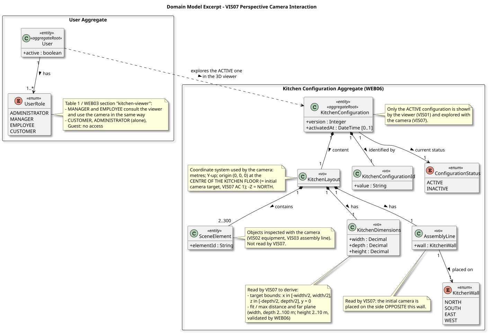
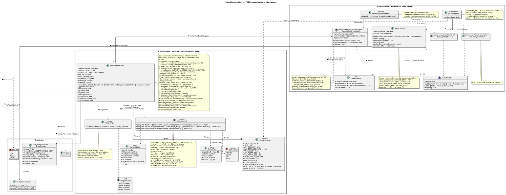
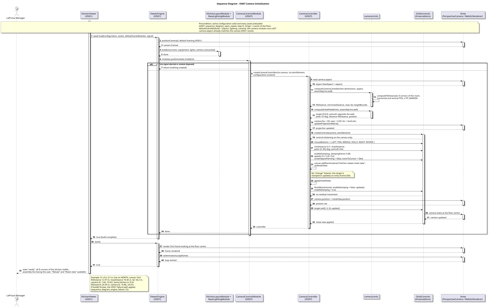
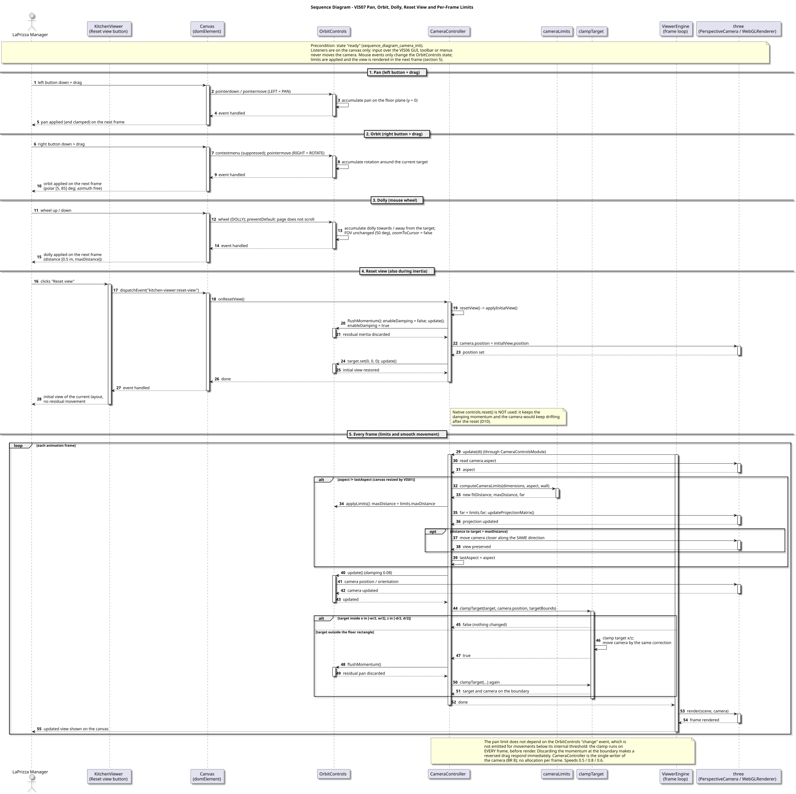
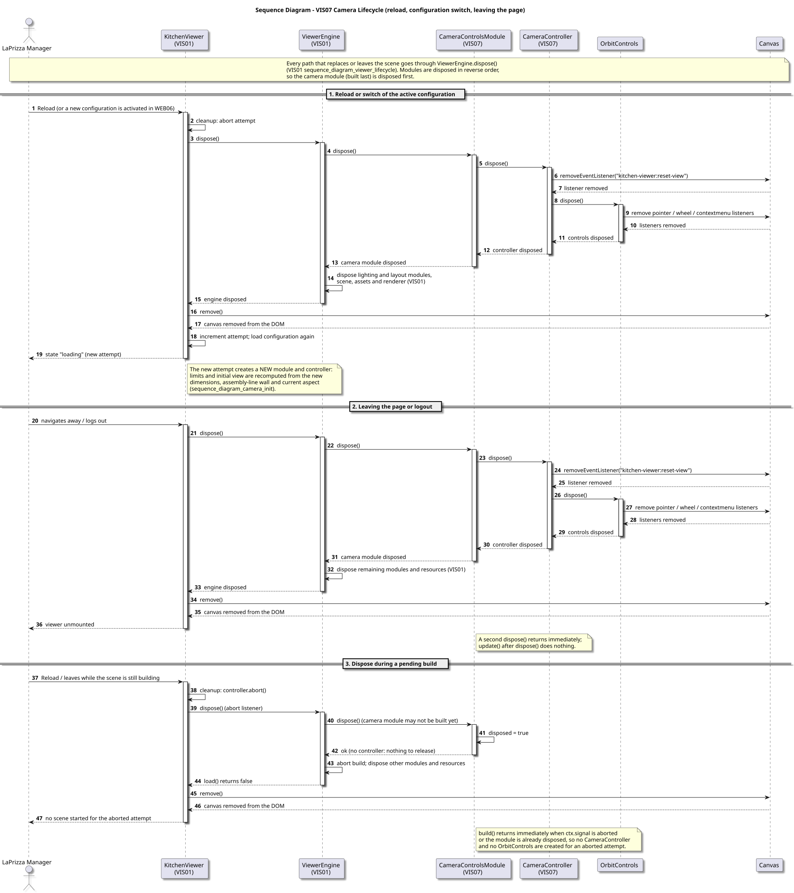

# US VIS07 – Perspective Camera Interaction

## 1. Context & Scope

*   **User Story ID:** VIS07
*   **Sprint:** Sprint 2
*   **Area:** 3D Kitchen Visualization (VIS)
*   **Responsible:** Leonor de Moura (1240914) and Mariana Moreira (1240905)
*   **Related Requirements / Stories:**
    *   Sprint 2 User Stories, *PART IV – Sprint 2 – User Stories*, VIS07, the *VIS – 3D Kitchen Visualization* introduction ("interactive 3D representation of the restaurant kitchen … integrated into the SPA") and *Table 1 – Website roles and accessible functionality* (LaPrizza Manager and Restaurant Staff: "consult the kitchen viewer").
    *   System Specification: *PART II – System Specification*, section II.3.3 3D Visualization and Interaction.
    *   Architecture: [System Architecture Description](../../architecture/SAD.md) (*Front-End* container; principle *Client-side 3D rendering*).
    *   Sprint 2 planning: VIS07 tasks *Implement perspective camera movement and interaction*, *Constrain camera movement to usable viewing positions*, *Test camera controls and navigation* ([sprintPlanning.md](../../Planning/Sprint2/sprintPlanning.md)).
    *   Related stories:
        *   **VIS01 – 3D Module Integration:** `KitchenViewerPage`, the renderer, the scene, the animation loop and the viewer states (`loading` / `ready` / `empty` / `error`). VIS07 plugs its camera into that viewer.
        *   **VIS02 / VIS03 / VIS04 – Kitchen, Assembly Line, Textures:** the objects the user inspects. VIS02 must keep the interior visible when the camera is outside the walls (ALN-2). The initial framing uses the same eight room corners as VIS02 (`±w/2`, `0` / `h`, `±d/2`).
        *   **VIS05 – Scene Lighting:** "the lighting setup works consistently across zoom levels and camera angles" – the zoom and angle ranges are the ones defined here.
        *   **VIS06 – Interactive Light Controls:** the lil-gui panel shown over the viewer must not move the camera (ALN-4).
        *   **WEB01 – SPA Setup and Integration:** front-end project, dependencies and test setup (`three`, Jest – ALN-1).
        *   **WEB03 – Role-Based Navigation:** section `kitchen-viewer` (`/kitchen/viewer`, `MANAGER`, `EMPLOYEE`).
        *   **WEB06 – Kitchen Configuration and 3D Integration Page:** `GET /kitchen-configurations/active`, the coordinate convention (metres, Y-up, origin at the **centre of the kitchen floor**, `-Z` = `NORTH`), `kitchen.dimensions` and `assemblyLine.wall`. WEB06 states that camera limits are **not** part of the stored configuration.
    *   **Dependencies:** VIS07 depends on VIS01 (viewer, renderer, animation loop, resize) and WEB06 (active layout dimensions). VIS02–VIS06 are rendered and inspected through the camera of VIS07.

### Scope boundary

VIS07 concerns **how the user moves the perspective camera with the mouse and which camera positions are allowed**. It does not load the configuration (VIS01 / WEB06), build the scene objects (VIS02–VIS04), set up or control lights (VIS05–VIS06), decide who can open the viewer (WEB03) nor define the viewer states (VIS01).

VIS07 owns:

1. The `PerspectiveCamera` parameters (field of view, near / far planes); the aspect ratio is kept by VIS01 and **read** by VIS07.
2. The **initial view**: target at the centre of the kitchen floor, camera position derived from the active layout and the canvas aspect ratio, so the whole kitchen is visible.
3. The **mouse mapping**: left-drag = pan, right-drag = orbit around the current target, wheel = dolly.
4. The **limits** of pan, orbit and dolly, derived from the kitchen dimensions of the active configuration (and from the aspect ratio for the dolly limit).
5. The **smoothness** of the movement (damping, speeds, a single writer of the camera state).
6. The camera **lifecycle** inside the viewer: created when the scene is ready, re-applied when a new configuration is loaded, limits recomputed when the viewer is resized, disposed when the page is left.
7. A **Reset view** action that restores the initial view.

---

## 2. Requirements & Analysis

### 2.1. User Story Description

> **As a** LaPrizza Manager,  
> **I want** to control a perspective camera with the mouse,  
> **so that** I can explore the scene and inspect objects from different angles.

The actor is the **LaPrizza Manager** (`MANAGER`). **Restaurant Staff** (`EMPLOYEE`) is a secondary actor: Table 1 also allows Staff to consult the kitchen viewer, and the camera works in the same way for both.

### 2.2. Acceptance Criteria

- [ ] **AC 1:** The initial camera target coincides with the centre of the kitchen floor.
- [ ] **AC 2:** Left-click-and-drag pans the camera within reasonable limits.
- [ ] **AC 3:** Right-click-and-drag orbits around the current target within reasonable limits.
- [ ] **AC 4:** The mouse wheel dollies in and out within reasonable limits.
- [ ] **AC 5:** Movement is responsive and smooth, without jitter or excessive sensitivity.

Criteria from related stories that constrain VIS07 (not owned, but must hold):

*   **WEB06 3.4.1:** coordinates in metres, right-handed **Y-up**, origin at the **centre of the kitchen floor**, `-Z` is the `NORTH` wall; `width`, `depth` ∈ [2, 100] m, `height` ∈ [2, 10] m; `assemblyLine.wall` ∈ `NORTH | SOUTH | EAST | WEST` → the target of AC 1 is the origin `(0, 0, 0)` and the limits can be computed from validated, finite dimensions.
*   **WEB06 §7:** "camera limits (VIS07) are not part of the stored configuration" → limits are derived in the front end, nothing is added to the JSON format.
*   **VIS01:** the viewer has no fallback layout and shows `empty` / `error` when no valid layout is available → without a layout there is nothing to explore and no camera controls are created. VIS01 keeps `camera.aspect` equal to the canvas width / height on resize.
*   **VIS05 AC 4:** lighting must work across zoom levels and camera angles → the ranges of 2.4.1 are the test range for VIS05.
*   **VIS06:** the lighting GUI is shown over the viewer → interacting with it must not move the camera.
*   **Table 1 / WEB03:** only `MANAGER` and `EMPLOYEE` open `/kitchen/viewer`; the camera itself sends no request.

Existing implementation evidence:

*   `frontend/package.json` has no `three` dependency yet and `frontend/src/visualization/README.md` is only a placeholder ("Sprint 1 does not implement these views"); VIS01 adds Three.js and the viewer.
*   Three.js `OrbitControls` (`three/addons/controls/OrbitControls.js`) supports remapping of mouse buttons, distance limits, polar / azimuth limits and damping, but has **no rectangular pan limit** (only a circular `minTargetRadius` / `maxTargetRadius` around `cursor`) → VIS07 adds a target clamp (D4).
*   `OrbitControls` emits `change` only when the movement in `update()` exceeds an internal threshold (`EPS`); small movements change the camera without an event → the pan limit cannot depend on `change` (D4). Its native `reset()` restores the saved state but keeps the damping momentum → Reset view does not use it (D10). With damping disabled, `update()` applies the whole pending pan / rotation at once and then clears it; VIS07 uses this to stop the remaining momentum (D4, D10).

### 2.3. Client Clarifications & Questions

none yet

### 2.4. Business Rules & Invariants

Each rule states its source: **S** = Sprint 2 specification, **C** = client clarification, **D** = team design decision (section 3.8).

| ID | Rule | Source |
| --- | --- | --- |
| **BR 1** | The viewer uses one `PerspectiveCamera` with a fixed vertical field of view (50°). The wheel **dollies** (changes the distance to the target); it never changes the field of view. | S – US title, AC 4; D6 |
| **BR 2** | When the scene becomes `ready`, the camera target is the centre of the kitchen floor, i.e. the origin `(0, 0, 0)` of the layout coordinate system, and **all eight corners of the kitchen** are inside the view, for any canvas aspect ratio (landscape or portrait). | S – AC 1, WEB06 3.4.1; D11 |
| **BR 3** | Mouse mapping on the viewer canvas: **left drag = pan**, **right drag = orbit** around the current target, **wheel = dolly** (middle drag = dolly, not required). The browser context menu is suppressed on the canvas only. | S – AC 2, AC 3, AC 4; D2 |
| **BR 4** | Pan moves the target in the horizontal floor plane (`y = 0`). The target is kept inside the floor rectangle `x ∈ [-width/2, width/2]`, `z ∈ [-depth/2, depth/2]` **in every rendered frame**; when a pan would leave it, the target **and** the camera are moved back by the same correction, so the distance and the viewing direction do not change, and the remaining pan momentum is **applied at once and stopped** (the part towards the wall is corrected by the clamp), so a reversed drag responds immediately. | S – AC 2, AC 5; D3, D4 |
| **BR 5** | Orbit keeps the polar angle in **[5°, 85°]**: the camera is always above the floor level and never flips over the top. The azimuth is unrestricted (full 360° around the target). | S – AC 3; D5 |
| **BR 6** | The distance to the target stays in **[0.5 m, maxDistance]**, with `maxDistance = 1.5 × fitDistance` (2.4.1). When the canvas aspect ratio changes, `fitDistance`, `maxDistance` and the far plane are recomputed; if the camera is then farther than the new `maxDistance`, it is moved closer **along the same direction**, so the current view is kept. | S – AC 4; D6 |
| **BR 7** | All limits are derived from the dimensions of the **active** configuration (and the current aspect ratio) and recomputed every time a configuration is loaded or reloaded. No camera data is stored in the configuration, in the back end or in browser storage. | S – AC 2–AC 4, WEB06 §7; D7 |
| **BR 8** | Smoothness: damping (factor 0.08) is applied in the render loop; rotate / pan / zoom speeds are reduced (0.5 / 0.8 / 0.6) and pan is proportional to the distance. `CameraController` is the **only** writer of the camera position and target; the camera state is never React state (no re-render per pointer move). | S – AC 5; D8 |
| **BR 9** | Camera controls exist only while the viewer is `ready`. They are re-applied (not duplicated) when a new layout is loaded and disposed when the viewer becomes `empty` / `error` or the page is left, so no listener is left behind. | S – AC 5, VIS01; D9 |
| **BR 10** | Input over elements that are not the canvas (VIS06 GUI, page toolbar, menus) never moves the camera; the wheel over the canvas never scrolls the page. | S – AC 4, AC 5 |
| **BR 11** | "Reset view" restores the initial view of BR 2 / 2.4.1 for the current layout and aspect ratio, and stops any remaining damping movement first: after a reset the camera stays still. | D10 |
| **BR 12** | Camera interaction is purely client-side: it sends no request and changes no business data. It behaves the same for `MANAGER` and `EMPLOYEE`. | S – Table 1; D7 |

#### 2.4.1. Camera parameters (`cameraSettings` / `cameraLimits`)

`w`, `d`, `h` = `kitchen.dimensions.width`, `.depth`, `.height` of the active configuration; `aspect` = canvas width / height.

| Parameter | Value | Rule |
| --- | --- | --- |
| Field of view | vertical `vFov` = 50°; horizontal `hFov = 2·atan(tan(vFov/2) · aspect)` | BR 1 |
| Aspect ratio | canvas width / height (kept by VIS01; change detected by VIS07 in the frame loop) | BR 6 |
| Near plane | 0.05 m | below `minDistance`, so close-ups are not clipped |
| `fitDistance` | `FIT_MARGIN × max` over the eight corners (see below), `FIT_MARGIN` = 1.05 | BR 2 – the whole kitchen fits on the screen in the initial direction |
| `minDistance` | 0.5 m | BR 6 – close inspection of tools and equipment |
| `maxDistance` | `1.5 × fitDistance` | BR 6 – the kitchen is never reduced to a point |
| Far plane | `maxDistance + √(w² + d² + h²)` | the whole kitchen is visible from the farthest position |
| Target bounds | `x ∈ [-w/2, w/2]`, `y = 0`, `z ∈ [-d/2, d/2]` | BR 4 |
| Polar angle | [5°, 85°]; initial 55° | BR 5 |
| Azimuth | unrestricted; initial: camera on the side **opposite** the assembly-line wall | BR 5, D11 |
| Initial target / distance | `(0, 0, 0)` / `fitDistance` | BR 2 |
| Speeds | `rotateSpeed` 0.5, `panSpeed` 0.8, `zoomSpeed` 0.6 | BR 8 |
| Damping | enabled, `dampingFactor` 0.08 | BR 8 |
| Pan plane | `screenSpacePanning = false` (horizontal plane) | BR 4 |
| Dolly to cursor | off (`zoomToCursor = false`) | D6 |

**`fitDistance` (eight-corner fit).** Let `u` be the unit vector from the target to the camera for the initial azimuth θ and polar angle φ = 55°, `u = (sinφ·sinθ, cosφ, sinφ·cosθ)`, and `right`, `up` the camera axes for that direction. For every corner `c = (±w/2, 0 | h, ±d/2)` the camera at distance `D` sees `c` only if

```
D ≥ c·u + |c·right| / tan(hFov / 2)     (horizontal)
D ≥ c·u + |c·up|    / tan(vFov / 2)     (vertical)
```

`fitDistance` is the largest of these 16 values multiplied by `FIT_MARGIN`. The calculation is exact, uses both fields of view (so portrait canvases are handled) and includes the wall height (so small, tall kitchens are handled).

Initial azimuth (camera position relative to the target; `OrbitControls` azimuth θ = 0 is `+Z`):

| `assemblyLine.wall` | Wall position | Camera side | θ |
| --- | --- | --- | --- |
| `NORTH` | `-Z` | `+Z` | 0° |
| `SOUTH` | `+Z` | `-Z` | 180° |
| `EAST` | `+X` | `-X` | −90° |
| `WEST` | `-X` | `+X` | 90° |

Examples (assembly line on `NORTH`, target `(0, 0, 0)`):

| Kitchen | Canvas | `fitDistance` | `maxDistance` | Far plane | Initial camera position |
| --- | --- | --- | --- | --- | --- |
| 12 × 8 × 3.2 m | 16:9 | 12.97 m | 19.45 m | 34.2 m | ≈ `(0, 7.44, 10.62)` |
| 12 × 8 × 3.2 m | 9:16 | 29.39 m | 44.08 m | 58.9 m | ≈ `(0, 16.86, 24.07)` |
| 2 × 2 × 2 m | 16:9 | 5.32 m | 7.99 m | 11.5 m | ≈ `(0, 3.05, 4.36)` |

Target bounds for the 12 × 8 kitchen: x ∈ [−6, 6], z ∈ [−4, 4].

### 2.5. Domain Model Excerpt



PlantUML source: [`excerptDomainModel/domain_model_excerpt.puml`](./excerptDomainModel/domain_model_excerpt.puml).

| Concept | Kind | Role in VIS07 |
| --- | --- | --- |
| **KitchenConfiguration** | Entity / Aggregate Root (existing, WEB06) | Only the `ACTIVE` one is shown by the viewer |
| **KitchenLayout** | Value Object (existing, WEB06) | Defines the coordinate system (metres, Y-up, origin at the centre of the floor) |
| **KitchenDimensions** | Value Object (existing, WEB06) | `width`, `depth`, `height` → eight corners, target bounds, distances and far plane |
| **AssemblyLine** / **KitchenWall** | Value Object / Enumeration (existing, WEB06) | Wall of the assembly line → initial azimuth |
| **User** / **UserRole** | Aggregate Root / Enumeration (existing, AA03) | `MANAGER` and `EMPLOYEE` open the viewer (WEB03) |

VIS07 introduces **no new domain concept**. The camera, its limits and its current position are presentation state of the SPA and live in `frontend/src/visualization/scene/camera`, not in the domain model nor in the database.

---

## 3. Design

### 3.1. Architecture & C4 Alignment

This User Story operates within the established **C4 Model** of the system ([SAD](../../architecture/SAD.md)):

*   **C4 Level 1 (System Context):** the LaPrizza Manager and the Restaurant Staff explore the kitchen through the *LaPrizza Information System*; no external system is added.
*   **C4 Level 2 (Containers):** camera interaction runs entirely in the *Front-End* container (React + Three.js, WebGL in the browser). It sends no request to the *Back-End API* and stores nothing in the *Relational Database* (BR 12).
*   **C4 Level 3 (Components):** inside the **Visualization feature** of VIS01, VIS07 adds `visualization/scene/camera/` (camera settings, limits, target clamp and the `CameraController`, Three.js without React) and one scene module, `scene/modules/CameraControlsModule.js`, registered **last** in `defaultSceneModules`. The `ViewerEngine`, the asset loader and the other scene modules are reused unchanged; `KitchenViewer` only gains the "Reset view" button (ALN-3).

---

### 3.2. Class Diagram (CD)

Structural design of the classes participating in this User Story: VIS01 engine and extension point (reused), the VIS07 camera package and the scene module that plugs it into the engine.



> PlantUML source: [`classDiagram/class_diagram.puml`](./classDiagram/class_diagram.puml).

Key design points:

*   **Reused unchanged:** `ViewerEngine` (renderer, scene, `PerspectiveCamera`, frame loop, resize → `camera.aspect`), `SceneModule` / `SceneContext`, `defaultSceneModules` order rules, `KitchenLayoutModule` (VIS02, never touches the camera) and `BaseLightingModule` (VIS01 / VIS05).
*   **Extended:**
    *   `scene/defaultSceneModules.js`: `createCameraControlsModule` appended as the **last** factory, so the camera is set after every scene element exists.
    *   `viewer/KitchenViewer.jsx`: a **"Reset view"** button next to "Reload", visible only in `ready`; it dispatches the `kitchen-viewer:reset-view` event on the canvas (ALN-3).
    *   `visualization/README.md`: camera mapping, limits and the rule that only VIS07 writes the camera.
*   **New:**
    *   `scene/camera/cameraSettings.js`: fixed values of 2.4.1 (FOV, near, minimum distance, `FIT_MARGIN`, polar range, speeds, damping, reset event, wall azimuths).
    *   `scene/camera/cameraLimits.js`: pure functions (no Three.js objects, no React): `computeFitDistance(dimensions, aspect, azimuth, polar)` (eight-corner fit), `computeCameraLimits(dimensions, aspect, wall)` (`fitDistance`, `maxDistance`, far plane, target bounds) and `computeInitialView(limits, wall)` (initial target, azimuth, polar angle and position).
    *   `scene/camera/clampTarget.js`: pure; keeps the target in the floor rectangle, moves the camera by the same correction and reports whether it clamped.
    *   `scene/camera/CameraController.js`: the **only writer** of the camera position and target (BR 8). It wraps `OrbitControls`, applies the mapping, limits and smoothness; in `update()`, on **every frame before render**, it recomputes the limits when the aspect ratio changed, advances the damping, clamps the target and, at the boundary, applies the remaining momentum at once and stops it; it applies / resets the initial view without residual movement and releases its listener.
    *   `scene/modules/CameraControlsModule.js`: `SceneModule` adapter: `build()` creates the `CameraController` for the active layout, `update()` calls `controller.update()`, `dispose()` disposes it.
*   **Separation of concerns:** limits and the initial view are computed by pure functions, testable without a browser; `OrbitControls` is reached only through `CameraController` (injectable factory for tests); the engine and the viewer do not know the camera rules.

#### Mouse mapping (BR 3, BR 10)

| Input on the viewer canvas | `OrbitControls` action | Limit applied |
| --- | --- | --- |
| Left button + drag | `MOUSE.PAN` (horizontal floor plane) | Target clamped to the floor rectangle on every frame (BR 4) |
| Right button + drag | `MOUSE.ROTATE` around the current target | Polar angle [5°, 85°]; azimuth free (BR 5) |
| Wheel | Dolly towards / away from the target (`zoomToCursor = false`) | Distance [0.5 m, `maxDistance`] (BR 6) |
| Middle button + drag | `MOUSE.DOLLY` (not required) | Same as wheel |
| Right click | Browser context menu suppressed on the canvas only | – |
| Input over the VIS06 GUI, toolbar or menus | Not received by `OrbitControls` (listeners only on the canvas) | – |
| Wheel over the canvas | `preventDefault()`: the page does not scroll | – |

#### Camera parameters applied by `CameraController`

| Property | Value | Source |
| --- | --- | --- |
| `camera.fov` / `near` / `far` | 50° / 0.05 m / `maxDistance + √(w² + d² + h²)` (recomputed on aspect change) | 2.4.1, BR 6 |
| `controls.target` | `(0, 0, 0)`, clamped to `x ∈ [-w/2, w/2]`, `z ∈ [-d/2, d/2]` every frame | BR 2, BR 4 |
| `minDistance` / `maxDistance` | 0.5 m / `1.5 × fitDistance` (recomputed on aspect change) | BR 6 |
| `minPolarAngle` / `maxPolarAngle` | 5° / 85° | BR 5 |
| `enableDamping` / `dampingFactor` | `true` / 0.08 | BR 8 |
| `rotateSpeed` / `panSpeed` / `zoomSpeed` | 0.5 / 0.8 / 0.6 | BR 8 |
| `screenSpacePanning` / `zoomToCursor` | `false` / `false` | BR 4, D6 |
| Initial view | target origin, distance `fitDistance` (eight-corner fit), polar 55°, azimuth opposite `assemblyLine.wall` | BR 2, D11 |

#### `CameraController.update()` – order inside one frame

| Step | Action | Rule |
| --- | --- | --- |
| 1 | If `camera.aspect ≠ lastAspect`: recompute the limits, apply `maxDistance` and `far` (`updateProjectionMatrix()`), move the camera closer along the same direction if it is beyond `maxDistance` | BR 6 |
| 2 | `controls.update()` – advances damping and applies polar / distance limits | BR 5, BR 6, BR 8 |
| 3 | `clampTarget(target, camera.position, targetBounds)` | BR 4 |
| 4 | If step 3 clamped: `flushMomentum()` (`enableDamping = false` → `controls.update()` applies the remaining momentum at once and clears it → `enableDamping = true`), then `clampTarget` again | BR 4, AC 5 |
| 5 | Return; `ViewerEngine` renders the frame | – |

#### Ownership of the camera

| Concern | Owner | Notes |
| --- | --- | --- |
| Camera object, render, resize (`aspect`) | VIS01 `ViewerEngine` | Default framing by `positionCamera()` is replaced by VIS07 at build time (ALN-3) |
| FOV, near / far, position, target, limits, interaction | VIS07 `CameraController` | Single writer (BR 8); reads `aspect` |
| Camera in React state | Nobody | The camera is never React state; no re-render per pointer move |
| Camera data in the configuration / back end / browser storage | Nobody | BR 7, BR 12 |

---

### 3.3. Sequence Diagrams (SD)

Three scenarios are documented separately because they cover distinct acceptance criteria. Error and abort branches end the interaction explicitly.

#### SD 1 — Camera Initialization (AC 1, BR 2, BR 7, BR 9)

`ViewerEngine.load()` builds the layout and lighting modules, then `CameraControlsModule.build()`: the current aspect ratio is read; limits (eight-corner `fitDistance`) and the initial view are computed from the active dimensions, the assembly-line wall and the aspect ratio; FOV, near and far applied; `CameraController` created with `OrbitControls`, mapping, limits and smoothness; initial view applied without residual movement; first frame rendered looking at the floor centre with the whole kitchen visible. An aborted build creates nothing.



> Source: [`sequence_diagram_camera_init.puml`](./sequenceDiagram/sequence_diagram_camera_init.puml)

#### SD 2 — Pan, Orbit, Dolly, Reset View and Per-Frame Limits (AC 2–AC 5, BR 3–BR 6, BR 8, BR 10, BR 11)

Mouse actions only change the `OrbitControls` state on the canvas. On every frame, before render, `CameraController.update()` recomputes the limits if the aspect ratio changed, advances the damping and clamps the target; at the boundary the remaining momentum is applied at once and stopped. "Reset view" stops the remaining momentum and restores the initial view of the current layout.



> Source: [`sequence_diagram_camera_interaction.puml`](./sequenceDiagram/sequence_diagram_camera_interaction.puml)

#### SD 3 — Camera Lifecycle: Reload, Configuration Switch and Leaving the Page (BR 9)

`ViewerEngine.dispose()` disposes the camera module first (reverse order); `CameraController` removes its reset-view listener and disposes `OrbitControls`, which removes its listeners from the canvas; a new attempt creates a new controller with limits recomputed for the new layout; a dispose during a pending build releases nothing because nothing was created.



> Source: [`sequence_diagram_camera_lifecycle.puml`](./sequenceDiagram/sequence_diagram_camera_lifecycle.puml)

---

### 3.4. REST API Specification (ARC03)

VIS07 **does not create or call any endpoint**. It uses only data already loaded by VIS01 from `GET /api/v1/kitchen-configurations/active` (usWEB06 3.4.2):

| Field of the active configuration | Used for |
| --- | --- |
| `content.kitchen.dimensions.width`, `depth`, `height` | Eight corners, `fitDistance`, `maxDistance`, far plane, target bounds |
| `content.assemblyLine.wall` | Initial azimuth (2.4.1) |

WEB06 validates these values (`width`, `depth` ∈ [2, 100] m, `height` ∈ [2, 10] m, wall enumeration) and VIS01 rejects non-finite dimensions; VIS07 does not repeat that validation. If `assemblyLine.wall` is absent, the initial azimuth defaults to `+Z` (θ = 0°).

#### Integration requirements

| ID | Change | Owner | Verified by |
| --- | --- | --- | --- |
| **ALN-1** | `three` (with `three/addons/controls/OrbitControls.js`) and the Jest module mapping for `three/addons` are available in the front end. | WEB01 / VIS01 | `npm test` runs the camera tests |
| **ALN-2** | When the camera is outside the room, the walls must not hide the interior (e.g. walls rendered with `FrontSide` facing inwards). | VIS02 | VIS02 tests; MT-6 |
| **ALN-3** | VIS01 keeps its default framing only until VIS07 builds and keeps `camera.aspect` up to date on resize; `KitchenViewer` shows "Reset view" in `ready` and dispatches `kitchen-viewer:reset-view` on the canvas. No change to `ViewerEngine`. | VIS01 / VIS07 | IT-2, IT-3, IT-4 |
| **ALN-4** | The VIS06 lil-gui panel is a separate DOM element over the viewer; pointer and wheel events on it never reach the canvas. | VIS06 | MT-7 |

### 3.5. Persistence & Data Integrity (ARC04)

VIS07 **does not add or change any persistence**.

- **Back end:** nothing is added to the configuration JSON, the database or any endpoint (WEB06 §7).
- **Front end:** the camera position, target and limits live only in the `PerspectiveCamera` and the `CameraController` while the viewer is `ready`; they are not React state and are not written to `localStorage` / `sessionStorage`. A reload, a configuration switch or leaving the page discards them (BR 7, BR 9).
- **Integrity rules:** limits are recomputed from the dimensions of the configuration currently shown and the current aspect ratio; a previous layout's limits are never reused, because each attempt creates a new controller.

### 3.6. Applied Patterns & Architecture Principles

- **Plugin / Strategy (`SceneModule`, VIS01):** camera interaction is one more module; engine and viewer stay closed for modification (Open / Closed).
- **Adapter / Facade:** `CameraControlsModule` adapts `CameraController` to the `SceneModule` contract; `CameraController` is a facade over `OrbitControls` exposing only `applyInitialView`, `resetView`, `update` and `dispose`.
- **Single writer:** only `CameraController` changes the camera position and target (BR 8).
- **Pure functions:** fit distance, limits, initial view and target clamping have no side effects outside their arguments and are unit-tested without a GPU.
- **Dependency Injection:** `CameraController` receives a `createControls` factory, so tests use a fake `OrbitControls`.
- **Game loop:** damping, aspect-change detection and the target clamp run in `update()` inside the VIS01 frame loop, before render; the limits never depend on `OrbitControls` events. No allocation per frame.
- **Event-driven decoupling:** "Reset view" reaches the controller through a DOM event on the canvas, so the viewer does not hold a reference to a scene module.
- **Fail-safe cleanup:** `dispose()` is idempotent and safe after a partial or aborted build.

### 3.7. New Components and Justification

| Component | Layer | Why it is needed / why an existing one is not enough |
| --- | --- | --- |
| `scene/camera/cameraSettings.js` | visualization – scene/camera | One place for the fixed values of 2.4.1, so tests and documentation use the same numbers. |
| `scene/camera/cameraLimits.js` | visualization – scene/camera | AC 2–AC 4 require limits derived from the active layout; the eight-corner fit depends on the aspect ratio; pure and testable (BR 2, BR 6, BR 7, D11). |
| `scene/camera/clampTarget.js` | visualization – scene/camera | `OrbitControls` has no rectangular pan limit, only a circular target radius (D4). |
| `scene/camera/CameraController.js` | visualization – scene/camera | Single writer of the camera; applies mapping, limits per frame, smoothness, initial view and reset (BR 3–BR 11). |
| `scene/modules/CameraControlsModule.js` | visualization – scene | Plugs the controller into the VIS01 lifecycle without changing the engine (BR 9). |
| "Reset view" button | visualization – viewer | BR 11 / D10; needs a UI control outside the canvas. |

### 3.8. Design Decisions

| ID | Decision |
| --- | --- |
| **D1** | Use Three.js **`OrbitControls`** (`three/addons/controls/OrbitControls.js`), as in the course material, wrapped by `CameraController`. Custom orbit / pan math was rejected: more code to test, same behaviour. |
| **D2** | **Remap the mouse buttons** (`OrbitControls` default is left = rotate, right = pan): `LEFT = PAN`, `RIGHT = ROTATE`, `MIDDLE = DOLLY`, wheel = dolly. Listeners are attached to the canvas only; the context menu is suppressed and the wheel does not scroll the page there (BR 3, BR 10). `MapControls` (same add-on, left = pan and right = rotate by default) was considered: it gives the same mapping. `OrbitControls` with an explicit `mouseButtons` remap was kept so the mapping, the middle-button dolly and the limits are all visible in one place (`CameraController`) and match the course material. |
| **D3** | **Pan on the horizontal floor plane** (`screenSpacePanning = false`), so the target always stays at `y = 0` (BR 4). |
| **D4** | **Rectangular pan limit applied every frame**: `CameraController.update()` calls `clampTarget` after `controls.update()` and before the render, not on the `change` event (which `OrbitControls` does not emit for movements below its internal threshold). Target `x` / `z` are clamped to the floor rectangle and the camera is moved by the same correction, so distance and direction are unchanged. When the clamp acts, `flushMomentum()` disables damping for one `controls.update()`, which **applies the remaining momentum at once and clears it**, and the target is clamped again. Towards the wall this has the same effect as discarding the momentum (the clamp corrects it); along the wall (diagonal pan) the rest of the movement is applied in that frame, a small sideways step at the moment of contact. Truly discarding it would require changing the private `_panOffset` of `OrbitControls`, which was rejected. There is no push against the boundary and a reversed drag responds immediately (BR 4, AC 5). |
| **D5** | **Polar angle [5°, 85°]**, azimuth unrestricted: the camera never goes below the floor nor flips over the top; the user can look from every side (BR 5). |
| **D6** | **Dolly, not zoom:** the wheel changes the distance to the target; the FOV stays 50°. Distance in [0.5 m, `1.5 × fitDistance`]; `zoomToCursor = false` so the target does not drift away from the floor centre. When the aspect ratio changes (detected in `update()` by comparing `camera.aspect` with the last value), `fitDistance`, `maxDistance` and the far plane are recomputed; a camera beyond the new `maxDistance` is moved closer along the same direction, keeping the user's view (BR 1, BR 6). |
| **D7** | **Limits derived, not stored:** computed from `kitchen.dimensions` (and the aspect ratio) every time a configuration is loaded; nothing is added to the JSON, the back end or the browser storage (BR 7, BR 12; WEB06 §7). |
| **D8** | **Smoothness:** damping 0.08 advanced in the frame loop; reduced speeds 0.5 / 0.8 / 0.6; `CameraController` is the single writer; the camera is never React state (BR 8). |
| **D9** | **Lifecycle through `SceneModule`:** the controller is created in `build()` (only when the viewer reaches `ready`), updated in `update()` and disposed in `dispose()` (listeners removed). A new configuration creates a new module and controller, never a second set of listeners (BR 9). |
| **D10** | **Reset view without residual movement:** a button of `KitchenViewer` dispatches `kitchen-viewer:reset-view` on the canvas; `CameraController.resetView()` first stops the remaining damping momentum (`flushMomentum()`: `enableDamping = false` → `controls.update()` → `enableDamping = true`), then sets the initial position and target of the current layout and aspect ratio and calls `controls.update()`, so the momentum applied by the flush is overwritten by the initial view. The native `controls.reset()` is **not** used, because it keeps the momentum and the camera would keep drifting after the reset (BR 11). |
| **D11** | **Initial view by eight-corner fit:** azimuth opposite the assembly-line wall (2.4.1 table), polar 55°, distance `fitDistance` computed from the eight room corners with both fields of view and `FIT_MARGIN` 1.05 (the same corners as VIS02). The whole kitchen, including the top of the walls, is visible in landscape and portrait canvases and the assembly line faces the user on opening. The previous floor-diagonal formula was rejected: it ignored the aspect ratio and the wall height and cut the kitchen in portrait canvases and small, tall rooms (BR 2). |

---

## 4. Tests (ARC05)

Tests are written in Jest (`frontend/test/visualization/...`), following the structure of the source folders. Pure functions are tested directly; `CameraController` is tested with a fake `OrbitControls` (injected `createControls`) and an `EventTarget` as canvas; the integration tests use the real `ViewerEngine`, `CameraController` and `OrbitControls` with a fake renderer; no WebGL context is needed.

### 4.1. Unit Tests (UT)

**`scene/camera/cameraLimits.test.js`**

| ID | Scenario | Expected |
| --- | --- | --- |
| UT-1 | 12 × 8 × 3.2, `NORTH`, aspect 16:9 | `fitDistance` ≈ 12.97, `maxDistance` ≈ 19.45, far ≈ 34.2, bounds x ∈ [−6, 6], z ∈ [−4, 4] |
| UT-2 | Same kitchen, every wall, aspect 16:9 | All **8 corners** project inside the frustum (`|ndc.x| ≤ 1`, `|ndc.y| ≤ 1`) from the initial position |
| UT-3 | Same kitchen, aspect **9:16** (portrait) | All 8 corners inside the frustum; `fitDistance` ≈ 29.39 (> landscape value) |
| UT-4 | Kitchen **2 × 2 × 2** m, aspect 16:9 and 9:16 | All 8 corners inside the frustum (top of the walls included) |
| UT-5 | Minimum / maximum WEB06 dimensions (2 × 2 × 2, 100 × 100 × 10) | Finite values; `minDistance < fitDistance < maxDistance < far` |
| UT-6 | `fitDistance` is tight | With `FIT_MARGIN` = 1, at least one corner lies on the frustum border (± 1e-6) |
| UT-7 | `computeInitialView` per wall | θ = 0° / 180° / −90° / 90°; polar 55°; target `(0, 0, 0)`; distance = `fitDistance`; missing wall → θ = 0° |
| UT-8 | Invalid dimensions or aspect (0, negative, `NaN`, `Infinity`) | `RangeError` |

**`scene/camera/clampTarget.test.js`**

| ID | Scenario | Expected |
| --- | --- | --- |
| UT-9 | Target inside the rectangle | Returns `false`; target and camera unchanged |
| UT-10 | Target outside in `x`, in `z` and in both | Returns `true`; target on the boundary; camera moved by the same delta (distance and direction unchanged) |
| UT-11 | Target exactly on the boundary | Returns `false` |
| UT-12 | No allocation | Same `Vector3` instances mutated in place |

**`scene/camera/CameraController.test.js`**

| ID | Scenario | Expected |
| --- | --- | --- |
| UT-13 | Creation | fov 50, near 0.05, far = `limits.far`, `updateProjectionMatrix()` called; mouse buttons `LEFT: PAN`, `MIDDLE: DOLLY`, `RIGHT: ROTATE`; distance / polar limits, damping, speeds, `screenSpacePanning` and `zoomToCursor` as in 2.4.1; **no** `change` listener |
| UT-14 | Initial view | Camera at `initialView.position`, target `(0, 0, 0)` |
| UT-15 | **Per-frame clamp without `change`** | Fake controls moves the target to `x = w/2 + 1e-5` in `update()` **without** dispatching `change` → after `controller.update()` the target is on the boundary |
| UT-16 | **Pan inversion at the boundary** | Target pushed outside with damping momentum → after the clamp `enableDamping` was toggled off / on, the remaining momentum was applied and cleared, and the target is on the boundary; a reversed pan in the next frame moves the target inwards in that same frame |
| UT-17 | **Aspect change** (16:9 → 9:16 → 16:9) | `maxDistance` and `far` recomputed, `updateProjectionMatrix()` called; camera beyond the new `maxDistance` moved closer along the **same direction** (unit offset vector unchanged); no change when the aspect is the same |
| UT-18 | **Reset view during inertia** | Momentum pending → `kitchen-viewer:reset-view` on the canvas → the momentum is stopped before the position is set; after further `update()` calls the camera stays at the initial position |
| UT-19 | `dispose()` | Reset-view listener removed, `controls.dispose()` called once; second `dispose()` and `update()` after dispose do nothing |

**`scene/modules/CameraControlsModule.test.js`**

| ID | Scenario | Expected |
| --- | --- | --- |
| UT-20 | `build()` with aborted signal or after `dispose()` | No controller created |
| UT-21 | `build()` / `update()` / `dispose()` | Controller created with `camera`, `domElement`, `configuration.content`; `update()` delegated; `dispose()` idempotent |

### 4.2. Integration Tests (IT)

| ID | File | Scenario | Expected |
| --- | --- | --- | --- |
| IT-1 | `scene/defaultSceneModules.test.js` | `defaultSceneModules` | The layout module is first and `camera-controls` is the **last** module |
| IT-2 | `scene/ViewerEngine.camera.test.js` | Real `ViewerEngine` with a layout-module double and the real camera module (`CameraController` + `OrbitControls`), fake renderer, 16:9 container | After `load()` + `start()` the camera has fov 50, is at the initial position ≈ `(0, 7.44, 10.62)` and looks at `(0, 0, 0)`; `dispose()` disposes `camera-controls` before the layout module |
| IT-3 | `scene/ViewerEngine.camera.test.js` | `ViewerEngine.resize()` to a 9:16 canvas, then one frame | Far plane 34.2 m → 58.9 m: limits recomputed through the engine (UT-17 behaviour end to end) |
| IT-4 | `viewer/KitchenViewer.test.jsx` | `KitchenViewer` in `ready` and while loading | A click on "Reset view" dispatches `kitchen-viewer:reset-view` on the viewer canvas; the button is not shown while the viewer is not ready |

### 4.3. Manual Tests (MT)

| ID | Scenario | Expected |
| --- | --- | --- |
| MT-1 | Open `/kitchen/viewer` (wide window) | Target on the floor centre; whole kitchen visible; assembly line facing the user (AC 1) |
| MT-2 | Open in a **narrow / portrait** window and resize between landscape and portrait | Whole kitchen visible on opening; after resizing, the view is kept and no wall is cut by the far plane |
| MT-3 | Left drag towards each wall, **reverse at the boundary**, and a **diagonal** drag into a wall | Target stops at the floor edge without jitter; reversing the drag moves the view back immediately (AC 2, AC 5); on a diagonal drag only a small sideways step is visible at the moment of contact (D4) |
| MT-4 | Right drag in every direction | Orbit around the target; camera never below the floor nor over the top (AC 3) |
| MT-5 | Wheel in / out to the limits | Smooth dolly; stops at 0.5 m and at `maxDistance`; page does not scroll (AC 4) |
| MT-6 | Dolly / orbit to a camera outside the walls | Interior still visible (ALN-2) |
| MT-7 | Drag and scroll over the VIS06 GUI and the toolbar | Camera does not move (BR 10, ALN-4) |
| MT-8 | Start a fast drag, release and click **Reset view** during the inertia | Initial view restored; no drift afterwards (BR 11) |
| MT-9 | Reload, activate another configuration, leave the page | New limits for the new layout; no duplicated listeners (BR 9) |

Acceptance-criteria and rule traceability:

| AC / BR | Main scenarios |
| --- | --- |
| AC 1 | UT-7, UT-14, IT-1, IT-2, MT-1 |
| AC 2 | UT-9 – UT-12, UT-15, UT-16, MT-3 |
| AC 3 | UT-13, MT-4 |
| AC 4 | UT-1, UT-5, UT-13, UT-17, MT-5 |
| AC 5 | UT-13, UT-16, UT-18, MT-3, MT-8 |
| BR 2 (eight-corner framing) | UT-1 – UT-4, UT-6, IT-2, MT-1, MT-2 |
| BR 6 (aspect change) | UT-17, IT-3, MT-2 |
| BR 9 (lifecycle) | UT-19 – UT-21, IT-1, IT-2, MT-9 |
| BR 10 (input outside the canvas) | MT-7 |
| BR 11 (Reset view) | UT-18, IT-4, MT-8 |

---

## 5. Implementation

### 5.1. File Structure

The camera is one more scene module on top of the VIS01 engine. `ViewerEngine`,
the asset loader and the other scene modules are not changed. The eight-corner
fit, the limits, the initial view and the target clamp are pure functions
(`cameraLimits`, `clampTarget`); `CameraController` is the only writer of the
camera, applies the limits in `update()` on every frame (aspect-ratio check,
damping, target clamp, momentum applied and stopped at the boundary) and reaches
`OrbitControls` through an injected factory, so the unit tests use a fake
controls object and no WebGL context.

```text
frontend/
├── src/
│   ├── shared/locale/messages.js                     (extended: viewerResetView – "Repor vista" / "Reset view")
│   └── visualization/
│       ├── viewer/
│       │   └── KitchenViewer.jsx                     (extended: "Reset view" button next to "Reload")
│       └── scene/
│           ├── defaultSceneModules.js                (extended: createCameraControlsModule registered last)
│           ├── camera/
│           │   ├── cameraSettings.js                 (new: FOV, near, distances, FIT_MARGIN, polar range, speeds,
│           │   │                                           damping, reset event, wall azimuths)
│           │   ├── cameraLimits.js                   (new: computeFitDistance – eight-corner fit with the aspect
│           │   │                                           ratio, computeCameraLimits, computeInitialView)
│           │   ├── clampTarget.js                    (new: rectangular target clamp, no allocation)
│           │   └── CameraController.js               (new: OrbitControls wrapper – mapping, limits, damping;
│           │                                               per-frame update(): syncAspect, clamp, flushMomentum;
│           │                                               initial view, Reset view, dispose)
│           └── modules/
│               └── CameraControlsModule.js           (new: SceneModule adapter – build / update / dispose)
└── test/visualization/
    ├── scene/
    │   ├── defaultSceneModules.test.js               (extended: IT-1, camera-controls last)
    │   ├── ViewerEngine.camera.test.js               (new: IT-2, IT-3 – real engine and camera module)
    │   ├── camera/
    │   │   ├── cameraLimits.test.js                  (new: UT-1 – UT-8, corners projected with a real
    │   │   │                                               PerspectiveCamera)
    │   │   ├── clampTarget.test.js                   (new: UT-9 – UT-12)
    │   │   └── CameraController.test.js              (new: UT-13 – UT-19, fake OrbitControls with damping
    │   │                                                   momentum, EventTarget canvas)
    │   └── modules/
    │       └── CameraControlsModule.test.js          (new: UT-20 – UT-21, fake controller)
    └── viewer/
        └── KitchenViewer.test.jsx                    (extended: IT-4, "Reset view" button)
```

### 5.2. Mapping from the SGRAI Sprint 2 Support Slide Deck

Slide 19 of the *Sprint 2 Support Slide Deck* (Ricardo Gil Durão) describes US7
and suggests exploring the built-in Three.js camera controls. The criteria map
to the implementation as follows:

| Slide 19 | VIS07 implementation |
| --- | --- |
| Initial target coincident with the centre of the kitchen floor | `computeInitialView()` returns target `(0, 0, 0)`, the floor centre in the WEB06 convention (BR 2) |
| Left-click-and-drag pans within reasonable limits | `mouseButtons.LEFT = MOUSE.PAN`, `screenSpacePanning = false`; `clampTarget` keeps the target inside the floor rectangle on every frame (BR 4, D3, D4) |
| Right-click-and-drag orbits around the current target within reasonable limits | `mouseButtons.RIGHT = MOUSE.ROTATE` around `controls.target`; polar angle [5°, 85°] (BR 5, D5) |
| Mouse wheel dollies in / out within reasonable limits | Dolly, not zoom: FOV fixed at 50°, distance [0.5 m, `1.5 × fitDistance`], recomputed when the aspect ratio changes, `zoomToCursor = false` (BR 1, BR 6, D6) |
| Responsive and smooth, without jitter or excessive sensitivity | Damping 0.08 advanced in the frame loop by `CameraControlsModule.update()`; speeds 0.5 / 0.8 / 0.6; at the pan boundary the remaining momentum is applied at once and stopped (BR 4, BR 8, D4, D8) |
| Tip: explore Three.js' built-in Camera Controls | `OrbitControls` (`three/addons/controls/OrbitControls.js`) with remapped buttons, wrapped by `CameraController` (D1, D2) |

The same deck (slide 18) recommends removing debugging panels that are not part
of US6 before delivery; no camera lil-gui panel is left in the delivered code.

---

## 6. Integration, Verification & Demonstration

### 6.1. Running the Automated Tests

```bash
cd frontend
npm test -- test/visualization
npm run lint
VITE_BACKEND_BASE_URL=/api/v1 npm run build
```

### 6.2. Manual Verification & OpenAPI Contract

1. Start the database, run `npm run db:migrate` and `npm run db:seed` in `backend`, then start the backend and the frontend (`npm run dev`).
2. VIS07 adds no endpoint. In Swagger UI (`http://localhost:8080/api-docs`), `GET /kitchen-configurations/active` (WEB06) supplies `content.kitchen.dimensions` and `content.assemblyLine.wall`, the only data the camera uses.
3. As a Manager, import and activate `kitchen-compact.json` (12 × 8 m) in WEB06 and open **Kitchen viewer**. Confirm that the camera looks at the centre of the floor, that the kitchen is framed and that the assembly line faces the user (MT-1).
4. Execute MT-2 – MT-8 from section 4.3: resize between landscape and portrait, pan towards each wall, reverse at the boundary and pan diagonally into a wall, orbit, dolly to both limits, camera outside the walls, input over the toolbar and **Reset view** during the inertia.
5. Import and activate `kitchen-extended.json` (16 × 10 m) and select **Open / reload the kitchen viewer**. Confirm that the limits and the initial framing follow the new dimensions (MT-9).

### 6.3. Verification on the implementation branch

- The frontend visualization suite (`npm test -- test/visualization`) passed all
  158 tests (19 suites), and the full frontend suite passed all 439 tests
  (51 suites). The camera unit tests (`cameraLimits`, `clampTarget`,
  `CameraController`, `CameraControlsModule`) cover UT-1 – UT-21 and the
  integration tests cover IT-1 – IT-4 (module order, real engine with the camera
  module, resize through the engine and the "Reset view" button): the eight
  corners are inside the view in 16:9, 9:16 and for the 2 × 2 × 2 m kitchen, the
  target is clamped without a `change` event, the remaining momentum is applied
  at once and stopped at the boundary, the limits follow the aspect ratio and
  Reset view leaves no drift.
- `CameraController` was also exercised once with the real Three.js
  `OrbitControls` (not only the test double): a strong pan stopped at the floor
  edge with no momentum left, a reversed pan moved the target inwards in the same
  frame, switching to 9:16 gave `maxDistance` 44.08 m and far 58.9 m, and after
  Reset view the camera did not move in the following 30 frames.
- In the browser, with the real Express API and PostgreSQL, the viewer opened
  framed on the floor centre; left drag panned, right drag orbited and the wheel
  dollied within the limits, and **Reset view** restored the initial view.

---

## 7. Observations, Dependencies & Limitations

- **Dependencies:** VIS01 (engine, `SceneModule`, frame loop, resize → `camera.aspect`), WEB06 (`kitchen.dimensions`, `assemblyLine.wall`), WEB01 (`three` and the Jest mapping for `three/addons`).
- **Alignment with other stories:**
  - **VIS01:** the default framing of `positionCamera()` is replaced when the camera module builds (ALN-3); `ViewerEngine` is not changed.
  - **VIS02:** the walls must not hide the interior when the camera is outside the room (ALN-2).
  - **VIS05:** the distance and angle ranges of 2.4.1 are the range in which the lighting must work.
  - **VIS06:** the lil-gui panel is a separate DOM element; its events never reach the canvas (ALN-4).
- **Known Limitations:**
  - At the pan boundary the remaining momentum is applied at once, not discarded: on a diagonal drag into a wall, the movement along the wall is applied in one frame, a small sideways step at the moment of contact (D4). Discarding it would require changing private `OrbitControls` state.
  - The camera position is not kept between reloads or configuration switches; every attempt starts from the initial view (BR 7).
  - Only the target is limited to the floor rectangle; the camera itself may move outside the walls, relying on ALN-2 to keep the interior visible.
  - The maximum polar angle is 85°: a strictly top-down view and a view from below the floor are not available (BR 5).
  - Touch gestures use the `OrbitControls` defaults and are not part of the acceptance criteria; keyboard camera control is not provided.
- **Future Sprint Considerations:** Sprint 3 animation of the assembly line does not change the camera module. A "focus on object" action (e.g. double-click to move the target to an element, using the stable element ids) could reuse `clampTarget`.
