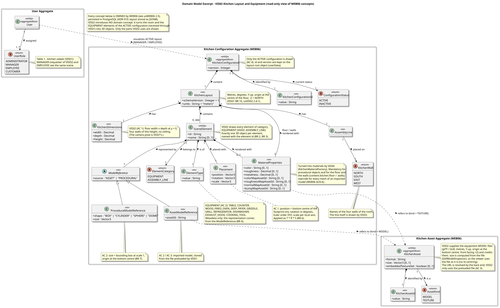
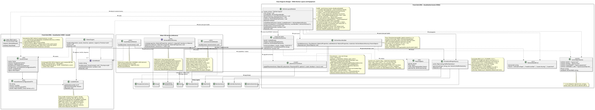
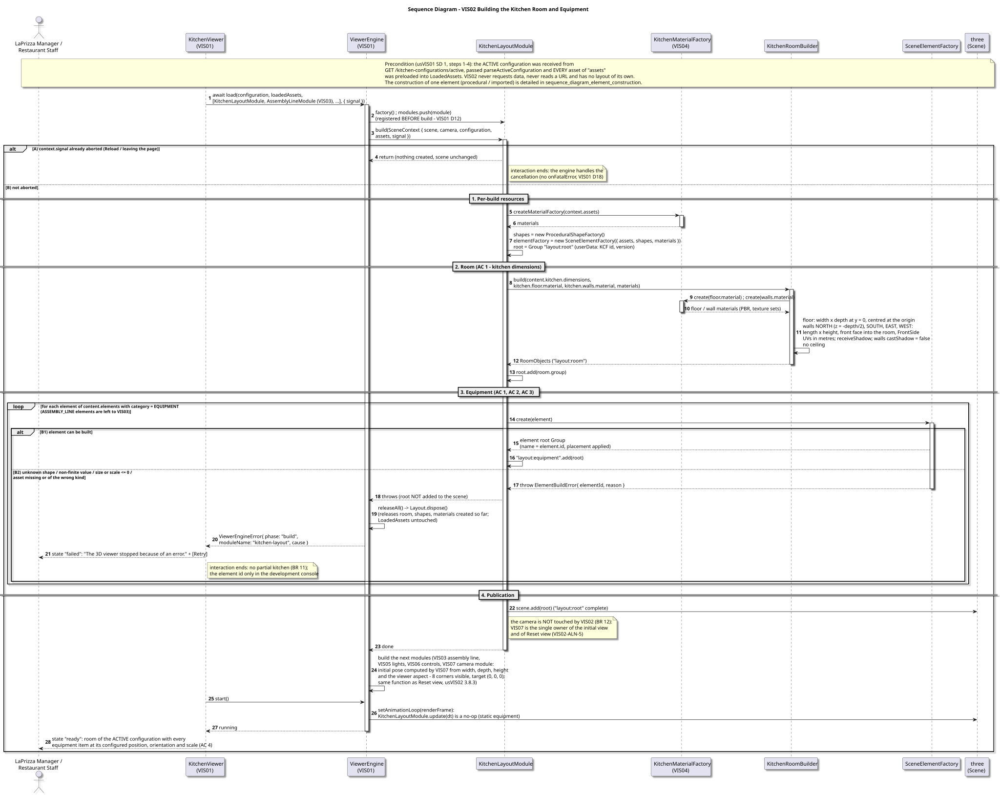
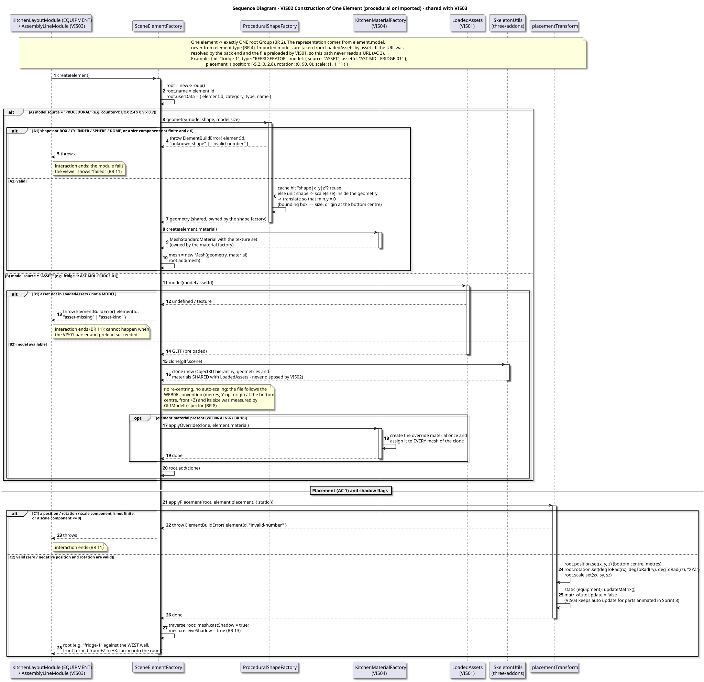
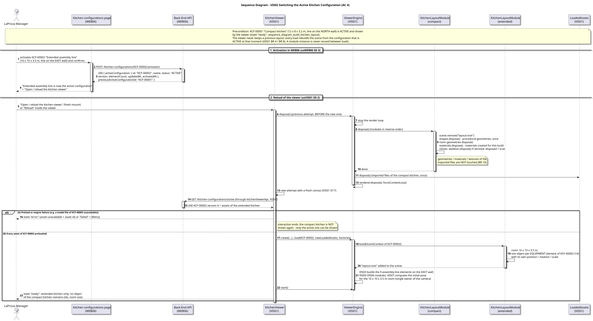

# US VIS02 – Kitchen Layout and Equipment

## 1. Context & Scope

*   **User Story ID:** VIS02
*   **Sprint:** Sprint 2
*   **Area:** 3D Kitchen Visualization (VIS)
*   **Responsible:** Leonor De Moura (1240914) (see [Sprint 2 Planning](../../Planning/Sprint2/sprintPlanning.md))
*   **Related Requirements / Stories:**
    *   Sprint 2 User Stories, *PART IV – Sprint 2 – User Stories*, VIS02, the VIS introduction ("the module must be integrated into the SPA and obtain layout and asset information from the back end") and *Table 1 – Website roles and accessible functionality* (kitchen viewer).
    *   System Specification: *PART II – System Specification*, II.3.3 3D Visualization and Interaction and II.3.3.2 Kitchen and Food Preparation Visualization (kitchen resources represented spatially).
    *   SGRAI – *Sprint 2 Support Slide Deck* (US2 = VIS02, and *General Tips*): define the unit of measure; the kitchen is described by a JSON file that already accounts for the VIS03 assembly line; sketch the layout and render it with primitive shapes first; decide how objects are created (procedural / imported, imported URLs retrieved as JSON); justify any render style; prefer glTF / GLB; check the licence of third-party models and credit their authors; document every decision about the layout and the objects used.
    *   Architecture: [System Architecture Description](../../architecture/SAD.md) (*Client-side 3D rendering*, *Back-end authority*, project structure `frontend/src/visualization`) and [ADR-010 – PostgreSQL as the single database](../../architecture/ADR.md#adr-010-use-postgresql-as-the-single-database) (kitchen configurations and the asset catalogue, WEB06).
    *   Sprint 2 planning: VIS02 tasks (*model the kitchen space, dimensions and principal equipment*; *position, orient and scale objects according to configuration JSON*; *validate multiple kitchen layouts*) and the integration checkpoint *WEB06 ↔ VIS01–VIS03 – active kitchen configuration and documented JSON format must be agreed jointly* ([sprintPlanning.md](../../Planning/Sprint2/sprintPlanning.md)).
    *   Related stories:
        *   **VIS01 – 3D Module Integration:** `ViewerEngine`, the `SceneModule` / `SceneContext` extension point, `LoadedAssets` (every model and texture of the active configuration preloaded before any module is built), the viewer states, the fail-closed build policy (BR 9, BR 12, BR 14) and the coordinate convention (BR 10). VIS02 replaces the VIS01 baseline `KitchenFloorModule` ([usVIS01 §7](../vis/vis01/usVIS01.md#7-observations-dependencies--limitations)).
        *   **WEB06 – Kitchen Configuration and 3D Integration Page:** JSON format `schemaVersion` 1 (usWEB06 3.4.1), equipment types, modelling convention of model files (usWEB06 2.4.3), asset catalogue and manifest (BR 15, BR 19), demonstration configurations (AC 10) and the `material` override of imported models (ALN-6).
        *   **VIS03 – Automated Pizza Assembly Line Representation:** builds the `ASSEMBLY_LINE` elements inside the room built by VIS02, with the same `SceneElementFactory`.
        *   **VIS04 – Textures and Materials:** owns `KitchenMaterialFactory`, which creates the materials of the floor, the walls and the elements (texture sets, BR 18 / ALN-6).
        *   **VIS05 / VIS06 – Scene Lighting / Interactive Light Controls:** lights and shadow maps; VIS02 only marks its meshes as shadow casters / receivers.
        *   **VIS07 – Perspective Camera Interaction:** single owner of the camera pose – initial view, mouse controls and *Reset view*, with the target at the centre of the kitchen floor. VIS02 never moves the camera; it only states what the initial view must show (VIS02-ALN-5).
        *   **WEB01 / WEB03 / AA03 – AA05:** route, roles and `401` / `403` handling, unchanged and reached only through VIS01.
    *   **Dependencies:** VIS02 depends on VIS01 (engine, extension point, preloaded assets), WEB06 (format, active-configuration endpoint, asset catalogue and files) and VIS04 (material factory). VIS03 depends on VIS02 (room, `SceneElementFactory`); VIS05 depends on VIS02 (shadow flags); VIS07 frames the room built by VIS02 from the same `kitchen.dimensions`.

### Scope boundary

VIS02 concerns **what the kitchen space and its equipment look like in the scene and where they stand**: it turns the room part of the active configuration (`content.kitchen`) and every `EQUIPMENT` element into 3D objects with the configured position, orientation and scale. It does not define *how* the active configuration is requested, preloaded and mapped to viewer states (VIS01), *how* the assembly line is composed and arranged (VIS03), *which* materials and textures are created (VIS04), the lights and shadow maps (VIS05–VIS06), the camera pose and controls (VIS07), nor *how* configurations are stored, validated and activated (WEB06).

VIS02 owns:

1. The **room**: floor and four walls built from `kitchen.dimensions` (no ceiling).
2. The **equipment**: one 3D object per `EQUIPMENT` element, procedural or imported, with the configured placement.
3. The **shared element construction** (`SceneElementFactory`, `ProceduralShapeFactory`, `placementTransform`) also used by VIS03, so that `model` and `placement` have one interpretation in the whole scene.
4. The **equipment representation**: which types are procedural and which are imported, the equipment model files added to the WEB06 asset catalogue (licence and credits) and the equipment part of the demonstration configurations.
5. Replacing `KitchenFloorModule` (VIS01 baseline) by `KitchenLayoutModule` in the viewer's default modules.

---

## 2. Requirements & Analysis

### 2.1. User Story Description

> **As a** LaPrizza Manager,  
> **I want** a 3D representation of the restaurant kitchen,  
> **so that** I can visualize its physical layout.

The requester is the **LaPrizza Manager** (`MANAGER`). The same scene is shown to **Restaurant Staff** (`EMPLOYEE`) through the kitchen viewer (Table 1); VIS02 adds no permission and no page.

### 2.2. Acceptance Criteria

- [ ] **AC 1:** The kitchen dimensions and the position, orientation, and scale of equipment and tools are retrieved from the back end as JSON.
- [ ] **AC 2:** Kitchen models may be procedural or imported and represent equipment such as tables, counters, a stone/dome wood-fired oven, deep fryer, griddle, grill, refrigerator, dishwasher, exhaust hood, and cooking tools.
- [ ] **AC 3:** For imported models, the model URLs are retrieved from the back end as JSON.
- [ ] **AC 4:** The kitchen layout corresponds to the configuration selected as active on the Kitchen Configuration and 3D Integration Page (WEB06).

Criteria from related stories that constrain VIS02 (not owned, but must hold):

*   **SGRAI support slides (US2):** a unit of measure is defined; the kitchen is a JSON file that already accounts for the VIS03 assembly line; layouts are sketched and first rendered with primitive shapes; the way objects are created and any render style are justified; imported models are glTF / GLB, licensed for reuse and credited in the codebase.
*   **VIS01 BR 4 / BR 5 / BR 14:** the layout and asset URLs come only from `GET /kitchen-configurations/active`; only the `ready` state shows a scene; every model and texture is preloaded before the scene is built.
*   **VIS01 BR 8 / BR 9 / BR 12:** content is added only through `SceneModule`s; a module disposes only what it creates; a module that cannot be built makes the whole viewer `failed` (no partial scene).
*   **VIS01 BR 10 / WEB06 3.4.1:** metres, degrees, Y-up, origin at the centre of the kitchen floor, `-Z` = `NORTH`.
*   **WEB06 2.4.3 / BR 15 / BR 16 / BR 18 / ALN-6:** model files follow the modelling convention (glTF / GLB, metres, Y-up, origin at the bottom centre); assets are referenced only by id; element ids are used unchanged; a `material` override of an imported model applies to every mesh.
*   **VIS03:** the assembly line stands on one wall of the room built by VIS02; the dispenser, conveyor belt and robotic arms will be animated in Sprint 3.
*   **VIS04 AC 4 / VIS05 AC 3:** textures, materials and shadows must not significantly degrade performance or loading time.
*   **VIS07 AC 1:** the camera's initial target is the centre of the kitchen floor.

### 2.3. Client Clarifications & Questions

No client clarification addresses VIS02 directly. The viewer inherits from VIS01 the clarifications below (usVIS01 §2.3); VIS02 must not break them.

| Source | Clarified requirement and effect on VIS02 |
| --- | --- |
| **Client 15, paragraph 1** (as recorded in [WEB02 §2.3](../web02/usWEB02.md#23-client-clarifications--questions)) | The main navigation must remain easily accessible. VIS01 keeps the viewer inside the common shell, with its own Reload / Retry controls reachable by keyboard and with visible focus. VIS02 draws only inside the VIS01 canvas and adds no control, overlay or focus trap, so the shell navigation and the VIS01 controls stay usable. |
| **Client 15, paragraph 2** (as recorded in [WEB02 §2.3](../web02/usWEB02.md#23-client-clarifications--questions)) | The selected PT/EN language persists across navigation and refreshes. Messages and accessible names belong to VIS01 and follow that locale. VIS02 shows no text in the scene (no labels, D16); element names are kept in `userData` as stored in the configuration. Changing or restoring the locale does not rebuild or alter the layout. |
| **Client 16** (as recorded in [WEB02 §2.3](../web02/usWEB02.md#23-client-clarifications--questions)) | Users may hold multiple roles; a removed role does not remove access granted by another role. Access to the viewer (`MANAGER` or `EMPLOYEE`) is decided by WEB03 / VIS01. VIS02 adds no permission and no role-dependent content: every allowed role sees the same scene (MT08), and a role refresh that keeps the viewer mounted does not rebuild the layout. |

### 2.4. Business Rules & Invariants

Each rule states its source: **S** = Sprint 2 specification (including the SGRAI support slides), **C** = client clarification, **D** = team design decision (section 3.8), **W** = rule of another story's design that VIS02 must follow.

| ID | Rule | Source |
| --- | --- | --- |
| **BR 1** | The room dimensions and the model reference, position, orientation and scale of every equipment element come **only** from the active configuration received in `SceneContext.configuration` (VIS01, `GET /kitchen-configurations/active`). VIS02 contains no layout, no default equipment and no default position. | S – AC 1, AC 4; W – VIS01 BR 4, WEB06 BR 13; D1 |
| **BR 2** | Every element of the configuration is represented by **exactly one** object: VIS02 builds every `EQUIPMENT` element and VIS03 every `ASSEMBLY_LINE` element, both with `SceneElementFactory`. No element is omitted, duplicated or added. | S – AC 4; D2 |
| **BR 3** | The object of an element is named with the element id (`object.name = id`) and carries `userData = { elementId, category, type, name }`. Objects that are not elements use names with a `:` prefix (`layout:root`, `room:floor`, `room:wall:NORTH`, …), which can never clash with an element id (`^[A-Za-z0-9_-]{1,64}$`). The nodes of an imported model are renamed `part:<name>` (the file name stays in `userData.partName`), so `scene.getObjectByName(id)` always returns the element root, never a part such as `door-upper`. | W – WEB06 BR 16, 3.4.5 step 7; D11, D18 |
| **BR 4** | The representation is chosen from `model`, never from `type`: `PROCEDURAL` → a shape of `model.size`, `ASSET` → a clone of the preloaded model. `type` is metadata only. | S – AC 2; D3 |
| **BR 5** | The room has a floor of `width × depth` at `y = 0`, centred at the origin, and four walls of height `height` on its borders (`NORTH` at `z = -depth/2`, `SOUTH` at `z = +depth/2`, `EAST` at `x = +width/2`, `WEST` at `x = -width/2`), facing inwards and single-sided. There is no ceiling. Floor and walls use `kitchen.floor.material` and `kitchen.walls.material`. | S – AC 1; W – WEB06 3.4.1; D7 |
| **BR 6** | Placement is applied to the element's root object as translation · rotation · scale: `position` in metres is the base point (bottom centre of the footprint), `rotation` in degrees is converted to radians and applied with the Euler order `XYZ`, `scale` is per local axis. | S – AC 1; W – WEB06 3.4.1, 2.4.3; D5 |
| **BR 7** | A procedural shape (`BOX`, `CYLINDER`, `SPHERE`, `DOME`) has `model.size` as its bounding box at scale 1 and its origin at the bottom centre, the same meaning WEB06 uses to compute footprints. | W – WEB06 2.4.3; D4 |
| **BR 8** | An imported model is taken from `LoadedAssets` by `model.assetId`; VIS02 never reads, builds or requests a URL. Each element gets its own clone of the glTF scene; the file is used as it is (no re-centring, no automatic scaling). | S – AC 2, AC 3; W – WEB06 BR 15, 2.4.3, VIS01 BR 14; D6 |
| **BR 9** | Materials of the floor, the walls and every procedural element are created from their `MaterialProperties`; an imported element with `material` gets it on every mesh of its clone (ALN-6); an imported element without `material` keeps the materials of its file. Materials are created by `KitchenMaterialFactory` (VIS04). | W – WEB06 BR 18, ALN-6; VIS02-ALN-2 |
| **BR 10** | `KitchenLayoutModule` disposes only what VIS02 created (room and procedural geometries, materials created for it, clone hierarchies) and **never** a resource owned by `LoadedAssets` (geometries, materials and textures of the loaded files, shared by the clones). `dispose()` is idempotent and safe after a partial build. | W – VIS01 BR 8, D11, D12; D10 |
| **BR 11** | Fail closed: an element that cannot be built makes `build()` throw `ElementBuildError{ elementId }` and VIS01 shows `failed`. Only these cases are errors: unknown shape; a `size` or `scale` component that is not a finite number greater than 0; a `position` or `rotation` component that is not a finite number; an asset missing from `LoadedAssets` or of the wrong kind. Zero and negative positions and rotations are valid (WEB06 accepts them within the kitchen bounds and [-360, 360]). An element is never skipped and no placeholder is drawn. | S – AC 4; W – VIS01 BR 12, D14; D9 |
| **BR 12** | VIS02 never changes the camera (position, rotation, projection, `near` / `far`). The camera pose – initial view and *Reset view* – has a single owner, VIS07, and is computed by the same function in both cases, from the width, depth and height of the room and the current aspect of the viewer, so that the 8 corners of the room are visible with the target at the centre of the floor. VIS07's zoom limit (`maxDistance`) and the `far` plane are derived from that same distance, so zooming out never cuts the room (VIS02-ALN-5, 3.8.3). | S – user story ("visualize its physical layout"), VIS07 AC 1; W – VIS07; D8 |
| **BR 13** | Every equipment mesh casts and receives shadows; floor and walls only receive them (a single-sided wall must not block the light). Shadow maps and lights belong to VIS05. | W – VIS05 AC 3; D15 |
| **BR 14** | Every equipment type of AC 2 is represented in the extended demonstration configuration, and both demonstration configurations are valid for WEB06. Imported models are glTF / GLB, licensed for reuse (CC0 or CC BY) and credited in `backend/assets/kitchen/CREDITS.md`. | S – AC 2, SGRAI slides; W – WEB06 AC 10; D13 |
| **BR 15** | Performance budget: each equipment model ≤ 15 000 triangles and ≤ 2 MB; the demonstration scene ≤ 300 000 triangles; identical procedural shapes share one geometry; equipment is static (`update()` allocates nothing and changes nothing). | S – VIS04 AC 4, VIS05 AC 3; D14 |

#### 2.4.1. Coordinate and model conventions

The conventions below are those of VIS01 BR 10 and usWEB06 3.4.1 / 2.4.3, completed with the two points VIS02 needs to place equipment unambiguously (Euler order and front direction, proposed to WEB06 in VIS02-ALN-1).

| Aspect | Convention |
| --- | --- |
| Unit | 1 Three.js unit = 1 metre (SGRAI point 1). |
| Axes | Right-handed, Y-up; origin at the centre of the kitchen floor; `-Z` = `NORTH`, `+Z` = `SOUTH`, `+X` = `EAST`, `-X` = `WEST`. |
| `position` | Base point of the element = bottom centre of its footprint, in metres. |
| `rotation` | Degrees, Euler order `XYZ` (Three.js default). A positive `rotation.y` turns counter-clockwise seen from above: `rotation.y = 90` turns the local `+X` axis to `-Z` (`NORTH`). |
| `scale` | Per local axis, applied before the rotation. |
| Model files | glTF / GLB, metres, Y-up, origin at the bottom centre (WEB06 2.4.3); the **front** of an equipment model (doors, controls, oven mouth) faces local `+Z`. |
| Equipment against a wall, facing into the room | `NORTH` wall: `rotation.y = 0`; `SOUTH`: `180`; `EAST`: `-90` (or `270`); `WEST`: `90`. |

### 2.5. Domain Model Excerpt



PlantUML source: [`excerptDomainModel/domain_model_excerpt.puml`](./excerptDomainModel/domain_model_excerpt.puml).

| Concept | Kind | Role in VIS02 |
| --- | --- | --- |
| **KitchenConfiguration** (`ACTIVE`) | Aggregate Root (WEB06) | Read-only: the only source of the layout; id and version kept on the layout root |
| **KitchenLayout** | Value Object (WEB06) | `content` of the answer; VIS02 reads `kitchen`, `assemblyLine.wall` and `elements` |
| **KitchenDimensions** | Value Object (WEB06) | Size of the floor and height of the walls |
| **Floor / walls `MaterialProperties`** | Value Object (WEB06) | Materials of the room surfaces (through VIS04) |
| **AssemblyLine** / **KitchenWall** | Value Object / Enumeration (WEB06) | Names of the four walls of the room; the line itself is drawn by VIS03 |
| **SceneElement** (category `EQUIPMENT`), **ElementType** | Entity in the layout / Value Object (WEB06) | One object per element; `type` kept as metadata (AC 2 types) |
| **Placement** | Value Object (WEB06) | Position, orientation and scale applied to the element's root object (AC 1) |
| **ModelReference** (`ASSET` / `PROCEDURAL`) | Value Objects (WEB06) | Decides imported clone vs procedural shape (AC 2, AC 3) |
| **KitchenAsset** (`MODEL`) | Aggregate Root, read-only (WEB06) | Model files preloaded by VIS01 and cloned by VIS02; VIS02 supplies the equipment files |

VIS02 introduces **no new domain concept and no persistence**. The room and the element objects are presentation objects rebuilt from the active configuration on every load.

---

## 3. Design

### 3.1. Architecture & C4 Alignment

This User Story operates within the established **C4 Model** of the system ([SAD](../../architecture/SAD.md)):

*   **C4 Level 1 (System Context):** the LaPrizza Manager and the Restaurant Staff consult the kitchen through the *LaPrizza Information System*; no external system is added.
*   **C4 Level 2 (Containers):** the room and the equipment are drawn in the *Front-End* container (React + Three.js, WebGL in the browser), from the active configuration served by the *Back-End API* and stored in the *Relational Database* (PostgreSQL, ADR-010). The equipment model files are deployed with the Back-End API and served read-only (WEB06). No new container is created.
*   **C4 Level 3 (Components):** inside the **Visualization feature** of VIS01 (`frontend/src/visualization/scene`), VIS02 adds the scene module `KitchenLayoutModule`, the room builder and the shared element construction (`scene/elements`). On the back end it only adds model files and manifest entries to the **Kitchen Configuration Component** of WEB06; no code changes there.

---

### 3.2. Class Diagram (CD)

Structural design of the classes participating in this User Story: the VIS02 scene module and its builders, plugged into the VIS01 engine through `SceneModule`.



> PlantUML source: [`classDiagram/class_diagram.puml`](./classDiagram/class_diagram.puml).

Key design points:

*   **Reused unchanged (VIS01):** `ViewerEngine`, `SceneModule`, `SceneContext`, `LoadedAssets`, `ViewerEngineError`, the viewer states and the whole loading path; the engine is not modified (VIS01 BR 9).
*   **Extended:**
    *   `KitchenViewerPage`: the default module list starts with `KitchenLayoutModule` (replaces `KitchenFloorModule`), followed by the VIS03, VIS05, VIS06 and VIS07 modules, so that the room exists when the other modules are built.
    *   `frontend/src/visualization/README.md`: conventions of 2.4.1, object naming and module order.
*   **New:** `KitchenLayoutModule`, `KitchenRoomBuilder`, `SceneElementFactory`, `ProceduralShapeFactory`, `placementTransform`, `ElementBuildError` and `sceneObjectNames`.
*   **Removed:** `scene/modules/KitchenFloorModule.js` and its test (its behaviour moves to `KitchenRoomBuilder`, VIS02-ALN-6).
*   **Separation of concerns:** `KitchenLayoutModule` orchestrates; `KitchenRoomBuilder` knows the room; `SceneElementFactory` knows how an element becomes an object; `ProceduralShapeFactory` knows the geometry of the shapes; `placementTransform` knows the placement rules; `KitchenMaterialFactory` (VIS04) knows materials. None of them imports React.
*   **Dependency Injection:** `KitchenLayoutModule` receives `createMaterialFactory` (VIS04) and, for tests, `elementFactory` / `roomBuilder`; it reads everything else from `SceneContext`, so `SceneContext` and the engine stay unchanged.

#### Object structure in the scene

```text
Scene (VIS01)
└── Group "layout:root"                 KitchenLayoutModule (userData: configurationId, version)
    ├── Group "layout:room"             KitchenRoomBuilder
    │   ├── Mesh "room:floor"           width × depth, y = 0, receives shadows
    │   ├── Mesh "room:wall:NORTH"      single-sided, facing +Z, receives shadows
    │   ├── Mesh "room:wall:SOUTH" / "room:wall:EAST" / "room:wall:WEST"
    └── Group "layout:equipment"
        ├── Group "fridge-1"            element root: name = element id, placement (T·R·S), userData
        │   └── <clone of the glTF scene of AST-MDL-FRIDGE-02>
        │       ├── Mesh "part:body"    one node per named part of the model, renamed part:<name> (BR 3)
        │       └── Mesh "part:door-upper" / "part:door-lower" / "part:handles" / ...
        └── Group "<procedural element>"
            └── Mesh                    procedural BOX / CYLINDER / ... of model.size, origin at the bottom centre
VIS03 adds its own Group "layout:assembly-line" built with the same SceneElementFactory.
```

#### Ownership of resources

| Resource | Created by | Released by |
| --- | --- | --- |
| Floor and wall geometries | `KitchenRoomBuilder` | `KitchenLayoutModule.dispose()` |
| Procedural geometries (one per shape + size) | `ProceduralShapeFactory` | `ProceduralShapeFactory.dispose()`, called by the module |
| Materials of floor, walls, procedural elements and overrides | `KitchenMaterialFactory` (VIS04), one instance per build | `materials.dispose()`, called by the module |
| Textures | `SceneAssetLoader` (VIS01) | `LoadedAssets.dispose()` (VIS01) |
| Geometries and materials of imported files (shared by every clone) | `SceneAssetLoader` (VIS01) | `LoadedAssets.dispose()` (VIS01) |
| Clone hierarchies (`Object3D`s, no GPU memory); skeleton of a skinned clone | `SceneElementFactory` | removed with `layout:root`; `skeleton.dispose()` if present |

---

### 3.3. Sequence Diagrams (SD)

Three scenarios are documented separately because they cover distinct acceptance criteria. All start after the VIS01 loading path has produced a valid configuration and a complete `LoadedAssets` (usVIS01 SD 1, step 5).

#### SD 1 — Building the Kitchen Room and Equipment (AC 1, AC 2, AC 4)

`KitchenLayoutModule.build()` called by the engine: cancellation check, one material factory per build, room from the dimensions, one object per `EQUIPMENT` element, layout added to the scene only when complete (the camera is not touched); failure of an element ends in the VIS01 `failed` state.



> Source: [`sequence_diagram_build_kitchen_layout.puml`](./sequenceDiagram/sequence_diagram_build_kitchen_layout.puml)

#### SD 2 — Construction of One Element: Procedural or Imported (AC 1, AC 2, AC 3)

`SceneElementFactory.create()` (shared with VIS03): procedural shape with its material, or clone of a preloaded model with an optional material override; placement; shadow flags; every error case.



> Source: [`sequence_diagram_element_construction.puml`](./sequenceDiagram/sequence_diagram_element_construction.puml)

#### SD 3 — Switching the Active Configuration (AC 4)

The Manager activates another configuration in WEB06 and reloads the viewer: the previous layout is released (without touching `LoadedAssets` resources) and the new one is built from the new configuration; a reload that fails never brings the previous kitchen back.



> Source: [`sequence_diagram_switch_active_layout.puml`](./sequenceDiagram/sequence_diagram_switch_active_layout.puml)

---

### 3.4. REST API Specification (ARC03)

VIS02 **does not create or change back-end endpoints**. The active configuration is requested by VIS01 and the files are preloaded by VIS01; the normative contract is [usWEB06 §3.4](../web06/usWEB06.md) and the viewer side is [usVIS01 §3.4](../vis/vis01/usVIS01.md#34-rest-api-specification-arc03).

| Method | Endpoint | Used by VIS02 for | Auth / Role |
| :--- | :--- | :--- | :--- |
| `GET` | `/api/v1/kitchen-configurations/active` | `content.kitchen`, `content.assemblyLine.wall`, `content.elements` (through `SceneContext.configuration`) | `MANAGER`, `EMPLOYEE` (VIS01 request) |
| `GET` | `/api/v1/kitchen-assets/files/models/{file}` | Equipment model files, through `LoadedAssets` (URLs taken from `assets`, never built) | Public, read-only (VIS01 preload) |

#### Properties read by VIS02

| JSON property (usWEB06 3.4.1) | Use in VIS02 |
| --- | --- |
| `id`, `version` | `userData` of `layout:root` (identification in tests and development logs) |
| `content.kitchen.dimensions.width / depth / height` | Floor and walls (BR 5) |
| `content.kitchen.floor.material`, `content.kitchen.walls.material` | `KitchenMaterialFactory.create()` for the room surfaces |
| `content.assemblyLine.wall` | Not read by VIS02 (the line is VIS03's; VIS07 may use it to choose the viewing side) |
| `content.elements[]` with `category = "EQUIPMENT"` | One object each (BR 2) |
| `elements[].id`, `name`, `type` | `object.name`, `userData` (BR 3, BR 4) |
| `elements[].model.source` / `assetId` / `shape` / `size` | Procedural shape or clone of the preloaded model (BR 7, BR 8) |
| `elements[].placement.position / rotation / scale` | Root transform (BR 6) |
| `elements[].material` | Material of a procedural element or override of an imported one (BR 9) |
| `assets[assetId]` | Not read by VIS02 (VIS01 preloads it; VIS02 uses only `LoadedAssets.model(assetId)`) |

Example of an equipment element (valid in `schemaVersion` 1, `WEST` wall, front facing into the room; the model has no textures, so the element gives its texture set, D17):

```json
{ "id": "fridge-1", "name": "Refrigerator", "category": "EQUIPMENT", "type": "REFRIGERATOR",
  "model": { "source": "ASSET", "assetId": "AST-MDL-FRIDGE-02" },
  "placement": { "position": { "x": -5.2, "y": 0, "z": 2.8 }, "rotation": { "x": 0, "y": 90, "z": 0 }, "scale": { "x": 1, "y": 1, "z": 1 } },
  "material": { "colorMapAssetId": "AST-TEX-STEEL-COLOR", "roughnessMapAssetId": "AST-TEX-STEEL-ROUGH", "metalness": 0.8 } }
```

#### Integration requirements

| ID | Change | Owner | Verified by |
| --- | --- | --- | --- |
| **VIS02-ALN-1** | usWEB06 3.4.1 / 2.4.3 state the Euler order (`XYZ`, degrees) and that the front of every model faces local `+Z` (2.4.1). VIS03 confirms the orientation of the assembly-line oven of the example (`rotation.y = 180` on the `NORTH` wall would turn a `+Z` front towards the wall). | WEB06, requested by VIS02; VIS03 | Review; UT01, MT03 |
| **VIS02-ALN-2** | `KitchenMaterialFactory` (VIS04): `createMaterialFactory(assets) → { create(properties): Material, applyOverride(root, properties): void, dispose(): void }`; it releases only the materials it created. Room textures use `RepeatWrapping`, because VIS02 gives floor and walls UVs in metres (1 UV unit = 1 m, D7). | VIS04 with VIS02 | UT04, UT06, UT09; VIS04 tests |
| **VIS02-ALN-3** | VIS03's module builds only `ASSEMBLY_LINE` elements, with `SceneElementFactory`, under `layout:assembly-line`, and is registered after `KitchenLayoutModule`. | VIS03 | FT01 |
| **VIS02-ALN-4** | VIS05 enables `renderer.shadowMap` and the casting lights; VIS02 sets the mesh flags of BR 13. | VIS05 | UT04, UT08; VIS05 tests |
| **VIS02-ALN-5** | VIS07 is the single owner of the camera pose and computes it with **one** function, used when the viewer opens and by *Reset view*: the distance `D` of 3.8.3, which uses the width, depth and height of the room and the current aspect of the viewer (replacing the bounding-sphere distance, which cuts the top of a 2 × 2 × 2 m room even at 16:9). The VIS07 limits come from the same calculation, never from a separate formula: `maxDistance = zoomOutFactor · D` (factor ≥ 1, chosen by VIS07), recomputed with `D` whenever the aspect changes, and `far = 1.1 · (maxDistance + ρ)`, so that the plane covers the whole room up to the zoom limit in any orbit direction (3.8.3). The current VIS07 zoom limit still uses the old formula and must be replaced: for a 2 × 2 × 2 m room at 16:9 the new pose needs 5.55 m but the limit is 5.02 m, so the controls would clamp the camera and cut the top again. Target `(0, 0, 0)`; the 8 corners of the room inside the view for any valid dimensions (2–100 m, height 2–10 m) and aspect. VIS02 does not move the camera. | VIS07 | UT16, FT05; VIS07 tests |
| **VIS02-ALN-6** | `KitchenFloorModule` and VIS01 UT31 are removed; the floor is built by `KitchenRoomBuilder` (UT08, UT09). usVIS01 §7 already announces it. | VIS01 / VIS02 | FT04 |
| **VIS02-ALN-7** | Equipment model files and their manifest entries are added to the WEB06 catalogue (seeded and inspected by `GltfModelInspector`); `CREDITS.md` lists every model and texture file; the equipment part of `kitchen-compact.json` and `kitchen-extended.json` follows 3.8.2. **Done:** the equipment models of 3.8.1 are in `manifest.json` and `CREDITS.md`; the ids used before (`AST-MDL-FRIDGE-01`, `AST-MDL-OVEN-DOME-01`) keep their textured placeholder files and the new models use new ids (D20); both samples use the new models for every `EQUIPMENT` element and the line oven, each with a `material` (D17). | VIS02 with WEB06 | AT01–AT03, CP01–CP03; WEB06 UT01; MT01, MT02 |

### 3.5. Persistence & Data Integrity (ARC04)

VIS02 **does not add or change any persistence**.

- **Back end:** configurations and the asset catalogue stay as designed by WEB06 (PostgreSQL, ADR-010). VIS02 only supplies static content: model files in `backend/assets/kitchen/files/models/`, their entries in the versioned `manifest.json` (seeded by `npm run db:seed`) and `CREDITS.md`. `size` and `embeddedTextureSet` of each model are computed from the file by `GltfModelInspector` (WEB06 D19, D20), so they cannot disagree with what VIS02 renders (no re-centring or re-scaling, BR 8).
- **Front end:** the room and the element objects live only in the scene while the viewer is mounted; nothing is written to `localStorage` / `sessionStorage`; every load rebuilds them from the configuration that is active at that moment.
- **Integrity rules:**
  - The number of element objects equals the number of elements of the configuration (BR 2); the ids are unchanged (BR 3).
  - A layout is added to the scene only after it is complete; an error leaves nothing in the scene (BR 11).

### 3.6. Applied Patterns & Architecture Principles

- **Plugin / Strategy (`SceneModule`, VIS01):** VIS02 is one more module; the engine is not changed (Open / Closed).
- **Data-driven scene:** the configuration is the only description of the kitchen; the code has no layout (back-end authority).
- **Factory:** `SceneElementFactory` turns an element into an object; `ProceduralShapeFactory` creates geometries; `KitchenMaterialFactory` (VIS04) creates materials.
- **Flyweight:** one geometry per procedural shape and size; imported geometries and materials shared by all clones.
- **Prototype:** imported models are cloned from the preloaded glTF scene (`SkeletonUtils.clone`).
- **Builder:** `KitchenRoomBuilder` assembles floor and walls.
- **Composite:** the scene graph (`layout:root` → room / equipment → element roots).
- **Dependency Injection:** material factory and builders injected into the module; fakes in tests.
- **Single owner of every resource:** what VIS02 creates, VIS02 releases; what `LoadedAssets` loads, `LoadedAssets` releases.
- **Fail closed:** an element that cannot be built makes the viewer `failed`; no partial or default kitchen.

### 3.7. New Components and Justification

| Component | Layer | Why it is needed / why an existing one is not enough |
| --- | --- | --- |
| `KitchenLayoutModule` | visualization – scene module | AC 1 / AC 4: the content of the kitchen in the VIS01 extension point; replaces the baseline `KitchenFloorModule`. |
| `KitchenRoomBuilder` | visualization – scene | BR 5: floor and four walls from the dimensions, with metre UVs and shadow flags. |
| `SceneElementFactory` | visualization – scene (shared with VIS03) | AC 2 / AC 3: one interpretation of `model` and `placement` for equipment and assembly line. |
| `ProceduralShapeFactory` | visualization – scene | BR 7: shapes whose bounding box is `size` with the origin at the bottom centre, as WEB06 assumes; geometry cache (BR 15). |
| `placementTransform` | visualization – scene | BR 6: one place for degrees → radians, Euler order and T·R·S. |
| `ElementBuildError` | visualization – scene | BR 11: the failing element id reaches the development console through `ViewerEngineError.cause`. |
| `sceneObjectNames` | visualization – scene | BR 3: names of non-element objects in one place (used by VIS03 and tests). |
| `three/addons` `SkeletonUtils` | Build (already in `three`) | Correct clones of models with skinned meshes (robotic arms of VIS03 in Sprint 3). |
| Equipment model files, manifest entries, `CREDITS.md` | Back-End – static assets | AC 2 (equipment represented), SGRAI (licence and credits). |

### 3.8. Design Decisions

| ID | Decision |
| --- | --- |
| **D1** | **One module for the kitchen space and its equipment** (`KitchenLayoutModule`, module name `"kitchen-layout"`). Alternative considered: separate room and equipment modules – rejected because they are always built and released together and one owner keeps disposal simple. The module reads only `SceneContext` (configuration, assets, scene, signal); it does not use the camera. |
| **D2** | **Shared element construction with a category partition.** `SceneElementFactory` is used by VIS02 (`EQUIPMENT`) and VIS03 (`ASSEMBLY_LINE`), so that placement and footprint mean the same for every element and match the WEB06 validator. Alternative considered: each story with its own code – rejected because two interpretations of `position` / `rotation` could place the belt or the oven differently from what WEB06 validated. |
| **D3** | **Representation from `model`, not from `type`.** The viewer has no switch on equipment types; any type may use any model, and a type added by WEB06 needs no viewer change. `type` stays in `userData` for future overlays and Sprint 3. |
| **D4** | **Procedural shapes:** a unit geometry per shape (`BOX` = `BoxGeometry(1,1,1)`; `CYLINDER` = `CylinderGeometry(0.5, 0.5, 1, 32)`; `SPHERE` = `SphereGeometry(0.5, 32, 16)`; `DOME` = upper half of `SphereGeometry(0.5, 32, 8)` stretched to height 1) is scaled to `size` **inside the geometry** and moved so that its bottom is at `y = 0`. The bounding box of every shape is therefore exactly `size` (BR 7). Geometries are cached by `shape + size` (BR 15). Procedural elements keep the default UVs of the primitive (small objects); only room surfaces use metre UVs (D7). |
| **D5** | **Placement:** the element root is a `Group` with `position`, `rotation` (`MathUtils.degToRad`, order `XYZ`) and `scale`; children never carry the placement. Equipment roots are static: `matrixAutoUpdate = false` after `updateMatrix()`. VIS03 keeps automatic updates for the parts animated in Sprint 3. |
| **D6** | **Imported models:** `SkeletonUtils.clone(loadedAssets.model(assetId).scene)` per element; geometries and materials are shared with `LoadedAssets` and never disposed by VIS02. No automatic centring or fitting: the WEB06 modelling convention is trusted, because the sizes WEB06 validates are read from the same file. A `material` override is applied with `KitchenMaterialFactory.applyOverride()` (ALN-6). |
| **D7** | **Room:** floor and walls are planes facing into the room, rendered single-sided (`FrontSide`) and without ceiling. Seen from outside, the walls between the camera and the room are back faces and are not drawn ("dollhouse" view) without per-frame logic; seen from inside, all walls are visible. Walls receive shadows but do not cast them. UVs are in metres (floor: `x`, `z`; walls: along the wall, `y`), so a texture keeps its real size on kitchens of any dimension (VIS02-ALN-2). Alternatives rejected: walls as boxes hidden according to the camera (per-frame logic), double-sided walls (they hide the kitchen from outside). |
| **D8** | **Single owner of the camera pose: VIS07.** The initial view and *Reset view* are computed by VIS07 with one function, using the distance agreed in 3.8.3; VIS02 never writes to the camera and only states the requirement of VIS02-ALN-5 (target at the origin, 8 corners of the room visible, `far` large enough). Alternative considered: VIS02 frames the room in `build()` and VIS07 starts its controls from that pose – rejected because VIS07 already computes its own distance and azimuth for its controller and *Reset view*, so two components would write the pose and the result would depend on the module order (initialisation and *Reset view* could show different views). The combined result is tested with both modules active (FT05). |
| **D9** | **Fail closed per element:** the module throws `ElementBuildError{ elementId, reason }` (`unknown-shape`; `invalid-number` for a non-finite value or a `size` / `scale` component ≤ 0 – never for a zero or negative position or rotation; `asset-missing`; `asset-kind`); the engine reports `ViewerEngineError{ phase: "build", moduleName: "kitchen-layout", cause }` and VIS01 shows `failed` with Retry. The element id appears only in the development console (VIS01 D9: no internal details in messages). Alternative considered: skip the element or draw a placeholder – rejected because the scene would not correspond to the active configuration (AC 4). |
| **D10** | **Build and release:** `build()` is synchronous (every asset is already preloaded), checks `context.signal` once at the start (nothing is created if it is aborted), builds everything inside `layout:root` and adds `layout:root` to the scene only at the end. `dispose()` removes `layout:root` if present, then releases room geometries, the shape cache and the material factory, each step in its own `try/catch`; a `disposed` flag makes it idempotent. It never touches `LoadedAssets` (BR 10). |
| **D11** | **Names:** element root `name` = element id; non-element objects use `layout:`, `room:` prefixes (`:` is not allowed in element ids). Sprint 3 animation and future overlays can find any element with `scene.getObjectByName(id)`. |
| **D12** | **Render style: physically based, no cel shading.** Materials are `MeshStandardMaterial` (VIS04) with colour + roughness / normal / bump maps. Cel shading was rejected because VIS04 asks for objects that "look realistic"; low-poly geometry is used for performance, not as a visual style (SGRAI slides 5–6). |
| **D13** | **Imported (glTF / GLB) equipment models, after a primitive blockout.** Every equipment type of AC 2, counters included, is an imported low-poly GLB model with named parts (3.8.1): recognition depends on details (doors, knobs, grate bars, baskets, dome) that one primitive cannot show, and a counter as a plain box could not be told from a table or a fridge (VIS02 review). Procedural shapes stay supported for any element (BR 7) and are used for the room surfaces and the assembly counter of VIS03. Following the SGRAI advice (slide 5), both demonstration configurations were first written with `PROCEDURAL` shapes only (blockout) to validate the layout; then the `model` of each element was switched to its asset without changing any placement. The models are made by the team in code (D19); third-party files may only come from sources that allow reuse (CC0 / CC BY); AI 3D-generation apps are not used. Every model and texture file is listed in `backend/assets/kitchen/CREDITS.md` (asset id, file, title, author, source, licence). |
| **D14** | **Performance budget (BR 15):** ≤ 15 000 triangles and ≤ 2 MB per equipment model, ≤ 300 000 triangles for the demonstration scene (measured with `renderer.info.render.triangles`, MT06); one geometry per shape + size; clones share geometry and material; static matrices; `update()` is a no-op. |
| **D15** | **Shadow flags:** equipment meshes `castShadow = receiveShadow = true`; floor and walls `receiveShadow = true` only. Enabling shadow maps, choosing the casting lights and tuning them is VIS05's (VIS02-ALN-4). |
| **D16** | **No labels and no collision check in Sprint 2:** no AC requires labels, so `name` stays in `userData`; WEB06 validates bounds, not collisions, so overlaps are avoided in the demonstration configurations (MT04), not detected by the viewer. |
| **D17** | **Equipment models without textures; the texture set comes from the layout JSON.** SGRAI slide 13 says textures cannot be implemented procedurally, so the code that makes the models writes only PBR factors (colour, metalness, roughness) and no image. Each element that uses one of them has a `material` with a colour map and a roughness or normal map (WEB06 BR 18 already requires it for a model without `embeddedTextureSet`), applied to every mesh of the clone (ALN-6). Trade-off: one material per element, so knobs and handles have the texture of the body and are recognised by their shape. |
| **D18** | **Named parts.** Each model has one node per part (`door-upper`, `grate-bars`, `oil-well`, `dome`, …). In the scene the parts are renamed `part:<name>` (BR 3), so they never shadow an element id; VIS04 or the Sprint 3 animation can still find a part inside an element with `root.getObjectByName('part:door-upper')`. |
| **D19** | **Models made in code by the team** (`backend/scripts/kitchen-models`, `npm run kitchen:models`): boxes, tapered boxes, cylinders and a dome, written as GLB. The output is deterministic; the models follow 2.4.1 by construction (metres, origin at the bottom centre, front at `+Z`), are small (48–988 triangles) and need no licence check. Slides 4–5 allow procedural or imported models: these are procedural in their creation and imported by the viewer, so their URLs come in the JSON (AC 3). |
| **D20** | **New asset ids for models whose contract changes.** A catalogue entry is identified by its id and `npm run db:seed` updates it in place, and WEB06 revalidates a saved layout when it is activated. The VIS02 refrigerator and oven have no embedded texture set, unlike the WEB06 placeholders `AST-MDL-FRIDGE-01` and `AST-MDL-OVEN-DOME-01`, so they get new ids (`AST-MDL-FRIDGE-02`, `AST-MDL-OVEN-DOME-02`); the `-01` ids keep their textured placeholder files, and layouts saved with them can still be activated (CP01). `AST-MDL-TABLE-PLAIN-01` keeps its id because its contract does not change (same size, no embedded textures, CP03). Rule for later stories: change the file of an existing id only when its size and `embeddedTextureSet` stay the same. |

#### 3.8.1. Equipment representation

Every equipment type of AC 2 has its own model, made in code (D19), with named parts (D18) and no textures (D17). Sizes are those computed by `GltfModelInspector`; the front of every model faces `+Z`.

| Equipment type (AC 2) | Model (asset id) | Size x × y × z (m) | Parts that identify it |
| --- | --- | --- | --- |
| `COUNTER` | `AST-MDL-COUNTER-01` | 2.4 × 0.9 × 0.7 | `cabinet`, `worktop`, `doors`, `handles`, `toe-kick` |
| `TABLE` | `AST-MDL-TABLE-PLAIN-01` | 1.6 × 0.9 × 0.8 | `top`, `legs`, `apron`, `lower-shelf` |
| `WOOD_FIRED_OVEN` (stone / dome) | `AST-MDL-OVEN-DOME-02` (also the VIS03 line oven) | 1.8 × 1.6 × 1.8 | `base`, `hearth`, `dome`, `mouth-arch`, `mouth-opening`, `chimney` |
| `DEEP_FRYER` | `AST-MDL-DEEP-FRYER-01` | 0.5 × 0.9 × 0.7 | `cabinet`, `oil-well`, `baskets`, `basket-handles`, `flue`, `door`, `knobs` |
| `GRIDDLE` | `AST-MDL-GRIDDLE-01` | 0.9 × 0.9 × 0.7 | `cabinet`, `plate`, `splash-guard`, `grease-trough`, `knobs` |
| `GRILL` | `AST-MDL-GRILL-01` | 0.8 × 0.9 × 0.7 | `cabinet`, `firebox`, `embers`, `grate-bars`, `side-walls`, `knobs` |
| `REFRIGERATOR` | `AST-MDL-FRIDGE-02` | 0.9 × 2.0 × 0.8 | `body`, `door-upper`, `door-lower`, `handles`, `display`, `kick-plate` |
| `DISHWASHER` | `AST-MDL-DISHWASHER-01` | 0.6 × 0.85 × 0.6 | `body`, `door`, `handle`, `control-panel`, `display`, `kick-plate` |
| `EXHAUST_HOOD` | `AST-MDL-EXHAUST-HOOD-01` | 1.3 × 0.6 × 1.0 | `filters`, `lip`, `canopy`, `duct` |
| `COOKING_TOOL` | `AST-MDL-PIZZA-PEEL-01`, `AST-MDL-PAN-01`, `AST-MDL-POT-01` | 0.35 × 0.03 × 0.9; 0.55 × 0.06 × 0.3; 0.38 × 0.25 × 0.3 | `blade`, `handle`; `bowl`, `cooking-surface`, `handle`; `body`, `lid`, `lid-knob`, `handles` |
| Floor, walls | Procedural planes (BR 5) | From `kitchen.dimensions` | Texture sets of `kitchen.floor` / `kitchen.walls` (VIS04) |

In the samples, steel appliances use the steel texture set, tables and the peel the wood set, and the ovens the tiles set (D17). Cooking tools stand on the tables (`position.y` = 0.9 m); the hood hangs above the hot zone. `AST-MDL-FRIDGE-01` and `AST-MDL-OVEN-DOME-01` are the WEB06 placeholders kept for existing layouts (D20).

#### 3.8.2. Demonstration layouts

Two configurations with different dimensions, assembly-line wall and equipment (planning task *validate multiple kitchen layouts*, WEB06 AC 10). The kitchen is organised in zones – cold storage, preparation, hot cooking under the hood, washing – and the assembly line (VIS03) on one wall. Exact coordinates are in the WEB06 sample files; VIS02 writes their `EQUIPMENT` entries (VIS02-ALN-7, done); AT03 checks that the files follow this section.

**`kitchen-compact.json`** – 12 × 8 × 3.2 m, assembly line on the `NORTH` wall, 6 equipment + 8 line elements (14):

```text
                          NORTH wall (z = -4) – assembly line (VIS03)
 x = -6 +------------------------------------------------------------+ x = +6
        | [platform + dispenser]========= belt =========[ line oven ] |
        |        (arm)          (arm)          (arm)                  |
        |                                                             |
  WEST  | [fridge-1]           [table-1 + tool-peel-1]    [griddle-1] |  EAST
        |                                                 [hood-1]    |
        |                                                             |
        |   [counter-1 ..............]                                |
        +------------------------------------------------------------+
                          SOUTH wall (z = +4)
```

| Element | Type | Representation | Zone / wall | `rotation.y` |
| --- | --- | --- | --- | --- |
| `fridge-1` | `REFRIGERATOR` | `AST-MDL-FRIDGE-02` | Cold storage, `WEST` wall | 90 |
| `table-1` | `TABLE` | `AST-MDL-TABLE-PLAIN-01` | Preparation, centre | 0 |
| `tool-peel-1` | `COOKING_TOOL` | `AST-MDL-PIZZA-PEEL-01` | On `table-1` | 0 |
| `griddle-1` | `GRIDDLE` | `AST-MDL-GRIDDLE-01` | Hot zone, `EAST` wall | -90 |
| `hood-1` | `EXHAUST_HOOD` | `AST-MDL-EXHAUST-HOOD-01` | Above `griddle-1` | -90 |
| `counter-1` | `COUNTER` | `AST-MDL-COUNTER-01` | `SOUTH` wall | 180 |

**`kitchen-extended.json`** – 16 × 10 × 3.5 m, assembly line on the `SOUTH` wall (left → right facing the wall = east → west: platform, belt, oven), 14 equipment + 10 line elements (24), **every AC 2 type**:

```text
                          NORTH wall (z = -5)
 x = -8 +-------------------------------------------------------------------+ x = +8
        | [fridge-1][fridge-2]                  [fryer-1][griddle-1][grill-1] |
        |                                          (hood-1 above, y = 2.4)    |
        | [dishwasher-1]                                                      |
  WEST  |               [table-1 + tool-peel-1, tool-pan-1]                   |  EAST
        | [counter-1]                                                         |
        |                         [table-2 + tool-pot-1]                      |
        | [stone-oven-1]                                                      |
        |   [line oven]=================== belt ===========[platform + disp]  |
        |               (arm)    (arm)    (arm)    (arm)    (arm)             |
        +-------------------------------------------------------------------+
                          SOUTH wall (z = +5) – assembly line (VIS03)
```

| Element(s) | Type | Representation | Zone / wall | `rotation.y` |
| --- | --- | --- | --- | --- |
| `fridge-1`, `fridge-2` | `REFRIGERATOR` | `AST-MDL-FRIDGE-02` | Cold storage, `NORTH` wall | 0 |
| `dishwasher-1` | `DISHWASHER` | `AST-MDL-DISHWASHER-01` | Washing, `WEST` wall | 90 |
| `counter-1` | `COUNTER` | `AST-MDL-COUNTER-01` | Washing, `WEST` wall | 90 |
| `stone-oven-1` | `WOOD_FIRED_OVEN` | `AST-MDL-OVEN-DOME-02` | `WEST` wall, south end | 90 |
| `table-1`, `table-2` | `TABLE` | `AST-MDL-TABLE-PLAIN-01` | Preparation, centre | 0 / 90 |
| `tool-peel-1`, `tool-pan-1`, `tool-pot-1` | `COOKING_TOOL` | `AST-MDL-PIZZA-PEEL-01`, `AST-MDL-PAN-01`, `AST-MDL-POT-01` | On the tables | 0 |
| `fryer-1`, `griddle-1`, `grill-1` | `DEEP_FRYER`, `GRIDDLE`, `GRILL` | `AST-MDL-DEEP-FRYER-01`, `AST-MDL-GRIDDLE-01`, `AST-MDL-GRILL-01` | Hot zone, `NORTH` wall | 0 |
| `hood-1` | `EXHAUST_HOOD` | `AST-MDL-EXHAUST-HOOD-01`, `scale.x = 2` (2.6 m over the three units) | Above the hot zone, `y = 2.4` | 0 |

Element counts: 14 (compact) and 24 (extended). The line stays on the `SOUTH` wall of the WEB06 sample (its frame is validated by WEB06 and used by VIS03), so the hot zone moved to the `NORTH` wall.

#### 3.8.3. Initial camera distance (agreed with VIS07, VIS02-ALN-5)

VIS07 owns the function and chooses the azimuth and elevation; the distance is computed from the **8 corners of the room**, so that width, depth, height and the screen proportion are all taken into account. The same function is called when the viewer opens and by *Reset view*, with the aspect of that moment.

```text
Inputs  w, d, h        content.kitchen.dimensions (width, depth, height)
        fov            vertical field of view of the camera (50°, VIS01 D13)
        aspect         current canvas width / height
        az, el         azimuth and elevation chosen by VIS07
        m = 1.1        margin
Target  t = (0, 0, 0)  centre of the floor (VIS07 AC 1)

v      = (cos el · sin az, sin el, cos el · cos az)       unit vector from the target to the camera
f      = -v ;  r = normalize(f × (0, 1, 0)) ;  u = r × f   forward, right and up of the camera
tanV   = tan(fov / 2) / m ;  tanH = tanV · aspect

for each corner c = (±w/2, 0 or h, ±d/2):
    depth(c) = D - c·v                                      distance of c in front of the camera
    visible  ⇔  |c·r| ≤ tanH · depth(c)  and  |c·u| ≤ tanV · depth(c)
    D_c      = max( c·v + |c·r| / tanH ,  c·v + |c·u| / tanV )

D        = max of D_c over the 8 corners
position = t + D · v ;  lookAt(t)
maxDistance = zoomOutFactor · D           zoomOutFactor ≥ 1, chosen by VIS07; recomputed with D when the aspect changes
ρ           = √((w/2)² + h² + (d/2)²)     distance from the target to the farthest corner of the room
far         = 1.1 · (maxDistance + ρ) ;  near = 0.1 ;  updateProjectionMatrix() updateProjectionMatrix()
```

Why the bounding-sphere distance is not enough: it uses a sphere of half the room diagonal, but the target is on the floor (`y = 0`), not at the centre of the room (`y = h/2`), so the top corners can lie outside that sphere. For a 2 × 2 × 2 m room at 16:9 (fov 50°, azimuth 30°, elevation 35°) the top corners project at about 1.16 in normalised device coordinates, outside the view. With the corner-based distance every corner stays at ≤ 1 / 1.1 ≈ 0.91 for the cases of FT05. **Zoom limit and far plane.** With the camera at any distance `R ≤ maxDistance` from the target, in any orbit direction, every corner is at most `R + ρ` from the camera, so `far = 1.1 · (maxDistance + ρ)` covers the whole room up to the zoom limit and does not change while zooming. Because `maxDistance ≥ D` for the current aspect, the zoom limit never forces the camera closer than the distance that frames the 8 corners. If VIS07 lets the target move (pan), `ρ` is measured from the farthest allowed target position.

When the window is resized, the current pose is kept (it belongs to the user), but `D`, `maxDistance` and `far` are recomputed with the new aspect; if the camera is beyond the new `maxDistance`, VIS07 clamps it, which still leaves it at a distance ≥ `D`. The next *Reset view* uses the new aspect.

---

## 4. Tests (ARC05)

### 4.1. Test Plan & Scenarios

Fixtures: the WEB06 sample configurations (`kitchen-compact.json`, `kitchen-extended.json`) wrapped as active answers, and a **fake `LoadedAssets`** whose models are small `three` scenes built in the test (spies on their geometries and materials). The material factory is a fake that records `create` / `applyOverride` / `dispose`. Tests run in Jest without a GPU (no renderer for unit tests; the VIS01 fake renderer for the engine tests), as in VIS01.

The scenarios that use the sample configurations (UT10, UT11, FT01, AT02, AT03, CP02, MT01, MT02, MT07) use the current files, which follow 3.8.2 (VIS02-ALN-7, done).

#### Element construction (shared with VIS03)

| Test ID | Level / Source | Scenario / Description | Expected Result |
| ------- | -------------- | ---------------------- | --------------- |
| UT01 | Scene — `placementTransform.test.js` | Position (1, 0, -2), rotation (0, 90, 0), scale (2, 1, 1); rotation (10, 20, 30); position (-5.2, 0, 2.8) with rotation (0, -90, 0) and with rotation (0, 0, 0) | No error for zero / negative positions and rotations; root position / scale as given; local `+X` mapped to world `-Z` and local `+Z` front mapped to world `+X`; Euler order `XYZ`; radians equal `degToRad`; `matrixAutoUpdate === false` and matrix already updated |
| UT02 | Scene — `ProceduralShapeFactory.test.js` | `BOX`, `CYLINDER`, `SPHERE`, `DOME` with size (2, 0.9, 0.8) | Bounding box min (-1, 0, -0.4), max (1, 0.9, 0.4) for every shape |
| UT03 | Scene — `ProceduralShapeFactory.test.js` | Same shape + size twice; another size; `dispose()` twice | Same geometry instance; different instance; each geometry disposed exactly once |
| UT04 | Scene — `SceneElementFactory.test.js` | `PROCEDURAL` element | Root named with the id, `userData` { elementId, category, type, name }; one mesh with the cached geometry and the material from `materials.create(element.material)`; `castShadow` and `receiveShadow` true |
| UT05 | Scene — `SceneElementFactory.test.js` | Two `ASSET` elements with the same `assetId` | Two distinct roots and clones; their geometries and materials are the same instances as in `LoadedAssets`; `LoadedAssets` unchanged; no property `url` read |
| UT05b | Scene — `SceneElementFactory.test.js` | A model with a node `door-upper` and another element whose id is `door-upper` | `scene.getObjectByName('door-upper')` returns the element; the node is named `part:door-upper` with `userData.partName = 'door-upper'`; the loaded model is not renamed (BR 3) |
| UT06 | Scene — `SceneElementFactory.test.js` | `ASSET` element with `material`; without `material` | `applyOverride(clone, material)` called once; not called, original materials kept |
| UT07 | Scene — `SceneElementFactory.test.js` | Shape `PYRAMID`; `size.y` 0; `scale.x` 0; `scale.z` -1; position `NaN`; rotation `Infinity`; `assetId` absent from `LoadedAssets`; `assetId` of a texture | `ElementBuildError` with the element id and reason `unknown-shape`, `invalid-number` (×5), `asset-missing`, `asset-kind` |

#### Room and layout module

| Test ID | Level / Source | Scenario / Description | Expected Result |
| ------- | -------------- | ---------------------- | --------------- |
| UT08 | Scene — `KitchenRoomBuilder.test.js` | Dimensions 12 × 8 × 3.2 | Floor 12 × 8 at `y = 0` centred at the origin; walls at `z = ∓4`, `x = ±6`, height 3.2, normals pointing into the room, `FrontSide`; names `room:floor`, `room:wall:NORTH` …; floor and walls `receiveShadow` true, walls `castShadow` false |
| UT09 | Scene — `KitchenRoomBuilder.test.js` | Same dimensions | Floor UVs span [0, 12] × [0, 8]; `NORTH` wall UVs span [0, 12] × [0, 3.2]; floor / wall materials from `materials.create(floor.material / walls.material)` |
| UT10 | Scene — `KitchenLayoutModule.test.js` | `build()` with the compact sample | One root per `EQUIPMENT` element (ids equal); no object for `ASSEMBLY_LINE` elements; world positions equal configured positions; `layout:root` added to the scene once, at the end |
| UT11 | Scene — `KitchenLayoutModule.test.js` | `build()` with the extended sample in a new module | Room 16 × 10 × 3.5; 14 equipment roots; every AC 2 type present in `userData.type` |
| UT12 | Scene — `KitchenLayoutModule.test.js` | `build()` with an already aborted `signal` | Nothing created, scene unchanged, no material factory created |
| UT13 | Scene — `KitchenLayoutModule.test.js` | `dispose()` twice after a build | `layout:root` removed; room geometries, shape cache and material factory released once; **no** geometry / material / texture of `LoadedAssets` disposed |
| UT14 | Scene — `KitchenLayoutModule.test.js` | The 5th equipment element has an unknown asset | `build()` throws `ElementBuildError{ elementId }`; scene unchanged; a later `dispose()` releases what was created for the room and the first four elements |
| UT15 | Scene — `KitchenLayoutModule.test.js` | `update(0.016)` 100 times after a build | No transform changed, no object created |

#### Camera (owned by VIS07)

| Test ID | Level / Source | Scenario / Description | Expected Result |
| ------- | -------------- | ---------------------- | --------------- |
| UT16 | Scene — `KitchenLayoutModule.test.js` | `build()` and `dispose()` with the compact and the extended samples | Camera position, quaternion, projection matrix, `near` and `far` identical before and after (BR 12) |

#### Integration with VIS01 / VIS03 and assets

| Test ID | Level / Source | Scenario / Description | Expected Result |
| ------- | -------------- | ---------------------- | --------------- |
| FT01 | Scene — `ViewerEngine.test.js` (extended, fake renderer) | `load()` with `KitchenLayoutModule` and a fake VIS03 module using `SceneElementFactory` for `ASSEMBLY_LINE`, compact sample | Every element id of the configuration found **exactly once** in the scene (BR 2) |
| FT02 | Scene — `ViewerEngine.test.js` | Same, with an equipment element whose asset is missing | `ViewerEngineError{ phase: "build", moduleName: "kitchen-layout" }` with `ElementBuildError` as cause; module disposed; loop never started |
| FT03 | Viewer — `KitchenViewer.test.jsx` (jsdom) | Fake loader returns compact, then (Reload) extended | Previous engine and layout disposed before the new build; scene contains only extended ids and a 16 × 10 room |
| FT04 | Page — `KitchenViewerPage.test.jsx` | Default module factories | First module is `KitchenLayoutModule`; `KitchenFloorModule` absent; VIS07 controls registered after it |
| FT05 | Scene — `ViewerEngine.test.js` (fake renderer) | `load()` with the **real** `KitchenLayoutModule` and the **real** VIS07 camera module; dimensions 2 × 2 × 2 (regression: top corners at `y = 2`), 12 × 8 × 3.2, 16 × 10 × 3.5, 100 × 100 × 10, 100 × 2 × 10 and 2 × 100 × 2; aspect 16:9, 4:3, 1:1 and 9:16; then *Reset view* after moving the camera; then zoom out to the VIS07 limit, in the initial direction and after orbiting; then resize to another aspect and *Reset view* again | Target (0, 0, 0); **all 8 corners** of the room project inside the view (NDC in [-1, 1]) at opening and after every *Reset view*; the pose after *Reset view* with the same aspect equals the initial pose; opening and *Reset view* call the same VIS07 function (spy). **`maxDistance ≥ D`** for every case and after every resize (regression: 2 × 2 × 2 m at 16:9, where the old limit of 5.02 m was below the 5.55 m needed); at the zoom limit the 8 corners are still inside the view in the initial direction, and in every tested direction the farthest corner is closer than `far` (VIS02-ALN-5, 3.8.3) |
| AT01 | Back end — `tests/unit/kitchen-configuration-management/kitchenAssetCredits.test.js` | Read `manifest.json` and `CREDITS.md` | Every manifest asset id has a credits line with author (or "LaPrizza team"), source and licence |
| AT02 | Back end — `kitchenAssets.test.js` | Validate both samples with `KitchenLayoutValidator` | No issues; extended contains every `EQUIPMENT` type; compact and extended differ in dimensions and line wall |
| AT03 | Back end — `kitchenAssets.test.js` | Compare each sample with 3.8.2 | Line wall (`NORTH` / `SOUTH`), number of elements (14 / 24) and the model of every equipment element as designed |
| CP01 | Back end — `kitchenAssetCompatibility.test.js` | Catalogue built like the seed from the **shipped** manifest and GLB files; validate the layouts that were valid before VIS02 (`tests/fixtures/kitchen-layouts/previous-*.json`) | No issues: existing kitchens can still be activated (D20) |
| CP02 | Same | Validate the current samples against the same catalogue | No issues |
| CP03 | Same | Contract of the ids used before | `AST-MDL-FRIDGE-01` and `AST-MDL-OVEN-DOME-01` keep their size and `embeddedTextureSet = true`; `AST-MDL-TABLE-PLAIN-01` keeps its size and `false` |

#### Manual

| Test ID | Scenario | Expected Result |
| ------- | -------- | --------------- |
| MT01 | Manager activates `kitchen-compact.json` (WEB06) and opens the kitchen viewer; uses *Reset view* (VIS07) after moving the camera | Room 12 × 8 with the proportions of 3.8.2; the whole room and all six equipment items visible from the initial view; *Reset view* shows the same view again |
| MT02 | Activate `kitchen-extended.json`, "Open / reload the kitchen viewer" | New 16 × 10 room, 14 equipment items, line on the south wall; nothing of the compact kitchen remains |
| MT03 | Edit the active configuration: move `fridge-1` 1 m in `z`, change its `rotation.y` from 90 to -90, scale `table-1` by 1.5 in `x`; save and reload | The fridge moves 1 m and turns to face the other way (front towards `-X`); the table is 1.5 × wider; nothing else changes (AC 1) |
| MT04 | With VIS07, look at both kitchens from above | Positions match the sketches of 3.8.2; no overlapping equipment; tools rest on the tables; hood above the hot zone |
| MT05 | Network tab while opening the viewer; search the production bundle for `.glb` | Model requests only to URLs present in `assets` of `/active`; no model URL or layout in the bundle (AC 3) |
| MT06 | Extended kitchen in the lab PC: development overlay with `renderer.info` | ≤ 300 000 triangles; smooth interaction (no visible stutter); viewer `ready` in a few seconds on the local network |
| MT07 | Checklist of AC 2 with the extended kitchen | Each listed equipment type identified by a person who did not build the scene |
| MT08 | Restaurant Staff opens the viewer | Same scene as the Manager; nothing editable |

Acceptance-criteria and rule traceability:

| AC / BR | Main scenarios |
| --- | --- |
| AC1 | UT01, UT08–UT11, MT01–MT03 |
| AC2 | UT02, UT04–UT07, UT11, AT02, MT07 |
| AC3 | UT05, UT06, MT05 |
| AC4 | UT10, UT11, UT14, FT01–FT03, MT01, MT02, MT08 |
| BR 2 / BR 3 (one object per element, names) | UT04, UT10, FT01 |
| BR 5 / BR 7 / BR 6 (room, shapes, placement) | UT01–UT03, UT08, UT09, MT03 |
| BR 10 / BR 11 (ownership, fail closed) | UT12–UT14, FT02, FT03 |
| BR 12 (camera owned by VIS07) | UT16, FT05, MT01, MT02 |
| BR 14 / BR 15 (assets, credits, budget) | AT01, AT02, MT06, MT07 |

---

## 5. Implementation

### 5.1. File Structure

Planned files:

```text
frontend/src/visualization/
├── README.md                                   (updated: conventions 2.4.1, object names, module order)
├── KitchenViewerPage.jsx                       (extended: KitchenLayoutModule first in the default modules)
├── KitchenViewerPage.test.jsx                  (new / extended: FT04)
├── viewer/KitchenViewer.test.jsx               (extended: FT03)
└── scene/
    ├── ViewerEngine.test.js                    (extended: FT01, FT02, FT05)
    ├── sceneObjectNames.js                     (new)
    ├── elements/                               (new, shared with VIS03)
    │   ├── SceneElementFactory.js
    │   ├── SceneElementFactory.test.js
    │   ├── ProceduralShapeFactory.js
    │   ├── ProceduralShapeFactory.test.js
    │   ├── placementTransform.js
    │   ├── placementTransform.test.js
    │   └── ElementBuildError.js
    ├── room/
    │   ├── KitchenRoomBuilder.js               (new)
    │   └── KitchenRoomBuilder.test.js          (new)
    └── modules/
        ├── KitchenLayoutModule.js              (new)
        ├── KitchenLayoutModule.test.js         (new)
        ├── KitchenFloorModule.js               (removed, VIS02-ALN-6)
        └── KitchenFloorModule.test.js          (removed, VIS02-ALN-6)
backend/
├── assets/kitchen/
│   ├── manifest.json                           (extended: equipment models of 3.8.1)
│   ├── CREDITS.md                              (new: author, source and licence of every file)
│   └── files/models/*.glb                      (new: equipment models)
└── tests/unit/kitchen-configuration-management/
    ├── kitchenAssetCredits.test.js             (new: AT01)
    └── kitchenSamples.test.js                  (new: AT02)
docs/user_stories/web06/samples/
└── kitchen-compact.json, kitchen-extended.json (EQUIPMENT entries written by VIS02, 3.8.2)
```

---

## 6. Integration, Verification & Demonstration

### 6.1. Running the Automated Tests

```bash
cd frontend
npm test -- src/visualization
cd ../backend
npm test -- tests/unit/kitchen-configuration-management
```

### 6.2. Manual Verification & OpenAPI Contract

1. Start the database (`infra`), run `npm run db:migrate` and `npm run db:seed` (asset catalogue with the equipment models), start the backend and the frontend (`npm run dev`).
2. In Swagger UI (`http://localhost:8080/api-docs`) check `GET /kitchen-assets` (WEB06): the equipment models of 3.8.1 are listed with `size` and `embeddedTextureSet`.
3. As a Manager, import and activate `kitchen-compact.json` (WEB06), open **Kitchen viewer**: MT01.
4. Activate `kitchen-extended.json` and use "Open / reload the kitchen viewer": MT02, MT07.
5. Execute MT03–MT06 and MT08 from section 4.1.

---

## 7. Observations, Dependencies & Limitations

- **Dependencies:** VIS01 (engine, `SceneModule` / `SceneContext`, `LoadedAssets`, states), WEB06 (format, active endpoint, catalogue, seed and `GltfModelInspector`, sample files), VIS04 (`KitchenMaterialFactory`).
- **Alignment with other stories:**
  - **WEB06:** VIS02-ALN-1 (Euler order and `+Z` front in 3.4.1 / 2.4.3) and VIS02-ALN-7 (equipment models, manifest, credits, equipment part of the samples). While analysing, two small differences between usWEB06 sections were noticed and should be fixed there: the domain model excerpt lists `CRUST_FEEDER` (not in 3.4.1) and `2..300` elements (3.4.1 says 9–300).
  - **VIS03:** VIS02-ALN-3 (`SceneElementFactory`, `ASSEMBLY_LINE` only, module order) and the orientation of the line oven (VIS02-ALN-1).
  - **VIS04:** VIS02-ALN-2 (material factory interface, `RepeatWrapping` with metre UVs on room surfaces).
  - **VIS05:** VIS02-ALN-4 (shadow maps and casting lights).
  - **VIS07:** VIS02-ALN-5 – VIS07 is the single owner of the initial pose and *Reset view*; its distance must be computed as in 3.8.3 (width, depth, height and aspect; same function at opening and on *Reset view*), replacing the bounding-sphere distance. The zoom limit and the `far` plane documented in VIS07 must also be derived from that distance (`maxDistance = zoomOutFactor · D`, `far = 1.1 · (maxDistance + ρ)`, both recomputed when the aspect changes), replacing the current limit based on the old formula (checked by FT05 with both modules).
  - **VIS01:** VIS02-ALN-6 (`KitchenFloorModule` replaced).
- **Known Limitations:** no ceiling, doors or windows (only what the configuration describes is drawn); no labels; overlapping equipment is not detected; procedural elements use the default UVs of their primitive, so a texture may stretch on very elongated shapes; an element that cannot be built makes the whole viewer `failed` (deliberate, AC 4); the quality of the imported models depends on the free models available within the licence and triangle budget.
- **Future Sprint Considerations:** Sprint 3 animation targets are found by element id (`scene.getObjectByName(id)`); equipment stays static. Element names can be shown on selection when an interaction story requires it.