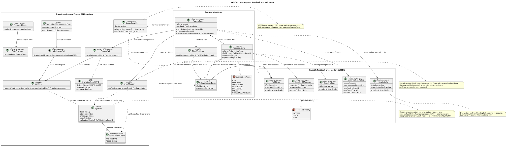
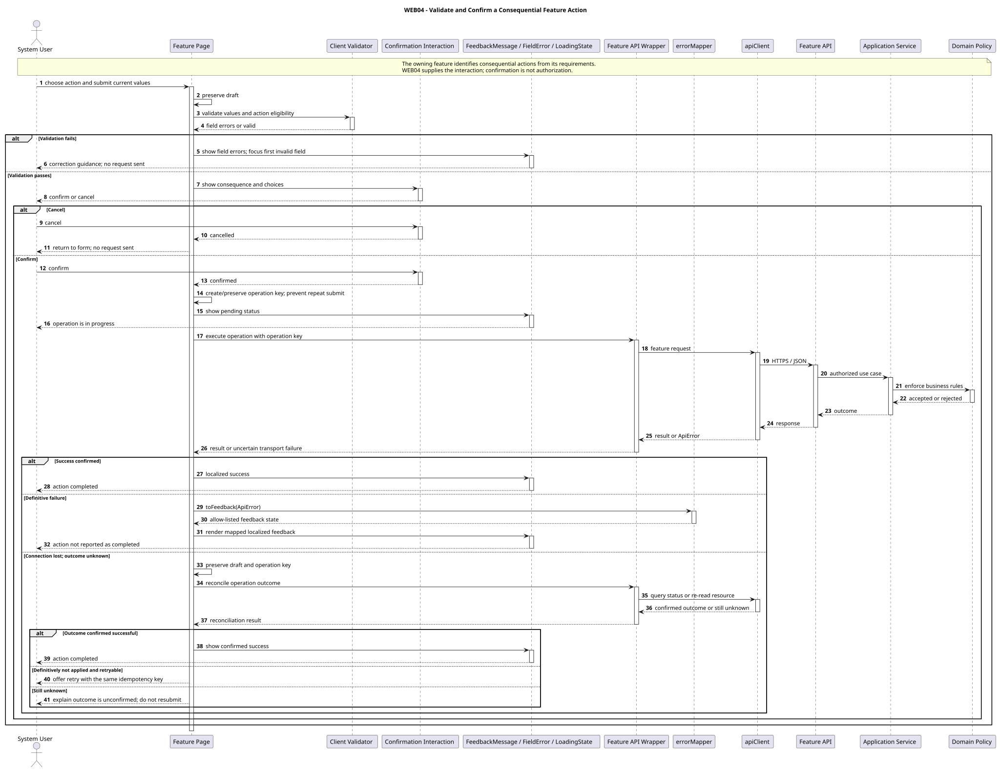
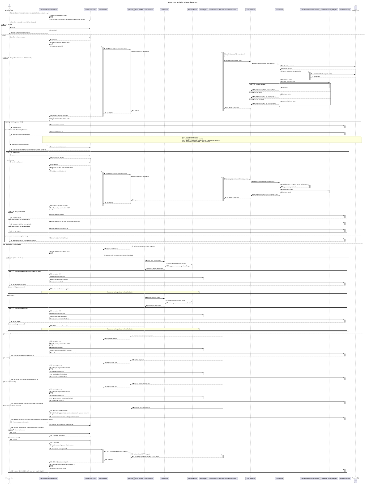
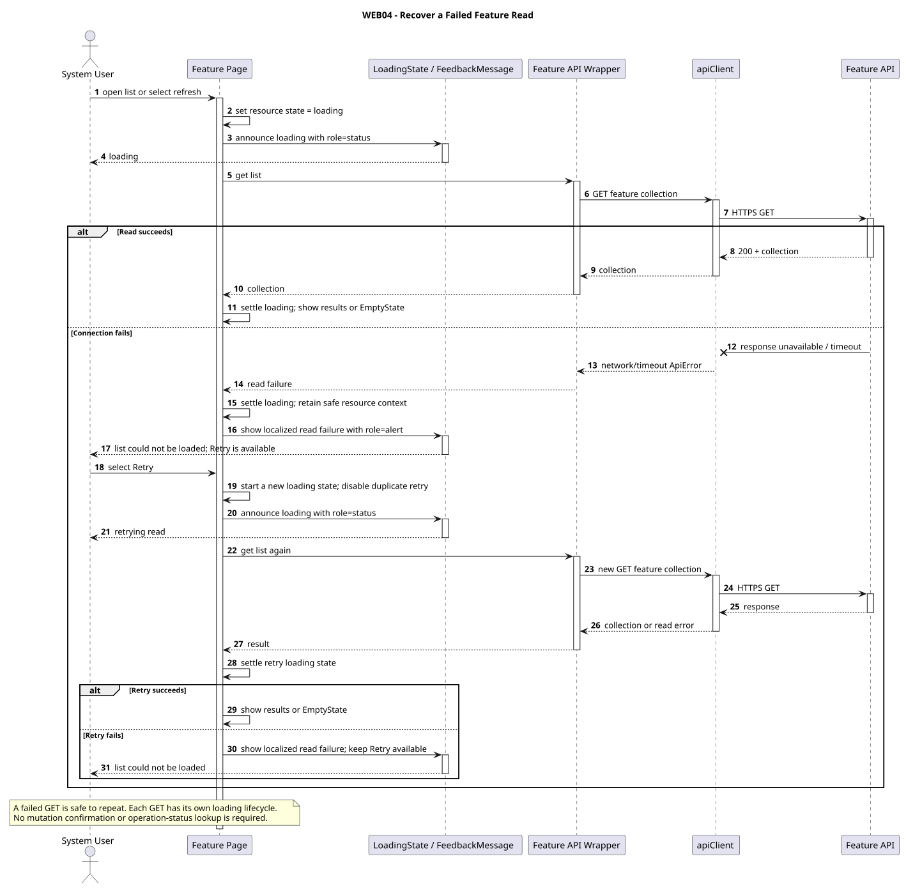

# US WEB04 – User Feedback and Validation

## 1. Context & Scope

- **User Story ID:** WEB04
- **Sprint:** Sprint 2
- **Area:** Front-End Web Application (WEB)
- **Responsible:** Sofia Carvalho (1240898)
- **Related Stories:**
  - **WEB01 – SPA Setup and Integration:** provides `apiClient` and the current normalized `ApiError` (`kind`, `status`, diagnostic `message`). WEB04 proposes optional safe `code` and `validationDetails` fields, subject to agreement with WEB01 and each API owner.
  - **WEB02 – Consistent Layout and Navigation:** provides the common shell, localization and accessible layout for feedback.
  - **WEB03 – Role-Based Navigation:** consumes loading and access-denied feedback and presents permission errors safely.
  - **WEB05–WEB07, VIS01 and AA01–AA07:** use shared feedback for forms and feature operations.
  - **AA04 – Secure Session Handling / AA05 – Authorization Enforcement:** define session and permission outcomes that the UI must keep distinct.
  - **Dependencies:** WEB01 (`ApiError`, shared SPA structure), WEB02 (shell and localization), and WEB03 (route and authorization feedback). Feature stories consume the shared feedback components.

### Scope boundary

WEB04 provides reusable user feedback and client-side validation behaviour for the SPA. It owns shared loading, success, error and empty-state presentation; field-level validation feedback and preservation of entered values after errors or language changes; duplicate-submission prevention; confirmation before actions with significant consequences; and safe handling of connection failures and retries. Feedback messages are available in Portuguese and English.

WEB04 does not define business validation rules owned by the API or feature stories, replace server-side validation, implement the business pages, or decide authentication and authorization policy. The back end remains authoritative; feedback must not expose internal details or make a failed operation appear successful.

---

## 2. Requirements & Analysis

### 2.1. User Story Description

> **As a** System User,  
> **I want** clear, localized feedback for actions and failures,  
> **so that** I can understand results and correct invalid input without losing my work.

### 2.2. Acceptance Criteria

- [ ] **AC 1:** Success messages must confirm relevant actions such as saving, updating, or deactivating information.
- [ ] **AC 2:** Validation errors must identify the affected fields and explain how to correct the input
- [ ] **AC 3:** Loading indicators must be shown while information is being obtained or operations are being processed.
- [ ] **AC 4:** Failures must be presented in clear language without exposing internal system details or sensitive information.
- [ ] **AC 5:** An unsuccessful operation must not be presented as completed, and user input should be preserved where appropriate.
- [ ] **AC 6:** Actions with significant consequences must request confirmation before they are completed.
- [ ] **AC 7:** Repeated submissions while an operation is in progress must be prevented, and connection failures must allow users to recover or retry safely.

### 2.3. Client Clarifications & Questions

The [Sprint 2 client clarifications (§§15–16)](https://github.com/Departamento-de-Engenharia-Informatica/LEI-SEM5-PI-2026-27-3DE-01/blob/d3f1b4295b3feb219423e91b28c8b729aae44945/docs/architecture/clientClarifications/clarifications.md) are relevant to WEB04: §15 informs localized feedback, preservation of in-progress work, and stale-edit handling; §16 informs authentication, role refresh, and authorization feedback. The invitation retry behavior below also follows the WEB04 clarification recorded for this story.

**Client Clarifications:**

- Feedback messages must be available in **Portuguese and English**. Changing the selected language must not clear or reset data already entered in a form.
- Feedback messages must not reveal important or sensitive data. 
- If sending an account invitation fails, the interface must show the failure and allow the invitation to be sent again for the **existing account**. That account remains inactive until activation succeeds. A failed invitation may be reported in the response body even when the HTTP status is `200`; the interface must use the operation result, not the status code alone, to decide whether to show success.

### 2.4. Business Rules & Invariants

- **Localized feedback:** All shared feedback messages are available in Portuguese and English. Switching language changes the displayed text but preserves the current form values and validation context. 
- **Field validation:** Client-side validation errors are associated with the relevant fields and explain how to correct them. API validation errors are associated with a field only when the response identifies that field unambiguously; otherwise, show a general form-level error. Client-side validation does not replace server-side validation.
- **Preserve user input:** Form values remain available after client or API validation errors, connection failures, and language changes, so the user can correct or retry without re-entering the data.
- **Single in-flight submission:** A form action cannot be submitted again while its current request is in progress.
- **Confirmation:** Before an action with significant consequences is sent, the interface requests confirmation. This includes destructive actions and permission changes such as assigning the Administrator role; the owning feature identifies which actions require confirmation. Every invitation send/replace action, including a retry after a failed or lost response, requires confirmation because it may invalidate the previous invitation. The dialog explains this consequence and never reveals the full recipient address or invitation token.
- **Safe error presentation:** Feedback does not expose stack traces, SQL, tokens, request credentials or other internal details. It preserves the distinction between unauthenticated (`401`) and forbidden (`403`) outcomes. A successful HTTP status alone is not sufficient to show success when the operation result reports a failure (for example, invitation delivery failure in an HTTP `200` response).
- **Concurrent edits:** If another user changed a record, the interface informs the user and requires review of the current record before another save. WEB05/BCK05 must identify stale versions distinctly, preferably with `412 Precondition Failed`; if using `409`, the response must include a stable code such as `STALE_VERSION`. Other `409` conflicts use their own safe, code-specific guidance and must not automatically be treated as stale edits.
- **Uncertain mutation outcome:** If a connection fails before a mutation response arrives, the operation may already have completed. Keep the submitted values, use the feature API's read-back or operation-status contract when available, and do not blindly repeat a non-idempotent mutation. If the result cannot be determined, explain that it remains unconfirmed and keep recovery unavailable until a safe action can be offered. Do not discard the user's input.
- **Read failure and retry:** If a GET fails, stop that read's loading state, show a safe localized failure, and offer an explicit retry of the GET. A read retry does not require a mutation confirmation. Each retry is a new request with its own pending state; do not keep the previous loading indicator active while the user decides.
- **Invitation retry and lost response:** AA06's invitation POST returns the delivery result (`SENT` or `FAILED`) in its response body. If the response is lost, the UI marks that attempt's outcome unknown, settles its loading state, and offers a confirmed replacement invitation to the same existing inactive account. The replacement POST returns its own `SENT` or `FAILED` result; it invalidates the previous invitation, does not create another account, and is never sent automatically. The confirmation warns that the previous invitation may stop working. No separate invitation-status query is required by this design.
- **Truthful operation state:** Loading feedback is removed as soon as that request settles, whether it succeeds, fails, or loses its connection. A later retry is a separate confirmed action with a fresh loading state. Success is shown only after the operation is confirmed successful; an empty result is not treated as a failure. A successful change is presented using the saved state returned or re-read from the API.

### 2.5. Domain Model Excerpt

WEB04 is a presentation and interaction story and introduces no business-domain aggregate. It consumes existing API outcomes and form data; its relevant concepts are the shared `ApiError`, feedback state, and form validation state. No domain model changes are required.

## 3. Design

### 3.1. Architecture & C4 Alignment

This User Story operates within the established **C4 Model** of the system:
- **C4 Level 1 (System Context):** The actor (System User) interacts with the *LaPrizza Information System* via HTTPS ([System Architecture and Design](../../../architecture/SAD.md)).
- **C4 Level 2 (Containers):** The request originates from the *UI* and targets the *Back-End API*, which persists state in the *Database* ([System Architecture and Design](../../../architecture/SAD.md)).
- **C4 Level 3 (Component Diagram):** As defined in the global Back-End architecture ([System Architecture and Design](../../../architecture/SAD.md)).
---

### 3.2. Class Diagram (CD)

The diagram describes shared feedback contracts and front-end dependencies. The complete back-end layer path is documented below rather than adding unrelated feature backend classes to this class view.



| Component / type | Owner | Inputs / state | Responsibility |
| --- | --- | --- | --- |
| FeedbackMessage | WEB04 | severity, localized message key, safe parameters | Present success, error, or informational feedback with appropriate status semantics. It does not decide whether an operation succeeded. |
| LoadingState | WEB04 | Localized pending label | Announce a pending read or mutation. Pending state is owned by the page or route. |
| EmptyState | WEB04 | Localized heading/help and optional page-owned action | Explain a successful empty result; never represent a failure. |
| FieldError | WEB04 | Allow-listed field identifier and localized message key | Associate safe correction guidance with its input. The feature form retains its value. |
| ConfirmationDialog | WEB04 | Localized consequence, confirm/cancel labels, callbacks | Return a choice before a designated action is sent. Cancel invokes no feature request; the feature owner decides eligibility. |
| Feature page/form | WEB05–WEB07, account/module owner | Local draft values, validation state, pending state, result | Orchestrate its use case and compose shared feedback. Contains no authoritative business rules. |
| Feature API adapter | Owning feature | Feature request and response DTOs | Map feature operations to apiClient calls; separate from feedback presentation. |
| apiClient / ApiError | WEB01 | Current: HTTP status, kind, diagnostic message. Proposed: recognized code and safe validation details | Current contract has no structured field details or code. WEB04 proposes `code`/`validationDetails` for agreement with WEB01 and the API owners; until adopted and implemented, API validation errors without an identified field map to form-level feedback. |
| AdminUserManagementPage / adminUserApi | Existing AA06 consumer | Selected account, role draft, invitation result | Reuse as the concrete example of shared success/error feedback and invitation retry; AA06 retains account/role policy. |
| LocaleProvider / message catalog | WEB02 | Current supported locale and message keys | Resolve PT/EN copy. Locale changes do not reset page draft or validation state. |
| AuthProvider / ProtectedRoute | AA03 / WEB03 | Session and authorization outcome | Preserve existing session/route behavior; WEB04 does not merge 401 and 403. |

### 3.3. Use Cases and Sequence Diagrams (SD)

Each diagram covers a representative interaction and an important alternate or failure path. The generic submission flow does not prescribe a feature endpoint; the invitation flow uses the existing AA06 contract.

| SD | Use case and principal alternatives | Criteria |
| --- | --- | --- |
| **SD 1** | Validate and submit a feature form; map 400/422 validation feedback; distinguish stale-version failures from other 409 conflicts; process success or connection loss with unknown outcome. Preserve the draft and prevent duplicate in-flight submission. | AC 1–5, AC 7 |
| **SD 2** | Validate a consequential action before confirmation; cancel sends no request; confirmation proceeds through the feature API. Reconcile a lost response without blindly resubmitting. | AC 2, AC 4–7 |
| **SD 3** | Confirm every invitation send/replace, including retries; settle each request's loading state before showing another action; handle SENT/FAILED, non-retryable failure, documented HTTP errors, and a lost response recovered by a separately confirmed replacement POST to the same account. Route 401/403 through AA04/WEB03 before local feedback. | AC 1, AC 4–7; AA06 |
| **SD 4** | Recover a failed collection read: settle loading, show an error, and allow the user to retry the GET as a new request. | AC 3, AC 4, AC 7 |

#### SD 1 — Submit and present feedback


#### SD 2 — Confirm a consequential action



#### SD 3 — Invitation failure and retry



#### SD 4 — Read failure and retry




### 3.4. REST API Specification 

WEB04 adds no business endpoint. Feature pages call their owning feature adapters, which use apiClient. API contracts remain feature-owned.

| Method | Endpoint / contract | Use in WEB04 | Auth / role |
| --- | --- | --- | --- |
| GET | Existing feature endpoints defined by WEB05–WEB07, VIS01, and AA stories | Reads use the feature API adapter. On a connection failure, stop loading, show an error, and let the user repeat the GET. | As defined by each endpoint and AA05. |
| Any | Existing feature mutations defined by WEB05–WEB07, VIS01, and AA stories | Feature page submits through its adapter; mutation recovery follows that API's idempotency, status, or read-back contract. | As defined by each endpoint and AA05. |
| POST | /api/v1/users/:id/activation-invitations | AA06 invitation request. No body. The POST response carries `deliveryStatus` (`SENT` or `FAILED`), expiry, and `retryable`; never the invitation token. A lost response is recovered by a new, explicitly confirmed replacement POST for the same account, which returns its own `SENT`/`FAILED` result and invalidates the previous invitation. | Bearer authentication; ADMINISTRATOR. |

#### Existing contracts

The current general backend error body is `{ error: { message, status } }`. WEB01 currently maps it to `ApiError` with `kind`, `status`, and `message`; it does not preserve response details or error codes. WEB04 proposes optional `validationDetails` for recognized 400/422 error bodies and stable `code` values for conflict mapping. This is a proposal to agree with WEB01 and each API owner, not an existing or committed WEB01 contract. Shared backend schema validation currently returns a generic 400 Invalid request body without field details, and some user/password operations return 422; until the extension is agreed and implemented, API validation errors without an identifiable field map to safe form-level feedback. For an operation whose body contains a result state, the body matters: AA06 invitation delivery returns HTTP 200 for either SENT or FAILED.

The invitation outcome is determined by `deliveryStatus`, not HTTP 200 alone. `FAILED` with `retryable=true` is shown as failure and permits a confirmed replacement POST against the same inactive account; `FAILED` with `retryable=false` is terminal and has no retry action. A lost response is shown as an unknown outcome after the attempt's loading state settles. Recovery is a new, explicitly confirmed replacement POST to the same account; its response reports `SENT` or `FAILED`, and AA06 invalidates the prior invitation. This may send a replacement even if the prior email was delivered, so confirmation must explain that consequence. For documented 404, 409, and 503 responses, show safe localized resource-unavailable, conflict, or service-unavailable feedback and settle loading before presenting any next action. 401 and 403 remain distinct; backend authorization is authoritative.

#### Validation, authentication, and error mapping

- **Client validation:** checks the form draft before a request and associates its own known errors with the corresponding controls.
- **API validation:** checks request shape and business constraints. WEB04 proposes an optional safe-detail contract for agreement with WEB01 and the APIs that return validation errors. Under that proposal, 400/422 `error.details` may provide an allow-listed field identifier and stable code; WEB01 would carry only those safe tokens. The mapper produces a field error only when both values are recognized for that feature. Until the proposal is agreed and implemented, API validation errors without an identified field become form-level feedback. No rejected values or raw messages are shown.
- **Application/domain validation:** the owning application service and domain enforce business rules. The controller maps HTTP/DTOs and does not own those rules.
- **Error mapping:** the front-end `errorMapper.toFeedback(ApiError)` module maps only normalized `kind` and `status`, plus future allow-listed field identifiers and error codes, to safe localized feedback state. It preserves the 401/403 distinction and maps unknown/network failures to generic copy. `ApiError.message` is never rendered or used as user-facing copy.
- **Safe feedback:** never display raw exceptions, SQL, stack traces, tokens, credentials, submitted values, or sensitive customer/account data. Use localized allow-listed messages; if a field cannot be identified unambiguously, show a form-level error.
- **Access outcomes:** retain the established 401 unauthenticated versus 403 forbidden distinction. Route a 401 through AA04 session handling first; route a 403 through WEB03 role refresh and route re-evaluation first. Show local feedback only if that handling leaves the feature page mounted and available. Business API authorization remains with the backend, and feedback does not expose protected information.

| Normalized outcome | Feedback mapping |
| --- | --- |
| 400 or 422 with a recognized allow-listed field code and field identifier | Localized field error associated with that field. |
| 400 or 422 without recognized details, or another validation failure | Localized form-level error; retain the draft. |
| 401 | Route through AA04 session handling first; show local authentication feedback only if the page remains mounted after session handling. |
| 403 | Route through the WEB03 role refresh/re-evaluation first; show local permission feedback only if the page remains available, otherwise the access-denied route takes over. |
| 404 | Safe resource-unavailable feedback without exposing identifiers or protected resource details. |
| 412, or 409 with recognized `ApiError.code = STALE_VERSION` | Stale-version feedback; retain the draft and require review of refreshed state before another save. |
| Other 409 with a recognized conflict code | Conflict-specific localized guidance; do not label it a stale edit or force a reload unless that conflict contract requires it. |
| 503 or unknown transport/server failure during a mutation | Generic service-unavailable feedback. For uncertain non-idempotent writes, use the API's agreed reconciliation contract; do not blindly retry. |
| Network/timeout failure during a GET | Settle the loading state, show a localized read failure, and offer an explicit retry of the GET. No mutation confirmation is needed. |
| Network/timeout failure during invitation POST | Settle the attempt's loading state, show outcome unknown, and offer a separately confirmed replacement POST for the same account; the replacement invalidates the prior invitation and returns its own `SENT`/`FAILED` result. |

In every case, the UI maps the current `ApiError.kind` and `ApiError.status`; conflict mapping may use a recognized `ApiError.code`, and validation mapping may use only allow-listed `ApiError.validationDetails` if the proposed extension is agreed and implemented. It never renders `ApiError.message`.

#### Integration contracts

- **Validation-detail dependency:** relevant 400/422 API responses may adopt `error.details: [{ field?, code }]`, with stable allow-listed codes and field identifiers only. WEB04 proposes that WEB01's `apiClient` filter these fields into `ApiError.validationDetails`; this requires agreement with WEB01 and each API owner. Until then, errors without a field identifier remain form-level. Raw submitted values, tokens, exception text, SQL, and personal/sensitive data are never included in details or displayed.
- For mutations that cannot be reconciled by reliable resource read-back, the API must accept an idempotency key scoped to the caller and operation, and retain the definitive result for the same key and request. Repeating that request with the same key must not repeat its business effect; reusing the key with a different payload must be rejected. For asynchronous operations or external effects not verifiable by resource read-back, the owning API must expose operation status unless its recovery contract explicitly uses a confirmed replacement operation, as AA06 does for invitations. A retry of the same operation reuses its key; a new key is not used to retry an uncertain outcome. API owners must define key retention long enough to cover the supported recovery window.
- If the owning API does not yet provide idempotency or operation status, the client may re-read the affected resource through its feature API adapter. It must not blindly retry a non-idempotent mutation. If read-back cannot determine whether the action took effect, keep the outcome unconfirmed and do not offer an automatic retry; AC 7 remains incomplete for that mutation until reliable recovery is available. This fallback limits duplicate risk but does not substitute for the required API contract. The invitation flow is the defined exception: a lost response is recovered by a separately confirmed replacement POST against the same account, whose result is returned as `SENT` or `FAILED` and whose replacement semantics are documented by AA06.
- Mutable resources should expose a version/ETag and require it on update. Reject stale versions distinctly, preferably with `412 Precondition Failed`; if `409` is used, return `error.code=STALE_VERSION`. Other conflicts must have distinct codes and meanings. WEB01 carries recognized codes into `ApiError.code`. The client preserves the draft and requires review of refreshed state before another stale-version save.
- Exact field names, headers, DTOs, status representation, key retention, and response mapping must be agreed and documented by each API owner. WEB04 does not invent endpoint paths.

### 3.5. Persistence & Data Integrity (ARC04)

WEB04 introduces no database persistence and no business-domain aggregate. Form values, field errors, and pending/feedback state stay with the mounted feature page; locale preference belongs to WEB02; session state belongs to AA03/AA04; business data remains in the back end.

#### State ownership and transitions

| State | Owner and behavior | Transition |
| --- | --- | --- |
| Draft / idle | Feature page owns values; previous operation feedback is cleared when a new attempt starts. | Submit starts local validation. |
| Validating | Feature page runs client checks; field errors render beside controls; no request is sent when invalid. | Return to draft or continue to confirmation/submission. |
| Confirming | Shared confirmation view is open; no request is sent yet. | Cancel returns to draft; confirm starts the operation. |
| Submitting / loading | Page marks the operation pending, announces progress, and blocks another submit. | Resolve to success/failure or uncertain outcome. |
| Succeeded | Enter only after the operation result confirms success. Show returned or re-read saved state. | New operation returns to draft/idle. |
| Failed | Show safe localized error and retain the draft. Empty successful reads use EmptyState instead. | User corrects values or retries only when safe. |
| Outcome unknown | Preserve the draft and use the mutation's status/read-back contract. Never blindly resubmit a non-idempotent mutation. For an invitation, settle the failed attempt and offer a separately confirmed replacement POST against the same account. | Confirm success, confirmed not applied/retryable, or remain unknown with clear explanation; invitation replacement returns its own `SENT`/`FAILED` result. |

`SubmissionPhase` describes mutations. Initial/read loading and successful empty results belong to the feature page's resource state and use `LoadingState`/`EmptyState`; they are not mutation phases. A failed GET settles that resource's loading state and exposes an explicit retry action; invoking it starts a new GET and a new pending state.

Language selection is shared state; changing it updates message text while the feature page remains mounted with the same values and validation context. The UI does not persist business drafts or feedback state globally.

If an API owner adopts the proposed recovery contract, that owner is responsible for persistence needed to make idempotency/status reliable and for record-version integrity. That storage belongs to the relevant backend module and persistence design; it is not a WEB04 table or repository. The UI treats identifiers and DTO fields as opaque and never treats feedback state as business truth.

### 3.6. Applied Patterns & Architecture Principles

- **Presentation composition:** Feature pages compose focused feedback views rather than putting all status/validation rendering in one large page component.
- **Single responsibility:** Feedback components display; feature handlers coordinate; API adapters map endpoint contracts; apiClient transports and normalizes errors.
- **Dependency direction:** Feature pages depend on shared presentation and their API adapters. Shared feedback uses WEB02 locale contracts; it does not import feature modules or call the backend.
- **Back-end authority / defense in depth:** Client validation improves usability; API and domain layers remain authoritative. Hiding actions is not authorization.
- **DTO boundary:** Feature request/response DTOs remain separate from domain entities. The UI maps safe error codes and operation result DTOs to localized messages.
- **Authentication / authorization:** Existing AuthProvider, route guards, and backend middleware remain authoritative. WEB04 presents outcomes but neither grants access nor treats hidden actions as authorization.
- **Accessibility:** Loading and success feedback use `role="status"`; errors use `role="alert"`. Invalid controls set `aria-invalid="true"` and reference their `FieldError` with `aria-describedby`. After failed submit, focus moves to the first invalid control. `ConfirmationDialog` traps focus while open, closes on Escape as cancel, and restores focus to its invoking control. Cancel sends no request.
- **SOLID:** Single Responsibility is reflected in the display, page orchestration, API adapter, and transport boundaries. Open/Closed is supported by message keys and presentation variants. Adapters remain substitutable when they honor DTO/ApiError contracts. Pages use only needed feedback/adapter operations. UI depends on locale/API contracts rather than Express or persistence.

#### End-to-end architectural traceability

| Use case | Interaction path | Layer responsibility |
| --- | --- | --- |
| Feature read or mutation | SPA feature page → feature API adapter → WEB01 apiClient → feature API route/auth/role middleware → controller → application service → domain/policy → repository port/adapter → database → response DTO → feature page and WEB04 feedback | The page owns presentation/draft state; adapter owns endpoint mapping; API middleware authorizes; controller maps HTTP/DTOs; application coordinates; domain enforces rules; repository persists. DTOs are not domain objects. |
| Invitation retry | Administrator page → adminUserApi → apiClient → UserRoutes and Administrator middleware → UserController → UserService → User/invitation repository and invitation delivery adapter → InvitationResult DTO → page feedback | AA06 owns account/invitation behavior and email integration. WEB04 interprets the result for the user but does not send email or change account state. |

No WEB04 API call is made directly to IARTI or SGRAI. The email service is only an indirect AA06 backend dependency.

#### Testability assessment

No test files are added by this design task. The design supports:

| Level | Scenarios and expected behavior |
| --- | --- |
| React component | Accessible success/error/loading/empty states; field association; draft retained after validation/API failure and locale switch; duplicate submission blocked; cancel sends no request. |
| API / Postman | Endpoint authorization and validation; proposed safe field-detail response after owner agreement; stale version rejected distinctly from unrelated conflicts; AA06 invitation POST returns `SENT`/`FAILED`, and a confirmed replacement targets the same account after `FAILED` or a lost response. No invitation-status GET is assumed. |
| End to end | Successful save shows returned/refreshed state; invalid input can be corrected without data loss; failed GET can be retried after loading settles; uncertain writes follow their API recovery contract; stale edit requires review; confirmation versus cancel; each invitation replacement requires confirmation and returns its own result. |

#### Bounded contexts and external modules

WEB04 creates no bounded context or domain language. It consumes feature-owned API outcomes without treating similarly named fields as identical domain concepts. User/invitation concepts remain in AA06 user-authentication management; catalogue, kitchen, and planning data remain with their respective feature contexts. The invitation email adapter is called by AA06's backend workflow, not by the SPA feedback components.

## 4. Tests (ARC05)

### 4.1. Implementation Summary

WEB04 introduces shared localized feedback, loading and empty-state components, safe API error mapping, a submission guard, and an accessible confirmation dialog. The existing catalogue read flows, administrator account actions, and password-change flow compose these shared components. Invitation outcomes follow AA06's `deliveryStatus` and `retryable` response fields; uncertain role/deactivation outcomes use the existing user read endpoint and are never resubmitted automatically. Existing form validation and locale-switch behavior are also covered by the existing authentication and application tests.

### 4.2. Main Jest Scenarios

#### Scenario — Retry a failed invitation after confirmation

**Objective:** Verify that an AA06 `FAILED` result marked retryable is shown as a failure, then a replacement invitation is sent only after confirmation and its own `SENT` result is shown.

**Preconditions:** An administrator manages an existing inactive account that has never been activated. The first invitation response is `FAILED` with `retryable: true`; the replacement response is `SENT`.

**Test Steps:**
1. Request an invitation and confirm the consequential action.
2. Observe the failed delivery feedback and the explicit retry action.
3. Request a replacement, review the warning that the previous invitation may stop working, and confirm.

**Expected Result:** Failure is not presented as success. Retry is available for the same account, requires confirmation, and the replacement response determines the final feedback.

#### Scenario — Recover an invitation with an unknown outcome

**Objective:** Ensure a lost invitation response does not lead to an automatic or unconfirmed POST retry.

**Preconditions:** An administrator manages an existing inactive account; the invitation request fails with a network error.

**Test Steps:**
1. Confirm the invitation request.
2. Observe the unknown-outcome message and retry action.
3. Open the replacement confirmation and cancel it.

**Expected Result:** The attempt settles, internal error details are hidden, and cancellation sends no replacement request.

#### Scenario — Confirm or cancel consequential account changes

**Objective:** Verify that deactivation, reactivation, and role changes require explicit confirmation before the API operation.

**Preconditions:** An administrator has a loaded account and requests a consequential action.

**Test Steps:**
1. Open the confirmation dialog for deactivation and cancel it.
2. Open the reactivation dialog and confirm it.
3. Exercise the role-update flow and confirm the requested role set.

**Expected Result:** Cancellation sends no request; confirmation sends the intended operation. The dialog announces its consequence, traps keyboard focus, closes on Escape as cancellation, and restores focus to its opener.

#### Scenario — Preserve the role draft during uncertain-outcome review

**Objective:** Verify that a pending mutation cannot be submitted again; a timeout or unreadable 2xx response is reconciled by read-back; and a differing server state does not overwrite the administrator's draft before explicit review.

**Preconditions:** An administrator changes an account role. One request remains pending. A separate update ends with an unknown outcome (`timeout` or `invalid-response`), and the read-back returns roles different from the submitted draft.

**Test Steps:**
1. Start the role update and inspect the pending state and disabled controls.
2. Resolve the pending operation and verify only one request was made.
3. Simulate an unreadable success response and inspect the user read-back result.
4. Verify that the submitted draft remains visible and mutations stay blocked; explicitly review the returned current data.

**Expected Result:** A pending operation cannot be submitted twice. An uncertain outcome triggers one read-back and no mutation retry. If the server state differs, the draft remains intact and controls remain blocked until the administrator explicitly reviews the current data; only then are the server values applied and editing re-enabled.

**Actual Result:** Passed. The invalid 2xx payload entered reconciliation, the differing server roles did not replace the draft, and the review action applied the current roles and released the block without repeating the mutation.

**Jest References:** `test/user-management/AdminUserManagementPage.test.js` — `does not automatically retry a pending role update` and `preserves the role draft and blocks changes until current data is reviewed after an unknown update`; `test/shared/api/apiClient.test.js` — `distinguishes an invalid success payload from a connection failure`.

**Acceptance Criteria:** AC 3, AC 5, AC 7.

#### Scenario — Reflect a server-confirmed deactivation after timeout

**Objective:** Verify that a read-back confirming an uncertain deactivation updates the displayed account and available actions.

**Preconditions:** An administrator manages an active account. The deactivation request times out; the account read-back returns `active: false`.

**Test Steps:**
1. Request and confirm account deactivation.
2. Simulate a timeout and allow the page to read the account.
3. Inspect the account status and available action buttons.

**Expected Result:** The mutation is not repeated. The account is shown as inactive and the Reactivate action is available instead of Deactivate.

**Actual Result:** Passed. One deactivation request was made; the read-back updated the displayed account and its available action.

**Jest Reference:** `test/user-management/AdminUserManagementPage.test.js` — `updates the displayed account and actions when read-back confirms deactivation`.

**Acceptance Criteria:** AC 1, AC 5, AC 7.

#### Scenario — Show password-change confirmation after ending the session

**Objective:** Verify that changing a password requires explicit confirmation, preserves the draft if cancelled, then ends the session and shows the sign-in confirmation after success.

**Preconditions:** The user is signed in to an account with a local password and is on the change-password page.

**Test Steps:**
1. Submit the current password and a valid new password with matching confirmation; verify that a consequence dialog appears before the API request.
2. Cancel once and verify that no request is sent and the entered values remain.
3. Submit again and confirm the change.
4. Inspect the destination route and feedback message after the successful response.

**Expected Result:** Cancellation sends no request and preserves the draft. Confirmation sends the request; on success the session is discarded, the user is redirected to `/login`, and the localized success message instructs them to sign in with the new password.

**Actual Result:** Passed. Cancellation kept the draft and made no request. Confirmation sent `PATCH /auth/password`, after which the app navigated to `/login` and rendered the success message.

**Jest References:** `test/app/App.test.jsx` — `cancels password-change confirmation without losing the form or sending a request` and `shows password-change confirmation on the sign-in page after logout`.

**Acceptance Criteria:** AC 1, AC 5–6.

#### Scenario — Retry a failed read and distinguish an empty result

**Objective:** Verify that a failed catalogue GET settles loading, offers an explicit retry, and keeps a successful empty catalogue distinct from an error.

**Preconditions:** The catalogue GET first fails with a network error; a subsequent GET succeeds with an empty list.

**Test Steps:**
1. Load the catalogue and observe the safe error feedback after the request fails.
2. Choose the explicit retry action.
3. Observe the empty state returned by the successful request.

**Expected Result:** Loading ends on failure, no diagnostic error is exposed, retry starts a new GET, and an empty success is not shown as an error.

#### Scenario — Keep validation context and entered values across locale changes

**Objective:** Verify that an unsaved form and its validation feedback survive a language change.

**Preconditions:** A user has entered invalid local-registration data and the page has displayed validation feedback.

**Test Steps:**
1. Enter form data that triggers validation feedback.
2. Change the selected language.
3. Inspect the same form and its feedback in the new language.

**Expected Result:** Text is translated while the form values and validation state remain available.

#### Scenario — Map API errors to safe, distinct feedback

**Objective:** Verify that normalized transport/status metadata maps to localized allow-listed messages without rendering the server diagnostic message.

**Preconditions:** The mapper receives representative network, timeout, 401, 403, validation, conflict, stale-version, and unknown errors.

**Test Steps:**
1. Pass each normalized error to `toFeedback`.
2. Inspect the severity and localized message key.
3. Verify raw diagnostic text is not returned as feedback.

**Expected Result:** 401 and 403 remain distinct; network and unknown errors use safe generic messages; server text is never exposed.

### 4.3. Test Execution Summary

The main WEB04 Jest examples were executed from `frontend/` using the six suites referenced above. The complete frontend Jest suite was also run.

| Test Suite | Passed | Failed | Skipped |
| --- | ---: | ---: | ---: |
| Main WEB04 Jest examples (`AdminUserManagementPage`, `ConfirmationDialog`, `CataloguePage`, `App`, `errorMapper`, `apiClient`) | 70 tests across 6 suites | 0 | 0 |
| Full frontend Jest suite (`npm test -- --runInBand`) | 235 tests across 23 suites | 0 | 0 |
| API health/CORS integration (`npm run test:integration`) | 1 | 0 | 0 |

The API integration test starts a local Express server and passed with loopback networking enabled. It verifies the health/CORS contract; it is not a browser end-to-end test.

### 4.4. End-to-End Validation and Limitations

The repository has Jest and a Node API health integration test, but no Playwright, Cypress, or other browser end-to-end runner. Therefore, no real SPA-to-backend user journey was executed in a browser, and none is claimed here. The component tests exercise the page/API-adapter boundary with controlled responses; they do not establish browser-to-live-backend behavior.

**Manual end-to-end procedure:**
1. Start the backend and frontend using the repository's documented development commands and a test administrator account.
2. Sign in as an administrator and open user management. Confirm the user list loads and the pending indicator settles.
3. Choose an inactive account that has not been activated, request an invitation, and confirm. Verify the AA06 result appears; for a controlled delivery failure, verify the failure and explicit retry path.
4. Request a replacement, verify the warning, cancel once and confirm no invitation is sent; repeat and confirm to verify the replacement result.
5. Exercise a role update and account deactivation/reactivation, confirming each dialog and verifying the re-read account state.
6. Open the public catalogue, simulate or cause a read failure, use the explicit retry, and verify a successful empty response is displayed as an empty state.
---

## 5. Implementation

### 5.1. File Structure

WEB04's reusable feedback primitives live in `shared`; feature pages own operation state and compose those primitives. Catalogue and administrator account management are the current concrete consumers. The relevant implementation and test files are:

```text
frontend/
├── src/
│   ├── shared/
│   │   ├── feedback/
│   │   │   ├── ConfirmationDialog.jsx
│   │   │   ├── EmptyState.jsx
│   │   │   ├── FeedbackMessage.jsx
│   │   │   ├── FormFeedback.jsx
│   │   │   ├── LoadingState.jsx
│   │   │   └── errorMapper.js
│   │   ├── hooks/
│   │   │   ├── useFormValidation.js
│   │   │   └── useSubmission.js
│   │   ├── api/                 # Existing apiClient and ApiError contracts
│   │   └── locale/messages.js   # PT/EN feedback copy
│   └── features/
│       ├── catalogue/
│       │   ├── CataloguePage.jsx
│       │   └── catalogueApi.js
│       └── user-management/
│           ├── AdminUserManagementPage.jsx
│           └── adminUserApi.js
└── test/
    ├── app/App.test.jsx
    ├── catalogue/CataloguePage.test.js
    ├── shared/feedback/
    │   ├── ConfirmationDialog.test.js
    │   └── errorMapper.test.js
    ├── shared/api/apiClient.test.js
    └── user-management/AdminUserManagementPage.test.js
```

`apiClient` and feature API adapters remain the transport boundary. WEB04 adds no backend endpoint or new HTTP client. `FormFeedback.jsx` also exports `FieldLabel` and `FieldError` for existing feature forms.

### 5.2. Core Implementation Highlights

- **Accessible feedback:** `FeedbackMessage` uses `role="alert"` for errors and `role="status"` for other messages. `LoadingState` and `EmptyState` represent pending and successful-empty reads separately.
- **Field feedback:** `FormFeedback` and `FieldError` render localized form and field messages. `useFormValidation` associates issues with controls and focuses the first invalid field; feature pages retain ownership of their form values.
- **Safe API errors:** `errorMapper.toFeedback` maps normalized transport kinds and HTTP statuses to message keys. It does not display `ApiError.message`, which may contain diagnostic text.
- **Submission control:** `useSubmission` ignores a second operation while one is pending and distinguishes success, failure and uncertain outcomes, including unreadable successful responses. The owning feature decides how to recover an uncertain mutation.
- **Consequential actions:** `ConfirmationDialog` announces the consequence, moves focus into the dialog, traps Tab navigation, treats Escape as cancellation and restores focus when it closes. Administrator account operations and password changes start their API operation only after confirmation.
- **Feature-owned workflows:** Catalogue reads expose explicit retry and distinguish an empty response from failure. Administrator account operations consume AA06 results, apply confirmed read-backs to the displayed account, and preserve role drafts while a differing read-back awaits explicit review.
- **Localization:** shared feedback text is selected through locale message keys in Portuguese and English; shared feedback components do not own business rules or call APIs.

---

## 6. Integration, Verification & Demonstration

### 6.1. Running the Automated Tests

Run these commands from `frontend/`. The first runs the suites covering the representative WEB04 examples; the second runs all frontend Jest tests.

```bash
npm test -- --runInBand test/user-management/AdminUserManagementPage.test.js test/shared/feedback/ConfirmationDialog.test.js test/catalogue/CataloguePage.test.js test/app/App.test.jsx test/shared/feedback/errorMapper.test.js test/shared/api/apiClient.test.js
npm test -- --runInBand
npm run lint
VITE_BACKEND_BASE_URL=http://localhost:8080/api/v1 VITE_API_TIMEOUT_MS=15000 npm run build
```

The build requires `VITE_BACKEND_BASE_URL` to be set to a complete API base URL (for local development, `http://localhost:8080/api/v1`) or `/api/v1`. Section 4.3 records the executed Jest results. The latest frontend validation completed with 70/70 tests in the six representative suites, 235/235 tests in the full Jest suite, and successful lint and production build runs.

### 6.2. Manual Verification & OpenAPI Contract

Use a test environment and test accounts so that administrator actions do not affect real users or send real invitations.

1. Start the backend and frontend using their existing development scripts, then sign in with an administrator test account.
2. Open user management and verify that loading settles into a user list, an empty state, or a safe error. When the list request fails, use the explicit retry and confirm that it starts a new read.
3. Try an invitation flow with a controlled AA06 delivery result. Confirm the action; verify that `SENT` and `FAILED` are presented according to the response body. For a retryable failure or unknown result, verify that replacing the invitation requires a second confirmation. Cancel that dialog once and check that no replacement request is sent.
4. In the test account, open a consequential role or activation action. Cancel and confirm separately; cancellation must make no mutation request, while confirmation must show the result returned or re-read from the API. Keep a request pending where practical and verify that a second submission is blocked. For an uncertain role update that reads back different roles, verify the draft remains visible and the block persists until **Review current data** is selected.
5. Open the catalogue. Verify initial loading, a failed read followed by explicit retry, and a successful empty result as distinct states.
6. On a form with validation feedback, enter values, trigger a validation error, switch PT/EN, and verify that the values and validation context remain while the message text changes.
7. Change the password on a local account and verify that the session ends, `/login` opens, and the confirmation to sign in with the new password is visible.

WEB04 defines no new REST endpoint or API schema. Check the existing AA06 user/invitation contracts in their owning documentation and OpenAPI definition; the SPA continues to call them through the existing `apiClient` and feature adapter.

---

## 7. Observations, Dependencies & Limitations

- **Dependencies:** WEB01 supplies `apiClient` and `ApiError`; WEB02 supplies localization and the common shell; WEB03 and AA04 supply route, session and authorization outcomes; AA06 owns user, role and activation-invitation contracts. WEB05–WEB07 and other feature pages can reuse the shared feedback components while retaining their own business state and API adapters.
