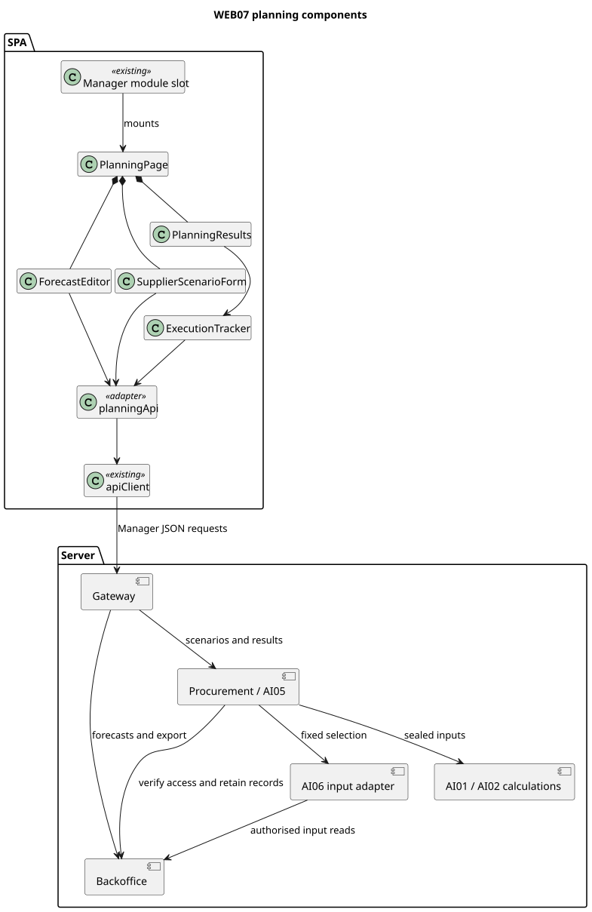
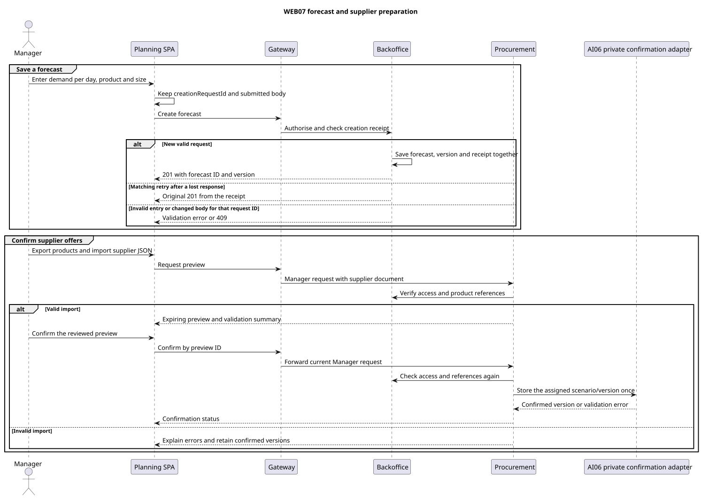
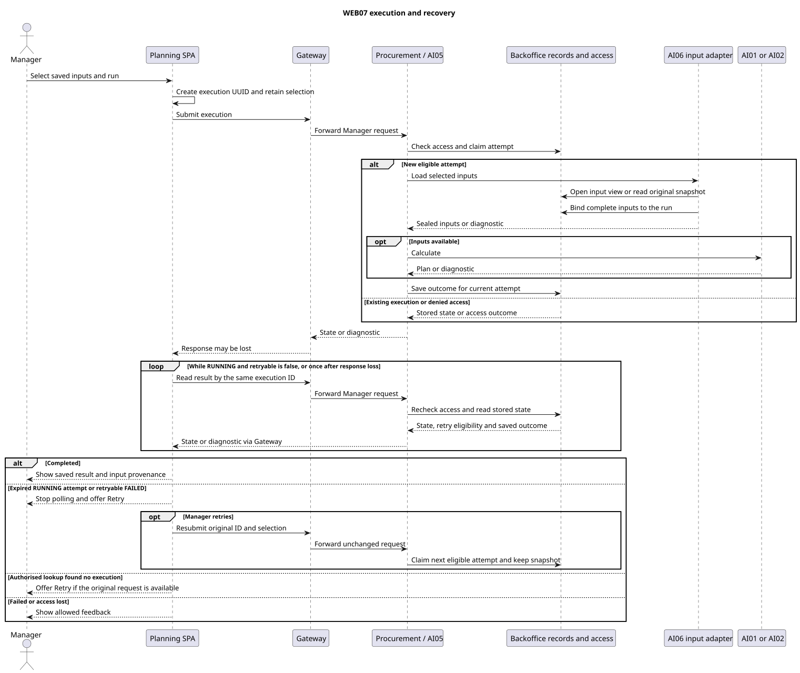

# US WEB07 – Artificial Intelligence Configuration and Execution Page

## 1. Context & Scope

- **User Story ID:** WEB07
- **Sprint:** Sprint 2
- **Area:** Front-end Web Application (WEB)
- **Responsible:** Sofia Carvalho (1240898) and Francisco Sá (1241341), per the [Sprint 2 plan](../../../Planning/Sprint2/sprintPlanning.md#web07--artificial-intelligence-configuration-and-execution-page).
- **Status:** Design for review.

References:

- **S2** – *Sprint 2 User Stories*, Part IV, WEB07 (printed pp. 6–7).
- **CC** – [Sprint 2 Client Clarifications at d3f1b42](https://github.com/Departamento-de-Engenharia-Informatica/LEI-SEM5-PI-2026-27-3DE-01/blob/d3f1b4295b3feb219423e91b28c8b729aae44945/docs/architecture/clientClarifications/clarifications.md), the source for §§17 and 19.
- **CC-WEB07** – Paulo Matos's follow-up reply on standalone sellable products.
- **SS** – *System Specification*, Part II.
- **SPA** – ARQSI, *Single Page Applications* lecture.
- [WEB01](../../web01/usWEB01.md), [story template](../../../guidelines/us_template.md), [SAD](../../../architecture/SAD.md) and [architecture decisions](../../../architecture/ADR.md).

### Scope

The Manager uses the common SPA to manage forecasts, export products, confirm supplier scenarios and compare planning results. This includes pizzas and standalone sellable products, such as drinks and desserts, wherever relevant to each operation (CC-WEB07). Purchase plans are for consultation in Sprint 2. Supplier scenario confirmation saves inputs for planning. Customer ordering, supplier order management and food-preparation scheduling are outside this story (S2 p. 3, Table 1, WEB05/07; CC §§17, 19; SS §§II.3.1.5–II.3.1.6).

### Starting point

The [route registry](../../../../frontend/src/app/navigation/moduleRoutes.js) reserves `/planning` for Managers. WEB07 will provide the module loader and reuse the [shared REST client](../../../../frontend/src/shared/api/apiClient.js). WEB01 §3.4 describes the integration.

The [back-end API](../../../../backend/src/shared/openapi/spec.js) already exposes products, sizes, pizza compositions, component consumption and available stock.

### Dependencies

- **WEB01–WEB04 and AA03–AA05** provide the shared SPA, navigation, feedback, session and access checks (S2 pp. 3–5, 9–10).
- **BCK05/06/08/09/10** supply products, sizes, component quantities, stock and pizza definitions. [WEB05](../../web05/WEB05.md) covers their management pages. AI06 supplies configured consumption per unit sold for tracked direct sales (CC §19).
- **AI01** calculates material needs, **AI02** plans replenishment and selects suppliers, **AI05** exposes the calculation service, and **AI06** supplies Prolog with the selected back-end inputs (S2 pp. 15–19).

---

## 2. Requirements & Analysis

### 2.1. User Story Description

> **As a LaPrizza Manager, I want** a website page to manage daily product-consumption forecasts and prepare supplier data in JSON, **so that** I can execute and compare planning scenarios using consistent back-end information.

The LaPrizza Manager is the only role with planning access. A user with several roles can use the page while their Manager role and session are valid (S2 WEB07 p. 6 and Table 1 p. 11; CC §16).

### 2.2. Acceptance Criteria

In specification order (S2 WEB07, pp. 6–7).

| ID | Specification criterion | Trace |
| --- | --- | --- |
| WEB07-AC01 | Provide a Manager-only SPA page to create, view, edit, and delete consumption forecasts stored in the back end. | Table 1, CC §§15–16 · BR01–03 · AS01–02, AS16 |
| WEB07-AC02 | Each forecast must have an identifier, name, start and end dates, and daily quantities of sellable products, including pizzas. Each entry identifies the date, product, applicable size, and a non-negative integer quantity. Reject unknown products, incompatible sizes, dates outside the period, and duplicate date/product/size entries. Explain that omitted entries mean zero consumption. | CC §19, CC-WEB07, AI02 · BR03–04 · AS02–03 |
| WEB07-AC03 | Allow each saved forecast to be executed through the AI service and its results consulted. Show progress and errors, and prevent duplicate submission while execution is in progress. | WEB04, AI05, CC §19 · BR05–06 · AS04–05, AS14–15 |
| WEB07-AC04 | Associate each result with the forecast version, stock snapshot, pizza BOM, and supplier scenario used. Show daily requirements, suppliers, replenishment, expected delivery dates, and unmet needs. Editing a forecast must not change the meaning of earlier results. | AI01/02/06, CC §19, CC-WEB07 · BR07, BR13–15 · AS06, AS12–13 |
| WEB07-AC05 | Export relevant back-end products as JSON, including identifiers, names, and abstract stock units. Include raw materials, purchased aggregates, and directly sold stock-controlled products needed for planning. Catalogue selling prices are optional; their absence must not exclude a product. | SS §II.3.1.4, BCK05/09, CC-WEB07 · BR08 · AS07 |
| WEB07-AC06 | Document a supplier JSON format that can be prepared manually or with optional Large Language Model (LLM) assistance. It must contain two lists: suppliers with unique identifiers (names optional), and products with existing system identifiers and a list of supplier offers for each product. | WEB07/AI06 · BR09 · AS08 |
| WEB07-AC07 | Each offer must identify a listed supplier and specify its selling price in euros (EUR), the positive integer number of abstract stock units covered by that price, and the delivery lead time in days from order placement. Prices and lead times must be non-negative numbers. Supply limits and other offer attributes are optional. | CC §19, AI02/06 · BR10–11 · AS09 |
| WEB07-AC08 | Allow supplier JSON to be imported, inspected, and explicitly confirmed before saving through the back end. Reject invalid structure, duplicate identifiers or supplier/product offers, unknown references, missing required fields, and invalid values. Explain errors and retain the previous valid dataset. | WEB04, AI06, CC-WEB07 · BR09–12 · AS08–10 |
| WEB07-AC09 | Products without offers must remain visible as having no configured supplier. Manually or LLM-generated offers must be labelled simulated. | AI02/06 · BR11–12 · AS08, AS10 |
| WEB07-AC10 | Confirmed supplier scenarios must be available to Prolog through back-end endpoints, as defined in AI06. | AI06 · BR12–13 · AS10–11, AS13 |
| WEB07-AC11 | Forecast executions calculate plans only. They must not change stored stock, including scenario input stock. Hypothetical balances and simulated purchase proposals remain scenario results. | CC §17, AI01/02/06 · BR15 · AS11, D03 |
| WEB07-AC12 | Demonstrate two forecasts with pizza consumption varying over at least two days, execution and result consultation, and unchanged stored stock. Also demonstrate product export, supplier import with two offers for one product, and rejection of unknown references and missing prices or lead times. | S2 §IV.2.3 · D01–D07 |

### 2.3. Client Clarifications & Questions

- **Purchase plans (§17).** Table 1 allows permitted operational changes and AI01/02/05/06 require separate confirmation for such changes. For Sprint 2, §17 limits plans to consultation. Stock changes come from sales or manual stock management.
- **Active references and history (§19).** New forecasts and first executions require active products and applicable sizes. Earlier results stay available. Historical replay may use the original inputs if clearly labelled.
- **Pizzas and standalone products (§19, CC-WEB07).** Drinks, desserts and other standalone sellable products also belong in forecasts, exports, supplier scenarios and replenishment plans where applicable. For pizzas, calculate requirements from the components and their quantities for the chosen size. For other stock-controlled products, multiply forecast sales by the configured stock consumption per unit sold. Only pizzas use a BOM.
- **Supplier capacity.** Lead times are whole days. A capacity limit applies per day to one offer for one product. The client states, “When no limit is defined, supplier capacity is considered unlimited.” AI02 (S2 p. 17) requires the plan to disclose this assumption. The offer's actual capacity remains unknown, and proposed quantities that rely on the assumption are conditional on supplier availability. [Client clarification §19](https://github.com/Departamento-de-Engenharia-Informatica/LEI-SEM5-PI-2026-27-3DE-01/blob/d3f1b4295b3feb219423e91b28c8b729aae44945/docs/architecture/clientClarifications/clarifications.md#19-forecasting-and-supplier-capacity)
- **Shared behavior (§§15–16).** Preserve input when switching between PT and EN. Ask users to reload stale records before saving. Apply Manager role changes immediately.

For review, comparing two saved results can satisfy the comparison goal. Show a relevant product as having no supplier when the selected scenario has no offer for it, including when the product is absent from the import (AC04/09/12).

| ID | Open question | Owner |
| --- | --- | --- |
| OP01 | Which forecast edits and deletions are allowed once an execution exists? What limits apply to the forecast period and entries? | WEB07 and back end, with ARC01 |
| OP02 | How are abstract stock units represented in the export? Who maintains consumption per unit sold? | WEB07, BCK05/09 and AI06 |
| OP03 | How will results retain the exact inputs used? Is historical replay needed? | WEB07 back end and AI06 |
| OP04 | What supplier JSON rules apply to optional fields, empty lists and capacity values? How does confirmation affect the previous scenario? | WEB07 back end and AI02/06 |
| OP05 | How are pizza sizes and BOM completeness checked? Can an internally produced component be expanded within a pizza BOM under §19 and AI01? | AI01/06 and ARC01, with the client if needed |
| OP06 | Confirm how WEB07 presents the saved result, the retryable state and the diagnostic using the [execution recovery flow](#execution-recovery). | WEB07, WEB04 and AI05 |
| OP07 | Register the [shared execution contract](../../../architecture/planning-execution-api.md) in AI05 and the Gateway. Procurement checks current Manager access through AA04. AI06 reads inputs with separate service permissions. | AA05 and AI05/06 |
| OP08 | Is consecutive result consultation enough for comparison? Is a separate BOM-only action required by Table 1? | WEB07 and AI01/02/05 |

### 2.4. Business Rules & Invariants

| ID | Rule | Source |
| --- | --- | --- |
| BR01 | Check Manager access for every operation. Procurement asks the Backoffice AA04 authority before scenario, execution, replay or saved-result requests. Invalid sessions return `401` and missing permissions return `403`. AI06 uses read-only service access for its inputs. | Table 1, AA03–05, AI05/06 |
| BR02 | Use the shared PT/EN navigation and feedback. Explain loading, empty results and failures, retain input where appropriate, confirm deletion and refresh after saving. Require reload on stale edits. | WEB01–05, CC §15 |
| BR03 | A saved forecast has a back-end identifier, name, ordered start and end dates, and a version. Only saved forecasts can be executed. | AC01–04, ARC01 |
| BR04 | An entry must fall within the period and refer to an existing sellable product, including standalone drinks and desserts. A pizza requires a compatible size. An unsized product has no size. New forecasts require active products and applicable sizes. Quantities are non-negative integers. Reject duplicate date/product/size combinations, including unsized entries. Zero is valid and omitted entries count as zero. | AC02, CC §19, CC-WEB07 |
| BR05 | Refuse first execution if a referenced product or size is inactive. Show progress, prevent repeated submission while an attempt is active and distinguish invalid or missing data from service failure. After a lost response, check the outcome with the execution ID created before submission. | AC03, CC §19, WEB04, AI05 |
| BR06 | A saved result remains available for consultation. Historical replay, if offered, uses the original inputs and is labelled as historical. | AC03/04, CC §19 |
| BR07 | Keep the forecast version, stock snapshot, pizza BOM and confirmed supplier scenario used for each result. Record input sources and versions or retrieval times, relevant product units and consumption rules, and the planning reference date. Later edits must preserve the meaning of earlier results. | AC04, AI02/06 |
| BR08 | Export product IDs, names and abstract stock units for relevant raw materials, purchased aggregates and directly sold stock-controlled products, including applicable drinks and desserts. Catalogue prices are optional. The stock unit is the measure, consumption per sale is how many units one sale uses, and quoted quantity is how many units a supplier price covers. | AC05/07, SS §II.3.1.4, CC-WEB07 |
| BR09 | Supplier JSON has a supplier list and a product list with offers. Supplier names are optional. IDs are unique within each list. Offers link a listed supplier to an existing product, which may be a standalone product bought for replenishment. Each supplier/product pair appears at most once. | AC06/08, CC-WEB07 |
| BR10 | Require a non-negative EUR price, a positive integer quantity covered by the price and a non-negative lead time in whole calendar days from order placement. AI02 compares quotes on the same stock-unit basis. | AC07, CC §19, AI02 |
| BR11 | Apply the daily capacity limit when the offer specifies one. An omitted limit leaves actual capacity unknown. The simulation applies no capacity constraint to that offer, as clarified in §19. Label manually prepared and LLM-assisted offers as simulated. Manual preparation is sufficient. | AC06–09, CC §19, AI02 |
| BR12 | Validate the complete import and let the Manager inspect it before confirmation. Explain invalid entries and retain the previous valid dataset on rejection. Show products with no offers. AI06 supplies only confirmed scenarios to Prolog. | AC08–10, AI06 |
| BR13 | AI06 supplies a consistent set of back-end inputs and records their origin. An incomplete refresh must not mix input versions. Any simulated input makes the result a simulation. | AC04/10, AI06 |
| BR14 | AI01/02 calculate pizza stock needs from component quantities by size and use available stock first. Replenish purchased aggregates directly and avoid double counting. For standalone stock-controlled products, calculate daily needs as forecast quantity × configured stock consumption per unit sold. Report missing consumption values without assuming one unit per sale. AI02 uses confirmed offers to plan replenishment, accounting for stock, cost, capacity and delivery timing. | AI01/02, CC §19, CC-WEB07 |
| BR15 | Show daily requirements, supplier, replenishment, expected delivery, unmet needs and warnings. When a proposed quantity relies on an offer with unknown capacity, identify the offer and explain that the simulation applied no capacity constraint and delivery depends on supplier availability. Include the reference date, proposed order dates and hypothetical balances where calculated. Execution leaves stored stock and scenario input stock unchanged. Purchase proposals remain simulation results. | AC04/11, AI01/02, CC §§17, 19 |

#### Manager workflows

The SPA lecture guides the transitions below (slides 12, 14–16 and 19). Forecast edits and supplier previews are local until saved or confirmed. Backoffice serves saved forecasts. Procurement serves supplier scenarios, execution status and results through the Gateway.

- **Forecasts.** Open an existing forecast or start a new one. After saving or deleting, show the updated record or list. Explain invalid entries, conflicts and failures (BR01–04).
- **Execution and comparison.** Select a saved forecast and run it with confirmed supplier data. Show progress, then the result or an explanation of the failure. Compare saved results using their daily quantities and inputs (BR05–07, BR13–15).
- **Product export.** Request JSON from current back-end data. Distinguish an empty export from a failed retrieval (BR08).
- **Supplier import.** Prepare JSON, inspect the validated offers and confirm to save. A rejected import leaves the previous scenario available (BR09–12).

#### Execution recovery

Before `POST /api/v1/planning/executions`, WEB07 generates an `executionId` and keeps it with the original request, including the forecast and, where applicable, the confirmed supplier scenario version. If the response is lost, WEB07 requests `GET /api/v1/planning/executions/{executionId}/result` with that ID and the current session. A `COMPLETED` response displays the saved result, which takes precedence over late progress responses for that ID. While an attempt is active, WEB07 shows progress and keeps repeat submission disabled.

If an attempt expires, the server returns `RUNNING` with `retryable: true`. Stop polling and offer a manual retry with the original ID and selection. Do the same for a retryable failure. After an authorised `404`, offer retry only if the original request is still available. A deliberate new run or historical replay gets a new ID. [Shared execution contract](../../../architecture/planning-execution-api.md) · [Storage and completion rules](../../../architecture/SAD.md#27-planning-access-and-records)

#### Planned acceptance scenarios

| ID | Check |
| --- | --- |
| AS01 | Allow Manager access through navigation and direct entry. Deny the page and protected operations to other roles and after Manager access is lost. |
| AS02 | Create, view, edit and delete a forecast. Verify saved state and rejection of stale edits. |
| AS03 | Save one forecast with a sized pizza and an unsized drink. Accept zero and explain omissions. Reject invalid product, size, date, quantity and duplicate entries. |
| AS04 | Run a saved forecast and consult the result. Prevent repeated submission and explain service, input and connection failures. |
| AS05 | Deactivate a referenced product or size before first execution. Refuse the run and keep earlier results available. |
| AS06 | Edit the forecast and change a planning input after execution. Verify the earlier result still reflects its original inputs. Check historical replay if offered. |
| AS07 | Export raw materials, purchased aggregates and directly sold stock-controlled products, including a drink or dessert. Verify IDs, names and abstract units. Include a product without a catalogue price. |
| AS08 | Inspect a manually prepared import with two offers for one product and a product without offers. Include an offer for an exported drink or dessert. Check simulated labels and explicit confirmation. |
| AS09 | Reject invalid structure, references, duplicates and quote values. Accept zero price and zero lead time. Verify that a stated capacity caps the daily quantity for that offer, and that a plan using an offer with no limit labels actual capacity as unknown and discloses the simulation assumption. |
| AS10 | Reject an invalid import or cancel a preview. Verify the previous scenario remains in use until a new one is confirmed. |
| AS11 | Verify Prolog uses the confirmed scenario and consistent back-end inputs. Check stored stock and scenario stock before and after. |
| AS12 | Check sufficient and insufficient stock, purchased aggregates, direct-sale consumption and missing data. Compare daily outputs and warnings against AI01/02 expectations. |
| AS13 | Forecast 6 sales of a drink configured to consume 2 stock units per sale. With 4 units in stock and no incoming stock, verify a daily requirement of 12 units and a shortfall of 8. Check replenishment against the confirmed offers for the drink. Repeat with the consumption value missing and verify that the result reports missing data. |
| AS14 | Lose the response after a forecast result is saved. Verify WEB07 uses the ID it generated before submission to retrieve and display the result, with one execution and one attempt. |
| AS15 | Poll a `RUNNING` attempt with `retryable: false` after its inputs are sealed. Advance the server clock past expiry. On `RUNNING` with `retryable: true`, verify that polling stops and no POST is sent until the Manager retries. Retry the original request. Verify one execution, an incremented attempt and the same sealed snapshot despite changes in source stock. A late outcome from the expired attempt must not replace the new outcome. |
| AS16 | Save a new forecast and discard its `201` response after the server commits. Retry the unchanged draft with the original `creationRequestId`. Verify the same forecast ID and initial version and a single forecast in the list. Reusing that ID with a changed draft returns `409`. |

#### Sprint 2 demonstration

Planned evidence for AC12 and S2 §IV.2.3.

- **D01.** Show two saved forecasts with pizza consumption varying over at least two days each.
- **D02.** Run both through the integrated service. Reopen their results and show the daily plan and inputs used.
- **D03.** Record matching actual and scenario stock before and after the runs. Show purchase proposals in the results.
- **D04.** Show the exported product JSON, including a product without a catalogue price.
- **D05.** Inspect and confirm a file with two supplier offers for one product. Show that Prolog uses the confirmed scenario.
- **D06.** Show rejection of an unknown product, an unlisted supplier, a missing price and a missing lead time. Verify the prior dataset after each attempt.
- **D07.** Keep the demonstration inputs, expected results and integration references with the Sprint 2 evidence.

### 2.5. Domain Model Excerpt

The [base model](../../../architecture/domainModel/domainmodel.puml) covers products, pizza configurations and stock. The [Sprint 2 model at a5a622a](https://github.com/Departamento-de-Engenharia-Informatica/LEI-SEM5-PI-2026-27-3DE-01/blob/a5a622a15cda51400a56d630533e5383cc05281a/docs/architecture/domainModel/domainmodel.puml) on `origin/arc/domain-model-sprint-2` adds forecasts, supplier scenarios and planning results. The excerpt follows that revision.


[PlantUML source](./excerptDomainModel/domain_model_excerpt.puml)

- **Forecasts** contain zero or more entries. Each entry refers to a sellable product and, for pizza demand, an applicable size (AC01–04). Standalone sellable products use the same product reference (CC-WEB07).
- **Products, pizza configurations and stock** provide the export references and the size-specific quantities and balances used in the calculation (AC02/04/05).
- **Supplier scenarios** contain suppliers and offers. Each offer links one supplier to one product (AC06–10).
- **Planning results** record execution status, the inputs used and the daily plan. The model has optional forecast and scenario links for BOM-only calculations. A WEB07 forecast result identifies both inputs (AC03/04/10/11).

The excerpt clarifies the Sprint 2 model's note on `SupplierOffer`: an omitted limit records unknown actual capacity. AI02 applies no daily cap in the simulation under §19 and discloses the assumption in the plan. ARC01 should adopt this wording in the shared Sprint 2 model.

For ARC01 review, confirm how the model preserves exact supplier offers for historical results (OP03), represents consumption per sale (OP02), shows products without offers (OP04), and applies recursive composition within a pizza BOM (OP05).

## 3. Design

### 3.1. Architecture & C4 alignment

The SPA sends planning requests through the Gateway. **Backoffice** handles forecasts and product export. **Procurement** handles supplier scenarios, execution and results. For each protected request, Procurement asks Backoffice to verify the current session and Manager role, then checks access to the selected records. AI06 uses separate service credentials. [SAD §2.7](../../../architecture/SAD.md#27-planning-access-and-records)

The `main` baseline (`e833d96`) includes the AI01 calculation. The AI06 branch (`9a804fb`) provides the private API to load and retain inputs, read stock-unit settings and store confirmed supplier versions. Current runs still need a forecast reader and, for AI02, a pending-delivery reader. See §3.4 for the proposed public contract with AI05. [AI01 calculation](../../../../ai/src/bom.pl) · [AI06 implementation](https://github.com/Departamento-de-Engenharia-Informatica/LEI-SEM5-PI-2026-27-3DE-01/tree/9a804fbc3cc3dcb02b77df901fdff6328137c519/backend/src/modules/planning-inputs)

### 3.2. Class diagram and SPA state



[PlantUML source](classDiagram/class_diagram_planning.puml)

| View | User action and state |
| --- | --- |
| Forecasts | List saved forecasts. Create or edit a local draft and save it to Backoffice. Delete after confirmation. Refresh the list on success. A stale version prompts the Manager to reload before saving. |
| Supplier scenarios | Download current planning product references. Open a local JSON file, send its parsed document for validation and inspect the preview. Show products with no configured supplier and label imported offers as simulated. Confirm the reviewed version or cancel the preview. |
| Run and results | Select a saved forecast version and, for daily planning, a confirmed supplier scenario version. Run the plan, follow its status and reopen saved results from history. Compare two saved daily plans and their input versions. |

Keep drafts in the page when the Manager changes language or corrects a validation error. Use the shared PT/EN feedback and keyboard navigation. Map field errors from `ApiError.details` to the affected inputs. [WEB01](../../web01/usWEB01.md) · [WEB04](../web04/WEB04.md) · [Shared REST client](../../../../frontend/src/shared/api/apiClient.js)

**Forecast form.** Choose the start and end dates before entering quantities. The end date cannot precede the start. The date picker for each entry offers only dates within that period, inclusive. If the Manager shortens the period, flag entries outside it so they can be moved or removed before saving. For a pizza, require a size and offer only the active sizes that apply to that product. Clear an incompatible size when the product changes. Hide the size field for unsized items such as drinks. Place the hint “Days and product/size combinations without an entry count as zero” above the entry list. Backoffice checks the same rules when the form is saved.

### 3.3. Sequences

#### Forecasts and supplier scenarios



[PlantUML source](sequenceDiagram/sequence_diagram_preparation.puml)

Backoffice checks product and size eligibility on save. A stock shortage does not prevent the Manager from forecasting demand for an active product.

Procurement validates the whole import against Backoffice product references and canonical units. It returns a preview tied to the reviewed document. Explicit confirmation rechecks eligibility and units before writing through the AI06 confirmation adapter. An expired preview or changed reference requires a fresh preview. An invalid import, cancelled preview or failed confirmation leaves the previous confirmed versions available. After a lost confirmation response, check the same preview's status before trying again.

#### Execution and result recovery



[PlantUML source](sequenceDiagram/sequence_diagram_execution.puml)

Poll the result endpoint with one request at a time while the response is `RUNNING` with `retryable: false`. Stop on expiry, completion, failure or loss of access. After a reload, reopen the run from history. The server supplies the original request for a retryable run. If the server has no record and the page has lost the original request, the Manager must select the inputs again before starting another run. [Execution recovery flow](#execution-recovery)

For a first run, AI05 fixes the forecast version and source selections. AI06 checks current eligibility, reads current stock and saves the inputs for the run. The **BOM** action shows material needs for the pizza lines. **Requirements Planning** also includes tracked direct sales such as drinks and desserts. It uses the selected confirmed offers and pending deliveries. Report an unavailable delivery feed as missing data. Use versioned fixtures in labelled simulations.

A historical replay gets a new ID linked to the completed original execution. It reuses the sealed demand, eligibility, catalogue, stock, incoming deliveries, supplier offers and reference date required by the original calculation. Show a historical label independently of the simulation label. Keep the original result available even when a forecast is edited, removed from the list or contains a reference that later becomes inactive.

### 3.4. REST API specification (ARC03)

These Manager routes are proposed under `/api/v1`. Start, status, history and replay follow the [shared planning execution API](../../../architecture/planning-execution-api.md).

| Method and path | Owner | Request and successful response |
| --- | --- | --- |
| `GET /planning/forecast-options` | Backoffice | Active sellable products and applicable active pizza sizes for form selection, with IDs and display names. |
| `GET /planning/forecasts`, `GET /planning/forecasts/{id}` | Backoffice | List current forecasts or read one with its saved version, name, period and entries. |
| `POST /planning/forecasts` | Backoffice | Create a forecast using the client-supplied `creationRequestId`. Return `201` with its assigned `id` and opaque `version`. An identical retry returns the original response. |
| `PUT /planning/forecasts/{id}`, `DELETE /planning/forecasts/{id}` | Backoffice | Send the last read `version` in the update body or as a delete query parameter. Return the new version on update or `204` on deletion. A stale version returns `409`. |
| `GET /planning/products/export` | Backoffice | Return JSON with product ID, name, configured `stockUnit` and optional catalogue price. The SPA downloads the JSON using the shared client. |
| `POST /planning/supplier-scenario-previews` | Procurement | Validate the supplier document. Return `previewId`, expiry, the reviewed offers and products with no offers. |
| `GET /planning/supplier-scenario-previews/{previewId}`, `PUT /planning/supplier-scenario-previews/{previewId}/confirmation` | Procurement | Read preview/confirmation status or explicitly confirm. An identical retry returns the same confirmed `id` and `version`. |
| `GET /planning/supplier-scenarios` | Procurement | List confirmed versions with identities and labels for selection. |

**Forecast JSON.** Writes send `name`, `startDate`, `endDate` and `entries: [{date, productId, sizeId?, quantity}]`. Use inclusive `YYYY-MM-DD` dates and non-negative safe integers. Omit `sizeId` for unsized products. An empty entries list means zero demand for the period. The AI06 reader uses the same transaction as the live catalogue and stock. It returns `forecast: {id, version, startDate, endDate}` and the entries as `demandLines`. Backoffice sets each line's `type` to `pizza` or `directSale` from the catalogue. [AI06 input contract](../../ai/ai06/usAI06.md#43-internal-rest-contracts)

**Creation retry.** Add a UUID `creationRequestId` to the POST body before the first submission. Keep it with the submitted draft until the outcome is known. If the response is lost, offer a retry with the same body and ID. Backoffice checks the current Manager and looks up the receipt by actor and request ID before checking current product eligibility. Matching requests return the original `201` with `{id, version}`, even if the forecast has since been edited or deleted. A changed body under the same ID returns `409 FORECAST_CREATION_CONFLICT`. After a definitive validation rejection with no creation, the Manager can correct the draft and submit it with a new ID.

Example create request with a pizza and an unsized drink. The form leaves 22 November without entries, so its demand is zero.

```json
{
  "creationRequestId": "02df7bc7-dc79-4f2f-9534-09a79bc7734e",
  "name": "Weekend forecast",
  "startDate": "2026-11-21",
  "endDate": "2026-11-22",
  "entries": [
    { "date": "2026-11-21", "productId": "PROD-90020", "sizeId": "PSIZE-0002", "quantity": 5 },
    { "date": "2026-11-21", "productId": "PROD-90030", "quantity": 6 }
  ]
}
```

**Product export.** Include active raw materials, purchased aggregates and directly sold stock-controlled products relevant to replenishment. Include them even if they have no catalogue price. If an eligible product lacks a configured stock unit, list it in the error so its settings can be corrected before export.

Copy `productId` and `stockUnit` from this export into the supplier file. Add the suppliers, prices, pack quantities and delivery terms manually or with optional LLM assistance. `cataloguePriceEur`, when present, is the sale price.

```json
{
  "products": [
    { "productId": "PROD-90003", "name": "Mozzarella", "stockUnit": "g" },
    { "productId": "PROD-90005", "name": "Purchased pizza base", "stockUnit": "unit" },
    { "productId": "PROD-90030", "name": "Lemonade", "stockUnit": "unit", "cataloguePriceEur": "2.50" }
  ]
}
```

**Supplier JSON.** Use the AI06 confirmation schema. Both lists are required and may be empty. A product must use the `stockUnit` from the export and may have an empty `offers` list. The preview also shows eligible products missing from the file as having no offer. Each supplier/product pair may appear once. Enter `priceEur` as a non-negative decimal string with up to two decimal places. Use positive whole stock units for `coveredUnits`, whole calendar days for `leadTimeDays` and whole stock units for the optional `dailyLimit`. Lead time and daily limit can be zero. An omitted limit follows BR11.

```json
{
  "suppliers": [{ "id": "A" }, { "id": "B", "name": "Supplier B" }],
  "products": [{
    "productId": "PROD-90030",
    "stockUnit": "unit",
    "offers": [
      { "supplierId": "A", "priceEur": "10.00", "coveredUnits": 6, "leadTimeDays": 0, "dailyLimit": 12 },
      { "supplierId": "B", "priceEur": "15.50", "coveredUnits": 10, "leadTimeDays": 2 }
    ]
  }]
}
```

Procurement confirms through AI06's implemented private `PUT /internal/planning-records/supplier-scenarios/{scenarioId}/versions/{version}`. AI06 reads that exact confirmed version through `POST /internal/planning/supplier-offers`. Service credentials stay server-side. [AI06 confirmation contract](../../ai/ai06/usAI06.md#43-internal-rest-contracts)

**Result view.** Show forecast and supplier versions, the stock snapshot, pizza BOM references and the reference date where applicable. Label simulated inputs and historical replays.

Daily plans distinguish requirements, hypothetical stock, projected receipts and purchase proposals. AI02 buys whole packs in the simulation and can carry unused units into later days. For each proposal, show the supplier, pack count, stock units, cost, order date and expected delivery. Stock has to be available by the end of the day before consumption. Keep quantities missed by the original deadline visible alongside any late fulfilment. If a proposal uses an omitted capacity limit, identify it and show that its quantity depends on supplier availability. A complete plan can contain unmet needs. Missing required data has its own diagnostic. The UI presents AI02's output and rationale without recalculating supplier choices. [AI02 requirements and client clarifications](../../ai/ai02/usAI02.md#23-client-clarifications--questions)

**Errors.** Use the [shared error format](../../../architecture/planning-execution-api.md#errors) for validation, authorisation and conflicts. Preserve drafts on failures. After an uncertain edit or confirmation, read the server state before resubmitting. For creation, retry with the same request ID and body.

### 3.5. Persistence & data integrity (ARC04)

- **Forecasts.** Backoffice stores the forecast, its initial version and the creation receipt in one transaction. A unique actor/request ID pair serializes concurrent retries. The receipt retains the accepted body and original response and survives forecast deletion. Each update checks the expected version and writes a new version with its entries. Deleting hides the forecast and prevents new selections. Keep versions required by in-flight runs and retained results.
- **Supplier scenarios.** Procurement keeps an expiring preview bound to the Manager and assigns a stable scenario/version for confirmation. The private Backoffice adapter stores the authoritative confirmed document once. Publish it to the selector only after that write succeeds. Retry or reconcile with the same version if the acknowledgement is lost. Previous confirmed versions remain selectable and historical results keep their original version.
- **Executions.** Procurement records the Manager and immutable selection before AI06 loads inputs. Use the AI06 input-run lease and sealed snapshot for acquisition. The planned AI05 records adapter owns calculation completion and enforces one active execution per forecast in addition to duplicate handling by execution ID. Only the current attempt can publish an outcome. A retry after the snapshot was sealed uses that snapshot. Persist the completed result and its snapshot reference together. See [SAD §2.7](../../../architecture/SAD.md#27-planning-access-and-records).
- **Operational data.** Keep stock, orders and pending-delivery records read-only during planning. Proposed purchases and balances are consultation results under CC §17. AI06 planning settings supply the stock unit and configured per-sale factor. A missing factor is reported for a tracked direct sale instead of assuming one unit.

### 3.6. Implementation decisions and open integration

| Analysis point | Design decision or remaining agreement |
| --- | --- |
| OP01 / OP03 | Use immutable versions and archived deletions. Replay uses the original snapshot. Confirm operational limits for forecast size and history before setting validation bounds. |
| OP02 / OP04 | Use AI06 planning settings and the implemented supplier confirmation schema. The AI06 administration command currently configures stock units and per-sale factors. Agree whether product management needs a separate UI. |
| OP05 | Match AI06 live catalogue behavior. Use the pizza's configured components and quantities by size. Treat ordinary current components as terminal planning items. Explicitly versioned teaching preparations can exercise nested recipes through AI01. |
| OP06 / OP07 | Implement the shared contract in AI05 and connect the live forecast and pending-delivery readers in AI06. AI02 still needs to confirm how it handles demand due on or before the reference date. |
| OP08 | Provide BOM-only and Requirements Planning actions, with saved results available for comparison. Compare two saved results of the same calculation type with their own input provenance. |

## 4. Tests (ARC05)

### 4.1. Planned verification

| Coverage | Planned evidence |
| --- | --- |
| AC01–03 | Verify Manager-only access, date and size constraints, version conflicts, inactive references and duplicate submission. Drop the forecast creation response and verify a single forecast (AS16). Let a running attempt expire and verify polling stops and the retry keeps the sealed snapshot (AS15). |
| AC04 / AC11 | Read a historical result after changing forecast and supplier versions. Verify exact replay inputs, lookup after response loss and unchanged actual and scenario stock. |
| AC05–10 | Export and reimport a stock-controlled standalone product. Verify units, simulated labels, missing offers, rejection without replacing valid data and authorised AI06 lookup of the confirmed version. Use whole-pack quotes and both zero and omitted capacity. |
| AC12 | Run D01–D07 through the SPA and real services once available. Include pizza and drink demand, missing direct-sale consumption, a late delivery, and a proposal that discloses its unknown-capacity assumption. Keep fixture-based and integrated evidence identifiable. |

## 5. Implementation

### 5.1. File structure

| Area | Files and responsibility |
| --- | --- |
| SPA | The loader in `frontend/src/main.jsx` opens `frontend/src/features/planning/PlanningPage.jsx`. `ForecastEditor.jsx`, `SupplierScenarioForm.jsx` and `PlanningResults.jsx` implement the three Manager workflows. `planningApi.js`, `usePlanningResource.js`, `useExecutionTracker.js` and `PlanningFeedback.jsx` handle requests, recovery and feedback. |
| Shared frontend | `frontend/src/shared/locale/planningMessages.js` supplies PT/EN copy through `messages.js`. The shared API client preserves public error codes for authorised result lookup. `frontend/src/styles/index.css` provides the planning form and comparison layout. |
| Backoffice | `backend/src/modules/forecast-planning/` contains the Manager routes, forecast invariants, PostgreSQL repository, catalogue queries and public OpenAPI operations. `backend/migrations/0033_forecast_planning.sql` creates the forecast versions, creation receipts and reviewer-bound supplier previews. |
| Procurement and AI06 | `backend/src/modules/procurement-scenarios/` validates supplier imports against the export and calls Backoffice over HTTP. The `planning-inputs` module shares its supplier document schema, stores previews in `SupplierPreviewRecords.js`, and confirms immutable versions through `ConfirmedSupplierScenarios.js`. |
| Wiring | `backend/index.js`, `backend/src/app.js` and `backend/src/modules/index.js` register the modules and inject the forecast reader. The central AA05 policy defines Manager access, and the shared OpenAPI spec includes the public routes and private records API. |
| Verification | `backend/tests/unit/forecast-planning/`, `backend/tests/integration/forecast-planning/` and `frontend/test/planning/` contain the executable examples. The AI06 migration regression includes the new migration and the existing AI checks workflow runs the integrated WEB07 suite. |

### 5.2. Core implementation

- A forecast creation transaction serialises retries by Manager and request UUID. The receipt points to the immutable first version. Retrying the same body after a later edit or archive still recovers the original response. Competing updates lock the forecast row and check the last-read version.
- Forecast options derive compatible sizes from the active pizza, its components and their size configurations. Stock shortages permit forecasting. The AI06 reader validates the saved version against the catalogue in the same read transaction used for current operational inputs.
- Procurement asks the AA04 authority for the current Manager on every public supplier operation. A 15-minute preview retains the reviewed document, products without offers and the reviewer's identity. Confirmation rechecks the document, expiry, eligible products and units in the AI06 write transaction. A confirmed version remains discoverable after a lost response or preview expiry.
- Procurement's scenario router shares the existing API listener in this checkout. Its Backoffice HTTP adapter uses the Manager bearer for authority and export, and the dedicated supplier-confirmation credential for private records. Configure the three existing AI06 service credentials on the server to enable supplier preparation.
- The SPA keeps forecast drafts across PT/EN changes, downloads product JSON, previews imported files and labels simulated offers. Execution requests fix the forecast version and, for Requirements Planning, the supplier version. The tracker looks up an uncertain submission, polls serially, stops on expiry and offers a manual retry with the original selection. Saved-result comparison uses two executions of the same calculation type. Historical replay gets a new ID.

## 6. Integration, verification and demonstration

Run the frontend Jest suite, lint and build from `frontend/`. For the production Gateway build use `VITE_BACKEND_BASE_URL=/api/v1 npm run build`, then `npm run check:bundle`. Run backend Jest from `backend/` against an isolated PostgreSQL database whose name ends in `_test`. Set `RUN_DATABASE_TESTS=1` and `SWIPL` to the SWI-Prolog executable. The focused commands are:

```sh
# Inside frontend/
npm test -- --runInBand test/planning

# Inside backend/, with the isolated database configured
npm test -- --runInBand tests/unit/forecast-planning tests/integration/forecast-planning
```

| Acceptance criteria | Verification on 21 November 2026 |
| --- | --- |
| AC01–02 | React and HTTP/PostgreSQL tests cover creation, reload, editing, archive, safe retry, stale writes, sized pizza, unsized drink, duplicate entries, date and quantity errors. Protected routes reject missing Manager access. A size deactivated after saving fails a fresh AI06 read. |
| AC03–04 | React contract tests cover a lost execution response, duplicate clicks, expiry, same-ID retry, authorised lookup and comparison of saved results with different snapshot IDs. Live AI05 execution history, replay and result retrieval remain pending. |
| AC05–10 | PostgreSQL and HTTP tests export a price-free ingredient and a drink, accept two offers for the drink, show the ingredient without offers, bind previews to their reviewer and recover confirmations. They reject unknown references, duplicate offers, missing price or lead time, invalid values, changed units and expired previews. Empty supplier scenarios and earlier confirmed versions remain available. Prolog reads the confirmed offer version. |
| AC11–12 | The integration test saves two forecasts for 23–24 November. Pizza quantities of 2/3 and 4/1 produce daily cheese needs of 240/360 g and 480/120 g. Six drink sales require 12 units. The test uses the versioned `daily-sales` empty pending-delivery fixture, current PostgreSQL stock for one run and versioned scenario stock for the other. It verifies actual and scenario balances after calculation and the unknown-capacity warning. Both calculations use the private AI06/Prolog path. The full public SPA execution demonstration depends on AI05. |

A local headless Chrome smoke check used the production SPA build, a real Manager sign-in and an isolated PostgreSQL schema. It opened `/planning` directly, saved a drink forecast, downloaded the product JSON, reviewed and confirmed two supplier offers, displayed the unavailable AI05 service message and deleted the forecast through its confirmation dialog.

Full regression results were 919 backend tests across 112 suites and 633 frontend tests across 67 suites. Backend lint passed. Frontend lint had zero errors and nine warnings in existing modules. The production build and public bundle check passed.

## 7. Observations, dependencies and limitations

- The public AI05 start, result, replay and history service and live incoming-delivery reader are outstanding dependencies. The production UI calls the shared contract and reports unavailable service responses. The authorised end-to-end execution demonstration remains open.
- The approved lifecycle allows empty supplier lists and retains all confirmed versions for selection. An omitted limit marks actual capacity as unknown. Results identify when a simulated purchase relied on unconstrained capacity.
- Stock, pending deliveries and purchase orders are operational inputs. WEB07's write paths persist forecast versions, receipts, previews and confirmed supplier data. The result view presents the calculation returned by AI05.
