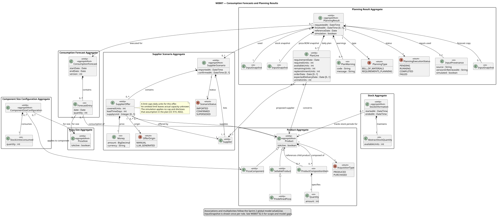

# US WEB07 – Artificial Intelligence Configuration and Execution Page

## 1. Context & Scope

- **User Story ID:** WEB07
- **Sprint:** Sprint 2
- **Area:** Front-end Web Application (WEB)
- **Responsible:** Sofia Carvalho (1240898) and Francisco Sá (1241341), per the [Sprint 2 plan](../../../Planning/Sprint2/sprintPlanning.md#web07--artificial-intelligence-configuration-and-execution-page).
- **Status:** Requirements analysis for peer review. Acceptance scenarios and demonstration evidence are planned.

References:

- **S2** – *Sprint 2 User Stories*, Part IV, WEB07 (printed pp. 6–7).
- **CC** – [Sprint 2 Client Clarifications at d3f1b42](https://github.com/Departamento-de-Engenharia-Informatica/LEI-SEM5-PI-2026-27-3DE-01/blob/d3f1b4295b3feb219423e91b28c8b729aae44945/docs/architecture/clientClarifications/clarifications.md), the source for §§17 and 19.
- **CC-WEB07** – Paulo Matos's follow-up reply on standalone sellable products.
- **SS** – *System Specification*, Part II.
- **SPA** – ARQSI, *Single Page Applications* lecture.
- [WEB01](../../web01/usWEB01.md), [story template](../../../guidelines/us_template.md), [SAD](../../../architecture/SAD.md) and [architecture decisions](../../../architecture/ADR.md).

### Scope

The Manager uses the common SPA to manage forecasts, export products, confirm supplier scenarios and compare planning results. This includes pizzas and standalone sellable products, such as drinks and desserts, wherever relevant to each operation (CC-WEB07). Purchase plans are for consultation in Sprint 2. Supplier scenario confirmation saves inputs for planning. Customer ordering, supplier order management and food-preparation scheduling are outside this story (S2 p. 3, Table 1, WEB05/07; CC §§17, 19; SS §§II.3.1.5–II.3.1.6).

### Starting point

The analysis started from a clean `web/WEB07-analysis` at `17e9952` (`origin/main`), with no existing WEB07 files. The [route registry](../../../../frontend/src/app/moduleRoutes.js) reserves `/planning` for Managers and the [shared REST client](../../../../frontend/src/api/apiClient.js) is available. Planning runs only as a fixture in the [SPA tests](../../../../frontend/src/App.test.jsx). WEB01 §3.4 describes the proposed integration.

The [back-end API](../../../../backend/src/shared/openapi/spec.js) already exposes products, pizza sizes and compositions, component consumption and available stock. Planning still needs forecast and supplier scenario services, a product export, and contracts for execution, results and AI06 inputs. The [AI directory](../../../../ai/README.md) is a placeholder at this base.

### Dependencies

- **WEB01–WEB04 and AA03–AA05** provide the shared SPA, navigation, feedback, session and access checks (S2 pp. 3–5, 9–10).
- **BCK05/06/08/09/10** supply products, sizes, component quantities, stock and pizza definitions. [WEB05](../../web05/WEB05.md) covers their management pages. Explicit consumption per unit sold still needs a back-end source (CC §19).
- **WEB07** provides the Manager's planning page. The SPA uses the Gateway. Backoffice validates and stores forecasts and exports catalogue products. Procurement validates and confirms supplier scenarios, executes requests through AI05 and serves saved results. Procurement writes its records to PostgreSQL through the private Backoffice storage adapter. [Planning access and records](../../../architecture/SAD.md#27-planning-access-and-records)
- **AI01** calculates material needs, **AI02** plans replenishment and selects suppliers, **AI05** exposes the calculation service, and **AI06** supplies Prolog with the selected back-end inputs (S2 pp. 15–19).

---

## 2. Requirements & Analysis

### 2.1. User Story Description

> **As a LaPrizza Manager, I want** a website page to manage daily product-consumption forecasts and prepare supplier data in JSON, **so that** I can execute and compare planning scenarios using consistent back-end information.

The LaPrizza Manager is the only role with planning access. A user with several roles can use the page while their Manager role and session are valid (S2 WEB07 p. 6 and Table 1 p. 11; CC §16).

### 2.2. Acceptance Criteria

In specification order (S2 WEB07, pp. 6–7).

| ID | Specification criterion | Trace |
| --- | --- | --- |
| WEB07-AC01 | Provide a Manager-only SPA page to create, view, edit, and delete consumption forecasts stored in the back end. | Table 1, CC §§15–16 · BR01–03 · AS01–02 |
| WEB07-AC02 | Each forecast must have an identifier, name, start and end dates, and daily quantities of sellable products, including pizzas. Each entry identifies the date, product, applicable size, and a non-negative integer quantity. Reject unknown products, incompatible sizes, dates outside the period, and duplicate date/product/size entries. Explain that omitted entries mean zero consumption. | CC §19, CC-WEB07, AI02 · BR03–04 · AS02–03 |
| WEB07-AC03 | Allow each saved forecast to be executed through the AI service and its results consulted. Show progress and errors, and prevent duplicate submission while execution is in progress. | WEB04, AI05, CC §19 · BR05–06 · AS04–05, AS14 |
| WEB07-AC04 | Associate each result with the forecast version, stock snapshot, pizza BOM, and supplier scenario used. Show daily requirements, suppliers, replenishment, expected delivery dates, and unmet needs. Editing a forecast must not change the meaning of earlier results. | AI01/02/06, CC §19, CC-WEB07 · BR07, BR13–15 · AS06, AS12–13 |
| WEB07-AC05 | Export relevant back-end products as JSON, including identifiers, names, and abstract stock units. Include raw materials, purchased aggregates, and directly sold stock-controlled products needed for planning. Catalogue selling prices are optional; their absence must not exclude a product. | SS §II.3.1.4, BCK05/09, CC-WEB07 · BR08 · AS07 |
| WEB07-AC06 | Document a supplier JSON format that can be prepared manually or with optional Large Language Model (LLM) assistance. It must contain two lists: suppliers with unique identifiers (names optional), and products with existing system identifiers and a list of supplier offers for each product. | WEB07/AI06 · BR09 · AS08 |
| WEB07-AC07 | Each offer must identify a listed supplier and specify its selling price in euros (EUR), the positive integer number of abstract stock units covered by that price, and the delivery lead time in days from order placement. Prices and lead times must be non-negative numbers. Supply limits and other offer attributes are optional. | CC §19, AI02/06 · BR10–11 · AS09 |
| WEB07-AC08 | Allow supplier JSON to be imported, inspected, and explicitly confirmed before saving through the back end. Reject invalid structure, duplicate identifiers or supplier/product offers, unknown references, missing required fields, and invalid values. Explain errors and retain the previous valid dataset. | WEB04, AI06, CC-WEB07 · BR09–12 · AS08–10 |
| WEB07-AC09 | Products without offers must remain visible as having no configured supplier. Manually or LLM-generated offers must be labelled simulated. | AI02/06 · BR11–12 · AS08, AS10 |
| WEB07-AC10 | Confirmed supplier scenarios must be available to Prolog through back-end endpoints, as defined in AI06. | AI06 · BR12–13 · AS10–11, AS13 |
| WEB07-AC11 | Forecast executions calculate plans only. They must not change stored stock, including scenario input stock. Hypothetical balances and simulated purchase proposals remain scenario results. | CC §17, AI01/02/06 · BR15 · AS11, D03 |
| WEB07-AC12 | Demonstrate two forecasts with pizza consumption varying over at least two days, execution and result consultation, and unchanged stored stock. Also demonstrate product export, supplier import with two offers for one product, and rejection of unknown references and missing prices or lead times. | S2 §IV.2.3 · D01–D07 |

### 2.3. Client Clarifications & Questions

- **Purchase plans (§17).** Table 1 allows permitted operational changes and AI01/02/05/06 require separate confirmation for such changes. For Sprint 2, §17 limits plans to consultation. Stock changes come from sales or manual stock management.
- **Active references and history (§19).** New forecasts and first executions require active products and applicable sizes. Earlier results stay available. Historical replay may use the original inputs if clearly labelled.
- **Pizzas and standalone products (§19, CC-WEB07).** Drinks, desserts and other standalone sellable products also belong in forecasts, exports, supplier scenarios and replenishment plans where applicable. For pizzas, calculate requirements from the components and their quantities for the chosen size. For other stock-controlled products, multiply forecast sales by the configured stock consumption per unit sold. Only pizzas use a BOM.
- **Supplier capacity.** Lead times are whole days. A capacity limit applies per day to one offer for one product. The client states, “When no limit is defined, supplier capacity is considered unlimited.” AI02 (S2 p. 17) requires the plan to disclose this assumption. The offer's actual capacity remains unknown, and proposed quantities that rely on the assumption are conditional on supplier availability. [Client clarification §19](https://github.com/Departamento-de-Engenharia-Informatica/LEI-SEM5-PI-2026-27-3DE-01/blob/d3f1b4295b3feb219423e91b28c8b729aae44945/docs/architecture/clientClarifications/clarifications.md#19-forecasting-and-supplier-capacity)
- **Shared behavior (§§15–16).** Preserve input when switching between PT and EN. Ask users to reload stale records before saving. Apply Manager role changes immediately.

For review, comparing two saved results can satisfy the comparison goal. Show a relevant product as having no supplier when the selected scenario has no offer for it, including when the product is absent from the import (AC04/09/12).

| ID | Open question | Owner |
| --- | --- | --- |
| OP01 | Which forecast edits and deletions are allowed once an execution exists? What limits apply to the forecast period and entries? | WEB07 and back end, with ARC01 |
| OP02 | How are abstract stock units represented in the export? Who maintains consumption per unit sold? | WEB07, BCK05/09 and AI06 |
| OP03 | How will results retain the exact inputs used? Is historical replay needed? | WEB07 back end and AI06 |
| OP04 | What supplier JSON rules apply to optional fields, empty lists and capacity values? How does confirmation affect the previous scenario? | WEB07 back end and AI02/06 |
| OP05 | How are pizza sizes and BOM completeness checked? Can an internally produced component be expanded within a pizza BOM under §19 and AI01? | AI01/06 and ARC01, with the client if needed |
| OP06 | Confirm how WEB07 presents the saved result, the retryable state and the diagnostic using the [execution recovery flow](#execution-recovery). | WEB07, WEB04 and AI05 |
| OP07 | Align the public planning payloads with the [AI01 execution and result routes](../../ai/ai01/usAI01.md#43-integration-contract-proposal). Procurement checks current Manager access through AA04. AI06 uses separate read-only service permissions. | AA05 and AI05/06 |
| OP08 | Is consecutive result consultation enough for comparison? Is a separate BOM-only action required by Table 1? | WEB07 and AI01/02/05 |

### 2.4. Business Rules & Invariants

| ID | Rule | Source |
| --- | --- | --- |
| BR01 | Check Manager access for every operation. Procurement asks the Backoffice AA04 authority before scenario, execution, replay or saved-result requests. Invalid sessions return `401` and missing permissions return `403`. AI06 uses read-only service access for its inputs. | Table 1, AA03–05, AI05/06 |
| BR02 | Use the shared PT/EN navigation and feedback. Explain loading, empty results and failures, retain input where appropriate, confirm deletion and refresh after saving. Require reload on stale edits. | WEB01–05, CC §15 |
| BR03 | A saved forecast has a back-end identifier, name, ordered start and end dates, and a version. Only saved forecasts can be executed. | AC01–04, ARC01 |
| BR04 | An entry must fall within the period and refer to an existing sellable product, including standalone drinks and desserts. A pizza requires a compatible size. An unsized product has no size. New forecasts require active products and applicable sizes. Quantities are non-negative integers. Reject duplicate date/product/size combinations, including unsized entries. Zero is valid and omitted entries count as zero. | AC02, CC §19, CC-WEB07 |
| BR05 | Refuse first execution if a referenced product or size is inactive. Show progress, prevent repeated submission while an attempt is active and distinguish invalid or missing data from service failure. After a lost response, check the outcome with the execution ID created before submission. | AC03, CC §19, WEB04, AI05 |
| BR06 | A saved result remains available for consultation. Historical replay, if offered, uses the original inputs and is labelled as historical. | AC03/04, CC §19 |
| BR07 | Keep the forecast version, stock snapshot, pizza BOM and confirmed supplier scenario used for each result. Record input sources and versions or retrieval times, relevant product units and consumption rules, and the planning reference date. Later edits must preserve the meaning of earlier results. | AC04, AI02/06 |
| BR08 | Export product IDs, names and abstract stock units for relevant raw materials, purchased aggregates and directly sold stock-controlled products, including applicable drinks and desserts. Catalogue prices are optional. The stock unit is the measure, consumption per sale is how many units one sale uses, and quoted quantity is how many units a supplier price covers. | AC05/07, SS §II.3.1.4, CC-WEB07 |
| BR09 | Supplier JSON has a supplier list and a product list with offers. Supplier names are optional. IDs are unique within each list. Offers link a listed supplier to an existing product, which may be a standalone product bought for replenishment. Each supplier/product pair appears at most once. | AC06/08, CC-WEB07 |
| BR10 | Require a non-negative EUR price, a positive integer quantity covered by the price and a non-negative lead time in whole calendar days from order placement. AI02 compares quotes on the same stock-unit basis. | AC07, CC §19, AI02 |
| BR11 | Apply the daily capacity limit when the offer specifies one. An omitted limit leaves actual capacity unknown. The simulation applies no capacity constraint to that offer, as clarified in §19. Label manually prepared and LLM-assisted offers as simulated. Manual preparation is sufficient. | AC06–09, CC §19, AI02 |
| BR12 | Validate the complete import and let the Manager inspect it before confirmation. Explain invalid entries and retain the previous valid dataset on rejection. Show products with no offers. AI06 supplies only confirmed scenarios to Prolog. | AC08–10, AI06 |
| BR13 | AI06 supplies a consistent set of back-end inputs and records their origin. An incomplete refresh must not mix input versions. Any simulated input makes the result a simulation. | AC04/10, AI06 |
| BR14 | AI01/02 calculate pizza stock needs from component quantities by size and use available stock first. Replenish purchased aggregates directly and avoid double counting. For standalone stock-controlled products, calculate daily needs as forecast quantity × configured stock consumption per unit sold. Report missing consumption values without assuming one unit per sale. AI02 uses confirmed offers to plan replenishment, accounting for stock, cost, capacity and delivery timing. | AI01/02, CC §19, CC-WEB07 |
| BR15 | Show daily requirements, supplier, replenishment, expected delivery, unmet needs and warnings. When a proposed quantity relies on an offer with unknown capacity, identify the offer and explain that the simulation applied no capacity constraint and delivery depends on supplier availability. Include the reference date, proposed order dates and hypothetical balances where calculated. Execution leaves stored stock and scenario input stock unchanged. Purchase proposals remain simulation results. | AC04/11, AI01/02, CC §§17, 19 |

#### Manager workflows

The SPA lecture guides the transitions below (slides 12, 14–16 and 19). Forecast edits and supplier previews are local until saved or confirmed. Backoffice serves saved forecasts. Procurement serves supplier scenarios, execution status and results through the Gateway.

- **Forecasts.** Open an existing forecast or start a new one. After saving or deleting, show the updated record or list. Explain invalid entries, conflicts and failures (BR01–04).
- **Execution and comparison.** Select a saved forecast and run it with confirmed supplier data. Show progress, then the result or an explanation of the failure. Compare saved results using their daily quantities and inputs (BR05–07, BR13–15).
- **Product export.** Request JSON from current back-end data. Distinguish an empty export from a failed retrieval (BR08).
- **Supplier import.** Prepare JSON, inspect the validated offers and confirm to save. A rejected import leaves the previous scenario available (BR09–12).

#### Execution recovery

Before `POST /api/v1/planning/executions`, WEB07 generates an `executionId` and keeps it with the original request, including the forecast and, where applicable, the confirmed supplier scenario version. If the response is lost, WEB07 requests `GET /api/v1/planning/executions/{executionId}/result` with that ID and the current session. A `COMPLETED` response displays the saved result, which takes precedence over late progress responses for that ID. While an attempt is active, WEB07 shows progress and keeps repeat submission disabled.

If the lookup reports a retryable state or returns `404` after the access check, WEB07 can offer a manual retry with the same ID and request. This lets Procurement resume an eligible execution or reserve the ID if the first request never arrived. A deliberate new run or historical replay gets a new ID. For a replay, WEB07 also keeps the original run reference in `replayedFrom`. [AI01 integration contract](../../ai/ai01/usAI01.md#43-integration-contract-proposal) · [Storage and completion rules](../../../architecture/SAD.md#27-planning-access-and-records)

#### Planned acceptance scenarios

| ID | Check |
| --- | --- |
| AS01 | Allow Manager access through navigation and direct entry. Deny the page and protected operations to other roles and after Manager access is lost. |
| AS02 | Create, view, edit and delete a forecast. Verify saved state and rejection of stale edits. |
| AS03 | Save one forecast with a sized pizza and an unsized drink. Accept zero and explain omissions. Reject invalid product, size, date, quantity and duplicate entries. |
| AS04 | Run a saved forecast and consult the result. Prevent repeated submission and explain service, input and connection failures. |
| AS05 | Deactivate a referenced product or size before first execution. Refuse the run and keep earlier results available. |
| AS06 | Edit the forecast and change a planning input after execution. Verify the earlier result still reflects its original inputs. Check historical replay if offered. |
| AS07 | Export raw materials, purchased aggregates and directly sold stock-controlled products, including a drink or dessert. Verify IDs, names and abstract units. Include a product without a catalogue price. |
| AS08 | Inspect a manually prepared import with two offers for one product and a product without offers. Include an offer for an exported drink or dessert. Check simulated labels and explicit confirmation. |
| AS09 | Reject invalid structure, references, duplicates and quote values. Accept zero price and zero lead time. Verify that a stated capacity caps the daily quantity for that offer, and that a plan using an offer with no limit labels actual capacity as unknown and discloses the simulation assumption. |
| AS10 | Reject an invalid import or cancel a preview. Verify the previous scenario remains in use until a new one is confirmed. |
| AS11 | Verify Prolog uses the confirmed scenario and consistent back-end inputs. Check stored stock and scenario stock before and after. |
| AS12 | Check sufficient and insufficient stock, purchased aggregates, direct-sale consumption and missing data. Compare daily outputs and warnings against AI01/02 expectations. |
| AS13 | Forecast 6 sales of a drink configured to consume 2 stock units per sale. With 4 units in stock and no incoming stock, verify a daily requirement of 12 units and a shortfall of 8. Check replenishment against the confirmed offers for the drink. Repeat with the consumption value missing and verify that the result reports missing data. |
| AS14 | Lose the response after a forecast result is saved. Verify WEB07 uses the ID it generated before submission to retrieve and display the result, with one execution and one attempt. |

#### Sprint 2 demonstration

Planned evidence for AC12 and S2 §IV.2.3.

- **D01.** Show two saved forecasts with pizza consumption varying over at least two days each.
- **D02.** Run both through the integrated service. Reopen their results and show the daily plan and inputs used.
- **D03.** Record matching actual and scenario stock before and after the runs. Show purchase proposals in the results.
- **D04.** Show the exported product JSON, including a product without a catalogue price.
- **D05.** Inspect and confirm a file with two supplier offers for one product. Show that Prolog uses the confirmed scenario.
- **D06.** Show rejection of an unknown product, an unlisted supplier, a missing price and a missing lead time. Verify the prior dataset after each attempt.
- **D07.** Keep the demonstration inputs, expected results and integration references with the Sprint 2 evidence.

### 2.5. Domain Model Excerpt

The [base model](../../../architecture/domainModel/domainmodel.puml) covers products, pizza configurations and stock. The [Sprint 2 model at a5a622a](https://github.com/Departamento-de-Engenharia-Informatica/LEI-SEM5-PI-2026-27-3DE-01/blob/a5a622a15cda51400a56d630533e5383cc05281a/docs/architecture/domainModel/domainmodel.puml) on `origin/arc/domain-model-sprint-2` adds forecasts, supplier scenarios and planning results. The excerpt follows that revision.

[PlantUML source](./excerptDomainModel/domain_model_excerpt.puml)

- **Forecasts** contain zero or more entries. Each entry refers to a sellable product and, for pizza demand, an applicable size (AC01–04). Standalone sellable products use the same product reference (CC-WEB07).
- **Products, pizza configurations and stock** provide the export references and the size-specific quantities and balances used in the calculation (AC02/04/05).
- **Supplier scenarios** contain suppliers and offers. Each offer links one supplier to one product (AC06–10).
- **Planning results** record execution status, the inputs used and the daily plan. The model has optional forecast and scenario links for BOM-only calculations. A WEB07 forecast result identifies both inputs (AC03/04/10/11).

The excerpt clarifies the Sprint 2 model's note on `SupplierOffer`: an omitted limit records unknown actual capacity. AI02 applies no daily cap in the simulation under §19 and discloses the assumption in the plan. ARC01 should adopt this wording in the shared Sprint 2 model.

For ARC01 review, confirm how the model preserves exact supplier offers for historical results (OP03), represents consumption per sale (OP02), shows products without offers (OP04), and applies recursive composition within a pizza BOM (OP05).
