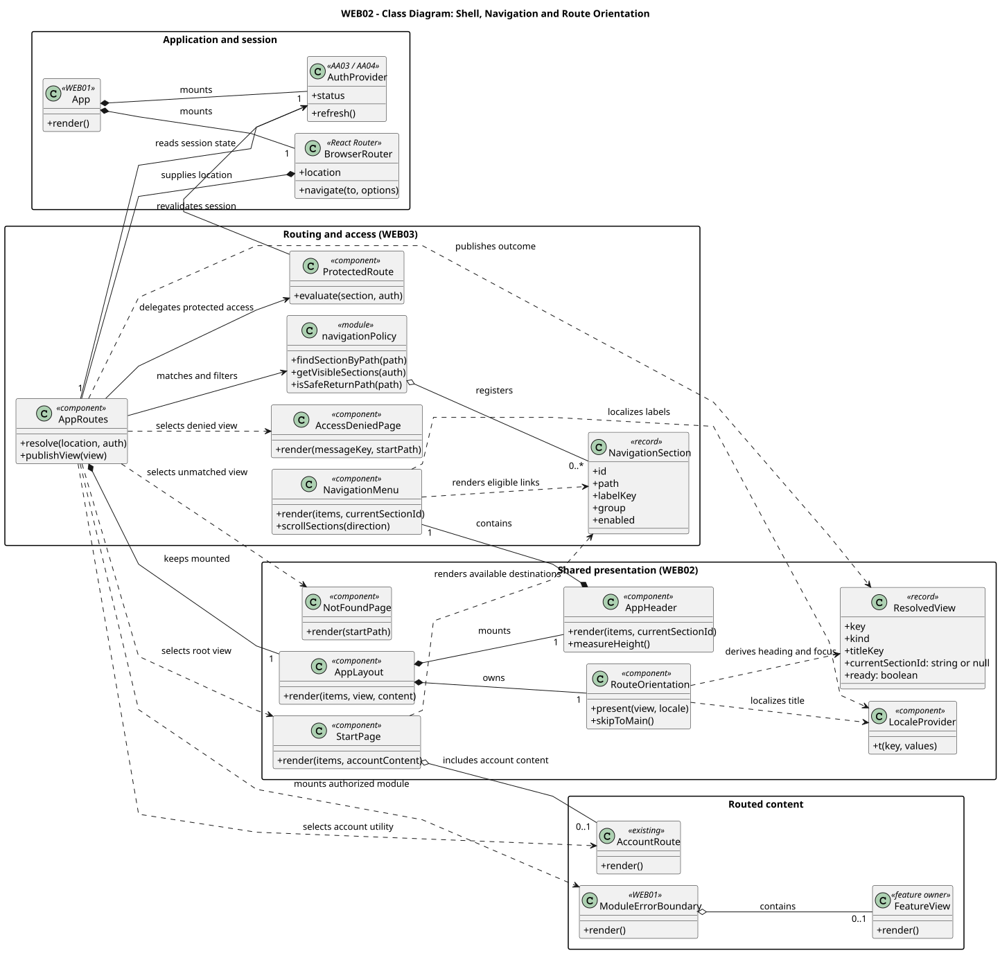
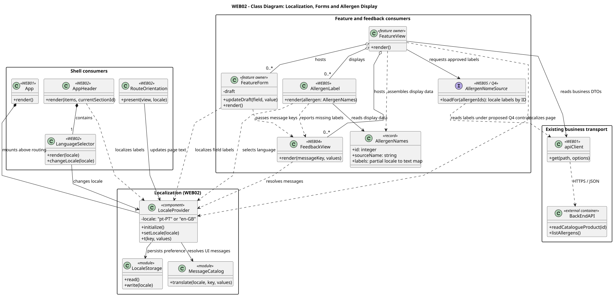
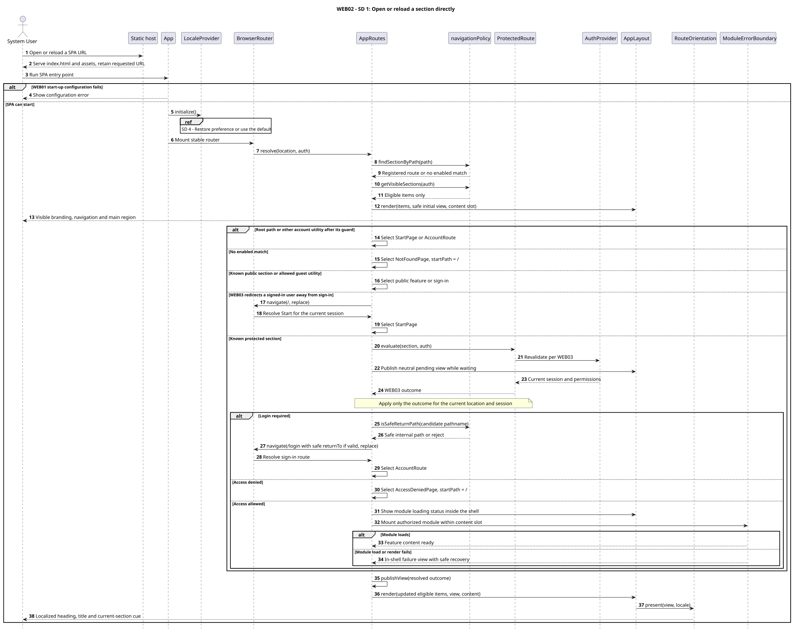
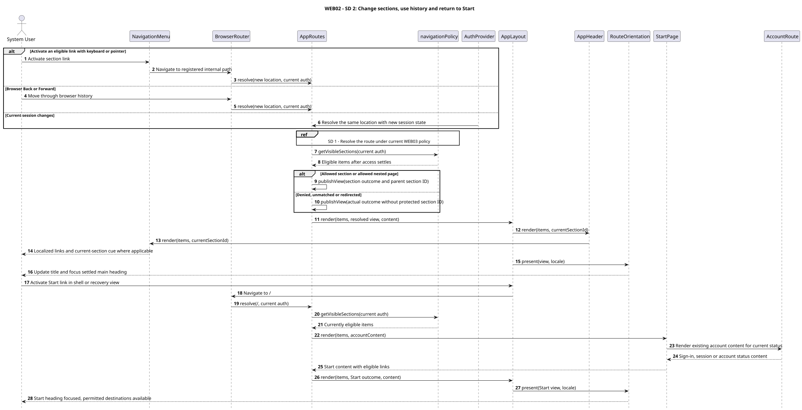
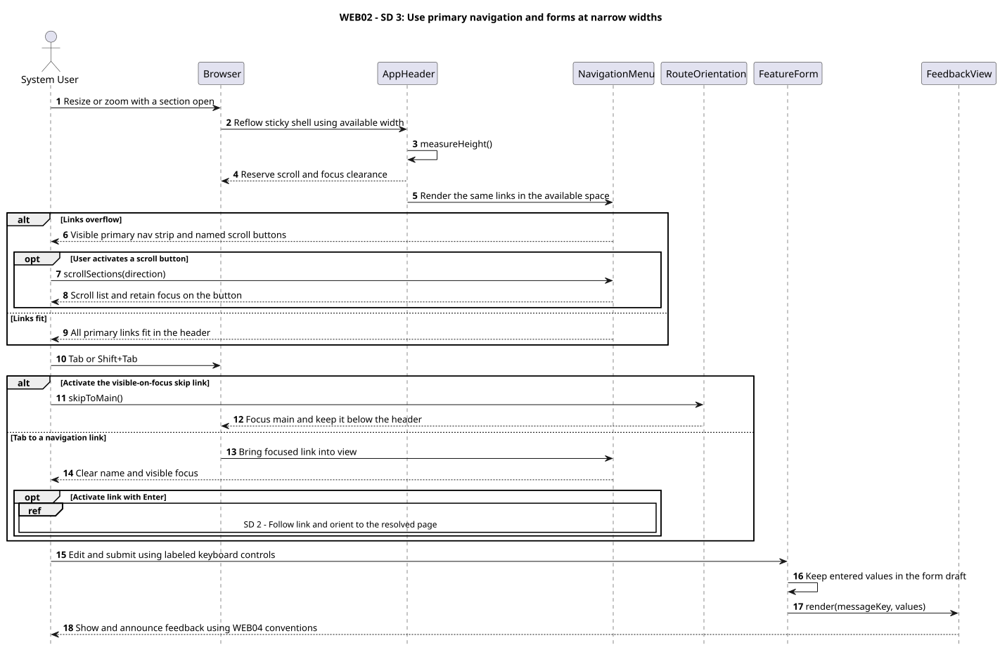
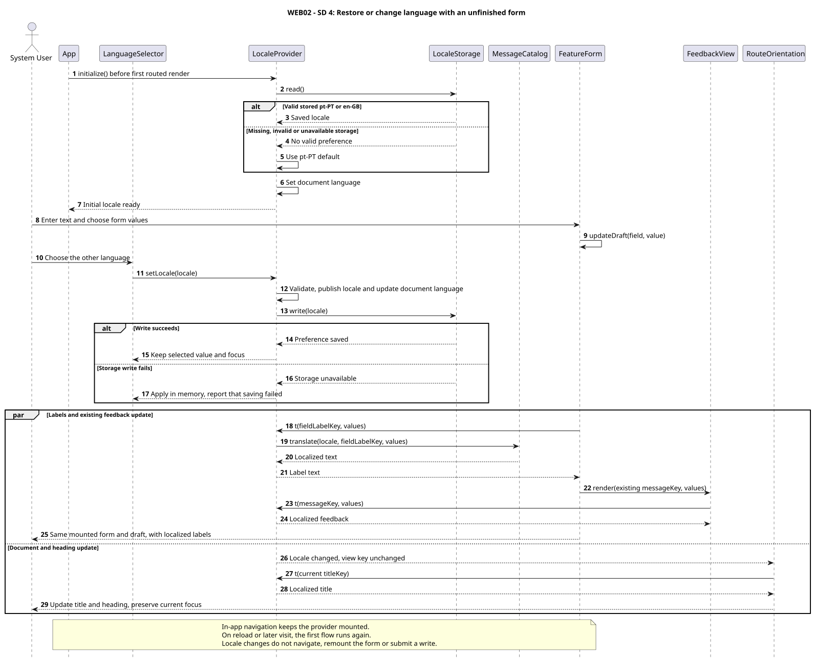
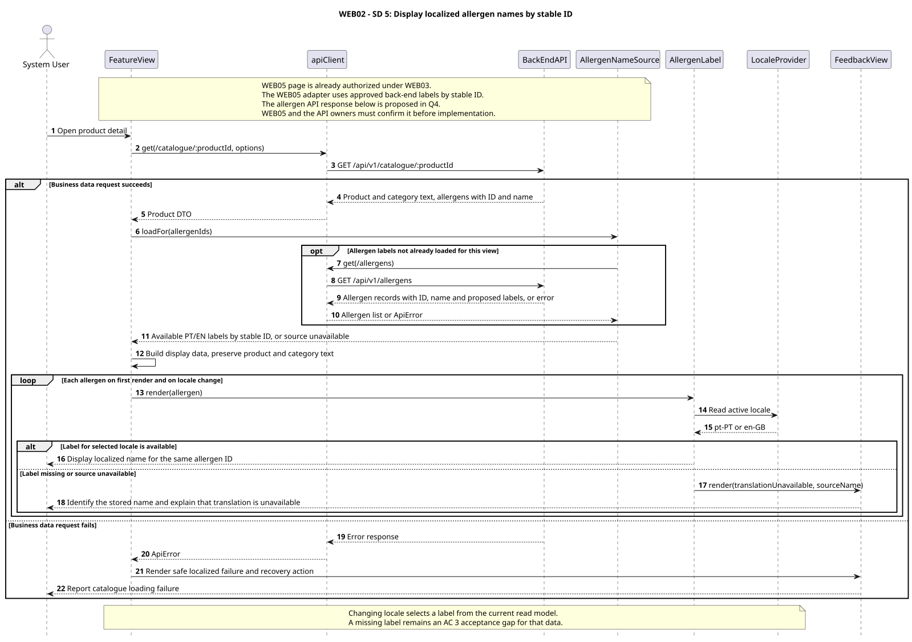

# US WEB02 – Consistent Layout and Navigation

## 1. Context & Scope

- **User Story ID:** WEB02
- **Sprint:** Sprint 2
- **Area:** Front-end Web Application (WEB)
- **Responsible:** Francisco Sá (1241341), per [Sprint 2 Planning, §1, §3 and WEB02 task breakdown](../../Planning/Sprint2/sprintPlanning.md).
- **Related Requirements / Stories:**
    - **Sprint 2** – *PART IV – Sprint 2 – User Stories*, `LEI-2026-27-Sem5-Project_v1-Sprint2US.pdf`: §IV.2.1, WEB01–WEB07 (printed pp. 3–7), AA05 and Table 1 (pp. 10–12), VIS01 (p. 12), and §IV.2.3 deliverable (pp. 24–25). WEB02 on printed p. 4 is PDF page 5.
    - **System** – *PART II – System Specification*, `LEI-2026-27-Sem5-Project_v1-SystemSpecification.pdf`: §II.3 scope note (printed p. 3); §II.3.1.2 Products and Allergens (pp. 3–4); §II.3.2 Web Application (p. 11, PDF page 12); §II.3.6 Integration and General System Concerns (p. 14). These establish a coherent main interface, the relevance of allergen information, and the integration and security boundaries.
    - **Client** – [Sprint 2 Client Clarifications, §15](https://github.com/Departamento-de-Engenharia-Informatica/LEI-SEM5-PI-2026-27-3DE-01/blob/d3f1b4295b3feb219423e91b28c8b729aae44945/docs/architecture/clientClarifications/clarifications.md#15-interface-localization-and-usability): The [working-tree copy](../../architecture/clientClarifications/clarifications.md) ends at §6. The pinned file matches the copy at `dddd788` on `arc/domain-model-sprint-2`; the Sprint 2 text can also be read with `git show d3f1b42:docs/architecture/clientClarifications/clarifications.md`. See §2.3 for the applicable answers.
    - **SPA lecture** – ARQSI, *Single Page Applications*, `03 - SPA (1).pdf`: Slides 12 and 27: client navigation, history, deep links and the host fallback. Slide 14: distinguish local form state, shared client state, server data and URL state. Slides 19–20: analyse journeys and transitions; treat layout, localization and accessibility as shared concerns. Slide 25: keyboard operation, visible focus and orientation on route changes. These are analysis and design guidance; framework examples and techniques do not add acceptance requirements.
    - **Repository**: [Story template](../../guidelines/us_template.md), [WEB01](../web01/usWEB01.md) and [WEB03](../web03/usWEB03.md) establish the English analysis format. The [SAD, §2.2, §2.3 and Scenario 3](../../architecture/SAD.md) describes the actors, shared front end and back-end authority.

### Scope boundary

Make the features available to a user easy to find and use in one coherent SPA. WEB02 owns the common layout, restaurant identification, presentation and accessibility of primary navigation, shared interaction conventions, PT/EN behavior, layout adaptation, and orientation and return navigation. Feature pages apply these conventions to their own content and controls. The System Specification describes capabilities that may be introduced over the project; WEB02 does not add those capabilities to Sprint 2 (System §II.3, printed p. 3; §II.3.2, p. 11; Sprint 2 §IV.2.1, WEB02, p. 4).

The baseline is `afed478` on `web/WEB02-analysis-design`, equal to the local `origin/main` reference at the start of analysis and containing the integrated WEB01 implementation. No existing WEB02 artefacts or working-tree changes were found. The code observations below come from inspection of that baseline. WEB03's checked-in document describes its planned behavior; it is not evidence that the full navigation policy is already running.

| Story or area | What WEB02 takes from it or provides to it | Source |
| --- | --- | --- |
| **WEB01 / SYS01** | WEB01 provides the application entry, router, initial `AppShell`, authenticated module integration and API client. WEB02 completes the user-facing shell, including the starting and unknown-page experiences. The deployed SPA fallback must let the existing router receive direct links and refreshes; SYS01 verifies the deployed host. | Sprint 2 WEB01, p. 3; [WEB01 §1 and §3.8](../web01/usWEB01.md); [frontend README, Serve the production bundle](../../../frontend/README.md#serve-the-production-bundle). |
| **WEB03 / AA03–AA05** | WEB02 presents and labels eligible destinations, indicates the current section, and provides a safe way back. WEB03 owns menu eligibility and known-route access decisions, including direct access, role changes and access denied. AA03–AA05 own identity, session and authorization; the back end remains authoritative. The unknown-path presentation belongs to WEB02. | Sprint 2 WEB03, p. 4; AA04/AA05 and Table 1, pp. 9–12; [WEB03 §1, §2.2 and §3.8 D5](../web03/usWEB03.md); [SAD §2.3 and Scenario 3](../../architecture/SAD.md). |
| **WEB04** | WEB02 owns the shared visual and interaction conventions and language behavior for messages. WEB04 owns when feedback appears and how success, validation, loading, confirmation, failure and retry work. Client §15 clarifies that AC 3 requires preserving entered values on a language switch. WEB04 covers preserving input after failed operations. | Sprint 2 WEB02, p. 4, and WEB04, p. 5; Client §15. |
| **WEB05, WEB06, WEB07, VIS01 and account-page owners** | WEB05 owns catalogue and business-management pages and their allergen displays. WEB06 owns kitchen-configuration workflows; VIS01 embeds the viewer in the common shell and owns the viewer UI; WEB07 owns planning pages and workflows. AA stories own sign-in, account and administration flows. Each owner supplies its page content, localizes its interface copy, retains its draft during a language switch and applies the shared conventions, including keyboard and narrow-screen behavior. WEB02 does not define business operations, permissions or specialized viewer controls. | Sprint 2 WEB05–WEB07, pp. 5–7; VIS01, p. 12; AA01–AA07, pp. 8–12; [Sprint 2 Planning, §7 Main Dependencies](../../Planning/Sprint2/sprintPlanning.md#7-main-dependencies-and-integration-checkpoints). |

---

## 2. Requirements & Analysis

### 2.1. User Story Description

> **As a** System User,  
> **I want** a consistent layout and navigation structure,  
> **so that** the available features are easy to find.

**Actor:** System User (Sprint 2 §IV.2.1, WEB02, p. 4). In this context, that includes Guest and the authenticated roles in Table 1 (Administrator, LaPrizza Manager, Restaurant Staff and Customer), using the same SPA. **Need:** Recognize the same layout and navigation across the application. **Benefit:** Find the features available in the current access context and recover one's bearings after entering or switching sections. Guest is an unauthenticated visitor rather than an assigned role; the shell does not grant access to additional features (Sprint 2 Table 1 and accompanying notes, pp. 11–12; SAD §2.2).

### 2.2. Acceptance Criteria

The six criteria below reproduce the official wording and order of **Sprint 2 §IV.2.1, WEB02, printed p. 4 (PDF page 5)**. Section 2.3 records the client clarifications and §2.4.3 records the team's interpretations.

- [x] **AC 1:** The common layout must include the restaurant name and logo, a primary navigation area, and a main content area. Restaurant identification and primary navigation must remain visible and accessible during use.
- [x] **AC 2:** Menus, forms, buttons, and messages must follow consistent visual and interaction conventions.
- [ ] **AC 3:** The interface must support English and Portuguese, and the selected language must remain consistent during navigation.
- [x] **AC 4:** The layout must adapt to different screen sizes, prioritizing desktop use without hiding essential information or actions.
- [x] **AC 5:** Forms and navigation must be usable with a keyboard, and relevant controls must have clear labels.
- [x] **AC 6:** Users must be able to identify their current section and return to an appropriate starting page.

The checked criteria are verified for the current WEB02 implementation and registered test modules. The integrated feature pages and deployment checks remain in §4.1. AC 3 is partial. PT/EN selection, persistence and draft preservation are verified. Localized allergen names await the WEB05/API integration.

#### 2.2.1. Observable behavior and baseline by criterion

| AC | Interpretation and WEB02 responsibility | Existing behavior and remaining work at `afed478` |
| --- | --- | --- |
| **AC 1 – Shared layout and identity** | **Required outcome (AC 1):** Restaurant identification and primary navigation remain visible and accessible during use. Client §15 reinforces ease of access. The analysis applies this outcome while scrolling, at supported narrow widths (AC 4), and while modules load or fail inside the running shell (WEB01 §3.3, SD 3; VIS01). D1 records the chosen mechanism for keeping navigation visible and accessible (Q1). | [`App.jsx`](../../../frontend/src/App.jsx) puts routed content inside a shared `header`, labelled `nav` and `main`. The [logo asset](../../../frontend/public/laprizza-logo.webp) includes the LaPrizza wordmark, and its home link has image alternative text. The header wraps but is in normal document flow ([`index.css`](../../../frontend/src/index.css)); continued visibility/access while scrolling is not established. Module links are conditional on supplied loaders and roles; [`main.jsx`](../../../frontend/src/main.jsx) passes no loaders in the baseline. Full destinations depend on WEB03 and page owners. The invalid-config branch returns an emergency message outside the normal shell (Q7). |
| **AC 2 – Conventions** | A user moving between pages should recognize the same kind of menu item, field, primary or secondary action, and message by its presentation and behavior. Apply this to normal, validation, loading, success, empty and failure views where relevant. Consistency does not imply identical forms or the same available actions. WEB02 defines common conventions; WEB04 and feature owners provide the relevant behavior and content (Sprint 2 WEB04/WEB05, p. 5; Client §15 feature guidance). | [`index.css`](../../../frontend/src/index.css) has shared styles for the shell, inputs, authentication cards and some messages. [`LoginPage.jsx`](../../../frontend/src/LoginPage.jsx), [registration](../../../frontend/src/auth/LocalRegistrationPage.jsx) and [administration](../../../frontend/src/AdminUserManagementPage.jsx) provide examples, but these do not establish a common convention across feature pages. D2 records the shared conventions (Q2). |
| **AC 3 – Language** | The current PT/EN choice applies to shared and page interface text: navigation, section titles, labels, buttons, instructions and user-facing status, error and validation messages. Displayed allergen names also follow it. Switching should update the current view and keep the same task and entered values, including selections; navigation, refresh and later visits retain the language. Product and category names and descriptions need no translation (Client §15 second paragraph). See §2.3 for the API gap and boundaries (Q3–Q4). | [`index.html`](../../../frontend/index.html) declares `lang="en"`; [`App.jsx`](../../../frontend/src/App.jsx), [`moduleRoutes.js`](../../../frontend/src/app/moduleRoutes.js) and account pages contain English literals. No shared language selector, app-wide locale or preference persistence was found. WEB02 supplies shared behavior; WEB03/WEB04 and page owners provide localized text in their areas. |
| **AC 4 – Screen sizes** | Desktop is the primary layout. On narrower screens, users must still find navigation, read essential content and reach the same essential permitted actions. Reflow or a usable alternate presentation can preserve them; simply removing the essential content or action does not satisfy the criterion. Check the transition when resizing with a form or long list open, including longer translations. The page owners identify essential information and actions in their views; WEB02 defines the common behavior (AC 4; Client §15 feature examples; Sprint 2 WEB05, p. 5). | [`index.html`](../../../frontend/index.html) sets a responsive viewport, and [`index.css`](../../../frontend/src/index.css) uses wrapping, fluid sizing and a 320 px body minimum. These are starting points; they do not prove that all features, forms or controls work on narrow screens. The design records the initial viewport and zoom cases in §3.2 (Q2). |
| **AC 5 – Keyboard** | Users can reach, recognize and operate navigation, the language control and form controls without a pointer. A logical traversal, visible focus and meaningful labels are observable interpretations of keyboard usability. Using the primary navigation, switching language or moving to another route should leave the user able to continue with visible focus. The particular route announcement and focus technique is a design choice (SPA lecture slide 25; Q5). | The shell uses router links and native buttons, and the [login](../../../frontend/src/LoginPage.jsx) and [registration](../../../frontend/src/auth/LocalRegistrationPage.jsx) forms use associated labels. [`index.css`](../../../frontend/src/index.css) styles focused inputs. There is no evidence here of a verified keyboard journey across route changes, language selection, compact navigation and feature forms. WEB02 owns the common interactions; page owners ensure their controls follow them. |
| **AC 6 – Orientation and return** | On a permitted direct URL, nested page, in-app move, or browser Back/Forward, users should be able to tell which section actually rendered and reach a valid starting page even without browser history. A recognized section without permission follows WEB03's denied flow; an unknown path gets a clear not-found view and a safe return, with no misleading active-section indicator (WEB01 §1; WEB03 §3.8 D5; Table 1). D5–D7 record the section cue, focus behavior and Start destination (Q5–Q7). | [`App.jsx`](../../../frontend/src/App.jsx) defines `/` and `/login` using `AccountRoute` (sign-in for Guest; session content when authenticated; administration for `ADMINISTRATOR`), links the logo to `/`, and renders an inline `Page not found` with a return link for `*`. Module links use plain `Link` without a current-section indicator. [`AccessDeniedPage.jsx`](../../../frontend/src/auth/AccessDeniedPage.jsx) offers a back button only if a caller supplies it. The existing `/` and fallback are candidates, not proof of an appropriate return for every user. |

#### 2.2.2. Planned acceptance scenarios

**Evidence status:** The table defines the planned acceptance scenarios. Inspection of `afed478` establishes the starting behavior and gaps. [Section 4](#4-tests-arc05) maps these scenarios to the implementation evidence and identifies the checks that still require integration.

| Scenario | Initial conditions | Action | Expected observable result |
| --- | --- | --- | --- |
| **WEB02-AS01 – Planned (AC 1)** | An authorized user has a direct link to an available, scrollable section; the SPA host can serve deep links. | Open the URL in a new tab, scroll into the content, and use primary navigation to move to another allowed section. Repeat at a supported narrow width and while a module is loading. | The restaurant name, logo and primary navigation remain visible and accessible while using the page. Both sections render inside the common main area. The user can leave the loading module via the same navigation. |
| **WEB02-AS02 – Planned (AC 2)** | An authorized user can open two integrated forms, with shared feedback conventions available. | Use the primary menu to move between the forms, trigger a field error in one and complete a valid action in the other. | The menu indicates the current section. Both forms place labels, hints and actions consistently and distinguish primary from secondary actions. The field error identifies the affected control and explains the correction, and the successful action has a distinct text cue. Feedback of the same kind uses the same placement and style across pages. |
| **WEB02-AS03a – Planned (AC 3)** | A browser has no saved preference. An available product detail shows at least one allergen, a stored product name and description, and a category name. | Select the other supported language, navigate to and from the detail, refresh it, then close and reopen the application in the same browser context. | Interface text and displayed allergen names follow the selected language in each view and after return. The product name, description and category name stay as supplied and refer to the same records. The first-visit default follows the design decision in Q3. Client §15 allows either supported language. |
| **WEB02-AS03b – Planned (AC 3)** | An authorized user has entered text and made a selection in an unsaved form. | Change PT to EN, then back to PT, without submitting. | Labels and visible messages change language on the same form; entered values and selections remain, and no save is triggered. The language preference persists independently of the draft. |
| **WEB02-AS04 – Planned (AC 4)** | An authorized user has an integrated page open at desktop width with essential details and actions; an agreed narrow viewport and essential-content list are available. | Narrow the viewport while using the page, then access an essential action and return to desktop width. Repeat in the other language. | The layout adapts and the primary navigation, essential details and permitted actions remain reachable and usable at both widths. The user can finish the same task; labels and controls are not clipped or hidden. |
| **WEB02-AS05 – Planned (AC 5)** | Start on an available section with navigation and a form. Use a narrow viewport where the primary navigation overflows. | With keyboard only, traverse forward and backward, operate navigation and the language control, then complete and submit the form. Reach a navigation link that is initially outside the visible part of the list. | Focus remains visible and moves in a usable order; controls have clear labels and activate with the keyboard. The user can leave navigation, reach the new section and complete the form without a pointer or focus trap. |
| **WEB02-AS06a – Planned (AC 6)** | A permitted nested section URL is opened directly in a new tab with no in-app history; another section is available. | Identify the section, move to the other section, use browser Back and Forward, then activate the application's return control. | The orientation cue follows the section actually displayed, including on first entry and history moves. The return control reaches the agreed accessible starting page without relying on prior history. |
| **WEB02-AS06b – Planned (AC 6)** | A visitor has no access to a known protected section. A separate URL has no matching SPA page. | Open each URL directly and use the return offered by its outcome. | The WEB03 outcome protects the restricted content and does not reveal protected labels or data. The unmatched path shows a distinct not-found view without a false current section. Both allow recovery to an accessible starting page. |
| **WEB02-AS06c – Planned (AC 6)** | A Guest can reach the public catalogue after ALN-1 is integrated, or an authenticated user can open a protected page. | As Guest, enter a public product detail and return to the agreed Guest starting page. As the authenticated user, sign out from the application and use browser Back. | The Guest can recover without signing in. The signed-out user sees the public or sign-in outcome defined with WEB03/AA04 and can recover without seeing stale protected content or a protected section marked as current. |

### 2.3. Client Clarifications & Questions

| Source | Clarified requirement and effect on WEB02 |
| --- | --- |
| **Client §15, paragraph 1 → AC 1, AC 4, AC 5** | No official logo or palette is supplied; the team can choose the visual identity. The main navigation mechanisms should stay easily accessible. This complements AC 1's visibility requirement; it does not prescribe a sticky header, sidebar, compact menu or palette. |
| **Client §15, paragraph 2 → AC 2, AC 3, AC 5** | PT/EN covers interface elements, including visible feedback and accessible control labels. Product and Product Category names and descriptions do not require translation. **Allergen names must be shown in the selected language.** Either language may be the default. The user's selection persists across navigation, refreshes and later visits; a switch preserves data already entered in the current form. Persistence of the preference does not imply persistence of unfinished forms across reloads or later visits. |
| **Client §15, paragraphs 3–6 → AC 2, AC 4** | The answers on essential customer and product information, dependency explanations, configuration feedback, size availability, catalogue stock confidentiality, ingredient search and concurrent edits constrain the relevant feature views. WEB05 and the relevant APIs own the content, workflows and enforcement; WEB04 owns generic feedback, including the message that explains a stale edit and asks the user to reload. WEB02 provides the conventions and keeps essential permitted content/actions usable as the layout changes. |
| **Client §16 → AC 1, AC 6** | Restaurant Staff is `EMPLOYEE`; a removed role loses access while remaining roles may still apply. The shell must follow the destinations WEB03 determines are available. The selected section and return behavior must make sense after a permission change without disclosing protected content (Sprint 2 WEB03 and Table 1). |

#### Integration dependencies

**Guest catalogue access (AC 6).** Table 1 grants Guest public catalogue and product/allergen consultation. At the baseline, both catalogue reads require authentication. Guest catalogue entry and any catalogue-based starting page depend on the WEB03 alignment with WEB05/AA05. [Baseline catalogue routes](../../../backend/src/modules/product-catalogue-and-information/api/routes/CatalogueRoutes.js) · [WEB03 §3.4.1 ALN-1](../web03/usWEB03.md#341-back-end-alignment-with-table-1-integration-requirements).

**External dependency: PT/EN allergen names (AC 3, Q4).** Client §15 requires names in the selected language. The baseline allergen and catalogue payloads supply a stable allergen ID and a single name, and authorized managers can edit that name. The category payload has no description field. The client's translation exemption applies to product and category names and descriptions where displayed. [Allergen DTO](../../../backend/src/modules/allergen-management/application/dtos/AllergenResponseDTO.js) · [Catalogue response mapper](../../../backend/src/modules/product-catalogue-and-information/application/CatalogueResponseMapper.js) · [Allergen routes](../../../backend/src/modules/allergen-management/api/routes/AllergenRoutes.js) · [Category DTO](../../../backend/src/modules/product-category-management/application/dtos/CategoryResponseDTO.js).

The team confirmed the integration direction: WEB05 selects the approved PT/EN name for the stable allergen ID using the current WEB02 locale, with labels supplied by a back-end source. [§3.4](#34-rest-api-specification-arc03) proposes a source and response contract for WEB05 and the allergen and catalogue API owners to approve or revise before implementing this flow. They must also confirm who maintains the labels, how edits affect them, and the bilingual data for WEB02-AS03a.

The [analysis question log](#244-resolution-of-analysis-questions) links Q1–Q7 to their design decisions. The dependencies above affect integrated acceptance and have their own implementation owners.

### 2.4. Business Rules & Invariants

WEB02 establishes presentation invariants. It does not change how the back end validates, identifies or relates business records (SAD §2.3, *Architectural Boundaries*; Sprint 2 WEB01 and WEB05).

#### 2.4.1. Official WEB02 requirements (Sprint 2 specification)

| ID | Rule | Source |
| --- | --- | --- |
| **BR 1** | The common layout includes restaurant identification, primary navigation and main content. Restaurant identification and primary navigation remain visible and accessible during use. Menus, forms, buttons and messages use consistent visual and interaction conventions. | AC 1–2. |
| **BR 2** | Adapt the layout with desktop as the priority while preserving essential information and actions. Forms and navigation must be operable by keyboard with clear labels on relevant controls. | AC 4–5. |
| **BR 3** | The interface supports English and Portuguese and retains the selected language during navigation. | AC 3. Client §15 further clarifies the language behavior in §2.3. |
| **BR 4** | Users can identify their current section and return to an appropriate starting page. | AC 6. |

#### 2.4.2. Constraints from related stories and architecture

| ID | Rule | Source |
| --- | --- | --- |
| **BR 5** | Layout, locale and history cannot expand access. Navigation presents only destinations allowed by WEB03; the back end still authorizes protected requests. Public views must keep internal stock data private. | Sprint 2 WEB03, AA04/AA05 and Table 1; System §II.3.6; Client §§15–16; SAD §2.3. |

#### 2.4.3. Analysis interpretations (design choices deferred)

| ID | Rule | Source |
| --- | --- | --- |
| **BR 6** | The current section cue follows the section that actually renders, including after direct entry and history transitions. A return action leads to an available, permitted starting page and does not depend on browser history. A denied or unknown route must not be presented as a successfully opened protected section. | AC 6; Sprint 2 WEB03 and Table 1; WEB03 §3.8 D5; SPA lecture slides 12, 25 and 27 (guidance). |
| **BR 7** | Treat the selected language as shared UI preference, current section as derived from navigation and access context, and form values as page-owned draft state. Changing language changes presentation without replacing the referenced business record, mutating its identifier or submitting the form. Business data remains authoritative in the back end. This separation does not select a storage mechanism or require saving drafts across visits. | AC 3; Client §15, paragraph 2; WEB01 §2.4; SPA lecture slides 14 and 19 (guidance). |

#### 2.4.4. Resolution of analysis questions

No requirement or design decision remains open within WEB02. The log preserves the outcomes of Q1–Q7 from the analysis review and links them to [§3.8 Design Decisions](#38-design-decisions). External work is tracked under [Integration dependencies](#integration-dependencies), and acceptance scenarios remain planned (§2.2.2).

| ID / criteria | Owner | Resolution |
| --- | --- | --- |
| **Q1 · AC 1, AC 4, AC 5** | Francisco Sá (WEB02), with WEB03 | **Resolved in D1.** Use the LaPrizza identity and keep primary navigation visible in the sticky header, including at narrow widths. |
| **Q2 · AC 2, AC 4** | Francisco Sá (WEB02), with WEB04 and feature owners | **Resolved in D2.** Use shared control and feedback conventions and the desktop, narrow and zoom cases in §3.2. Feature owners identify essential actions for their own pages. |
| **Q3 · AC 3** | Francisco Sá (WEB02), with WEB04 and feature owners | **Resolved in D3.** Default to PT, persist the selected language in the same browser and origin, and preserve draft values on a language change. |
| **Q4 · AC 3** | Francisco Sá (WEB02), coordinating with Mariana Moreira (WEB05) and allergen and catalogue API owners | **WEB02 boundary agreed in D4.** WEB02 supplies the locale; WEB05 displays the approved name for the existing allergen ID. The proposed API contract and bilingual acceptance data await confirmation by WEB05 and the API owners (§3.4). |
| **Q5 · AC 5, AC 6** | Francisco Sá (WEB02), with WEB03 and feature owners | **Resolved in D5.** Use native controls, visible focus and a skip link. Focus the settled view on navigation and preserve focus on language changes. |
| **Q6 · AC 6** | Francisco Sá (WEB02), with WEB03, AA04 and feature owners | **Resolved in D6.** Use Start at `/` for every session context and show only eligible destinations. Guest catalogue availability depends on ALN-1. |
| **Q7 · AC 1, AC 6** | Francisco Sá (WEB02), with WEB01, WEB03, SYS01 and feature owners | **Handoff agreed in D7.** WEB03 supplies the actual route outcome; WEB02 presents the current section and handles unknown routes. Deployed deep links are verified with SYS01. |

#### 2.4.5. Analysis sign-off checklist

- [x] AC 1–AC 6 match the official Sprint 2 wording. The analysis records the required outcomes for visibility and consistency, localization, responsive layout, keyboard access and orientation.
- [x] Client clarifications and team interpretations are traceable to the relevant criteria. The analysis records the scope and access boundaries for design.
- [x] Each criterion has at least one planned acceptance scenario. Acceptance evidence is pending.
- [x] Record the design decisions for Q1–Q3 and Q5–Q6 in §3.8. Their acceptance scenarios remain planned.
- [x] Confirm the route outcome and active section handoff with WEB03 (Q7, D7).
- [x] Confirm the Q4 integration direction for localized allergen names (D4).

### 2.5. Domain Model Excerpt

WEB02 concerns how the SPA presents existing business data. Under AC 3 and Client §15, allergen names follow the selected language, while product and category names and descriptions can be shown as supplied. The existing entities, relationships and business rules are sufficient for this requirement, so a separate diagram would repeat the [global domain model at `dddd788`](https://github.com/Departamento-de-Engenharia-Informatica/LEI-SEM5-PI-2026-27-3DE-01/blob/dddd78858b6bb25e3fbe707bb6b00d3c54ac32ee/docs/architecture/domainModel/domainmodel.puml).

---

## 3. Design

### 3.1. Architecture & C4 Alignment

| C4 level | WEB02 design |
| --- | --- |
| **1 — System Context** | Guest, Customer, Restaurant Staff, Manager and Administrator use the LaPrizza Information System through one web application. The navigation surface changes with the user's current access context. Sprint 2 §IV.2.1, WEB02 and WEB03, and Table 1 define the requirements and access boundaries. |
| **2 — Containers** | Static Content delivers the React SPA and brand assets. The SPA resolves routes, applies the locale and renders the shared layout in the browser. The Back-End API remains the authority for business data and protected operations. WEB05 consumes business DTOs through the WEB01 client. The only storage introduced by WEB02 is the browser's language preference. |
| **3 — Front-End components** | WEB01's `App` composes `LocaleProvider`, `AuthProvider` and the existing `BrowserRouter`. WEB03's route composition supplies the eligible navigation items and the actual route outcome to one persistent `AppLayout`. The layout hosts the header, orientation and main content slot. Feature owners provide routed content and form drafts. WEB04 supplies feedback that consumes the same locale. |

The design follows System §II.3.2 and §II.3.6, the responsibilities in [SAD §2.2–§2.3 and Scenario 3](../../architecture/SAD.md), and the SPA foundation in [WEB01 §3.1, §3.3 and §3.8](../web01/usWEB01.md). The static host serves the SPA entry document for frontend deep links and keeps API and asset routing separate. This is a WEB01/SYS01 integration constraint. [Frontend deployment notes](../../../frontend/README.md#serve-the-production-bundle)

Until WEB03's route composition is available in code, the existing WEB01 routes and guards can supply the same layout inputs for the modules already registered. The full menu and protected-route behavior depend on WEB03 integration. Use the current route and guard results in either case so the layout does not introduce a parallel permission policy.

### 3.2. Class Diagram (CD)

The two views describe one design. Components represent React functions. Modules group related functions, and records describe data passed between components. `App`, `AppHeader`, `RouteOrientation`, `LocaleProvider` and `FeatureView` identify the same participants in both views.



[PlantUML source — shell and navigation](./classDiagram/class_diagram.puml)



[PlantUML source — localization](./classDiagram/class_diagram_localization.puml)

#### Layout and route contract

- **Composition and identity.** Extract the shared header and main region from WEB01's `AppShell` into `AppLayout`. Mount the layout once inside the existing router, above route-specific views. The header reuses the LaPrizza logo and palette, shows a readable restaurant name, and exposes a primary navigation landmark and language selector. The logo and adjacent name form one home link with one accessible name. Retain the existing health status through the shared feedback conventions. [WEB01 §3.2 and §3.8 D9](../web01/usWEB01.md) · [WEB04 analysis](../web/web04/WEB04.md)
- **Navigation input.** WEB03's `navigationPolicy.getVisibleSections(auth)` supplies eligible `NavigationSection` records with an `id`, `path`, `labelKey` and `group`. WEB03 owns the section tree, role rules and enabled state. `AppRoutes` can give the same result to `NavigationMenu` and `StartPage`. The menu renders those records in policy order and omits empty groups. A public Start link to `/` stays visible. WEB02 owns the shared layout, translated labels and current-section cue. Guards and the API check access on each protected route or operation. [WEB03 §2.4, §3.2 and §3.8](../web03/usWEB03.md)
- **Resolved view.** WEB03 defines the route match through `navigationPolicy.findSectionByPath(path)` and the access decision through `accessPolicy.evaluateAccess(section, auth)`. The WEB03 direct-entry sequence highlights the current section after the guard allows and mounts it. WEB02 and WEB03 agreed that `AppRoutes` passes the rendered route outcome and the active section ID to `AppLayout`. WEB02 models that input as `ResolvedView {key, kind, titleKey, currentSectionId, ready}`. The active section ID is supplied only after the section is allowed to render. For an allowed nested route, `currentSectionId` identifies the eligible menu ancestor. An exact active link uses `aria-current="page"`. A link marking the containing section uses `aria-current="location"`. During protected resolution, use a neutral pending view. Denied, unknown and authentication utility views carry no protected section ID. The route publishes outcomes for the latest navigation only, so a late response cannot reinstate a previous heading, focus target or active section. [WEB03 access decision table](../web03/usWEB03.md#access-decision-accesspolicyevaluateaccesssection-auth) · [WEB03 direct-entry sequence](../web03/sequenceDiagram/sequence_diagram_direct_url_access.puml)
- **Orientation.** Feature views expose a visible heading, and the layout always provides a focusable main target for the skip link. `RouteOrientation` sets the translated document title and moves focus to the rendered heading, or to main if a heading is unavailable, after a settled change of view. A denied or unavailable view becomes the focus target when it replaces the previous view. A change of language or of a filter within the same view updates the text with focus kept in place. The view key identifies the rendered route and its state, excluding language, filter query strings and credentials. For loading inside the shell, use the feedback status region while the new content is pending. ARQSI *Single Page Applications*, slides 12 and 25.

| Route or condition | Presentation and return |
| --- | --- |
| **`/` — Start** | A public entry point with currently eligible destinations and existing account content. Guests can reach sign-in and any enabled public sections. Authenticated users keep access to their current session actions and eligible sections. Denied or signing-out states show the existing account status and public links. The Start view avoids a return link to itself. The catalogue appears only when WEB05 and the public-read alignment ALN-1 are ready. |
| **Account routes and utilities** | The guest menu links to `/register`. Signed-in users can open `/account`, and the existing `/account/password` page marks Account as its parent when available. `/admin/users` mounts the existing administration page for Administrators, consistent with the WEB03 matrix. Login and recovery remain utility routes. WEB02 preserves the Google SPA callback at `/auth/callback/google`, as defined in the [WEB01 route map](../web01/usWEB01.md#route-map), [router](../../../frontend/src/App.jsx) and [AA02 redirect configuration](../aa/aa02/usAA02.md). The separate code exchange remains `POST /api/v1/auth/google/callback`. Callback and recovery views carry no current-section cue. The root route retains the legacy recovery query and its one-time token handling in `AccountRoute`. |
| **Allowed section or nested route** | Render within `AppLayout` and indicate the owning section. A failure inside an allowed lazy module keeps the shell and Start link available. Use the WEB01 error boundary and WEB04 feedback for retry or recovery. |
| **Known protected route with no access** | Apply WEB03's login redirect with its validated internal return path, or show the generic denied view with a Start link. The shell uses the actual result and avoids disclosing protected content, role requirements or labels. [WEB03 §3.8 D3, D5–D6](../web03/usWEB03.md) |
| **Unknown or disabled route** | Render a localized `NotFoundPage` with a Start link and no active section. This is the SPA's wildcard view. WEB01's invalid startup configuration is handled before routing. [WEB03 §3.8 D8](../web03/usWEB03.md) · [WEB01 §3.8 D5](../web01/usWEB01.md) |

The [WEB03 section matrix](../web03/usWEB03.md#section-matrix-table-1--navigationpolicy) currently lists `/auth/google/callback` as a SPA path. WEB03 owns aligning its matrix and any route policy with the existing SPA callback. WEB02 keeps the router path intact and preserves the [WEB01 router regression case](../../../frontend/src/App.test.jsx): direct entry to the callback consumes `code` and `state` once and returns to `/` after sign-in.

#### Responsive layout

- **Desktop and narrow widths.** Keep the brand, Start and primary navigation in a sticky header while the main document scrolls. On desktop, present eligible links in a row when space permits. On narrow widths, the same primary navigation remains visible as an inline scroll area. Keep Start outside the scrolling link list and show labelled previous/next section buttons when the list overflows. Pointer, touch and keyboard can reach all eligible links. Tabbing to a link brings it into view and highlights focus. Scrolling with a button retains focus on that button. The layout reserves clearance for the actual header height so headings, anchored content and focused fields remain visible. Keep the same link elements through resize and zoom so focus survives reflow.
- **Short viewports.** Keep connection status and retry in the document flow below the sticky header. At short heights, reduce header spacing and use one row when the available width allows it. The brand, menu and language control stay available while scrolling.
- **Page content.** At narrow widths, forms stack in reading order and actions wrap. Feature owners keep essential actions reachable and label any local scroll region for content that cannot reflow, such as a data table. Feature forms keep their validation and entered data through layout changes.
- **Review viewports.** Use desktop 1280 CSS px, narrow 320 CSS px and desktop 200% zoom as initial verification cases. Exercise both languages, a long menu for a user with several roles, an overflowing feature view and keyboard navigation. These are design verification cases for AC 1, AC 2, AC 4 and AC 5. Sprint 2 §IV.2.1, WEB02 and Client §15 establish the behavior. ARQSI slide 25 informs the focus and control choices.

#### Minimum shared conventions (AC 2)

Use one set of shared styles for typography, spacing, control sizing, focus outlines and status variants. Apply the following defaults in the shell and in feature pages in both languages. Preserve the reading and keyboard order when content wraps.

| Element | Visual convention | Interaction convention |
| --- | --- | --- |
| **Menus** | Use the same navigation link style and spacing across sections. Distinguish the current item with an underline or marker as well as color, and make keyboard focus visually distinct from the current state. | Use native links for destinations. Keep eligible items in WEB03 policy order, mark the current item with the applicable `aria-current` value, and use native buttons for overflow controls. |
| **Forms** | Place a visible label above each field and its hint or error immediately below it. Identify required fields in text. Group related fields and use consistent spacing between groups. | Associate labels and messages with their inputs; expose the invalid state when an error applies. Keep entered values and the order of controls across language changes and reflow. |
| **Buttons** | Use a filled style for the primary action and an outlined or text style for secondary actions. Label actions with a verb such as Save or Cancel. Give destructive actions an explicit label and a distinct style; use a consistent disabled appearance. | Use native buttons for actions and links for destinations. In form action groups, place secondary actions before the primary action in reading and keyboard order; preserve that order when they wrap. WEB04 governs confirmation and when an in-flight action is unavailable. |
| **Feedback** | Put field errors next to their inputs and form-level or page-level feedback in a consistent status area near the related form or content. Distinguish loading, success, error and empty states with text and consistent styling. | Localize the message and make the next step clear when there is one. WEB04 owns when messages appear, how updates are announced, and validation, retry and confirmation behavior. |

#### Localization and feature contract

`LocaleProvider` restores a supported locale before the first routed view and publishes it to the shell, features and WEB04 feedback. `LanguageSelector` uses a labelled native control with Português and English. Update the document language, page title and message text when the user chooses a language. Store messages as keys with parameters so an existing validation or status message can be rendered in either language. WEB04 maps known error semantics to keys and uses a safe generic message when a response has no supported mapping. Interface copy has matching PT/EN keys. If a key is missing at runtime, prefer the default-language message and use a generic localized string for unknown keys. A missing translation in a required view remains an acceptance issue.

Keep the feature route and form mounted when the locale changes. The locale is independent of input values, identifiers, draft selections and the submission lifecycle. Format read-only dates, numbers and prices for display where the feature requires it. Retain original input values and the API's currency and data format. WEB05 renders localized allergen names via the contract in §3.4. Product and category names and descriptions use the supplied text. Client §15 and AC 3 define the language requirements. ARQSI slides 14 and 19 inform the choice of local form state and shared language state.

### 3.3. Use Cases and Sequence Diagrams (SD)

Each sequence starts from a user action or a browser event. The results are design expectations for the scenarios in §2.2.2.

| SD | Use case and principal alternatives | Criteria | Planned scenarios |
| --- | --- | --- | --- |
| **SD 1** | Open or reload a SPA URL. Resolve a public, protected, denied, unknown or disabled route and retain the shell during module loading or failure. | AC 1, AC 6 | AS01, AS06a, AS06b |
| **SD 2** | Navigate between eligible sections, use Back/Forward, and return to Start from a feature or recovery view. Reapply access if the session changes. | AC 1, AC 5, AC 6 | AS01, AS05, AS06a–c |
| **SD 3** | Resize or zoom, navigate with a keyboard, skip to main, and operate a form with consistent controls and feedback. | AC 1, AC 2, AC 4, AC 5 | AS01, AS02, AS04, AS05 |
| **SD 4** | Restore or change language, preserve an unfinished draft, and handle unavailable preference storage. | AC 2, AC 3, AC 5 | AS03a–b, AS05 |
| **SD 5** | Display approved allergen names by stable ID for the selected locale, handle unavailable labels, and preserve business data. The concrete API contract is a Q4 dependency. | AC 3 | AS03a |

#### SD 1 — Direct entry and reload



[PlantUML source — direct entry](./sequenceDiagram/sequence_diagram_direct_entry.puml)

#### SD 2 — Section navigation and return to Start



[PlantUML source — section navigation](./sequenceDiagram/sequence_diagram_section_navigation.puml)

#### SD 3 — Responsive layout and keyboard access



[PlantUML source — responsive keyboard access](./sequenceDiagram/sequence_diagram_responsive_keyboard.puml)

#### SD 4 — Language preference and unfinished form



[PlantUML source — language preference](./sequenceDiagram/sequence_diagram_language_preference.puml)

#### SD 5 — Localized allergen names



[PlantUML source — allergen localization](./sequenceDiagram/sequence_diagram_allergen_localization.puml)

### 3.4. REST API Specification (ARC03)

WEB02's layout, orientation and locale preference operate within the SPA. The existing WEB01 `apiClient` and feature adapters carry the business requests. The following contracts affect the design.

| Integration | Existing behavior | Dependency and handling |
| --- | --- | --- |
| **Session / access** | The authentication layer resolves the current session and roles via its existing APIs. | WEB03/AA03–AA05 own protected-route access, refresh and business authorization. The layout consumes their result. |
| **Catalogue** | `GET /api/v1/catalogue` and `GET /api/v1/catalogue/:productId` supply catalogue data and currently require authentication at the baseline. The detail mapper returns allergen `id` and `name`. | WEB05 owns data loading. Public catalogue access depends on ALN-1. Once available, Guest sees the public catalogue without internal stock details. [WEB03 §3.4.1](../web03/usWEB03.md#341-back-end-alignment-with-table-1-integration-requirements) · [Catalogue response mapper](../../../backend/src/modules/product-catalogue-and-information/application/CatalogueResponseMapper.js) |
| **Allergen records** | `GET /api/v1/allergens` and `GET /api/v1/allergens/:id` are public reads. The DTO supplies one stored name. The write operations are Manager-only. | WEB05 resolves approved labels by stable ID from a back-end source. WEB05 and the allergen and catalogue API owners finalize the source and response contract before implementing this flow (Q4). [Allergen routes](../../../backend/src/modules/allergen-management/api/routes/AllergenRoutes.js) · [Allergen response DTO](../../../backend/src/modules/allergen-management/application/dtos/AllergenResponseDTO.js) |

#### Proposed bilingual allergen contract (Q4)

**Status: proposed for WEB05 and API owner approval before integrated implementation.** Use the allergen management API as the source of approved names. Extend the existing public `GET /api/v1/allergens` response items and `GET /api/v1/allergens/:id` response with `labels`, keyed by `pt-PT` and `en-GB`. Keep the existing `id`, `name` and timestamp fields. A complete bilingual item would include the following fields (timestamps omitted in this excerpt):

```json
{
  "id": 1,
  "name": "Cereais que contêm glúten",
  "labels": {
    "pt-PT": "Cereais que contêm glúten",
    "en-GB": "Cereals containing gluten"
  }
}
```

Use the existing allergen ID to match catalogue and management records to these labels. The WEB05 adapter can read the list once for the current view and reuse the response if the view already loaded it. This avoids one request per allergen and does not require a change to the catalogue DTO. Public reads expose only public allergen data; the catalogue's Guest access still depends on ALN-1. Switching the language uses the labels already loaded for the view. It does not reload the catalogue or send a write.

The adapter builds this internal display record:

```text
AllergenNames
  id          integer from the existing allergen DTO
  sourceName  stored name from the existing allergen DTO
  labels      partial map of pt-PT and en-GB to approved names
```

Before implementing this flow, WEB05 and the allergen and catalogue API owners must confirm the endpoint and schema, name the maintainer of the approved PT/EN values, and agree how a rename updates the labels. The proposal keeps `name` as the existing stored value; a rename does not automatically translate it or replace the approved labels. If a rename invalidates either label, that label must be reviewed before it is served again. The API omits unavailable locale keys (an empty `labels` object is possible); WEB05 refreshes display data after an authorized edit. Provide complete bilingual fixtures for public and management views and a missing-label fixture for the degraded case.

If a label is unavailable, display the stored name explicitly as the source name with a localized translation-unavailable message. Keep the allergen visible and its ID unchanged. This is a degraded display, so that data still fails AC 3 until the selected-language label is available. On a failed business request, WEB04 presents localized failure or retry feedback. Protected reads and writes keep their existing authorization contracts.

### 3.5. Persistence & Data Integrity (ARC04)

| State | Location and lifecycle |
| --- | --- |
| **Language preference** | Store only a validated `pt-PT` or `en-GB` value in browser `localStorage` under `laprizza.locale.v1`. Restore it before displaying routes. Default to `pt-PT` when the value is missing, invalid or inaccessible. If writing fails, apply the choice in memory for the running SPA and report that it could not be saved for the next visit. Refresh and later visits restore a valid saved value in the same browser profile and origin. |
| **Route and orientation** | Browser history owns the URL. Active-section and focus state derive from the rendered route outcome. The frontend keeps pending state in memory and clears stale access-dependent view metadata when a route or session changes. |
| **Form drafts and feedback** | The feature component owns current draft values. WEB04 owns feedback semantics. A locale update changes labels and messages without resetting form state or initiating submission. |
| **Business data** | APIs retain authority over entities, identifiers and writes. Feature views use the DTOs for the current view and approved localized labels in memory. The locale preference does not store business records, roles, credentials or draft data. WEB02 needs no database migration. |

### 3.6. Applied Patterns & Architecture Principles

- **Composition root and reusable shell.** WEB01's `App` supplies the providers and router. One layout surrounds feature content, so visual conventions and orientation behavior apply to current and future pages without feature-to-feature imports. Lazy module error boundaries contain failures inside the routed slot.
- **Single source of truth.** WEB03 owns route eligibility, the router owns location, and `LocaleProvider` owns language. The menu and Start use the same eligible items. The current-section cue reflects the rendered outcome, including on direct entry and history transitions.
- **Local state and shared context.** Feature forms own drafts, while shared presentation reads the locale and message catalogue through context. Updating language re-renders text while preserving component identity. The storage adapter isolates browser failures from rendering.
- **Separation of concerns and dependency direction.** Shared layout receives route metadata and renders a content slot. It does not import individual pages. Feature and feedback components may consume localization and shared styles. The locale modules have no dependency on WEB05 DTOs. WEB05 owns allergen normalization and presentation, and its HTTP calls go through the existing API gateway. Back-end authorization still applies on every protected request.

These choices follow [WEB01 §3.6](../web01/usWEB01.md) and the component, routing and state guidance in ARQSI *Single Page Applications*, slides 12, 14, 19–20 and 25.

### 3.7. New Components and Justification

| Component or contract | Responsibility |
| --- | --- |
| **`AppLayout`, `AppHeader` and shared styles** | Extract and extend WEB01's shell with persistent identity, visible primary navigation, a common main region and consistent control styles. |
| **`StartPage`, `NotFoundPage` and `RouteOrientation`** | Provide a stable start destination, localized fallback and coordinated current-section cues, heading, title and focus. |
| **`ResolvedView` and navigation presentation** | Pass the actual rendered route state from WEB03's route composition into the shared shell. Use WEB03's `NavigationMenu` with the responsive and localized presentation agreed here. |
| **`LocaleProvider`, `LocaleStorage`, `MessageCatalog` and `LanguageSelector`** | Share the selected locale, restore and save the preference, translate message keys and provide a keyboard-operable control. |
| **`AllergenNameSource`, `AllergenNames` and `AllergenLabel`** | Proposed WEB05 boundary for assembling and displaying approved labels using the current locale and the existing ID. The source contract depends on Q4. |

### 3.8. Design Decisions

The table records the WEB02 design decisions and the agreed WEB03 handoff in D7.

| Decision | Question | Outcome and rationale |
| --- | --- | --- |
| **D1 — Visible shared navigation** | Q1 | Reuse the existing LaPrizza identity and add a readable name. A sticky header keeps brand and navigation visible. A narrow scroll area keeps actual primary links in the navigation region and explicit scroll controls expose remaining destinations without depending on a collapsed menu. |
| **D2 — Consistent controls and reflow** | Q2 | Apply the minimum visual and interaction conventions in §3.2 to menus, forms, buttons and feedback. Verify them on desktop, at narrow widths and at zoom with both languages and realistic authorized menus. Feature owners identify essential content. |
| **D3 — Language and draft behavior** | Q3 | Default to `pt-PT` and support `en-GB`. Store the preference by browser profile and origin. One stable context changes displayed text while preserving the route, form, draft and focus. Use message keys for feedback. |
| **D4 — Approved allergen labels by stable ID** | Q4 | WEB05 selects the approved PT/EN label for the existing ID using the current WEB02 locale. §3.4 proposes adding `labels` to the existing public allergen reads. WEB05 and the API owners must confirm the source, response and update behavior before implementing this flow. |
| **D5 — Keyboard and orientation** | Q5 | Use native controls, visible focus, a skip link and route-based heading focus. Preserve focus on in-place locale changes. Apply the measured header offset to navigation targets and keyboard focus. |
| **D6 — Public Start at `/`** | Q6 | Use a single available starting route for all session contexts. Show only eligible feature links, preserve existing account behavior and keep the return action available without prior browser history. Guest catalogue access still depends on ALN-1. |
| **D7 — Actual route outcome** | Q7 | Agreed with WEB03. `AppRoutes` passes the effective route outcome to `AppLayout` and supplies the active section ID only for an allowed section. The layout clears the section cue while authorization is pending and for access denied, login redirects and unknown routes. An allowed module failure stays inside the shared shell. Verify these transitions after integration and the deployed host fallback with SYS01. |

---

## 4. Tests (ARC05)

### 4.1. Test Plan & Scenarios

| ID | Scenario | Result and coverage |
| --- | --- | --- |
| **FT01** | Open an allowed module URL, wait for its guard and loader, navigate to another module, enter a declared child path or an unknown path and use Start. | Automated in `App.test.jsx` with module fixtures. The same header stays mounted. The active link, title and focus follow the rendered result. A child route marks its parent, unknown routes have no active item, and Start lists the available modules. Covers AC 1 and AC 6, and the route focus and skip link in AC 5. |
| **FT02** | Start with an unsupported saved value, switch PT to EN with an unfinished registration form and a field error, then navigate and remount the application. | Automated in `App.test.jsx`. PT is the default. The same input, consent selection, error and language control survive the switch. The error and document title translate, and the preferred language is restored on remount. Also checks the warning and in-memory behavior when browser storage is unavailable. Covers AC 3 and the field labeling and feedback parts of AC 2 and AC 5. |
| **FT03** | Trigger a denied route, revoke a role, retry a failed lazy module and open account utility routes directly. | Existing SPA regressions cover access decisions, persistent shell, error recovery, Google callback and recovery URL cleanup. The WEB02 regression checks Start from the legacy recovery URL. Covers AC 1 and AC 6. |
| **FT04** | Exercise local sign-in, registration, account/password navigation and administration in the localized UI. Open `/admin/users` with and without the Administrator role. | The actual account pages work without optional module loaders. The menu marks the rendered account or administration view. A denied visit makes no request for account records. Existing regressions cover localized feedback, session restoration and clearing account data after a forbidden response. Covers AC 1, AC 2, AC 3 and AC 6. |
| **IT01** | Call the Express health endpoint and build the frontend for a same-origin API. | The existing health contract, production build and bundle scan verify integration with the WEB01 baseline. |
| **MT01** | At desktop and narrow widths, scroll a long module page, reach an overflowing navigation link by keyboard, follow it, use Back and return to Start. | Passed in Chrome headless at 1280 and 320 CSS px with authorized module fixtures. Covers AC 1, AC 4, AC 5 and AC 6 within the common layout. |
| **MT02** | Compare the WEB05 feature forms and WEB04 feedback in PT and EN at desktop and narrow widths, including 200% zoom. | Pending feature integration. Verify AC 2, AC 3, AC 4 and AC 5 on real feature views and their essential controls. |
| **MT03** | Open a public WEB05 product with an allergen, change language, reload and reopen it. | Pending the WEB05/API contract and public catalogue access (ALN-1). Verify the localized allergen label and unchanged product/category data for AC 3. |
| **MT04** | Open and reload an allowed and denied route on the deployment host, and test role changes with the complete WEB03 policy. | Pending WEB03 and SYS01 integration. Verify AC 1 and AC 6 beyond the local fixtures. |
| **MT05** | Use the normal SPA entry to open registration, Account, change password and administration. Check the current link and compact header at 640 × 360 CSS px. | Passed in Chrome with simulated API responses and no injected module loaders. The header measured 57 CSS px and navigation stayed visible. Covers AC 1, AC 4 and AC 6. |

### 4.2. Sample Test Implementations

- [SPA tests](../../../frontend/src/App.test.jsx) cover the shared shell, language storage and draft preservation, focus, active navigation, fallback and return to Start.
- [Registration](../../../frontend/test/auth/localRegistration.test.js) and [local sign-in tests](../../../frontend/test/auth/localSignIn.test.js) cover localized feedback and preserved authentication contracts.
- [Administrative access regression](../../../frontend/test/AdminUserManagementPage.http.test.js) verifies that a forbidden response clears the protected account list and uses localized feedback.

---

## 5. Implementation

### 5.1. File Structure

```text
frontend/
├── index.html                         Portuguese document language before startup
└── src/
    ├── App.jsx                        provider and route composition
    ├── App.test.jsx                   shell, language and route regressions
    ├── index.css                      shared styles and responsive header
    ├── app/
    │   ├── AppLayout.jsx              persistent shell, main region and skip link
    │   ├── AppHeader.jsx              branding and language selector
    │   ├── ConnectionStatus.jsx       localized status and retry below the header
    │   ├── NavigationMenu.jsx         visible links, active state and overflow controls
    │   ├── RouteView.jsx              reports the mounted route outcome
    │   ├── RouteOrientation.jsx       page title and settled view focus
    │   ├── StartPage.jsx               available destinations and existing account entry
    │   ├── NotFoundPage.jsx            localized fallback and Start link
    │   ├── FormFeedback.jsx           common labels and feedback presentation
    │   ├── useFormValidation.js       localized errors for existing account forms
    │   └── ModulePage.jsx             guard and lazy module presentation
    └── locale/
        ├── LocaleProvider.jsx         shared language and persistence status
        ├── localeContext.js           useLocale for layout and feature consumers
        ├── localeStorage.js           validated browser preference
        ├── messages.js                bilingual interface copy
        └── messageKeys.js             safe mappings for existing API messages
```

### 5.2. Core Implementation Highlights

`AppRoutes` supplies guest registration, the signed-in Account page and the existing administration page for Administrators even without optional module loaders. It reuses the current session and guards and sends the same eligible links to the menu and Start. Optional modules are shown only when registered. `moduleRoutes` accepts WEB06's declared `new` and `:configurationId` child patterns once the loader is present. The shell retains the parent link as the current location, while the module supplies its own child views.

The class diagram shows the integration design. `navigationPolicy` and `NavigationSection` are the WEB03 contracts. The current code uses WEB01's `moduleRoutes` and the existing guards. `FeatureView` represents a feature component supplied by a page owner. `RouteView` reports `pathname`, `kind`, `titleKey`, `currentSectionId` and `ready`. `RouteOrientation` derives the focus key from pathname and view kind. Pending and denied outcomes leave the protected section cue clear.

The header keeps LaPrizza identification and navigation visible while the document scrolls. A `ResizeObserver` updates the scroll offset to match the header. When the links overflow, the navigation strip keeps the same elements and adds scroll controls. Keyboard focus brings an off-screen link into view. The current link has an underline and a distinct background. Connection status and retry are below the sticky area, so they scroll with the document.

`LocaleProvider` restores PT or EN before route content renders. Components use `useLocale()` to render interface keys and format display values. The selected language is stored under `laprizza.locale.v1`. Form state and feedback keys remain in their existing views, so a switch preserves draft values and does not submit or remount the form. Known API messages map to localized keys and unknown failures use safe localized text.

---

## 6. Integration, Verification & Demonstration

### 6.1. Running the Automated Tests

```powershell
Set-Location frontend
npm ci
npm run lint
npm test -- --runInBand
npm --prefix ../backend ci
npm run test:integration
$env:VITE_BACKEND_BASE_URL = '/api/v1'
npm run build
npm run check:bundle
```

### 6.2. Manual Verification & OpenAPI Contract

1. Follow the [frontend README](../../../frontend/README.md) to start the SPA and API. Open the sign-in and registration screens in a browser with no saved language. Verify the default PT labels, then switch to EN with data entered in the registration form. Navigate and reload to check the selected language.
2. Register authorized module loaders using the WEB01 integration entry point. Open a module URL directly, scroll at desktop and narrow widths, use Tab and Enter to navigate, and check focus and the current link after Back and Start. Open an unknown URL and a denied module URL to check recovery.
3. With the normal SPA entry, open `/register` as a guest. Sign in to see Account, open `/account/password` with a local credential, and open `/admin/users` as Administrator. Try the administration URL as a Customer and verify that access is denied. Repeat with 640 × 360 CSS px of available viewport space.
4. Once the WEB05 contract is implemented, compare the approved allergen labels in the API response with the displayed name in both languages. Verify that product/category text and allergen IDs match the same records throughout.

WEB02 uses the existing OpenAPI contracts. The bilingual allergen example in §3.4 is a proposal for the owning stories.

**Verification recorded:** 112 Jest tests passed, along with ESLint, the production build, the bundle scan and Prettier on the changed frontend source files. Run the Jest suite using §6.1. Chrome covered the normal entry with controlled API responses and the module fixture scenarios at desktop and narrow widths. The feature and deployment checks in MT02–MT04 remain pending.

---

## 7. Observations, Dependencies & Limitations

- **WEB03 and AA02:** The current implementation uses WEB01's module registry and guards. When WEB03 supplies route outcomes and navigation items, its policy can replace those inputs while preserving the layout. The existing Google SPA callback is `/auth/callback/google`; aligning the WEB03 matrix remains with WEB03.
- **WEB04 and feature owners:** Existing screens consume the shared language, control and feedback conventions. Verify the same behavior when WEB04 feedback and WEB05–WEB07/VIS01 feature pages are integrated.
- **WEB05 and API owners:** Confirm and implement the bilingual allergen contract and supply acceptance data. Guest catalogue verification also depends on ALN-1.
- **SYS01:** Verify SPA fallback for deep links on the deployment host. The browser preference is scoped to the same origin and browser profile. If storage is unavailable, the selection applies for the running session.
