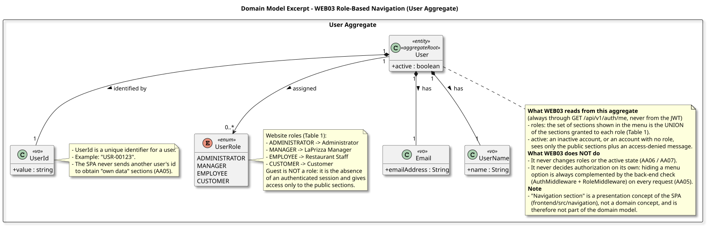
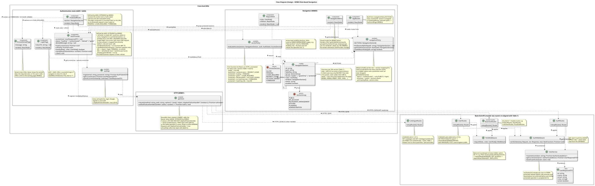
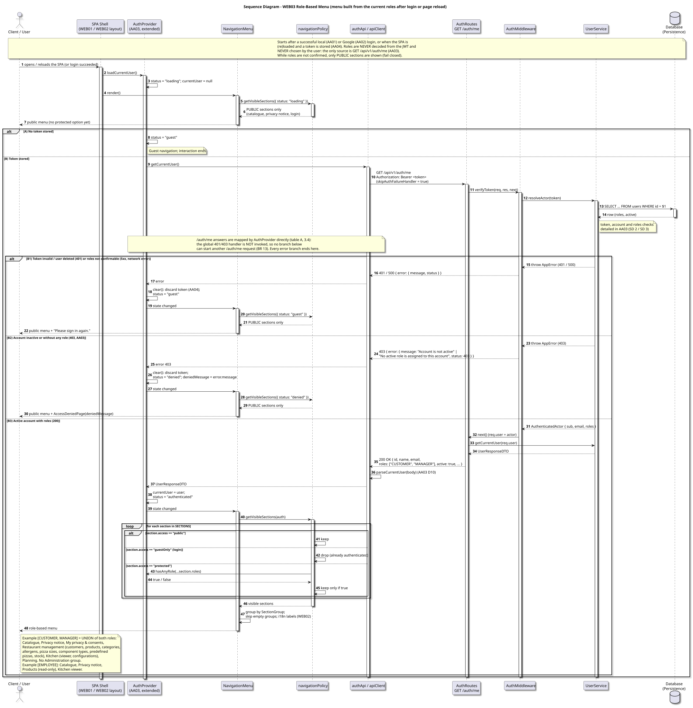
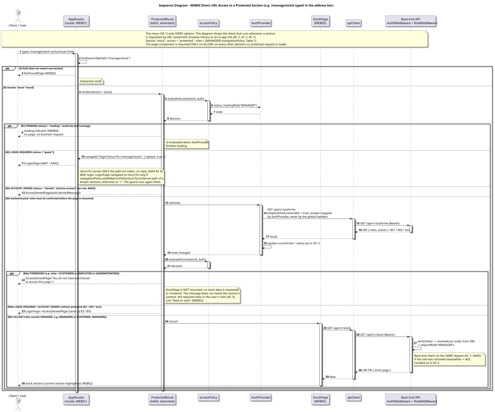
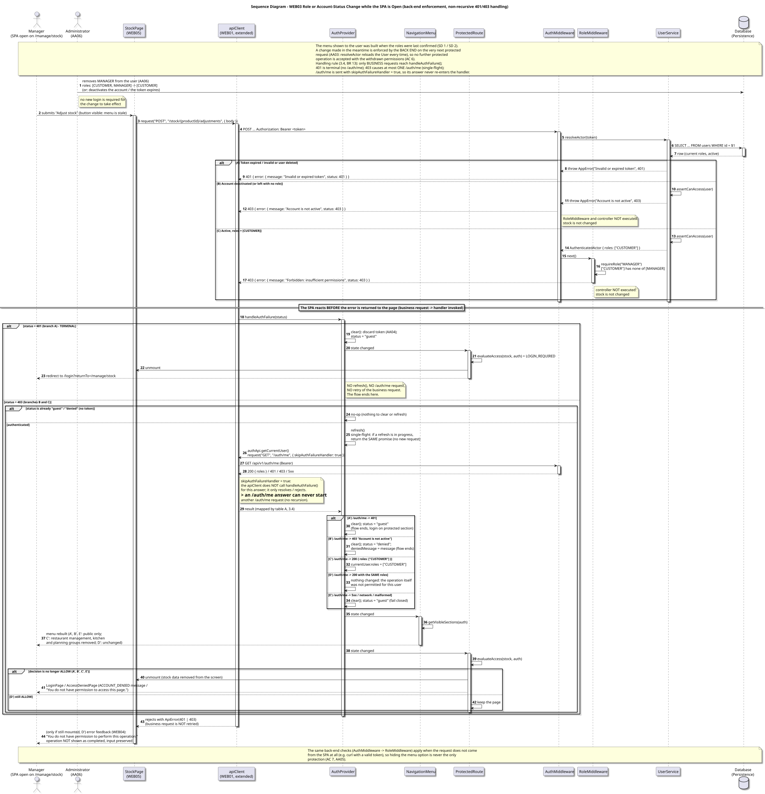

# US WEB03 – Role-Based Navigation

## 1. Context & Scope

*   **User Story ID:** WEB03
*   **Sprint:** Sprint 2
*   **Area:** Front-end Web Application (WEB)
*   **Responsible:** Leonor de Moura (1240914)
*   **Related Requirements / Stories:**
    *   Sprint 2 User Stories, *PART IV – Sprint 2 – User Stories*, WEB03, and *Table 1 – Website roles and accessible functionality*.
    *   System Specification: *PART II – System Specification*, section II.3.2 Web Application (Identity and Access Management: control of access to functionality according to assigned roles and permissions).
    *   Architecture: [System Architecture Description](../../architecture/SAD.md) (*Front-End* container; principle *Back-end authority*) and [ADR-006 – Secure authentication with bcrypt and JWTs](../../architecture/ADR.md).
    *   Related stories:
        *   **WEB01 – SPA Setup and Integration:** SPA project structure, client-side router and the reusable `apiClient` extended here.
        *   **WEB02 – Consistent Layout and Navigation:** common layout where the menu is placed, i18n of the labels, current-section indicator, starting page and `NotFoundPage`.
        *   **WEB04 – User Feedback and Validation:** loading indicators and error feedback reused by the route guard and by the 401/403 reaction.
        *   **WEB05 / WEB06 / WEB07, VIS01:** pages behind the sections declared here; they use `RequireRole` for action-level visibility.
        *   **AA01 / AA02 – Local and External Authentication:** login pages that receive the `returnTo` path.
        *   **AA03 – Internal Role Resolution:** `GET /api/v1/auth/me`, `AuthProvider`, `ProtectedRoute`, `AccessDeniedPage`, `authApi.parseCurrentUser()` and the fail-closed rules. WEB03 extends them.
        *   **AA04 – Secure Session Handling:** token storage, `clear()` on logout / `401`, no session data in URLs.
        *   **AA05 – Authorization Enforcement:** back-end permission per operation (`RoleMiddleware`), `401` vs `403`.
        *   **AA06 – Role Assignment and Activation Invitation:** role removals and deactivations that WEB03 must reflect; Administrator pages.
    *   **Dependencies:** WEB03 depends on AA03 (`/auth/me` and the `AuthProvider` state) and on WEB01/WEB02 (router, layout). It provides `navigationPolicy` (single role → section mapping), `NavigationMenu`, `RequireRole` and the route-guard decision used by every page of WEB05, WEB06, WEB07, VIS01 and AA06. Two back-end alignments with Table 1 are integration requirements of WEB03 (section 3.4.1): public read of the catalogue (with WEB05 / AA05) and user administration restricted to `ADMINISTRATOR` (with AA06 / AA05).

### Scope boundary

WEB03 concerns **which sections each user can see and open in the SPA, and how the SPA reacts when that changes**. It does not define *where roles come from* (AA03), *who changes them* (AA06) nor *how each operation is authorized in the back end* (AA05). It does not implement the pages behind the protected sections (WEB05, WEB06, WEB07, VIS01, AA06) nor the layout itself (WEB02). The only pages WEB03 delivers are the two **public, read-only** sections that Table 1 gives to every role, Guest included: the sellable catalogue with product / allergen information and the privacy notice (D13). Without them AC 4 would not hold in the running SPA.

WEB03 owns:

1. The single declarative mapping *section → path → required roles* derived from Table 1 (`navigationPolicy`).
2. The dynamic menu built from the current roles (union of permissions for users with several roles).
3. The route guard decision for every section requested by URL, bookmark, history or link, including Guest redirection to login and a safe `returnTo`.
4. The access-denied presentation that reveals no protected information.
5. The SPA reaction to role or account-status changes: re-reading `/auth/me` on navigation and after a `403`, and ending the session on a `401`, with a non-recursive handling rule (section 3.4).
6. Action-level visibility (`RequireRole`) for buttons and links inside pages.
7. The verification that the back end grants exactly the access of the section matrix, including anonymous access to the catalogue and Administrator-only access to user administration (tests IT01, IT04–IT06).
8. The public catalogue view (list, search by component, product detail with sizes and allergens) on top of the BCK11 API, and the privacy notice page (D13).

---

## 2. Requirements & Analysis

### 2.1. User Story Description

> **As an** authenticated System User,  
> **I want** menus and navigation appropriate to my role,  
> **so that** I can find the operations available to me.

The actor is **authenticated System User**, as named in the Sprint 2 specification. The behaviour for Guest (no session) is also specified because the menu and the route guard must treat it explicitly (Table 1).

### 2.2. Acceptance Criteria

- [ ] **AC 1:** Menu options are rendered dynamically based on the authenticated user's roles and permissions.
- [ ] **AC 2:** Navigation to unauthorized sections is prevented, even if the URL is typed manually.
- [ ] **AC 3:** An appropriate access-denied message is shown without revealing protected information.
- [ ] **AC 4:** The available sections follow the base-role permissions defined in Table 1.
- [ ] **AC 5:** Users with more than one role may access the functionality granted by those roles, subject to applicable data-ownership and confidentiality restrictions.
- [ ] **AC 6:** Changes to roles or account status are reflected before further protected operations are accepted.
- [ ] **AC 7:** Hiding a menu option is complemented by checks whenever the corresponding functionality is requested.

Criteria from related stories that constrain WEB03 (not owned, but must hold):

*   **AA03 AC 4 / AC 8 / AC 9:** roles are obtained from the back end after login; roles supplied by the user are not proof of authorization; if roles cannot be confirmed, protected functionality remains unavailable → the menu and the guard use only the `/auth/me` answer and show only public sections while it is unknown.
*   **AA03 AC 6:** users with no active role or an inactive account receive an access-denied message.
*   **AA04 AC 6 / AC 7:** session information is not exposed in addresses; returning to a page after logout does not reveal protected information → `returnTo` carries only a path; the guard runs again on back/forward navigation.
*   **AA05 AC 2 / AC 3:** access is prevented in both the Web Application and the services; `401` (authentication) is distinguished from `403` (permission).
*   **WEB02 AC 6:** users can identify the current section and return to an appropriate starting page → the access-denied page offers a link to the starting page.
*   **WEB05:** each list and detail view distinguishes available actions according to the user's permissions → `RequireRole`.
*   **Table 1:** Administrator access to restaurant management requires the corresponding additional role; Restaurant Staff changes to customer records, stock, planning and administration require an additional role.

| Back-end endpoint (current) | Required role(s) |
| --- | --- |
| `GET /categories`, `GET /allergens`, `GET /pizza-sizes` (and `/:id`) | Public |
| `GET /catalogue`, `GET /catalogue/:productId` | Any authenticated user (public after ALN-1, section 3.4.1) |
| `GET /products`, `GET /products/:id` | `MANAGER` or `EMPLOYEE` |
| Writes on categories, allergens, products, pizza sizes; `/customers/*`, `/stock`, `/stock/:productId`, `/stock/:productId/adjustments`, `/pizza-component-types/*`, `/products/:id/component-configurations/*`, `/predefined-pizzas/*` | `MANAGER` |
| `/users` (list, get, roles, deactivate, activation, invitations) | `ADMINISTRATOR` (moved from `MANAGER` by AA06, ALN-2) |

*   `AuthMiddleware.verifyToken` → `UserService.resolveActor()` reloads the `User` on every protected request, so a removed role or a deactivated account is enforced on the next request without a new login (AA03 BR 7). This is the back-end half of AC 6 and AC 7.
*   AA03 designs `GET /api/v1/auth/me`, `AuthProvider` (`status: loading | authenticated | denied | guest`), `ProtectedRoute(requiredRoles)` and `AccessDeniedPage`, but leaves the menus and the section → role mapping to WEB03.

### 2.3. Client Clarifications & Questions

**Question 1 (Sprint 1):** Which roles should exist in the first phase? Can a user have more than one role?

**Answer 1:** In this first phase, you should consider at least the roles Manager, Customer, and Employee. A User may have more than one role, if necessary to represent different responsibilities in the system. *(Extended in Sprint 2 by Table 1, which adds the Administrator role.)*

**Question 2:** What are the applicable data-ownership and confidentiality restrictions to users with more than one role exaclty?  e.g., a Staff user that is also a Customer: it will have access to everything both the roles can have or not?

**Answer 2:** A user with multiple roles has the combined permissions of those roles, while remaining subject to the applicable data-ownership, access and confidentiality restrictions. For example, a user with both Employee and Customer roles may access the functionality of both roles. However, the Employee role does not grant unrestricted access to other customers' personal data, and the Customer role does not allow access to other customers' records. Permissions must be enforced for each operation, considering both the user's roles and the data being accessed.

### 2.4. Business Rules & Invariants

Each rule states its source: **S** = Sprint 2 specification, **C** = client clarification, **D** = team design decision (section 3.8).

| ID | Rule | Source |
| --- | --- | --- |
| **BR 1** | The sections and their required roles are defined **once** (`navigationPolicy`) and that definition generates both the menu and the protected routes. | S – AC 1, AC 2, AC 4; D1 |
| **BR 2** | A protected section is shown in the menu and can be opened only if the user is `authenticated` (AA03) and holds **at least one** of its roles. Several roles give the **union** of their sections. | S – AC 1, AC 5, Table 1; C – Q1 |
| **BR 3** | While roles are not confirmed (`loading`, `guest`, `denied`, error, malformed `/auth/me`), only public sections are shown and no protected page is mounted (fail closed). | S – AA03 AC 9 |
| **BR 4** | Guest sees only: catalogue with product/allergen information, privacy notice, and the local / external login entry points. | S – Table 1 |
| **BR 5** | A child route (e.g. *edit product*) may only **restrict** the roles of its parent section, never widen them. | D2 |
| **BR 6** | The page of a section is mounted only when the guard decision is `ALLOW`; on any other decision no protected request is sent, so nothing protected can be rendered. | S – AC 2, AC 3; D3 |
| **BR 7** | The access-denied message is generic and never includes section data, required roles or the user's roles; for inactive / role-less accounts the AA03 message is shown. | S – AC 3, AA03 AC 6; D5 |
| **BR 8** | A Guest requesting a protected section is redirected to login with `returnTo=<path>`; after login the SPA navigates there only if it is an internal path of a known section (no open redirect), and the guard runs again. | S – AC 2, AA04 AC 6; D6 |
| **BR 9** | The roles are re-read from `/auth/me` on every navigation to a protected section, on window focus, and after a `403` answered by a **business** endpoint; the menu and the current route are re-evaluated with the new state. A `401` from any endpoint ends the session (no `/auth/me` call). | S – AC 6, AA04 AC 3; D4 |
| **BR 10** | The back end checks every request (`AuthMiddleware` → `RoleMiddleware`) independently of the SPA; hiding a menu option or a button is never the only protection. | S – AC 7, AA05 |
| **BR 11** | Sections with personal data of the authenticated user ("My privacy & consents") use endpoints scoped to the authenticated user and never send another user's identifier; managing other customers' data requires `MANAGER`. | S – AC 5, AA05 AC 4, Table 1 |
| **BR 12** | An Administrator without `MANAGER` / `EMPLOYEE` sees only Administration and the public sections. | S – Table 1 |
| **BR 13** | Requests to the authentication endpoints (`/auth/me`, `/auth/login`, `/auth/google/*`, `/users/register`) never invoke the global `401`/`403` handler; their answers are mapped directly by `AuthProvider`. Therefore an answer of `/auth/me` can never start another `/auth/me` request, and each `403` burst causes at most **one** `/auth/me` request. | S – AC 6, AA03 AC 9; D4, D10 |
| **BR 14** | The back end allows anonymous `GET` of the sellable catalogue and of a catalogue product; the answer contains no stock quantities and no personal data. All other Sprint 1 reads keep their current roles. | S – Table 1 (Guest); D11 |
| **BR 15** | User administration endpoints (`/users` list, detail, roles, deactivation) require `ADMINISTRATOR`; `MANAGER`, `EMPLOYEE`, `CUSTOMER` get `403`, anonymous requests `401`. | S – Table 1 (Administrator, LaPrizza Manager), AA05, AA06; D12 |

#### Section matrix (Table 1 → `navigationPolicy`)

| Section (`id`) | Path | Group | Guest | Customer | Staff (`EMPLOYEE`) | Manager | Administrator | Page owner |
| --- | --- | --- | :-: | :-: | :-: | :-: | :-: | --- |
| `catalogue` | `/catalogue` (+ `/:productId`) | Public | X | X | X | X | X | WEB03 (read-only view of BCK11) |
| `privacy-notice` | `/privacy` | Public | X | X | X | X | X | WEB03 (content from GDP01 / GDP02) |
| `login`, `registration` | `/login`, `/register` | Guest only | X | – | – | – | – | AA01 / AA02 |
| `my-privacy` | `/account/privacy` | My account | – | X | – | – | – | Table 1 (Customer) |
| `products` | `/manage/products` (read) | Restaurant mgmt | – | – | X | X | – | WEB05 |
| ↳ `productsEdit`, `productEdit`, `productComponentConfigurations` | `/manage/products/new`, `/:productId/edit`, `/:productId/component-configurations` | Restaurant mgmt | – | – | – | X | – | WEB05 |
| `customers` | `/manage/customers` | Restaurant mgmt | – | – | – | X | – | WEB05 |
| `categories` | `/manage/categories` | Restaurant mgmt | – | – | – | X | – | WEB05 |
| `allergens` | `/manage/allergens` | Restaurant mgmt | – | – | – | X | – | WEB05 |
| `pizza-sizes` | `/manage/pizza-sizes` | Restaurant mgmt | – | – | – | X | – | WEB05 |
| `component-types` | `/manage/pizza-component-types` | Restaurant mgmt | – | – | – | X | – | WEB05 |
| `predefined-pizzas` | `/manage/predefined-pizzas` | Restaurant mgmt | – | – | – | X | – | WEB05 |
| `stock` | `/manage/stock` | Restaurant mgmt | – | – | – | X | – | WEB05 |
| `kitchen-viewer` | `/kitchen/viewer` | Kitchen | – | – | X | X | – | VIS01 |
| `kitchen-configurations` | `/kitchen/configurations` | Kitchen | – | – | – | X | – | WEB06 |
| `planning` | `/planning` | Planning | – | – | – | X | – | WEB07 |
| `users` | `/admin/users` | Administration | – | – | – | – | X | AA06 |
| `account` (+ ↳ `accountPassword`) | `/account`, `/account/password` | My account | – | X | X | X | X | AA01 / AA04 |

A user with several roles sees every column it holds (e.g. `[CUSTOMER, MANAGER]` = Customer ∪ Manager). Sections whose page is not yet implemented are kept in the policy but hidden by an `enabled: false` flag, so the matrix stays complete and testable.

Menu actually rendered today (`getVisibleSections`, all lazy modules supplied). It is the matrix restricted to the enabled sections, which UT02b checks:

| Role | Menu entries |
| --- | --- |
| Guest | `catalogue`, `privacy-notice`, `registration` |
| Customer | `catalogue`, `privacy-notice`, `account` |
| Staff (`EMPLOYEE`) | `catalogue`, `privacy-notice`, `account`, `kitchen-viewer` |
| Manager | `catalogue`, `privacy-notice`, `account`, `kitchen-viewer`, `kitchen-configurations`, `planning` |
| Administrator | `catalogue`, `privacy-notice`, `account`, `users` |

Still disabled (D8): `my-privacy` (no endpoint yet) and the WEB05 management pages (`products`, `customers`, `categories`, `allergens`, `pizza-sizes`, `component-types`, `predefined-pizzas`, `stock`). They are protected sections, so they never widen any role's access.

### 2.5. Domain Model Excerpt



PlantUML source: [`excerptDomainModel/domain_model_excerpt.puml`](./excerptDomainModel/domain_model_excerpt.puml).

| Concept | Kind | Role in WEB03 |
| --- | --- | --- |
| **User** | Entity / Aggregate Root (existing, unchanged) | Its `roles` and `active` state, read through `/auth/me`, decide the visible sections |
| **UserRole** | Enumeration (existing, unchanged) | `ADMINISTRATOR`, `MANAGER`, `EMPLOYEE`, `CUSTOMER` – the role names used in `navigationPolicy` |
| **UserId**, **Email**, **UserName** | Value Objects | Shown in the layout (name) and used implicitly by "own data" sections (BR 11) |

WEB03 introduces **no new domain concept**. A *navigation section* is a presentation concept of the SPA and therefore lives in `frontend/src/navigation`, not in the domain model. Guest is the absence of a session and is not a role.

---

## 3. Design

### 3.1. Architecture & C4 Alignment

This User Story operates within the established **C4 Model** of the system ([SAD](../../architecture/SAD.md)):

*   **C4 Level 1 (System Context):** every actor of Table 1 (Guest, Customer, Restaurant Staff, LaPrizza Manager, Administrator) uses the *LaPrizza Information System* through the Web Application over HTTP.
*   **C4 Level 2 (Containers):** the *Front-End* (React SPA) decides only what to **show**; the *Back-End API* remains the only authority that **allows** an operation (*Back-end authority* principle), reading roles from the *Relational Database* on each request.
*   **C4 Level 3 (Components):** in the Front-End, WEB03 adds a *Navigation* component (`navigationPolicy`, `accessPolicy`, `NavigationMenu`, `RequireRole`, `AppRoutes`) next to the *Authentication state* component of AA03/AA04 and the *HTTP client* of WEB01. In the Back-End, the **Security Component** (`AuthMiddleware`, `RoleMiddleware`) and the **User Component** (`UserService.resolveActor`, `getCurrentUser`) are reused unchanged. The back end needs **no new component**; only the role requirements of two existing routers change to match Table 1 (`CatalogueRoutes` → public read, `UserRoutes` → `ADMINISTRATOR`, section 3.4.1).

---

### 3.2. Class Diagram (CD)

Structural design of the classes participating in this User Story (SPA packages and the reused back-end elements).



> PlantUML source: [`classDiagram/class_diagram.puml`](./classDiagram/class_diagram.puml).

Key design points:

*   **Reused unchanged:** back end – `AuthRoutes` (`GET /auth/me`), `AuthMiddleware`, `RoleMiddleware`, `UserService.resolveActor` / `getCurrentUser` / `assertCanAccess`, every business router; front end – `AccessDeniedPage`, `authApi`, `LoginPage` (AA01/AA02).
*   **Extended:**
    *   `AuthProvider` (AA03): `refresh()` (single in-flight request shared by concurrent callers), `handleAuthFailure(status)`, `deniedMessage`.
    *   `ProtectedRoute` (AA03): receives a `NavigationSection` instead of a hard-coded role list and delegates the decision to `accessPolicy.evaluateAccess()`; it triggers `refresh()` before mounting a protected page.
    *   `apiClient` (WEB01): `setAuthFailureHandler()` and the per-request option `skipAuthFailureHandler`. A `401`/`403` from a **business** endpoint is passed to `AuthProvider.handleAuthFailure()` before the error reaches the page; requests of `authApi` (`/auth/me`, login, Google, register) are always sent with `skipAuthFailureHandler: true` (BR 13).
    *   `LoginPage` (AA01): honours `returnTo` only when `navigationPolicy.isSafeReturnPath()` accepts it.
*   **New:** `NavigationSection` (configuration record), `SectionGroup`, `navigationPolicy`, `accessPolicy` + `AccessDecision`, `NavigationMenu`, `RequireRole`, `AppRoutes`.
*   **Pure decision logic:** `navigationPolicy.getVisibleSections()` and `accessPolicy.evaluateAccess()` are plain functions without React or HTTP, so the whole Table 1 matrix is unit-tested exhaustively.

#### Access decision (`accessPolicy.evaluateAccess(section, auth)`)

| `section.access` | `auth.status` | Roles | Decision | Effect |
| --- | --- | --- | --- | --- |
| `public` | any | – | `ALLOW` | Page rendered |
| `guestOnly` | `authenticated` | – | `REDIRECT_HOME` | Navigate to `/` |
| `guestOnly` | other | – | `ALLOW` | Login page rendered |
| `protected` | `loading` | – | `PENDING` | Loading indicator (WEB04); no page |
| `protected` | `guest` | – | `LOGIN_REQUIRED` | Redirect to `/login?returnTo=<path>` |
| `protected` | `denied` | – | `ACCOUNT_DENIED` | `AccessDeniedPage(deniedMessage)` |
| `protected` | `authenticated` | none of `section.roles` | `FORBIDDEN` | `AccessDeniedPage(generic)` |
| `protected` | `authenticated` | ≥ 1 of `section.roles` | `ALLOW` | Page mounted |

---

### 3.3. Sequence Diagrams (SD)

Three scenarios are documented separately because they cover distinct acceptance criteria and interaction paths. Error branches always end the interaction explicitly.

#### SD 1 — Role-Based Menu after Login / Reload (AC 1, AC 4, AC 5)

Menu while roles are unknown (public only), `/auth/me` failures (`401`/`5xx` → Guest, `403` → access denied), and the success case in which the visible sections are the union of the user's roles.



> Source: [`sequence_diagram_role_based_menu.puml`](./sequenceDiagram/sequence_diagram_role_based_menu.puml)

#### SD 2 — Direct URL Access to a Protected Section (AC 2, AC 3, AC 7)

Unknown path, roles still loading, Guest (redirect to login with a safe `returnTo`), denied account, insufficient roles (access-denied page, page **not** mounted, no data request) and allowed access, where the page request is checked again by the back end.



> Source: [`sequence_diagram_direct_url_access.puml`](./sequenceDiagram/sequence_diagram_direct_url_access.puml)

#### SD 3 — Role or Account-Status Change while the SPA is Open (AC 6, AC 7)

An Administrator removes `MANAGER` (or deactivates the account, or the token expires) while the user has the stock page open. The next protected operation is rejected by the back end. On `401` the session ends with no `/auth/me` request; on `403` the SPA re-reads `/auth/me` once (single-flight, sent with `skipAuthFailureHandler`, so its answer can never re-enter the handler), rebuilds the menu, unmounts the page and shows the login or access-denied page; the operation is never shown as completed nor retried.



> Source: [`sequence_diagram_role_change_enforcement.puml`](./sequenceDiagram/sequence_diagram_role_change_enforcement.puml)

---

### 3.4. REST API Specification (ARC03)

WEB03 **adds no endpoint**. It consumes the AA03 endpoint, relies on the role checks of the Sprint 1 endpoints, and requires the two role alignments of section 3.4.1.

| Method | Endpoint | Use in WEB03 | Auth / Role |
| :--- | :--- | :--- | :--- |
| `GET` | `/api/v1/auth/me` | Source of the roles / active state for the menu and the guard (after login, on reload, on protected navigation, on focus, after a business `403`). Always sent with `skipAuthFailureHandler: true` | Authenticated (AA03) |
| *any* | Endpoints of each section (section matrix, 2.4) | Called only by a page mounted after `ALLOW`; every call re-checked by `AuthMiddleware` + `RoleMiddleware` | As in 2.2 *Existing implementation evidence*, with the changes of 3.4.1 |

#### Request & Response Schemas

- **Current user — Request (`GET /api/v1/auth/me`):** no body; header `Authorization: Bearer <token>`.
- **Current user — Success (`200 OK`)**, as defined by AA03 and validated by `authApi.parseCurrentUser()`:

  ```json
  {
    "id": "USR-00007",
    "name": "Rui Costa",
    "email": "rui.costa@laprizza.pt",
    "roles": ["CUSTOMER", "MANAGER"],
    "active": true,
    "marketingConsent": false,
    "createdAt": "2026-10-12T09:30:00.000Z"
  }
  ```

#### Handling of `401` / `403` (non-recursive rule)

Two kinds of requests are distinguished:

*   **Authentication requests** – sent by `authApi` (`GET /auth/me`, `POST /auth/login`, `/auth/google/*`, `POST /users/register`) with `skipAuthFailureHandler: true`. The `apiClient` **never** calls the global handler for them; `AuthProvider` maps their answer directly (table A). This is what guarantees that an answer of `/auth/me` cannot trigger another `/auth/me` request (BR 13).
*   **Business requests** – every other call made by a page. A `401` or `403` is passed to `AuthProvider.handleAuthFailure(status)` **before** the error is returned to the page (table B). The failed request is **never retried automatically**.

**Table A – answers of `GET /auth/me` (handler not invoked):**

| Answer | `AuthProvider` reaction | Further requests |
| --- | --- | --- |
| `200` valid body | `status = authenticated`; menu and current route re-evaluated | None |
| `200` malformed body | Treated as error (AA03 D10): `clear()`, `status = guest`, Guest menu | None |
| `401 No token provided` / `Invalid or expired token` | `clear()` (AA04), `status = guest`, redirect to `/login?returnTo=<current path>` if the current section is protected | **None** – the flow ends |
| `403 Account is not active` / `No active role is assigned to this account` | `clear()`, `status = denied`, `deniedMessage = message`, public menu + `AccessDeniedPage(message)` | **None** – the flow ends |
| `5xx` / network error | Roles not confirmed → `clear()`, `status = guest` (fail closed, AA03 D7) | None |

**Table B – `401` / `403` answered by a business endpoint (`handleAuthFailure`):**

| Answer | Reaction | `/auth/me` requests |
| --- | --- | --- |
| `401` (any message) | Terminal: `clear()`, `status = guest`, redirect to `/login?returnTo=<current path>`. No `refresh()`, no retry. | **0** |
| `403` (any message, not parsed) | `refresh()` – single-flight: if a refresh is already in progress, the same promise is returned. The refresh answer is then handled by table A only. Afterwards: roles changed / account denied → menu rebuilt and page replaced by `AccessDeniedPage`; same roles → WEB04 error *"You do not have permission to perform this operation."* | **At most 1** per burst of concurrent `403`s |
| `401` / `403` when `status` is already `guest` or `denied` (no token) | Ignored by the handler (nothing to clear or refresh); the page shows the WEB04 error | **0** |

Invariant: `/auth/me` is called only by `loadCurrentUser()` and `refresh()`; neither is ever called from the handling of an `/auth/me` answer, so there is no recursive path.

- **Access-denied texts (i18n, WEB02):**
  - `FORBIDDEN`: *"You do not have permission to access this page."* / *"Não tem permissão para aceder a esta página."*
  - `ACCOUNT_DENIED`: the AA03 message (`Account is not active` / `No active role is assigned to this account`), translated.

#### 3.4.1. Back-end alignment with Table 1 (integration requirements)

| ID | Router / endpoints | Current | Required by Table 1 | Change | Owner of the change | Verified by |
| --- | --- | --- | --- | --- | --- | --- |
| **ALN-1** | `CatalogueRoutes`: `GET /api/v1/catalogue`, `GET /api/v1/catalogue/:productId` | `authenticate` (any authenticated user; anonymous → `401`) | Guest may browse the catalogue | Remove `authenticate` from both reads (query/param validation kept) and the `security` / `401` entries of the two OpenAPI operations. Answer unchanged: no stock quantities, no personal data. The existing test expecting `401` is replaced by IT04. | WEB03 with WEB05 (BCK11 module), reviewed by AA05 | IT04, FT18, MT04 |
| **ALN-2** | `UserRoutes`: `GET /users`, `GET /users/:id`, `PATCH /users/:id/roles`, `DELETE /users/:id` | `requireRole('MANAGER')` | Only the Administrator manages accounts and roles | `requireRole('ADMINISTRATOR')`; the `ADMINISTRATOR` role exists since AA03. `POST /users/register` stays public. The `users` section of `navigationPolicy` already declares `[ADMINISTRATOR]`. | AA06 (role administration) with AA05; integrated and tested in WEB03 | IT05, IT06, MT05 |

- **Anonymous catalogue — `GET /api/v1/catalogue` without `Authorization` (`200 OK`):** the same array of `CatalogueProduct` already returned by BCK11 (`CatalogueResponseMapper`), e.g.

  ```json
  [
    {
      "id": "PROD-00001",
      "name": "Margherita",
      "description": "Tomato, mozzarella and basil",
      "available": true,
      "category": { "id": "CAT-00001", "name": "Pizzas" },
      "price": null,
      "allergens": [{ "id": "1", "name": "Gluten" }],
      "pizza": {
        "defaultComponents": [{ "id": "PROD-00123", "name": "Mozzarella", "pizzaComponentTypeId": "type-01" }],
        "sizes": [{ "sizeId": "PSIZE-0001", "sizeName": "Medium", "price": { "amount": "9.50", "currency": "EUR" }, "available": true }]
      }
    }
  ]
  ```
  Only the authentication requirement changes. The module's `api/openapi.js` drops `security` and the `401` response from both catalogue operations.

- **User administration after ALN-2:** `ADMINISTRATOR` → `200` / `204`; `MANAGER`, `EMPLOYEE`, `CUSTOMER` → `403 Forbidden: insufficient permissions`; no token → `401 No token provided`. A user with `[ADMINISTRATOR, MANAGER]` keeps both restaurant management and administration (union, BR 2).

### 3.5. Persistence & Data Integrity (ARC04)

WEB03 requires **no database change and no migration**. Roles and the `active` state remain persisted only in `users` (AA03) and are read through `/auth/me`.

- **Client-side state:** the current user and its roles live **only in memory** (`AuthProvider`). They are not written to `localStorage` / `sessionStorage` / cookies, so a stale or edited copy can never be used to build the menu; only the token is stored (AA04).
- **`returnTo`:** contains only an internal path (`/manage/stock`), never the token, ids of protected records or query data (AA04 AC 6).
- **Integrity rule:** `navigationPolicy` is static code; a unit test checks that every section uses only known roles, that child routes do not widen their parent's roles (BR 5) and that the matrix equals Table 1.

### 3.6. Applied Patterns & Architecture Principles

- **Single Source of Truth:** one `navigationPolicy` drives menu, routes and tests (D1).
- **Policy / Strategy as pure functions:** `getVisibleSections()` and `evaluateAccess()` separate the decision from rendering, making the Table 1 matrix exhaustively testable.
- **Guard (Route Protection):** `ProtectedRoute` mounts the page only on `ALLOW`.
- **Observer:** `NavigationMenu` and `ProtectedRoute` subscribe to `AuthProvider` (React context) and re-evaluate on every state change.
- **Interceptor:** `apiClient` intercepts `401`/`403` of business requests (never of authentication requests) and notifies `AuthProvider` before the page sees the error.
- **Defense in depth:** SPA hides and blocks; the back end (`AuthMiddleware` → `RoleMiddleware`) authorizes every request (AC 7, AA05).
- **Security principles:** fail closed, least privilege (Guest by default), no trust in client-side state, no information disclosure in error messages.

### 3.7. New Components and Justification

| Component | Layer | Why it is needed / why an existing one is not enough |
| --- | --- | --- |
| `NavigationSection`, `SectionGroup`, `navigationPolicy` | Front-End – Navigation | AC 1 / AC 4 need a role → section mapping; defining it once avoids a menu that hides an option whose route is still open (or the opposite). |
| `accessPolicy.evaluateAccess()` + `AccessDecision` | Front-End – Navigation | AA03's `ProtectedRoute` only distinguishes "has role / has not"; WEB03 needs the full set of outcomes (loading, Guest, denied account, forbidden, guest-only) in one testable place. |
| `NavigationMenu` | Front-End – Navigation | Renders the role-based menu inside the WEB02 layout (AC 1, AC 5). |
| `RequireRole` | Front-End – Navigation | Pages of WEB05/WEB06/WEB07 must hide actions per permission (e.g. Staff sees products but not "Edit"); a single component keeps that consistent with the policy. |
| `AppRoutes` | Front-End – Routing | Generates the routes from the policy and wraps every protected one in `ProtectedRoute` (AC 2). |
| `AuthProvider.refresh()` / `handleAuthFailure()` | Front-End – Auth (extension of AA03) | AA03 loads roles only after login / reload; AC 6 requires the SPA to follow changes made while it is open. |
| `apiClient.setAuthFailureHandler()` | Front-End – HTTP (extension of WEB01) | Centralises the `401`/`403` reaction of business requests so that no page has to implement it (AC 6, AC 7). |
| `navigationPolicy.isSafeReturnPath()` | Front-End – Navigation | Prevents the `returnTo` parameter from becoming an open redirect or a vehicle for data (AA04 AC 6). |
| `apiClient` option `skipAuthFailureHandler` | Front-End – HTTP (extension of WEB01) | Without it the global handler would also run for `/auth/me`, and an `/auth/me` answer could start a new `/auth/me` request (recursion). |
| `catalogueApi`, `CataloguePage`, `CatalogueProductPage` | Front-End – Catalogue | Table 1 gives every role, Guest included, the catalogue with product and allergen information (BR 4, AC 4); no other story had delivered it in the SPA (D13). |
| `PrivacyNoticePage` | Front-End – Privacy | Table 1 gives every role the privacy notice (BR 4, AC 4); static, translated content (D13). |

### 3.8. Design Decisions

| ID | Decision |
| --- | --- |
| **D1** | A single declarative `navigationPolicy.SECTIONS` (id, path, i18n label key, group, access, roles, children, owner) generates the menu and the routes. Roles are an **any-of** list, matching `RoleMiddleware.requireRole(...)`. |
| **D2** | Child routes inherit the parent's roles and may only restrict them (`products` → `MANAGER, EMPLOYEE`; `products-edit` → `MANAGER`). |
| **D3** | `ProtectedRoute` mounts the section's page only on `ALLOW`. Data fetching happens inside the page, so `PENDING`, `LOGIN_REQUIRED`, `ACCOUNT_DENIED` and `FORBIDDEN` never trigger a protected request. |
| **D4** | `AuthProvider.refresh()` (re-reads `/auth/me`) runs on every navigation to a protected section, on window focus and after a `403` from a **business** endpoint. The `403` message is not parsed: `/auth/me` tells whether the roles changed, the account was disabled, or the operation simply was not permitted. A `401` from any endpoint is terminal: `clear()` + login, no `refresh()`. `refresh()` is single-flight (concurrent callers share one request) and the failed business request is never retried automatically. |
| **D5** | Known section without permission → `AccessDeniedPage` with a generic message (no data, no required roles, no user roles) and a link to the starting page; unknown path → `NotFoundPage` (WEB02). Route paths are public (they are in the bundle) and are not considered protected information (Q2 assumption). |
| **D6** | Guest on a protected section → `replace` navigation to `/login?returnTo=<path>`. After login, `returnTo` is used only if it is a relative internal path (`/` + no `//`, no scheme) matching a known section; the guard then decides again with the new roles. |
| **D7** | The current user and roles are kept only in memory; nothing about roles is persisted in the browser. The JWT is never decoded by the SPA (AA03 D3). |
| **D8** | Sections of later stories (WEB05 management pages, my privacy) are already declared with their Table 1 roles and an `enabled` flag; disabled sections are neither shown nor routable until their page exists. Lazy modules (kitchen viewer, kitchen configurations, planning) are enabled by their WEB01 loader. |
| **D9** | WEB03 introduces no new back-end component. The back end remains the authority (`RoleMiddleware` on each endpoint); the two misalignments with Table 1 found in the analysis are fixed as integration requirements (D11, D12) and verified by the permission-matrix tests. |
| **D10** | `authApi` sends every authentication request with `skipAuthFailureHandler: true`; the `apiClient` calls the global handler only for business requests. `AuthProvider` maps `/auth/me` answers directly (table A of 3.4). |
| **D11** | `GET /catalogue` and `GET /catalogue/:productId` become public (ALN-1). No separate "public catalogue" endpoint is created, because the existing answer already contains only public information. |
| **D12** | User administration routes require `ADMINISTRATOR` (ALN-2), implemented with AA06 and covered by AA05's matrix; the SPA `users` section uses the same role. |
| **D13** | WEB03 delivers the two public sections of Table 1 itself, so that AC 4 holds for every role, Guest included: a read-only catalogue (`CataloguePage`, `CatalogueProductPage`) over `GET /catalogue` and `GET /catalogue/:productId`, and a static `PrivacyNoticePage`. They send no access token and opt out of the `401`/`403` handler, because the answer is the same for everyone. They offer only what the API offers (search by `componentName`). Management pages remain WEB05, and the privacy-notice wording may be refined by GDP01 / GDP02 without changing the section. |

---

## 4. Tests (ARC05)

### 4.1. Test Plan & Scenarios

| Test ID | Level / Source | Scenario / Description | Expected Result |
| ------- | -------------- | ---------------------- | --------------- |
| UT01 | Unit — `test/navigation/navigationPolicy.test.js` | Every section uses only known roles; ids and paths unique; children roles ⊆ parent roles | Passes for all `SECTIONS` |
| UT02a | Unit — `test/navigation/navigationPolicy.test.js` | Role decision: for each base role (Guest, `CUSTOMER`, `EMPLOYEE`, `MANAGER`, `ADMINISTRATOR`) `evaluateAccess()` on every top-level section, enabled or not | `ALLOW` exactly for the X cells of the section matrix (Table 1) |
| UT02b | Unit — `test/navigation/navigationPolicy.test.js` | Rendered menu: for each base role `getVisibleSections()` with all lazy modules supplied | Exactly the "menu actually rendered" table (2.4), which equals the role's Table 1 row restricted to enabled sections (+ registration for Guest) |
| UT02c | Unit — `test/navigation/navigationPolicy.test.js` | Guest menu; `catalogue` and `privacy-notice` flags | Both public sections visible and enabled (BR 4) |
| UT03 | Unit — `test/navigation/navigationPolicy.test.js` | `[CUSTOMER, MANAGER]`, `[EMPLOYEE, MANAGER]`, `[ADMINISTRATOR, MANAGER]` | Union of the corresponding columns |
| UT04 | Unit — `test/navigation/navigationPolicy.test.js` | `status` = `loading` / `guest` / `denied` / `logoutPending` with any roles | Only `catalogue` and `privacy-notice` (+ registration for Guest) |
| UT05 | Unit — `test/navigation/navigationPolicy.test.js` | `isSafeReturnPath`: known section paths; `//evil…`, `https://…`, `/\evil…`, query strings, `..` segments, `/unknown`, `/login`, `/register`, `javascript:…`, `null` | `true` only for internal paths of known, non guest-only sections |
| UT06 | Unit — `test/navigation/accessPolicy.test.js` | `evaluateAccess` for every row of the decision table (3.2) | Expected `AccessDecision` |
| UT07 | Unit — `test/navigation/navigationPolicy.test.js` | Disabled section (D8); module without loader | Not visible, not routable |
| FT01 | SPA — `test/navigation/roleBasedNavigation.test.js` | Menu for Guest, `[CUSTOMER]`, `[EMPLOYEE]`, `[MANAGER]`, `[ADMINISTRATOR]`, `[CUSTOMER, MANAGER]`, `[ADMINISTRATOR, EMPLOYEE]` | Only the allowed, enabled entries (union for several roles); catalogue and privacy notice for everyone |
| FT02 | SPA — `test/navigation/roleBasedNavigation.test.js` | Roles change from `[CUSTOMER, MANAGER]` to `[CUSTOMER]`; window regains focus | Manager entries disappear without reload |
| FT03 | SPA — `src/App.test.jsx` | Guest opens `/kitchen/viewer?secret=x#y` | Redirect to `/login?returnTo=%2Fkitchen%2Fviewer` (path only); module never loaded |
| FT04 / FT07 | SPA — `test/navigation/roleBasedNavigation.test.js` | `[CUSTOMER]` / `[EMPLOYEE]` / `[ADMINISTRATOR]` type `/planning` | Generic access-denied page with link to Start; no section name, no role names; module never loaded; no business request |
| FT05 | SPA — `src/App.test.jsx` (WEB02) | Lazy section still loading after the guard | Loading indicator; section marked only after it settles |
| FT06 | SPA — `test/navigation/roleBasedNavigation.test.js` | `/auth/me` answers `403 Account is not active` during the navigation check | AA03 message; module never loaded; public menu only |
| FT08 | Component — `test/navigation/RequireRole.test.js` | Action for `MANAGER` with `[EMPLOYEE]`, `[MANAGER]`, `[CUSTOMER, MANAGER]`, loading, denied, guest | Shown only for confirmed sessions holding `MANAGER` |
| FT09 | SPA — `test/navigation/roleBasedNavigation.test.js` | Business `403`; `/auth/me` now returns fewer roles | Exactly 1 `/auth/me`; menu rebuilt; page replaced by access denied |
| FT10 | SPA — `test/navigation/roleBasedNavigation.test.js` | Business `403`; `/auth/me` returns the same roles | Page kept; failure reported; operation never shown as completed; no retry |
| FT11 / FT16 | SPA — `test/navigation/roleBasedNavigation.test.js` | Business `401` | **0** `/auth/me`; no retry; session discarded; `/login?returnTo=%2Fplanning` with "session expired" |
| FT12 | SPA — covered by FT15 / FT17 in `test/navigation/roleBasedNavigation.test.js` | Concurrent `refresh()` calls (three handlers at once) | One `/auth/me` request |
| FT13 | SPA — `test/navigation/roleBasedNavigation.test.js` | `/login?returnTo=…` with a restored session: `/planning` as `[MANAGER]` / `[CUSTOMER]`, `//evil.example`, `https://evil.example/x`, `/register` | Section / access denied / `/` / `/` / `/` |
| FT14 | SPA — `test/navigation/roleBasedNavigation.test.js` | Business `403`, then `/auth/me` answers `401` | Exactly **1** `/auth/me`; no further request after 100 ms; Guest menu, login page |
| FT15 / FT17 | SPA — `test/navigation/roleBasedNavigation.test.js` | Three simultaneous business `403`s; `/auth/me` answers `403 Account is not active` | Exactly **1** `/auth/me` in total; each call rejects with `403`; access-denied message |
| FT18 | SPA — `test/navigation/publicSections.test.js` | Guest opens `/catalogue` | Products with price ("from" the cheapest available size for pizzas), category and allergens; section marked current; no `Authorization` header |
| FT19 | Unit — `src/api/apiClient.test.js` | Business `401`/`403`; auth request with `skipAuthFailureHandler`; `404` / network error; failing handler; handler replacement | Handler awaited before the rejection, request not retried; never called for auth requests or other errors; original `ApiError` kept |
| FT20 | SPA — `test/navigation/publicSections.test.js` | Guest opens a product from the catalogue list | Detail with sizes, prices and availability, default ingredients and allergens; catalogue marked as current location |
| FT21 | SPA — `test/navigation/publicSections.test.js` | `/catalogue/PROD-99999` (API `404`); `/catalogue/not-a-product` | "Does not exist or is not on sale"; the malformed id is never requested |
| FT22 | SPA — `test/navigation/publicSections.test.js` | API `503`, then retry; search by component with no result | Error with retry, then the list; empty result explained; `componentName` sent to the API |
| FT23 | SPA — `test/navigation/publicSections.test.js` | Guest opens `/privacy` | Privacy notice (controller, data, purposes, retention, rights); no business request |
| FT24 | SPA — `test/navigation/publicSections.test.js` | `CUSTOMER`, `EMPLOYEE`, `MANAGER`, `ADMINISTRATOR` open `/catalogue` | Catalogue shown; both public sections in the menu; no access token sent |
| IT01 | HTTP (back end) — `tests/integration/web03-role-based-navigation/permissionMatrix.test.js` | Guest, `CUSTOMER`, `EMPLOYEE`, `MANAGER`, `ADMINISTRATOR`, `[ADMINISTRATOR, MANAGER]` on `GET /catalogue`, `GET /stock`, `POST /stock/:productId/adjustments`, `GET /users` | Statuses exactly as the section matrix (`200` / `403` / `401`) |
| IT02 | HTTP (back end) — `permissionMatrix.test.js` | Manager token; `MANAGER` removed in the repository; `POST /stock/PROD-00123/adjustments` with the same token | `403 Forbidden: insufficient permissions`; stock unchanged |
| IT03 | HTTP (back end) — `permissionMatrix.test.js` | Account deactivated; `GET /stock` with the same token | `403 Account is not active` |
| IT04 | HTTP (back end) — `tests/integration/product-catalogue-and-information/api.test.js` | `GET /catalogue`, `GET /catalogue/:productId` **without token**; unknown product; with a Customer token | `200` (no stock quantity / personal data); `404`; same answer as anonymous |
| IT04b | Unit (back end) — `tests/unit/product-catalogue-and-information/openapi.test.js` | OpenAPI of both catalogue operations | `security: []`, no `401` response |
| IT05 | HTTP (back end) — `permissionMatrix.test.js` | `GET /users`, `GET /users/:id`, `PATCH /users/:id/roles`, `DELETE /users/:id` with no token, `CUSTOMER`, `EMPLOYEE`, `MANAGER`, `ADMINISTRATOR` | `401`; `403`; `403`; `403`; `200`/`204` |
| IT06 | HTTP (back end) — `permissionMatrix.test.js` | `[ADMINISTRATOR, MANAGER]`: `GET /users`, `GET /stock`; `[ADMINISTRATOR]`: `GET /stock` | `200`, `200`; `403` (BR 12) |
| MT01 | Manual | Log in as Manager, Staff, Customer, Administrator and Customer+Manager | Menus as in the section matrix |
| MT02 | Manual | As Customer type `/manage/customers`, `/admin/users`; press Back after logout (AA04) | Access-denied page / login page; no protected data visible |
| MT03 | Manual | Manager with stock page open; Administrator removes `MANAGER`; click "Adjust stock" | Error, menu loses Manager groups, access-denied page, stock unchanged |
| MT04 | Manual | Private browser window (no session): open `/catalogue`, a product and `/privacy` from the side menu | Catalogue with allergens and the privacy notice, no login prompt |
| MT05 | Manual | Log in as Manager and open `/admin/users` by URL; call `GET /api/v1/users` with the Manager token in Swagger | Access-denied page; `403` |

Acceptance-criteria traceability:

| AC | Main scenarios |
| --- | --- |
| AC1 | UT02b, UT04, FT01, FT02, MT01 |
| AC2 | UT05, UT06, FT03, FT04, FT13, MT02, MT05 |
| AC3 | FT04, FT06, FT07, MT02 |
| AC4 | UT01, UT02a, UT02b, UT02c, FT01, FT18, FT20–FT24, IT01, IT04, IT05, MT01, MT04, MT05 |
| AC5 | UT03, FT01, IT06, MT01 |
| AC6 | FT02, FT09, FT11, FT14, FT15, FT16, FT17, FT19, IT02, IT03, MT03 |
| AC7 | FT08, FT10, FT19, IT01, IT02, IT05, MT03, MT05 |

---

## 5. Implementation

### 5.1. File Structure

```text
frontend/
├── src/
│   ├── navigation/
│   │   ├── navigationPolicy.js            (new: SECTIONS, getSection, getVisibleSections, findSectionByPath, isSafeReturnPath)
│   │   ├── accessPolicy.js                (new: AccessDecision, evaluateAccess)
│   │   └── RequireRole.jsx                (new)
│   ├── catalogue/
│   │   ├── catalogueApi.js                (new: public GET /catalogue, /catalogue/:productId; D13)
│   │   ├── catalogueFormat.js             (new: price formatting, "from" price of a pizza)
│   │   ├── CatalogueParts.jsx             (new: allergen list, availability tag)
│   │   ├── CataloguePage.jsx              (new: list + search by component)
│   │   └── CatalogueProductPage.jsx       (new: product detail, sizes, ingredients, allergens)
│   ├── privacy/
│   │   └── PrivacyNoticePage.jsx          (new: public privacy notice; D13)
│   ├── locale/messages.js                 (extended: catalogue and privacy notice texts, PT / EN)
│   ├── api/
│   │   ├── apiClient.js                   (extended: setAuthFailureHandler, skipAuthFailureHandler)
│   │   └── apiClient.test.js              (extended: FT19)
│   ├── auth/
│   │   ├── AuthProvider.jsx               (extended: handleAuthFailure, handler registration, refresh on focus)
│   │   ├── ProtectedRoute.jsx             (extended: section + evaluateAccess, login redirect, re-confirmation)
│   │   └── authApi.js                     (extended: authentication requests skip the handler)
│   ├── app/
│   │   ├── ModulePage.jsx                 (changed: uses ProtectedRoute(section); 401/403 left to the global handler)
│   │   └── moduleRoutes.js                (changed: matching moved to navigationPolicy)
│   ├── App.jsx                            (changed: menu and routes from navigationPolicy; returnTo after sign-in; public routes)
│   ├── App.test.jsx                       (changed: FT03)
│   ├── AdminUserManagementPage.jsx        (changed: no own refresh on 403)
│   └── authApi.js                         (extended: authentication requests skip the handler)
└── test/
    ├── navigation/navigationPolicy.test.js    (new: UT01–UT05, UT07)
    ├── navigation/accessPolicy.test.js        (new: UT06)
    ├── navigation/roleBasedNavigation.test.js (new: FT01–FT17)
    ├── navigation/publicSections.test.js      (new: FT18, FT20–FT24)
    ├── navigation/RequireRole.test.js         (new: FT08)
    ├── AdminUserManagementPage.test.js    (changed: refresh count)
    └── AdminUserManagementPage.http.test.js (changed: refresh count)
backend/
├── index.js                                                                   (changed: catalogue module without auth middleware)
├── src/modules/product-catalogue-and-information/
│   ├── index.js                                                               (changed: ALN-1)
│   ├── api/routes/CatalogueRoutes.js                                          (changed: public GET, ALN-1)
│   └── api/openapi.js                                                         (changed: security [] and no 401, ALN-1)
└── tests/
    ├── integration/web03-role-based-navigation/permissionMatrix.test.js       (new: IT01–IT03, IT05, IT06)
    ├── integration/product-catalogue-and-information/api.test.js             (changed: IT04)
    ├── integration/product-catalogue-and-information/postgres.test.js        (changed: no auth middleware)
    └── unit/product-catalogue-and-information/openapi.test.js                (changed: IT04b)
```

ALN-2 (`/users*` restricted to `ADMINISTRATOR`) was already implemented by AA06; WEB03 only adds IT05 / IT06.

### 5.2. Core Implementation Highlights

`navigationPolicy.SECTIONS` is the single list of sections. It reuses WEB01's `moduleRoutes` for the lazy modules, so their paths and roles are not duplicated. `App.jsx` gets the menu from `getVisibleSections(auth, { modules })` and every route's section from `getSection(...)`. A lazy module is enabled when its loader is supplied. Every other section uses its `enabled` flag: my privacy and the WEB05 management pages are declared with their Table 1 roles but stay disabled until their pages exist (D8). The catalogue and the privacy notice are enabled and public. Account and registration go to the header, every other entry to the side menu (`placement`).

The public routes use the same `ProtectedRoute(section)`. For a `PUBLIC` section `evaluateAccess` is always `ALLOW`, so the page is mounted at once for any status, Guest included. `catalogueApi` sends no token and sets `skipAuthFailureHandler`. `CataloguePage` lists the sellable products with price, category, availability and allergens, and filters only through `componentName`. `CatalogueProductPage` shows sizes, default ingredients and allergens. It validates the id format before calling the API, and a `400`/`404` is shown as "does not exist or is not on sale". `PrivacyNoticePage` is static and translated.

`ProtectedRoute` receives a section and calls `evaluateAccess`. On `LOGIN_REQUIRED` it navigates to `/login?returnTo=<path>`, only when the path passes `isSafeReturnPath`. On `FORBIDDEN` it shows the generic `AccessDeniedPage`, and on `ACCOUNT_DENIED` the AA03 message. On `ALLOW` it calls `refresh(token)` once per path and mounts the page only after that answer. The answer of `/auth/me` can still turn the decision into `FORBIDDEN` or `ACCOUNT_DENIED` before anything protected is rendered. `AccountRoute` follows a safe `returnTo` once the session is authenticated.

`apiClient.request` wraps the WEB01 `send` function. For a business `401`/`403` it awaits the registered handler and then rethrows the same `ApiError`, outside the timeout window, without retrying. Every call in both `authApi` modules uses `skipAuthFailureHandler: true`. `AuthProvider.handleAuthFailure` ignores answers for a missing or older token. On `401` it calls `discardSession('Your session expired…')`. On `403` it calls the existing single-flight `refresh()`, whose `/auth/me` answer is mapped by `loadCurrentSession` and never reaches the handler. It also re-reads the roles when the window regains focus.

Back end: `CatalogueRoutes` no longer applies `authenticate`, and the catalogue module no longer requires the authentication middleware. The OpenAPI operations declare `security: []`.

---

## 6. Integration, Verification & Demonstration

### 6.1. Running the Automated Tests

```bash
cd frontend
npm test -- test/navigation src/api src/App.test.jsx test/AdminUserManagementPage
cd ../backend
npm test -- tests/integration/web03-role-based-navigation tests/integration/product-catalogue-and-information tests/unit/product-catalogue-and-information
```

### 6.2. Manual Verification & OpenAPI Contract

1. Start the backend (`npm run dev`) and the frontend (`npm start`).
2. In Swagger UI (`http://localhost:8080/api-docs`) confirm `GET /auth/me` (AA03) and the role requirements of the Sprint 1 endpoints.
3. Prepare one account per base role plus one `[CUSTOMER, MANAGER]` account (bootstrap command / AA06).
4. Supply the module loaders (WEB01 `modules`) for the kitchen viewer, kitchen configurations and planning so their sections are enabled.
5. Execute MT01–MT05: compare each menu with the section matrix (2.4), type protected URLs manually, use the browser Back button after logout, and change roles while the SPA is open.

---

## 7. Observations, Dependencies & Limitations

- **Dependencies:** AA03 (`/auth/me`, `AuthProvider`, `ProtectedRoute`, `AccessDeniedPage`, `parseCurrentUser`); AA04 (token storage, `clear()`, logout); AA05 (back-end permission per operation and the role matrix tests); AA06 (role changes, `ADMINISTRATOR`, Administration page); WEB01 (router, `apiClient`); WEB02 (layout, i18n, current-section indicator, starting page, `NotFoundPage`); WEB04 (loading and error feedback); WEB05 / WEB06 / WEB07 / VIS01 (pages behind the sections, `RequireRole` usage).
- **Integration requirements:**
  - **ALN-1 – public catalogue:** done in WEB03, in the back end (IT04) and in the SPA (D13; FT18, FT20–FT22, FT24). The privacy notice is also delivered (FT23). Guest therefore sees exactly the public sections of Table 1. WEB05 may later enrich the catalogue view (for example with filters added to the API) without changing the section or its roles.
  - **ALN-2 – user administration:** done by AA06 (`requireRole('ADMINISTRATOR')` on every `/users*` route except register) and verified by IT05 / IT06.
  - **Table 1 – "My privacy & consents":** no endpoint exists yet for a customer to manage their own consents / data requests; the section is declared disabled (D8) until its owner story provides it.
  - **Enabling a section:** a story that delivers a page sets `enabled: true` on its entry (or supplies the module loader), adds its `labelKey` to `locale/messages.js` and its route element in `App.jsx`. Its roles must not change.
- **Known Limitations:** `refresh()` on every protected navigation costs one `/auth/me` request (one primary-key query) per navigation. Between two navigations the menu can be stale, but no protected operation is accepted with withdrawn permissions because the back end re-validates every request (AA03 BR 7) and the SPA reacts to the resulting `401`/`403` (SD 3) with at most one `/auth/me` request (BR 13). A business request rejected with `403` is not retried; the user repeats it if still permitted. Section paths are visible in the SPA bundle; only data is protected. `returnTo` is kept for local sign-in; the Google flow (AA02) returns to `/` because the redirect to Google does not carry it. The menu is not split into visual groups yet: entries are ordered by `SectionGroup` in the side menu.
