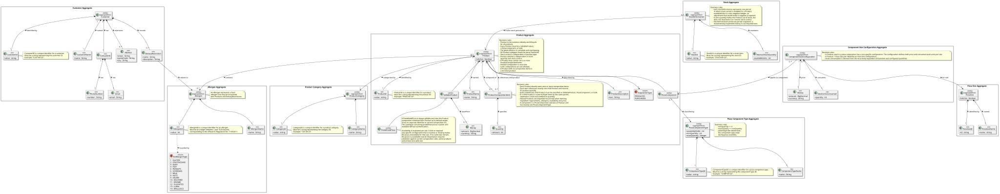
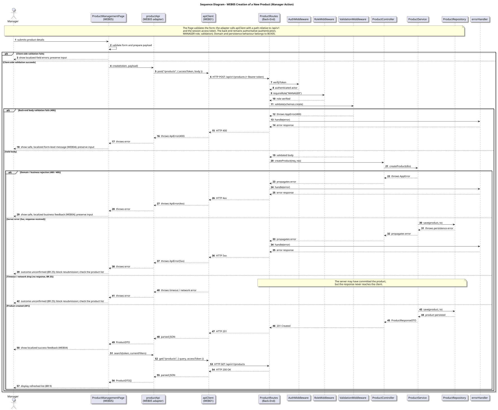

# US WEB05 – Sprint 1 Business Management Pages

## 1. Context & Scope

*   **User Story ID:** WEB05
*   **Sprint:** Sprint 2
*   **Area:** Front-end Web Application (WEB)
*   **Responsible:** Mariana Moreira (1240905)
*   **Related Requirements / Stories:**
    *   Sprint 2 User Stories, *PART IV – Sprint 2 – User Stories*, WEB05, and *IV.2.3 Sprint 2 Deliverable* (SPA giving access to the Sprint 1 business functionality "with consistent navigation, validation, and feedback"; business identifiers and data representations consistent across components).
    *   System Specification: *PART II – System Specification*, section II.3.2 Web Application and II.3.6 Integration and General System Concerns.
    *   Architecture: [SAD](../architecture/SAD.md) (*Front-End* container; principle *Back-end authority*), [ADR-003 – REST and JSON](../architecture/ADR.md), [ADR-007 – Shared PostgreSQL](../architecture/ADR.md).
    *   **Sprint 1 back-end stories** that deliver the REST APIs consumed here: BCK02 (Customers), BCK03 (Product Categories), BCK04 (Allergens), BCK05 (Products), BCK06 (Pizza Sizes), BCK07 (Pizza Component Types), BCK08 (Component Size Configurations), BCK09 (Stock Information), BCK10 (Predefined Pizzas), and Sellable Catalogue.
    *   Related Sprint 2 stories:
        *   **WEB01 – SPA Setup and Integration:** provides `apiClient` / `ApiError`, `appConfig`, `AppShell`, `AppRoutes`, the `src/features/<feature>/{<feature>Api.js, pages/, components/}` convention and the import rules (BR 2, BR 3, BR 4, BR 5, BR 14 of WEB01).
        *   **WEB02 – Consistent Layout and Navigation:** layout, visual conventions, PT/EN i18n, keyboard usability, responsive behaviour. WEB05 pages must follow them.
        *   **WEB03 – Role-Based Navigation:** menu entries and route guards per role; WEB05 pages are registered in `navigationPolicy`; hiding is complemented by checks on request.
        *   **WEB04 – User Feedback and Validation:** loading, success, error, empty and confirmation components, double-submit prevention, safe retry. WEB05 consumes them and does not build its own.
        *   **AA03 / AA05 – Role Resolution and Authorization Enforcement:** roles come from the back end; Table 1 permissions; `401` vs `403`; no access to another customer's data by changing an identifier.
        *   **WEB07 – AI Configuration and Execution Page:** uses products and stock-related data (forecasts, product export); relies on the identifiers and abstract stock units shown consistently here. Supplier management beyond WEB07's needs is out of scope for WEB05.
        *   **GDP01 – Personal Data Handling:** customer data and dietary restrictions shown by WEB05 are personal data.
    *   **Dependencies:** WEB05 depends on WEB01 (technical foundation) and on the Sprint 1 REST API (`/api/v1`). It consumes WEB02 (layout), WEB03 (navigation / guards) and WEB04 (feedback).

### Scope boundary

WEB05 concerns **the business pages that make the Sprint 1 capabilities usable through the SPA**. It does not define the layout or the navigation menu (WEB02 / WEB03), the generic feedback components (WEB04), the HTTP client or configuration (WEB01), the authentication / session (AA01–AA04), nor any new back-end business rule.

WEB05 owns:

1. One group of pages (list, detail, create / edit forms, as the Sprint 1 API allows) per business area: **customers, product categories, allergens, products, pizza sizes, pizza component types, size-dependent component configurations, stock information, predefined pizzas, sellable catalogue**.
2. One `<feature>Api` HTTP adapter per management area; `ModulePage` injects `ModuleRequest` into the module and adapter, which delegates requests to `apiClient` (one function per Sprint 1 endpoint, DTO in / DTO out).
3. Client-side form validation of required data, as a convenience that mirrors the back-end rules.
4. Search and filtering as supported by the Sprint 1 endpoints.
5. Display of allergen information in product and predefined-pizza views.
6. Permission-aware actions in lists and details, and clear empty / unavailable-record states.
7. Refresh of the displayed data after every successful change.
8. Restricted display of customer information and dietary restrictions.

WEB05 explicitly **does not** add order processing, personalized-pizza pricing rules, or supplier-management operations beyond what the Materials and Requirements Planning stories need (those are WEB07 / AI06). The review fixes below include coordinated API-contract changes in BCK05 and the catalogue service, plus the clarified BCK07 rule for preserving existing configurations; WEB05 does not own those domain rules.

---

## 2. Requirements & Analysis

### 2.1. User Story Description

> **As a** LaPrizza Manager,  
> **I want** pages for the business capabilities delivered in Sprint 1,  
> **so that** the existing services are usable through the SPA.

The primary actor is the **LaPrizza Manager**. Other website roles are secondary actors for the read-only parts that Table 1 allows them (catalogue, product and allergen information). Each page must therefore distinguish what each role may see and do (AC 6).

### 2.2. Acceptance Criteria

- [ ] **AC 1:** Authorized pages are provided for customers, product categories, allergens, products, pizza sizes, pizza component types, size-dependent component configurations, stock information, predefined pizzas, and the sellable catalogue.
- [ ] **AC 2:** Forms validate required data and use the corresponding REST APIs to read and persist information.
- [ ] **AC 3:** Search and filtering follow the relevant Sprint 1 capabilities; existing business invariants remain enforced.
- [ ] **AC 4:** Product and predefined-pizza views expose relevant allergen information.
- [ ] **AC 5:** The story does not add order processing, personalized-pizza pricing rules, or supplier-management operations beyond what the Materials and Requirements Planning stories explicitly need.
- [ ] **AC 6:** Each list and detail view distinguishes available actions according to the user's permissions.
- [ ] **AC 7:** Empty results and unavailable records are clearly explained.
- [ ] **AC 8:** Information is refreshed after a successful change so that the displayed result reflects the saved state.
- [ ] **AC 9:** Customer information and dietary restrictions are displayed only to users who need them for their authorized responsibilities.

Criteria from related stories and architecture that constrain WEB05 (not owned, but must hold). They are listed separately from the WEB05 acceptance criteria and classified in 2.4.2:

*   **WEB01 BR 2 / BR 3 / BR 4 / BR 5 / BR 14:** feature isolation, all HTTP through `apiClient`, back-end identifiers used unchanged, no business data in browser storage, re-read after change.
*   **WEB02:** PT/EN, consistent forms / buttons / messages, keyboard usability, labelled controls, responsive layout.
*   **WEB03 AC 1 / AC 2 / AC 7:** options rendered by role; unauthorized URLs blocked; hiding complemented by checks on request.
*   **WEB04 AC 1–7:** success messages, field-level validation errors, loading indicators, errors without internal details, input preserved on failure, confirmation for significant actions, no repeated submission, safe retry.
*   **AA05 AC 1 / AC 3 / AC 4:** permissions checked on every request; `401` vs `403`; no access to another customer's personal information by changing a record reference.
*   **Table 1 (Website roles):** defines who may consult the catalogue, product and allergen information, and who may manage customers, products, categories, allergens, pizza configurations and stock.
*   **IV.2.3 / "Sprint 2 Completion":** the story is complete only if implemented, integrated, tested, documented and demonstrable in the common solution.

### 2.3. Client Clarifications & Questions

Based on the client clarifications (section 15 of the specification), the following operational expectations affect WEB05. They were first registered as API dependencies; the API now supports them and WEB05 uses that support:

| Topic | Client Clarification (section 15) | API support used by WEB05 | WEB05 behaviour |
| :--- | :--- | :--- | :--- |
| **Multi-ingredient inclusion filter** | Products or pizzas containing **any** excluded allergen or component are removed (disjunctive `OR` exclusion). | `GET /catalogue?excludeComponentIds=&excludeAllergenIds=`; allergens are the direct ones plus those derived from the whole composition. | The catalogue exclusion filters are sent to the API (BR 3, BR 19). |
| **Concurrent edit detection** | An edit based on a stale version is rejected; the current server data is shown and the user's draft is retained for review. | `PUT /products/:id` with `expectedUpdatedAt`; a stale edit returns `412`. | The draft is kept, the current record is shown and a new save is allowed only after the user reviews it (SD 1). |
| **Component-type quantity bounds** | Changing component-type bounds preserves existing pizza configurations; the new bounds apply when a configuration is created or replaced. | `PATCH /pizza-component-types/:id` (BCK07) keeps stored compositions; BCK10 validates new or replaced configurations. | A rejected creation or replacement is explained with safe, localized feedback (BR 4). |

### 2.4. Business Rules & Invariants

The rules are split by **where their authority comes from**, so that a team choice is never presented as a specification requirement:

*   **2.4.1 – Requirements of WEB05:** only what the nine WEB05 acceptance criteria state.
*   **2.4.2 – Constraints from related stories, architecture and the domain model:** rules WEB05 must respect because another story, an accepted architecture document or the Sprint 1 domain model states them.
*   **2.4.3 – Team design rules:** choices made by the team **to satisfy** a requirement; they are justified in the Design section and may be replaced by another choice that satisfies the same AC.
*   **2.4.4 – Open points:** what is not defined yet and therefore cannot be validated in WEB05.

#### 2.4.1. Requirements of WEB05 (Sprint 2 specification)

| ID | Rule | Source |
| --- | --- | --- |
| **BR 1** | There is a page group (list / detail / form, as the Sprint 1 API allows) for each of the ten business areas listed in AC 1, reachable only by authorized users (the public catalogue is readable without authentication, see 2.4.2). | AC 1 |
| **BR 2** | Forms validate required data before submission; data is read and persisted only through the corresponding REST API. | AC 2 |
| **BR 3** | Search and filtering expose only the capabilities supported by the Sprint 1 REST APIs, preserving their parameters and semantics. The SPA does not introduce unsupported search criteria or present client-side filtering as equivalent to server-side filtering. | AC 3 |
| **BR 4** | Sprint 1 business invariants (listed in 2.4.2) stay enforced by the back end; the SPA never relaxes them and presents safe, localized feedback corresponding to the back-end rejection. | AC 3 |
| **BR 5** | Product views and predefined-pizza views show their relevant allergen information. | AC 4 |
| **BR 6** | The pages do not implement order processing, personalized-pizza pricing, or supplier management. | AC 5 |
| **BR 7** | In every list and detail view, actions (create, edit, deactivate / delete, etc.) are shown only when the user's permissions allow them. | AC 6 |
| **BR 8** | Empty search results, unavailable or inactive records, and authorization failures are presented as distinct states with clear explanations. Access-denied messages must not disclose protected information. For predefined pizzas, availability is presented per size; a pizza with no valid available size is considered unavailable overall. | AC 7; domain model (PredefinedPizza) |
| **BR 9** | After a successful create / update / delete, the page shows the state re-read from the back end. | AC 8 |
| **BR 10** | Customer information (name, contact details and addresses) and dietary restrictions are displayed only to users whose authorized responsibilities require access to that information. Access is restricted according to the permissions enforced by the back end. | AC 9; Table 1 |

#### 2.4.2. Constraints from related stories, architecture and the domain model

| ID | Rule | Source |
| --- | --- | --- |
| **BR 11** | Management requests go through `<feature>Api` → injected `ModuleRequest` → `apiClient`; the public catalogue uses its existing public adapter → `apiClient`. No page calls `fetch` directly. Identifiers are used as issued by the back end (`CUST-…`, `PROD-…`, `CAT-…`, `COMP-…`, `STOCK-…`, pizza-size ID, integer allergen ID), without generating or rewriting them, including in routes. | WEB01 BR 3, BR 4 |
| **BR 12** | A feature never imports another feature. Data needed by two areas (e.g. allergens listed in the customer dietary-restriction form, products in a composition form) is obtained through the page's own adapter from the back end. | WEB01 BR 2 |
| **BR 13** | Business data, and especially customer data, is not persisted in `localStorage`, `sessionStorage` or IndexedDB. Exception (BR 25): a pending-operation marker (operation, record id and, only for operations verified against the API – stock adjustment and start tracking – the entered values and the previous balance) is kept in `sessionStorage` for the current tab and removed once the outcome is confirmed; customer data is never stored. | WEB01 BR 5 |
| **BR 14** | Hiding an action or route is not authorization: the back end decides. `401` and `403` are handled differently (re-authentication vs access denied) and the access-denied message reveals no protected information. | WEB03; AA05 AC 3; WEB01 BR 17 |
| **BR 15** | Roles are read from the authenticated session provided by the back end, never chosen or sent by the client. If roles cannot be confirmed, protected pages stay unavailable. | AA03 AC 8 / AC 9 |
| **BR 16** | A user must not gain access to customer information outside their authorized responsibilities by changing a customer identifier in a URL or request. Customer-specific access restrictions are enforced by the back end, and the SPA displays the corresponding authorization error without exposing protected information. | AA05 AC 4; WEB03 |
| **BR 17** | WEB05 uses the shared WEB04 components to provide loading indicators, success messages, validation feedback, confirmation of significant actions, duplicate-submission prevention and safe retry. When the back-end response identifies specific invalid fields, the corresponding errors are displayed next to those fields. If field-level details are not available, the failure is presented as a safe, localized form-level message. Failures must not expose internal technical details or be presented as successful operations, and user input is preserved where appropriate. | WEB04 AC 1–7 |
| **BR 18** | All texts (labels, messages, empty states) exist in PT and EN, forms are keyboard-usable and controls are labelled. | WEB02 |
| **BR 19** | Availability, prices and stock values are those provided by the back end and are not recomputed by the SPA. Product management obtains component products from the API and resolves their direct allergen IDs through the composition graph for display; those references are fetched again on each list refresh. Catalogue allergens and pizza availability remain sourced from the catalogue API, which returns the direct allergens of each entry plus those derived from its whole composition. Stock quantities use the abstract stock units of the back end. | WEB01 (back-end authority); domain model |

##### Sprint 1 invariants the pages must respect (from the domain model; enforced by the back end, BR 4)

| Area | Invariant stated in the model | Consequence for the pages |
| --- | --- | --- |
| Identifiers | `CustomerId` `CUST-…`, `ProductId` `PROD-…`, `CategoryId` `CAT-…`, `ComponentTypeId` `COMP-…`, `StockId` `STOCK-…` (strings); `PizzaSizeId` string; `AllergenId` is an **integer between 1 and 14** (EU Regulation No. 1169/2011); identifiers are issued by the back end. | Used unchanged and as opaque values; the allergen id is a number while the others are strings (BR 11). |
| Product | Every product is a `SellableProduct`, a `PizzaComponent`, or both (complete, overlapping); all subtypes share the same `ProductId`. | Product forms and views must handle products that are both. |
| Product | `isActive` is independent of stock quantity and stock control; stock control is independent of product type. | Active state and stock are shown and edited separately. |
| Product composition | Each item references exactly one child product with a positive quantity; the child must be a `SellableProduct`, a `PizzaComponent`, or both; the same child used twice by one parent is represented once with the combined quantity; composition is recursive and cycles are not allowed; a product without items is terminal. | Composition forms present one item per child product; a cycle or invalid child is rejected by the back end and shown to the user. |
| Component | A `PizzaComponent` has exactly one `PizzaComponentType`. | Type selection is mandatory for components. |
| Component type | `minQuantity >= 0`; `maxQuantity >= minQuantity` (`maxQuantity` may be absent); `assemblyOrder` defines the order of component types in the assembly. | Early client check of these value rules (BR 21). |
| Component size configuration | A product + pizza size pair identifies at most one configuration (it has no identifier of its own); it defines price and stock units consumed per size. | A second configuration for the same pair is rejected / not offered. |
| Predefined pizza | Always sellable; uses the inherited product composition as default recipe, with no identifier or composition list of its own. The catalogue containing predefined pizzas is public and readable without authentication. Availability is evaluated per size: an inactive or missing size or size-specific configuration makes it unavailable for that size; no valid size means unavailable overall. Reactivation requires validation against the composition rules, active products and at least one valid size. | Per-size availability is shown (BR 8); a rejected reactivation is explained with safe, localized feedback via WEB04 (BR 4). |
| Stock | One `StockInformation` represents one period in which stock control is enabled for a product; `availableUnits` is a non-negative integer and an adjustment that would make it negative is rejected; zero means out of stock but does not deactivate the product or remove stock control. | Out of stock is distinguished from inactive; a rejected adjustment is explained. |
| Customer | Zero or more addresses and zero or more dietary restrictions; contact information has a phone number and an e-mail. Each dietary restriction relates to an allergen. | Lists of addresses and restrictions in the customer forms. |

##### Role expectations per area (derived from Table 1; see OP1)

| Area | Guest | Customer | Restaurant Staff | LaPrizza Manager | Administrator |
| --- | :-: | :-: | :-: | :-: | :-: |
| Sellable catalogue | Read | Read | Read | Read | — |
| Products (including allergen information) | Read | Read | Read | Manage | — |
| Allergens | Read | Read | Read | Manage | — |
| Product categories | Not stated | Not stated | Not stated | Manage | — |
| Pizza sizes, component types, component size configurations and predefined pizzas | Not stated | Not stated | Not stated | Manage | — |
| Stock information | Not stated | Not stated | OP1 | Manage | — |
| Customers and dietary restrictions | Not stated | Own data, as applicable | OP1 | Manage, subject to need | — |

**Note:** "—" indicates that the role is not granted the corresponding restaurant-management permission by Table 1. Additional website roles may grant further permissions. "Not stated" indicates that Table 1 does not explicitly define the corresponding access. All operations remain subject to back-end authorization.

#### 2.4.3. Team design rules (chosen to satisfy the requirements above)

| ID | Rule | Satisfies | Decision |
| --- | --- | --- | --- |
| **BR 20** | One folder per area under `src/features/` (WEB01 structure) with `<feature>Api.js`, `pages/`, `components/` and tests. | BR 1, BR 12 | D1 |
| **BR 21** | Client-side validation mirrors only the required-data and value rules stated in the domain model (2.4.2) for early feedback; the back-end response is always authoritative and a safe, localized error message is displayed if it differs. | BR 2, BR 4 | D2 |
| **BR 22** | List, detail and form pages follow one common interaction pattern (same actions, same feedback). | BR 7, BR 17, BR 18 | D3 |
| **BR 23** | Actions that remove or deactivate follow the Sprint 1 API semantics of each resource and always request confirmation. | BR 17 | D4 |
| **BR 24** | Permission checks in pages use the capability / role helper provided by WEB03, not ad hoc role comparisons. | BR 7, BR 14 | D5 |
| **BR 25** | **Safe recovery on unknown mutation outcome:** Non-idempotent creates and relative stock adjustments (`POST /stock/:productId/adjustments`, `POST /customers`, `POST /products`, `POST /stock`) whose outcome is unknown (`timeout`, network drop, or `5xx`) are never retried automatically or resubmitted blindly. They remain blocked—including after navigating away and returning within the same tab—until the outcome can be confirmed against the API (or left blocked if the API cannot confirm it), while keeping re-read checks (stock balance / list or detail view) separate from blind resubmission. | BR 4, BR 17 | D6 |

#### 2.4.4. Open points

| ID | Open point | Owner | How WEB05 handles it |
| --- | --- | --- | --- |
| **OP1** | Read access of Restaurant Staff to customers and stock: Table 1 says changes to customer records or stock "require an additional role" but does not say whether consulting them is allowed. | Client / AA05 / WEB03 | Follow the permissions defined by the back end (AA05) and the WEB03 `navigationPolicy`. |
| **OP2** | `ComponentSizeConfiguration` has no independent identifier in the domain model and is identified by the product + pizza size pair. The exact REST API operations and response structure used to retrieve and manage these configurations must be confirmed. | Sprint 1 back end / team | Confirm the Sprint 1 API contract and define the corresponding page and adapter placement consistently with the WEB01 feature structure. |
| **OP3** | Field-level validation errors: `ApiError` carries only `message` and `status`, while WEB04 AC 2 requires errors identifying the affected fields. | WEB01 / WEB04 / back end | Check what the Sprint 1 error responses contain; if there is no field information, rely on client-side validation per field and present a safe, localized form-level message via WEB04, without rendering raw server text. |

### 2.5. Domain Model Excerpt



PlantUML source: [`excerptDomainModel/domain_model_excerpt.puml`](./excerptDomainModel/domain_model_excerpt.puml).

| Concept | Kind | Role in WEB05 |
| --- | --- | --- |
| **CustomerId**, **ProductId**, **CategoryId**, **ComponentTypeId**, **StockId**, **PizzaSizeId**, **AllergenId** | Value Objects (existing, unchanged) | Business identifiers generated by the back end and used unchanged in routes, requests and views (BR 11). `AllergenId` is an integer between 1 and 14; the others are strings. |
| **Customer** (with `ContactInfo`, `Address`, `DietaryRestriction`) | Aggregate Root (existing, unchanged) | Customers pages; personal data with restricted display (BR 10). Each dietary restriction relates to an `Allergen`. |
| **Product** (with `PizzaComponent`, `SellableProduct`, `PredefinedPizza`, `ProductCompositionItem`) | Aggregate Root and entities (existing, unchanged) | Products, predefined-pizza and sellable-catalogue pages; allergen information (BR 5); per-size availability of predefined pizzas (BR 8). |
| **ProductCategory** | Aggregate Root (existing, unchanged) | Categories pages; every product belongs to one category. |
| **Allergen** | Aggregate Root (existing, unchanged) | Allergens pages; allergen information in product and predefined-pizza views. |
| **PizzaSize** | Aggregate Root (existing, unchanged) | Pizza sizes pages. |
| **PizzaComponentType** | Aggregate Root (existing, unchanged) | Component types pages; classifies each `PizzaComponent`. |
| **ComponentSizeConfiguration** | Aggregate Root (existing, unchanged) | Size-dependent component configuration pages (OP2); one per product + pizza size pair. |
| **StockInformation** | Aggregate Root (existing, unchanged) | Stock pages, in abstract stock units (BR 19). |


The excerpt has no separate aggregate for the **sellable catalogue**: it is the public catalogue of `SellableProduct`s, which includes the `PredefinedPizza`s. `UserRole` is not part of this excerpt; roles are consumed through WEB03 (BR 7), never decided by WEB05.

WEB05 introduces **no new domain concept**. Its only back-end changes are the coordinated API-contract and catalogue-service fixes described in this document (stale product edits, catalogue filters, direct and derived catalogue allergens, omission of products with inconsistent catalogue data). The `<feature>Api` adapters, page components and form validation are technical concepts of the SPA (`frontend/src/features`), not domain concepts. **DDD stays on the back-end side:** aggregates, value objects, repositories and domain rules exist only in the Back-End API. The SPA receives their **DTO representations** (plain JSON objects) and does not re-model them.


---

## 3. Design

### 3.1. Architecture & C4 Alignment

This User Story operates within the established **C4 Model** of the system ([SAD](../architecture/SAD.md)):

*   **C4 Level 1 (System Context):** the actors of Table 1 use the *LaPrizza Information System* through the single Web Application over HTTP. The primary actor of WEB05 is the LaPrizza Manager.
*   **C4 Level 2 (Containers):** the *Front-End* (React SPA) presents the Sprint 1 business capabilities; the *Back-End API* remains the only authority over business rules, validation and authorization (*Back-end authority* principle). Communication is REST / JSON over `/api/v1` ([ADR-003](../architecture/ADR.md)); the database is accessed only by the back end ([ADR-007](../architecture/ADR.md)).
*   **C4 Level 3 (Components):** in the Front-End, WEB05 adds business feature components under `src/features/`, each with its `<feature>Api` adapter and pages. `ModulePage` injects a `ModuleRequest` into each management module; the module passes it to its adapter, which uses it for requests through the shared `apiClient` and receives normalized `ApiError` failures. The pages also use WEB03 navigation and WEB04 feedback components. The Back-End reuses the Sprint 1 routers, with the product update contract extended to reject stale writes.

#### Code base of WEB05

WEB05 uses the repository's layered structure (`src/app`, `src/features`, `src/shared`), `apiClient` / `ApiError`, the WEB03 `navigationPolicy`, and the existing public catalogue page. `ModulePage` creates the authenticated `ModuleRequest`; `createManagementModule` and feature modules inject it into their adapters without importing `apiClient` directly. The catalogue adapter remains the existing public read path. WEB05 enables its management sections and uses the shared feedback and validation components already present in the integrated SPA.

---

### 3.2. Class Diagram (CD)


> PlantUML source: [`classDiagram/WEB05_Class_Diagram.puml`](./classDiagram/WEB05_Class_Diagram.puml).

Key design points:

*   **Existing and reused:**
    *   Front end: `apiClient` / `ApiError` (`src/shared/api`), `navigationPolicy` (`src/app/navigation`), and the catalogue page (`src/features/catalogue`: `CataloguePage`, `CatalogueProductPage`, `catalogueApi`).
    *   Back end: the Sprint 1 routers, with `AuthMiddleware` and `RoleMiddleware`.
*   **API pattern:** management pages call their injected feature adapter; `ModulePage` supplies `ModuleRequest`, which attaches the authenticated session token and delegates to `apiClient`. Adapters do not import `apiClient` directly. The public catalogue retains its public request path without an authorization token. Relative API paths omit `/api/v1`; adapters encode dynamic path segments and pass filters as query parameters.
*   **Catalogue (AC 1, AC 4, AC 7):** the public catalogue page is reused and extended. Its filters include every selected component, exclusion of any selected component, and exclusion of any selected allergen. The inclusive `componentIds` and exclusion parameters are supported by the catalogue endpoint; the legacy `componentName` query remains available. The allergens of a catalogue entry are its **direct allergens plus those derived from its whole composition** (components of components), computed by `CataloguePolicy`; the same set is used for display and for `excludeAllergenIds`. A sellable product with inconsistent catalogue data (e.g. a component-based product without a predefined pizza yet) is **omitted** from the list and logged, instead of failing the whole catalogue; `GET /catalogue/:productId` answers `404` for it.
*   **Predefined pizzas data composition (AC 4, AC 7):** the back-end endpoint `BCK10` (`GET /predefined-pizzas` and `GET /predefined-pizzas/:id`) returns only `{ id, componentIds }`. It does **not** return allergens, per-size availability, product names, or active status directly. To satisfy AC 4 and AC 7:
    *   `predefinedPizzaApi` exposes feature-scoped lookup helpers (`GET /products`, `GET /allergens`, and `GET /catalogue/:id`) to assemble the view model in the management page.
    *   **Allergens & component labels:** component labels and direct allergen identifiers are read from the product payloads for the pizza's component IDs; allergen IDs are displayed using localized names.
    *   **Per-size availability & unavailable pizzas:** per-size availability and prices come from `GET /catalogue/:id`. A `404` is followed by a product lookup that tells the manager whether the pizza is missing, inactive, not sellable, or active and sellable but not offered by the catalogue; in the last case the cause is not guessed, because the `404` does not state it. Other catalogue lookup errors are shown separately as a lookup failure. If catalogue data is unavailable, the page uses the component products already loaded to show their available allergen identifiers instead of rendering a misleading dash.
*   **Stock adjustment contract (BCK09):** `stockApi.adjust(productId, payload)` sends `{ direction, units }` (`INCREASE` or `DECREASE`, with positive integer units) to `POST /stock/:productId/adjustments` through the injected `ModuleRequest`. `stockOutcome` verifies an unknown adjustment or start-tracking result against `GET /stock` (BR 25).
*   **Feature isolation (BR 12):** a page uses only the adapter of its own feature. Reference data from another area is read through dedicated methods on the feature's own adapter (e.g., `customerApi.listAllergenOptions()`, `predefinedPizzaApi` reference lookups, and `componentConfigurationApi` reference product/size lookups).
*   **Size-dependent component configurations (OP2):** they are not a separate feature; they belong to `products`, matching the route `/manage/products/:productId/component-configurations` of `navigationPolicy`. They are addressed by the composite pair `(productId, sizeId)`.
*   **DTOs are plain data** and no domain behaviour is modelled (BR 11). `AllergenDTO.id` is an integer `1..14`, while the remaining identifiers are strings.
*   **Permission-aware actions:** actions are shown according to the roles confirmed by `AuthProvider`, using the WEB03 helper (`RequireRole`, BR 7, BR 24). It is a UI-only guard; the back end authorizes every request (BR 14).

---

### 3.3. Sequence Diagrams (SD)

The areas share one interaction pattern (BR 22), so three representative scenarios are documented. The management request path is `Page → <feature>Api → injected ModuleRequest → apiClient`; the public catalogue keeps its public read adapter. Relative paths omit the `/api/v1` prefix.

#### SD 1 — Creation of a New Product (Manager Action)

The page validates the form and, if valid, calls `productApi.create(payload)` through the injected `ModuleRequest`. In `ProductRoutes`, `AuthMiddleware`, `RoleMiddleware` (`MANAGER`) and `ValidationMiddleware` run before the controller. Branches: client-side validation failure, back-end body validation failure (`400`), domain or business validation failure (`400` / `409`), server error (`5xx`), timeout / network drop without response (BR 25) and success (`201`). After success the page shows localized feedback (WEB04) and re-reads the list (BR 9). Product edits also send the `updatedAt` value read when editing as `expectedUpdatedAt`; the API rejects stale edits with `412`. WEB05 preserves the draft, shows the current server record, and allows saving again only after the user reviews that current version.



> Source: [`sequenceDiagram/sequence_diagram_product_creation.puml`](./sequenceDiagram/sequence_diagram_product_creation.puml)

#### SD 2 — Stock Adjustment & Timeout/5xx Recovery

The Manager submits an adjustment on the stock page, which calls `stockApi.adjust(productId, { direction, units })` through the injected `ModuleRequest`. After authentication, role and validation checks, `StockManagementService` runs the adjustment in a transaction (`PostgresUnitOfWork`), reading the current stock with `findCurrentByProductIdForUpdate` and saving the updated stock. The page displays the stock returned by the back end (BR 19).

*   **Timeout / 5xx recovery (BR 25):** because `POST /stock/:productId/adjustments` applies a relative delta without an idempotency key, a timeout, dropped connection, or `5xx` leaves the outcome ambiguous. The workspace records the operation as pending (with the direction, units and the balance shown before sending) and blocks it, also after leaving and returning to the page in the same tab. **"I checked the result"** first re-reads the stock from the API and compares it with the recorded balance: *previous ± units* → applied (unblocked, nothing resent); *previous* → not applied (unblocked and the entered values are restored for review); any other value or an unreachable API → **stays blocked**, because a concurrent adjustment makes the outcome undecidable. Start-tracking (create) is confirmed by the presence of a current stock record for the product.


> Source: [`sequenceDiagram/sequence_diagram_stock_adjustment.puml`](./sequenceDiagram/sequence_diagram_stock_adjustment.puml)

#### SD 3 — Sellable Catalogue Consultation (Public Access)

A Guest or signed-in user opens the existing catalogue page, which calls its public adapter with the selected component/allergen filters. The request carries no access token (`AuthMiddleware` is not applied on `CatalogueRoutes`, per WEB03 ALN-1). `CatalogueService` loads sellable facts with their whole composition, evaluates each product with `CataloguePolicy` (direct and derived allergens; products with inconsistent data are omitted and logged), applies all-required component and any-excluded component/allergen filtering, and `CatalogueResponseMapper` builds the `CatalogueDTO[]` with allergen information (BR 5), without internal stock counts or customer data.


> Source: [`sequenceDiagram/sequence_diagram_catalogue_consultation.puml`](./sequenceDiagram/sequence_diagram_catalogue_consultation.puml)

---

### 3.4. REST API Specification (ARC03)

WEB05 adds no business endpoint of its own. It consumes the Sprint 1 REST API (`/api/v1`) through feature adapters and the injected `ModuleRequest`; the product update version field and catalogue query filters are coordinated API-contract changes documented below. Methods, paths and roles reflect the current routers; request and response bodies are defined by each BCK story and Swagger.

| Feature | Adapter | Method and path (relative to `/api/v1`) | Role |
| :--- | :--- | :--- | :--- |
| Customers (BCK02) | `customerApi` | `POST /customers` | `MANAGER` |
| | | `GET /customers` (query) | `MANAGER` |
| | | `GET /customers/:id` | `MANAGER` |
| | | `PUT /customers/:id` | `MANAGER` |
| | | `PATCH /customers/:id/activate` | `MANAGER` |
| | | `PATCH /customers/:id/deactivate` | `MANAGER` |
| Categories (BCK03) | `productCategoryApi` | `GET /categories`, `GET /categories/:id` | Public (no token) |
| | | `POST /categories`, `PUT /categories/:id`, `DELETE /categories/:id` | `MANAGER` |
| Allergens (BCK04) | `allergenApi` | `GET /allergens`, `GET /allergens/:id` | Public (no token) |
| | | `POST /allergens`, `PUT /allergens/:id`, `DELETE /allergens/:id` | `MANAGER` |
| Products (BCK05) | `productApi` | `POST /products` | `MANAGER` |
| | | `GET /products`, `GET /products/:id` | `MANAGER`, `EMPLOYEE` |
| | | `PUT /products/:id` (includes `expectedUpdatedAt`; stale edit returns `412`), `DELETE /products/:id`, `PATCH /products/:id/activate` | `MANAGER` |
| Pizza sizes (BCK06) | `pizzaSizeApi` | `GET /pizza-sizes` (query), `GET /pizza-sizes/:id` | Public (no token) |
| | | `POST /pizza-sizes`, `PUT /pizza-sizes/:id`, `DELETE /pizza-sizes/:id` | `MANAGER` |
| Component types (BCK07) | `pizzaComponentTypeApi` | `POST /pizza-component-types`, `GET /pizza-component-types`, `GET /pizza-component-types/:id`, `PATCH /pizza-component-types/:id`, `DELETE /pizza-component-types/:id` | `MANAGER` |
| Component configurations (BCK08) | `componentConfigurationApi` (in `products`) | `GET /products/:productId/component-configurations` | `MANAGER` |
| | | `POST /products/:productId/component-configurations/:sizeId`, `PATCH` on the same path | `MANAGER` |
| Stock (BCK09) | `stockApi` | `POST /stock`, `GET /stock`, `GET /stock/:productId`, `DELETE /stock/:productId` | `MANAGER` |
| | | `POST /stock/:productId/adjustments` | `MANAGER` |
| Predefined pizzas (BCK10) | `predefinedPizzaApi` | `POST /predefined-pizzas`, `GET /predefined-pizzas`, `GET /predefined-pizzas/:id`, `PUT /predefined-pizzas/:id` | `MANAGER` |
| Sellable catalogue | `catalogueApi` | `GET /catalogue` (`?componentIds=`, `?excludeComponentIds=`, `?excludeAllergenIds=`; legacy `?componentName=`), `GET /catalogue/:productId` | Public (no token, ALN-1) |

---

### 3.5. Error Handling & WEB04 Feedback Mapping

All API errors (`ApiError`) and network failures are handled exclusively through **WEB04** feedback components and **WEB02** localized (`PT`/`EN`) translation keys (BR 17, BR 18). **Raw back-end error strings or technical stack details are never rendered directly to the user.**

| Scenario / HTTP Status | WEB04 Component & Behaviour | User Feedback & Input Handling |
| :--- | :--- | :--- |
| **Client-side validation failure** | Inline field validation (`WEB04`) | Prevents HTTP submission; displays localized field-specific message next to each invalid input; preserves all form values. |
| **400 Bad Request** (schema / domain validation) | Form-level `FeedbackMessage` (`error`) | Client-side validation catches expected errors first. Since `ApiError` carries only `status` and `message` (OP3), an unexpected 400 is mapped to a safe, localized form-level message (never raw server text). Preserves user input. |
| **401 Unauthorized** | Handled globally by `apiClient` / `AuthProvider` (`WEB03`) | Clears expired session and redirects to `LoginPage` with safe `returnTo`. Does not show a false success state. |
| **403 Forbidden** | `AuthProvider.refresh()` (`WEB03`) + `FeedbackMessage` (`error`) | Triggers role refresh; displays a generic, localized access-denied message without disclosing protected data or required roles (BR 14). |
| **404 Not Found** | Empty / Unavailable state panel (`WEB04`) | Explains clearly in PT/EN that the requested record does not exist or is unavailable (e.g., a predefined pizza absent from the public catalogue). |
| **409 Conflict** (business invariant) / **412 Precondition Failed** (stale product edit) | Form-level `FeedbackMessage` (`error`) | Explains the domain conflict safely and preserves user input. For a stale product edit, shows the current record and requires the user to review it before a new save can use its version. |
| **5xx Server Error / Network Error (non-mutating GET / PUT / DELETE or idempotent)** | Form/Page `FeedbackMessage` (`error`) + WEB04 safe retry | Displays a generic localized service-unavailable message without internal details; preserves form input and offers safe retry via WEB04. |
| **Timeout / Network Error or 5xx on non-idempotent POST (creations, stock adjustments)** | Warning `FeedbackMessage` (`warning`) + pending-operation list | **No blind retry (BR 25).** Marks the outcome as unknown and blocks resubmission in the current tab, across navigation. "I checked the result" consults the API before releasing the block: stock operations are compared with the recorded state (applied / not applied / undecidable → still blocked); other creates are released only after the list was re-read successfully. Not-applied stock operations get their values back. |

---

## 4. Tests (WEB05)

### 4.1. Test Plan & Scenarios

| Test ID | Level / Source | Scenario / Description | Expected Result |
| ------- | -------------- | ---------------------- | --------------- |
| UT01 | Unit — `frontend/test/navigation/navigationPolicy.test.js` | Verify all WEB05 management sections are registered with Table 1 roles and enabled | Passes for all enabled sections |
| UT02 | Unit — `frontend/test/business-management/businessManagementAdapters.test.js` | API adapters and DTO mappers (including `productToPayload`) use `/api/v1` endpoints and preserve back-end identifiers (`CUST-…`, `PROD-…`, etc.) unchanged | Endpoints called accurately; IDs preserved as opaque values; DTO fields parsed and normalized |
| UT03 | Unit — `frontend/test/business-management/formValidation.test.jsx` | Client-side validation for required fields and domain value constraints (e.g., non-negative stock adjustments) | Invalid inputs blocked with field feedback; valid inputs pass |
| UT04 | Component — `frontend/test/business-management/ManagementWorkspace.test.jsx` | Timeout on create / stock adjustment, leaving and returning to the page; stale product edit (`412`) | The block survives navigation; "I checked the result" releases it only after consulting the API (applied → nothing resent; not applied → values restored; API unreachable or undecidable → still blocked); stale edit draft stays intact until the current record is reviewed |
| UT05 | Unit — `frontend/test/business-management/businessManagementAdapters.test.js` | Product references refresh allergens; predefined-pizza catalogue lookup distinguishes `404` from `5xx` | Updated allergen IDs are read on refresh; unavailable and failed offer reads have distinct states |
| UT06 | Unit — `backend/tests/unit/product-catalogue-and-information/application.test.js` | Inclusive multi-component filter and exclusion by component/allergen | All selected components are required; any excluded component or allergen removes the result |
| UT07 | Unit — `frontend/test/business-management/stockOutcome.test.js` | Stock outcome verification against the API | Increase / decrease applied, not applied, changed by someone else (unconfirmed), no current record, failing lookup |
| UT08 | Unit — `backend/tests/unit/product-catalogue-and-information/catalogueAllergens.test.js` | Allergen declared on the pizza itself; allergen of a sub-component; fixed-price product with composition | Direct and derived allergens are shown once each; missing composition data is rejected |
| UT09 | Unit — `backend/tests/unit/product-catalogue-and-information/catalogueResilience.test.js` | A sellable component-based product without predefined pizza | The catalogue list still answers without it; its detail returns `404` |
| FT01 | SPA — `frontend/test/navigation/roleBasedNavigation.test.js` | Manager sees and accesses all authorized business management sections; Guest, Customer, and Employee see only permitted entries | Menu and routes match role permissions (ALLOW vs FORBIDDEN) |
| FT02 | SPA — `frontend/test/catalogue/CataloguePage.test.js` & `test/catalogue/catalogueFormat.test.js` | Guest and authenticated roles read the public sellable catalogue, prices, and product/allergen details | Products, prices, and allergens displayed without token |
| IT01 | HTTP (back end) — `backend/tests/integration/*-management/api.test.js` | Sprint 1 REST endpoints for customers, categories, allergens, products, sizes, component types, configurations, stock, and predefined pizzas enforce domain invariants and role permissions | Statuses conform to Table 1 (`200` / `201` / `401` / `403` / `409`) |
| IT02 | HTTP (back end) — `backend/tests/integration/product-management/api.test.js` | Two Managers edit the same product version; the second submits after the first update | The stale update receives `412` and the first Manager's saved state remains intact |
| IT03 | Integration (back end) — `backend/tests/integration/pizza-component-type-management/postgres.test.js` | Component-type bounds change while stored pizza compositions fall outside the new bounds | The change succeeds and all stored composition rows remain unchanged |
| MT01 | Manual | Log in as Manager, Staff, and Customer; navigate through all business management areas, create/edit/deactivate records, and inspect empty/error states | UI renders role-appropriate actions, refreshes state after mutations, and displays allergen and dietary information accurately |

Acceptance-criteria traceability:

| AC | Main scenarios |
| --- | --- |
| AC1 | UT01, FT01, FT02, IT01, MT01 |
| AC2 | UT02, UT03, UT04, UT07, IT01, IT02, MT01 |
| AC3 | UT06, FT02, IT01, MT01 |
| AC4 | UT08, FT02, MT01 |
| AC5 | Scope boundary check (no order processing, personalized-pizza pricing rules, or supplier management added) |
| AC6 | UT01, FT01, IT01, MT01 |
| AC7 | UT05, UT09, FT01, FT02, MT01 |
| AC8 | MT01 |
| AC9 | UT01, FT01, IT01, MT01 |

---

## 5. Implementation

### 5.1. File Structure

```text
frontend/
├── src/
│   ├── features/
│   │   └── business-management/
│   │       ├── allergens/                        (AllergensModule.jsx, AllergensPage.jsx, allergenApi.js, allergenDTO.js)
│   │       ├── categories/                       (CategoriesModule.jsx, CategoriesPage.jsx, categoryApi.js, categoryDTO.js)
│   │       ├── component-configurations/         (ComponentConfigurationsModule.jsx, ComponentConfigurationsPage.jsx, componentConfigurationApi.js, componentConfigurationDTO.js)
│   │       ├── component-types/                  (ComponentTypesModule.jsx, ComponentTypesPage.jsx, componentTypeApi.js, componentTypeDTO.js)
│   │       ├── customers/                        (CustomersModule.jsx, CustomersPage.jsx, customerApi.js, customerDTO.js)
│   │       ├── pizza-sizes/                      (PizzaSizesModule.jsx, PizzaSizesPage.jsx, pizzaSizeApi.js, pizzaSizeDTO.js)
│   │       ├── predefined-pizzas/                (PredefinedPizzasModule.jsx, PredefinedPizzasPage.jsx, predefinedPizzaApi.js, predefinedPizzaDTO.js)
│   │       ├── products/                         (ProductsModule.jsx, ProductsPage.jsx, productApi.js, productDTO.js)
│   │       ├── stock/                            (StockModule.jsx, StockPage.jsx, stockApi.js, stockDTO.js, stockOutcome.js)
│   │       └── createManagementModule.jsx
│   ├── shared/
│   │   ├── feedback/
│   │   │   └── ManagementWorkspace.jsx           (shared workspace, form, feedback, confirmation, refresh and pending-outcome handling)
│   │   ├── hooks/                                (useSubmission.js – duplicate-submit and unknown-outcome guard; pendingOutcomes.js – tab-scoped pending operations, BR 25)
│   │   └── locale/                                (PT/EN messages and localized allergen labels)
│   ├── app/
│   │   └── navigation/
│   │       └── navigationPolicy.js               (extended: enabled WEB05 management sections)
│   └── styles/index.css                          (extended: management workspace styles)
└── test/
    ├── business-management/                      (adapter, workspace, stock outcome and validation tests)
    ├── catalogue/                                (catalogue tests and formatting)
    └── navigation/                               (navigation policy and role-based route tests)

backend/
├── src/modules/product-catalogue-and-information/
│   ├── application/CatalogueService.js           (extended: products with inconsistent data omitted and logged)
│   ├── domain/CataloguePolicy.js                 (extended: direct and derived allergens of the whole composition)
│   ├── domain/CatalogueFacts.js                  (extended: getProduct)
│   └── infrastructure/PostgresCatalogueReader.js (extended: recursive composition of the sellable products)
└── tests/unit/product-catalogue-and-information/ (catalogueAllergens.test.js, catalogueResilience.test.js)
```

### 5.2. Core Implementation Highlights

- **Unified business workspace**: all ten Sprint 1 areas use feature modules, their own adapters/DTOs, and the shared `ManagementWorkspace` for forms, feedback, confirmations and refreshed lists.
- **Injected request path**: `ModulePage` supplies `ModuleRequest`; each management module injects it into its feature adapter. Adapters do not import `apiClient` directly, and preserve back-end identifiers.
- **Stale product writes**: the editor sends its loaded `updatedAt` as `expectedUpdatedAt`. The API compares the version while holding the product row lock and returns `412` if it changed. The form retains its draft, displays the current record, and requires review before another save.
- **Unknown outcomes (BR 25)**: network/timeout/aborted/invalid responses, and `5xx` on create or stock adjustment, register a pending operation in the current tab and block it across navigation. "I checked the result" re-reads the API before releasing it: `stockOutcome.js` compares the stock with the balance recorded before sending (applied / not applied / undecidable). Not-applied stock operations get their values back; undecidable ones stay blocked. Values are kept only for operations verified against the API, so customer data never reaches `sessionStorage` (BR 13).
- **Catalogue filters and allergen labels**: catalogue requests support all-selected component matching and exclusion by any selected component/allergen. Product component references are fetched again for each list refresh; product and pizza screens use localized allergen labels.
- **Catalogue allergens and resilience**: `CataloguePolicy` collects direct and derived allergens through the whole composition (cycles visited once) for display and exclusion; `PostgresCatalogueReader` loads that composition recursively. Products with inconsistent catalogue data are omitted and logged instead of failing the catalogue.
- **Pizza offer state and component-type limits**: a catalogue `404` is explained as missing, inactive, not sellable, or active and sellable without an offer (cause not guessed); other lookup failures have separate feedback. Loaded component data supplies the allergen fallback. Component-type bound updates preserve existing pizza compositions, while BCK10 validates newly created or replaced configurations against the current bounds.
- **Navigation, authorization and validation**: routes follow Table 1, with back-end authorization remaining authoritative. Client-side checks supplement back-end validation; errors are presented without internal details.
- **Localization**: page labels, feedback, filter empty states and allergen labels are available in PT and EN.

---

## 6. Integration, Verification & Demonstration

### 6.1. Running the Automated Tests

```bash
cd frontend
npm test -- test/navigation test/catalogue test/business-management
cd ../backend
npm test -- tests/unit/product-catalogue-and-information tests/integration
```

### 6.2. Manual Verification

1. Start the back-end server (`npm run dev` in `backend/`) and the frontend SPA (`npm start` in `frontend/`).
2. Sign in as a LaPrizza Manager and navigate through each of the business management areas in the side menu.
3. Verify that lists load via `ManagementWorkspace`, search/filtering options follow Sprint 1 endpoint capabilities, and forms persist changes with immediate view refreshes.
4. Create a predefined pizza with milk declared on the pizza product and another whose sauce component contains a milk ingredient; in the public catalogue both show milk and both disappear when milk is excluded. A sellable component-based product without a predefined pizza does not break the catalogue.
5. Switch to a Customer or Restaurant Staff account and attempt to access restricted management routes, confirming access is denied with clear feedback.
6. Open a private window (Guest) and verify that the sellable catalogue and product/allergen information remain accessible without authentication.

---

## 7. Observations, Dependencies & Limitations

- **Dependencies**: WEB01 (routing, `apiClient`), WEB02 (layout, PT/EN i18n), WEB03 (role-based navigation guards), WEB04 (standardized loading, success, error, and confirmation feedback), AA05 (back-end permission enforcement), and the Sprint 1 REST API back-end endpoints.
- **Enabled Sections**: Unlike in WEB03 where management sections were disabled pending implementation, WEB05 activates these sections in `navigationPolicy.js` as the feature modules are delivered.
- **Known Limitations**:
  - The stock adjustment endpoint has no idempotency key or operation lookup. The outcome is inferred by comparing the balance with the one recorded before sending; when another adjustment changed it meanwhile, the outcome cannot be decided and the operation stays blocked until the user checks the stock history. If a concurrent change happens to produce exactly the expected balance, the inference can be wrong.
  - The pending block is kept per browser tab (`sessionStorage`); another tab or browser does not see it.
  - Products omitted from the catalogue because of inconsistent data are only reported in the back-end log and as "not offered" in the predefined-pizza page.