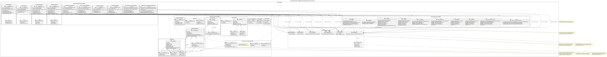
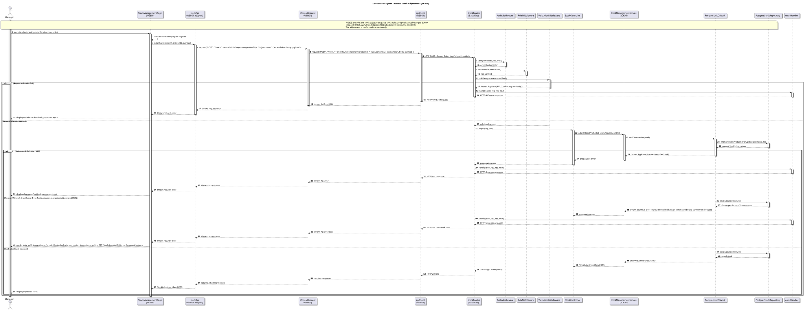
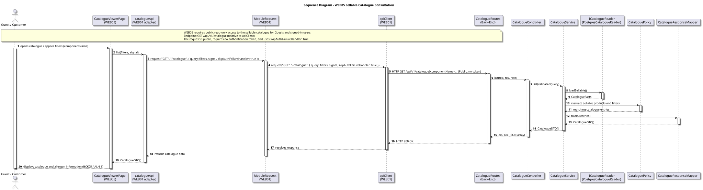

# US WEB05 – Sprint 1 Business Management Pages

## 1. Context & Scope

*   **User Story ID:** WEB05
*   **Sprint:** Sprint 2
*   **Area:** Front-end Web Application (WEB)
*   **Responsible:** Mariana Moreira (1240905)
*   **Related Requirements / Stories:**
    *   Sprint 2 User Stories, *PART IV – Sprint 2 – User Stories*, WEB05, and *IV.2.3 Sprint 2 Deliverable* (SPA giving access to the Sprint 1 business functionality "with consistent navigation, validation, and feedback"; business identifiers and data representations consistent across components).
    *   System Specification: *PART II – System Specification*, section II.3.2 Web Application and II.3.6 Integration and General System Concerns.
    *   Architecture: [SAD](../architecture/SAD.md) (*Front-End* container; principle *Back-end authority*), [ADR-003 – REST and JSON](../architecture/ADR.md), [ADR-007 – Shared PostgreSQL](../architecture/ADR.md).
    *   **Sprint 1 back-end stories** that deliver the REST APIs consumed here: BCK02 (Customers), BCK03 (Product Categories), BCK04 (Allergens), BCK05 (Products), BCK06 (Pizza Sizes), BCK07 (Pizza Component Types), BCK08 (Component Size Configurations), BCK09 (Stock Information), BCK10 (Predefined Pizzas), and Sellable Catalogue.
    *   Related Sprint 2 stories:
        *   **WEB01 – SPA Setup and Integration:** provides `apiClient` / `ApiError`, `appConfig`, `AppShell`, `AppRoutes`, the `src/features/<feature>/{<feature>Api.js, pages/, components/}` convention and the import rules (BR 2, BR 3, BR 4, BR 5, BR 14 of WEB01).
        *   **WEB02 – Consistent Layout and Navigation:** layout, visual conventions, PT/EN i18n, keyboard usability, responsive behaviour. WEB05 pages must follow them.
        *   **WEB03 – Role-Based Navigation:** menu entries and route guards per role; WEB05 pages are registered in `navigationPolicy`; hiding is complemented by checks on request.
        *   **WEB04 – User Feedback and Validation:** loading, success, error, empty and confirmation components, double-submit prevention, safe retry. WEB05 consumes them and does not build its own.
        *   **AA03 / AA05 – Role Resolution and Authorization Enforcement:** roles come from the back end; Table 1 permissions; `401` vs `403`; no access to another customer's data by changing an identifier.
        *   **WEB07 – AI Configuration and Execution Page:** uses products and stock-related data (forecasts, product export); relies on the identifiers and abstract stock units shown consistently here. Supplier management beyond WEB07's needs is out of scope for WEB05.
        *   **GDP01 – Personal Data Handling:** customer data and dietary restrictions shown by WEB05 are personal data.
    *   **Dependencies:** WEB05 depends on WEB01 (technical foundation) and on the Sprint 1 REST API (`/api/v1`). It consumes WEB02 (layout), WEB03 (navigation / guards) and WEB04 (feedback).

### Scope boundary

WEB05 concerns **the business pages that make the Sprint 1 capabilities usable through the SPA**. It does not define the layout or the navigation menu (WEB02 / WEB03), the generic feedback components (WEB04), the HTTP client or configuration (WEB01), the authentication / session (AA01–AA04), nor any new back-end business rule.

WEB05 owns:

1. One group of pages (list, detail, create / edit forms, as the Sprint 1 API allows) per business area: **customers, product categories, allergens, products, pizza sizes, pizza component types, size-dependent component configurations, stock information, predefined pizzas, sellable catalogue**.
2. One `<feature>Api` HTTP adapter per area on top of `apiClient` (one function per Sprint 1 endpoint, DTO in / DTO out).
3. Client-side form validation of required data, as a convenience that mirrors the back-end rules.
4. Search and filtering as supported by the Sprint 1 endpoints.
5. Display of allergen information in product and predefined-pizza views.
6. Permission-aware actions in lists and details, and clear empty / unavailable-record states.
7. Refresh of the displayed data after every successful change.
8. Restricted display of customer information and dietary restrictions.

WEB05 explicitly **does not** add: order processing, personalized-pizza pricing rules, or supplier-management operations beyond what the Materials and Requirements Planning stories need (those are WEB07 / AI06). It does not change back-end business rules; "existing business invariants remain enforced" means the SPA must not bypass or contradict them.

---

## 2. Requirements & Analysis

### 2.1. User Story Description

> **As a** LaPrizza Manager,  
> **I want** pages for the business capabilities delivered in Sprint 1,  
> **so that** the existing services are usable through the SPA.

The primary actor is the **LaPrizza Manager**. Other website roles are secondary actors for the read-only parts that Table 1 allows them (catalogue, product and allergen information). Each page must therefore distinguish what each role may see and do (AC 6).

### 2.2. Acceptance Criteria

- [ ] **AC 1:** Authorized pages are provided for customers, product categories, allergens, products, pizza sizes, pizza component types, size-dependent component configurations, stock information, predefined pizzas, and the sellable catalogue.
- [ ] **AC 2:** Forms validate required data and use the corresponding REST APIs to read and persist information.
- [ ] **AC 3:** Search and filtering follow the relevant Sprint 1 capabilities; existing business invariants remain enforced.
- [ ] **AC 4:** Product and predefined-pizza views expose relevant allergen information.
- [ ] **AC 5:** The story does not add order processing, personalized-pizza pricing rules, or supplier-management operations beyond what the Materials and Requirements Planning stories explicitly need.
- [ ] **AC 6:** Each list and detail view distinguishes available actions according to the user's permissions.
- [ ] **AC 7:** Empty results and unavailable records are clearly explained.
- [ ] **AC 8:** Information is refreshed after a successful change so that the displayed result reflects the saved state.
- [ ] **AC 9:** Customer information and dietary restrictions are displayed only to users who need them for their authorized responsibilities.

Criteria from related stories and architecture that constrain WEB05 (not owned, but must hold). They are listed separately from the WEB05 acceptance criteria and classified in 2.4.2:

*   **WEB01 BR 2 / BR 3 / BR 4 / BR 5 / BR 14:** feature isolation, all HTTP through `apiClient`, back-end identifiers used unchanged, no business data in browser storage, re-read after change.
*   **WEB02:** PT/EN, consistent forms / buttons / messages, keyboard usability, labelled controls, responsive layout.
*   **WEB03 AC 1 / AC 2 / AC 7:** options rendered by role; unauthorized URLs blocked; hiding complemented by checks on request.
*   **WEB04 AC 1–7:** success messages, field-level validation errors, loading indicators, errors without internal details, input preserved on failure, confirmation for significant actions, no repeated submission, safe retry.
*   **AA05 AC 1 / AC 3 / AC 4:** permissions checked on every request; `401` vs `403`; no access to another customer's personal information by changing a record reference.
*   **Table 1 (Website roles):** defines who may consult the catalogue, product and allergen information, and who may manage customers, products, categories, allergens, pizza configurations and stock.
*   **IV.2.3 / "Sprint 2 Completion":** the story is complete only if implemented, integrated, tested, documented and demonstrable in the common solution.

### 2.3. Client Clarifications & Questions

Based on the client clarifications (§15 of the specification), three operational expectations affect WEB05 and have explicit dependencies on the current Sprint 1 REST APIs:

| Topic | Client Clarification (§15) | Current Sprint 1 API Capability & Dependency | Expected WEB05 Design Behaviour |
| :--- | :--- | :--- | :--- |
| **Multi-ingredient inclusion filter** | Searching the catalogue or products by multiple selected ingredients must return only items containing **all** selected ingredients (conjunctive `AND` semantics). | `GET /catalogue` currently supports only a single `componentName` query parameter; `GET /products` filters by `name`, `categoryId`, and `active`. | WEB05 exposes the single `componentName` filter supported by Sprint 1 (BR 3) without faking conjunctive multi-ingredient filtering client-side over partial pages. Multi-ingredient filtering is registered as an **API dependency** (`BCK-catalogue` / `BCK05`). |
| **Allergen & component exclusion filter** | Users must be able to exclude products or pizzas containing **any** selected allergen or excluded component (disjunctive `OR` exclusion). | Neither `GET /catalogue` nor `GET /products` currently exposes `excludeAllergenIds` or `excludeComponentIds` query parameters. | Registered as an **API dependency** (`BCK-catalogue` / `BCK05`). Until the back end supports server-side exclusion parameters, the SPA does not advertise unsupported exclusion filters as server queries (BR 3). |
| **Concurrent edit detection** | If another user modifies a record while a Manager is editing it, the save must be rejected and the user must reload the latest version before re-applying changes. | `PUT /products/:id` (and the remaining Sprint 1 `PUT`/`PATCH` endpoints) do not currently accept an `If-Match` / `version` field or return `409 Conflict` on stale updates (last-write-wins). | Registered as an **API dependency** (optimistic concurrency control in BCK endpoints). In WEB05, whenever any endpoint returns `409 Conflict` (or when the user triggers a manual refresh), the form blocks overwriting, preserves the user's unsaved values for comparison, and prompts a reload of the current server record via WEB04 feedback. |

### 2.4. Business Rules & Invariants

The rules are split by **where their authority comes from**, so that a team choice is never presented as a specification requirement:

*   **2.4.1 – Requirements of WEB05:** only what the nine WEB05 acceptance criteria state.
*   **2.4.2 – Constraints from related stories, architecture and the domain model:** rules WEB05 must respect because another story, an accepted architecture document or the Sprint 1 domain model states them.
*   **2.4.3 – Team design rules:** choices made by the team **to satisfy** a requirement; they are justified in the Design section and may be replaced by another choice that satisfies the same AC.
*   **2.4.4 – Open points:** what is not defined yet and therefore cannot be validated in WEB05.

#### 2.4.1. Requirements of WEB05 (Sprint 2 specification)

| ID | Rule | Source |
| --- | --- | --- |
| **BR 1** | There is a page group (list / detail / form, as the Sprint 1 API allows) for each of the ten business areas listed in AC 1, reachable only by authorized users (the public catalogue is readable without authentication, see 2.4.2). | AC 1 |
| **BR 2** | Forms validate required data before submission; data is read and persisted only through the corresponding REST API. | AC 2 |
| **BR 3** | Search and filtering expose only the capabilities supported by the Sprint 1 REST APIs, preserving their parameters and semantics. The SPA does not introduce unsupported search criteria or present client-side filtering as equivalent to server-side filtering. | AC 3 |
| **BR 4** | Sprint 1 business invariants (listed in 2.4.2) stay enforced by the back end; the SPA never relaxes them and presents safe, localized feedback corresponding to the back-end rejection. | AC 3 |
| **BR 5** | Product views and predefined-pizza views show their relevant allergen information. | AC 4 |
| **BR 6** | The pages do not implement order processing, personalized-pizza pricing, or supplier management. | AC 5 |
| **BR 7** | In every list and detail view, actions (create, edit, deactivate / delete, etc.) are shown only when the user's permissions allow them. | AC 6 |
| **BR 8** | Empty search results, unavailable or inactive records, and authorization failures are presented as distinct states with clear explanations. Access-denied messages must not disclose protected information. For predefined pizzas, availability is presented per size; a pizza with no valid available size is considered unavailable overall. | AC 7; domain model (PredefinedPizza) |
| **BR 9** | After a successful create / update / delete, the page shows the state re-read from the back end. | AC 8 |
| **BR 10** | Customer information (name, contact details and addresses) and dietary restrictions are displayed only to users whose authorized responsibilities require access to that information. Access is restricted according to the permissions enforced by the back end. | AC 9; Table 1 |

#### 2.4.2. Constraints from related stories, architecture and the domain model

| ID | Rule | Source |
| --- | --- | --- |
| **BR 11** | Every request goes through `<feature>Api` → `apiClient`; no page calls `fetch` directly; identifiers are used exactly as issued by the back end (`CUST-…`, `PROD-…`, `CAT-…`, `COMP-…`, `STOCK-…`, the pizza-size id, and the integer allergen id) without generating, rewriting or deriving them, including in routes. | WEB01 BR 3, BR 4 |
| **BR 12** | A feature must not import implementation modules directly from another feature. When a page requires data belonging to another business area (e.g., allergens in a customer dietary-restriction form or products in a composition form), that data must be obtained through the appropriate API integration, using the shared `apiClient` and respecting the feature-isolation rules defined by WEB01. | WEB01 BR 2 |
| **BR 13** | Business data, and especially customer data, is not persisted in `localStorage`, `sessionStorage` or IndexedDB. | WEB01 BR 5 |
| **BR 14** | Hiding an action or route is not authorization: the back end decides. `401` and `403` are handled differently (re-authentication vs access denied) and the access-denied message reveals no protected information. | WEB03; AA05 AC 3; WEB01 BR 17 |
| **BR 15** | Roles are read from the authenticated session provided by the back end, never chosen or sent by the client. If roles cannot be confirmed, protected pages stay unavailable. | AA03 AC 8 / AC 9 |
| **BR 16** | A user must not gain access to customer information outside their authorized responsibilities by changing a customer identifier in a URL or request. Customer-specific access restrictions are enforced by the back end, and the SPA displays the corresponding authorization error without exposing protected information. | AA05 AC 4; WEB03 |
| **BR 17** | WEB05 uses the shared WEB04 components to provide loading indicators, success messages, validation feedback, confirmation of significant actions, duplicate-submission prevention and safe retry. When the back-end response identifies specific invalid fields, the corresponding errors are displayed next to those fields. If field-level details are not available, the failure is presented as a safe, localized form-level message. Failures must not expose internal technical details or be presented as successful operations, and user input is preserved where appropriate. | WEB04 AC 1–7 |
| **BR 18** | All texts (labels, messages, empty states) exist in PT and EN, forms are keyboard-usable and controls are labelled. | WEB02 |
| **BR 19** | Allergen information, availability, prices and stock values displayed by the SPA must correspond to the values provided by the back end. The SPA must not independently calculate, derive or modify these business values. Stock quantities are displayed using the abstract stock units defined by the back end. | WEB01 (Back-end authority); domain model |

##### Sprint 1 invariants the pages must respect (from the domain model; enforced by the back end, BR 4)

| Area | Invariant stated in the model | Consequence for the pages |
| --- | --- | --- |
| Identifiers | `CustomerId` `CUST-…`, `ProductId` `PROD-…`, `CategoryId` `CAT-…`, `ComponentTypeId` `COMP-…`, `StockId` `STOCK-…` (strings); `PizzaSizeId` string; `AllergenId` is an **integer between 1 and 14** (EU Regulation No. 1169/2011); identifiers are issued by the back end. | Used unchanged and as opaque values; the allergen id is a number while the others are strings (BR 11). |
| Product | Every product is a `SellableProduct`, a `PizzaComponent`, or both (complete, overlapping); all subtypes share the same `ProductId`. | Product forms and views must handle products that are both. |
| Product | `isActive` is independent of stock quantity and stock control; stock control is independent of product type. | Active state and stock are shown and edited separately. |
| Product composition | Each item references exactly one child product with a positive quantity; the child must be a `SellableProduct`, a `PizzaComponent`, or both; the same child used twice by one parent is represented once with the combined quantity; composition is recursive and cycles are not allowed; a product without items is terminal. | Composition forms present one item per child product; a cycle or invalid child is rejected by the back end and shown to the user. |
| Component | A `PizzaComponent` has exactly one `PizzaComponentType`. | Type selection is mandatory for components. |
| Component type | `minQuantity >= 0`; `maxQuantity >= minQuantity` (`maxQuantity` may be absent); `assemblyOrder` defines the order of component types in the assembly. | Early client check of these value rules (BR 21). |
| Component size configuration | A product + pizza size pair identifies at most one configuration (it has no identifier of its own); it defines price and stock units consumed per size. | A second configuration for the same pair is rejected / not offered. |
| Predefined pizza | Always sellable; uses the inherited product composition as default recipe, with no identifier or composition list of its own. The catalogue containing predefined pizzas is public and readable without authentication. Availability is evaluated per size: an inactive or missing size or size-specific configuration makes it unavailable for that size; no valid size means unavailable overall. Reactivation requires validation against the composition rules, active products and at least one valid size. | Per-size availability is shown (BR 8); a rejected reactivation is explained with safe, localized feedback via WEB04 (BR 4). |
| Stock | One `StockInformation` represents one period in which stock control is enabled for a product; `availableUnits` is a non-negative integer and an adjustment that would make it negative is rejected; zero means out of stock but does not deactivate the product or remove stock control. | Out of stock is distinguished from inactive; a rejected adjustment is explained. |
| Customer | Zero or more addresses and zero or more dietary restrictions; contact information has a phone number and an e-mail. Each dietary restriction relates to an allergen. | Lists of addresses and restrictions in the customer forms. |

##### Role expectations per area (derived from Table 1; see OP1)

| Area | Guest | Customer | Restaurant Staff | LaPrizza Manager | Administrator |
| --- | :-: | :-: | :-: | :-: | :-: |
| Sellable catalogue | Read | Read | Read | Read | — |
| Products (including allergen information) | Read | Read | Read | Manage | — |
| Allergens | Read | Read | Read | Manage | — |
| Product categories | Not stated | Not stated | Not stated | Manage | — |
| Pizza sizes, component types, component size configurations and predefined pizzas | Not stated | Not stated | Not stated | Manage | — |
| Stock information | Not stated | Not stated | OP1 | Manage | — |
| Customers and dietary restrictions | Not stated | Own data, as applicable | OP1 | Manage, subject to need | — |

**Note:** "—" indicates that the role is not granted the corresponding restaurant-management permission by Table 1. Additional website roles may grant further permissions. "Not stated" indicates that Table 1 does not explicitly define the corresponding access. All operations remain subject to back-end authorization.

#### 2.4.3. Team design rules (chosen to satisfy the requirements above)

| ID | Rule | Satisfies | Decision |
| --- | --- | --- | --- |
| **BR 20** | One folder per area under `src/features/` (WEB01 structure) with `<feature>Api.js`, `pages/`, `components/` and tests. | BR 1, BR 12 | D1 |
| **BR 21** | Client-side validation mirrors only the required-data and value rules stated in the domain model (2.4.2) for early feedback; the back-end response is always authoritative and a safe, localized error message is displayed if it differs. | BR 2, BR 4 | D2 |
| **BR 22** | List, detail and form pages follow one common interaction pattern (same actions, same feedback). | BR 7, BR 17, BR 18 | D3 |
| **BR 23** | Actions that remove or deactivate follow the Sprint 1 API semantics of each resource and always request confirmation. | BR 17 | D4 |
| **BR 24** | Permission checks in pages use the capability / role helper provided by WEB03, not ad hoc role comparisons. | BR 7, BR 14 | D5 |
| **BR 25** | **Safe recovery on timeout or 5xx of non-idempotent mutations:** `POST /stock/:productId/adjustments` applies a relative delta (`direction` + `units`) and the creation endpoints (`POST /customers`, `POST /products`, `POST /stock`) are not idempotent. If a timeout, network drop or `5xx` occurs, the page must **not** retry automatically or let the user blindly re-submit. It marks the outcome as unknown/unconfirmed and blocks duplicate submission until the API allows confirming the operation (idempotency key or adjustment log). Re-reading the stock balance does not prove whether a given adjustment was applied; for creations, the user checks the list/detail view. | BR 4, BR 17 | D6 |

#### 2.4.4. Open points

| ID | Open point | Owner | How WEB05 handles it |
| --- | --- | --- | --- |
| **OP1** | Read access of Restaurant Staff to customers and stock: Table 1 says changes to customer records or stock "require an additional role" but does not say whether consulting them is allowed. | Client / AA05 / WEB03 | Follow the permissions defined by the back end (AA05) and the WEB03 `navigationPolicy`. |
| **OP2** | `ComponentSizeConfiguration` has no independent identifier in the domain model and is identified by the product + pizza size pair. The exact REST API operations and response structure used to retrieve and manage these configurations must be confirmed. | Sprint 1 back end / team | Confirm the Sprint 1 API contract and define the corresponding page and adapter placement consistently with the WEB01 feature structure. |
| **OP3** | Field-level validation errors: `ApiError` carries only `message` and `status`, while WEB04 AC 2 requires errors identifying the affected fields. | WEB01 / WEB04 / back end | Check what the Sprint 1 error responses contain; if there is no field information, rely on client-side validation per field and present a safe, localized form-level message via WEB04, without rendering raw server text. |

### 2.5. Domain Model Excerpt

PlantUML source: [`excerptDomainModel/domain_model_excerpt.puml`](./excerptDomainModel/domain_model_excerpt.puml).

| Concept | Kind | Role in WEB05 |
| --- | --- | --- |
| **CustomerId**, **ProductId**, **CategoryId**, **ComponentTypeId**, **StockId**, **PizzaSizeId**, **AllergenId** | Value Objects (existing, unchanged) | Business identifiers generated by the back end and used unchanged in routes, requests and views (BR 11). `AllergenId` is an integer between 1 and 14; the others are strings. |
| **Customer** (with `ContactInfo`, `Address`, `DietaryRestriction`) | Aggregate Root (existing, unchanged) | Customers pages; personal data with restricted display (BR 10). Each dietary restriction relates to an `Allergen`. |
| **Product** (with `PizzaComponent`, `SellableProduct`, `PredefinedPizza`, `ProductCompositionItem`) | Aggregate Root and entities (existing, unchanged) | Products, predefined-pizza and sellable-catalogue pages; allergen information (BR 5); per-size availability of predefined pizzas (BR 8). |
| **ProductCategory** | Aggregate Root (existing, unchanged) | Categories pages; every product belongs to one category. |
| **Allergen** | Aggregate Root (existing, unchanged) | Allergens pages; allergen information in product and predefined-pizza views. |
| **PizzaSize** | Aggregate Root (existing, unchanged) | Pizza sizes pages. |
| **PizzaComponentType** | Aggregate Root (existing, unchanged) | Component types pages; classifies each `PizzaComponent`. |
| **ComponentSizeConfiguration** | Aggregate Root (existing, unchanged) | Size-dependent component configuration pages (OP2); one per product + pizza size pair. |
| **StockInformation** | Aggregate Root (existing, unchanged) | Stock pages, in abstract stock units (BR 19). |

The excerpt has no separate aggregate for the **sellable catalogue**: it is the public catalogue of `SellableProduct`s, which includes the `PredefinedPizza`s. `UserRole` is not part of this excerpt; roles are consumed through WEB03 (BR 7), never decided by WEB05.

WEB05 introduces **no new domain concept** and **no back-end change**. The `<feature>Api` adapters, page components and form validation are technical concepts of the SPA (`frontend/src/features`), not domain concepts. **DDD stays on the back-end side:** aggregates, value objects, repositories and domain rules exist only in the Back-End API. The SPA receives their **DTO representations** (plain JSON objects) and does not re-model them.

---

## 3. Design

### 3.1. Architecture & C4 Alignment

This User Story operates within the established **C4 Model** of the system ([SAD](../architecture/SAD.md)):

*   **C4 Level 1 (System Context):** the actors of Table 1 use the *LaPrizza Information System* through the single Web Application over HTTP. The primary actor of WEB05 is the LaPrizza Manager.
*   **C4 Level 2 (Containers):** the *Front-End* (React SPA) presents the Sprint 1 business capabilities; the *Back-End API* remains the only authority over business rules, validation and authorization (*Back-end authority* principle). Communication is REST / JSON over `/api/v1` ([ADR-003](../architecture/ADR.md)); the database is accessed only by the back end ([ADR-007](../architecture/ADR.md)).
*   **C4 Level 3 (Components):** in the Front-End, WEB05 adds the business feature components under `src/features/`, each with its `<feature>Api` adapter and its pages. They use the shared HTTP client (`apiClient`, `ApiError`, in `src/shared/api`), the navigation policy of WEB03 and the feedback components of WEB04. The Back-End needs **no new component**; the Sprint 1 routers are reused unchanged.

#### Code base of WEB05

WEB05 is built on `main`, which already contains the layered structure (`src/app`, `src/features`, `src/shared`), `apiClient` / `ApiError`, the WEB03 `navigationPolicy` and the public catalogue page. The WEB05 sections (`/manage/...`) are already declared in `navigationPolicy` with owner `WEB05` and `enabled: false`; WEB05 enables them as each page is delivered.

The shared feedback and validation components of WEB04 are on branch `web/WEB04-implementation` (`abf53c8`) and are **not yet merged** into `main`. WEB05 therefore depends on the merge of WEB04 to consume them (BR 17). The class and sequence diagrams below follow the code of `main`.

---

### 3.2. Class Diagram (CD)

> PlantUML source: [`classDiagram/WEB05_Class_Diagram.puml`](./classDiagram/WEB05_Class_Diagram.puml).

Key design points:

*   **Existing and reused:**
    *   Front end: `apiClient` / `ApiError` (`src/shared/api`), `navigationPolicy` (`src/app/navigation`), and the catalogue page (`src/features/catalogue`: `CataloguePage`, `CatalogueProductPage`, `catalogueApi`).
    *   Back end: the Sprint 1 routers, with `AuthMiddleware` and `RoleMiddleware`.
*   **API pattern (aligned with `main`):** `Page → <feature>Api → apiClient`. Each `<feature>Api` adapter imports `apiClient` directly and passes relative paths without repeating `/api/v1` (since `apiClient` prepends the configured base URL `/api/v1`). Protected endpoints pass `{ accessToken }` to `apiClient`; public read endpoints (`catalogueApi`, `GET /categories`, `GET /allergens`, `GET /pizza-sizes`) omit the token and pass `{ skipAuthFailureHandler: true }`. Dynamic path segments are encoded with `encodeURIComponent` and filters go in `query`.
*   **Catalogue (AC 1, AC 4, AC 7):** the public catalogue page already exists and is **reused, not rebuilt**. WEB05 verifies and, where needed, extends it to meet AC 4 (allergen information) and AC 7 (explained empty and unavailable states). `catalogueApi.list` supports only the filter `componentName`, so the catalogue filtering offered by WEB05 is limited to it (BR 3).
*   **Predefined pizzas data composition (AC 4, AC 7):** the back-end endpoint `BCK10` (`GET /predefined-pizzas` and `GET /predefined-pizzas/:id`) returns only `{ id, componentIds }`. It does **not** return allergens, per-size availability, product names, or active status directly. To satisfy AC 4 and AC 7 without violating BR 12 or BR 19:
    *   `predefinedPizzaApi` exposes feature-scoped lookup helpers (`GET /products`, `GET /allergens`, and `GET /catalogue/:id`) to assemble the view model in the management page.
    *   **Allergens & component labels:** resolved from the back-end product and allergen payloads (`GET /products` and `GET /allergens`) corresponding to `componentIds` (never computed from client-side heuristics).
    *   **Per-size availability & unavailable pizzas:** for predefined pizzas that appear in `GET /catalogue/:id`, per-size availability and prices come directly from the catalogue response. If a predefined pizza is absent from the catalogue (`404`), the management page keeps it visible in the Manager list with the localized key `catalogue.unavailableInPublic` (WEB02 i18n). The `404` does not distinguish "inactive" from "no valid size"; if `GET /products` returns `isActive`, it is used to separate the two cases.
*   **Stock adjustment contract (BCK09):** `stockApi.adjust(token, productId, payload)` sends `{ direction, units }` (where `direction` is `"INCREASE"` | `"DECREASE"` and `units` is a positive integer) to `POST /stock/:productId/adjustments`, matching the BCK09 REST contract.
*   **Feature isolation (BR 12):** a page uses only the adapter of its own feature. Reference data from another area is read through dedicated methods on the feature's own adapter (e.g., `customerApi.listAllergenOptions()`, `predefinedPizzaApi` reference lookups, and `componentConfigurationApi` reference product/size lookups).
*   **Size-dependent component configurations (OP2):** they are not a separate feature; they belong to `products`, matching the route `/manage/products/:productId/component-configurations` of `navigationPolicy`. They are addressed by the composite pair `(productId, sizeId)`.
*   **DTOs are plain data** and no domain behaviour is modelled (BR 11). `AllergenDTO.id` is an integer `1..14`, while the remaining identifiers are strings.
*   **Permission-aware actions:** actions are shown according to the roles confirmed by `AuthProvider`, using the WEB03 helper (`RequireRole`, BR 7, BR 24). It is a UI-only guard; the back end authorizes every request (BR 14).

---

### 3.3. Sequence Diagrams (SD)

The areas share one interaction pattern (BR 22), so three representative scenarios are documented. All diagrams follow the exact `Page → <feature>Api → apiClient` architecture on `main` (relative paths without duplicated `/api/v1` prefix in `apiClient` calls).

#### SD 1 — Creation of a New Product (Manager Action)

The page validates the form and, if valid, calls `productApi.create(token, payload)`, which calls `apiClient.post("/products", { accessToken, body: payload })`. In `ProductRoutes`, `AuthMiddleware`, `RoleMiddleware` (`MANAGER`) and `ValidationMiddleware` run before the controller. Branches: client-side validation failure, back-end body validation failure (`400`), domain or business validation failure (`400` / `409`), server error (`5xx`), timeout / network drop without response (BR 25) and success (`201`). After success the page shows localized feedback (`WEB04`) and re-reads the list with `productApi.search` (BR 9).

> Source: [`sequenceDiagram/sequence_diagram_product_creation.puml`](./sequenceDiagram/sequence_diagram_product_creation.puml)

#### SD 2 — Stock Adjustment & Timeout/5xx Recovery

The Manager submits an adjustment on the stock page, which calls `stockApi.adjust(token, productId, { direction, units })` → `apiClient.post("/stock/" + encodeURIComponent(productId) + "/adjustments", { accessToken, body })`. After authentication, role and validation checks, `StockManagementService` runs the adjustment in a transaction (`PostgresUnitOfWork`), reading the current stock with `findCurrentByProductIdForUpdate` and saving the updated stock. The page displays the stock returned by the back end (BR 19).

*   **Timeout / 5xx recovery (BR 25):** because `POST /stock/:productId/adjustments` applies a relative delta (`direction`, `units`) without an idempotency key, a network timeout, a dropped connection or a `5xx` leaves the outcome ambiguous (the server may have committed the change before the connection dropped). On such failures the diagram and page keep the result as **unknown/unconfirmed** and block automatic or accidental re-submission until the API allows confirming the operation (idempotency key or adjustment log). Re-reading the balance (`GET /stock/:productId`) does not prove whether the adjustment was applied, because concurrent adjustments change the same balance.

> Source: [`sequenceDiagram/sequence_diagram_stock_adjustment.puml`](./sequenceDiagram/sequence_diagram_stock_adjustment.puml)

#### SD 3 — Sellable Catalogue Consultation (Public Access)

A Guest or any signed-in user opens the existing catalogue page, which calls `catalogueApi.list({ componentName, signal })` → `apiClient.get("/catalogue", { query, signal, skipAuthFailureHandler: true })`. The request carries **no access token** (`AuthMiddleware` is not applied on `CatalogueRoutes`, per WEB03 ALN-1). `CatalogueService` loads the sellable facts, `CataloguePolicy` evaluates the entries and filters, and `CatalogueResponseMapper` builds the `CatalogueDTO[]`, which includes allergen information (BR 5) and excludes internal stock counts or customer data.

> Source: [`sequenceDiagram/sequence_diagram_catalogue_consultation.puml`](./sequenceDiagram/sequence_diagram_catalogue_consultation.puml)

---

### 3.4. REST API Specification (ARC03)

WEB05 **adds no endpoint**. It consumes the Sprint 1 REST API (`/api/v1`, prefix added automatically by `apiClient`) through the `<feature>Api` adapters and exposes only the operations and filters that API supports (BR 3). Methods, paths and roles below come from the routers on `main`; request and response bodies are defined by each BCK story and Swagger.

| Feature | Adapter | Method and path (relative to `/api/v1`) | Role |
| :--- | :--- | :--- | :--- |
| Customers (BCK02) | `customerApi` | `POST /customers` | `MANAGER` |
| | | `GET /customers` (query) | `MANAGER` |
| | | `GET /customers/:id` | `MANAGER` |
| | | `PUT /customers/:id` | `MANAGER` |
| | | `PATCH /customers/:id/activate` | `MANAGER` |
| | | `PATCH /customers/:id/deactivate` | `MANAGER` |
| Categories (BCK03) | `productCategoryApi` | `GET /categories`, `GET /categories/:id` | Public (no token) |
| | | `POST /categories`, `PUT /categories/:id`, `DELETE /categories/:id` | `MANAGER` |
| Allergens (BCK04) | `allergenApi` | `GET /allergens`, `GET /allergens/:id` | Public (no token) |
| | | `POST /allergens`, `PUT /allergens/:id`, `DELETE /allergens/:id` | `MANAGER` |
| Products (BCK05) | `productApi` | `POST /products` | `MANAGER` |
| | | `GET /products`, `GET /products/:id` | `MANAGER`, `EMPLOYEE` |
| | | `PUT /products/:id`, `DELETE /products/:id`, `PATCH /products/:id/activate` | `MANAGER` |
| Pizza sizes (BCK06) | `pizzaSizeApi` | `GET /pizza-sizes` (query), `GET /pizza-sizes/:id` | Public (no token) |
| | | `POST /pizza-sizes`, `PUT /pizza-sizes/:id`, `DELETE /pizza-sizes/:id` | `MANAGER` |
| Component types (BCK07) | `pizzaComponentTypeApi` | `POST /pizza-component-types`, `GET /pizza-component-types`, `GET /pizza-component-types/:id`, `PATCH /pizza-component-types/:id`, `DELETE /pizza-component-types/:id` | `MANAGER` |
| Component configurations (BCK08) | `componentConfigurationApi` (in `products`) | `GET /products/:productId/component-configurations` | `MANAGER` |
| | | `POST /products/:productId/component-configurations/:sizeId`, `PATCH` on the same path | `MANAGER` |
| Stock (BCK09) | `stockApi` | `POST /stock`, `GET /stock`, `GET /stock/:productId`, `DELETE /stock/:productId` | `MANAGER` |
| | | `POST /stock/:productId/adjustments` | `MANAGER` |
| Predefined pizzas (BCK10) | `predefinedPizzaApi` | `POST /predefined-pizzas`, `GET /predefined-pizzas`, `GET /predefined-pizzas/:id`, `PUT /predefined-pizzas/:id` | `MANAGER` |
| Sellable catalogue | `catalogueApi` | `GET /catalogue` (`?componentName=`), `GET /catalogue/:productId` | Public (no token, ALN-1) |

---

### 3.5. Error Handling & WEB04 Feedback Mapping

All API errors (`ApiError`) and network failures are handled exclusively through **WEB04** feedback components and **WEB02** localized (`PT`/`EN`) translation keys (BR 17, BR 18). **Raw back-end error strings or technical stack details are never rendered directly to the user.**

| Scenario / HTTP Status | WEB04 Component & Behaviour | User Feedback & Input Handling |
| :--- | :--- | :--- |
| **Client-side validation failure** | Inline field validation (`WEB04`) | Prevents HTTP submission; displays localized field-specific message next to each invalid input; preserves all form values. |
| **400 Bad Request** (schema / domain validation) | Form-level `FeedbackMessage` (`error`) | Client-side validation catches expected errors first. Since `ApiError` carries only `status` and `message` (OP3), an unexpected 400 is mapped to a safe, localized form-level message (never raw server text). Preserves user input. |
| **401 Unauthorized** | Handled globally by `apiClient` / `AuthProvider` (`WEB03`) | Clears expired session and redirects to `LoginPage` with safe `returnTo`. Does not show a false success state. |
| **403 Forbidden** | `AuthProvider.refresh()` (`WEB03`) + `FeedbackMessage` (`error`) | Triggers role refresh; displays a generic, localized access-denied message without disclosing protected data or required roles (BR 14). |
| **404 Not Found** | Empty / Unavailable state panel (`WEB04`) | Explains clearly in PT/EN that the requested record does not exist or is unavailable (e.g., a predefined pizza absent from the public catalogue). |
| **409 Conflict** (business invariant / stale edit) | Form-level `FeedbackMessage` (`error`) | Explains the domain conflict (e.g., duplicate `(productId, sizeId)` configuration, cyclic composition, negative stock, or concurrent modification) in safe localized text; preserves user input and prompts reload if stale. |
| **5xx Server Error / Network Error (non-mutating GET / PUT / DELETE or idempotent)** | Form/Page `FeedbackMessage` (`error`) + WEB04 safe retry | Displays a generic localized service-unavailable message without internal details; preserves form input and offers safe retry via WEB04. |
| **Timeout / Network Error or 5xx on non-idempotent POST (creations, stock adjustments)** | Warning `FeedbackMessage` (`warning`) + Block submission | **No blind retry (BR 25).** Marks the outcome as unknown/unconfirmed, disables duplicate submission until the API allows confirming the operation, and says that re-reading the balance does not prove an adjustment was applied; for creations, instructs checking the list/detail view. |