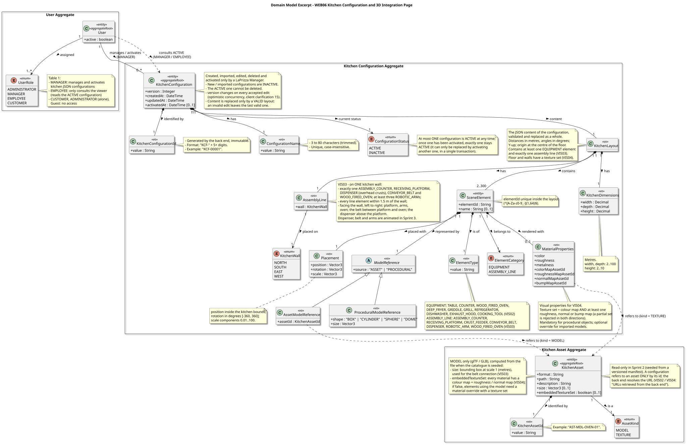
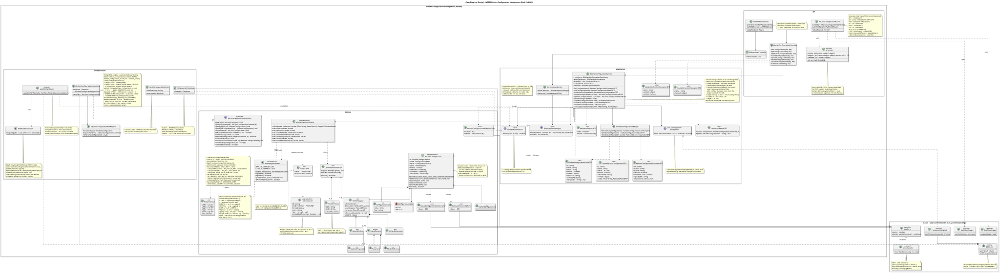
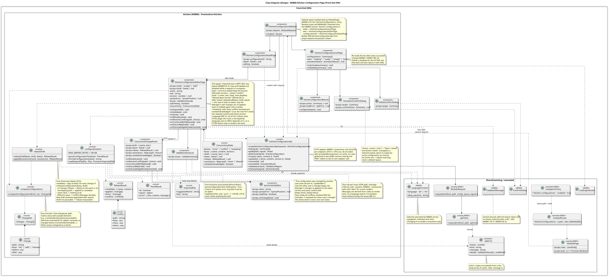
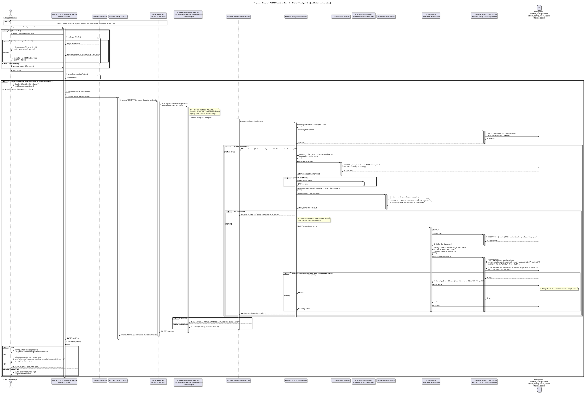
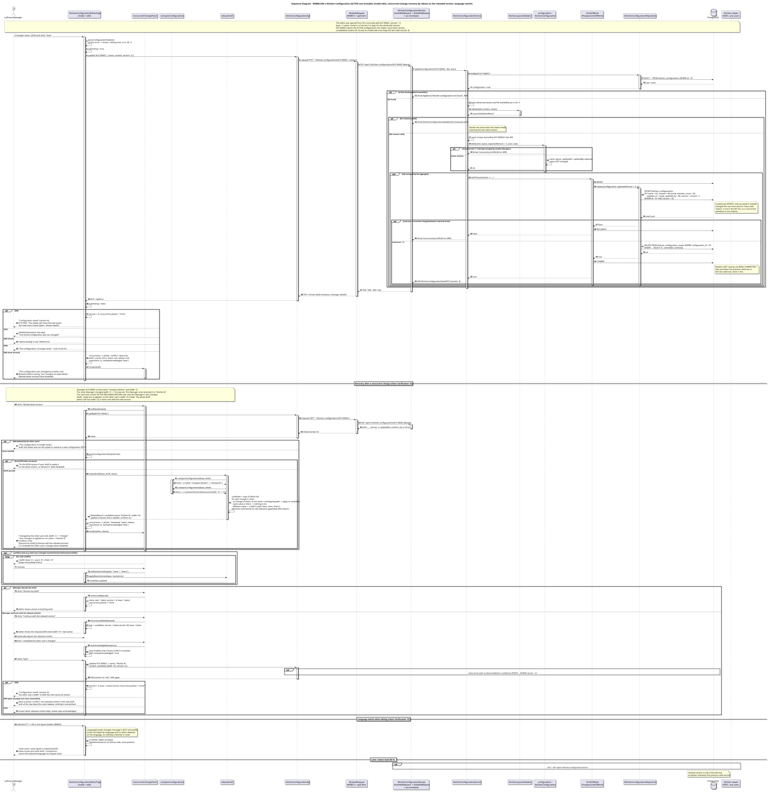
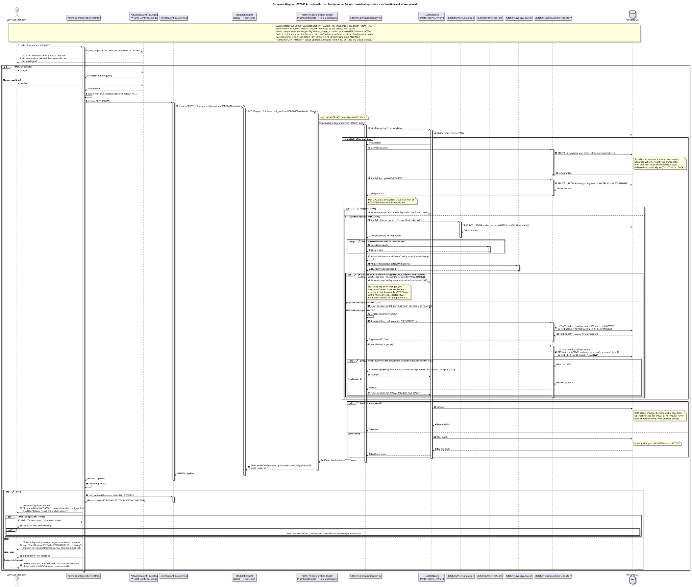
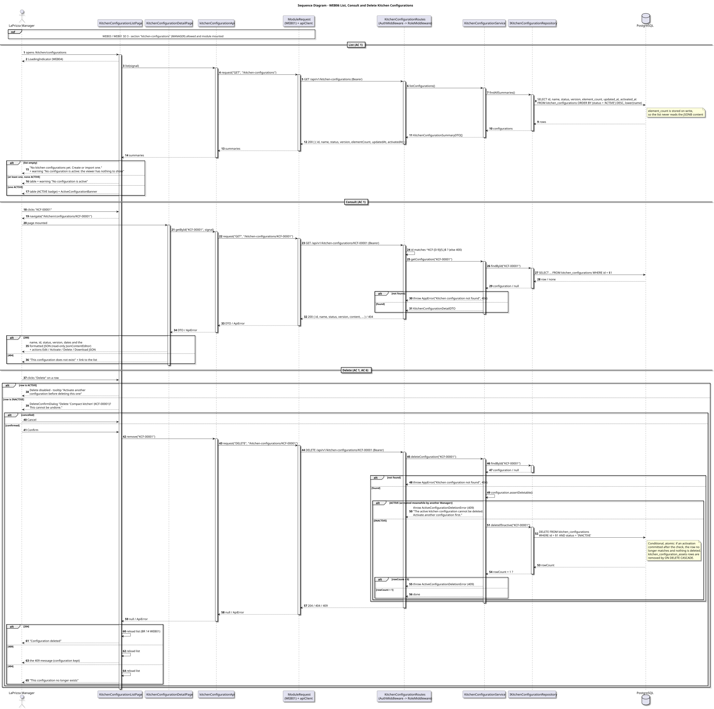
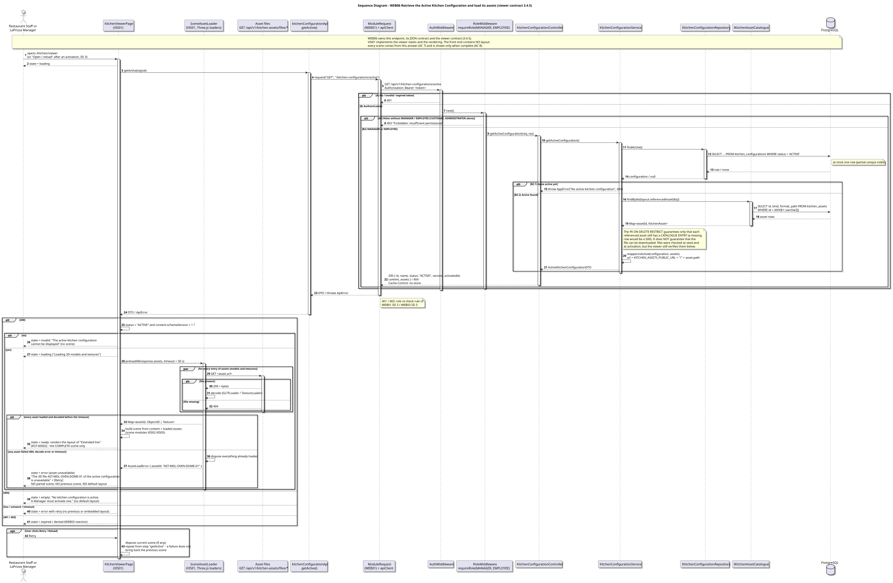

# US WEB06 – Kitchen Configuration and 3D Integration Page

## 1. Context & Scope

*   **User Story ID:** WEB06
*   **Sprint:** Sprint 2
*   **Area:** Front-end Web Application (WEB)
*   **Responsible:** Leonor de Moura (1240914) and Mariana Moreira (1240905)
*   **Related Requirements / Stories:**
    *   Sprint 2 User Stories, *PART IV – Sprint 2 – User Stories*, WEB06, the *VIS – 3D Kitchen Visualization* introduction ("obtain layout and asset information from the back end") and *Table 1 – Website roles and accessible functionality* (LaPrizza Manager: "manage and activate kitchen JSON configurations; consult the kitchen viewer"; Restaurant Staff: "consult … the kitchen viewer").
    *   System Specification: *PART II – System Specification*, section II.3.3 3D Visualization and Interaction (3D modules interact with information maintained by the rest of the system, not isolated static representations).
    *   Architecture: [System Architecture Description](../../architecture/SAD.md) (C4 diagrams; principles *Back-end authority* and *Client-side 3D rendering*) and [ADR-003 – REST and JSON](../../architecture/ADR.md). **Persistence:** [ADR-010 – PostgreSQL as the single database](../../architecture/ADR.md#adr-010-use-postgresql-as-the-single-database) (supersedes ADR-005): kitchen configurations and the asset catalogue are stored in the existing **PostgreSQL** database; the SAD container table and its persistence boundary reflect this decision.
    *   Sprint 2 planning: integration checkpoint *WEB06 ↔ VIS01–VIS03 – active kitchen configuration and documented JSON format must be agreed jointly* ([sprintPlanning.md](../../Planning/Sprint2/sprintPlanning.md)).
    *   Related stories:
        *   **WEB01 – SPA Setup and Integration:** `apiClient` / `ApiError`, the lazy module slot (`ModulePage`, `moduleRoutes` entry `kitchenConfigurations`) and the `<feature>Api` convention. WEB06 closes WEB01 **OP1** for the kitchen (route, payload and permissions of the active-configuration endpoint).
        *   **WEB02 – Consistent Layout and Navigation:** common layout and PT/EN texts of the page.
        *   **WEB03 – Role-Based Navigation:** section `kitchen-configurations` (`/kitchen/configurations`, `MANAGER`) that WEB06 enables, and the `401`/`403` reaction.
        *   **WEB04 – User Feedback and Validation:** loading, success, error and confirmation components; field errors; no double submission.
        *   **VIS01 – 3D Module Integration:** consumes `GET /kitchen-configurations/active` and follows the **viewer integration contract** of 3.4.5 (response, asset preloading, mapping of every outcome to a viewer state).
        *   **VIS02 / VIS03 / VIS04 – Kitchen, Assembly Line, Textures:** the equipment types (VIS02), the composition and arrangement of the assembly line (VIS03) and the texture sets (VIS04) are enforced by the WEB06 validator, so that every active configuration can be rendered as these stories require; they supply the model and texture files.
        *   **AA03 / AA05 – Role Resolution and Authorization Enforcement:** `AuthMiddleware` + `RoleMiddleware` on every endpoint; `401` vs `403`.
    *   **Dependencies:** WEB06 depends on WEB01 (module slot, `apiClient`), WEB03 (section and guard), WEB04 (feedback) and AA03/AA05 (authorization). VIS01–VIS04 depend on WEB06 for the active configuration, its JSON format and the asset references.

### Scope boundary

WEB06 concerns **how kitchen configurations are stored, validated, managed and activated, and how the active one is published to the viewer**. It does not define *how the scene is drawn* (VIS02–VIS05), *how the user interacts with it* (VIS06–VIS07), *how the viewer is mounted and shows its states* (VIS01), *which sections each role sees* (WEB03) nor *how feedback looks* (WEB04).

WEB06 owns:

1. The `KitchenConfiguration` aggregate and its persistence in PostgreSQL (layout stored as `JSONB`).
2. The **documented JSON format** (`schemaVersion` 1) of a kitchen layout: dimensions, assembly-line wall, equipment and assembly-line elements with placement, orientation, scale, model reference and visual properties.
3. The **validation** of imported or edited JSON (syntax, required properties, dimensions, scales, unique element ids, asset references, the assembly line required by VIS03 and the texture sets required by VIS04) with explained errors and no replacement of the last valid configuration.
4. The **activation** of exactly one configuration as a single consistent operation and the rule that the active one cannot be deleted.
5. The **documented back-end endpoint** that returns the active configuration with resolved asset URLs, and the **viewer integration contract** that VIS01 implements (3.4.5).
6. The read-only **kitchen asset catalogue** that makes the asset references resolvable.
7. The Manager page (list, create, import, consult, edit, delete, validate, activate), the recovery from a concurrent change, the preservation of the form when the language changes, and the confirmation that lets the viewer reload the activated layout.

---

## 2. Requirements & Analysis

### 2.1. User Story Description

> **As a** LaPrizza Manager,
> **I want** a website page to manage multiple kitchen configurations in JavaScript Object Notation (JSON) and select the active one,
> **so that** the 3D viewer uses the intended kitchen layout.

The actor is the **LaPrizza Manager** (`MANAGER`). **Restaurant Staff** (`EMPLOYEE`) is a secondary actor: it only reads the active configuration through the viewer (Table 1).

### 2.2. Acceptance Criteria

- [ ] **AC 1:** The SPA provides a page accessible to the LaPrizza Manager for listing, creating, importing, consulting, editing, and deleting kitchen configurations maintained by the back end.
- [ ] **AC 2:** Each configuration has a unique identifier, a descriptive name, JSON content, and an active or inactive status. It includes kitchen dimensions and the placement, orientation, and scale of equipment and assembly-line elements.
- [ ] **AC 3:** The JSON format is documented and includes the model references and visual properties required by the VIS User Stories, either directly or through resolvable back-end references.
- [ ] **AC 4:** Imported or edited JSON is validated for syntax, required properties, valid dimensions and scales, unique object identifiers, and valid asset references. Errors are explained without replacing the last valid configuration.
- [ ] **AC 5:** Multiple configurations may be stored, but exactly one valid configuration is active once the viewer is configured. Activating one configuration deactivates the previous one as a single consistent operation.
- [ ] **AC 6:** An active configuration is not deleted until a valid replacement has been activated. Changes to active content are validated before becoming available to the viewer.
- [ ] **AC 7:** The visualization module retrieves the active configuration through a documented back-end endpoint; it does not rely on a layout embedded in the front end.
- [ ] **AC 8:** After activation, the page confirms the selected configuration and allows the viewer to reload it. If no active configuration exists or it cannot be loaded, clear feedback is shown without silently using another layout.
- [ ] **AC 9:** Changes to kitchen configurations are restricted to authorized Managers; other roles may only view the scene where permitted by the role table.
- [ ] **AC 10:** The demonstration includes at least two distinct valid kitchen configurations, switching the active one, and rejection of an invalid configuration.

Criteria from related stories that constrain WEB06 (not owned, but must hold):

*   **Table 1 / AA05 AC 2–3:** only `MANAGER` changes configurations; `MANAGER` and `EMPLOYEE` read the active one (viewer); Guest, Customer and an Administrator without another role have no access. `401` (authentication) is distinguished from `403` (permission).
*   **WEB01 BR 4 / BR 6 / BR 14:** identifiers issued by the back end are reused unchanged (`KCF-…`, `AST-…`, element ids); business data only through the Back-End API; the page re-reads the saved state after a change.
*   **WEB01 OP1:** the kitchen-configuration contract must use JSON, back-end identifiers, bearer authentication, the `{ error: { message, status } }` format, Swagger documentation and Table 1 roles.
*   **WEB04 AC 2 / AC 5 / AC 6 / AC 7:** validation errors identify the affected fields; an unsuccessful operation is not presented as completed and input is preserved; significant actions (activate, delete) are confirmed; repeated submissions are prevented.
*   **Client clarification 15:** if another user changed a record since it was loaded, inform the user and require a reload before saving; do not overwrite the other user's changes. Changing language must preserve form data already entered; the language selection persists across navigation, refreshes and later visits (owned by WEB02).
*   **VIS01 BR 4 / BR 5:** the viewer has no fallback layout and maps every loading outcome (including "no active configuration") to an explicit state.
*   **VIS02 / VIS03 / VIS04:** kitchen dimensions and the position, orientation and scale of equipment come from the back end as JSON; imported model and texture URLs come from the back end; procedural models get texture and material properties from the back end; textures include a colour map and one of a roughness, bump or normal map; the assembly line is on one kitchen wall and its dispenser, conveyor belt and robotic arms will be animated in Sprint 3.

### 2.3. Client Clarifications & Questions

**Question 1:** WEB06 requires that a manager can create, import, edit, delete and activate JSON configurations for the kitchen scene. Is it also required to make 3D model manegement by the manager, or is the developing team, at this stage, the reponsible one to manage the models?

**Answer 1:** At this stage, the Manager is not required to manage the 3D models directly.

The kitchen scene configuration JSON file must include the information needed to locate and load the 3D models used in the scene.

Managing the 3D models is the development team's responsibility, while the Manager must be able to create, import, edit, delete, and activate JSON configurations, as specified in WEB06.


### 2.4. Business Rules & Invariants

Each rule states its source: **S** = Sprint 2 specification, **C** = client clarification, **D** = team design decision (section 3.8).

| ID | Rule | Source |
| --- | --- | --- |
| **BR 1** | Only `MANAGER` may list, consult, create, import, edit, validate, delete and activate kitchen configurations and list the asset catalogue. `MANAGER` and `EMPLOYEE` may read the **active** configuration (viewer). Any other role gets `403`; anonymous requests get `401`. | S – AC 1, AC 9, Table 1, AA05 |
| **BR 2** | Each configuration has an immutable identifier generated by the back end (`KCF-` + at least 5 digits), a name (3–80 characters after trimming, unique case-insensitively), JSON content, a status (`ACTIVE` / `INACTIVE`) and a version. | S – AC 2; D1, D6 |
| **BR 3** | The content follows the documented format `schemaVersion` 1 (3.4.1): kitchen dimensions, textured floor and walls, the assembly-line wall, at least one `EQUIPMENT` element and the assembly line of BR 17, each element with id, type, model reference, placement (position, rotation, scale) and, when required by BR 18, material properties. | S – AC 2, AC 3, VIS02–VIS04; D2 |
| **BR 4** | JSON syntax is checked in the SPA before sending (line and column reported). A malformed request body is also rejected by the back end with `400 Invalid JSON body`. | S – AC 4 |
| **BR 5** | The back end validates the content with the rules of 2.4.1, collects **all** issues and answers `422` with one issue per problem (`path` as JSON Pointer, `code`, `message`). The SPA never decides validity on its own (back-end authority). | S – AC 4, WEB04 AC 2; D3 |
| **BR 6** | An invalid create, import or edit stores nothing: the stored configuration (the last valid one) stays unchanged and the SPA keeps the text typed or imported by the Manager. | S – AC 4, WEB04 AC 5 |
| **BR 7** | New and imported configurations are created `INACTIVE`. | D4 |
| **BR 8** | At most one configuration is `ACTIVE` at any time. Once one has been activated, exactly one stays `ACTIVE`: there is no "deactivate" operation and the active one cannot be deleted. | S – AC 5, AC 6 |
| **BR 9** | Activation is one transaction: the target is re-validated **first** (content, catalogue and asset files – BR 19), and only then the previous `ACTIVE` configuration becomes `INACTIVE` and the target becomes `ACTIVE`; both changes are committed together or not at all. A failed re-validation answers `422` before any status change – also when the target is already active. Activating the already active, still valid configuration changes nothing (`200`). | S – AC 5, AC 6; D5 |
| **BR 10** | Deleting the active configuration is rejected with `409`; only `INACTIVE` configurations are deleted. | S – AC 6 |
| **BR 11** | An edit of the active configuration is validated before it is stored and replaces the row atomically (one transaction), so the viewer receives either the previous valid content or the new valid content, never invalid or partial content. | S – AC 6 |
| **BR 12** | An edit carries the version that was loaded; if the stored version is different, the edit is rejected with `409` and nothing is overwritten. The editor then keeps the Manager's draft, offers "Reload latest version" and builds the next save **on the reloaded record**: only the changes the Manager made since the version originally loaded (draft − base) are re-applied to the reloaded version (base − latest changes of the other user are kept). A property changed by both users to different values is a conflict that the Manager resolves explicitly (keep mine / keep theirs). "Save" is enabled only after every conflict is resolved and the Manager confirms the review; the new save carries the reloaded version. The whole draft is never sent on top of a newer version. The status is not part of the version (activations do not invalidate an open editor). | C – 15; D6, D16 |
| **BR 13** | The active configuration is published only by `GET /api/v1/kitchen-configurations/active`, which returns the content and the resolved asset URLs, or 404 with details[0].code = NO_ACTIVE_CONFIGURATION when none is active (VIS-ALN-1), so the viewer can tell it from an unknown route. The SPA contains no kitchen layout. | S – AC 7, AC 8, VIS02; D7 |
| **BR 14** | After a successful activation the page confirms the activated configuration (name and id) and offers "Open / reload the kitchen viewer". When no configuration is active, the page says so; when the active one cannot be loaded, the error is shown – another layout is never used. | S – AC 8 |
| **BR 15** | Models and textures are referenced only by asset id (`AST-…`) from the kitchen asset catalogue, with the expected kind (`MODEL` for models, `TEXTURE` for maps). The back end resolves the URL; the SPA and the JSON never contain asset URLs. | S – AC 3, VIS02, VIS03, VIS04; D8 |
| **BR 16** | Configuration, asset and element identifiers are used unchanged by the back end, the page and the viewer. | S – WEB01 BR 4 |
| **BR 17** | The layout contains exactly one assembly line on the wall given by `assemblyLine.wall`: one `ASSEMBLY_COUNTER` (large counter), one `RECEIVING_PLATFORM` at its **left** end, one overhead `DISPENSER` above the platform (pre-formed crusts), one `CONVEYOR_BELT` that **physically connects** the platform to the oven (its footprint touches or overlaps both, at the same depth and level – 2.4.3), one `WOOD_FIRED_OVEN` at its **right** end and at least three `ROBOTIC_ARM`s between the platform and the oven. Every assembly-line element is within 1.5 m of that wall. Left and right are seen from inside the kitchen, facing the wall (2.4.2). | S – VIS03; D14, D19 |
| **BR 18** | A texture set has a colour map **and** at least one roughness, normal or bump map: a colour map alone, or a roughness / normal / bump map without a colour map, is rejected. Procedural objects (floor, walls and every `PROCEDURAL` element) must have a material with a texture set. An imported model (`ASSET`) is accepted only if **every** material of its file has a texture set (`embeddedTextureSet` of the catalogue, checked when the asset is seeded) **or** the element defines a `material` override with a texture set, which the viewer applies to every mesh of the model. | S – VIS04; D15, D20 |
| **BR 19** | A configuration is accepted (create, edit, activation) only if every referenced asset exists in the catalogue, has the expected kind **and its file is present** in the asset store. The viewer still treats a file that cannot be loaded as an error (BR 20). | S – AC 4, AC 8; D13 |
| **BR 20** | The viewer becomes `ready` only after the configuration **and every referenced model and texture** have been loaded. If any file cannot be loaded, the viewer shows an explicit error naming the unavailable asset and offers "Retry"; it never shows a partial scene, a previous scene or another layout. | S – AC 8, VIS01; D18 |
| **BR 21** | Changing the interface language (PT/EN) keeps everything entered in the editor – name, typed or imported JSON, the validation issues (re-rendered in the new language) and the concurrent-change draft – and sends no request. | C – 15; D17 |

#### 2.4.1. Content validation rules (`KitchenLayoutValidator`)

| Code | Rule | Example of `path` |
| --- | --- | --- |
| `REQUIRED` | Every mandatory property of 3.4.1 is present. | `/kitchen/dimensions/height` |
| `INVALID_TYPE` | Each property has the documented type (object, array, number, string). Numbers must be finite. | `/elements/2/placement/position/x` |
| `UNKNOWN_PROPERTY` | No property outside the format (catches typos; nothing undocumented is stored). | `/elements/0/placment` |
| `UNSUPPORTED_SCHEMA_VERSION` | `schemaVersion` = `1` and `units` = `"meters"`. | `/schemaVersion` |
| `INVALID_DIMENSION` | `width`, `depth` ∈ [2, 100] m; `height` ∈ [2, 10] m. | `/kitchen/dimensions/width` |
| `INVALID_SCALE` | Each `scale` component ∈ [0.01, 100]; each procedural `size` component ∈ [0.01, 50] m. | `/elements/4/placement/scale/y` |
| `INVALID_ROTATION` | Each `rotation` component ∈ [-360, 360] degrees. | `/elements/1/placement/rotation/y` |
| `OUT_OF_BOUNDS` | `position.x` ∈ [-width/2, width/2], `position.z` ∈ [-depth/2, depth/2], `position.y` ∈ [0, height]. | `/elements/3/placement/position/z` |
| `INVALID_ELEMENT_ID` / `DUPLICATE_ELEMENT_ID` | Element ids match `^[A-Za-z0-9_-]{1,64}$` and are unique in the layout. | `/elements/7/id` |
| `INVALID_ENUM` | `category`, `type` (per category), `model.source`, `model.shape`, `assemblyLine.wall` take the documented values. | `/elements/5/type` |
| `MISSING_CATEGORY` | At least one `EQUIPMENT` element; at most 300 elements. | `/elements` |
| `LINE_COMPOSITION` | Exactly one `ASSEMBLY_COUNTER`, `RECEIVING_PLATFORM`, `DISPENSER`, `CONVEYOR_BELT` and `WOOD_FIRED_OVEN` in category `ASSEMBLY_LINE`, and 3–12 `ROBOTIC_ARM`s (BR 17). | `/elements` |
| `LINE_NOT_AT_WALL` | Every `ASSEMBLY_LINE` element has wall distance `d` ≤ 1.5 m (2.4.2). | `/elements/9/placement/position` |
| `LINE_ORDER` | Along the wall (`u`, left → right): platform < every robotic arm < oven; platform ≤ conveyor belt ≤ oven; dispenser within 0.75 m of the platform and higher than it (`position.y` greater). | `/elements/11/placement/position` |
| `LINE_ALIGNMENT` | Counter, platform, conveyor belt and oven have `rotation.x = rotation.z = 0` and `rotation.y` a multiple of 90°; the conveyor belt's length axis (model `+X`) runs **along** the wall (2.4.3). | `/elements/4/placement/rotation/y` |
| `LINE_BELT_DISCONNECTED` | The conveyor belt starts at the platform and ends at the oven: its `u` span begins inside the platform span or at most 0.05 m after it, ends inside the oven span or at most 0.05 m before it, overlaps both in depth (`d` span) and its top is within 0.15 m of the platform top, at most 0.15 m below the oven entrance (the oven base) and below the oven top (2.4.3). | `/elements/4/placement/position` |
| `UNKNOWN_ASSET` | Every `assetId` / `*MapAssetId` exists in the kitchen asset catalogue. | `/elements/0/model/assetId` |
| `ASSET_FILE_MISSING` | The file of every referenced asset is present in the asset store (BR 19). | `/elements/0/model/assetId` |
| `ASSET_KIND_MISMATCH` | `model.assetId` refers to a `MODEL`; `*MapAssetId` refers to a `TEXTURE`. | `/elements/0/material/colorMapAssetId` |
| `INVALID_MATERIAL` | `color` is `#RRGGBB`; `roughness`, `metalness` ∈ [0, 1]. | `/elements/6/material/roughness` |
| `INCOMPLETE_TEXTURE_SET` | Any map present ⇒ `colorMapAssetId` **and** at least one of `roughnessMapAssetId`, `normalMapAssetId`, `bumpMapAssetId` (both directions, BR 18). | `/elements/6/material` |
| `MATERIAL_REQUIRED` | `kitchen.floor.material`, `kitchen.walls.material` and the `material` of every `PROCEDURAL` element exist and contain a texture set. | `/kitchen/walls/material` |
| `MODEL_TEXTURES_MISSING` | An `ASSET` element whose model has `embeddedTextureSet = false` (a material of the file lacks a colour map or a roughness / normal map) defines a `material` override with a complete texture set (BR 18). | `/elements/3/material` |

#### 2.4.2. Assembly-line coordinates (VIS03)

The arrangement rules use two coordinates derived from `position` and `assemblyLine.wall`, as seen by a person inside the kitchen **facing the wall** (scene: metres, Y-up, origin at the centre of the floor, `-Z` = `NORTH`):

| `assemblyLine.wall` | `u` (left → right along the wall) | `d` (distance from the wall) |
| --- | --- | --- |
| `NORTH` | `x` | `z + depth/2` |
| `SOUTH` | `-x` | `depth/2 - z` |
| `EAST` | `z` | `width/2 - x` |
| `WEST` | `-z` | `x + width/2` |

The left end of the line is the smallest `u`, the right end the largest `u`. `position` is the base point of the element (the bottom centre of its footprint), so the dispenser being "overhead" is checked as a greater `position.y` than the platform.

#### 2.4.3. Footprints and conveyor-belt connection (VIS03, defined with the team)

Whether the belt reaches the platform and the oven depends on the **size** of the elements, not only on their positions. The size of every element is therefore known to the validator:

| Model source | Size at scale 1 (`sx`, `sy`, `sz`, metres) | Where it comes from |
| --- | --- | --- |
| `PROCEDURAL` | `model.size` | The configuration itself |
| `ASSET` | catalogue `size` of the model | Computed by `GltfModelInspector` when the catalogue is seeded: bounding box of the glTF scene (POSITION `min` / `max` with node transforms applied) |

The element size is `(sx·scale.x, sy·scale.y, sz·scale.z)`. Modelling convention defined with VIS02–VIS04 at the WEB06 ↔ VIS checkpoint (section 7) for every model file: glTF / GLB, metres, Y-up, origin at the **bottom centre** of the footprint (same meaning as `position`), and for the conveyor belt the direction of travel along the model `+X` axis.

Because counter, platform, belt and oven are rotated only by multiples of 90° around Y (`LINE_ALIGNMENT`), their footprint stays aligned with the wall:

*   **Along the wall:** if the element's `+X` axis is parallel to the wall (`rotation.y` ∈ {0°, 180°} for `NORTH` / `SOUTH`, ∈ {90°, 270°} for `EAST` / `WEST`), `lenU = size.x` and `lenD = size.z`; otherwise `lenU = size.z` and `lenD = size.x`. The belt must be in the first case.
*   **Spans:** `U = [u − lenU/2, u + lenU/2]`, `D = [d − lenD/2, d + lenD/2]`, `bottom = position.y`, `top = position.y + size.y`.
*   **Connection (`LINE_BELT_DISCONNECTED`):** with `P` = platform, `B` = belt, `O` = oven:
    *   start: `P.U.min ≤ B.U.min ≤ P.U.max + 0.05`;
    *   end: `O.U.min − 0.05 ≤ B.U.max ≤ O.U.max`;
    *   depth: `B.D` overlaps `P.D` and `O.D`;
    *   level: `|B.top − P.top| ≤ 0.15` and `O.bottom − 0.15 ≤ B.top < O.top` – the oven entrance opens at the base of the oven model (origin at the bottom centre), so a belt that passes under a raised oven does not reach it (e.g. oven raised to `y = 2` m above a belt with top 1.0 m: "The top of the conveyor belt is 1.00 m below the oven entrance").

A belt placed between the platform and the oven that reaches neither (e.g. `B.U = [-2, 2]` with `P.U.max = -3.1` and `O.U.min = 3.7`) is rejected with two issues: "The conveyor belt starts 1.10 m after the receiving platform" and "The conveyor belt ends 1.70 m before the oven". The 0.05 m / 0.15 m tolerances are part of the same checkpoint (VIS03 owner) and are constants of `AssemblyLineFrame`.

### 2.5. Domain Model Excerpt



PlantUML source: [`excerptDomainModel/domain_model_excerpt.puml`](./excerptDomainModel/domain_model_excerpt.puml).

| Concept | Kind | Role in WEB06 |
| --- | --- | --- |
| **KitchenConfiguration** | Entity / Aggregate Root (**new**) | Unit of consistency for name, content, status and version; enforces "new = inactive", "active cannot be deleted" and the version check |
| **KitchenConfigurationId** | Value Object (**new**) | `KCF-00001`; generated by the back end, reused by the page and the viewer |
| **ConfigurationName** | Value Object (**new**) | Descriptive, unique (case-insensitive) name |
| **ConfigurationStatus** | Enumeration (**new**) | `ACTIVE` / `INACTIVE`; at most one `ACTIVE` |
| **KitchenLayout** | Value Object (**new**) | The validated JSON content (`schemaVersion` 1); immutable – an edit replaces it as a whole |
| **KitchenDimensions**, **AssemblyLine** / **KitchenWall** | Value Objects (**new**) | Size of the kitchen (metres); wall, composition and left-to-right arrangement of the assembly line (VIS03, BR 17) |
| **SceneElement**, **ElementCategory**, **ElementType** | Entity inside the layout / Enumeration / Value Object (**new**) | Equipment (VIS02) and assembly-line elements (VIS03), identified by an element id unique in the layout |
| **Placement** (position, rotation, scale) | Value Object (**new**) | Placement, orientation and scale required by AC 2 |
| **ModelReference** (asset / procedural), **MaterialProperties** | Value Objects (**new**) | Model reference and visual properties required by VIS02–VIS04 (AC 3); a texture set is a colour map plus a roughness, normal or bump map (BR 18) |
| **KitchenAsset**, **KitchenAssetId**, **AssetKind** | Aggregate Root (read-only, **new**) / Value Object / Enumeration | Catalogue that makes asset references resolvable and validatable (BR 15) |
| **User** / **UserRole** | Aggregate Root / Enumeration (existing, AA03) | `MANAGER` manages and activates; `EMPLOYEE` only reads the active configuration |

The configuration and the asset catalogue are **separate aggregates**: a configuration refers to an asset only by id, and the reference is checked when the configuration is created, edited or activated, and resolved when the active configuration is read. The 3D engine objects (`Scene`, `Mesh`, …) remain presentation objects of VIS01–VIS05.

---

## 3. Design

### 3.1. Architecture & C4 Alignment

This User Story operates within the established **C4 Model** of the system ([SAD](../../architecture/SAD.md)):

*   **C4 Level 1 (System Context):** the LaPrizza Manager manages kitchen configurations and Restaurant Staff consults the kitchen through the *LaPrizza Information System*; no external system is involved.
*   **C4 Level 2 (Containers):** the *Front-End* (React SPA) hosts the Manager page and the viewer; the *Back-End API* validates, stores and publishes the configurations and is the only container that accesses the *Relational Database* (PostgreSQL), where the configurations, their asset links and the asset catalogue are stored next to the rest of the business data. Model and texture files are served read-only by the Back-End API. No new container is introduced.
*   **C4 Level 3 (Components):** in the Back-End, WEB06 adds the **Kitchen Configuration Component** (`kitchen-configuration-management` module: routes, controller, service, domain, PostgreSQL repositories) and reuses the shared **PostgreSQL persistence** (`createDatabase`, `PostgresUnitOfWork`), the **Security Component** (`AuthMiddleware`, `RoleMiddleware`) and extends the shared **error handler** (validation details). In the Front-End, WEB06 adds the **Kitchen configuration** feature (`frontend/src/kitchen`) plugged into the WEB01 module slot and the WEB03 navigation policy.

---

### 3.2. Class Diagram (CD)

The design is presented in two views: the Back-End module and the SPA feature. Only members relevant to WEB06 are shown.



> PlantUML source: [`classDiagram/class_diagram.puml`](./classDiagram/class_diagram.puml).



> PlantUML source: [`classDiagram/class_diagram_spa.puml`](./classDiagram/class_diagram_spa.puml).

Key design points:

*   **Reused unchanged:** back end – `AuthMiddleware`, `RoleMiddleware`, `ValidationMiddleware` (envelope), `express.json()` (100 KB limit), `createDatabase` / `PostgresUnitOfWork` and the `IUnitOfWork` port convention; front end – `ModulePage`, `ModuleRequest`, `apiClient`, `ProtectedRoute`, WEB04 feedback components.
*   **Extended:**
    *   `AppError` / `errorHandler`: optional `details` array copied to the error body for `4xx` answers (ALN-1, 3.4.4).
    *   `ApiError` (WEB01): `details` copied from a `4xx` body (ALN-2).
    *   `moduleRoutes` (WEB01) and `navigationPolicy` (WEB03): the `kitchenConfigurations` / `kitchen-configurations` entry receives its loader and becomes enabled; its child routes (`new`, `:configurationId`) inherit `[MANAGER]`.
*   **New (back end):** module `kitchen-configuration-management` (`KitchenConfigurationRoutes`, `KitchenAssetRoutes`, controllers, `KitchenConfigurationService`, `KitchenAssetService`, DTOs, mapper, ports including `IKitchenAssetFileStore`), domain (`KitchenConfiguration`, value objects, `KitchenLayoutValidator` with the VIS03 / VIS04 rules, `AssemblyLineFrame`, errors), infrastructure (`KitchenConfigurationRepository`, `KitchenConfigurationRowMapper`, `KitchenAssetCatalogue`, `LocalKitchenAssetFileStore`, `GltfModelInspector`, `seedKitchenAssets`) and migration `0026_kitchen_configurations.sql`.
*   **New (SPA):** `frontend/src/kitchen` – `KitchenConfigurationsModule`, `kitchenConfigurationApi`, `configurationJson`, `compareConfigurations`, `rebaseDraft`, the list / editor / detail pages and their components, including `ConcurrentChangePanel`.
*   **Pure, exhaustively testable logic:** `KitchenLayoutValidator` and `AssemblyLineFrame` (no I/O – the service passes the referenced assets and whether their files exist), `configurationJson.parseConfigurationText`, `compareConfigurations` and `rebaseDraft` (no React, no HTTP).
*   **Editor state and language (BR 21):** the editor keeps `name`, `text`, `version`, `issues` and the concurrent-change state (`base` – the record as it was loaded –, `draft`, `latest`, `rebase`, `resolutions`, `reviewAcknowledged`) in React state of `KitchenConfigurationEditorPage`. The route element is **not keyed by language** and no effect depends on the language, so a PT/EN switch only re-renders labels and issue messages (translated from the stable `code` and its parameters); the page is not remounted and nothing is re-fetched.

#### Configuration lifecycle

| Current status | Operation | Result | Answer |
| --- | --- | --- | --- |
| – | create / import (valid) | `INACTIVE`, version 1 | `201` |
| – | create / import (invalid) | nothing stored | `422` / `400` |
| `INACTIVE` / `ACTIVE` | edit (valid, same version) | content replaced, version + 1, status unchanged | `200` |
| `INACTIVE` / `ACTIVE` | edit (invalid) | unchanged (last valid kept) | `422` |
| `INACTIVE` / `ACTIVE` | edit (stale version) | unchanged; the editor keeps the draft and starts the recovery: reload, re-apply the Manager's own changes on the reloaded version, resolve conflicts, review (SD 2) | `409` |
| `INACTIVE` | activate (valid) | `ACTIVE`; previous `ACTIVE` → `INACTIVE` (same transaction) | `200` |
| `INACTIVE` | activate (content no longer valid or an asset file missing) | unchanged; previous `ACTIVE` kept | `422` |
| `ACTIVE` | activate (still valid, every file present) | unchanged (idempotent) | `200` |
| `ACTIVE` | activate (content no longer valid or an asset file missing) | unchanged (status not touched) | `422` |
| `INACTIVE` | delete | removed | `204` |
| `ACTIVE` | delete | unchanged | `409` |

---

### 3.3. Sequence Diagrams (SD)

#### SD 1 — Create or Import a Kitchen Configuration (AC 1, AC 2, AC 3, AC 4)

File reading and syntax are checked in the SPA without sending anything. The back end checks the name, loads only the referenced assets and whether their files exist, validates the whole content (including the assembly line of VIS03 and the texture sets of VIS04) and, only when it is valid, opens a transaction that takes the id from the sequence and inserts the row (`INACTIVE`) and its asset links. A `422` lists every issue; the text stays in the editor.



> Source: [`sequence_diagram_create_import.puml`](./sequenceDiagram/sequence_diagram_create_import.puml)

#### SD 2 — Edit a Kitchen Configuration (AC 4, AC 6)

The edit carries the loaded version. Validation happens before any write; the row is replaced in one transaction with a conditional `UPDATE … WHERE id = $1 AND version = $2` that does not touch the status, together with its asset links, so the viewer only ever reads valid content and concurrent edits are detected (`409`). After a `409` the editor keeps the draft and, on request, reloads the latest version. It does **not** send the draft again: `rebaseDraft(base, draft, latest)` takes the reloaded record as the starting point and re-applies only the Manager's own changes (draft − base), so the other user's changes (latest − base) are kept. Properties changed by both users to different values are listed as conflicts and the Manager chooses "keep mine" or "keep theirs" for each one. The rebased result is shown in the editor; "Save" is enabled only when every conflict is resolved and the review is confirmed, and the next `PUT` sends the rebased content with the reloaded version (clarification 15). Example: the other user changed the dimensions and this Manager only renamed the configuration → the save keeps the new dimensions **and** the new name. A language switch at any point keeps the name, the JSON, the issues and the draft (BR 21).



> Source: [`sequence_diagram_edit.puml`](./sequenceDiagram/sequence_diagram_edit.puml)

#### SD 3 — Activate a Kitchen Configuration (AC 5, AC 8)

After confirmation, the back end runs one PostgreSQL transaction: take the activation advisory lock, lock the target row (`FOR UPDATE`), re-validate it against the catalogue **and the asset files** (`assetFiles.exists`), and only if it is valid either return immediately (target already `ACTIVE`, nothing to change) or set the previous active configuration to `INACTIVE` and the target to `ACTIVE`, `COMMIT`. A missing file or any other validation issue answers `422` **before any status change** – also when the target is already active – and the transaction is rolled back. The order of the steps is the same as in `KitchenConfigurationService.activateConfiguration` (back-end class diagram). The page re-reads the list, confirms the new active configuration and offers to open / reload the viewer.



> Source: [`sequence_diagram_activation.puml`](./sequenceDiagram/sequence_diagram_activation.puml)

#### SD 4 — List, Consult and Delete Kitchen Configurations (AC 1, AC 6)

The list is read without the JSON content. Deleting is offered only for inactive rows and is enforced by a conditional `DELETE … WHERE id = $1 AND status = 'INACTIVE'`, so an activation committed in the meantime cannot be lost.



> Source: [`sequence_diagram_list_consult_delete.puml`](./sequenceDiagram/sequence_diagram_list_consult_delete.puml)

#### SD 5 — Retrieve the Active Kitchen Configuration (AC 7, AC 8, AC 9)

The documented endpoint consumed by VIS01: `MANAGER` / `EMPLOYEE` only, `404` when none is active, asset references resolved to URLs. The foreign keys only guarantee that each asset still has a **catalogue entry**, not that its file can be downloaded, so the diagram continues on the viewer side: the viewer preloads every model and texture before building the scene and becomes `ready` only when all of them loaded; a missing or unreadable file gives an explicit error state, never a partial or alternative scene (BR 20, contract 3.4.5). The viewer component and its states are implemented by VIS01.



> Source: [`sequence_diagram_active_configuration.puml`](./sequenceDiagram/sequence_diagram_active_configuration.puml)

---

### 3.4. REST API Specification (ARC03)

All endpoints are under `/api/v1`, use JSON (ADR-003), require `Authorization: Bearer <token>` (except the static asset files) and are documented in the module's `api/openapi.js` (Swagger `/api-docs`).

| Method | Endpoint | Description | Auth / Role | Success | Errors |
| :--- | :--- | :--- | :--- | :--- | :--- |
| `GET` | `/kitchen-configurations` | List summaries (no content) | `MANAGER` | `200` | `401`, `403` |
| `GET` | `/kitchen-configurations/active` | Active configuration with resolved assets (**viewer endpoint**) | `MANAGER`, `EMPLOYEE` | `200` | `401`, `403`, `404` (none active) |
| `GET` | `/kitchen-configurations/{id}` | Consult one configuration with its content | `MANAGER` | `200` | `400` (id), `401`, `403`, `404` |
| `POST` | `/kitchen-configurations` | Create / import (`INACTIVE`) | `MANAGER` | `201` + `Location` | `400`, `401`, `403`, `409` (name), `413`, `422` |
| `POST` | `/kitchen-configurations/validation` | Validate content without storing it (dry run) | `MANAGER` | `200` `{ valid, issues }` | `400`, `401`, `403`, `413` |
| `PUT` | `/kitchen-configurations/{id}` | Replace name and content (also when active) | `MANAGER` | `200` | `400`, `401`, `403`, `404`, `409` (stale version / name), `413`, `422` |
| `DELETE` | `/kitchen-configurations/{id}` | Delete an inactive configuration | `MANAGER` | `204` | `400`, `401`, `403`, `404`, `409` (active) |
| `POST` | `/kitchen-configurations/{id}/activation` | Activate (previous active → inactive, one transaction) | `MANAGER` | `200` | `400`, `401`, `403`, `404`, `409`, `422` |
| `GET` | `/kitchen-assets` | List the asset catalogue (to write references) | `MANAGER` | `200` | `401`, `403` |
| `GET` | `/kitchen-assets/files/{path}` | Static model / texture file | Public (read-only, no business or personal data) | `200` | `404` |

#### 3.4.1. Kitchen configuration JSON format (`schemaVersion` 1)

Conventions: metres, degrees, right-handed **Y-up** coordinates with the origin at the **centre of the kitchen floor** (same convention as VIS01 BR 10); `-Z` is the `NORTH` wall. All properties not listed are rejected (`UNKNOWN_PROPERTY`).

| Property | Type | Required | Rules / meaning |
| --- | --- | :-: | --- |
| `schemaVersion` | integer | ✔ | `1` |
| `units` | string | ✔ | `"meters"` |
| `kitchen.dimensions.width` / `.depth` / `.height` | number | ✔ | 2–100 / 2–100 / 2–10 m |
| `kitchen.floor.material`, `kitchen.walls.material` | object | ✔ | `MaterialProperties` (below) with a texture set (procedural floor and walls, VIS02 / VIS04) |
| `assemblyLine.wall` | string | ✔ | `NORTH` \| `SOUTH` \| `EAST` \| `WEST` (VIS03: "on one kitchen wall") |
| `elements[]` | array | ✔ | 9–300 items; at least one `EQUIPMENT` element and the assembly line of BR 17 |
| `elements[].id` | string | ✔ | `^[A-Za-z0-9_-]{1,64}$`, unique in the layout |
| `elements[].name` | string | – | 1–80 characters (label shown by the viewer) |
| `elements[].category` | string | ✔ | `EQUIPMENT` \| `ASSEMBLY_LINE` |
| `elements[].type` | string | ✔ | `EQUIPMENT`: `TABLE`, `COUNTER`, `WOOD_FIRED_OVEN`, `DEEP_FRYER`, `GRIDDLE`, `GRILL`, `REFRIGERATOR`, `DISHWASHER`, `EXHAUST_HOOD`, `COOKING_TOOL` (VIS02). `ASSEMBLY_LINE`: `ASSEMBLY_COUNTER`, `RECEIVING_PLATFORM`, `DISPENSER` (overhead crust supply), `CONVEYOR_BELT`, `ROBOTIC_ARM`, `WOOD_FIRED_OVEN` – composition and order in BR 17 / 2.4.2 (VIS03) |
| `elements[].model.source` | string | ✔ | `ASSET` (imported model) \| `PROCEDURAL` |
| `elements[].model.assetId` | string | if `ASSET` | Id of a `MODEL` asset (`GET /kitchen-assets`) |
| `elements[].model.shape` / `.size {x,y,z}` | string / object | if `PROCEDURAL` | `BOX` \| `CYLINDER` \| `SPHERE` \| `DOME`; size 0.01–50 m |
| `elements[].placement.position {x,y,z}` | object | ✔ | Inside the kitchen bounds (2.4.1) |
| `elements[].placement.rotation {x,y,z}` | object | ✔ | Degrees, −360 to 360 |
| `elements[].placement.scale {x,y,z}` | object | ✔ | 0.01–100 per axis |
| `elements[].material` | object | if `PROCEDURAL` | `color` (`#RRGGBB`), `roughness`, `metalness` (0–1), `colorMapAssetId`, `roughnessMapAssetId`, `normalMapAssetId`, `bumpMapAssetId` (ids of `TEXTURE` assets). Maps form a **texture set**: colour map + at least one roughness / normal / bump map; partial sets are rejected (BR 18). For `ASSET` models: required when the model file has no complete texture set (`embeddedTextureSet = false`, `MODEL_TEXTURES_MISSING`), optional otherwise; when present the viewer applies it to **every** mesh of the model. |

The dispenser, conveyor belt and robotic arms will be animated in Sprint 3. Their element ids are therefore stable references (an edit keeps them unless the Manager changes them), and animation properties will be added in a new `schemaVersion` instead of loosening the current rules (D2).

Example (valid; `NORTH` wall, so `u = x` and `d = z + 4`):

```json
{
  "schemaVersion": 1,
  "units": "meters",
  "kitchen": {
    "dimensions": { "width": 12, "depth": 8, "height": 3.2 },
    "floor": { "material": { "colorMapAssetId": "AST-TEX-TILES-COLOR", "normalMapAssetId": "AST-TEX-TILES-NORMAL", "roughness": 0.7 } },
    "walls": { "material": { "colorMapAssetId": "AST-TEX-PLASTER-COLOR", "roughnessMapAssetId": "AST-TEX-PLASTER-ROUGH" } }
  },
  "assemblyLine": { "wall": "NORTH" },
  "elements": [
    { "id": "line-counter", "name": "Assembly counter", "category": "ASSEMBLY_LINE", "type": "ASSEMBLY_COUNTER",
      "model": { "source": "PROCEDURAL", "shape": "BOX", "size": { "x": 8, "y": 0.9, "z": 1.2 } },
      "placement": { "position": { "x": 0, "y": 0, "z": -3.3 }, "rotation": { "x": 0, "y": 0, "z": 0 }, "scale": { "x": 1, "y": 1, "z": 1 } },
      "material": { "colorMapAssetId": "AST-TEX-STEEL-COLOR", "roughnessMapAssetId": "AST-TEX-STEEL-ROUGH", "metalness": 0.8 } },
    { "id": "line-platform", "category": "ASSEMBLY_LINE", "type": "RECEIVING_PLATFORM",
      "model": { "source": "PROCEDURAL", "shape": "BOX", "size": { "x": 0.8, "y": 0.1, "z": 0.8 } },
      "placement": { "position": { "x": -3.5, "y": 0.9, "z": -3.3 }, "rotation": { "x": 0, "y": 0, "z": 0 }, "scale": { "x": 1, "y": 1, "z": 1 } },
      "material": { "colorMapAssetId": "AST-TEX-STEEL-COLOR", "normalMapAssetId": "AST-TEX-STEEL-NORMAL" } },
    { "id": "line-dispenser", "category": "ASSEMBLY_LINE", "type": "DISPENSER",
      "model": { "source": "ASSET", "assetId": "AST-MDL-DISPENSER-01" },
      "placement": { "position": { "x": -3.5, "y": 2.1, "z": -3.3 }, "rotation": { "x": 0, "y": 0, "z": 0 }, "scale": { "x": 1, "y": 1, "z": 1 } } },
    { "id": "line-belt", "category": "ASSEMBLY_LINE", "type": "CONVEYOR_BELT",
      "model": { "source": "ASSET", "assetId": "AST-MDL-CONVEYOR-01" },
      "placement": { "position": { "x": 0.25, "y": 0.9, "z": -3.3 }, "rotation": { "x": 0, "y": 0, "z": 0 }, "scale": { "x": 7, "y": 1, "z": 1 } } },
    { "id": "line-arm-1", "category": "ASSEMBLY_LINE", "type": "ROBOTIC_ARM",
      "model": { "source": "ASSET", "assetId": "AST-MDL-ROBOT-ARM-01" },
      "placement": { "position": { "x": -1.5, "y": 0.9, "z": -3.7 }, "rotation": { "x": 0, "y": 0, "z": 0 }, "scale": { "x": 1, "y": 1, "z": 1 } } },
    { "id": "line-arm-2", "...": "same as line-arm-1 with x = 0" },
    { "id": "line-arm-3", "...": "same as line-arm-1 with x = 1.5" },
    { "id": "line-oven", "name": "Wood-fired oven", "category": "ASSEMBLY_LINE", "type": "WOOD_FIRED_OVEN",
      "model": { "source": "ASSET", "assetId": "AST-MDL-OVEN-DOME-01" },
      "placement": { "position": { "x": 4.6, "y": 0, "z": -3.2 }, "rotation": { "x": 0, "y": 180, "z": 0 }, "scale": { "x": 1, "y": 1, "z": 1 } } },
    { "id": "fridge-1", "category": "EQUIPMENT", "type": "REFRIGERATOR",
      "model": { "source": "ASSET", "assetId": "AST-MDL-FRIDGE-01" },
      "placement": { "position": { "x": -5.2, "y": 0, "z": 2.8 }, "rotation": { "x": 0, "y": 90, "z": 0 }, "scale": { "x": 1, "y": 1, "z": 1 } } }
  ]
}
```

(`line-arm-2` and `line-arm-3` are abbreviated here; the sample file `kitchen-compact.json` contains them in full.) Arrangement check: platform `u = -3.5` < arms `-1.5, 0, 1.5` < oven `4.6`; belt `0.25` between them; dispenser at the platform's `u` and higher; every `d` ≤ 1.5 m. Belt connection (2.4.3, catalogue sizes `AST-MDL-CONVEYOR-01` = 1.0 × 0.1 × 0.6 m, `AST-MDL-OVEN-DOME-01` = 1.8 × 1.6 × 1.8 m): platform `U = [-3.9, -3.1]`, belt `U = [-3.25, 3.75]` (starts inside the platform), oven `U = [3.7, 5.5]` (belt ends 0.05 m inside it); depth spans overlap; belt top 1.0 m = platform top 1.0 m < oven top 1.6 m. The imported models of the example have `embeddedTextureSet = true`, so they need no `material` override.

#### 3.4.2. Request & Response Schemas

- **Create / import — Request (`POST /kitchen-configurations`):**
  ```json
  { "name": "Extended assembly line", "content": { "schemaVersion": 1, "units": "meters", "...": "..." } }
  ```
- **Create — Success (`201 Created`, `Location: /api/v1/kitchen-configurations/KCF-00002`)** and **Consult (`GET /kitchen-configurations/{id}`, `200 OK`)**:
  ```json
  {
    "id": "KCF-00002",
    "name": "Extended assembly line",
    "status": "INACTIVE",
    "version": 1,
    "content": { "schemaVersion": 1, "units": "meters", "...": "..." },
    "createdAt": "2026-11-12T10:15:00.000Z",
    "updatedAt": "2026-11-12T10:15:00.000Z",
    "activatedAt": null
  }
  ```
- **Edit — Request (`PUT /kitchen-configurations/{id}`):** `{ "name": "...", "content": { ... }, "version": 3 }` → `200` with the detail (`version: 4`).
- **List — Success (`GET /kitchen-configurations`, `200 OK`):**
  ```json
  [
    { "id": "KCF-00001", "name": "Compact kitchen", "status": "INACTIVE", "version": 2, "elementCount": 14, "updatedAt": "2026-11-11T17:02:10.000Z", "activatedAt": "2026-11-10T09:00:00.000Z" },
    { "id": "KCF-00002", "name": "Extended assembly line", "status": "ACTIVE", "version": 4, "elementCount": 23, "updatedAt": "2026-11-12T10:40:00.000Z", "activatedAt": "2026-11-12T10:45:31.000Z" }
  ]
  ```
- **Activation — Success (`POST /kitchen-configurations/KCF-00002/activation`, no body, `200 OK`):**
  ```json
  {
    "activeConfiguration": { "id": "KCF-00002", "name": "Extended assembly line", "status": "ACTIVE", "version": 4, "elementCount": 23, "updatedAt": "2026-11-12T10:40:00.000Z", "activatedAt": "2026-11-12T10:45:31.000Z" },
    "previousActiveConfigurationId": "KCF-00001"
  }
  ```
- **Active configuration — Success (`GET /kitchen-configurations/active`, `200 OK`, `Cache-Control: no-store`)**: the stored content unchanged plus a map with **only** the referenced assets:
  ```json
  {
    "id": "KCF-00002",
    "name": "Extended assembly line",
    "status": "ACTIVE",
    "version": 4,
    "activatedAt": "2026-11-12T10:45:31.000Z",
    "content": { "schemaVersion": 1, "units": "meters", "...": "..." },
    "assets": {
      "AST-MDL-OVEN-DOME-01": { "kind": "MODEL", "format": "glb", "url": "http://localhost:8080/api/v1/kitchen-assets/files/models/oven-dome-01.glb" },
      "AST-TEX-TILES-COLOR": { "kind": "TEXTURE", "format": "webp", "url": "http://localhost:8080/api/v1/kitchen-assets/files/textures/tiles-color.webp" }
    }
  }
  ```
- **No active configuration (`404`):** `{ "error": { "message": "No active kitchen configuration", "status": 404 } }`.
- **Dry-run validation (`POST /kitchen-configurations/validation`, body `{ "content": { ... } }`, `200 OK`):** `{ "valid": false, "issues": [ { "path": "/elements/1/id", "code": "DUPLICATE_ELEMENT_ID", "message": "Element id \"line-oven\" is already used by /elements/0" } ] }`.
- **Asset catalogue (`GET /kitchen-assets`, `200 OK`):** `[ { "id": "AST-MDL-OVEN-DOME-01", "kind": "MODEL", "format": "glb", "description": "Dome wood-fired oven", "size": { "x": 1.8, "y": 1.6, "z": 1.8 }, "embeddedTextureSet": true, "url": "…" } ]` (`size` and `embeddedTextureSet` only for models), so the Manager knows which models need a `material` override.

#### 3.4.3. Error Responses

Existing format, with the optional `details` array of ALN-1 for content validation:

```json
{
  "error": {
    "message": "The kitchen configuration content is invalid",
    "status": 422,
    "details": [
      { "path": "/kitchen/dimensions/height", "code": "INVALID_DIMENSION", "message": "height must be between 2 and 10 metres" },
      { "path": "/elements/4/placement/scale/y", "code": "INVALID_SCALE", "message": "scale.y must be between 0.01 and 100" },
      { "path": "/elements/0/model/assetId", "code": "UNKNOWN_ASSET", "message": "Asset \"AST-MDL-OVEN-99\" does not exist" }
    ]
  }
}
```

| Status | Message (examples) | When |
| --- | --- | --- |
| `400` | `Invalid JSON body` / `Invalid request body` / `Invalid request params` | Malformed JSON; missing `name` / `content` / `version`; id not `KCF-…` |
| `409` | `A kitchen configuration with this name already exists` | Duplicate name (create / edit) |
| `409` | `This kitchen configuration was changed by another user. Reload it before saving.` | Stale `version` |
| `409` | `The active kitchen configuration cannot be deleted. Activate another configuration first.` | Delete of the active one |
| `409` | `Another activation was in progress. Reload and try again.` | Activation that loses a race (partial unique index, normally prevented by the advisory lock) |
| `413` | `Request body too large` | Body > 100 KB |
| `422` | `The kitchen configuration content is invalid` + `details` | Content rules of 2.4.1 |

Issue messages contain only paths, values supplied by the Manager and limits; never stack traces, database errors or other configurations' data.

#### 3.4.4. Integration requirements

| ID | Change | Owner | Verified by |
| --- | --- | --- | --- |
| **ALN-1** | `AppError` accepts an optional `details` array; `errorHandler` copies it to `error.details` only for `4xx` answers. Existing answers without `details` are unchanged. | WEB06 (shared code, reviewed by WEB04) | UT10, IT03 |
| **ALN-2** | `ApiError` (WEB01) keeps `details` from a `4xx` body when it is an array of `{ path, code, message }` strings. | WEB06 with WEB01 / WEB04 | FT03 |
| **ALN-3** | `moduleRoutes.kitchenConfigurations` gets its loader; the WEB03 section `kitchen-configurations` becomes `enabled: true` with children `new` and `:configurationId` (`[MANAGER]`). | WEB06 with WEB01 / WEB03 | FT08 |
| **ALN-5** | VIS01 implements the viewer contract of 3.4.5 (preload of every asset before `ready`, `asset-unavailable` error, no partial scene) and replaces its "ADR-005 / MongoDB" references by ADR-010. | VIS01 with WEB06 | VIS01 tests, MT06 |
| **ALN-6** | The viewer applies a `material` override of an `ASSET` element to every mesh of the model; model files follow the modelling convention of 2.4.3 (glTF / GLB, metres, Y-up, origin at the bottom centre, belt travel along `+X`), so `GltfModelInspector` sizes match what is rendered. | VIS01 / VIS04 with WEB06 | UT20, MT02, VIS04 tests |
| **ALN-4** | Migration `0025_kitchen_configurations.sql` (next free number when merged) runs with `npm run db:migrate` locally, in CI and on the DEI infrastructure; the asset catalogue is loaded by `npm run db:seed` (extended); the new `postgres.test.js` is added to `test:db`. No new container. | WEB06 with SYS01 / SYS08 | IT07–IT10, MT01 |

#### 3.4.5. Viewer integration contract (for VIS01)

WEB06 publishes the data; VIS01 owns the viewer component and its states. To meet AC 7 / AC 8 together, the viewer follows this contract:

1. **One source:** the layout comes only from `GET /api/v1/kitchen-configurations/active` (`Cache-Control: no-store`). The front end embeds no layout and keeps no previous one.
2. **Configuration check:** the viewer accepts only `status = "ACTIVE"` and `content.schemaVersion = 1`; anything else is the `invalid` state.
3. **All-or-nothing asset loading:** every entry of `assets` is loaded **before** the scene is built (models with the GLTF loader, textures with the texture loader), in parallel, with one overall timeout (30 s). The viewer becomes `ready` only when all of them succeeded.
4. **Unavailable file:** if any file answers `404`, cannot be decoded or times out, the viewer releases everything it already loaded and shows `error` with the reason `asset-unavailable` and the asset id (e.g. "The 3D file AST-MDL-OVEN-DOME-01 of the active configuration is unavailable"), plus "Retry". No partial scene, previous scene or default layout is shown.
5. **Outcome → state:**

   | Outcome | Viewer state |
   | --- | --- |
   | `200`, every asset loaded | `ready` (scene shown) |
   | `200`, an asset file failed | `error` (`asset-unavailable`, asset id, Retry) |
   | `200`, wrong status / `schemaVersion` | `invalid` |
   | `404` | `empty` ("No kitchen configuration is active. A Manager must activate one.") |
   | `401` / `403` | `expired` / `denied` (WEB03 reaction) |
   | `5xx`, network error, timeout | `error` (Retry) |

6. **Reload:** "Open / reload the kitchen viewer" (SD 3) navigates to `/kitchen/viewer`, which repeats steps 1–5; the viewer also offers "Reload" itself. A reload that fails does not bring back the previous scene.
7. **Identifiers:** `id`, `version` and element ids are shown or used unchanged (e.g. VIS06/VIS07 overlays, Sprint 3 animation targets).

### 3.5. Persistence & Data Integrity (ARC04)

Kitchen configurations and the asset catalogue are stored in the existing **PostgreSQL** database, through the new migration `backend/migrations/0025_kitchen_configurations.sql`. The layout itself is kept as **`JSONB`** (validated document, D12); everything the system must query or protect (id, name, status, version, asset references) is in normal columns with constraints.

- **Tables:**

  | Table | Columns | Constraints / indexes |
  | --- | --- | --- |
  | `kitchen_configurations` | `id VARCHAR(32)`, `name VARCHAR(80)`, `status VARCHAR(16)`, `version INTEGER`, `content JSONB`, `element_count INTEGER`, `created_at`, `created_by`, `updated_at`, `updated_by`, `activated_at`, `activated_by` | `PRIMARY KEY (id)`, `CHECK (id ~ '^KCF-[0-9]{5,}$')`; `CHECK (name = btrim(name) AND length(name) BETWEEN 3 AND 80)`; `CHECK (status IN ('ACTIVE','INACTIVE'))`; `CHECK (version >= 1)`; `CHECK (jsonb_typeof(content) = 'object')`; `UNIQUE INDEX kitchen_configurations_name_key ON (lower(name))`; **`UNIQUE INDEX kitchen_configurations_single_active ON (status) WHERE status = 'ACTIVE'`**; `*_by` → `users(id) ON DELETE SET NULL` |
  | `kitchen_assets` | `id VARCHAR(64)`, `kind VARCHAR(16)`, `format VARCHAR(16)`, `path VARCHAR(255)`, `description VARCHAR(200)`, `size_x`, `size_y`, `size_z NUMERIC(7,3)`, `embedded_texture_set BOOLEAN` | `PRIMARY KEY (id)`, `CHECK (id ~ '^AST-[A-Z0-9-]{1,60}$')`, `CHECK (kind IN ('MODEL','TEXTURE'))`, `UNIQUE (path)`; `CHECK (kind <> 'MODEL' OR (format IN ('glb','gltf') AND size_x > 0 AND size_y > 0 AND size_z > 0 AND embedded_texture_set IS NOT NULL))`; for `TEXTURE` the four columns are `NULL` |
  | `kitchen_configuration_assets` | `configuration_id`, `asset_id` | `PRIMARY KEY (configuration_id, asset_id)`; `configuration_id` → `kitchen_configurations(id) ON DELETE CASCADE`; **`asset_id` → `kitchen_assets(id) ON DELETE RESTRICT`** |
  | sequence `kitchen_configuration_id_seq` | – | `'KCF-' \|\| lpad(n::text, GREATEST(5, length(n::text)), '0')` (same rule as `PROD-` / `USR-`) |

- **Exactly one active (AC 5):** the partial unique index makes a second `ACTIVE` row impossible, even if two requests run at the same time. The activation also takes `pg_advisory_xact_lock(<kitchen activation key>)` so that concurrent activations run one after the other and the second sees the committed state instead of failing; a `23505` on the index is still mapped to `409` as a last guard.
- **Atomic activation:** both `UPDATE`s run inside `unitOfWork.withTransaction()` (`BEGIN` … `COMMIT` / `ROLLBACK`, `READ COMMITTED`). Readers of `GET /active` see the old or the new active row, never both or none.
- **Last valid configuration kept (AC 4, AC 6):** content is validated before any transaction is opened; an edit is one conditional `UPDATE … SET …, version = version + 1 WHERE id = $1 AND version = $2` (never touching `status`) plus the rewrite of its asset links, in the same transaction.
- **Active not deleted (AC 6):** `DELETE FROM kitchen_configurations WHERE id = $1 AND status = 'INACTIVE'`; `0` rows → `409` (or `404` if the row does not exist). The asset links are removed by `ON DELETE CASCADE`.
- **Asset references:** the ids referenced by a layout are also written to `kitchen_configuration_assets`, whose foreign key to `kitchen_assets` is `ON DELETE RESTRICT`, so an asset used by a stored configuration cannot lose its **catalogue entry**. A `23503` while inserting the links (asset removed between validation and insert) is mapped to `422 UNKNOWN_ASSET`. The database cannot guarantee that the **file** exists: the file store is checked when the catalogue is seeded and on every create, edit and activation (`ASSET_FILE_MISSING`, BR 19), and the viewer still handles a file that cannot be loaded (BR 20, 3.4.5).
- **Identifiers:** `nextval('kitchen_configuration_id_seq')` is called only inside the insert transaction, after the content is valid; a rolled-back insert just leaves a gap in the sequence (as for products).
- **Injection safety:** every statement is parameterised; the content is passed as one `$n::jsonb` parameter after validation with unknown properties rejected.
- **Asset catalogue:** seeded from the versioned manifest `backend/assets/kitchen/manifest.json` by `seedKitchenAssets` (`INSERT … ON CONFLICT (id) DO UPDATE`, idempotent), called from `npm run db:seed`. The seed never deletes and **fails** if a manifest entry has no file in `backend/assets/kitchen/files/` or a model is not glTF / GLB. For each model it runs `GltfModelInspector`, which reads only the glTF JSON (no rendering) and stores `size` (scene bounding box) and `embeddedTextureSet` (`true` only if every mesh primitive has a material with a base-colour texture **and** a metallic-roughness or normal texture, all images present). The files live in `backend/assets/kitchen/files/` and are served read-only at `/api/v1/kitchen-assets/files/`; URLs are built from `KITCHEN_ASSETS_PUBLIC_URL`.
- **Configuration (back end only, never `VITE_*`):** existing `PG*` / database variables, plus `KITCHEN_ASSETS_PUBLIC_URL` (default `http://localhost:8080/api/v1/kitchen-assets/files`) documented in `backend/.env.example`.
- **Client-side state:** the page keeps the list, the editor text and the concurrent-change draft only in memory; nothing about configurations is written to browser storage (WEB01 BR 5). The language selection itself is persisted by WEB02 and does not affect this state (BR 21).

### 3.6. Applied Patterns & Architecture Principles

- **Aggregate (DDD):** `KitchenConfiguration` guards its own invariants (new = inactive, version check, active not deletable); the "only one active" invariant crosses aggregates, so it is enforced by an application-service transaction plus a partial unique index.
- **Value Objects:** `KitchenLayout` and its parts are immutable; an edit replaces the layout as a whole.
- **Domain Service:** `KitchenLayoutValidator` – pure, collects all issues, independent of HTTP and PostgreSQL.
- **Repository + Ports & Adapters:** `IKitchenConfigurationRepository`, `IKitchenAssetCatalogue` and `IUnitOfWork` with PostgreSQL adapters; tests use in-memory doubles (same approach as BCK05).
- **Unit of Work:** `IUnitOfWork.withTransaction(work)` (existing `PostgresUnitOfWork`) for create, edit and activation.
- **Optimistic concurrency with user-driven recovery:** `version` checked in the aggregate and in the conditional update; after a conflict the save is rebuilt on the reloaded record (three-way rebase: base, draft, latest), only the Manager's own changes are re-applied and overlapping changes are decided by the Manager, so a save never restores values that another user changed.
- **Fail closed in the viewer:** all-or-nothing asset loading; an unavailable file is an explicit error, not a partial scene.
- **DTO + Mapper:** the API never exposes database rows (`KitchenConfigurationRowMapper` → domain → `KitchenConfigurationMapper` → DTO).
- **Adapter (SPA):** `kitchenConfigurationApi` – one function per endpoint, DTO in / DTO out (WEB01).
- **Back-end authority and defense in depth:** the page hides actions, the back end validates and authorizes every request.
- **Security principles:** least privilege (Manager writes, Staff reads only the active one), fail closed (no fallback layout), no internal details in errors.

### 3.7. New Components and Justification

| Component | Layer | Why it is needed / why an existing one is not enough |
| --- | --- | --- |
| `kitchen-configuration-management` module | Back-End | No existing module stores 3D configurations (2.2 evidence). |
| `KitchenConfiguration` + value objects | Back-End – Domain | AC 2 / AC 5 / AC 6 rules belong to the domain, not to the controller. |
| `KitchenLayoutValidator` + `AssemblyLineFrame` | Back-End – Domain | AC 4 needs every issue explained; joi envelope validation answers only "Invalid request body". `AssemblyLineFrame` converts positions to wall coordinates (`u`, `d`) for the VIS03 rules. |
| `IKitchenAssetFileStore` / `LocalKitchenAssetFileStore` | Back-End – Application port / Infrastructure | The catalogue row does not prove that the file exists (BR 19). |
| `GltfModelInspector` | Back-End – Infrastructure (seed) | The validator needs the size of imported models (belt connection, 2.4.3) and whether their files carry a texture set (BR 18); neither can be read from the configuration. |
| `KitchenAsset` catalogue + `KitchenAssetRoutes` | Back-End | AC 3 / AC 4 need resolvable, checkable asset references; VIS02–VIS04 need URLs from the back end. |
| `KitchenConfigurationRepository`, `KitchenConfigurationRowMapper`, `KitchenAssetCatalogue`, `seedKitchenAssets` | Back-End – Infrastructure | PostgreSQL adapters of the new ports (same style as `ProductRepository`); the atomic activation and the conditional edit / delete need SQL that no existing repository has. |
| Migration `0025_kitchen_configurations.sql` | Database | New tables, sequence, partial unique index and asset foreign keys (AC 2, AC 5, AC 6). |
| `AppError.details` / `errorHandler` (extension) | Back-End – Shared | The current error body cannot carry a list of issues (ALN-1). |
| `kitchenConfigurationApi` | Front-End – Kitchen | WEB01 adapter convention; also the contract used by VIS01. |
| `configurationJson` | Front-End – Kitchen | Syntax errors with line / column and safe file import before anything is sent. |
| `ConcurrentChangePanel` + `compareConfigurations` + `rebaseDraft` | Front-End – Kitchen | Clarification 15: reload after a `409`, re-apply only the Manager's own changes on the reloaded version, let the Manager resolve conflicts and review before saving again, without overwriting the other user's changes. |
| List / editor / detail pages and dialogs | Front-End – Kitchen | AC 1 and AC 8 (confirmation, viewer reload). |
| `ApiError.details` (extension) | Front-End – HTTP | Without it the page cannot show which properties are wrong (ALN-2). |

### 3.8. Design Decisions

| ID | Decision |
| --- | --- |
| **D1** | Identifier `KCF-` + zero-padded sequence (as VIS01 assumed), generated by the back end after successful validation; names trimmed and unique case-insensitively (unique index on `lower(name)`). |
| **D2** | A documented, versioned JSON format (`schemaVersion` 1) with strict rejection of unknown properties. Types, the assembly line and the texture sets follow VIS02–VIS04; a new `schemaVersion` will be added for Sprint 3 needs (e.g. animation of the dispenser, belt and arms) instead of loosening validation. |
| **D3** | The back end is the only validator of content (all issues, JSON Pointer paths, stable codes for i18n). The SPA only checks syntax and the import file, and offers a dry-run "Validate" button that calls `POST /kitchen-configurations/validation`. |
| **D4** | Create / import never activates: activation is always an explicit, confirmed Manager action. |
| **D5** | Activation is one PostgreSQL transaction serialised by a transaction-level advisory lock, plus a partial unique index `ON (status) WHERE status = 'ACTIVE'`. Alternative considered: a single-row "active pointer" table – rejected because AC 2 requires a status on each configuration; the index gives the same guarantee while keeping the status in the row. Inside the transaction the order is fixed: lock → load target `FOR UPDATE` → re-validate (catalogue **and** files) → *already active?* return → status updates. Validation comes before the idempotency shortcut, so a missing file always answers `422` and never a `200` that hides it. |
| **D6** | Optimistic concurrency with an integer `version` sent back on `PUT` (client clarification 15). Activation does not change `version`, so it does not force editors to reload. |
| **D7** | `GET /kitchen-configurations/active` is the only source of the layout; it returns the stored content unchanged plus an `assets` map, so VIS modules read one answer and never build URLs. `404` = none active. How the viewer uses it is fixed in the contract of 3.4.5. |
| **D8** | Assets are referenced by id and kind-checked. In Sprint 2 the catalogue is read-only and seeded from a versioned manifest (no upload); files are public static content because they contain no business or personal data and Three.js texture loaders cannot send an `Authorization` header. |
| **D9** | The page offers "Open / reload the kitchen viewer" as a navigation to `/kitchen/viewer` (the viewer re-reads the active configuration on mount) instead of embedding the viewer, because WEB01 BR 2 forbids one feature importing another. |
| **D10** | Import is client-side (`FileReader`): `.json`, at most 100 KB (same as the back-end body limit), shown in the editor and stored only on "Save" through the same `POST` as a typed configuration. |
| **D11** | The list endpoint never returns the content (`element_count` stored on write), keeping the list light even with many configurations. |
| **D12** | Persistence in the existing PostgreSQL database (ADR-010; there is no MongoDB). The layout is one `JSONB` column because it is always read and replaced as a whole and its structure is versioned (`schemaVersion`); columns are used only for what is queried or constrained (id, name, status, version, audit). Normalising every element into tables was rejected: it adds many joins and migrations for each format change without any query that needs it. |
| **D13** | Asset ids referenced by a layout are duplicated into `kitchen_configuration_assets` with `ON DELETE RESTRICT`, so the database prevents a stored configuration from pointing to a removed catalogue entry. File presence is a separate check (`IKitchenAssetFileStore`) at seed, create, edit and activation, because a row cannot prove that a file exists. |
| **D14** | VIS03 is enforced by the validator, not left to the viewer: one counter, platform on the left, overhead dispenser, conveyor belt, oven on the right and at least three robotic arms ("several") between them, all within 1.5 m of the chosen wall, and a belt that actually reaches the platform and the oven (2.4.3, D19). Left/right are defined facing the wall (2.4.2) so the rule is independent of the wall chosen. Alternative considered: fixed slots generated by the viewer – rejected because AC 2 requires the placement to come from the configuration. |
| **D15** | A texture set is checked in both directions (colour map ⇒ another map, any other map ⇒ colour map) and is mandatory for procedural objects, because VIS04 obtains their textures only from the back end. Imported models must carry a texture set in their file or receive an override (D20). |
| **D16** | Concurrent-change recovery (clarification 15) by **three-way rebase**. The editor keeps `base` (the record as loaded), the `draft` and, after "Reload latest version", `latest`. `compareConfigurations(from, to)` produces a change set keyed by path – `/name`, every leaf property outside `elements` (e.g. `/content/kitchen/dimensions/width`), elements matched **by id** (added, removed, or changed leaf properties such as `/content/elements[line-arm-2]/placement/position/x`). `rebaseDraft(base, draft, latest)` starts from `latest` and re-applies each change of `draft − base`: if `latest − base` has no change on the same or an overlapping path, it is applied; if it has the same value, nothing to do; otherwise it is a **conflict** (`{ path, base, mine, theirs }`), e.g. both changed the same coordinate, or one removed an element the other changed. New elements of the draft are appended after the elements of `latest`. The Manager resolves every conflict (keep mine / keep theirs), the rebased content is shown in the editor, and "Save" requires all conflicts resolved plus "I reviewed the other user's changes"; the `PUT` sends the rebased content with `latest.version`. A draft whose JSON does not parse cannot be rebased: the panel asks to fix the syntax or discard it. Alternative rejected: sending the whole draft with the new version (previous design) – it silently restores every property the other user changed (e.g. old dimensions after a rename). Automatic merge without Manager decision is also rejected for overlapping changes. The back end is unchanged: it still validates the result and checks the version. |
| **D17** | Language switch (clarification 15): editor state lives in the page component, the route is not keyed by language and messages are rendered from codes, so changing PT/EN re-renders text without remounting, re-fetching or clearing the form. |
| **D18** | The viewer preloads every referenced asset before building the scene (all-or-nothing, one timeout). Alternative considered: progressive loading with placeholders – rejected because it shows a partial scene, which AC 8 forbids. |
| **D19** | Belt connection is checked with **footprints**, not only positions (2.4.3). Sizes of procedural elements come from `model.size`; sizes of imported models are computed from the glTF file by `GltfModelInspector` at seed time and stored in the catalogue, so the Manager never types them and they cannot disagree with the file. Modelling convention (glTF / GLB, metres, Y-up, origin at the bottom centre, belt travel along `+X`), the 90° alignment of counter, platform, belt and oven and the 0.05 m / 0.15 m tolerances were defined with the VIS team (VIS02–VIS04) at the WEB06 ↔ VIS checkpoint. Alternative considered: Manager-supplied belt length in the JSON – rejected because it could contradict the model actually rendered. |
| **D20** | Texture sets of imported models are checked from the file: `GltfModelInspector` sets `embeddedTextureSet` when every material used by the model has a base-colour texture and a metallic-roughness (roughness) or normal texture (glTF has no bump map). A model without it can still be used, but only with a `material` override holding a full texture set, which the viewer (VIS04 / VIS01, ALN-6) applies to every mesh of that model. Alternative considered: trusting a flag written in the manifest – rejected because nothing would prove it. |

---

## 4. Tests (ARC05)

### 4.1. Test Plan & Scenarios

| Test ID | Level / Source | Scenario / Description | Expected Result |
| ------- | -------------- | ---------------------- | --------------- |
| UT01 | Domain — `KitchenLayoutValidator.test.js` | Valid compact and extended sample layouts | No issues; `KitchenLayout` built |
| UT02 | Domain — `KitchenLayoutValidator.test.js` | Missing `kitchen.dimensions.height`, `elements[0].placement`, `assemblyLine` | `REQUIRED` issues with the exact JSON Pointer paths |
| UT03 | Domain — `KitchenLayoutValidator.test.js` | width 1, depth 101, height 0, `NaN`, string `"5"` | `INVALID_DIMENSION` / `INVALID_TYPE` |
| UT04 | Domain — `KitchenLayoutValidator.test.js` | scale 0, −1, 101; rotation 400; position outside the floor / above the ceiling | `INVALID_SCALE`, `INVALID_ROTATION`, `OUT_OF_BOUNDS` |
| UT05 | Domain — `KitchenLayoutValidator.test.js` | Two elements with id `oven`; id with spaces | `DUPLICATE_ELEMENT_ID`, `INVALID_ELEMENT_ID` |
| UT06 | Domain — `KitchenLayoutValidator.test.js` | Unknown asset id; texture used as model; model used as colour map; asset whose file is reported missing | `UNKNOWN_ASSET`, `ASSET_KIND_MISMATCH`, `ASSET_FILE_MISSING` |
| UT07 | Domain — `KitchenLayoutValidator.test.js` | Unknown property `placment`; key `$where`; `schemaVersion: 2`; no `EQUIPMENT` element | `UNKNOWN_PROPERTY`, `UNSUPPORTED_SCHEMA_VERSION`, `MISSING_CATEGORY`; several issues returned together |
| UT08 | Domain — `KitchenConfiguration.test.js` | `create`; `edit` with expected version 1 vs 2; `activate`; `deactivate`; `assertDeletable` when active | `INACTIVE` v1; v2 / `ConcurrencyConflictError`; status changes; `ActiveConfigurationDeletionError` |
| UT09 | Domain — `ConfigurationName.test.js` | `"  Kitchen A "`, `"ab"`, 81 characters | Trimmed, key `kitchen a`; errors |
| UT10 | Shared — `errorHandler.test.js` | `AppError` 422 with `details`; 404 without; 500 with `details` | `details` present; absent; generic 500 without `details` |
| UT11 | Application — `KitchenConfigurationService.test.js` (in-memory doubles) | Create invalid content | `KitchenConfigurationValidationError`; `withTransaction`, `nextId` and `insert` **not** called |
| UT12 | Application — `KitchenConfigurationService.test.js` | Edit of the active configuration with invalid content | `422`; stored layout and version unchanged |
| UT13 | Application — `KitchenConfigurationService.test.js` | Activate KCF-2 while KCF-1 active; unit-of-work double fails after the first status update | KCF-1 `ACTIVE`, KCF-2 `INACTIVE` (rollback simulated by the double) |
| UT14 | Application — `KitchenConfigurationService.test.js` | First activation (none active); activate the active one (valid, files present) | KCF-1 active, `previous = null`; `200`, no status write |
| UT15 | Application — `KitchenConfigurationService.test.js` | `getActiveConfiguration` with none active; with two referenced assets | `404`; DTO with exactly those two entries in `assets` and absolute URLs |
| UT16 | Domain — `KitchenLayoutValidator.test.js` (VIS03) | Line with a single element; no platform; two ovens; two robotic arms; platform to the right of the oven; arm outside platform–oven; belt beyond the oven; dispenser lower than the platform; an element 3 m from the wall; oven rotated 45°; belt rotated across the wall; **belt between platform and oven touching neither** (`U = [-2, 2]`); belt touching the platform only; belt passing in front of the oven (no depth overlap); belt 0.4 m above the platform top; same valid line on each of the four walls | `LINE_COMPOSITION`, `LINE_ORDER`, `LINE_NOT_AT_WALL`, `LINE_ALIGNMENT`, `LINE_BELT_DISCONNECTED` (two issues – start and end – for the belt touching neither) with the element path; no issue for the four valid walls |
| UT17 | Domain — `KitchenLayoutValidator.test.js` (VIS04) | Colour map only; normal map without colour map; roughness + bump without colour map; procedural element without material; walls without material; colour + bump; **`ASSET` model with `embeddedTextureSet = false` and no override**; same with an incomplete override; same with a full override; `ASSET` model with `embeddedTextureSet = true` and no override | `INCOMPLETE_TEXTURE_SET` (×4), `MATERIAL_REQUIRED` (×2), `MODEL_TEXTURES_MISSING` (×1); the last three valid cases have no issue |
| UT18 | Domain — `AssemblyLineFrame.test.js` | Positions on `NORTH`, `SOUTH`, `EAST`, `WEST`; spans of a 1.0 × 0.1 × 0.6 m belt scaled ×7 with `rotation.y` 0°, 90°, 180°, 270° on each wall | `u` and `d` as in 2.4.2; `U` / `D` spans and `top` as in 2.4.3 |
| UT19 | Application — `KitchenConfigurationService.test.js` | Activate an **inactive** configuration and then the **already active** one while the file-store double reports one of their files missing | `422` with `ASSET_FILE_MISSING` in both cases; `deactivateCurrent` and `markActive` **not** called; transaction rolled back; previous active unchanged |
| UT20 | Infrastructure — `GltfModelInspector.test.js` | GLB fixtures: all materials with base-colour + metallic-roughness textures; one material with base colour only; a primitive without material; a texture image missing; a scaled child node | `embeddedTextureSet` true / false / false / false; `size` = scene bounding box with the node transform applied |
| FT01 | SPA — `configurationJson.test.js` | Text with a trailing comma at line 14; `[]`; `"text"`; valid object | Error with line / column; "must be an object" twice; `ok` |
| FT02 | SPA — `configurationJson.test.js` | Import `layout.txt`, a 150 KB `.json`, a valid `kitchen-a.json` | Rejected, rejected, `{ suggestedName: "kitchen-a", text }` |
| FT03 | SPA — `apiClient.test.js` (extended) | `422` body with `details`; `details` not an array; `500` with `details` | `ApiError.details` set; undefined; undefined |
| FT04 | SPA — `KitchenConfigurationEditorPage.test.jsx` | Save answers `422` with 3 issues | 3 rows with path and message; text unchanged; success message not shown |
| FT05 | SPA — `KitchenConfigurationEditorPage.test.jsx` | Save answers `409` stale version; double click on Save | Reload-required message and "Reload latest version" action; draft and `base` kept; Save disabled; one request only |
| FT06 | SPA — `KitchenConfigurationListPage.test.jsx` | Activation confirmed, `200`; then cancelled | List re-read, banner "… is now the active configuration" + "Open / reload the kitchen viewer"; cancel sends nothing |
| FT07 | SPA — `KitchenConfigurationListPage.test.jsx` | Active row; inactive row delete `204`; delete answers `409` | Delete disabled; row removed after re-read; message shown, row kept |
| FT08 | SPA — `App.test.jsx` / `navigationPolicy.test.js` | Manager, Staff, Customer open `/kitchen/configurations` and `/kitchen/configurations/new` | Page only for Manager; access-denied otherwise, module not loaded (WEB03) |
| FT09 | SPA — `KitchenConfigurationListPage.test.jsx` | No configuration; configurations but none active | Empty-state text; "No configuration is active" warning |
| FT10 | SPA — `KitchenConfigurationEditorPage.test.jsx` (clarification 15 recovery) | `base` v3; draft renames to "Kitchen B"; save → `409`; "Reload latest version" returns v4 where the other user changed `width` 12 → 14; try Save; tick review; Save | Panel lists the other user's change (`width`) and the Manager's change (`/name`) with no conflict; editor shows the rebased content; Save disabled until review; the `PUT` body has `name: "Kitchen B"`, `content.kitchen.dimensions.width: 14` and `version: 4` (old width 12 is **not** sent) |
| FT11 | SPA — `KitchenConfigurationEditorPage.test.jsx` (language) | Type a name and JSON, import a `.json` file, get a `422` and a `409` draft; switch EN → PT → EN | Name, JSON text, imported content, draft and issue list unchanged (issues re-rendered in PT); labels translated; no HTTP request; component not remounted |
| FT12 | SPA — `compareConfigurations.test.js` | `from` vs `to`: name changed; element added; element removed; element `placement.position.x` changed; dimension changed | Change set with one entry per path (`/name`, `/content/elements[id]`, `/content/elements[id]/placement/position/x`, `/content/kitchen/dimensions/width`) |
| FT13 | SPA — `rebaseDraft.test.js` | (a) other changed dimensions, mine changed name; (b) both changed `line-arm-2` x to different values; (c) both changed it to the same value; (d) other removed `fridge-2`, mine moved it; (e) mine added `table-3`; (f) mine removed `table-1`, other unchanged it; (g) draft not parseable | (a) both applied, no conflict; (b) one conflict `{ base, mine, theirs }`; (c) no conflict; (d) conflict; (e) `table-3` appended after latest elements; (f) removed; (g) `rebase-impossible` |
| FT14 | SPA — `concurrentEdit.test.jsx` (two editor instances over a **stateful in-memory API double** that stores the record and checks `version` like the back end) | Sessions A and B open v3. A changes `width` 12 → 14 and saves (v4). B renames to "Kitchen B", saves (`409`), reloads, reviews and saves | Stored record is v5 with `width = 14` **and** `name = "Kitchen B"`: both changes kept |
| FT15 | SPA — `concurrentEdit.test.jsx` | As FT14 but both change `width` (A → 14, B → 10); B keeps theirs, then repeats with keep mine | Save disabled until the conflict is resolved; stored `width` 14 (keep theirs) / 10 (keep mine); B's other changes kept in both cases |
| IT01 | HTTP — `kitchen-configuration-management/api.test.js` (supertest, in-memory doubles) | Each endpoint with `MANAGER`, `EMPLOYEE`, `CUSTOMER`, `ADMINISTRATOR`, no token | Only `MANAGER` on management endpoints; `MANAGER`/`EMPLOYEE` on `/active`; `403` / `401` otherwise |
| IT02 | HTTP — `api.test.js` | `POST` valid; `POST` same name in other case; `POST` invalid; `POST` body > 100 KB; malformed JSON | `201` + `Location`, `INACTIVE`; `409`; `422` + `details`; `413`; `400` |
| IT03 | HTTP — `api.test.js` | `PUT` with stale version; `PUT` invalid on the active one, then `GET /active` | `409`; `422` and `/active` returns the previous content and version |
| IT04 | HTTP — `api.test.js` | `DELETE` active; `DELETE` inactive; `DELETE` unknown | `409`; `204`; `404` |
| IT05 | HTTP — `api.test.js` | `GET /active` with none active; after activation of KCF-2 | `404`; `200` with `assets` containing only the referenced ids and absolute URLs |
| IT06 | HTTP — `api.test.js` | `POST /validation` with valid / invalid content | `200 { valid: true, issues: [] }` / `200 { valid: false, issues: [...] }`; nothing stored |
| IT07 | PostgreSQL — `kitchen-configuration-management/postgres.test.js` (`RUN_DATABASE_TESTS`) | Two rows with `status = 'ACTIVE'` inserted directly | Second insert fails with `23505` (partial unique index) |
| IT08 | PostgreSQL — `postgres.test.js` | 10 concurrent activations of different configurations | All succeed one after the other (advisory lock); exactly one `ACTIVE` at the end |
| IT09 | PostgreSQL — `postgres.test.js` | Activation transaction fails after deactivating the previous one | `ROLLBACK`: previous still `ACTIVE`, target `INACTIVE` |
| IT10 | PostgreSQL — `postgres.test.js` | Delete an asset used by a stored configuration; edit with stale version; delete the active row | `23503` (restrict), asset kept; `0` rows updated; `0` rows deleted |
| IT11 | HTTP — `api.test.js` | `POST` the sample `kitchen-invalid.json` (single-element line, colour map only, unknown asset, belt not reaching the oven, imported model without texture set and no override) | `422` whose `details` contain `LINE_COMPOSITION`, `INCOMPLETE_TEXTURE_SET`, `UNKNOWN_ASSET`, `LINE_BELT_DISCONNECTED`, `MODEL_TEXTURES_MISSING` |
| IT12 | HTTP — `api.test.js` (file-store double) | `POST /activation` of the ACTIVE configuration and of an INACTIVE one with a model file reported missing; then `GET /active` | `422` + `ASSET_FILE_MISSING` for both; `/active` still returns the same configuration and status |
| MT01 | Manual (demo, AC 10) | Import `kitchen-compact.json` and `kitchen-extended.json`; activate compact; open viewer; activate extended; reload viewer | Two valid configurations; the viewer shows each layout after its activation |
| MT02 | Manual (demo, AC 10) | Import `kitchen-invalid.json` (single-element assembly line, colour map without a second map, duplicate id, scale 0, unknown asset, belt between platform and oven touching neither, imported model without texture set) | `422` issues listed; nothing stored; active configuration unchanged in the viewer |
| MT03 | Manual | Try to delete the active configuration; edit the active one with a valid change and reload the viewer | Delete refused with explanation; viewer shows the new version |
| MT04 | Manual | Log in as Restaurant Staff: open `/kitchen/viewer`, `/kitchen/configurations`; call `POST /kitchen-configurations` in Swagger with the Staff token | Viewer works; access denied; `403` |
| MT05 | Manual (clarification 15) | Two browser sessions open the same configuration. Session A changes `kitchen.dimensions.width` and saves. Session B (still on the old version) only renames it and saves, reloads, reviews and saves again; consult the configuration in a third tab | B gets the reload-required message; after the recovery the stored configuration has A's new width **and** B's new name; no change of A is lost |
| MT06 | Manual (with VIS01) | Rename one model file of the active configuration on the server, open the viewer; restore it and click Retry | Explicit "3D file … unavailable" error with Retry, no scene shown; after restoring, `ready` |
| MT07 | Manual | Import `kitchen-extended.json`, edit the name, switch the language twice | Name and JSON unchanged; labels change language |

Acceptance-criteria traceability:

| AC | Main scenarios |
| --- | --- |
| AC1 | FT06, FT07, FT09, IT02, IT04, MT01 |
| AC2 | UT01, UT08, UT09, IT02 |
| AC3 | UT01, UT06, UT15, UT16, UT17, UT20, IT05, IT10, IT11 |
| AC4 | UT02–UT07, UT11, UT12, UT16–UT20, FT01, FT02, FT04, FT05, FT10–FT15, IT02, IT03, IT06, IT11, MT02, MT05, MT07 |
| AC5 | UT13, UT14, UT19, IT07, IT08, IT09, IT12, MT01 |
| AC6 | UT08, UT12, FT07, IT03, IT04, IT10, MT03 |
| AC7 | UT15, IT05, MT01 |
| AC8 | FT06, FT09, UT15, UT19, IT12, MT01, MT06 |
| AC9 | FT08, IT01, MT04 |
| AC10 | MT01, MT02 |

### 4.2. Sample Test Implementations

**UT16 – belt between the platform and the oven touching neither** (`backend/tests/unit/kitchen-configuration-management/validator.test.js`):

```js
test('belt between platform and oven touching neither -> two issues', () => {
  const issues = lineIssues((l) => {
    const belt = element(l, 'line-belt');
    belt.placement.position.x = 0;
    belt.placement.scale.x = 4;
  }, 'LINE_BELT_DISCONNECTED');
  expect(issues.map((item) => item.message)).toEqual([
    'The conveyor belt starts 1.10 m after the receiving platform',
    'The conveyor belt ends 1.70 m before the oven',
  ]);
});
```

**UT19 – a missing file blocks the activation of an inactive and of the active configuration** (`service.test.js`):

```js
files.missing.add('models/oven-dome-01.glb');
for (const id of [second.id, first.id]) {
  repository.calls = [];
  await expect(service.activateConfiguration(id, manager)).rejects.toMatchObject({
    status: 422,
    details: expect.arrayContaining([expect.objectContaining({ code: 'ASSET_FILE_MISSING' })]),
  });
  expect(repository.calls).not.toContain('deactivateCurrent');
  expect(repository.calls).not.toContain('markActive');
}
expect(statuses()).toEqual({ [first.id]: 'ACTIVE', [second.id]: 'INACTIVE' });
```

**FT14 – two editors over a stateful API double: both changes are stored** (`frontend/test/kitchen-configurations/concurrentEdit.test.jsx`):

```js
await changeWidth(sessionA, 14);
await clickButton(sessionA.container, 'Save');            // v4
await type(nameInput(sessionB), 'Kitchen B');
await clickButton(sessionB.container, 'Save');            // 409
await clickButton(sessionB.container, 'Reload latest version');
await clickButton(sessionB.container, 'Continue with the rebased version');
await check(sessionB.container.querySelector('.kitchen-conflict__review input'));
await clickButton(sessionB.container, 'Save');
expect(api.record).toMatchObject({ version: 5, name: 'Kitchen B' });
expect(api.record.content.kitchen.dimensions.width).toBe(14);
```

Test files: back end – `tests/unit/kitchen-configuration-management/{validator,assemblyLineFrame,domain,service,gltfModelInspector}.test.js` (UT01–UT09, UT11–UT20), `tests/unit/shared/errorHandler.test.js` (UT10), `tests/integration/kitchen-configuration-management/api.test.js` (IT01–IT06, IT11, IT12) and `postgres.test.js` (IT07–IT10); front end – `test/kitchen-configurations/*` (FT01–FT15).

---

## 5. Implementation

### 5.1. File Structure

```text
backend/
├── package.json                                                    (extended: test:db includes postgres.test.js; kitchen:demo-assets)
├── .env.example                                                    (extended: KITCHEN_ASSETS_PUBLIC_URL)
├── index.js                                                        (extended: createKitchenConfigurationModule)
├── migrations/0026_kitchen_configurations.sql                      (new: tables, sequence, indexes, foreign keys)
├── assets/kitchen/
│   ├── manifest.json                                               (new: asset catalogue)
│   └── files/{models,textures}/                                    (new: files supplied by VIS02–VIS04; placeholders by kitchen:demo-assets)
├── scripts/seed-reference-data.js                                  (extended: seedKitchenAssets, same transaction)
├── scripts/generate-kitchen-demo-assets.js                         (new: placeholder GLB / PNG for missing files)
├── src/app.js, src/modules/index.js                                (extended: kitchenConfigurationModule)
├── src/shared/errors/{AppError.js,errorHandler.js}                 (extended: details, ALN-1)
├── src/shared/openapi/spec.js                                      (extended: kitchen paths and schemas)
└── src/modules/kitchen-configuration-management/
    ├── index.js                                                    (new: composition root, KITCHEN_ASSETS_PUBLIC_URL)
    ├── api/{openapi.js,schemas.js}
    ├── api/routes/{KitchenConfigurationRoutes.js,KitchenAssetRoutes.js}
    ├── api/controllers/{KitchenConfigurationController.js,KitchenAssetController.js}
    ├── application/services/{KitchenConfigurationService.js,KitchenAssetService.js}
    ├── application/dtos/{CreateKitchenConfigurationDTO.js,UpdateKitchenConfigurationDTO.js}
    ├── application/mapping/KitchenConfigurationMapper.js
    ├── application/ports/{IKitchenAssetCatalogue.js,IKitchenAssetFileStore.js,IUnitOfWork.js}
    ├── domain/model/{KitchenConfiguration.js,KitchenConfigurationId.js,ConfigurationName.js,ConfigurationStatus.js,
    │                 KitchenLayout.js,KitchenLayoutFormat.js,KitchenAsset.js}
    ├── domain/services/{KitchenLayoutValidator.js,AssemblyLineFrame.js}
    ├── domain/errors/{KitchenConfigurationValidationError.js,ConcurrencyConflictError.js,ActiveConfigurationDeletionError.js}
    ├── domain/repositories/IKitchenConfigurationRepository.js
    └── infrastructure/
        ├── persistence/{KitchenConfigurationRepository.js,KitchenConfigurationRowMapper.js,KitchenAssetCatalogue.js}
        ├── files/{LocalKitchenAssetFileStore.js,GltfModelInspector.js}
        └── seedKitchenAssets.js
backend/tests/
├── helpers/kitchenConfigurationFixtures.js                         (new: samples, catalogue, in-memory doubles)
├── unit/kitchen-configuration-management/*.test.js                 (new: UT01–UT09, UT11–UT20)
├── unit/shared/errorHandler.test.js                                (new: UT10)
├── integration/kitchen-configuration-management/api.test.js        (new: IT01–IT06, IT11, IT12)
└── integration/kitchen-configuration-management/postgres.test.js   (new: IT07–IT10)
frontend/
├── src/main.jsx                                                    (extended: kitchenConfigurations loader, ALN-3)
├── src/shared/api/{ApiError.js,apiClient.js}                       (extended: details, ALN-2)
├── src/shared/feedback/ConfirmationDialog.jsx                      (extended: consequenceValues)
├── src/shared/locale/{messages.js,kitchenConfigurationMessages.js} (extended / new: PT-EN texts and issue codes, hasMessage)
├── src/styles/index.css                                            (extended: kitchen page styles)
├── src/features/kitchen-configurations/
│   ├── KitchenConfigurationsModule.jsx                             (new: nested routes, one api per module)
│   ├── kitchenConfigurationApi.js, kitchenPaths.js, kitchenFeedback.js
│   ├── configurationJson.js, compareConfigurations.js, rebaseDraft.js
│   ├── pages/{KitchenConfigurationListPage,KitchenConfigurationEditorPage,KitchenConfigurationDetailPage}.jsx
│   └── components/{ActiveConfigurationBanner,JsonContentEditor,ValidationIssueList,
│                   ActivationConfirmDialog,DeleteConfirmDialog,ConcurrentChangePanel}.jsx
└── test/kitchen-configurations/                                    (new: FT01–FT15)
docs/user_stories/web06/samples/{kitchen-compact,kitchen-extended,kitchen-invalid}.json   (new: demonstration, AC 10)
```

`navigationPolicy.js` and `moduleRoutes.js` did not need changes: the `kitchenConfigurations` section already declares `new` and `:configurationId`, and a lazy module is enabled by registering its loader in `main.jsx` (WEB01 / WEB03 D8).

### 5.2. Core Implementation Highlights

**Validator.** `KitchenLayoutValidator.validate(raw, assets)` runs one `ValidationRun` that walks the document once and collects every issue (`path` as JSON Pointer, stable `code`, English `message` and `params` used by the SPA to translate it). Structure first (`REQUIRED`, `INVALID_TYPE`, `UNKNOWN_PROPERTY`), then ranges, references and materials per element, then the assembly line on the elements that were structurally valid. `AssemblyLineFrame` converts positions into wall coordinates (`u`, `d`) and footprints (`span`), so the four walls share the same rules. The samples produce exactly the messages of 2.4.3 ("starts 1.10 m after the receiving platform", "ends 1.70 m before the oven").

**Asset context.** The service collects the referenced ids from the raw content (strings only), loads only those catalogue rows and asks `IKitchenAssetFileStore.exists(path)` for each one; the validator stays pure. The same context is used for create, edit, dry run and activation.

**Transactions.** Create validates first and only then opens the transaction (`existsByName` → `nextId` → `insert` + asset links). Edit validates, checks the version in the aggregate and runs one conditional `UPDATE … WHERE id = $1 AND version = $2` (status untouched) plus the rewrite of `kitchen_configuration_assets`. Activation runs `pg_advisory_xact_lock` → `SELECT … FOR UPDATE` → re-validation (catalogue + files) → idempotent return when already active → `deactivateCurrent` → `markActive`, in one transaction; `23505` on the partial unique index is a `409`.

**Assets.** `seedKitchenAssets` is called by `npm run db:seed` in the same transaction as the other reference data; it fails when a file is missing or a model is not glTF / GLB and stores `size` and `embeddedTextureSet` from `GltfModelInspector` (GLB JSON chunk only, node transforms applied). The files are served read-only by `express.static` under `/api/v1/kitchen-assets/files` (`Cache-Control: public, max-age=300`); URLs come from `KITCHEN_ASSETS_PUBLIC_URL`. `npm run kitchen:demo-assets` writes placeholder boxes / textures (bottom-centre origin, real sizes of the catalogue) for every missing file, so the demonstration works before VIS02–VIS04 deliver the final models.

**SPA.** `KitchenConfigurationsModule` builds one `kitchenConfigurationApi` whose calls always use the latest session-bound `request` (a token renewal neither re-fetches nor remounts a page). The editor keeps `name`, `text`, `version`, `base`, the issues and the concurrency state (`none` → `conflict` → `reviewing`) in React state; nothing depends on the language, and issues are translated at render time from `kitchenIssue:<code>[:<variant>]` (BR 21). After a stale-version `409`, "Reload latest version" calls `rebaseDraft(base, draft, latest)`; "Continue with the rebased version" is enabled only when every conflict is resolved, it loads the candidate, sets `version = latest.version` and `base = latest`, and "Save" is enabled only after the review checkbox. `ApiError.details` keeps the `4xx` issues (ALN-2).

---

## 6. Integration, Verification & Demonstration

### 6.1. Running the Automated Tests

```bash
cd backend
npm run kitchen:demo-assets            # once: placeholder files for the asset catalogue
npm test -- tests/unit/kitchen-configuration-management tests/unit/shared tests/integration/kitchen-configuration-management/api.test.js
RUN_DATABASE_TESTS=1 npm test -- --runInBand tests/integration/kitchen-configuration-management/postgres.test.js
cd ../frontend
npm test -- test/kitchen-configurations
```

### 6.2. Manual Verification & OpenAPI Contract

1. Start PostgreSQL (`infra/compose.yaml`), then `npm run db:migrate`, `npm run kitchen:demo-assets` (only if the VIS model / texture files are not in `backend/assets/kitchen/files` yet), `npm run db:seed` and `npm run dev` in `backend/`; `npm run dev` in `frontend/`.
2. In Swagger UI (`http://localhost:8080/api-docs`) check the *Kitchen configurations* and *Kitchen assets* operations, their roles and the `422` schema with `details`.
3. Log in as Manager and run MT01–MT03 with the three sample files (two valid configurations, switching, rejection of the invalid one – AC 10).
4. Log in as Restaurant Staff and run MT04; use two sessions for MT05; run MT06 together with VIS01 and MT07 for the language switch.

---

## 7. Observations, Dependencies & Limitations

- **Dependencies:** WEB01 (module slot, `apiClient`, `ApiError`), WEB02 (layout, i18n of messages and issue codes), WEB03 (section, guard, `401`/`403` reaction), WEB04 (feedback and confirmation components), AA03 / AA05 (authorization), VIS01 (viewer states and reload), VIS02–VIS04 (types, visual properties and the model / texture files of the catalogue), SYS01 / SYS08 (migration on the deployed database and asset files in the deployment; covered by the existing PostgreSQL backup).
- **Integration requirements (must be closed before the WEB06 demonstration):**
  - **ALN-1 / ALN-2:** validation `details` in the back-end error body and in `ApiError` (also useful for WEB04 field errors).
  - **ALN-3:** enable the `kitchen-configurations` section and its loader (WEB01 / WEB03).
  - **ALN-4:** migration `0026` (renumbered: `0025` was taken by AA06), `db:seed` extended with the asset catalogue (and the file check), `test:db` extended.
  - **ALN-5:** VIS01 follows the viewer contract of 3.4.5 and refers to ADR-010 instead of ADR-005.
  - **ALN-6 (VIS01 / VIS04):** when an `ASSET` element has a `material`, the viewer replaces the materials of **every** mesh of that model by it (BR 18, D20); model files follow the modelling convention of 2.4.3 (glTF / GLB, metres, Y-up, origin at the bottom centre, belt travel along `+X`).
  - **WEB06 ↔ VIS01–VIS04 checkpoint:** the element types, the coordinate convention, the assembly-line rules (BR 17, 2.4.2, 2.4.3 – footprints, 90° alignment and the 0.05 m / 0.15 m belt tolerances), the texture-set rule for procedural **and imported** models (BR 18, D20) and the viewer contract (3.4.5) must be confirmed by the VIS stories before implementation; any change is made in the format table and the validator, not in the viewer alone.
- **Open points:** the asset files themselves come from VIS02–VIS04; the VIS03 values of BR 17 (three arms, 1.5 m) to be confirmed with the client if needed.
- **Known Limitations:** the asset catalogue is read-only in Sprint 2 (new assets are added to the manifest and re-seeded; no upload page). The database guarantees that a referenced asset row exists; file presence is checked at seed, create, edit and activation, and a file that disappears afterwards makes the viewer show the `asset-unavailable` error (3.4.5). The "at least three robotic arms" and "1.5 m from the wall" values are team interpretations of VIS03 ("several", "on one kitchen wall") and are constants of the validator. Lighting (VIS05–VIS06) and camera limits (VIS07) are not part of the stored configuration. The viewer is not refreshed automatically in other open browsers after an activation; it shows the new active configuration on its next load or "Reload". The content limit is the 100 KB request-body limit (~300 elements).